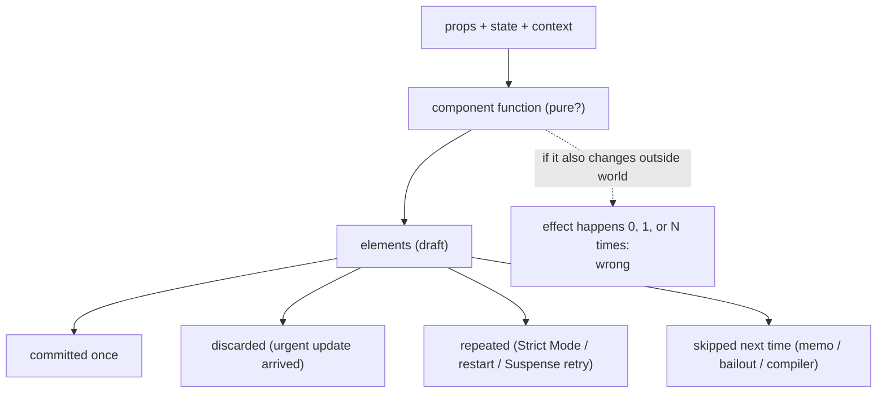
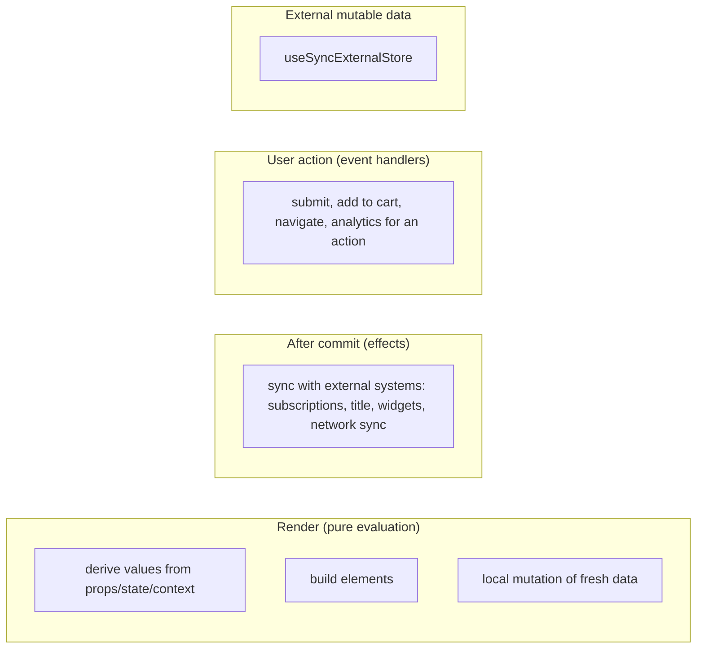

# 02 / 12 — Why Rendering Must Be Pure

## 1. Lesson metadata

| | |
|---|---|
| **Level** | Advanced |
| **Study time** | 5–6 hours (reading 2.5 h, experiments 1.5 h, exercises 1.5 h) |
| **Prerequisites** | [01/12 — Component purity](../01-react-fundamentals/12-component-purity.md) (the *what*; this lesson is the *why*), [08 — Why Fiber exists](./08-why-fiber.md), [10 — Current and work-in-progress trees](./10-current-and-work-in-progress-trees.md), [11 — Render phase vs commit phase](./11-render-phase-and-commit-phase.md), [00/08 — Objects, references, immutability](../00-web-and-javascript-foundations/08-objects-references-immutability.md) |
| **Next** | [13 — Scheduling and update priorities](./13-scheduler-and-priorities.md) |
| **Related** | [15 — Interruptible, restartable, abandoned renders](./15-interruptible-restartable-abandoned-rendering.md), [28 — Strict Mode behavior](./28-strict-mode-behavior.md), [Phase 3/20 — `useSyncExternalStore`](../03-react-state-and-hooks/20-usesyncexternalstore-and-external-stores.md) |

**Learning objectives.** After this lesson you can:
1. State the purity contract precisely: what counts as an *input*, what counts as a *side effect*, and which mutation is allowed (local) and which is not (anything that existed before the render).
2. Derive — from the internals in [08–11] — each reason purity is required: repeated renders, discarded renders, skipped renders, reordered renders, concurrent interleaving, Suspense retries, Strict Mode, SSR/hydration, compiler optimization, and server components.
3. Classify any suspicious line of render code into one of eight impurity categories and choose the correct replacement (derive, state, event handler, effect, `useId`, `useSyncExternalStore`, `key`, ...).
4. Explain what Strict Mode double-invokes and why, and use it (plus tests and lint rules) as a purity detector.
5. Explain *tearing* and how `useSyncExternalStore` prevents it.
6. Distinguish legitimate render-phase patterns (local mutation, lazy ref initialization, idempotent caches, render-phase state adjustment) from impurity.
7. Write a purity test and a code-review checklist for a team.

**Concepts covered:** purity contract, referential transparency in React terms, side effect, local mutation, idempotence, render repetition and discard, Strict Mode double invocation, tearing, hydration mismatch, snapshot semantics, immutability of props/state/JSX values, rules of React, React Compiler's reliance on purity.

> The public rules are documented at <https://react.dev/reference/rules> and <https://react.dev/reference/rules/components-and-hooks-must-be-pure>. Details of Strict Mode (which functions are double-invoked, memo reuse across the double call, console log dimming) have changed between React 17, 18 and 19; the tables below were checked against [react.dev — `<StrictMode>`](https://react.dev/reference/react/StrictMode) and by execution on React 19.3.1 (2026-10-22).

---

## 2. Deep conceptual explanation

### 2.1 What problem is this lesson solving?

[Phase 1](../01-react-fundamentals/12-component-purity.md) taught that components should be pure and showed the visible symptom (a counter that changes between renders). Most developers accept the rule, then violate it in "harmless" ways: a module-level counter, a `Date.now()` in a label, a `.sort()` on a state array, a `ref.current = x` in the body, an analytics call. They work in development until something *new* — Strict Mode, a transition, Suspense, SSR, the React Compiler — runs the code in a way the author did not imagine, and the code breaks mysteriously.

This lesson makes purity a **derived consequence** instead of a commandment. If you understand the render-phase contract (render may run any number of times, in any order within constraints, and its output may be thrown away), then each impurity maps to a *specific, predictable failure*.

### 2.2 The contract, precisely

**Purity in React (documented):** a component (and any hook callback that runs during render) must behave like a mathematical function of its inputs:

> **Same inputs → same output (JSX).** And the function **must not change anything that existed before it started running.**

Inputs are exactly: **props, state, context** (and the arguments/return values of hooks, plus values read via `use`). Everything else — module variables, `window`, `document`, time, randomness, network, `ref.current`, external stores read raw — is *not* an input and must not influence or be changed by the render.

Two clauses, which fail in different ways:

| Clause | Violation | Typical failure |
|---|---|---|
| **Determinism** (output depends only on inputs) | `Date.now()`, `Math.random()`, reading a mutable global, reading `ref.current`, reading the DOM | Output differs between repeated renders, between drafts and commit, between server and client (hydration mismatch), or between an abandoned and a committed render |
| **No observable mutation** (no side effects) | writing a global, mutating props/state, calling `fetch`, writing the DOM, `console.log` to a tracking service, `setState` of another component | Effect happens zero, one, or many times; state leaks between drafts; components disagree about shared data |

**Local mutation is fine.** A variable created *during this render* may be mutated freely before being returned, because it did not exist before the render and nobody else can observe it:

```tsx
function Tags({ tags }: { tags: readonly string[] }) {
  const out: React.ReactNode[] = [];            // created in this render
  for (const t of tags) out.push(<li key={t}>{t}</li>);   // mutated locally: fine
  return <ul>{out}</ul>;
}
```

**Not fine:** `tags.sort()` (mutates a prop, an object created *before* this render), `props.user.visits++`, `state.items.push(x)`.

### 2.3 Why purity is required: seven consequences of the architecture

Each consequence is a direct implication of lessons [08](./08-why-fiber.md)–[11](./11-render-phase-and-commit-phase.md).

**(1) Renders are repeated.** The work loop may restart a render from the root ([10 §2.7](./10-current-and-work-in-progress-trees.md)); Suspense may re-run a component once its data arrives; a render-phase `setState` re-runs the component; in development, Strict Mode calls components twice **on purpose**. If a render has an effect, the effect repeats.

**(2) Renders are discarded.** A transition's draft is dropped when urgent work arrives; an error unwinds a draft; a suspended mount is thrown away until resolution. If a render has an effect, the effect happened for a UI **that never existed**.

**(3) Renders are skipped.** `memo`, bailouts on equal props, and (with the React Compiler) automatic memoization mean React will *not call* your component when it thinks the output cannot have changed. If correctness depends on the call happening (a counter, a log, a subscription), it silently breaks. Conversely, purity is exactly what *licenses* skipping: for a pure function, skipping is unobservable.

**(4) Renders are reordered.** React does not promise that sibling components render in JSX order for all features; concurrent rendering may render some subtrees earlier or later (priority, Suspense boundaries, Activity/Offscreen content rendered in the background). A component whose output depends on "what rendered before me" (a shared counter) can see arbitrary values.

**(5) Renders are concurrent with other code.** Time-sliced renders yield to the browser; event handlers, timers and subscription callbacks run *in between*. A component that reads mutable external data in render can read **different values in different parts of the same render pass** — *tearing* (§2.7).

**(6) Renders run in more than one environment.** The same component runs on the server (SSR/RSC) and the client (hydration). Output must match; any dependence on `window`, time, randomness, locale or environment variables leaks differences ([25](./25-hydration-and-selective-hydration.md), [37](./37-scenario-f-hydration-mismatch.md)).

**(7) Tools assume purity.** DevTools may re-render components to inspect them; the React Compiler memoizes automatically *based on the assumption that the Rules of React hold* and skips work at a finer granularity than you would by hand; testing tools re-render; Server Components can be cached. A violation turns into a miscompiled or mis-cached behavior, far from its cause. The Compiler (1.0 stable since October 2025) depends on this assumption — see [Phase 9/08](../09-advanced-rendering-and-ecosystem/08-react-compiler.md) and the docs at <https://react.dev/learn/react-compiler>.

> **The shape of the argument.** Purity is the price React asks for *the freedom to schedule rendering however it likes*. A pure render is just computation; computation can be repeated, cancelled, reordered, cached and run anywhere without anyone noticing. An impure render is an *action*, and actions cannot be treated that way.

### 2.4 The eight categories of render-phase impurity

A review-friendly taxonomy. For each, *what breaks* and *the usual fix*.

| # | Category | Example | What breaks | Usual fix |
|---|---|---|---|---|
| 1 | **Mutating props, state or arguments** | `items.sort()`; `props.cart.total = …`; `state.push(x)` | State identity unchanged → missed updates (`Object.is` bailouts); shared data corrupted across drafts and memoized children; DevTools "time travel" confusion | Copy then change: `[...items].sort()`, `toSorted()`, immutable updates in handlers ([00/08](../00-web-and-javascript-foundations/08-objects-references-immutability.md)) |
| 2 | **Mutating module/global state** | `let nextId = 0; … nextId++` | IDs/counters depend on how many renders happened, not on the UI; breaks SSR (server module state is shared across requests — also a **security** issue: cross-request data leaks) | State, `useId`, props, or compute in an event/effect |
| 3 | **Non-determinism** | `Date.now()`, `new Date()`, `Math.random()`, `crypto.randomUUID()` in the body | Flicker between drafts; hydration mismatch; unstable memoization; flaky tests | Pass in as props; take a timestamp in an event or state initializer; `useId`; for "now" use a store/tick state updated by an effect |
| 4 | **Reading mutable external data directly** | `localStorage.getItem` in render; `window.innerWidth`; `store.value` of a non-React store | Tearing; server/client mismatch; no re-render when it changes | `useSyncExternalStore`; state initialized lazily on the client; effects |
| 5 | **Reading or writing `ref.current`** | `if (!ref.current) …` branching in render; `latest.current = value` | Value reflects the *previous commit* (or a discarded draft); output depends on non-tracked data | Keep refs for event handlers/effects. **Exception:** lazy-initialization of a ref (see §2.6) |
| 6 | **Side effects: I/O, DOM, subscriptions, logging, analytics** | `fetch()` in body; `document.title = …`; `ws.send()`; `track()` | Duplicate or phantom requests; effects for non-existent UIs | Effects (sync with external systems), handlers (user actions), framework data APIs, Server Components for data |
| 7 | **Scheduling updates elsewhere** | `otherSetState(x)` in body; `dispatch(action)` to a global store in render | "Cannot update a component while rendering a different component" warning; loops; inconsistent trees | Derive instead; update in handlers/effects; lift state |
| 8 | **Breaking hook rules** | Conditional hooks; hooks in loops/after early return; hooks in handlers | Hook list ([17](./17-hooks-and-fiber-state.md)) mismatches between renders → wrong state read, errors | Always call hooks at top level, in the same order ([Phase 3/16](../03-react-state-and-hooks/16-rules-of-hooks-and-composition.md)) |

An additional rule relates to JSX values: **don't mutate a value after passing it to JSX** (e.g., build `style` object, put it in `<div style={s}>`, then change `s.color`). React and its memoization assume that once a value has been used in an element it is a snapshot.

### 2.5 The inputs are snapshots

State "as a snapshot" ([01/14](../01-react-fundamentals/14-state-as-a-snapshot.md)) is purity seen from the user's side: in one render, `count` is a constant. This makes a render reproducible: *given (props, state, context) = X, the UI is f(X)*. That reproducibility is what lets React treat "re-running with the same inputs" as free of consequences, and what makes `Object.is` comparisons of state and props meaningful: they are used to decide whether re-running can possibly produce something different.

Mutating state in place breaks the bridge: the object identity says "nothing changed" while the contents did, so React (and your `memo` children) skip updates; or the object has changed under a discarded draft that still holds the same reference.

### 2.6 Things that look impure but are allowed

| Pattern | Why allowed | Condition |
|---|---|---|
| Local mutation of objects/arrays created in this render | Not observable outside | Created *inside* the render (or inside a callback it calls) |
| `console.log` for debugging | No effect on UI | Don't rely on counts; don't ship noisy logs; not for analytics |
| Lazy ref initialization: `if (ref.current === null) ref.current = new Foo()` | Value is a pure function of nothing and the same regardless of how many times it runs | Only for initialization; never branch on later values; documented in [`useRef`](https://react.dev/reference/react/useRef) |
| Module-level **idempotent** caches (e.g., memoized `Intl.NumberFormat` by locale) | Result is a pure function of the key; repeated computation yields equal values | Never store data that depends on time/IO/ordering; mind memory growth and server-wide sharing |
| `setState` for the *same* component during render, guarded | Documented "render-phase update" | Guard condition prevents loops; only own state ([11 §2.4](./11-render-phase-and-commit-phase.md)) |
| `useMemo(() => expensivePureFn(x), [x])` | Pure computation, cached | Callback must itself be pure; memo is an optimization, not a semantic guarantee: React may discard the cache |
| Reading `context` | Context is an input | Provider value must not be mutated |
| `use(promise)` | A sanctioned input mechanism (with Suspense) | Promise must be stable across renders (created outside render or cached) — see [24](./24-suspense-conceptual-internals.md) |

### 2.7 Tearing: why reading external mutable data in render is special

Imagine a store object outside React with a mutable `value`. Two components read it **directly** during a time-sliced render:

```text
render phase (sliced):
  render <Header>   reads store.value → 1
  ---- yield to the browser; a websocket message arrives; store.value = 2 ----
  render <Footer>   reads store.value → 2
commit: Header shows 1, Footer shows 2   ← one commit, two different versions of the same data
```

That visual inconsistency is **tearing**. Before concurrent rendering this could not happen because a render was never interrupted. Now it can for any non-React source read during render (in practice only in *time-sliced* renders, i.e. transition, deferred-value and retry work, because sync, continuous and default lanes render without yielding; see [13 §2.4](./13-scheduler-and-priorities.md)). The fix is `useSyncExternalStore(subscribe, getSnapshot)`, which (a) reads from a snapshot that must be stable between changes, (b) subscribes so changes cause re-render, and (c) **forces updates caused by the store to be rendered synchronously (no yielding)** and re-checks the snapshot before commit; if it changed mid-render, React re-renders synchronously to restore consistency ([react.dev — `useSyncExternalStore`](https://react.dev/reference/react/useSyncExternalStore)). The cost: updates from such stores cannot be transitions/time-sliced. Precisely how React detects and repairs mismatches is an implementation detail (store-driven updates use `SyncLane`: `forceStoreRerender` in `ReactFiberHooks`); the contract is *no tearing*.

State held by React itself (`useState`, `useReducer`, context) is tear-free by construction: a render reads state from a consistent snapshot of the committed tree plus the updates being processed.

### 2.8 Strict Mode: purity's automated checker (development only)

[`<StrictMode>`](https://react.dev/reference/react/StrictMode) deliberately provokes repetition so that impure code fails *early and loudly*. In development (checked against the react.dev `<StrictMode>` reference; the `useMemo` reuse row was also verified by execution):

| Double-invoked | To catch |
|---|---|
| Component function bodies | Impure render |
| State initializer functions, updater functions passed to `setState`, `useReducer` reducers | Impure initialization/updates |
| `useMemo`/`useCallback` factories (and, as of React 19, the second invocation may *reuse* results from the first) | Impure memoized computations |
| Class `constructor`, `render`, `shouldComponentUpdate`, `getDerivedStateFromProps` *(legacy)* | Same, classes |
| Effects: after mount, run setup → cleanup → setup | Effects without proper cleanup / non-idempotent effects |
| Ref callbacks: setup → cleanup → setup (React 19) | Ref callbacks that don't clean up |

Characteristics:
- It runs **only in development**; production behavior is single-invocation. It exists to *surface* bugs, not to change behavior.
- The second invocation's result is typically the one used; React doesn't promise which one.
- DevTools dims or can hide console output from the second invocation (react.dev: logs from the second render "appear slightly dimmed", and DevTools has an off-by-default setting to suppress them); the second call is still a real call.
- It does **not** simulate every hazard: interruptions, Suspense retries, SSR/hydration, and tearing need other tests. Passing Strict Mode is necessary, not sufficient.

### 2.9 Misconceptions

| Misconception | Reality |
|---|---|
| "Purity is a style rule from functional programming fans." | It is a requirement of the scheduling model; violating it produces real failures (duplicates, leaks, mismatches). |
| "If it works in production it was pure." | Production single-invokes; the next React feature (or the Compiler) may not. |
| "Removing `<StrictMode>` fixes the double-render bug." | It hides the detector. The impurity still bites in transitions, Suspense, SSR, Compiler. |
| "`useMemo` guarantees the callback runs once." | It is a performance cache; React may recompute (or, in dev, double-call). |
| "`console.log` in render is impure and forbidden." | Debug logging is harmless; counting on it is the mistake. |
| "A side effect that is idempotent is fine in render." | Only if it is also *unobservable* and *cheap*. Writing the DOM idempotently still breaks the draft/commit separation and flushes layout. Prefer effects. |
| "State updates mutate state, so it's okay to mutate it myself." | `setState` *replaces* a snapshot; mutating the old snapshot corrupts history. |
| "Reading `window.innerWidth` is fine because it doesn't change." | It changes; and it doesn't exist on the server. |

---

## 3. Internal mechanics

### 3.1 Public guarantee

- React may call your component function, `useMemo` factories, state initializers, updaters and reducers **more than once** and may use the result of any one call ([Keeping components pure](https://react.dev/learn/keeping-components-pure), [Rules of React](https://react.dev/reference/rules)).
- Strict Mode in development double-invokes the functions listed above ([`<StrictMode>`](https://react.dev/reference/react/StrictMode)).
- Props, state, hook arguments/return values, and values passed to JSX must be treated as immutable ([react.dev — Rules: components and hooks must be pure](https://react.dev/reference/rules/components-and-hooks-must-be-pure)).
- `useSyncExternalStore` provides tear-free reads of external stores.
- Components should not call other components as plain functions, nor pass hooks around as values — React must control invocation (Rules of React).

### 3.2 Teaching model

> Rendering is *evaluation*, not *execution*: React evaluates `f(props, state, context)` possibly many times to find out what the UI should be. Only the commit *executes* anything. Anything you want to happen exactly when the UI changes belongs after the commit (effects) or at the user's action (handlers).

### 3.3 Implementation details

- **How the second call happens.** In development, with a Strict-Mode subtree, the reconciler invokes the render function a second time during the same unit of work (the same fiber) and, to prevent its logs from confusing developers, DevTools can mark them. The component re-runs through the hooks machinery again for the second call; for state initializers/updaters React calls the function twice and uses one result. How hook state is shared between the two calls is an implementation detail; do not write code that depends on it. Exact reuse rules changed in React 19 for memoized values ("reuse results of the first render during the second render" for `useMemo`/`useCallback`; verified on 19.3.1: the `useMemo` factory ran twice in the first invocation and not in the second).
- **Render-phase update detection.** While a component is rendering, React knows which fiber is current; a `setState` call targeting a *different* fiber during render triggers a dev warning ("cannot update a component while rendering a different component"). A same-fiber update re-runs the component through a separate re-render path with a loop guard.
- **Hook list identity.** Hooks are stored in a linked list on the fiber in call order ([17](./17-hooks-and-fiber-state.md)). Any difference in call order between two renders of the same component mismatches slots (a dev-time check can detect and warn). This is why conditional hooks are not just "style".
- **External store tearing check.** For `useSyncExternalStore`, React stores the snapshot it rendered with and, for time-sliced renders, re-verifies against `getSnapshot()` before commit; a mismatch forces a synchronous re-render. Mechanism details are internal.
- **Compiler.** The React Compiler is a build-time transform that memoizes values and JSX within components/hooks, relying on purity and the hook rules. When it can't prove compliance it skips optimizing that component (and the `eslint-plugin-react-hooks` rules built on the same analysis can flag violations). `eslint-plugin-react-hooks` v6+ (7.1.1 on npm at review time) ships Compiler-powered rules such as `purity`, `refs`, `immutability`, `globals`, `set-state-in-render` and `static-components` (react.dev/reference/eslint-plugin-react-hooks).

### 3.4 Why this is not a performance tax

Purity does not cost runtime; the cost is *discipline* (copying instead of mutating, moving side effects). In exchange you get: free skipping, safe cancellation, safe parallel preparation of UI, and features (transitions, Suspense, Offscreen) that would be unsound otherwise.

---

## 4. Step-by-step execution walkthrough

We trace one impure component through four environments to show *when* each breaks. The component:

```tsx
let guestCount = 0;

function Guest() {
  guestCount += 1;                          // ❌ module-level mutation
  return <li>Guest #{guestCount}</li>;
}

export function Table() {
  return (
    <ul>
      <Guest />
      <Guest />
      <Guest />
    </ul>
  );
}
```

Intention: label three guests 1, 2, 3.

| Environment | Render sequence (calls to `Guest`) | What the user sees | Notes |
|---|---|---|---|
| **Production, first mount** | call → 1, call → 2, call → 3 | 1, 2, 3 (looks correct) | The bug is invisible. |
| **Production, any later re-render of `Table`** (e.g., parent state change) | calls → 4, 5, 6 | 4, 5, 6 | UI changes with no data change. Expected: 1, 2, 3 again. |
| **Dev, Strict Mode, first mount** | 6 calls: 1,2 (first Guest, twice), 3,4, 5,6 | typically **2, 4, 6** (the second call's output is used; verified on 19.3.1) | Reveals the problem. Which call's output wins isn't guaranteed. |
| **Transition abandoned halfway** | e.g., 1,2 rendered then the draft is dropped; later restart 3,4,5 | numbers skip | Counter reflects *render attempts*, not UI. |
| **SSR then hydration** | server increments its module counter per request over the whole process lifetime (a long-lived server process: 1…3 on first request, 4…6 on the second…) | server HTML says 4,5,6; client starts at 1,2,3 → **hydration mismatch** | Also a data-leak pattern if the global stores user data. |

**Why each failure is a direct consequence of the architecture:**
- Later re-render: render repeated ([§2.3 (1)](#23-why-purity-is-required-seven-consequences-of-the-architecture)).
- Strict Mode: deliberate repetition.
- Abandoned transition: discarded drafts (2).
- SSR: multiple environments (6) + long-lived module state.

**The pure version** passes the number in: `<Guest n={1} />` or derives it from a list index:

```tsx
export function Table({ guests }: { guests: readonly string[] }) {
  return (
    <ul>
      {guests.map((name, i) => (
        <li key={name}>Guest #{i + 1}: {name}</li>
      ))}
    </ul>
  );
}
```

Same props → same output, regardless of how often or in which environment it is rendered.

---

## 5. Code examples

### 5.1 Minimal example — locally mutating vs mutating a prop

```tsx
function SortedNames({ names }: { names: string[] }) {
  const sorted = names.sort();        // (A)
  return <ol>{sorted.map((n) => <li key={n}>{n}</li>)}</ol>;
}
```

**Predict.** `names` is state of the parent: `["bob", "alice"]`. After one render of `SortedNames`, what is `names` in the parent? What happens if the parent re-renders (without state change) and compares `names` to a memoized version?

**Result.** `Array.prototype.sort` sorts **in place** and returns the same array: the parent's state array is now `["alice", "bob"]` — mutated during a child's render. The parent's own logic, effects with `names` in dependencies (identity unchanged, so they won't re-run even though contents changed), and other children that read `names` see altered data. In Strict Mode the second call sorts an already-sorted array: no visible difference, hiding the bug's first-call effect.

**Why.** `sort` mutates the argument; the array existed before this render, so this is a side effect, not local mutation.

**Corrected:**

```tsx
function SortedNames({ names }: { names: readonly string[] }) {
  const sorted = [...names].sort();           // copy, then local mutation: fine
  // or: const sorted = names.toSorted();     // ES2023; needs lib/target support (TS "lib": ["ES2023"]) and runtime support
  return <ol>{sorted.map((n) => <li key={n}>{n}</li>)}</ol>;
}
```

Typing the prop as `readonly string[]` makes TypeScript reject `names.sort()` at compile time (ReadonlyArray has no `sort`; `toSorted` is available on `ReadonlyArray` with the ES2023 lib) — a cheap, systematic guard for category 1.

### 5.2 Practical example — where do the side effects belong? A product page

```tsx
interface ProductProps {
  id: string;
  name: string;
  priceCents: number;
}

export function ProductCard({ id, name, priceCents }: ProductProps) {
  // render: pure derivation only
  const price = new Intl.NumberFormat("en-US", { style: "currency", currency: "USD" }).format(priceCents / 100);

  // after the UI for this product is on screen: sync with an external system
  useEffect(() => {
    const controller = new AbortController();
    void fetch(`/api/impressions/${id}`, { method: "POST", signal: controller.signal }).catch(() => {});
    return () => controller.abort();
  }, [id]);

  // user action: handler, not render, not effect
  function addToCart() {
    void fetch("/api/cart", {
      method: "POST",
      headers: { "Content-Type": "application/json" },
      body: JSON.stringify({ id, qty: 1 }),
    });
  }

  return (
    <article>
      <h3>{name}</h3>
      <p>{price}</p>
      <button type="button" onClick={addToCart}>Add to cart</button>
    </article>
  );
}
```

**Line notes.**
- `Intl.NumberFormat` is deterministic given its locale/options (note: the *locale* default in the browser depends on the user's environment; for SSR consistency pass an explicit locale — otherwise server and client may format differently).
- The impression `fetch` is in an effect keyed on `id`: React guarantees it runs only for committed UI; the cleanup aborts the in-flight request on `id` change/unmount (and on Strict Mode's simulated remount). Because impression tracking must be *idempotent* under double-mount in dev, the server should dedupe — see exercise D2 in [11](./11-render-phase-and-commit-phase.md).
- `addToCart` is an event handler: runs exactly once per click.

**Predict.** In dev Strict Mode, how many impression requests are *sent* on mount? How many *complete*?

**Result.** Sent: 2 (setup → cleanup(abort) → setup). The first is aborted before/while in flight, so typically one completes on the server side — though the server may already have received the first request (abort cancels the client's wait, not necessarily the server's processing). That is why server-side idempotency still matters.

### 5.3 Incorrect example — five small impurities

```tsx
let renders = 0;                                         // (1) module state

export function Comment({ comment, onSeen }: { comment: { id: string; text: string; seen: boolean }; onSeen: (id: string) => void }) {
  renders++;                                             // (1)
  const id = `c-${Math.random().toString(36).slice(2)}`; // (2) non-deterministic id
  const stamp = new Date().toLocaleTimeString();         // (3) time in render
  comment.seen = true;                                   // (4) mutate prop
  onSeen(comment.id);                                    // (5) call parent callback (may set state) in render
  return (
    <section id={id}>
      <time>{stamp}</time>
      <p>{comment.text}</p>
    </section>
  );
}
```

**Predict.** Name the failure mode of each numbered line.

**Result.**
1. Counter reflects calls, not UI: inflated in Strict Mode; differs per environment.
2. A new DOM `id` every render: breaks `aria-labelledby`/`for` links, remounts nothing but churns DOM attributes; SSR hydration mismatch.
3. Visible text changes on every re-render, and differs between server and client (also timezone/locale differences).
4. Mutates parent-owned data; `memo` and effect dependencies don't notice; collaborators see mutated data from a draft that may be dropped.
5. Triggers a state update in another component during render: React warns ("cannot update a component while rendering a different component") and may loop.

### 5.4 Corrected implementation

```tsx
import { useEffect, useId } from "react";

interface CommentData { id: string; text: string; postedAt: string } // ISO string from the server

export function Comment({ comment, onSeen }: { comment: CommentData; onSeen: (id: string) => void }) {
  const headingId = useId();                                          // stable, SSR-safe id
  const posted = new Date(comment.postedAt);                          // derived, deterministic from props
  const label = new Intl.DateTimeFormat("en-US", { dateStyle: "medium", timeStyle: "short", timeZone: "UTC" }).format(posted);

  useEffect(() => {
    onSeen(comment.id);                                               // after commit, when it is actually on screen
  }, [comment.id, onSeen]);

  return (
    <section aria-labelledby={headingId}>
      <h4 id={headingId}>Comment</h4>
      <time dateTime={comment.postedAt}>{label}</time>
      <p>{comment.text}</p>
    </section>
  );
}
```

Notes:
- `useId` replaces random IDs and is stable across server and client ([react.dev — `useId`](https://react.dev/reference/react/useId)).
- Time displayed is derived from *data* (`postedAt`), not "now". An explicit `timeZone` makes server and client agree; for local-time display, render a placeholder on the server and format after mount, or accept a controlled hydration warning with `suppressHydrationWarning` on that single element (documented escape hatch; use sparingly).
- "Seen" is communicated after commit with an effect (and `onSeen` should be stable or the effect re-runs; parents can `useCallback` it — or better, make the parent update idempotent).
- The prop is read-only; type it `Readonly<…>` or use `readonly` fields to have the compiler enforce it.

### 5.5 Advanced example — tearing, reproduced and fixed; and a purity test helper

**Part A: a raw external store read in render.**

```tsx
// store.ts
let value = 0;
const listeners = new Set<() => void>();
export const store = {
  get: () => value,
  set(next: number) { value = next; listeners.forEach((l) => l()); },
  subscribe(l: () => void) { listeners.add(l); return () => { listeners.delete(l); }; },
};

// ❌ Reads the store directly in render (no subscription, torn reads possible in sliced renders)
function RawView({ label }: { label: string }) {
  return <span>{label}: {store.get()}</span>;
}

// ✅ Tear-free
import { useSyncExternalStore } from "react";
function SafeView({ label }: { label: string }) {
  const v = useSyncExternalStore(store.subscribe, store.get);
  return <span>{label}: {v}</span>;
}
```

**Predict.** A transition renders 2,000 `RawView` siblings (time-sliced). Halfway, a timer calls `store.set(1)`. What can the committed UI show? What with `SafeView`?

**Result.** With `RawView`: the first ~half show `0`, the rest `1` in the **same commit**, and `RawView`s never re-render when the store changes after commit (no subscription at all). With `SafeView`: React detects the store changed during the render (or processes the store-triggered update synchronously), and re-renders so the committed UI shows a single value (never a mixture). Also note `getSnapshot` (`store.get`) must return a stable (identical when unchanged) value; returning a fresh object each call causes an infinite loop (dev warning: "The result of getSnapshot should be cached"). *(Reproduced on React 19.3.1 in jsdom: 2,000 `RawView`s at about 0.1 ms each in a transition, `store.set(1)` fired 40 ms in; the committed DOM had 231 spans showing `0` and 1,769 showing `1`. With `SafeView` all 2,000 showed `1`. The split point depends on timing; the mixed commit is the point.)*

**Part B: a purity test helper.**

```tsx
// test-utils/expectPure.tsx
import type { ReactElement } from "react";
import { renderToStaticMarkup } from "react-dom/server";
import { expect } from "vitest";

export function expectPureRender(element: ReactElement): void {
  const first = renderToStaticMarkup(element);
  const second = renderToStaticMarkup(element);
  const third = renderToStaticMarkup(element);
  expect(second).toBe(first);
  expect(third).toBe(first);
}
```

**What it catches:** non-determinism and module-state counters (output differs between calls). **What it misses:** effects (not run by static rendering), mutation of props (add a deep-freeze: `Object.freeze` your fixtures recursively so mutation throws in strict mode code), tearing, hydration (use `hydrateRoot` tests with real DOM — [Phase 8](../08-testing-and-quality/01-test-strategy-and-pyramid.md)). Combine with: Strict Mode wrapper in your test render utility, frozen props, lint rules, and Profiler/DevTools double-render checks.

---

## 6. Visual explanations

### 6.1 One render, many outcomes



### 6.2 Where each kind of work belongs



### 6.3 Tearing

```text
time ─────────────────────────────────────────────────────────────►
render slice 1: <A> reads store=0
                     yield ── store.set(1) ──
render slice 2:                          <B> reads store=1
commit:        A shows 0, B shows 1   (torn)

with useSyncExternalStore:  store change detected → synchronous re-render → A=1, B=1
```

---

## 7. Alternative approaches and trade-offs

| Need | Pure approach | Impure shortcut | Trade-off |
|---|---|---|---|
| Unique ids | `useId`, or ids from data | module counter/`Math.random` | Shortcut works until SSR/Strict Mode |
| "Now" in the UI | State updated by an interval effect, or a store with `useSyncExternalStore` | `Date.now()` in body | Pure version re-renders on ticks (explicit and controllable) |
| Sorted/filtered view | `useMemo`/inline derivation from props | mutate state in place | In-place mutation saves a copy but breaks identity semantics; copies are cheap relative to rendering |
| Cache of expensive pure result | `useMemo`, or module-level memo keyed by input | memo keyed by "last render" | Keyed memo is deterministic; "last render" is not |
| Remember a value across renders without causing re-render | `useRef`, written in effects/handlers | `ref.current = x` in body | Body writes pick up values from discarded drafts |
| Read mutable external data | `useSyncExternalStore` | direct read | The hook forces synchronous updates (no time-slicing for that data) but guarantees consistency |
| Fire an event when something appears | Effect with cleanup (idempotent) or server-side dedupe | call in body | Effect timing is after commit (good) but needs idempotency for Strict Mode |

**A scenario where the "pure" approach is *not* best.** A high-frequency animation loop (60 Hz) computing positions for thousands of sprites: modeling every frame as React state/props and recomputing in render can be slower than mutating DOM/canvas imperatively from a `requestAnimationFrame` callback outside React (using refs to elements). Here the purity rule is satisfied *by moving the mutation out of render* (into an effect that owns the loop), not by contorting the data flow. Likewise, for a legitimately impure side effect required before first paint (reading layout), use a layout effect, not a render-phase read.

---

## 8. Best practices and anti-patterns

**Best practices**
- Treat props, state and context as read-only snapshots; type them `readonly`/`Readonly<>` to get compile-time checks.
- Derive in render; store only what you cannot derive ([Phase 3/17](../03-react-state-and-hooks/17-derived-state.md)).
- Put user-action consequences in handlers, synchronization in effects with cleanup, shared mutable data behind `useSyncExternalStore`.
- Develop with `<StrictMode>` on; keep it on in CI test renders.
- Add ESLint with `eslint-plugin-react-hooks` (v6+ includes the Compiler-powered `purity`, `refs` and `immutability` rules; see react.dev/reference/eslint-plugin-react-hooks).
- Review checklist for components (see §11 E-level): any `let` at module scope? any `Date`/`Math.random` in body? any `.sort/.reverse/.push/.splice` on props/state? any `ref.current` write in body? any fetch/DOM/analytics in body?

**Beginner mistakes**
- `.sort()`/`.reverse()` on state arrays; `push` into state.
- `Math.random()` for keys (forces remount each render) or ids.
- Calling `fetch` directly in the body "because it works".

**Experienced-developer mistakes**
- Treating Strict Mode double-calls as a React bug and working around them (flags like `if (!didInit)` in module scope) rather than fixing impurity.
- `useRef` flags to "run once" in render.
- Reading the DOM or `window` in render for conditional output ("isMobile") causing hydration mismatches.
- Relying on `useMemo` for correctness ("run once") rather than performance.
- Mutating objects after passing them to JSX or to a memoized child.

**Smells**
- A comment "don't re-order these lines, it relies on call order".
- Module-level `let`/`Map` written from components.
- `useEffect(() => setX(derivedFrom(props)))`: not impurity, but the same "wrong place" problem ([Phase 3/07](../03-react-state-and-hooks/07-you-might-not-need-an-effect.md)).

**Justified exceptions**
- Lazy `useRef` initialization.
- Module-level idempotent memo caches (document that keys fully determine values; bound size).
- Render-phase same-component `setState` for derived/reset state when a `key` change is impractical.
- Intentional `console.log` debugging.

---

## 9. Real-world application

| Domain | Impurity trap | Safe design | Constraint |
|---|---|---|---|
| **E-commerce** | Price formatting depends on `navigator.language` read in render → SSR/client mismatch; cart totals computed by mutating the cart array | Pass locale from request/user settings; compute totals immutably (`reduce`), store money as integer minor units | Hydration warnings can mean wrong prices flash |
| **Finance** | Rendering "last updated" with `new Date()`; accumulating running totals in module variables | Timestamps from data; derived sums in render or selectors; no accumulators outside | Compliance requires deterministic, reproducible displays |
| **Dashboards** | Live metrics read straight from a mutable global in many widgets → tearing, inconsistent charts within one commit | `useSyncExternalStore` with a single snapshot per tick | One-commit consistency across widgets |
| **Forms** | Validation functions that log or mutate form objects | Pure validators returning error maps; effects for async validation | Validators run on every keystroke and in Strict Mode |
| **Auth** | `if (!localStorage.token) redirect()` in render | Auth state in a store/context; redirect in router/loader/handler | SSR has no `localStorage`; render-phase navigation is a side effect |
| **Realtime collaboration** | Presence/cursor store mutated and read in render | External store + selectors | High-frequency updates; per-component selection |
| **Multi-team libraries** | Library uses a module counter for ids or a singleton registry in render | `useId`; registration in effects | Libraries run in unknown environments (Strict Mode, SSR, concurrent) — purity is a public API quality |

---

## 10. Debugging and troubleshooting

**Symptom 1: counters/IDs/timestamps look doubled or skip numbers.**
- *Repro:* §4.
- *Investigation:* toggle `<StrictMode>` off to confirm; search the component (and everything it calls) for module-level writes, `Date`, `Math.random`.
- *Root cause:* impure render.
- *Fix:* remove the dependency on call count; pass/derive; `useId`. *Validate:* identical output across repeated renders (`expectPureRender`), correct under Strict Mode, stable across hydration.

**Symptom 2: "Warning: Cannot update a component (`X`) while rendering a different component (`Y`)."**
- *Investigation:* stack trace names `Y`; find `setState`/dispatch/callback invoked in `Y`'s body — sometimes via a custom hook or a context setter.
- *Root cause:* category 7.
- *Fix:* derive in `Y`; or call in an event/effect; or lift state so `X`'s state is derived from the same source. *Validate:* warning gone, no extra render loop (Profiler commit count).

**Symptom 3: "Text content did not match" / hydration warnings.**
- *Investigation:* read the dev diff in the error message; look for time, locale, random, `typeof window` branches, user-agent logic.
- *Root cause:* different outputs on server and client (category 3/4).
- *Fix:* inputs from props/data, `useId`, client-only values after mount (state set in effect) or a `useSyncExternalStore` server snapshot. See [25](./25-hydration-and-selective-hydration.md), [37](./37-scenario-f-hydration-mismatch.md).

**Symptom 4: State doesn't update although you "changed" it.**
- *Investigation:* log `Object.is(prev, next)`; look for `state.push`, `obj.field = …; setObj(obj)`.
- *Root cause:* same-identity update → React bails out ([01/15](../01-react-fundamentals/15-update-queues-and-batching.md)).
- *Fix:* immutable updates; consider Immer in complex reducers ([Phase 3/03](../03-react-state-and-hooks/03-usereducer-and-reducer-architecture.md)).

**Symptom 5: Works until wrapped in `memo`/Compiler, then stale.**
- *Root cause:* correctness relied on the function being called (hidden side effect) or on reading mutable data.
- *Fix:* make output depend only on inputs; move the side effect out.

**Symptom 6: Intermittent inconsistent values across widgets in one frame.** Tearing; see §2.7 and §5.5.

**Detection checklist:** Strict Mode; frozen fixtures; `expectPureRender`; ESLint; hydration tests; random-order test runs; Profiler "why did this render".

---

## 11. Exercises

### Level A — Knowledge
A1. State the two clauses of the purity contract and give one violation of each.
A2. What counts as an *input* to a component's render?
A3. Name five situations in which React may call your component without committing the result.
A4. What is local mutation? Give one allowed and one disallowed example.
A5. What does Strict Mode double-invoke (list at least five items), and in which environments?
A6. What is tearing, and which hook prevents it?

### Level B — Code comprehension
B1. For each line, classify the impurity category (1–8) or say "pure":
```tsx
function Row({ item }: { item: { id: number; tags: string[] } }) {
  const t = item.tags.sort();                       // a
  const sorted = [...item.tags].sort();             // b
  const key = Math.random();                        // c
  const w = window.innerWidth;                      // d
  const cached = useMemo(() => expensive(item.id), [item.id]); // e
  if (item.id > 3) { const [x] = useState(0); }     // f
  const out: string[] = []; out.push("a");          // g
  return <li key={key}>{t.join()}</li>;
}
```
B2. In §4's `Guest` example under Strict Mode, why are the displayed numbers likely 2, 4, 6 and not 1, 2, 3?
B3. What does `useId` guarantee that `Math.random` ids don't?
B4. A component reads `ref.current.offsetWidth` in render. Why does the output lag one commit behind the DOM, and what is the correct place?

### Level C — Implementation
C1. Rewrite `Guest`/`Table` (§4) to keep a visible numbering that survives re-ordering of the guest list. Use `key` appropriately.
C2. Implement a `useNow(intervalMs)` hook that returns the current time in a way that is SSR-safe and tear-free, with a server snapshot.
C3. Write a `deepFreeze` test utility and a test that fails when a component mutates its props.

### Level D — Debugging
D1. A "recent searches" list reorders each time the parent re-renders, though the data didn't change. The code: `const recent = history.reverse().slice(0, 5)`. Diagnose and fix; explain the Strict Mode symptom.
D2. After adding `React.memo` to `Price`, the displayed value is stale. `Price` reads `store.currentCurrency` directly (module-level object, mutated by a settings panel). Diagnose and fix.
D3. A modal opens a second time with the previous modal's `id`, because the id is created with `useRef(Math.random())`. Why is `useRef(Math.random())` flagged as impure even though the ref initial value is "only used once"? What is correct?

### Level E — Architecture and engineering decisions
E1. Draft a pull-request review checklist (≤ 10 items) that a multi-team org can enforce on component code to prevent purity violations; indicate which items can be automated (lint/types/tests) and which need human review.
E2. Your design system exposes a `Tooltip` that registers itself in a global registry (`registry.add(id)`) to coordinate "only one tooltip open". The registration currently happens in render. Propose a redesign that is safe for concurrent rendering and SSR.

### Level F — Expert challenge
F1. Show with a small program that Strict Mode's "second render result is used" can be detected, and argue why a correct component must not depend on it.
F2. Design a test harness that simulates (without React internals) three adverse schedules for a component: repeated render, discarded render followed by a different-props render, and interleaving with an external store mutation. What assertions would you make, and what bug classes would remain undetected?

---

## 12. Detailed answers and explanations

> Attempt the exercises first.

**A1.** Determinism: output depends only on props/state/context. Violation: `Date.now()` in the output. No side effects: do not change anything that existed before the render. Violation: `items.push(x)` on a prop array / `fetch()` in the body.

**A2.** Props, state, context; hook arguments and returns; values obtained by `use`. Not inputs: module state, `window`, time, randomness, DOM, refs, network.

**A3.** Strict Mode dev double call; a transition draft superseded by urgent work; an error/suspension unwinding the draft; render-phase `setState` re-run; Suspense retry after data resolves; (also offscreen/background rendering, and a parent re-render that bails out later). Any five.

**A4.** Local mutation: changing a variable created during the same render before returning it. Allowed: `const arr: string[] = []; arr.push("x");`. Disallowed: `props.items.push("x")` or `globalCache.set(...)` of render-dependent data.

**A5.** Component bodies, state initializers, `setState` updater functions, reducers, `useMemo`/`useCallback` factories (class constructors/render, etc. for legacy); plus effect setup→cleanup→setup and ref callbacks (React 19). Development only.

**A6.** Visual inconsistency from reading mutable external data at different times within one (interruptible) render. `useSyncExternalStore`.

**B1.** (a) 1 (mutates prop array in place). (b) pure (copy + local mutation). (c) 3 (non-determinism; also used as a key it remounts every render). (d) 4 (mutable external read; breaks on server). (e) pure *if* `expensive` is pure. (f) 8 (conditional hook). (g) pure (local mutation). `t.join()` is derived from the mutated array; the key `key` on the `<li>` returned by a component root is ignored outside a list, but the pattern is still wrong.

**B2.** In dev Strict Mode, each `Guest` runs twice in a row; the module counter increments each time (Guest 1: 1 then 2; Guest 2: 3 then 4; Guest 3: 5 then 6) and the second call's output is typically used (verified on 19.3.1: rendered `2, 4, 6`). Don't depend on which call's output is used.

**B3.** `useId` yields a stable identifier tied to the component's position in the tree, consistent between server and client and across repeated renders; random ids differ on each call, causing re-created DOM attributes, mismatched ARIA references and hydration mismatches.

**B4.** The ref points to the DOM as of the *last commit*; during render the new DOM doesn't exist yet. Read after commit: `useLayoutEffect` (before paint) storing the result in state, or a ref callback / `ResizeObserver`.

**C1.**

```tsx
interface Guest { id: string; name: string }

export function Table({ guests }: { guests: readonly Guest[] }) {
  return (
    <ol>
      {guests.map((g) => (
        // <ol> numbers automatically; position is derived, not counted
        <li key={g.id}>{g.name}</li>
      ))}
    </ol>
  );
}
```
Numbering is derived from position (by `<ol>` or from the map index) and keys are stable ids, so state of each row follows the guest on reorder.

**C2.**

```tsx
import { useSyncExternalStore } from "react";

// One shared ticker per interval keeps all consumers consistent.
function createClock(intervalMs: number) {
  let now = Date.now();
  const listeners = new Set<() => void>();
  let timer: ReturnType<typeof setInterval> | undefined;
  return {
    subscribe(l: () => void) {
      listeners.add(l);
      if (listeners.size === 1) {
        now = Date.now();
        timer = setInterval(() => { now = Date.now(); listeners.forEach((fn) => fn()); }, intervalMs);
      }
      return () => {
        listeners.delete(l);
        if (listeners.size === 0 && timer !== undefined) clearInterval(timer);
      };
    },
    getSnapshot: () => now,
  };
}

const clock1s = createClock(1000);

export function useNow(): number {
  return useSyncExternalStore(clock1s.subscribe, clock1s.getSnapshot, () => 0);
}
```
Reasoning: `getSnapshot` returns a cached number that changes only on tick (stable between ticks); the server snapshot `0` (or a request timestamp passed in) avoids calling `Date.now()` in render; the clock updates *outside* render. Limitation: `now` is stale until the first subscriber ticks (it is refreshed on first subscription). For per-component intervals, parametrize with a Map of clocks. Edge: if you need a server timestamp that matches the client for hydration, pass it in as a prop and treat later ticks as updates.

**C3.**

```tsx
export function deepFreeze<T>(value: T): T {
  if (value && typeof value === "object" && !Object.isFrozen(value)) {
    Object.freeze(value);
    for (const v of Object.values(value as Record<string, unknown>)) deepFreeze(v);
  }
  return value;
}

// test
it("does not mutate props", () => {
  const props = deepFreeze({ names: ["b", "a"] });
  expect(() => renderToStaticMarkup(<SortedNames {...props} />)).not.toThrow();
});
```
In ES modules (strict mode), mutating a frozen array throws `TypeError` — so the bad `names.sort()` version fails the test; the corrected copy-then-sort passes. Edge: frozen objects won't catch writes through non-strict-mode (sloppy) code, and `Object.freeze` is shallow unless recursive (hence `deepFreeze`).

**D1.** `reverse()` mutates `history` in place (a prop/state array). Each render flips the array: appears to "reorder every time". Under Strict Mode the double call reverses twice, hiding or flipping the visible effect depending on parity — an unstable symptom. Fix: `history.toReversed().slice(0, 5)` or `[...history].reverse().slice(0, 5)` or `history.slice(-5).reverse()` (slice copies first).

**D2.** `memo` makes React skip re-rendering when props are equal; `Price` reads a mutable global that isn't a prop, so a currency change doesn't trigger a render (and nothing subscribes). Fix: make currency a prop/context value or subscribe via `useSyncExternalStore` (or put it in a React-owned store). Without `memo` it *seemed* to work only because parents re-rendered for other reasons.

**D3.** `useRef(Math.random())` evaluates `Math.random()` on **every render** (arguments are evaluated each call), though only the first result is retained; wasteful and, under Strict Mode/discarded drafts, the retained value comes from whichever draft committed first (first mount's draft), and SSR/client differ. Correct: `useId()` for a DOM id, or a lazy `useState(() => createId())` if an app-level unique id is needed *on the client only* (then SSR mismatch; for hydration-safe ids prefer `useId`). Lazy initial state runs the initializer once per mount (twice in dev Strict Mode), which is acceptable because the initializer is just creating a value.

**E1.** Evaluation criteria: concrete, automatable vs human, minimal. Example list: (1) no module-level `let`/mutable objects read or written in components [lint rule + review]; (2) no `Date`, `Math.random`, `crypto.*`, `window`, `document`, `localStorage` in render bodies [lint `no-restricted-globals`/custom rules]; (3) no mutating array methods on props/state/args [types via `readonly` + lint]; (4) no `ref.current` access in render except lazy init [`react-hooks/refs` rule in `eslint-plugin-react-hooks` v6+]; (5) no fetch/DOM/analytics in render [review + lint]; (6) hooks only at top level [`rules-of-hooks`]; (7) effects with cleanup and idempotency stated [review]; (8) external mutable data via `useSyncExternalStore` [review]; (9) tests render under Strict Mode with frozen props [test utility]; (10) no state setters of other components in render [runtime warning treated as test failure].

**E2.** Move registration to effects with cleanup (`useEffect(() => registry.add(id), [id])` returning removal) and store the open tooltip id in an external store using `useSyncExternalStore` or a context state at the provider level; ids from `useId`. On the server, the registry is empty and tooltips render closed. Trade-off: effects run after commit, so initial state "which tooltip is open" is derived from store/state in render rather than from the registry's contents.

**F1.** Program: a component logs `{call index}` and captures it in a module variable, rendering that variable, under StrictMode; show that the displayed index is always the second of each pair (or confirm in your React version). Argument: it's an implementation detail (the docs only say the function may be called multiple times and any result may be used); the Compiler, concurrent restarts, or React 19's memo reuse change which results are observed; a correct component produces equal output from every call, so the question is moot.

**F2.** Harness: (1) *Repeated render*: render twice (and thrice) via `renderToStaticMarkup` or React Testing Library with Strict Mode and assert equal markup; spy on globals (`vi.spyOn(Date, "now")`, `Math.random`) and fail if called. (2) *Discarded render*: render with props A, then re-render with props B, then render again with A in a fresh tree — outputs for A must be identical, ensuring no state leaked from B (compare snapshots). (3) *Interleaving*: for a store-reading component, use the store's `set` inside a mocked `scheduler` yield, or render two instances in a transition using `act` + `useTransition` and mutate the store between slices; assert all instances agree in the committed DOM. Undetected: bugs requiring real browser time-slicing, real Suspense retries, or effects with timing hazards; hydration mismatches need hydration tests; compiler-specific issues need compiled builds.

---

## 13. Senior engineer interview questions

**Q1. Why must React components be pure? Don't answer "because the docs say so".**
*Strong answer.* Because rendering is evaluation under a scheduler that may repeat, discard, skip, reorder and interleave it, and run it on server and client. Only pure computations are insensitive to those operations. Give a concrete failure (module counter under Strict Mode/SSR). Mention optimizations enabled by purity: memoization, bailouts, Compiler, concurrent features.

**Q2. What does Strict Mode do and what doesn't it catch?**
*Strong answer.* In dev, double-invokes render-phase functions and simulates mount/unmount/mount for effects (and ref callbacks in 19). It catches impure render, missing cleanups, non-idempotent effects. It doesn't catch tearing, hydration mismatches, interruption-specific hazards, or production-only differences.

**Q3. Explain tearing and why `useSyncExternalStore` exists.**
*Strong answer.* Time-sliced rendering lets mutable external data change mid-render; different components read different versions in one commit. `useSyncExternalStore` provides snapshot reads and subscription, processes store updates synchronously and re-validates before commit, so UI is consistent; the cost is no time-slicing for those updates.

**Q4. A teammate says reading `localStorage` in render is fine because "it's just a read". Respond.**
*Strong answer.* It is a read of mutable external data that doesn't exist on the server (SSR crash/mismatch), isn't subscribed (no re-render on change), and may differ between drafts. Read in a lazy state initializer on the client, in an effect, or through `useSyncExternalStore` with a server snapshot.

**Q5. How does the React Compiler relate to purity?**
*Strong answer.* It memoizes automatically at a fine granularity, assuming that components/hooks follow the Rules of React: render is pure, inputs immutable, hooks called unconditionally. Skipping a call or reusing a value is only observably safe if purity holds; when it can't verify, it bails out for that function. Compiler 1.0 has been stable since October 2025; see react.dev/learn/react-compiler for diagnostics.

**Q6. When is mutation inside render acceptable?**
*Strong answer.* Local mutation of values created in that render; lazy init of refs; idempotent module-level caches keyed by their full input. State the criterion: unobservable outside the render and the same result however many times it runs.

---

## 14. Further learning resources

| Resource | URL | Covers / why | Level | Study |
|---|---|---|---|---|
| React docs — Keeping Components Pure | <https://react.dev/learn/keeping-components-pure> | The official explanation with examples | Beginner–Int. | Whole page |
| React docs — Rules of React | <https://react.dev/reference/rules> | The formal rules, including purity and hooks | Intermediate | "Components and Hooks must be pure" and the linked pages |
| React docs — Components and Hooks must be pure | <https://react.dev/reference/rules/components-and-hooks-must-be-pure> | Detailed rule with immutability sections | Intermediate | Whole page |
| React docs — `<StrictMode>` | <https://react.dev/reference/react/StrictMode> | What is double-invoked; fixing bugs found | Intermediate | Whole page |
| React docs — `useSyncExternalStore` | <https://react.dev/reference/react/useSyncExternalStore> | Tear-free external reads, `getServerSnapshot` | Advanced | Whole page |
| React docs — `useId` | <https://react.dev/reference/react/useId> | Stable, SSR-safe ids | Intermediate | Whole page |
| React docs — You Might Not Need an Effect | <https://react.dev/learn/you-might-not-need-an-effect> | Where derived data/side effects belong | Intermediate | Whole page |
| React Compiler docs | <https://react.dev/learn/react-compiler> | How the compiler depends on the Rules of React | Intermediate | "How it works" and "Troubleshooting" sections |
| React docs — `eslint-plugin-react-hooks` | <https://react.dev/reference/eslint-plugin-react-hooks> | Lint rules that enforce hook and purity rules | Intermediate | Rule list |
| Working Group — useSyncExternalStore discussion | <https://github.com/reactwg/react-18/discussions> *(index only)* | Background on tearing and the API's motivation | Advanced | Search for "useSyncExternalStore" |

---

## 15. Knowledge checkpoint

**You should now understand**
- Purity = same inputs (props, state, context) → same output, and no change to anything that pre-existed the render; local mutation is exempt.
- Each purity rule is a consequence of render being repeated, discarded, skipped, reordered, interleaved, and run on the server too.
- Eight impurity categories and their fixes; the legitimate exceptions.
- Strict Mode is a development-time purity checker and is not sufficient on its own; tearing needs `useSyncExternalStore`.

**You should be able to explain without notes**
- Why a module-level counter breaks in four distinct environments.
- Why `useMemo` and `memo` are optimizations, not semantic guarantees.
- What tearing is and why only some data can tear.

**You should be able to implement**
- Pure derivations with `readonly` types, `useId`, tear-free store reads, a purity test helper with frozen fixtures.

**You should be able to debug**
- Doubled counters, hydration mismatches, "cannot update a component while rendering a different component", stale values after `memo`, mutated state that doesn't re-render.

**Before moving on:** read [13 — Scheduling and update priorities](./13-scheduler-and-priorities.md): now that you know renders can be repeated and dropped, learn *who decides* when they run and in which order.
