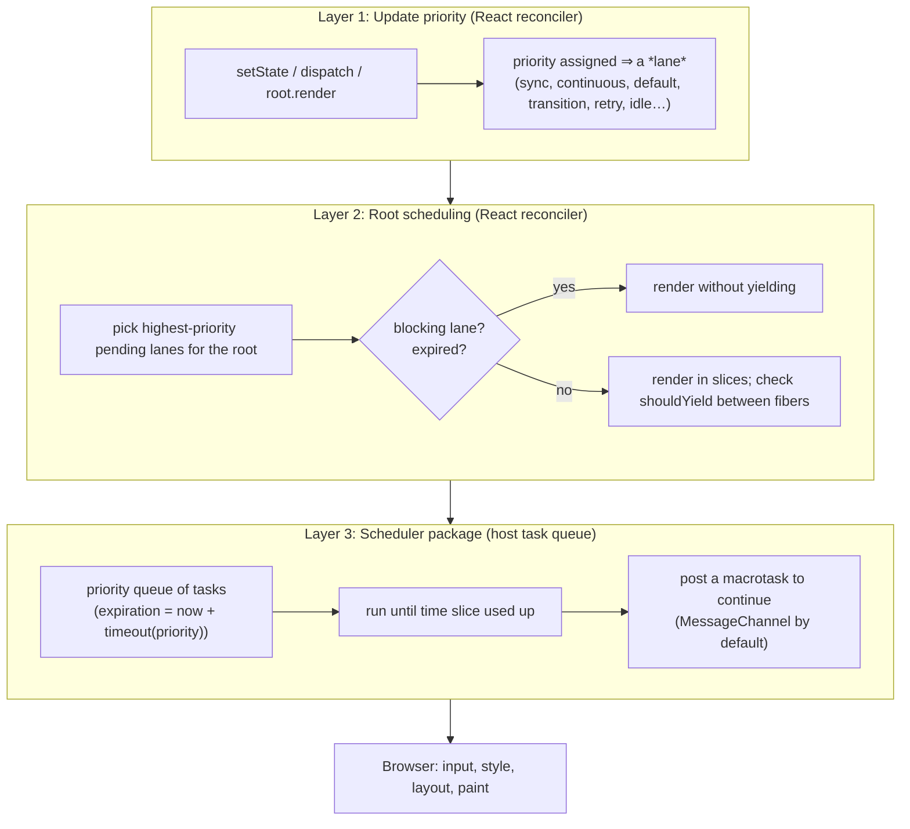
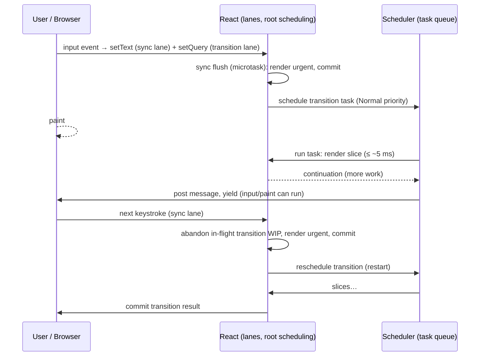
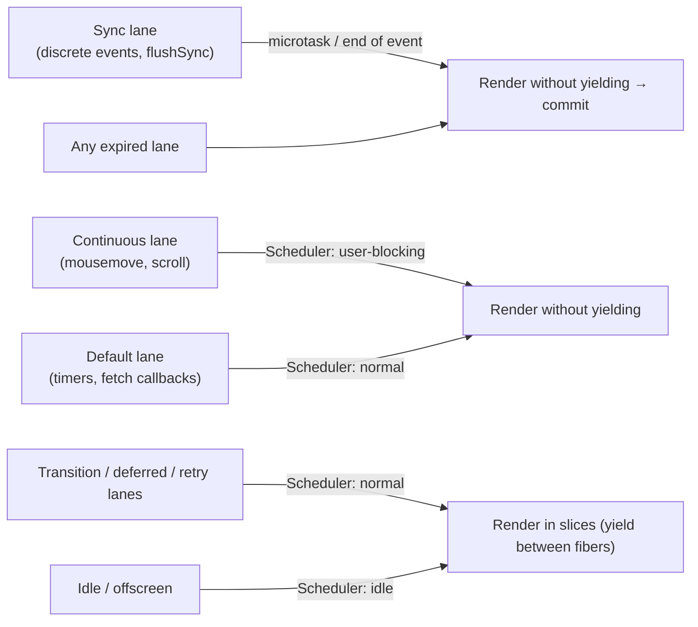

# 02 / 13 — Scheduling and Update Priorities

## 1. Lesson metadata

| | |
|---|---|
| **Level** | Professional |
| **Study time** | 6–7 hours (reading 3 h, experiments 2 h, exercises 1.5 h) |
| **Prerequisites** | [08 — Why Fiber exists](./08-why-fiber.md), [09 — Fiber nodes and units of work](./09-fiber-nodes-and-units-of-work.md), [10 — Current and work-in-progress trees](./10-current-and-work-in-progress-trees.md), [11 — Render phase vs commit phase](./11-render-phase-and-commit-phase.md), [12 — Why rendering must be pure](./12-why-rendering-must-be-pure.md), [00/11 — Event loop, tasks, microtasks](../00-web-and-javascript-foundations/11-event-loop-tasks-microtasks.md), [00/17 — JavaScript performance fundamentals](../00-web-and-javascript-foundations/17-javascript-performance-fundamentals.md), [01/15 — Update queues and batching](../01-react-fundamentals/15-update-queues-and-batching.md) |
| **Next** | [14 — Lanes: conceptual purpose](./14-lanes.md) |
| **Related** | [15 — Interruptible, restartable, abandoned renders](./15-interruptible-restartable-abandoned-rendering.md), [22 — Automatic batching](./22-automatic-batching.md), [23 — Transitions and deferred rendering](./23-transitions-and-deferred-rendering.md), [35 — Scenario D: transition vs urgent](./35-scenario-d-transition-vs-urgent.md), [Phase 7/11 — Scheduling and perceived responsiveness](../07-performance/11-scheduling-and-perceived-responsiveness.md) |

**Learning objectives.** After this lesson you can:
1. Separate the three layers that together decide *when and in what order React renders*: (a) **update priority** assigned when `setState` is called, (b) **root scheduling** (which pending work to render next, synchronously or sliced), (c) the **Scheduler** (a cooperative task queue that yields to the browser).
2. Explain how React DOM assigns a priority to an update: inside an event handler (by event type), inside a transition, outside React's control (timers, promises), for deferred values, for Suspense retries and hidden content.
3. Explain what the Scheduler does: priority levels, timeouts/expiration, the task queue, time-slice length, continuation callbacks, and the host mechanism used to yield (a `MessageChannel` message by default in browsers).
4. Explain precisely which renders are time-sliced and which are not, why that surprises people, and why starvation protection exists.
5. Predict the order of renders and commits when urgent and non-urgent updates are issued from one handler.
6. Use `startTransition`, `useTransition`, `useDeferredValue` and `flushSync` correctly and know the failure modes (async gaps, controlled inputs).
7. Implement a small cooperative priority scheduler in TypeScript and reason about its behavior.

**Concepts covered:** update priority, event priority, discrete/continuous/default/transition/idle updates, `window.event`-based priority inference, sync lane flush, Scheduler priority levels and timeouts, task queue (min-heap), time slice (~5 ms), `shouldYield`, continuations, `MessageChannel`/`setImmediate`/`setTimeout` host callbacks, expired lanes and starvation, blocking vs time-sliced lanes, async transitions, `isPending`.

> **This lesson is the most implementation-sensitive in the phase.** Specific numbers (5 ms slice, 250 ms / 5000 ms timeouts), priority mappings, which lanes are time-sliced, and when the sync lane is flushed (end of event vs microtask) have changed between React 17, 18 and 19 and may change again. The numbers and mappings in this lesson were **checked on 2026-10-22** against `packages/scheduler` (`Scheduler.js`, `SchedulerFeatureFlags.js`), `packages/react-reconciler` (`ReactFiberLane.js`, `ReactFiberRootScheduler.js`, `ReactFiberWorkLoop.js`) on `main`, the installed `react-dom@19.3.1` / `scheduler@0.28.0` builds, and by execution (blocking vs sliced renders, below). Re-check them for other versions. The *public guarantees* (§3.1) are stable.

---

## 2. Deep conceptual explanation

### 2.1 What problem is this lesson solving?

Fiber makes rendering divisible ([08](./08-why-fiber.md)). That raises three scheduling questions that application developers ask in disguise every time they say "why is my UI laggy" or "why did this render twice":

1. **Which update should be rendered first** when several are pending (a keystroke, a network response, a tab switch)?
2. **When should the render run** relative to the browser's own work (input handling, style, layout, paint) and how long may it hold the main thread?
3. **How does React avoid starving** low-priority work forever, and avoid being *too* nice (yielding so often that total time balloons)?

The answer has three cooperating layers. Confusing them is the root of most scheduler folklore ("React uses `requestIdleCallback`", "transitions run in the background", "React has its own event loop").



### 2.2 The browser's scheduling primitives (and why React built its own queue)

From [00/11](../00-web-and-javascript-foundations/11-event-loop-tasks-microtasks.md): the main thread runs one **task** at a time; **microtasks** drain after each task; the browser may **update the rendering** between tasks (not after every task).

What a library can use to "run something later":

| Primitive | Runs | Problem for a render scheduler |
|---|---|---|
| Microtask (`queueMicrotask`, `Promise.then`) | Before the next task, before rendering | Cannot yield to the browser at all |
| `requestAnimationFrame` | Right before the next paint | Not a general "run soon" tool; paused in background tabs; couples work to frames |
| `setTimeout(fn, 0)` | A later task | Nested timers are clamped to ≥ 4 ms in browsers (per the HTML spec's timer nesting clamp), wasting time on every yield |
| `requestIdleCallback` | When the browser is idle | May not run for long stretches under load, not available in all browsers (notably historically absent in Safari; check MDN's compatibility table); the idle period model suits optional work, not work the user is waiting for |
| `MessageChannel` `postMessage` | A new task, promptly, without the timer clamp | A good "yield and come right back" mechanism; the technique the Scheduler uses by default in browsers |
| `setImmediate` | Next iteration in Node/legacy IE | Preferred by the Scheduler where available (Node/jsdom) |
| `scheduler.postTask` / `scheduler.yield` (Prioritized Task Scheduling API) | Native prioritized tasks | Browser support is uneven; not React's default mechanism (the Scheduler's default hosts are `setImmediate`, `MessageChannel` and `setTimeout`; `Scheduler.js` on `main`) |

So React ships its own small library, the **`scheduler` package**, which keeps a **priority queue of callbacks** and implements *cooperative* time-slicing on top of the best available "come back as a new task" primitive. It is a **userland** scheduler: it cannot preempt running code, and it cannot make the browser prioritize anything. It only decides *which of React's own tasks run next* and *when to hand the main thread back*.

### 2.3 Layer 1 — Update priority: how React decides "urgent vs not"

Every update gets a priority at the moment it is *created* (`setState`, a reducer dispatch, `root.render`). React's design principle: **priority follows the cause of the update.**

| Cause | Priority class (conceptual) | Typical examples |
|---|---|---|
| **Discrete user event** (a single, atomic user action whose result users expect immediately) | Highest ("sync"/discrete) | `click`, `keydown`, `input`/`change`, `submit`, `pointerdown/up`, `focus`/`blur` |
| **Continuous user event** (a stream of events where results can be coalesced) | High ("continuous") | `mousemove`, `pointermove`, `scroll`, `wheel`, `drag`/`dragover`/`dragenter` (but `dragstart`, `dragend` and `drop` are discrete) |
| **Everything else** (timers, promise/fetch callbacks, message events, `root.render`, effects) | Normal ("default") | `setTimeout(() => setX(…))`, `fetch().then(setData)`, `WebSocket.onmessage` |
| **Transition** | Low, interruptible | `startTransition`, `useTransition`'s `startTransition`, router navigation updates |
| **Deferred value** | Low, derived | `useDeferredValue` re-render with the old value replaced by the new one in a lower-priority pass |
| **Retry** (Suspense) | Low-ish | Re-rendering a boundary after its data resolves |
| **Idle/offscreen** | Lowest | Hidden/prerendered content (`<Activity>`, stable since 19.2; `OffscreenLane`) |

**How the priority is determined, mechanically (implementation detail, stable concept):**

1. React's synthetic event system, when dispatching an event, sets a "current update priority" appropriate for that **event type** for the duration of your handler. Which event types are discrete vs continuous is a table inside React DOM; you cannot configure it.
2. If an update is created *inside* a transition (`startTransition(() => setX(…))`), it is marked as a transition and given a transition lane regardless of the event.
3. Otherwise, if no React-controlled context is active, React asks the environment: it consults the browser's current event (`window.event`) type to infer the priority — so an update scheduled synchronously from a *native* event listener you attached yourself still gets an event-appropriate priority. If there is no current event (timers, promises), the update gets the default priority.
4. For `flushSync`, the update is forced to the synchronous priority.

Consequences you can verify:
- Two updates in the **same** handler can have **different** priorities (one in a transition, one not).
- An update in a `setTimeout` is **default priority**, not "discrete", even if the timer was started by a click.
- After an `await` inside an async function, the "current event" context is gone: updates are default priority. (React 19's async transitions add rules for this: updates after the first `await` inside a transition callback are *not* automatically transitions; see §2.9.)

### 2.4 Layer 2 — Root scheduling: choosing what to render and whether to slice it

Updates are recorded on the **root** as a set of pending lanes ([14](./14-lanes.md)). After any update or commit React runs a function whose job (`ensureRootIsScheduled`; restructured in 18.3/19 so one microtask, `processRootScheduleInMicrotask`, processes all roots) is:

1. Compute the **next lanes** to render: the highest-priority pending lane group (plus entangled lanes).
2. Compare to what is already scheduled. If a task for the same priority exists, reuse it. If a *higher* priority arrived, **cancel** the existing task and schedule a new one at the new priority. If the root's next lanes are *lower* than the currently running render's lanes, nothing preempts.
3. Choose the mechanism:
   - **Sync lane (discrete events, `flushSync`)** → flush *synchronously*: scheduled in a **microtask** (or at the end of the event dispatch, depending on version), **bypassing the Scheduler package**. The render is not time-sliced. The commit happens before the browser paints.
   - **Other lanes** → create a **Scheduler task** with a Scheduler priority derived from the lane (see below) whose callback is "render this root" (`performWorkOnRootViaSchedulerTask` in React 19; it was `performConcurrentWorkOnRoot` in React 18).

**Mapping to Scheduler priorities (checked in `ReactFiberRootScheduler.js` and `lanesToEventPriority`):**

| Lane (conceptual) | Scheduler priority | Notes |
|---|---|---|
| Sync (discrete) | — (bypasses Scheduler; microtask) | Immediate priority exists in the Scheduler but React's sync path doesn't need it |
| Continuous (e.g., `mousemove`, `scroll`) | User-blocking | Timeout 250 ms |
| Default (timers, network) | Normal | Timeout 5000 ms |
| Transition, retry, deferred | Normal (they differ by lane, not by Scheduler priority) | Their *lane* determines inclusion in a render; they all run at Normal in the queue |
| Idle/offscreen | Idle | Never times out |

**Which renders are time-sliced? (the surprising part; verified by execution, see the note below).** In React 18 and 19 with `createRoot`, *only some lanes are rendered with the yielding loop*. Roughly:

- **Time-sliced (interruptible, can yield between fibers):** transition lanes, deferred-value lanes, Suspense retry lanes, idle/offscreen lanes.
- **Not time-sliced ("blocking" lanes):** sync lane, **continuous** lane, and **default** lane — these render with the non-yielding loop even though some of them are scheduled as Scheduler tasks (so they run in a macrotask, not a microtask).
- **Any lane that has expired** (starvation protection, §2.6) is rendered without yielding.

This is a deliberate React 18 design: default updates (e.g., results of a `fetch`) keep the *synchronous-like* semantics that existing apps relied on, and time slicing is **opt-in through transitions/deferred values**. A common wrong belief is "createRoot makes all my renders interruptible"; it makes *transition-class* renders interruptible. Internally this is `includesBlockingLane(lanes)` in `ReactFiberLane` (sync, sync-hydration, input-continuous, default and gesture lanes, plus their hydration variants) combined with `includesExpiredLane`; both must be false for `shouldTimeSlice`. *Verified by execution on React 19.3.1 (jsdom, a 300-row list at about 0.5 ms per row, a `setTimeout(0)` ticker running alongside): a default-lane update (`setState` called outside any event or transition) rendered all 300 rows with 0 ticker callbacks in between; the same update inside `startTransition` was interleaved with 31 ticker callbacks over about 180 ms (roughly one yield per 5 ms).*

### 2.5 Layer 3 — The Scheduler package

The `scheduler` package (<https://github.com/facebook/react/tree/main/packages/scheduler>; published to npm as `scheduler`) is a generic cooperative scheduler. Its public-ish (`unstable_`-prefixed) concepts:

**Priority levels** with fixed *timeouts* (constants from `Scheduler.js` and `SchedulerFeatureFlags.js`, checked 2026-10-22):

| Level | Timeout (ms) | Meaning |
|---|---|---|
| Immediate | −1 (already expired) | Run as soon as possible, never yield |
| User-blocking | 250 | Expected to finish within a quarter second (continuous input) |
| Normal | 5000 | Default |
| Low | 10000 | Background |
| Idle | effectively never | Only when nothing else to do |

**Task = (callback, priority, startTime, expirationTime = startTime + timeout).** Tasks are kept in a **min-heap ordered by expiration time** (ties by insertion order). Delayed tasks wait in a separate timer queue until their start time. Higher priority ⇒ *earlier expiration* ⇒ closer to the front. Notice this is an **earliest-deadline-first** scheduler: a Normal task scheduled 5 s ago can come before a User-blocking task scheduled just now, which is how long-waiting work eventually runs even if new high-priority work keeps arriving (a form of aging).

**The work loop.** When the host callback fires (a `MessageChannel` message):
1. Record the start time of this slice.
2. While the queue is non-empty: peek the earliest task; if the task has **not** expired and the slice's time is up (**`shouldYield`**: elapsed time since slice start ≥ the *frame interval*, **5 ms** at the time of writing), stop.
3. Otherwise call the task's callback, passing a flag `didTimeout` (true if the task's expiration time has passed). If the callback returns a **function**, that is a *continuation*: keep the task and call the returned function later (this is how a long render cooperates). If it returns nothing, the task is done.
4. If tasks remain, post another host message to continue in a **new macrotask**; the browser can run input handlers, style, layout and paint between these macrotasks.

The 5 ms figure is a policy knob: short enough that a 16.7 ms frame can accommodate a slice plus browser work, long enough to amortize the cost of yielding. React does **not** know *how much time the frame has left*; it uses a fixed slice length (`frameYieldMs = 5` in `SchedulerFeatureFlags.js`; the Scheduler has had experiments with input-pending checks and different intervals, and `main` has an experimental `enableAlwaysYieldScheduler` flag, none enabled in the published build).

**Where React plugs in.** The task's callback is "render this root". Inside it, React's work loop calls `shouldYield()` between fibers; when it returns true the render stops, React returns a continuation (if work remains), and the Scheduler posts the next message. If the task *did time out* (`didTimeout`), React renders with the non-yielding loop to guarantee completion.

### 2.6 Starvation and expiration

Because low-priority lanes could be postponed forever by a stream of urgent updates, React gives each pending lane an **expiration time** (`computeExpirationTime` in `ReactFiberLane`, checked on `main` and in `react-dom@19.3.1`: sync, input-continuous and gesture lanes expire after 250 ms, default and transition lanes after 5000 ms, and retry, idle, offscreen and deferred lanes never expire; retry-lane expiration sits behind a flag, `enableRetryLaneExpiration`, which is off). When a lane's expiration passes, React treats it as **urgent**: it will be rendered **synchronously (no yielding)** the next time the root is scheduled. This bounds the staleness of any update, at the cost of possibly blocking the main thread for that render. The Scheduler task timeouts above provide the equivalent protection at the queue level.

Practical implication: *transitions are "eventually" not "never"*. If you continuously trigger urgent updates (a 60 Hz animation calling `setState`), a transition may be starved until it expires and then renders non-interruptibly, producing a hitch.

### 2.7 What actually happens to an in-flight render when something more urgent arrives

Sequence (details in [15](./15-interruptible-restartable-abandoned-rendering.md)):

1. A transition render is in progress (Scheduler task running slices).
2. A discrete event happens; the event handler calls `setState` → sync lane update recorded; root scheduling runs: a higher-priority lane exists than the one being rendered.
3. React cancels/ignores the in-flight Scheduler task and schedules the sync flush (microtask). The WIP tree is **not** completed; on the next render attempt React sees the root's lanes changed and **resets** the stack, rebuilding the WIP tree from `current` for the urgent lanes.
4. After the urgent commit, root scheduling runs again: remaining lanes (the transition) are rescheduled and re-rendered **from the root with the new committed state**.

The transition is *restarted*, not resumed, because the urgent update may have changed inputs that the half-built draft already used.

### 2.8 Layering of controls the developer has

| API | Effect on priority | Notes |
|---|---|---|
| (none) — plain `setState` in a handler | Priority from event type | Discrete: sync lane |
| `startTransition(fn)` / `useTransition()` | Updates *called synchronously inside `fn`* become transition-class | Public; also provides `isPending` via `useTransition` ([react.dev](https://react.dev/reference/react/useTransition)) |
| `useDeferredValue(value)` | Re-render with the new value at a lower priority; the "previous value" is returned during urgent renders | Public ([react.dev](https://react.dev/reference/react/useDeferredValue)) |
| `flushSync(fn)` | Forces sync priority and immediate flush | Escape hatch ([react.dev](https://react.dev/reference/react-dom/flushSync)) |
| Suspense + `use` | Retry lanes after data resolves | [24](./24-suspense-conceptual-internals.md) |
| `unstable_*` Scheduler APIs | Direct access to the Scheduler | **Not for application code**; unstable; not tied to React's lanes |

There is **no public API** to set an arbitrary lane or priority. This is intentional: the model is "describe *intent* (urgent vs transition) and let React choose mechanics".

### 2.9 Transitions and asynchrony

`startTransition(fn)` marks only the state updates that are called **synchronously during `fn`**. Updates that happen later (inside `setTimeout`, after `await`, in a promise callback) are *not* transitions. React 19's **async transitions** ("Actions": `startTransition(async () => { … })`) keep the transition *pending state* alive across `await`s, but state updates made *after* an `await` still need their own `startTransition` wrapper to be marked as transitions ([react.dev — `startTransition`](https://react.dev/reference/react/startTransition), "Caveats"; verified against the react.dev `startTransition` reference 2026-10-22). `isPending` from `useTransition` is `true` from the start of the transition until the work (including async parts) completes and the resulting UI commits.

### 2.10 Misconceptions

| Misconception | Reality |
|---|---|
| "React has its own event loop / runs in a worker." | It rides on browser tasks; everything is on the main thread. |
| "React uses `requestIdleCallback`." | Not for rendering. The Scheduler uses a message-based macrotask loop. |
| "All renders in `createRoot` are time-sliced." | Only transition/deferred/retry/idle-class renders; default/continuous/sync lanes are rendered without yielding. |
| "Higher priority = faster." | Priority decides *order*, not *speed*. A high-priority 400 ms render still blocks for 400 ms. |
| "A transition runs in the background so it can't cause jank." | Each slice and the final commit block the main thread; jank arises from long slices (one slow component) or a large commit ([11](./11-render-phase-and-commit-phase.md)). |
| "`startTransition` wraps async work." | It marks synchronous state updates; async gaps need re-wrapping; it does not turn I/O into non-blocking. |
| "Urgent updates always show up first in the DOM." | The urgent update commits first, but only if it is not itself blocked behind a non-interruptible render already running. |
| "I can use `scheduler` directly to prioritize my renders." | Its `unstable_` API is separate from React's lane system and not supported for apps. |
| "The 5 ms slice means each component gets 5 ms." | The slice limits how long React *keeps working* before checking the clock between fibers; individual fibers can take longer. |

---

## 3. Internal mechanics

### 3.1 Public guarantee

- Updates inside **event handlers** (discrete events) are processed with high priority and committed before the browser paints (documented in the React 18 release notes' automatic batching/priority discussion and react.dev events pages).
- `startTransition`/`useTransition`/`useDeferredValue` mark work as **non-urgent and interruptible**; urgent updates (typing, clicking) will not be blocked by *pending* transition renders ([react.dev — `useTransition`](https://react.dev/reference/react/useTransition)).
- Multiple state updates in the same tick are **batched** into one render per priority (automatic batching, [22](./22-automatic-batching.md)).
- A transition update may be **interrupted and restarted**; intermediate states from abandoned transition renders are never shown.
- A transition that is pending does not display a Suspense fallback for already-visible content (it keeps showing the old UI) ([react.dev — Suspense](https://react.dev/reference/react/Suspense), "Preventing already revealed content from hiding").
- `flushSync` flushes synchronously.

Not guaranteed: slice length; which lanes slice; mapping to Scheduler priorities; microtask vs end-of-event flush; expiration constants; the number of renders per interaction.

### 3.2 Teaching model

> Each update is tagged with an **urgency** according to what caused it. React renders the most urgent pending work first; urgent work is rendered in one go, while "transition-class" work is rendered in short slices that hand control back to the browser and may be thrown away if something more urgent arrives. Work that has waited too long is promoted to urgent so that it can't starve.

### 3.3 Implementation details

Checked against the source on 2026-10-22 (see the note at the top).

- **Scheduler internals:** two queues (a `taskQueue` min-heap keyed on expiration time and a `timerQueue` for delayed tasks); `workLoop` peeks tasks and checks `shouldYieldToHost`; the host callback mechanism is chosen once at module load (prefers `setImmediate`, else `MessageChannel`, else `setTimeout`); the frame interval is a module constant (5 ms). A continuation is a function returned from a task callback.
- **React side:** the lane group chosen for a render is stored on the root as the "render lanes"; the Scheduler callback node for a root is stored on the root along with the priority of the scheduled lane, to detect "same priority ⇒ reuse task". The decision to time-slice involves checks for *blocking lanes* and *expired lanes*.
- **Sync lane:** scheduled in a "sync callback queue" flushed from a microtask (and also flushed at certain points, e.g., end of a batched event dispatch, `flushSync`). In React 19 the processing of "which roots need scheduling" is itself batched into a single microtask.
- **Event priority inference:** React DOM maps DOM event names to priorities in a switch/table; a "current update priority" global is set during dispatch; outside dispatch, `window.event?.type` is used.
- **Starvation:** a root tracks per-lane expiration times, updated when lanes are first scheduled and checked on subsequent scheduling passes.
- **Profiling:** newer React versions can emit data to Chrome DevTools' performance timeline ("performance tracks" for Scheduler and Components, introduced in React 19.2), showing which lane is rendering and when. Earlier versions require `User Timing` marks in dev builds or DevTools' own Profiler.

### 3.4 Cost model

Each yield costs: stopping the loop, posting a message, a new macrotask (~microseconds to a millisecond depending on load), plus the browser's chance to run other work. Slicing therefore adds overhead (typically small) and increases *total* render time in exchange for responsiveness. If nothing else wants the main thread, React continues immediately after the message.

---

## 4. Step-by-step execution walkthrough

**Scenario.** A search page:

```tsx
const [text, setText] = useState("");
const [query, setQuery] = useState("");
const [isPending, startTransition] = useTransition();

function onChange(e: React.ChangeEvent<HTMLInputElement>) {
  setText(e.target.value);                 // urgent
  startTransition(() => setQuery(e.target.value));  // non-urgent
}
```
`<Results query={query} />` takes ~300 ms in total, split over 600 small row components (~0.5 ms each). The user types "r", then "e" 120 ms later. Assume a non-Strict concurrent root; 60 Hz display.

| t (ms) | Main thread activity | Layer / priority notes | What the user sees |
|---|---|---|---|
| 0 | `input` event dispatched → `onChange("r")` | Discrete event: current update priority = discrete. `setText("r")` → **sync lane**. `startTransition` callback runs synchronously: `setQuery("r")` marked **transition lane**; `isPending` also set `true` in the **urgent** lane. | — |
| 0+ | Handler returns. Root scheduling: next lanes = sync lane (highest). Sync flush queued (microtask). Transition lane remains pending; a **Scheduler task at Normal priority** is created for it. | Layer 2 | — |
| 1 | **Render (sync, no yield):** `App` re-renders with `text="r"`, `isPending=true`, `query=""` (the transition update is *skipped* in this render). `Results` bails out (props unchanged). | Layer 2: blocking lane ⇒ `renderRootSync` | — |
| 3 | **Commit** of the urgent render. | | Input shows "r" and a pending indicator in the same frame |
| 4 | Browser rendering opportunity: style/layout/paint | | "r" and spinner/dimming visible (~one frame) |
| 5 | Scheduler task runs (host message): **transition render** starts for lane = transition; sliced loop; slice 1 ends after ~5 ms (~10 rows done): `shouldYield` → true; React returns a continuation. | Layer 3: slice = 5 ms | UI responsive |
| 10 | Browser handles input/paint opportunities between slices | | |
| 5…120 | Slices 2…n of the transition render (rows 11…), each ≈ 5 ms with gaps | | Input still showing "r"; pending indicator on |
| 120 | `input` event "e": **urgent** `setText("re")` (sync lane), `setQuery("re")` in a new transition (same transition lane or next one) | Higher-priority lane than the lane being rendered | — |
| 121 | The next time the work loop checks, root scheduling sees the new urgent lane. The in-flight transition render's WIP is **abandoned** (stack reset, [15]). Urgent sync render: `App` with `text="re"`; `Results` bails out again (its `query` prop is still `""`: the transition hasn't committed). | | |
| 124 | Commit; paint at next frame | | Input shows "re" within ≈ one frame of the keystroke |
| 126… | New transition render for `query="re"` restarts from the root (fresh WIP), sliced again. About 300 ms of rendering over ≈ 60 slices (if nothing else interrupts). | | Old results (for `""`) remain visible |
| ≈ 430 | Transition render completes; **commit** (one synchronous task) | | Results for "re" appear; pending indicator off |

Observations to draw:
1. **Two renders per keystroke** (one urgent, one transition) — expected, not a bug.
2. The user never sees intermediate results for "r".
3. The first transition's ≈ 120 ms of work was **wasted** (abandoned). That is the price of responsiveness. If the user pauses typing, it completes.
4. If any single `Row` took 200 ms, the "e" keystroke would wait up to ~200 ms before its event handler could run (input delay): slices are bounded **only between** fibers.

---

## 5. Code examples

### 5.1 Minimal example — two priorities from one handler

```tsx
import { useState, useTransition } from "react";

export function Demo() {
  const [urgent, setUrgent] = useState(0);
  const [slow, setSlow] = useState(0);
  const [isPending, startTransition] = useTransition();

  console.log("render", { urgent, slow, isPending });

  return (
    <button
      onClick={() => {
        startTransition(() => setSlow((s) => s + 1)); // statement 1
        setUrgent((u) => u + 1);                      // statement 2
      }}
    >
      urgent={urgent} slow={slow}
    </button>
  );
}
```

**Predict.** After one click (non-Strict), what is logged, in what order, and how many renders?

**Result.** Two renders:
```text
render { urgent: 1, slow: 0, isPending: true }
render { urgent: 1, slow: 1, isPending: false }
```
**Why.** Statement 2 is urgent even though it comes *after* statement 1 in the code; React renders the urgent lane first, **skipping** the transition update, so `slow` is still `0` and `isPending` is `true` (the `isPending` update is part of the urgent render). Then the transition lane renders with both updates applied. Statement order inside the handler does not determine render order; **lane priority does.**

**Edge cases.** In Strict Mode dev each render logs twice. If the transition render were interrupted by another urgent update before finishing, you could see additional abandoned `render {…slow:1…}` logs with no commit ([10 §5.5](./10-current-and-work-in-progress-trees.md)).

### 5.2 Practical example — responsive filter with pending feedback

```tsx
import { memo, useMemo, useState, useTransition } from "react";

interface Product { id: string; name: string }

const ProductGrid = memo(function ProductGrid({
  products,
  query,
}: {
  products: readonly Product[];
  query: string;
}) {
  const q = query.trim().toLowerCase();
  const visible = useMemo(
    () => (q ? products.filter((p) => p.name.toLowerCase().includes(q)) : products),
    [products, q],
  );
  return (
    <ul aria-live="polite">
      {visible.map((p) => (
        <li key={p.id}>{p.name}</li>
      ))}
    </ul>
  );
});

export function ProductSearch({ products }: { products: readonly Product[] }) {
  const [text, setText] = useState("");     // drives the input: must be urgent
  const [query, setQuery] = useState("");   // drives the expensive list: may lag
  const [isPending, startTransition] = useTransition();

  return (
    <section aria-busy={isPending}>
      <label>
        Search
        <input
          value={text}
          onChange={(e) => {
            const v = e.target.value;
            setText(v);
            startTransition(() => setQuery(v));
          }}
        />
      </label>
      <div style={{ opacity: isPending ? 0.6 : 1 }}>
        <ProductGrid products={products} query={query} />
      </div>
    </section>
  );
}
```

**Line notes.**
- Two state variables, deliberately: the **input's value** is urgent state; the **list's query** is the derived, expensive consumer.
- `memo` on `ProductGrid` is essential: during the urgent render `query` is unchanged, so the grid must bail out.
- `aria-busy` and a visual dimming communicate pending state; `aria-live="polite"` on the list is a design choice that can be noisy for large lists — choose a more targeted live region (e.g., announce a result count) in real products ([Phase 8/10](../08-testing-and-quality/10-accessibility-testing.md)).
- `useMemo` filters once per `(products, q)`.

**Predict.** If you delete `memo` from `ProductGrid`, does typing remain responsive?

**Result.** No: each keystroke's urgent render re-renders `ProductSearch`, creating a new element for `ProductGrid` with unchanged `query` but a new props object, so it re-renders (without `memo`) synchronously — the filter work happens in the urgent lane. See [08 §5.5](./08-why-fiber.md) for the same trap.

**Trade-offs.** Two renders per keystroke; stale results on screen during typing; extra memory for old and new trees. For small lists, simply render synchronously. For huge lists, filter on the server or virtualize ([Phase 7/09](../07-performance/09-windowing-and-virtualization.md)).

### 5.3 Incorrect example — the three classic transition mistakes

```tsx
function Bad() {
  const [text, setText] = useState("");
  const [results, setResults] = useState<string[]>([]);
  const [, startTransition] = useTransition();

  // (1) Controlled input state set inside a transition
  const onChange1 = (e: React.ChangeEvent<HTMLInputElement>) =>
    startTransition(() => setText(e.target.value));

  // (2) State updated after an async gap inside a transition
  const onChange2 = (e: React.ChangeEvent<HTMLInputElement>) =>
    startTransition(async () => {
      const r = await search(e.target.value);
      setResults(r);                       // after await: not marked as a transition
    });

  // (3) Deferring with a timer inside a transition
  const onChange3 = (e: React.ChangeEvent<HTMLInputElement>) =>
    startTransition(() => {
      setTimeout(() => setResults(compute(e.target.value)), 0);  // runs later at default priority
    });

  return <input value={text} onChange={onChange1} />;
}
declare function search(q: string): Promise<string[]>;
declare function compute(q: string): string[];
```

**Predict.** What goes wrong with each?

**Result.**
1. The text is a *controlled* input value. Putting it in a transition lets React render the typed value late, so the input appears to **drop or lag characters** or fight the user's caret (documented caveat in the `startTransition`/`useTransition` pages: don't use transitions to control inputs). Typing must be urgent.
2. The `await` ends the synchronous marking context; `setResults` after it is a **default-priority** update (in React 19, you can wrap the post-`await` update in another `startTransition`). The *pending* state of the outer transition covers the async function, but the update itself is not interruptible-class.
3. The timer callback runs outside the transition scope; `setResults` is default priority, and the `compute` cost is paid synchronously in the timer task.

### 5.4 Corrected implementation

```tsx
function Good() {
  const [text, setText] = useState("");
  const [results, setResults] = useState<string[]>([]);
  const [isPending, startTransition] = useTransition();

  function onChange(e: React.ChangeEvent<HTMLInputElement>) {
    const v = e.target.value;
    setText(v);                              // (1) urgent: controlled input
    startTransition(async () => {
      const r = await search(v);             // (2) async work inside the Action
      startTransition(() => setResults(r));  //     post-await update re-wrapped (React 19 async transitions; react.dev calls this a known limitation)
    });
  }

  return (
    <>
      <input value={text} onChange={onChange} aria-busy={isPending} />
      <ul>{results.map((r) => <li key={r}>{r}</li>)}</ul>
    </>
  );
}
```

**Explanation.**
- (1) The input's own state is urgent.
- (2) Async work stays in the Action so `isPending` covers the request, and the **result commit** is marked as a transition via a nested wrapper.
- (3) CPU-heavy synchronous computation should be done *in render* under a transition-driven state (as in §5.2), not in timers.
- Race conditions: out-of-order responses can still set stale `results`; add request ids/`AbortController` ([Phase 6/02](../06-data-fetching-and-state-ecosystems/02-cancellation-and-race-conditions.md)). Frameworks and data libraries typically handle this better than hand-rolled code.

### 5.5 Advanced example — build a mini cooperative priority scheduler

This is **not** React's code. It reproduces the Scheduler's ideas — earliest-expiration-first queue, 5 ms slices, continuations, `MessageChannel` yielding — in about 70 lines so you can reason about the behavior empirically.

```ts
type Priority = "immediate" | "userBlocking" | "normal" | "low" | "idle";
type Callback = (didTimeout: boolean) => Callback | void;

const TIMEOUT_MS: Record<Priority, number> = {
  immediate: -1,
  userBlocking: 250,
  normal: 5000,
  low: 10000,
  idle: Number.POSITIVE_INFINITY,
};

interface Task {
  id: number;
  callback: Callback | null;
  expiration: number;
}

export class MiniScheduler {
  private queue: Task[] = [];      // kept sorted by (expiration, id); React uses a min-heap
  private nextId = 0;
  private hostScheduled = false;
  private sliceStart = 0;
  private readonly channel = new MessageChannel();

  constructor(private readonly sliceMs = 5) {
    this.channel.port1.onmessage = () => this.performWork();
  }

  schedule(priority: Priority, callback: Callback): Task {
    const task: Task = {
      id: this.nextId++,
      callback,
      expiration: performance.now() + TIMEOUT_MS[priority],
    };
    const i = this.queue.findIndex((t) => t.expiration > task.expiration);
    if (i === -1) this.queue.push(task);
    else this.queue.splice(i, 0, task);
    this.requestHostCallback();
    return task;
  }

  cancel(task: Task): void {
    task.callback = null; // lazily skipped in the loop, like the real Scheduler
  }

  shouldYield(): boolean {
    return performance.now() - this.sliceStart >= this.sliceMs;
  }

  private requestHostCallback(): void {
    if (this.hostScheduled) return;
    this.hostScheduled = true;
    this.channel.port2.postMessage(null);
  }

  private performWork(): void {
    this.hostScheduled = false;
    this.sliceStart = performance.now();
    while (this.queue.length > 0) {
      const task = this.queue[0];
      const didTimeout = task.expiration <= performance.now();
      if (!didTimeout && this.shouldYield()) break; // slice used up and task not overdue
      if (task.callback === null) {                  // cancelled
        this.queue.shift();
        continue;
      }
      const continuation = task.callback(didTimeout);
      if (typeof continuation === "function") {
        task.callback = continuation;                // keep the task, run the rest later
      } else {
        const idx = this.queue.indexOf(task);
        if (idx !== -1) this.queue.splice(idx, 1);
      }
    }
    if (this.queue.length > 0) this.requestHostCallback(); // continue in a NEW macrotask
  }
}

// ---- demo ----
function busy(ms: number): void {
  const end = performance.now() + ms;
  while (performance.now() < end) {}
}

const s = new MiniScheduler();
const log: string[] = [];
let lowDone = 0;
const LOW_CHUNKS = 6;

const lowJob: Callback = () => {
  while (lowDone < LOW_CHUNKS) {
    busy(2);
    lowDone++;
    log.push(`low:${lowDone}`);
    if (lowDone === 1) s.schedule("userBlocking", () => { log.push("urgent"); });
    if (s.shouldYield()) return lowDone < LOW_CHUNKS ? lowJob : undefined;
  }
};

s.schedule("low", lowJob);
setTimeout(() => console.log(log.join(" ")), 100);
```

**Predict.** What is printed (assume each `busy(2)` takes about 2 ms and `sliceMs = 5`)?

**Result.** `low:1 low:2 low:3 urgent low:4 low:5 low:6`. *(Verified by execution on 2026-10-22: the toy typechecks under `tsc --strict` and prints exactly this; the same scenario written against the real `scheduler@0.28.0` (`unstable_scheduleCallback`, `unstable_shouldYield`) prints the same sequence.)*

**Why.**
- Slice 1: `lowJob` does chunk 1 (2 ms) and schedules an urgent task (its expiration is `now + 250`, earlier than the low task's `now + 10000`, so it sorts *ahead* of the low task). The low callback does not stop for it: **there is no preemption**; it only yields when `shouldYield()` is true, after chunk 3 (≈ 6 ms ≥ 5 ms).
- It returns itself as a continuation. The loop re-checks: the front task is now the urgent one, not expired, and the slice is used up → break; post a message.
- Slice 2 (new macrotask; the browser could have handled input here): the urgent task runs first (front of queue), then the low continuation finishes chunks 4–6.

**What this teaches.** (1) Priority only matters at yield points; (2) the unit size (here 2 ms) bounds how late urgent work starts: ≈ unit + remaining slice; (3) the same structure explains why one 200 ms fiber defeats time slicing; (4) expiration-ordered queues provide aging.

**Trade-offs and omissions vs. the real Scheduler.** Binary heap instead of a sorted array (O(log n) vs O(n) insertion), delayed tasks (timer queue), `setImmediate` host preference, `isInputPending` experiments, error handling, profiling hooks, and React's integration (lanes, continuation protocol, cancellation based on root state) are all absent. Run it in a browser console or Node ≥ 16 (`MessageChannel` and `performance` are globals); in Node the process may not exit while the port is open—call `s["channel"].port1.close()` in a test harness (accessing a private field is for demonstration only).

---

## 6. Visual explanations

### 6.1 Three layers, one timeline



### 6.2 Which lane gets which treatment (checked against `ReactFiberLane.js` and `ReactFiberWorkLoop.js`)



### 6.3 Earliest-deadline-first queue

```text
now = 0 ms
task A: low,          expires at 10_000
task B: normal,       expires at  5_000
task C: userBlocking, expires at    250
queue order → C, B, A

now = 4_900: new userBlocking task D expires 5_150
queue order → B(5_000), D(5_150), A(10_000)      ← aging: B waited long enough to precede D
```

---

## 7. Alternative approaches and trade-offs

| Approach | What it controls | Pros | Cons | Use when |
|---|---|---|---|---|
| **React transitions / deferred values** | Render priority & interruptibility | Declarative, integrated with Suspense/pending UI | Only helps if the work is divisible across components; two renders per interaction | Expensive derived UI driven by input |
| **Debounce** the input | Reduces the number of updates | Fewer renders, fewer requests | Adds fixed latency; doesn't fix a slow render when it does fire | Network-bound search; also combine with transition |
| **Throttle** continuous events | Rate of updates | Bounds work/second | Choppy if too aggressive | Scroll/resize handlers |
| **Virtualization / pagination** | Amount of work | Removes the work | Complexity, a11y considerations | Large lists/tables |
| **Web Worker** | Moves computation off thread | Truly parallel | Serialization costs; no DOM access | Heavy pure computation |
| **Manual chunking** (`scheduler.postTask`, `setTimeout`/MessageChannel) | Your own tasks | Works outside React | You own the policy; doesn't integrate with React lanes | Non-render CPU work (indexing, parsing) |
| **`requestIdleCallback`** | Optional background work | Good for analytics/prefetch | Unreliable timing; not for user-awaited work | Non-urgent housekeeping |
| **`flushSync`** | Forces immediate render | Deterministic DOM after call | Defeats batching/concurrency | Imperative DOM integration |
| **Server rendering / RSC** | Moves work to server | Less client JS/work | Network latency; architectural change | Data-heavy read views ([27](./27-react-server-components-intro.md)) |

**A scenario where transitions are *not* the right tool.** The slow part is a single synchronous computation (a 300 ms `useMemo`) or one huge component — a transition cannot slice it (§5.5: unit size). Another: a **controlled input** or anything the user must see immediately (use urgent state). Another: the work is wasteful regardless of priority (filtering 50k items on each keystroke) — remove the work (server-side filter, index, virtualization, debounce) rather than schedule it politely.

---

## 8. Best practices and anti-patterns

**Best practices**
- Model *intent*: separate state that must reflect the input **now** from state that drives expensive derived UI; update the former urgently and the latter in a transition (or via `useDeferredValue`).
- Memoize the expensive consumer (`memo`) so the urgent pass is cheap ([08 §5.5](./08-why-fiber.md)).
- Show **pending feedback** (`isPending`, dimming, `aria-busy`) — stale content without any indication is confusing.
- Keep each unit small: many cheap components > one huge one.
- Measure with the Performance panel; look for long tasks in the *urgent* path first.
- Use `useSyncExternalStore` for external stores; remember those updates are synchronous (not sliced).
- Treat priority constants and slice length as unknowns; never write code that depends on them.

**Beginner mistakes**
- Wrapping the input's `setState` in `startTransition`.
- Expecting a transition to speed up total render time.
- Calling `startTransition` around a network call and expecting the result commit to be low priority (async gap).

**Experienced-developer mistakes**
- Using transitions as a band-aid for unbounded rendering instead of reducing work.
- Assuming default-priority updates (e.g., after `fetch`) are time-sliced: they are rendered without yielding, so a slow tree from a network response still blocks.
- Importing `scheduler` and calling `unstable_scheduleCallback` for app logic.
- Forgetting that continuous updates (60 Hz) can starve transitions until they expire, then render non-interruptibly.

**Smells**
- `isPending` never used.
- A transition whose consumer isn't memoized.
- `flushSync` sprinkled to "fix" ordering issues.

**Justified exceptions**
- `flushSync` for imperative focus/scroll integration.
- Direct use of `scheduler.postTask`/MessageChannel in app code for non-React CPU work with explicit priority.
- Wrapping a router navigation in a transition by default (frameworks do this) to avoid hiding visible content with fallbacks.

---

## 9. Real-world application

| Domain | Scheduling consideration | Constraints |
|---|---|---|
| **E-commerce faceted search** | Facet checkbox clicks: urgent checkbox state, transition for result grid; pending overlay. | Keep checkbox state separate from query state; announce result count politely for screen readers; server-side filtering at large scale. |
| **Trading/finance dashboards** | Order ticket inputs urgent; market-data charts non-urgent. Streaming ticks via an external store are sync-lane updates and **can't be deferred** by transitions. | Throttle data at the source; deferred copies (`useDeferredValue`) for heavy charts; budgets for commit size. |
| **Forms** | Field value urgent; validation summary/preview via deferred value. | Validation must be pure/fast; avoid transitions for async server validation results that gate submit. |
| **Collaboration (cursors, presence)** | Presence updates are high-frequency continuous-like; content updates are default. | Keep presence in isolated leaf components/stores; avoid re-rendering the document tree on cursor moves. |
| **Navigation/routing** | Route changes in transitions keep the old page visible while the new one loads. | Provide global pending indicator; handle back/forward; frameworks implement this. |
| **Admin tables** | Sorting/filtering a 5k-row table in a transition; virtualization for DOM size. | Commit cost still synchronous: virtualization is the real fix. |

---

## 10. Debugging and troubleshooting

**Symptom 1: Typing lags even though I use `useTransition`.**
- *Investigation:* Performance panel recording while typing: find long tasks and their callers. If the long task is in the *urgent* render (React DevTools Profiler: first commit per keystroke is slow), the expensive child isn't memoized or the transition wraps the wrong state.
- *Root cause:* urgent render includes the expensive subtree (no `memo`; derived state computed in the urgent lane; input state placed in the transition).
- *Fix:* split `text`/`query`, memoize consumer, validate long task disappears from the urgent path.

**Symptom 2: The transition never seems to finish / UI stuck in pending.**
- *Investigation:* is something dispatching urgent updates continuously (animation `setState`, a 60 Hz store)? Each urgent commit restarts the transition render.
- *Root cause:* starvation until expiration; or the transition's render suspends repeatedly.
- *Fix:* reduce urgent update frequency (rAF-throttle, move animation to CSS/refs), isolate the animating component.

**Symptom 3: "Why is a click response delayed ~200 ms?"** Input delay: a long task was running when the click arrived (e.g., a slice that ran 200 ms because one component is slow, or a non-sliceable default-lane render). Check the Performance panel's interaction breakdown (input delay vs processing vs presentation) and the long task's origin.

**Symptom 4: Transition update logs appear twice with different values.** Normal: urgent render + transition render (§5.1), plus Strict Mode doubling in dev.

**Symptom 5: `isPending` flickers.** Short transitions toggle pending quickly. Delay showing the indicator (CSS transition-delay, or only show after ~150–200 ms) — a product decision.

**Tooling.** React DevTools Profiler (commit list, "why did this render"); Chrome Performance panel (tasks, and the React Scheduler/Components tracks added in React 19.2); `performance.mark` around interactions; the `PerformanceObserver` for `longtask` and `event` entries ([00/17](../00-web-and-javascript-foundations/17-javascript-performance-fundamentals.md)); INP in field data ([Phase 7/21](../07-performance/21-web-vitals-and-budgets.md)).

---

## 11. Exercises

### Level A — Knowledge
A1. Name the three layers involved in scheduling a React update and what each decides.
A2. How does React DOM decide the priority of an update created inside a `setTimeout` callback? Inside a `click` handler? Inside `startTransition`?
A3. What is `didTimeout` in a Scheduler task callback, and how does React use it?
A4. Which kinds of renders are time-sliced under `createRoot` in React 18/19 (author's understanding), and which are not? What does that imply about `fetch().then(setData)`?
A5. What is a continuation callback?
A6. Why does the Scheduler order tasks by expiration time rather than by priority number?

### Level B — Code comprehension
B1. In §5.1, what is logged if the click handler's statement order is swapped (urgent first, transition second)? Why?
B2. In §5.2, what happens on each keystroke if `isPending` is true and the user types a second character before the first transition finishes? List renders and commits.
B3. In §5.5, change `sliceMs` to 1. What is printed? Change the `busy(2)` to `busy(8)` with `sliceMs = 5`. What is printed?
B4. Explain why `startTransition(() => { setTimeout(() => setX(1), 0); })` does not mark `setX` as a transition.

### Level C — Implementation
C1. Extend `MiniScheduler` with delayed tasks (`schedule(priority, cb, { delay })`) using a second queue that moves tasks to the main queue when their start time arrives.
C2. Write a `useThrottledValue<T>(value: T, ms: number)` hook and compare in a comment when you would use it vs `useDeferredValue`.
C3. Implement a React component with an input and a 3,000-row list using `useTransition`, `memo`, pending feedback with accessible semantics, and a Testing Library test that asserts the input reflects typed text immediately (use `act`/`userEvent`).

### Level D — Debugging
D1. A teammate converted a form field to `startTransition(() => setValue(e.target.value))` to "make it faster". Users report typing in mid-word sometimes jumps the caret and drops letters. Explain and fix.
D2. A dashboard has a transition-driven chart. A "live clock" component calls `setNow(Date.now())` every 16 ms. The chart rarely updates, then freezes the page for ~300 ms. Explain with lane expiration and propose two fixes.
D3. After a `fetch`, `setRows(bigArray)` renders 20,000 rows. The team wrapped the *fetch call* in `startTransition(async …)` and sees no improvement. Why? Provide a corrected approach.

### Level E — Architecture and engineering decisions
E1. Your product has three interaction types: typing in a command palette, dragging a split pane divider, and switching between heavy dashboard tabs. Assign each to urgent/continuous/transition handling, state the mechanism in React, and name the metric you'd monitor for each.
E2. Argue for or against adopting `useDeferredValue` vs `useTransition` as the standard approach in a design system's data-grid component. Consider API ergonomics, controlled vs uncontrolled usage, and testing.

### Level F — Expert challenge
F1. Construct, using only public APIs, an experiment that demonstrates that a default-priority render (from `setTimeout`) is **not** interrupted by a keystroke while a transition render **is**. Describe the instrumentation and the expected timeline for each, and the caveats (browser, React version).
F2. A colleague proposes patching React's Scheduler slice interval to 1 ms "for more responsiveness". Analyze the trade-offs quantitatively: overhead per yield, expected total render time, input latency distribution. What would you measure first?

---

## 12. Detailed answers and explanations

> Attempt the exercises first.

**A1.** (1) Update priority: assigned at `setState` time from the cause (event type, transition, etc.), recorded as a lane. (2) Root scheduling: decides which pending lanes to render next, whether to flush synchronously or via the Scheduler, whether to slice, and cancels/restarts on higher-priority arrivals. (3) The Scheduler: orders React's tasks (and others) by expiration, runs them in slices and yields to the browser through a host macrotask.

**A2.** `setTimeout` callback: no current React event context and (typically) no `window.event` of a user event ⇒ default priority. `click` handler: discrete event ⇒ sync lane. Inside `startTransition`: a transition lane regardless of the event, but only for updates called synchronously within the callback.

**A3.** `didTimeout` is true when the task's expiration time has passed when it starts. React then renders the root without yielding to guarantee that overdue work finishes. Wrong-but-plausible: "it means an error occurred".

**A4.** Time-sliced: transition, deferred, retry, idle/offscreen lanes. Not sliced: sync, continuous, default lanes, and any expired lane. So `fetch().then(setData)` (default lane) renders the entire resulting tree in one go; a large tree blocks. To get slicing, wrap the *update* in a transition (`startTransition(() => setData(d))` in the `then`).

**A5.** A function returned by a task callback that the Scheduler keeps and calls later; it lets one logical task (a render) be spread across several slices.

**A6.** Expiration time encodes both priority (via timeout) and age. A long-waiting low-priority task eventually has an earlier expiration than a freshly scheduled high-priority task, so it runs — avoiding starvation. A pure priority number would starve low priority under constant urgent load.

**B1.** Same output: `render { urgent: 1, slow: 0, isPending: true }` then `render { urgent: 1, slow: 1, isPending: false }`. Lane priority, not statement order, determines which is rendered first; the transition lane is skipped in the first pass.

**B2.** First keystroke: urgent render (`text="r"`, `isPending=true`), commit; transition render starts and slices. Second keystroke: urgent render (`text="re"`, `isPending` stays true), commit — *the in-flight transition render is abandoned*; the new transition (with `query="re"`; the earlier update to `"r"` is subsumed because both updates are applied in order and the final value is `"re"`) renders from scratch. If the user stops typing, one transition commit shows results for `"re"`. Commits: urgent, urgent, transition (3). Renders: more than 3 because abandoned ones don't commit.

**B3.** (a) `sliceMs = 1`, `busy(2)`: after chunk 1 (2 ms >= 1 ms) `shouldYield()` is true, so the job returns a continuation immediately. In slice 2 the urgent task is at the front of the queue and runs first, then the low continuation does one chunk and yields again. Printed: `low:1 urgent low:2 low:3 low:4 low:5 low:6`. (b) `busy(8)`, `sliceMs = 5`: after chunk 1 (8 ms >= 5 ms) the job yields too, giving the same order. Lesson: the delay before urgent work starts is bounded by roughly *one unit of work* beyond the slice, not by the slice length alone.

**B4.** `startTransition` sets a context for the duration of the *synchronous* callback; `setTimeout` defers `setX` to a later task, when the context is gone; there `setX` gets priority from the environment (default).

**C1.** Sketch: keep `timers: Task[]` sorted by `startTime`; in `performWork`, before the main loop, move all timers whose `startTime <= now` into the main queue with `expiration = startTime + TIMEOUT`; if the main queue is empty and timers exist, schedule a `setTimeout` to wake the host callback at the earliest `startTime`. Edge cases: cancelling delayed tasks; multiple wakeups; not creating several host callbacks at once. The real Scheduler keeps a min-heap of timers and a single host timeout.

**C2.**

```tsx
import { useEffect, useRef, useState } from "react";

export function useThrottledValue<T>(value: T, ms: number): T {
  const [throttled, setThrottled] = useState(value);
  const last = useRef(0);
  useEffect(() => {
    const now = performance.now();
    const wait = Math.max(0, last.current + ms - now);
    const id = setTimeout(() => {
      last.current = performance.now();
      setThrottled(value);
    }, wait);
    return () => clearTimeout(id);
  }, [value, ms]);
  return throttled;
}
```
Differences: throttling limits update **rate** by wall-clock (use for rate-limiting expensive effects/network or when CPU is bounded); `useDeferredValue` doesn't skip updates by time but by **priority**, renders as soon as the CPU is free, and is interruptible. Throttle is good for non-React side effects (requests); deferred value is good for expensive renders.

**C3.** Evaluation: urgent `text` state; `startTransition` for `query`; `memo` list; `aria-busy`; test with `userEvent.type(input, "abc")` then `expect(input).toHaveValue("abc")` immediately (no `waitFor`), then `await screen.findByText(...)` for results. Note that Testing Library's `act` environment flushes work, so the test cannot prove time slicing; it only verifies behavior contracts.

**D1.** A controlled input must update synchronously with the event so the DOM value and React's state agree; deferring the state lets React re-render the input with a *stale* value, resetting the DOM value and caret position and dropping characters. Fix: `setValue` urgently; if the field drives an expensive consumer, defer *that* (transition/`useDeferredValue`) via a second state or derived deferred value.

**D2.** The 16 ms urgent updates keep the root busy with urgent lanes, repeatedly restarting the transition render. After the transition's lane expires (seconds), React promotes it and renders the chart without yielding: ≈ 300 ms freeze. Fixes: isolate the clock (its own small component or an external store read only by the clock) so urgent updates are cheap and don't restart the chart's render; render the clock with a CSS/`requestAnimationFrame` direct DOM update; reduce frequency to what's visible (1 Hz for a seconds clock); make the chart cheaper/virtualized so the expired render is short.

**D3.** The expensive part is rendering `setRows(bigArray)`, a state update performed in the `then` after the gap—default lane (not sliced), and wrapping the network call doesn't change the lane of the later update. Fix: `startTransition(() => setRows(data))` at the update site (and/or React 19 pattern with nested transition after `await`), plus virtualization for 20k rows, and `memo` rows. Even in a transition, the commit of 20k DOM nodes is one synchronous task; virtualize.

**E1.** Command palette typing: urgent input state; filtered results via `useDeferredValue` or transition; metric: INP/keystroke latency. Split pane drag: continuous events: update a CSS variable/ref directly (avoid React renders per mousemove) or keep a tiny state in an isolated component; metric: frame time/long animation frames. Tab switch: transition with pending indicator and keep old tab visible; metric: time to next paint after click (INP) and interaction-to-content time. Evaluate by mechanism fit and measurement.

**E2.** Evaluation criteria and sample answer: `useDeferredValue` is ergonomic for *consuming* a value from props/state without owning the update (library-friendly: a grid can defer its `rows`/`filter` props internally without changing its public API) and has no `isPending` (you compare `value !== deferred`). `useTransition` requires controlling the update site, which a design-system component usually doesn't own (consumers do). Reasoned answer: the grid should `useDeferredValue` internal derived inputs (and be `memo`), and document that consumers may wrap their own state updates in transitions. Testing: both require tests that don't assert render counts; use behavior-based assertions.

**F1.** Experiment: a component with a button for each mode. Mode A: `setTimeout(() => setRows(make(N)), 0)` (default lane) where each row burns 0.5 ms (N=600). Mode B: `startTransition(() => setRows(make(N)))`. Instrument with `PerformanceObserver` (`longtask`, `event`) and a `keydown` listener timing, `performance.now()` logs in row render (render-phase logging only as a diagnostic). Procedure: start the mode, then press keys at 50 ms intervals. Expected: Mode A shows one long task of ~300 ms in which key events wait (event delays ≈ up to 300 ms); Mode B shows many ~5 ms tasks and key events handled promptly, with the transition render restarting when urgent updates arrive. Caveats: React version (default-lane slicing could change; `allowConcurrentByDefault`-like flags), Strict Mode doubling, DevTools overhead, browser timer throttling in background tabs, and dev vs production builds.

**F2.** Overhead per yield ≈ cost of a `postMessage` macrotask round trip plus cache/branch effects, typically tens to hundreds of microseconds, but under load the browser may interleave other tasks, increasing wall time. With 1 ms slices a 300 ms render has ~300 yields → maybe 30–100 ms of extra overhead and more opportunities for other tasks, increasing completion time and energy use; input latency improves only if input delays were dominated by the slice length (they are typically bounded by the *unit* size and other main-thread work). Measure first: distribution of input delay and long tasks in real traces (field INP), the share of delay due to slices vs single-unit overruns, and total time to commit. A patch also forks React: maintenance burden and lost support.

---

## 13. Senior engineer interview questions

**Q1. Walk me through what happens between a keystroke and the updated input being on screen, for a controlled input with an expensive neighbor.**
*Strong answer.* Event dispatch sets discrete priority; `setState` marks the sync lane; handler returns; React flushes the sync lane (microtask/end of event) without yielding; commit; browser paints. Expensive neighbor must bail out (memo) or be deferred; otherwise its render is part of this synchronous pass. Mention input delay/processing/presentation delay breakdown (INP).

**Q2. Where does React's Scheduler fit and why doesn't it use `requestIdleCallback`?**
*Strong answer.* A userland cooperative task queue ordered by expiration time (priority → timeout), time-sliced via a `MessageChannel` host callback; yields every ~5 ms; continuations for long tasks. `requestIdleCallback` is for optional work, has inconsistent/limited availability and idle-period timing that isn't suited to work the user waits for. Add that React's sync lane doesn't even use the Scheduler.

**Q3. Which updates are interruptible, and what is the consequence for data fetching code?**
*Strong answer.* Transition/deferred/retry/idle renders are sliceable; default/continuous/sync are not. Therefore a large render triggered by `fetch().then(setState)` blocks unless the update is wrapped in a transition (or the tree is made cheap). Verify with the Performance panel and the React version in use.

**Q4. Explain starvation and how React avoids it.**
*Strong answer.* Continuous urgent work can postpone lower-priority lanes indefinitely; lanes carry expiration times; once expired they render synchronously; the Scheduler's earliest-deadline-first ordering has aging. Cost: a delayed render may become a long blocking task.

**Q5. A teammate wraps a form's `setState` in `startTransition` to "improve performance". What's your review comment?**
*Strong answer.* Controlled inputs must be urgent; transitions are for *derived expensive UI*, not for the state that echoes the user's input; separate states; memoize the consumer; measure.

**Q6. How would you decide between a transition, debounce, virtualization and a worker for a slow filter?**
*Strong answer.* Identify the bottleneck by profiling (render vs commit vs compute vs network). If many small components: transition/deferred. If DOM/commit heavy: virtualization. If a pure CPU computation: worker or precomputation. If network: debounce/abort. Often combine; a transition does not reduce work.

---

## 14. Further learning resources

| Resource | URL | Covers / why | Level | Study |
|---|---|---|---|---|
| React docs — `useTransition` | <https://react.dev/reference/react/useTransition> | Public API, caveats (controlled inputs, async) | Intermediate | Usage + Caveats |
| React docs — `startTransition` | <https://react.dev/reference/react/startTransition> | Non-hook version, async transition caveats | Intermediate | Caveats |
| React docs — `useDeferredValue` | <https://react.dev/reference/react/useDeferredValue> | Deferral semantics, memo requirement | Intermediate | Whole page |
| React docs — `flushSync` | <https://react.dev/reference/react-dom/flushSync> | Forcing sync updates | Intermediate | Caveats |
| React 18 release post | <https://react.dev/blog/2022/03/29/react-v18> | Concurrent rendering, transitions, automatic batching | Intermediate | Whole post |
| React Working Group — React 18 | <https://github.com/reactwg/react-18> *(index page only)* | Design discussions (automatic batching, transitions, Suspense) | Advanced | Discussions list |
| React source — Scheduler | <https://github.com/facebook/react/tree/main/packages/scheduler> | The queue, priorities, host callbacks | Advanced | `Scheduler.js` and host config |
| React source — reconciler | <https://github.com/facebook/react/tree/main/packages/react-reconciler> | Root scheduling, lanes, work loop | Advanced | `ReactFiberWorkLoop`, `ReactFiberLane` |
| MDN — Prioritized Task Scheduling API | <https://developer.mozilla.org/en-US/docs/Web/API/Prioritized_Task_Scheduling_API> | Native `scheduler.postTask`/`yield` | Intermediate | Overview |
| WICG scheduling-apis | <https://github.com/WICG/scheduling-apis> | Specs/explainers for `postTask`, `isInputPending` | Advanced | Explainers |
| web.dev — Optimize long tasks | <https://web.dev/articles/optimize-long-tasks> | Yielding strategies in app code | Intermediate | Whole article |
| HTML Standard — timers (nesting clamp) | <https://html.spec.whatwg.org/multipage/timers-and-user-prompts.html> | Why `setTimeout(0)` isn't ideal for yielding | Advanced | Timer initialization steps |

---

## 15. Knowledge checkpoint

**You should now understand**
- Three layers: update priority (lane), root scheduling, Scheduler task queue; none can preempt running JavaScript.
- Priority follows cause: discrete events sync; continuous/default via Scheduler without slicing ; transitions/deferred/retry/idle sliced; expired lanes promoted to urgent.
- The Scheduler is an earliest-deadline-first cooperative queue with ~5 ms slices and continuation callbacks, yielding through a host macrotask.
- `startTransition` marks only synchronous updates; controlled inputs must be urgent; async gaps require re-wrapping.

**You should be able to explain without notes**
- Why urgent updates render first even if written second.
- Why a single slow component defeats scheduling.
- Why `createRoot` alone doesn't make every render interruptible.

**You should be able to implement**
- A responsive filter with pending feedback; a mini cooperative scheduler; a throttled value hook.

**You should be able to debug**
- Input lag with transitions; starvation; default-lane renders that block; flickering pending state.

**Before moving on:** read [14 — Lanes: conceptual purpose](./14-lanes.md) to see how React *represents* priorities as a bitmask, merges them, skips and rebases updates, and decides which updates belong to a given render.
