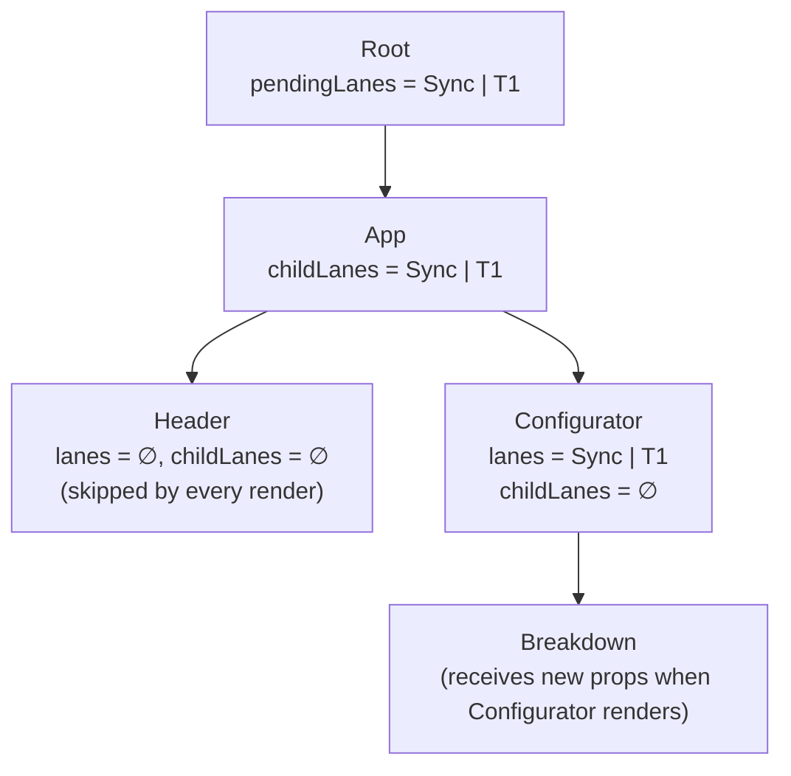
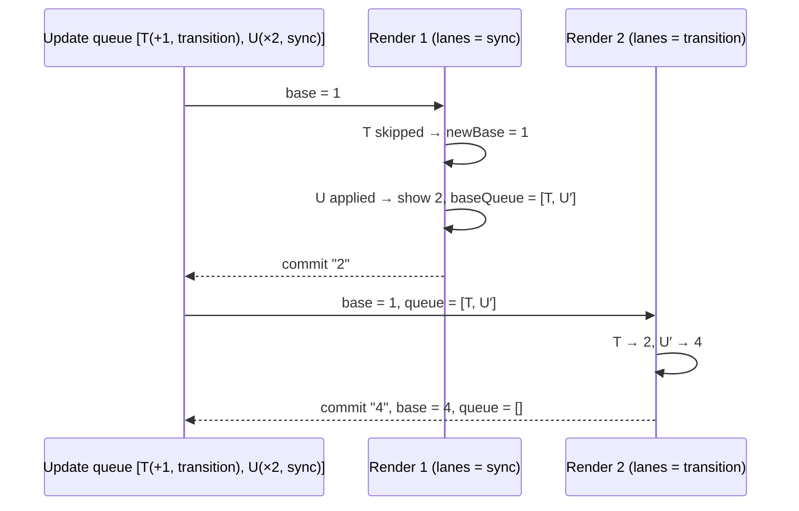
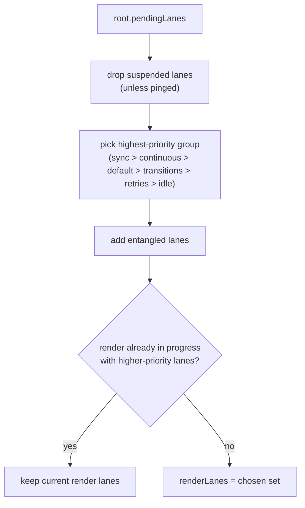

# 02 / 14 — Lanes: Conceptual Purpose

## 1. Lesson metadata

| | |
|---|---|
| **Level** | Professional |
| **Study time** | 6–7 hours (reading 2.5 h, experiments 2 h, exercises 2 h) |
| **Prerequisites** | [09 — Fiber nodes and units of work](./09-fiber-nodes-and-units-of-work.md), [10 — Current and work-in-progress trees](./10-current-and-work-in-progress-trees.md), [12 — Why rendering must be pure](./12-why-rendering-must-be-pure.md), [13 — Scheduling and update priorities](./13-scheduler-and-priorities.md), [01/15 — Update queues and batching](../01-react-fundamentals/15-update-queues-and-batching.md), bitwise operators ([MDN](https://developer.mozilla.org/en-US/docs/Web/JavaScript/Reference/Operators/Bitwise_AND)) |
| **Next** | [15 — Interruptible, restartable, abandoned renders](./15-interruptible-restartable-abandoned-rendering.md) |
| **Related** | [17 — How hooks attach to Fiber](./17-hooks-and-fiber-state.md), [23 — Transitions and deferred rendering](./23-transitions-and-deferred-rendering.md), [24 — Suspense and thrown thenables](./24-suspense-conceptual-internals.md), [Phase 3/01 — `useState` internals and update semantics](../03-react-state-and-hooks/01-usestate-internals-and-update-semantics.md) |

**Learning objectives.** After this lesson you can:
1. Explain what a **lane** is (one bit in an integer bitmask that names a "channel" of work), what a **set of lanes** is, and why representing priority as a *set of independent bits* is more expressive than a single priority number or expiration timestamp.
2. Describe the lifecycle of a lane: assigned to an update, recorded on the fiber and on the root, selected for a render, removed after commit, and re-scheduled if skipped.
3. Explain how a render decides **which updates belong to it** (subset test), what happens to the updates it **skips**, and why skipped updates are **rebased** so that final state is the same as applying every update in the order issued.
4. Predict the intermediate and final values of state when urgent and transition updates interleave, including how often updater functions are invoked.
5. Explain how lanes propagate through the tree (`lanes` on the updated fiber, `childLanes` on ancestors), enabling bailouts and subtree pruning ([09 §2.7](./09-fiber-nodes-and-units-of-work.md)).
6. Describe, conceptually, entanglement, suspended/pinged lanes, expiration and starvation handling.
7. Implement a toy lane system (bit operations, root bookkeeping, update-queue rebasing) and verify its invariants with a permutation test.
8. State what is public (nothing about lane bits) and what is implementation detail, and how to reason about lanes without ever seeing one.

**Concepts covered:** bitmask, lane vs lanes, lane groups (transition/retry), `pendingLanes`, `suspendedLanes`, `pingedLanes`, `expiredLanes`, `entangledLanes`, `fiber.lanes`/`childLanes`, update lane, render lanes, subset test, skipped updates, base state / base queue, rebasing, transition lane rotation, history (expiration times → lanes), higher-priority-wins, no priority inversion within a queue.

> **Implementation-detail warning, applies to the entire lesson.** React exposes **no** public API for lanes. The existence of "lanes", their names, count, bit positions, grouping and the exact selection algorithm are internal and have changed across releases (they replaced "expiration times" in the reconciler during the React 17/18 era and gained new lanes, e.g. for deferred values, in later versions). **Every bit layout in this lesson is a labelled toy.** Names of real functions and constants (such as `SyncLane`, `DefaultLane`, `TransitionLanes`, `mergeLanes`, `getNextLanes`, `pendingLanes`) are given only where the author is confident they exist at the time of writing; the lane list below was checked against `packages/react-reconciler/src/ReactFiberLane.js` on `main` and the installed `react-dom@19.3.1` on 2026-10-22 (see the real-values note in §2.3).

---

## 2. Deep conceptual explanation

### 2.1 What problem is this lesson solving?

[13](./13-scheduler-and-priorities.md) described *what kinds of priority exist* and *how the Scheduler runs React's tasks*. This lesson answers the question one level down: **how does React represent "which pending updates are part of this render?"** Three requirements make that harder than it sounds:

1. **Selective rendering.** At a given moment a root may hold several pending updates of different urgency, some of which must wait. A render must include *exactly* the updates it is responsible for and ignore the rest — while still producing a UI consistent with the state it shows.
2. **Correctness of skipped work.** An update that is skipped because it is low priority must not be *lost* or applied in the wrong order. When it is eventually rendered, the final state must equal what you would get by applying all updates in the order they were issued. Otherwise, adding transitions to an app would change its results.
3. **Cheap bookkeeping.** Each fiber needs to answer "do I or any descendant have work for *this* render?" thousands of times per update ([09 §2.7](./09-fiber-nodes-and-units-of-work.md)). The representation must make that test a couple of machine instructions and must fit in a field on every fiber.

The representation React uses is **lanes**: a priority/"channel" encoded as a single bit in a 32-bit integer; sets of channels are the integers formed by OR-ing bits. Everything in the rest of the lesson is a consequence of that choice.

### 2.2 History in one paragraph (why lanes exist)

Before lanes, the reconciler's central scheduling datum was an **expiration time**: a single number per update meaning "this update must be flushed by time T"; smaller T meant more urgent. A render at expiration time E processed every update with expiration ≤ E... that is, **"all updates at least as urgent as this threshold"**. The model could not express *non-contiguous* sets: for example, "render the Suspense retry updates and the transition updates now, but skip the default-priority update that arrived in between", or "do this transition independently of that one". Features such as multiple concurrent transitions, Suspense retries and selective hydration made a **set-based** representation desirable. The lanes model (developed by the React team during the 17-era reconciler rewrite; React 17's own release shipped on it, and React 18 built its concurrent features on it) replaced the scalar with a bitmask: priority is a property of *which bit(s)* are set, and "the work for this render" is just a set (an integer) you can intersect, union and subtract.

### 2.3 Bits as channels: the vocabulary

A lane is **one bit**; "lanes" (plural) is any integer that may have several bits set. Operators map directly to set operations:

| Operation | JS | Meaning |
|---|---|---|
| Union (merge) | `a \| b` | "work in either set" |
| Intersection | `a & b` | "work in both" — nonzero ⇒ the sets overlap (`includesSomeLane`) |
| Subset test | `(set & x) === x` | "every bit of `x` is in `set`" (`isSubsetOfLanes(set, x)`) |
| Remove | `a & ~b` | "a without the bits of b" (`removeLanes`) |
| Isolate the **lowest set bit** | `a & -a` | "the single highest-priority lane in the set" (`getHighestPriorityLane`) |
| Empty | `0` | no work (`NoLanes`/`NoLane`) |

**Convention:** lower bit position = higher priority (so the lowest set bit is the most urgent lane). The isolate-lowest-bit identity `a & -a` works on two's-complement integers: `-a` flips all bits above the lowest set bit and keeps that bit, so the AND leaves only that bit. Example: `0b0110 & -0b0110 = 0b0010`.

**Why 31 lanes?** JavaScript bitwise operators work on signed 32-bit integers. React uses 31 usable bits (bit 31, the sign bit, is avoided so values stay non-negative small integers, which engines represent efficiently). Hence the lane space is small and **fixed**; the design allocates it as: a few single lanes for the "named" priorities, a **group** of lanes for transitions, a group for retries, and some for idle/offscreen/hydration variants.

**Conceptual table of lane kinds** (names are the ones the author is confident about in the source; ordering and bit values are *not* given because they change):

| Lane (concept) | What it is for |
|---|---|
| `SyncLane` | Discrete events, `flushSync`, legacy-root updates: render synchronously |
| `InputContinuousLane` (+ a hydration variant) | Continuous events (`mousemove`, scroll...) |
| `DefaultLane` (+ a hydration variant) | Everything else: timers, network callbacks, initial `root.render` |
| `TransitionLanes` (a **group** of several lanes) | `startTransition`/`useTransition` updates; independent transitions can occupy different lanes in the group |
| `RetryLanes` (a group) | Suspense boundaries retrying after data arrives |
| `SelectiveHydrationLane`, `IdleHydrationLane` | Hydration work at various priorities ([25](./25-hydration-and-selective-hydration.md)) |
| `IdleLane` | Lowest priority work |
| `OffscreenLane` | Work for hidden/prerendered content |
| Deferred lane(s) | `useDeferredValue` background re-renders. In current React these are a dedicated subset of the transition lane block (`TransitionDeferredLanes`, the last four transition lanes), or `OffscreenLane` when prerendering a hidden tree (`requestDeferredLane` in `ReactFiberWorkLoop`). |

### 2.4 Where lanes live

Lanes are stored on three kinds of objects; knowing which is which clarifies every algorithm:

| Object | Fields (conceptual names) | Meaning |
|---|---|---|
| **Update object** (an entry in a hook's or class's update queue) | `lane` | The lane this specific update was assigned when created |
| **Fiber** | `lanes`, `childLanes` | `lanes`: lanes of work scheduled **on this fiber** (e.g., it has a pending update, or a consumed context changed). `childLanes`: union of lanes of work scheduled **below** this fiber. |
| **FiberRoot** | `pendingLanes`, `suspendedLanes`, `pingedLanes`, `expiredLanes` (+ entanglement info, finished lanes, per-lane timing) | All lanes that have uncommitted work somewhere in the tree; those whose renders suspended; those whose suspended data has since arrived ("pinged"); those that have waited too long |

**Marking on schedule.** When `setState` runs, React (1) chooses a lane for the update ([13 §2.3](./13-scheduler-and-priorities.md)), (2) appends the update (tagged with that lane) to the hook's queue, (3) ORs the lane into the fiber's `lanes` (and its twin), (4) walks `return` pointers up to the root ORing the lane into each ancestor's `childLanes`, and (5) ORs it into the root's `pendingLanes`. Then root scheduling runs ([13 §2.4](./13-scheduler-and-priorities.md)).

### 2.5 Choosing the lanes for a render

When React is about to render a root it must choose **`renderLanes`** — the set of lanes this render pass is responsible for. Conceptually (`getNextLanes`):

1. Start from `root.pendingLanes`. If empty, nothing to do.
2. Remove lanes that are **suspended** (their last render suspended and data hasn't arrived) unless they have been **pinged**.
3. Take the **highest-priority group** among what remains: e.g., if sync work is pending, render only that; else continuous; else default; else **all pending transition lanes together** (they are batched as a group); else retry lanes; else idle/offscreen.
4. **Entanglement:** if some chosen lane is entangled with others, add them (they must be rendered together).
5. **Don't downgrade an in-progress render:** if a render is already underway with lanes `W` and the newly computed lanes are *lower* priority than `W`, keep `W` (don't interrupt more urgent work with less urgent work); if the new lanes are *higher*, the in-progress render is abandoned in favor of them ([13 §2.7](./13-scheduler-and-priorities.md), [15](./15-interruptible-restartable-abandoned-rendering.md)).

The result is stored while rendering (a "render lanes" value). Everything downstream asks the same question: *is lane X part of `renderLanes`?*

### 2.6 What a render does with `renderLanes`

**At the fiber level (bailouts).** In `beginWork`, a fiber with `fiber.lanes ∩ renderLanes = ∅` (no matching work on it) and unchanged props may bail out; if additionally `fiber.childLanes ∩ renderLanes = ∅`, the whole subtree is skipped ([09 §2.7](./09-fiber-nodes-and-units-of-work.md)). Work in *other* lanes remains recorded on the fibers (their `lanes`/`childLanes` stay set) and keeps the pending bits set on the root, so a later render for that lane will find it.

**At the update-queue level (the interesting part).** When a component with state renders, React processes its update queue. For each update:

- If the update's lane is a **subset** of `renderLanes` (i.e., `(renderLanes & update.lane) === update.lane`), it is **included**: apply it to the running state.
- Otherwise it is **skipped**.

Skipping complicates ordering. Suppose the queue is `[T, U]` where `T` (lane transition) was issued before `U` (lane sync) and the render is for the sync lane only. React renders with `U` applied but not `T` — yet `U` was issued *after* `T`, and `U` might be a function of `T`'s result (`n => n * 2`). To guarantee the final state is the same as sequential application, React keeps two things per queue:

- **`baseState`**: the state *before the first skipped update* — the base on which skipped work will later be re-applied.
- **`baseQueue`**: the list consisting of the skipped updates **and every update after the first skipped one** (including the already-applied ones, whose lane is cleared to "always include" in the copy, so they will be re-applied).
- **`memoizedState`**: the state to **display** now: the base plus whichever updates were included.

This is called **rebasing**: later, when the skipped lane is rendered, processing starts again from `baseState` and replays the whole `baseQueue` in the **original order**, now including everything. If nothing is skipped, `baseState` simply advances to the new state and `baseQueue` is empty.

**Worked example.** `n` starts at `1` (baseState = memoizedState = 1). In one click handler:

```tsx
startTransition(() => setN(x => x + 1));  // T: lane = transition
setN(x => x * 2);                          // U: lane = sync
```

Queue (in issue order): `[T: +1, U: ×2]`.

| Step | renderLanes | Processing | memoizedState (shown) | baseState | baseQueue |
|---|---|---|---|---|---|
| 0 | — | before | 1 | 1 | `[]` |
| 1 | sync | `T`: not subset → **skip**, `newBaseState = 1`. `U`: included → state `1×2 = 2`; since a skip happened earlier, also copied to the base queue with lane cleared (`U′`) | **2** | 1 | `[T, U′]` |
| — | commit 1: UI shows `2` | | | | |
| 2 | transition | start from `baseState 1`: `T`: included → 2; `U′` (always included) → 4. No skip ⇒ base advances. | **4** | 4 | `[]` |
| — | commit 2: UI shows `4` | | | | |

The UI passes through `2` before reaching `4`. `2` is **not** a state you'd get from sequential application of any prefix of `[T, U]` (prefixes give `1`, `2` (after T), `4`). It is "urgent updates applied on top of the committed state" — the *best available picture for the urgent lane right now*. The final state `4` equals sequential application `(1+1)×2 = 4`. React guarantees **eventual consistency with issue order**, not that every displayed intermediate is a sequential prefix.

**Consequence for updater functions.** The updater `U` (`x => x * 2`) ran **twice** across the two renders (once in step 1, once re-applied as `U′` in step 2). Updaters, reducers and state initializers therefore **must be pure** ([12](./12-why-rendering-must-be-pure.md)): they are replayed by design, not only by Strict Mode.

### 2.7 Lane assignment details worth knowing (implementation detail)

- **Transition lane rotation.** All updates created within one transition "event" share one lane from the transition group; the *next* transition claims the *next* lane in the group, wrapping around. So two independent transitions started in separate events can occupy different lanes (and can be reasoned about independently), although root scheduling tends to render all currently pending transition lanes together as a group.
- **Entanglement.** React sometimes forces lanes to render *together* (e.g., when a later transition update touches the same hook queue as an earlier pending one, so that showing one without the other could display an inconsistent combination; also for certain hydration/sync cases). Conceptually: *independent when safe, entangled when consistency demands it.*
- **Suspended/pinged lanes.** If rendering a lane suspends and no fallback can be committed (typical for a transition that would hide visible content), the root records the lane as **suspended** so React doesn't spin re-rendering it. When the awaited promise resolves, the lane is **pinged**, becoming eligible again ([24](./24-suspense-conceptual-internals.md)). Suspense boundaries use **retry lanes** to re-render themselves.
- **Expiration.** Lanes get timestamps when first scheduled; when one has waited longer than its class allows (the rough magnitudes are in [13 §2.6](./13-scheduler-and-priorities.md)), it is added to `expiredLanes` and rendered without yielding. Idle/offscreen lanes do not expire.
- **Context.** When a context provider's value changes, React walks the subtree to consumers and ORs the current render's lane into their `lanes` (and ancestors' `childLanes`) so they re-render in this pass ([Phase 3/13](../03-react-state-and-hooks/13-usecontext-and-propagation.md)).

### 2.8 Why a set of independent bits is the right abstraction

| Capability | Scalar expiration time | Single priority enum | **Bitmask of lanes** |
|---|---|---|---|
| Express "these N updates, not those M" | No (threshold only) | No | **Yes** (any subset) |
| Run two independent transitions separately | Hard | No | **Yes** (distinct bits) |
| Test "does this fiber have relevant work?" | compare | compare | `&` (one instruction) |
| Combine pending work on a parent | `min` | `min` | `\|` (exact union, nothing lost) |
| Remove completed work | not representable precisely | not precisely | `& ~lanes` |
| Memory per fiber | 1 number | 1 number | 2 ints (`lanes`, `childLanes`) |
| Number of distinguishable channels | unbounded (but conflated with time) | few | **31** (hard cap) |

The `min`-vs-`|` row is the important one: with scalars, summarizing "the most urgent work below me" with a `min` **loses** the presence of less urgent work below, which then needs recomputation by re-walking; with bits, `childLanes` is an exact summary.

### 2.9 Misconceptions

| Misconception | Reality |
|---|---|
| "Lanes are threads or parallel pipelines." | They are *labels* on work. Only one render runs at a time on one thread. |
| "A lane is a priority number." | A lane is a bit; priority is derived from which bits are set and their order. A set may contain many lanes. |
| "There is an API to choose a lane." | None. You choose *intent* (`startTransition`, `flushSync`, defer). |
| "A skipped update is dropped and re-queued at the end." | It stays in the queue; the final state respects the original order via rebasing. |
| "The UI always shows states from sequential application." | Intermediate displays can be "urgent updates on top of committed state", which may not be a sequential prefix; the *final* state is consistent. |
| "The transition's updater runs once." | It may run in multiple renders (abandoned ones, rebased replays, Strict Mode). It must be pure. |
| "Transitions are always rendered in one lane." | They rotate through a group; independent transitions can have distinct lanes. |
| "More lanes = more concurrency." | The limit of 31 bits is a design cap; concurrency is about interleaving, not parallelism. |
| "`fiber.lanes` tells me which update is pending." | It records *that* work exists in some lanes, not which updates; the queue holds the updates. |

---

## 3. Internal mechanics

### 3.1 Public guarantee

What you can rely on (documentation-level):

- Updates inside discrete event handlers are processed urgently; updates inside `startTransition` are non-urgent and interruptible ([react.dev — `useTransition`](https://react.dev/reference/react/useTransition)).
- State updates are **applied in the order they were issued** with respect to the final state; transitions do not reorder the logical history of a state variable (see [react.dev — `useState` → updater functions and batching](https://react.dev/reference/react/useState#updating-state-based-on-the-previous-state)).
- An urgent update may be shown **before** an earlier-issued transition update ("urgent first"), but both will be reflected eventually.
- Updater functions and reducers must be **pure**; React may call them more than once ([react.dev — `useState` caveats](https://react.dev/reference/react/useState)).
- You may not observe or control lanes.

### 3.2 Teaching model

> Every update carries a **channel** (lane). A render is allowed to run only the channels it has been assigned. Updates in other channels are left in place and re-applied later on top of the right base state so that the end result is as if every update had been applied in the order issued. Fibers carry two summaries — "work on me in channels …" and "work below me in channels …" — which let the render skip anything irrelevant to its assigned channels.

### 3.3 Implementation details

Checked 2026-10-22 against `ReactFiberLane`, `ReactFiberHooks`, `ReactFiberClassUpdateQueue`, `ReactFiberWorkLoop`.

- **Lane constants** are module-level integers; helper functions (`mergeLanes`, `removeLanes`, `includesSomeLane`, `isSubsetOfLanes`, `getHighestPriorityLane`, `laneToIndex` using `31 - Math.clz32(lane)`, `pickArbitraryLane`...) are one-line bit expressions.
- **Per-lane bookkeeping on the root** uses arrays indexed by lane index (e.g., event times, expiration times) — which is why the lane space must be small.
- **Selecting lanes** (`getNextLanes`) uses helper `getHighestPriorityLanes` that returns a *group* for the highest-priority class, then applies filters for suspended/pinged, entanglement and "work in progress lanes" rules.
- **Hook queue processing** lives in the shared update processing used by `useState`/`useReducer` (`updateReducer` conceptually) and, separately, in the class/HostRoot queue processing; both implement the base-state/base-queue rebasing described above. Rebasing cloned updates get a special "no lane" value so they are always included on replay.
- **Eager state.** When a hook's queue is empty, React may compute the new state **eagerly at dispatch time** (to bail out without rendering if the state is unchanged). Therefore an updater can be called *at dispatch* in addition to render. This optimization's details differ between versions; another reason updaters must be pure. (Observed on 19.3.1 in the §2.6 example: the transition updater `x => x + 1` ran once, eagerly at dispatch, and was not re-invoked on the rebased replay because its eagerly computed state was reused, while the urgent updater `x => x * 2` ran twice, once per render.)
- **Legacy roots** (`ReactDOM.render`, removed in React 19) use only the sync lane: every update is synchronous and none of the rebasing logic is ever exercised.

### 3.4 Complexity

- `childLanes` bubbling on schedule: O(depth) per update.
- Subtree skipping: O(1) per skipped subtree.
- Queue processing: O(queue length) per render per hook with pending updates; skipped updates remain in the queue (cloned) until their lane renders. A pathological pattern — many transition updates queued while urgent ones keep cutting in — grows the base queue until the transition renders.

---

## 4. Step-by-step execution walkthrough

**Scenario.** A product configurator. State: `qty` (number, via `useState`) and a derived "price breakdown" computed in a heavy child driven by `deferredQty`... To keep the trace about *lanes*, we use two states and one handler:

```tsx
function Configurator() {
  const [qty, setQty] = useState(1);            // hook A
  const [promo, setPromo] = useState("none");   // hook B
  const [isPending, startTransition] = useTransition();
  console.log("render", { qty, promo, isPending });
  return (
    <>
      <button onClick={() => {
        startTransition(() => setPromo("SUMMER"));    // T1 on hook B  (transition lane)
        setQty((q) => q + 1);                          // U1 on hook A  (sync lane)
      }}>add</button>
      <Breakdown qty={qty} promo={promo} />
    </>
  );
}
```
Assume non-Strict mode, `Breakdown` is a heavy memoized child (~200 ms in many small units), and the user clicks twice, 80 ms apart.

| t (ms) | Event | Update queues / root state | Render lanes | What is shown |
|---|---|---|---|---|
| 0 | Click 1 handler: `T1 = {lane: TL1, set "SUMMER"}` on hook B's queue; `isPending=true` (urgent lane update on the transition hook); `U1 = {lane: Sync, q+1}` on hook A's queue. `Configurator.lanes = Sync|TL1`; root `pendingLanes = Sync|TL1` | A: `[U1]` B: `[T1]` | — | (nothing yet) |
| 1 | Sync flush | | `renderLanes = Sync` | **Render:** hook A includes U1 → `qty=2`; hook B: T1 skipped → `promo="none"`, baseState `"none"`, baseQueue `[T1]`. `isPending=true`. Log: `render {qty:2, promo:"none", isPending:true}`. `Breakdown` receives `qty=2`, so re-renders... *but see note.* |
| 3 | Commit 1 | `pendingLanes = TL1` | | UI: qty 2, pending indicator |
| 5 | Transition render starts | | `renderLanes = TL1` | Hook B: base `"none"` → T1 included → `"SUMMER"`; hook A: queue empty. Log: `render {qty:2, promo:"SUMMER", isPending:false}` (slicing begins in `Breakdown`'s children) |
| 80 | Click 2 handler: `T2 = {lane: TL2, set "SUMMER"}` (same value for illustration), `U2 = {lane: Sync, q+1}` | A: `[U2]`; B: `[T2]` | Sync is higher priority than the in-progress `TL1` render | |
| 81 | In-flight TL1 render **abandoned**; stack reset; sync render: `renderLanes = Sync` | | `Sync` | Render: `qty=3`; hook B: T2 skipped (lane TL2) *but* hook B's baseQueue also still has any un-committed earlier skipped updates; log: `render {qty:3, promo:"none", isPending:true}` |
| 83 | Commit 2 | `pendingLanes = TL1|TL2` (TL1's work is **still pending**: it never committed) | | UI qty 3 |
| 85… | Next transition render: `getNextLanes` picks **all pending transition lanes together** (`TL1|TL2`) | | `renderLanes = TL1|TL2` | Hook B replays `[T1, T2]` from base `"none"` → `"SUMMER"`; log: `render {qty:3, promo:"SUMMER", isPending:false}`; slices | Still showing promo "none" |
| ≈ 290 | Commit 3 | `pendingLanes = ∅` | | Both updates reflected |

**Notes.**
- *Note on `Breakdown`:* in the sync render `Breakdown` has new `qty`, so it re-renders in that urgent lane (its heavy subtree is part of the urgent pass!). To keep clicks cheap the heavy part must depend only on transition-driven state, or be deferred separately; otherwise "urgent" includes the heavy work (see [13 §5.2](./13-scheduler-and-priorities.md)).
- **Ordering rule observed:** the second click's urgent update was rendered *before* the first click's still-pending transition finished, and the transition restarted — **but the first transition's update was not lost**; its lane stayed in `pendingLanes`, its update stayed in hook B's queue.
- **Transition lane batching:** both transitions rendered together because `getNextLanes` returned the whole pending transition group.

---

## 5. Code examples

### 5.1 Minimal example — lane bit operations (a labelled toy layout)

```ts
// TOY layout for teaching. NOT React's real constants or bit positions.
type Lanes = number;
type Lane = number;

const NoLanes: Lanes = 0;
const SyncLane: Lane = 0b0000001;
const ContinuousLane: Lane = 0b0000010;
const DefaultLane: Lane = 0b0000100;
const TransitionLane1: Lane = 0b0001000;
const TransitionLane2: Lane = 0b0010000;
const TransitionLanes: Lanes = TransitionLane1 | TransitionLane2;
const IdleLane: Lane = 0b1000000;

const mergeLanes = (a: Lanes, b: Lanes): Lanes => a | b;
const removeLanes = (set: Lanes, remove: Lanes): Lanes => set & ~remove;
const includesSomeLane = (a: Lanes, b: Lanes): boolean => (a & b) !== NoLanes;
const isSubsetOfLanes = (set: Lanes, subset: Lanes): boolean => (set & subset) === subset;
const getHighestPriorityLane = (lanes: Lanes): Lane => lanes & -lanes; // lowest set bit

const pending = mergeLanes(mergeLanes(TransitionLane2, DefaultLane), TransitionLane1);
console.log(pending.toString(2));                                // (1)
console.log(getHighestPriorityLane(pending).toString(2));        // (2)
console.log(includesSomeLane(pending, TransitionLanes));         // (3)
console.log(isSubsetOfLanes(pending, SyncLane));                 // (4)
console.log(removeLanes(pending, TransitionLanes).toString(2));  // (5)
console.log(isSubsetOfLanes(TransitionLanes, TransitionLane2));  // (6)
```

**Predict** all six lines.

**Result.**
```text
(1) 11100     // 0b11100: Default | T1 | T2
(2) 100       // lowest set bit = DefaultLane (more urgent than transitions)
(3) true
(4) false
(5) 100       // only Default remains
(6) true
```
**Why.** (1) Union of three bits. (2) `x & -x` isolates the lowest set bit; by the "lower bit = more urgent" convention that is the most urgent pending lane: Default. (3) Intersection non-empty. (4) `SyncLane` is not in the set. (5) Clearing the transition group leaves Default. (6) A one-lane set is a subset of the group.

**Edge case.** `x & -x` for `x = 0` is `0` ("no lane") — callers must handle `NoLanes`.

### 5.2 Practical example — observing rebasing in real React

```tsx
import { useState, useTransition } from "react";

export function RebaseDemo() {
  const [n, setN] = useState(1);
  const [isPending, startTransition] = useTransition();

  console.log("render n =", n, "isPending =", isPending);

  return (
    <button
      onClick={() => {
        startTransition(() => setN((x) => x + 1)); // T: +1, transition lane
        setN((x) => x * 2);                         // U: ×2, urgent lane
      }}
    >
      n = {n} {isPending ? "(pending)" : ""}
    </button>
  );
}
```

**Predict.** Click once (non-Strict, development build). What is logged and what is the final text?

**Result.**
```text
render n = 2 isPending = true
render n = 4 isPending = false
```
and the button finally reads `n = 4`.

**Why.** The urgent render includes only `U` (`1 × 2 = 2`), skipping `T`, and `isPending` is `true` in the same urgent render. The transition render replays from the base state: `T` then `U′` → `(1 + 1) × 2 = 4`. If the transition render is abandoned and restarted, the updater functions run again (you would see more logs only if you log inside the updaters). If you log *inside* the updaters you will see `U` invoked twice (once per render), and possibly `T` invoked more than once under Strict Mode/restarts — this is the observable proof that updaters are replayed.

**Practical lesson.** Because the final value is always the sequential result, a transition-wrapped `setState` can be safely *combined* with urgent updates to the same state — as long as updaters are pure and **functional** (`x => …`), not computed from a captured stale `n`.

### 5.3 Incorrect example — stale closure values and impure updaters

```tsx
let analyticsCount = 0;

export function Broken() {
  const [n, setN] = useState(1);
  const [, startTransition] = useTransition();

  return (
    <button
      onClick={() => {
        startTransition(() => setN(n + 1));          // (1) captured value: always "1 + 1"
        setN(n * 2);                                  // (2) captured value: always "1 * 2"
        setN((x) => {
          analyticsCount += 1;                        // (3) side effect inside an updater
          return x + 10;
        });
      }}
    >
      {n}
    </button>
  );
}
```

**Predict.** Final `n` after one click with `n = 1`? And is `analyticsCount` 1?

**Result.** Value updates (1) and (2) replace the state with *constants computed from the captured `n`*: (1) sets `2`, (2) sets `2`, and (3) adds 10 to whatever precedes it in queue order. The queue in issue order is `[set 2 (T), set 2 (U), +10 (U)]`; sequential application gives `((1→2)→2)→12`. The *displayed* progression: urgent render skips (1), applies (2) and (3): `2 → 12`; transition render replays from base `1`: `2 → 2 → 12`. Final **12**; but the intention "increment, double, add ten" would be `(1+1)*2+10 = 14` — the closure-based writes ignored each other's results. `analyticsCount` ends **greater than 1** (the updater at (3) runs in the urgent render, again when replayed in the transition render, possibly eagerly at dispatch, and twice more under Strict Mode).

**Why it fails.** (1)/(2): value updates overwrite; they are not functions of pending state. (3): updater purity violated; count depends on scheduling.

### 5.4 Corrected implementation

```tsx
export function Fixed({ onAddedToCart }: { onAddedToCart: (qty: number) => void }) {
  const [n, setN] = useState(1);
  const [, startTransition] = useTransition();

  return (
    <button
      onClick={() => {
        startTransition(() => setN((x) => x + 1)); // functional: composes with other updates
        setN((x) => x * 2);
        setN((x) => x + 10);                        // pure updater
        onAddedToCart(n);                           // side effect in the HANDLER, once per click
      }}
    >
      {n}
    </button>
  );
}
```

**Explanation.** All three updates are functions of the *pending* state, so the sequential result is `((1+1)×2)+10 = 14` regardless of how lanes interleave. Side effects live in the event handler (exactly once). If several state variables must change together consistently, prefer **one reducer** (`useReducer`) so related changes are a single update with a single lane; transitions that update only part of a related set can show inconsistent combinations ([Phase 3/03](../03-react-state-and-hooks/03-usereducer-and-reducer-architecture.md)).

### 5.5 Advanced example — a toy update queue with skipping and rebasing, plus a permutation test

```ts
// Toy implementation of React's "base state / base queue" idea. NOT React's code.
interface Update {
  lane: number;                 // 0 = "no lane" = always included (used for rebased clones)
  apply: (state: number) => number;
  label: string;
}
interface Hook {
  baseState: number;
  baseQueue: Update[];
  memoizedState: number;
}

const isSubset = (set: number, subset: number): boolean => (set & subset) === subset;

function processQueue(hook: Hook, pending: Update[], renderLanes: number): Hook {
  const queue = [...hook.baseQueue, ...pending];
  let newState = hook.baseState;
  let newBaseState = hook.baseState;
  const newBaseQueue: Update[] = [];
  let skipped = false;

  for (const u of queue) {
    if (!isSubset(renderLanes, u.lane)) {
      // Not part of this render: skip it, remember the state it must be applied on top of.
      if (!skipped) {
        skipped = true;
        newBaseState = newState;
      }
      newBaseQueue.push(u);
    } else {
      // Included: apply for display. If anything was skipped earlier, keep a clone
      // (lane cleared) so it is replayed in order later.
      if (skipped) newBaseQueue.push({ ...u, lane: 0 });
      newState = u.apply(newState);
    }
  }
  return {
    memoizedState: newState,
    baseState: skipped ? newBaseState : newState,
    baseQueue: skipped ? newBaseQueue : [],
  };
}

// ---- Worked example from §2.6 ----
const SYNC = 0b01;
const TRANS = 0b10;
const updates: Update[] = [
  { lane: TRANS, apply: (s) => s + 1, label: "T:+1" },
  { lane: SYNC, apply: (s) => s * 2, label: "U:*2" },
];

let hook: Hook = { baseState: 1, baseQueue: [], memoizedState: 1 };
hook = processQueue(hook, updates, SYNC);
console.log(hook.memoizedState, hook.baseState, hook.baseQueue.map((u) => `${u.label}@${u.lane}`));
hook = processQueue(hook, [], TRANS);
console.log(hook.memoizedState, hook.baseState, hook.baseQueue.length);

// ---- Property: any order of rendering the lanes ends at the sequential result ----
function sequential(initial: number, ups: Update[]): number {
  return ups.reduce((s, u) => u.apply(s), initial);
}
function permutations<T>(xs: T[]): T[][] {
  if (xs.length <= 1) return [xs];
  return xs.flatMap((x, i) => permutations([...xs.slice(0, i), ...xs.slice(i + 1)]).map((p) => [x, ...p]));
}

const LANES = [0b001, 0b010, 0b100];
const ups: Update[] = [
  { lane: 0b100, apply: (s) => s + 3, label: "a:+3" },
  { lane: 0b001, apply: (s) => s * 2, label: "b:*2" },
  { lane: 0b010, apply: (s) => s - 1, label: "c:-1" },
  { lane: 0b100, apply: (s) => s * 5, label: "d:*5" },
];
const expected = sequential(7, ups);
for (const order of permutations(LANES)) {
  let h: Hook = { baseState: 7, baseQueue: [], memoizedState: 7 };
  let first = true;
  for (const lane of order) {
    h = processQueue(h, first ? ups : [], lane);
    first = false;
  }
  console.assert(h.memoizedState === expected, `order ${order} -> ${h.memoizedState} !== ${expected}`);
}
console.log("sequential =", expected);
```

**Predict** the first two `console.log` lines and the final one.

**Result.**
```text
2 1 [ 'T:+1@2', 'U:*2@0' ]
4 4 0
sequential = 95
```
The last value is computed from `ups` in issue order starting at `7`: `7 + 3 = 10`, `10 x 2 = 20`, `20 - 1 = 19`, `19 x 5 = 95`. The `console.assert` never fires: for every permutation of rendering the three lanes one at a time, the final state is `95`.

Trace of one non-trivial order, `[0b100, 0b001, 0b010]` starting from base 7 and queue `[a(100), b(001), c(010), d(100)]`:
1. Render lane `100`: `a` included → 10; `b` skipped (base state captured = 10); `c` skipped; `d` included → 50 (clone `d′` lane 0 in base queue). Display 50; base 10; baseQueue `[b, c, d′]`.
2. Render lane `001`: from base 10: `b` included → 20; `c` skipped (newBaseState = 20); `d′` (lane 0) included → 100 (clone `d″`). Display 100; base 20; baseQueue `[c, d″]`.
3. Render lane `010`: from base 20: `c` → 19; `d″` → 95. No skip → base 95, empty queue. Display **95** ✓.

**What this teaches.** (1) Skipped updates are never lost; (2) the base state is "the state just before the first skipped update"; (3) clones after the first skip carry lane `0`, so they are always replayed; (4) intermediate displays (50, 100) are not sequential prefixes, but the final state always is; (5) updaters are re-applied: `d`'s function ran in steps 1, 2 and 3.

**Trade-offs/limitations of the toy.** Real React also handles reducers with different arguments, eager state, entanglement, error/abort paths, class and root queues, and per-fiber twin queues; but the algorithmic core is this.

---

## 6. Visual explanations

### 6.1 A lane word

```text
bit position:   6   5   4   3   2   1   0        (TOY layout)
                Idle  -  T2  T1  Def Cont Sync
pendingLanes:   0   0   1   1   1   0   0   =  0b0011100
                          └── transitions ──┘ └ default
getHighestPriorityLane = pending & -pending = 0b0000100 (Default)
```

### 6.2 Lanes on the tree



### 6.3 Rebasing timeline



### 6.4 How a render picks lanes (conceptual)



---

## 7. Alternative approaches and trade-offs

| Design | How "work for this render" is chosen | Can render an arbitrary subset? | Order-preserving for skipped updates? | Cost | Notes |
|---|---|---|---|---|---|
| **Lanes (React 18+)** | Bitmask set per render | Yes | Yes, via base state/queue rebasing | O(1) per test; 31-lane cap | Independent transitions, retries, hydration |
| Expiration times (React ≤ 17 internals) | Threshold on one number | No (all ≥ threshold) | Required hacks for skipped work | O(1) | Hard to express Suspense + transition combos |
| Single priority number per root | One priority at a time | No | n/a | O(1) | Conflates independent work |
| Separate render per update (no batching) | Each update alone | Trivial | Natural | Many renders | Wasteful, can show inconsistent intermediates |
| Event sourcing / CRDT-style op log | Replay log with filters | Yes | Yes | Log growth, complexity | Used in collaborative editors; heavier than UI needs |
| Optimistic UI libraries (e.g. rebasing optimistic updates onto server state) | Rebase local ops over authoritative base | n/a | Yes | Domain-specific | Same *idea* as React's rebase; see [Phase 6/05](../06-data-fetching-and-state-ecosystems/05-optimistic-updates.md), `useOptimistic` ([Phase 3/22](../03-react-state-and-hooks/22-modern-hooks-and-apis.md)) |

**A scenario where lanes are not the best tool.** For an application *outside* React's model — a canvas editor or a game with its own update loop — you don't need subset rendering: a fixed-timestep loop with an immutable snapshot per frame is simpler. And for **React app code**, the lane system is fixed: if you need domain-specific priorities (e.g., "premium user's updates first") you cannot add lanes; you must model them at the data layer (queues, scheduling of your own tasks) and feed React with already-ordered updates.

---

## 8. Best practices and anti-patterns

**Best practices**
- **Use functional updaters** (`setX(prev => …)`) whenever the next state depends on the previous one — especially when transitions or batching may interleave updates.
- **Keep updaters/reducers pure and cheap**; they are replayed.
- Prefer `useReducer` (one update = one coherent change) for state whose parts must change together.
- Keep urgent state minimal; put expensive derived UI behind transitions/deferred values with memoized consumers.
- Treat intermediate displays as potentially "urgent-on-top-of-committed" states; design UI so those combinations are meaningful (e.g., show the input value immediately with old results marked stale).
- Reason in terms of *intent* (urgent vs transition) and never in terms of lane bits in application code.

**Beginner mistakes**
- Computing next state from a captured variable instead of the updater form.
- Expecting `setState` inside `startTransition` to apply "instantly but with lower CPU".
- Putting side effects inside updater functions.

**Experienced-developer mistakes**
- Splitting related state across urgent and transition updates, producing inconsistent intermediate screens (e.g., a filter label updated urgently, results updated later, with no stale indication).
- Assuming the displayed state is always a sequential prefix; asserting equality of intermediate states in tests.
- Reading lane-related internals (via internal packages/DevTools hooks) to make behavior decisions in production code.
- Over-queuing transition updates at high frequency, growing base queues until they render.

**Smells**
- Updaters with `console.log`/`fetch`/`track`.
- Two states where one reducer would express invariants.
- A transition that updates only half of a "form" of related fields.

**Justified exceptions**
- Splitting urgent `text` and transition `query` state is intentionally *different* in lane but related in meaning; make the UI honest with `isPending`/stale styling.
- Using `flushSync` to force a consistent commit before reading DOM.

---

## 9. Real-world application

| Domain | Lane-related behavior | Engineering constraints |
|---|---|---|
| **E-commerce cart** | Quantity buttons: urgent `+1` updates; recomputing totals/shipping in a transition. Rapid clicks produce many sync updates; skipped transition updates rebase. | Use functional updates for quantities; derive totals from the *committed* quantity for correctness-critical displays (price at checkout comes from the server). |
| **Forms with live preview** | Field input urgent; preview in a transition. | Keep the "source of truth" for submission in urgent state, not in the deferred copy. |
| **Dashboards** | Filters (urgent) vs charts (transition). | Memoize charts; show `isPending` skeletons; avoid mixing store-driven sync updates with heavy transitions on the same data. |
| **Optimistic UI** | `useOptimistic` layers temporary state over the real state and *rebases* when the real state changes — conceptually the same mechanism ([Phase 3/22](../03-react-state-and-hooks/22-modern-hooks-and-apis.md)). | Updaters/reducers for optimistic state must be pure; they are replayed when the base changes. |
| **Realtime feeds** | Store updates are sync-lane (via `useSyncExternalStore`), transitions in the same tree are low priority; heavy sync updates can starve transitions until they expire. | Throttle store updates; isolate heavy transition consumers. |
| **Testing** | Tests flush everything via `act`, hiding intermediate lane states. | Don't assert intermediate renders; assert final DOM and user-visible pending indicators. |

---

## 10. Debugging and troubleshooting

**You cannot print a lane from user code.** Debug by *behavior*:

**Symptom 1: "My transition update applies twice / my updater runs more than I expect."**
- *Repro:* log inside the updater (`setN(x => { console.log("updater", x); return x + 1 })`) with a transition + urgent update (§5.2).
- *Investigation:* count calls across renders: urgent render, replay in transition render, Strict Mode doubling, eager computation at dispatch.
- *Root cause:* by design, updaters are replayed during rebasing/restarts.
- *Fix:* remove side effects from updaters; make them pure; move effects to handlers/effects.

**Symptom 2: "The UI shows a state I never set (e.g., 2 then 4)."**
- *Root cause:* urgent-on-committed intermediate display (§2.6).
- *Fix:* if the intermediate is semantically wrong, restructure so related fields change in one update (reducer) and one lane; or keep derived data in the same lane as its source.

**Symptom 3: "Transition result seems to be lost / not applied until later."**
- *Investigation:* is a stream of urgent updates continuously preempting it ([13 §10](./13-scheduler-and-priorities.md))? Is the render suspending without a fallback (waiting for a promise)? Is the root pending in DevTools Profiler commits?
- *Root cause:* starvation until expiration, or suspended lane awaiting data.
- *Fix:* reduce urgent frequency; ensure the data promise resolves; provide Suspense boundaries.

**Symptom 4: "Test passes but real app shows flicker/old data."** `act` flushes all lanes; real timing exposes the urgent/transition split. Reproduce with CPU throttling and the Performance panel.

**Symptom 5: Large queue growth/memory.** Many transition updates to one hook while urgent ones keep rendering; check update frequency and throttle at the source.

**Tools.** React DevTools Profiler (commit sequence: urgent commit followed by transition commit); `<Profiler>` callbacks with `phase`; Chrome Performance panel and, in recent React versions, the React performance tracks which visualize scheduled/rendered lanes *(React Performance Tracks, introduced in React 19.2)*; logging inside render (counts, not exact sequences).

---

## 11. Exercises

### Level A — Knowledge
A1. What is a lane? What is a "set of lanes"? How is each represented?
A2. Write the bit expressions for union, intersection test, subset test, removal, and "highest-priority lane".
A3. Why is the lane space limited to 31 bits?
A4. Name the three places lanes are stored (object kinds) and what each stores.
A5. What do `baseState` and `baseQueue` represent in an update queue? Why do cloned, already-applied updates get a "no lane" value?
A6. Why must updater functions be pure even in production builds?

### Level B — Code comprehension
B1. Using the toy lanes of §5.1, evaluate: `getHighestPriorityLane(TransitionLane2 | IdleLane | DefaultLane)` and `removeLanes(0b1111111, DefaultLane | SyncLane)`.
B2. Trace `RebaseDemo` (§5.2) if the click handler were `setN(x => x * 2); startTransition(() => setN(x => x + 1));` (urgent first). What renders, and what is the final value? Is the final value the same as the original ordering? Why or why not?
B3. In §5.5, trace `processQueue` for `ups` with render order `[0b001, 0b010, 0b100]` and show `baseState`, `baseQueue` labels, and `memoizedState` after each step.
B4. Suppose `setN(5)` (a value update) in a transition and `setN(x => x + 1)` urgent are issued in that order from `n = 1`. What is displayed after the urgent render and what is the final state?

### Level C — Implementation
C1. Implement `getNextLanes(pending, suspended, pinged, inProgress)` for the toy layout: drop suspended unless pinged, choose the highest-priority group (transition lanes as a group), and apply the "don't downgrade in-progress" rule. Write tests for four situations.
C2. Extend `processQueue` to handle a `useReducer`-style update (`{ lane, action }`) and a reducer function; verify with the permutation test.
C3. Implement a toy `Fiber` with `lanes`/`childLanes`, a `scheduleUpdate(fiber, lane)` that bubbles lanes up, and `beginWork`-style pruning for a given `renderLanes`; show that rendering lane A leaves lane B's work pending.

### Level D — Debugging
D1. A developer logs inside an updater and sees "updater called 3 times for one click". List all legitimate causes and explain how to verify each.
D2. A "Pending…" indicator shows (via `isPending`) but the results never change until the user stops interacting for several seconds. Diagnose using lane concepts and propose two fixes.
D3. A form's total (computed in a transition) briefly shows a value that doesn't correspond to any sequence of the user's clicks. Is that a bug? Explain with rebasing and propose a UI design that handles it.

### Level E — Architecture and engineering decisions
E1. You must show an input's text immediately but derive a heavy, validated "preview" from it. Compare three designs: (a) `useDeferredValue(text)`; (b) separate `text`/`query` with `startTransition`; (c) `useReducer` with both in one state updated urgently plus `useMemo` on a deferred copy. Choose and justify, discussing consistency and rebasing.
E2. A team wants a library of "priority-aware" hooks exposing `useLowPriorityState`. What API surface would you allow, what would you refuse (hint: lanes), and what tests would you require?

### Level F — Expert challenge
F1. Prove or give a counterexample: "For any set of updates with pure updaters, if every lane is eventually rendered and no new updates arrive, the final state equals sequential application regardless of render order and number of abandoned renders." Where does the proof rely on purity and on the "first skipped" rule?
F2. Explain why entanglement is necessary: construct a scenario with two transition updates on the same state variable in different lanes where rendering only one of them produces an *incorrect* (not merely intermediate) UI, and describe how rendering them together fixes it. Discuss the cost of entanglement for independent transitions.

---

## 12. Detailed answers and explanations

> Attempt the exercises first.

**A1.** A lane is one bit in an integer, naming a channel of work (a priority class). A set of lanes is an integer in which several bits may be set; sets are combined and compared with bitwise operators. Not an array or object.

**A2.** Union `a | b`; intersects `(a & b) !== 0`; subset `(set & x) === x`; remove `a & ~b`; highest priority `a & -a` (lowest set bit).

**A3.** JS bitwise operators operate on signed 32-bit integers; React avoids the sign bit so lanes remain non-negative small integers (efficient), leaving 31 bits. Also per-lane bookkeeping arrays on the root are indexed by lane, so the space must be small.

**A4.** Update objects (`lane`), fibers (`lanes`, `childLanes`), root (`pendingLanes`, `suspendedLanes`, `pingedLanes`, `expiredLanes`, plus entanglement and timing data).

**A5.** `baseState`: the state before the first skipped update, on which skipped work will be re-applied. `baseQueue`: the skipped updates plus all updates after the first skip, in order. Already-applied updates after the first skip are cloned with "no lane" so that during replay they are **included** regardless of `renderLanes`, preserving original ordering.

**A6.** They are replayed for rebasing, re-run when renders are abandoned/restarted, possibly computed eagerly at dispatch, and doubled by Strict Mode in development — all of which exist in production (except Strict Mode doubling). Impure updaters produce duplicated or wrong effects.

**B1.** Pending = `TransitionLane2 (0b0010000) | IdleLane (0b1000000) | DefaultLane (0b0000100)` = `0b1010100`; lowest set bit → `0b0000100` (Default). `removeLanes(0b1111111, 0b0000101)` = `0b1111010`.

**B2.** Handler: `U` (urgent, ×2) then `T` (transition, +1). Queue `[U, T]`. Urgent render: `U` included → `1×2 = 2`; `T` skipped (base state captured *after* `U`? The first skipped update is `T`; before it, `U` was applied, so `newBaseState = 2`). Display `2`, baseState `2`, baseQueue `[T]` (no clone of `U` since no skip came before it). Transition render: base 2 → `T` → `3`. Final **3**, differing from the previous example's 4, because the *issue order* differs: `(1×2)+1 = 3`. Logs: `render n = 2 isPending = true`, `render n = 3 isPending = false`. Takeaway: order of issue matters for the final state; lane priority only changes what is displayed first.

**B3.** Start: base 7, queue `[a(100), b(001), c(010), d(100)]`, render order lanes `001`, `010`, `100`.
Step 1 (lane `001`): `a` skipped → `newBaseState = 7`, push `a`; `b` included → state `14`, push clone `b′`; `c` skipped → push `c`; `d` skipped → push `d`. Result: memoized `14`, base `7`, baseQueue `[a, b′, c, d]`.
Step 2 (lane `010`): queue `[a, b′, c, d]` from base 7: `a` skipped (`newBase = 7`, push); `b′` (lane 0) included → `14`, push clone; `c` included → `13`, push clone `c′`; `d` skipped → push. Result: memoized `13`, base `7`, baseQueue `[a, b″, c′, d]`.
Step 3 (lane `100`): from base 7: `a` → 10; `b″` → 20; `c′` → 19; `d` → 95; no skip → base 95, queue empty. Final **95** ✓.

**B4.** Queue in issue order: `[T: set 5 (transition), U: x => x+1 (sync)]` from 1. Urgent render: `T` skipped (newBase = 1); `U` included → `2`; baseQueue `[T, U′]`. Display **2**. Transition render: base 1 → `T` sets 5 → `U′` → 6. Final **6**. Note: the value update `T` *overwrote* history (it set 5 regardless of `x`), then `U′` re-applied on top: sequential semantics `((1→5)→6)`.

**C1.**

```ts
const GROUPS: number[] = [SyncLane, ContinuousLane, DefaultLane, TransitionLanes, IdleLane];

function getNextLanes(pending: number, suspended: number, pinged: number, inProgress: number): number {
  const eligible = pending & ~(suspended & ~pinged);   // drop suspended unless pinged
  if (eligible === 0) return 0;
  let next = 0;
  for (const g of GROUPS) {
    const m = eligible & g;
    if (m !== 0) { next = g === TransitionLanes ? m : (m & -m); break; }
  }
  if (inProgress !== 0 && next !== 0) {
    // Don't interrupt a render with LESS urgent work: lower priority = higher bit.
    if ((next & -next) > (inProgress & -inProgress)) return inProgress;
  }
  return next;
}
```
Tests: (1) pending Default|T1, none suspended, no WIP → Default. (2) pending T1|T2 → `T1|T2` (group). (3) pending T1 suspended, not pinged → 0; pinged → T1. (4) in-progress T1, pending Sync arrives → Sync (more urgent: lower bit); in-progress Sync, pending Default → keep Sync. Edge: in the toy, an idle lane at a higher bit never beats others.

**C2.** Replace `apply` with `{ lane, action }` and call `reducer(state, action)`. The permutation test remains valid provided the reducer is pure and deterministic; add a case where the reducer ignores unknown actions. Evaluation criteria: queue stores actions, not results; replays call the reducer again; final equals sequential `reduce`.

**C3.** Sketch:

```ts
interface LFiber { name: string; lanes: number; childLanes: number; child: LFiber | null; sibling: LFiber | null; parent: LFiber | null }
function scheduleUpdate(f: LFiber, lane: number): void {
  f.lanes |= lane;
  for (let p = f.parent; p; p = p.parent) p.childLanes |= lane;
}
function render(f: LFiber, renderLanes: number, visited: string[]): void {
  const hasWork = (f.lanes & renderLanes) !== 0;
  const childWork = (f.childLanes & renderLanes) !== 0;
  if (!hasWork && !childWork) return;                 // prune
  if (hasWork) { visited.push(f.name); f.lanes &= ~renderLanes; } // work done in these lanes
  for (let c = f.child; c; c = c.sibling) render(c, renderLanes, visited);
  f.childLanes = recomputeChildLanes(f);              // children's lanes after this render
}
function recomputeChildLanes(f: LFiber): number {
  let m = 0;
  for (let c = f.child; c; c = c.sibling) m |= c.lanes | c.childLanes;
  return m;
}
```
Render lane A: only fibers with A visited; fibers with B retain `lanes` B and ancestors keep `childLanes` B after recomputation → B's work remains pending. Evaluation: correct bubbling on schedule, recomputation on completion (React does this in complete-phase bubbling), no loss of other lanes.

**D1.** Causes: (a) eager state computation at dispatch (when the queue was empty), (b) the urgent render, (c) the replay in the transition render (rebase), (d) Strict Mode double invocation (dev), (e) abandoned and restarted renders, (f) multiple updates queued. Verify by running a production build (no Strict), logging a render id and lane-independent counters, toggling transition usage, and comparing with a plain update.

**D2.** Urgent updates (e.g., a 60 Hz `setState`, a store subscription) continuously preempt the transition lane; it stays pending (and restarts) until it *expires* and is then rendered without yielding. `isPending` stays true all that time. Fixes: reduce the urgent update rate (throttle/rAF or move the animation out of React state), isolate the frequently updating component so urgent renders are tiny, ensure heavy transition consumer is memoized; if starvation is unacceptable, reconsider making the update urgent and virtualize/optimize the work.

**D3.** Not a bug: the urgent render displayed "committed state + urgent updates" (`2`), which isn't a sequential prefix; the final result converges. If an intermediate combination misleads users (e.g., a total that doesn't match visible line items), **put all inputs of the total in the same lane** (one reducer/state object updated together), or show a pending/stale treatment for derived values, or compute the total from the same data used for the line items in the same render.

**E1.** (a) `useDeferredValue(text)`: simplest; one source of truth (`text` is urgent state, the deferred copy lags); no `isPending` flag (compare `text !== deferred`); good when you can't control the update site. (b) Two states + `startTransition`: explicit and gives `isPending`; risk of divergence between `text` and `query` if code forgets to update both; fine at one update site. (c) Reducer: consistent structure but the transition benefit comes only from deferring the *consumer* — you still need a deferred copy. Recommended: (a) for derived UIs in reusable components, (b) in handlers you own and need pending UI. Consistency: all three yield sequential final results; intermediate displays differ — (a) shows the old preview with new text, marked stale by comparison.

**E2.** Allow: documented hooks wrapping public APIs (`useDeferredValue`, `useTransition`) with ergonomic defaults and pending state. Refuse: anything that imports React internals, reads/sets lanes, uses `unstable_` Scheduler APIs for rendering, or promises exact priorities/timing. Tests: purity of updaters (render twice, replay), behavior under Strict Mode, interleaving of urgent/transition updates with `act`, final-state equivalence tests (property tests similar to §5.5), and SSR/hydration checks. Document version assumptions.

**F1.** Claim: true. Proof sketch by invariants: after each render, `memoizedState` is some function of `baseState` and included updates, while `(baseState, baseQueue)` represent "the sequential state up to the first skipped update, plus all later updates in order". Induction: (1) initially `baseQueue = []`; (2) in each processing, updates are visited in queue order; the first skipped update fixes `newBaseState` as the sequential result of everything before it (all of which were included — otherwise an earlier skip would exist); (3) every update from the first skip onward is retained in order in the new base queue (skipped ones as-is, included ones as lane-0 clones); (4) therefore `(newBaseState, newBaseQueue)` again represents the sequential result of the same original update list. When all lanes have been rendered, nothing is skipped, base advances to the sequential result. Purity matters because updates are re-applied: `apply` must give the same output for the same input every time; abandoned renders matter not at all because they don't mutate the committed queue state (they may recompute from the same base). Counterexample when not pure: an updater reading `Math.random()` yields different results on replay. Another caveat: *new* updates arriving between renders enqueue additional updates in order; the theorem then applies to the extended list.

**F2.** Scenario: `const [filter, setFilter] = useState("a")`; two transitions: T1 sets `"ab"`, T2 (later, in another event) sets `x => x + "c"` expecting `"abc"`. Suppose they live in different lanes and T2's lane is rendered first (because T1's lane is suspended or lower). Rendering only T2: T1 skipped; base `"a"`; T2 applies to `"a"` → `"ac"` displayed and **committed** — an incorrect state ("ac") that never corresponds to what the user typed or intended, and which may be paired with data fetched for `"ac"`. With entanglement, T2's lane is rendered together with T1's, so T2 is applied on top of T1 (`"abc"`). Cost: independent transitions that touch the same queue can no longer be completed or abandoned independently: a slow earlier transition delays later ones. React chooses consistency over independence in these cases (`entangleTransitionUpdate` in `ReactFiberHooks` merges the queue's pending transition lanes with the new one and calls `markRootEntangled`; checked on `main` 2026-10-22).

---

## 13. Senior engineer interview questions

**Q1. What problem do lanes solve that expiration times didn't?**
*Strong answer.* Expiration times encode priority as a threshold, so a render means "everything at least this urgent"; they can't express arbitrary subsets (e.g., Suspense retries + one transition but not an in-between update), independent transitions, or exact summaries of pending work on ancestors. Bitmasks make subsets, unions, intersections and removal exact and O(1), and give each fiber an exact `childLanes` summary.

**Q2. If two updates to the same state are issued in order T then U, but U is rendered first, how does React ensure correctness?**
*Strong answer.* Skipping + rebasing: the render for U's lane skips T, remembers the base state before T, and keeps T and U in a base queue (U cloned with an always-include lane). When T's lane renders, processing replays from the base state in original order. Final state equals sequential application; intermediate display may not. Therefore updaters must be pure.

**Q3. Why may an updater function run multiple times, and what must be true of it?**
*Strong answer.* Eager computation at dispatch, replay after rebasing, abandoned/restarted renders, Strict Mode in dev. It must be pure and deterministic; side effects belong in handlers/effects.

**Q4. How do `lanes` and `childLanes` on fibers relate to bailouts?**
*Strong answer.* A fiber with no matching own lanes and unchanged props can bail out; if `childLanes` don't intersect the render lanes either, the entire subtree is skipped without visiting; otherwise React clones children and descends only as needed. Scheduling bubbles lanes up via `return` pointers.

**Q5. Can application code choose a lane? Should it care about lane values?**
*Strong answer.* No API; internal and changing. Care about *intent* (urgent vs transition, deferred values), purity, and consistency of related state. Mention that reading internals is only for tooling.

**Q6. What does it mean for lanes to be entangled, and why does React sometimes do it?**
*Strong answer.* Entangled lanes must be rendered together; it prevents showing inconsistent combinations when independent transitions touch the same state or when sync/hydration requires ordering; cost is reduced independence. Specific triggers are internal.

---

## 14. Further learning resources

| Resource | URL | Covers / why | Level | Study |
|---|---|---|---|---|
| React docs — `useState` (updater functions, batching, caveats) | <https://react.dev/reference/react/useState> | Public semantics of updates and purity expectations | Beginner–Int. | "Updating state based on the previous state", "Caveats" |
| React docs — `useTransition` | <https://react.dev/reference/react/useTransition> | Public behavior of transition updates | Intermediate | Usage and Caveats |
| React docs — `useReducer` | <https://react.dev/reference/react/useReducer> | Reducers must be pure; consistent multi-field updates | Intermediate | Caveats |
| React docs — `useOptimistic` | <https://react.dev/reference/react/useOptimistic> | A public feature built on the same rebasing idea | Intermediate | Whole page |
| React docs — Queueing a series of state updates | <https://react.dev/learn/queueing-a-series-of-state-updates> | Update queue and updater function semantics | Beginner–Int. | Whole page |
| React source — lane utilities | <https://github.com/facebook/react/tree/main/packages/react-reconciler> | Look for `ReactFiberLane` (lane constants, helpers) | Advanced | Constants, `getNextLanes` |
| React source — hooks | <https://github.com/facebook/react/tree/main/packages/react-reconciler> | `ReactFiberHooks` (`updateReducer` queue processing, base queue) | Advanced | Search for `baseQueue`, `baseState` |
| React Working Group — React 18 | <https://github.com/reactwg/react-18> *(index page only)* | Background on concurrent rendering and transitions | Advanced | Discussions on transitions and Suspense |
| MDN — Bitwise operators | <https://developer.mozilla.org/en-US/docs/Web/JavaScript/Reference/Operators/Bitwise_AND> | Bit operations used by lanes (32-bit signed semantics) | Beginner | Whole page; also `Math.clz32` |
| React Fiber Architecture (Andrew Clark) | <https://github.com/acdlite/react-fiber-architecture> | Historical priority discussion (predates lanes) | Advanced | "Priority levels" section; treat as historical |


---

## 15. Knowledge checkpoint

**You should now understand**
- A lane is a bit naming a channel of work; a render is assigned a *set* of lanes, selected from the root's pending lanes with suspended/entangled/in-progress rules.
- Fibers carry exact summaries (`lanes`, `childLanes`) enabling subtree pruning; the root tracks pending/suspended/pinged/expired lanes.
- Updates outside the render's lanes are skipped but not lost: base state and base queue rebasing guarantee final state equals sequential application, while intermediate displays may not be sequential prefixes.
- Updaters/reducers are replayed by design and must be pure; functional updates compose, captured values do not.

**You should be able to explain without notes**
- Why `a & -a` yields the highest-priority lane and why there are only 31.
- The `[T: +1, U: ×2]` trace to `2` then `4`.
- Why entanglement exists.

**You should be able to implement**
- Toy lane utilities, `getNextLanes`, and a rebasing queue with a permutation test.

**You should be able to debug**
- Repeated updater calls; surprising intermediate displays; starved transitions; inconsistent derived values across lanes.

**Before moving on:** read [15 — Interruptible, restartable, abandoned renders](./15-interruptible-restartable-abandoned-rendering.md), which uses lanes to explain exactly when an in-progress render is paused, restarted from scratch, or thrown away.
