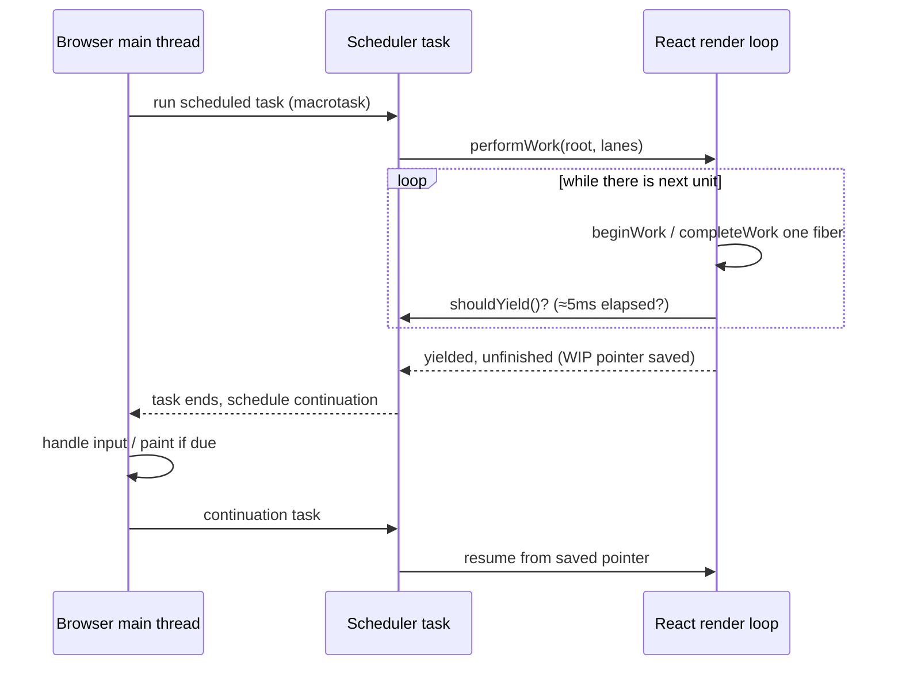
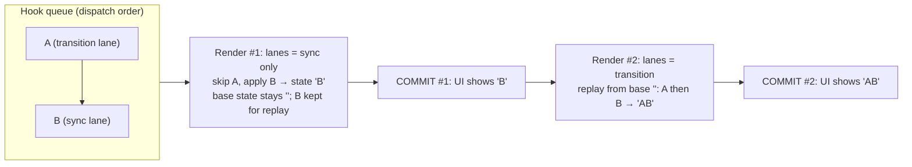

# 02 / 15 — Interruptible, Restartable, and Abandoned Renders

## 1. Lesson metadata

| | |
|---|---|
| **Level** | Professional (deepest tier of Phase 2) |
| **Study time** | 6–7 hours (reading 3 h, experiments 2 h, exercises 1.5–2 h) |
| **Prerequisites** | [08 — Why Fiber exists](./08-why-fiber.md), [09 — Fiber nodes and units of work](./09-fiber-nodes-and-units-of-work.md), [10 — Current and work-in-progress trees](./10-current-and-work-in-progress-trees.md), [11 — Render phase vs commit phase](./11-render-phase-and-commit-phase.md), [12 — Why rendering must be pure](./12-why-rendering-must-be-pure.md), [13 — Scheduling and update priorities](./13-scheduler-and-priorities.md), [14 — Lanes: conceptual purpose](./14-lanes.md) |
| **Next** | [16 — Concurrent React and common misconceptions](./16-concurrent-react-misconceptions.md) |
| **Related** | [01/15 — Update queues and batching](../01-react-fundamentals/15-update-queues-and-batching.md), [23 — Transitions and deferred rendering](./23-transitions-and-deferred-rendering.md), [24 — Suspense and thrown thenables](./24-suspense-conceptual-internals.md), [28 — Strict Mode behavior](./28-strict-mode-behavior.md), [35 — Scenario D: transition vs urgent interaction](./35-scenario-d-transition-vs-urgent.md) |

**Learning objectives.** After this lesson you can:
1. Define precisely what "interruptible", "restartable", "resumable" and "abandoned" mean for a React render, and which of those a given render can actually do.
2. Name the conditions under which a render is time-sliced (and therefore interruptible) and the conditions under which it is not.
3. Predict, for a sequence of events (keystrokes, transitions, Suspense), which render attempts run, which are discarded, how many commits happen, and what the DOM shows between commits.
4. Explain why an update queue must support *rebasing* when a lower-priority update is skipped and a higher-priority update is processed first.
5. List the categories of code that break when a render is thrown away or run twice (module-level mutation, ref writes in render, non-idempotent initializers, tearing reads of external mutable data) and fix each.
6. Instrument a real app to distinguish "component function invoked" from "result committed".
7. Distinguish what React guarantees publicly from what the current implementation happens to do, and say where to check the source.

**Concepts covered:** time slicing, yielding between fibers, `shouldYield`-style cooperative scheduling, interruption vs preemption, resuming a partially built work-in-progress tree, restarting from the root with a fresh stack, abandoning a render, discarded work, skipped updates and rebasing, blocking vs non-blocking lanes, expiration/starvation prevention, render-phase invocation counts vs commit counts, tearing, Suspense interplay.

> **Implementation-detail warning for the whole lesson.** The public contract is small: *a render may be invoked any number of times for a given committed result, may be paused, and may be discarded; commit is synchronous and happens once per committed render.* Everything about *how* React decides — time-slice length (currently on the order of 5 ms), which lanes are time-sliced, how entangled lanes are batched, the exact functions involved — changes between releases. Function names that appear below (`workLoopConcurrentByScheduler` in the published 19.3.1 build, `workLoopSync`, `prepareFreshStack`, `renderRootConcurrent`, `shouldYield`, `ensureRootIsScheduled`) were checked on 2026-10-22 against `packages/react-reconciler/src/ReactFiberWorkLoop.js`, `ReactFiberRootScheduler.js` and `packages/scheduler` on `main` and the installed `react-dom@19.3.1`; some were renamed or merged across React 18 → 19. **Verify against the version you ship.** Numbers like "5 ms" are the *current default of the Scheduler*, not API.

---

## 2. Deep conceptual explanation

### 2.1 What problem is this lesson solving?

The previous lessons gave you the pieces: a work-in-progress (WIP) tree that is a draft ([10](./10-current-and-work-in-progress-trees.md)), a render phase that must be pure ([12](./12-why-rendering-must-be-pure.md)), a scheduler and lanes that rank updates ([13](./13-scheduler-and-priorities.md), [14](./14-lanes.md)). This lesson assembles them into the behavior you actually observe: **a render is something React may start, pause, resume, throw away, and start over — while the user keeps typing.**

Concretely, this lesson answers:

- Why does my component's `console.log` appear four times for one visible change?
- I typed three characters; why did the slow list commit once?
- If React throws away a render, where did my `useState` update go? Is it lost?
- Why does a low-priority update seem to "jump the queue"? Why does an urgent render sometimes show a state that never existed in source order?
- Why does React stop slicing sometimes (a big render that freezes the page even with `createRoot`)?
- What does it mean that React "may call my component and never commit it"?

If you hold this model, concurrent features stop being magic and become a consequence of three design decisions: (1) render is pure and writes only to a draft; (2) the draft is built in small independent units; (3) the scheduler may choose a different draft than the one in progress.

### 2.2 Four verbs: interrupt, resume, restart, abandon

These words are used loosely in blog posts. In this curriculum they have precise meanings:

| Verb | Meaning | Is work lost? | Typical trigger |
|---|---|---|---|
| **Yield** (a.k.a. pause) | The render loop stops *between two units of work* and returns control to the browser. The WIP tree and a pointer to the next unit are kept. | No | The time slice is used up (cooperative). |
| **Resume** | A later task continues the loop from the saved pointer. Nothing already built is recomputed. | No | A new scheduler task fires with nothing more urgent pending. |
| **Restart** | React drops the partially built WIP tree and begins again **from the root** (a "fresh stack"), usually for a *different set of lanes*. | Yes — everything built in the attempt | A higher-priority update arrived; or the same lanes got new updates that change the inputs. |
| **Abandon** (a.k.a. discard) | A started render attempt is never committed. A restart *causes* an abandonment of the previous attempt; so can an error that is not recovered, or a root that is unmounted. | Yes | Superseded by another attempt, or thrown away. |

*Interruption* is the umbrella term for "something else gets the main thread before this render finishes". Interruption by **yielding** is a *voluntary pause* by React: React's loop checks `shouldYield` between fibers and returns. Interruption by **restart** happens when, after React has yielded (or between slices), a more urgent update has been scheduled and React chooses to render *that* instead.

Two crucial clarifications:

1. **React does not preempt.** JavaScript cannot be paused mid-function by other JavaScript. React checks "should I stop?" only *between* units of work. A single component function — however slow — is atomic. If `<Chart>` takes 400 ms to render, no amount of concurrent rendering shortens that one task ([00/01 §5.1](../00-web-and-javascript-foundations/01-how-the-browser-works.md)).
2. **Interruption applies only to the render phase.** The commit phase is one synchronous chunk ([11 §2.5](./11-render-phase-and-commit-phase.md)). There is no such thing as a half-committed concurrent update.

### 2.3 Why render can be interrupted at all

Interruption is safe because of three independent properties established earlier:

1. **Draft isolation.** The render phase writes to WIP fibers and (for new host elements) to *detached* DOM nodes. It never touches `root.current` or the attached DOM. Dropping the WIP tree leaves the user-visible state exactly as it was ([10 §2.7](./10-current-and-work-in-progress-trees.md)).
2. **Work is chunked into fibers.** The recursive call stack of the old stack reconciler is replaced by a linked-list traversal with an explicit pointer ([09](./09-fiber-nodes-and-units-of-work.md)). Because "where am I?" lives in heap memory, not on the JS call stack, the loop can return and later continue.
3. **State is not lost on abandon.** User updates live in **update queues attached to the current tree's hooks/fibers**, not in the WIP tree. A discarded draft leaves the queues intact; the updates will be processed again by the next attempt (§2.7).

Remove any one and the design collapses: without (1), discarding would need undo; without (2), you cannot yield; without (3), a restart would drop user input.

### 2.4 When a render is time-sliced (and when it is not)

Whether the loop yields is a property of the **lanes being rendered**, not of the API you used.

| Situation | Time-sliced (can yield between fibers)? | Why |
|---|---|---|
| Root created with `createRoot`, update inside a **transition** (`startTransition`, `useTransition`, the deferred half of `useDeferredValue`) | **Yes** | Non-blocking lane: the design purpose of slicing. |
| `Suspense` retry lanes, and other "retry"/"idle" style lanes | Yes (generally) | Background work. |
| Update from a **discrete event** (click, keydown, input) with no transition: "sync" lane | **No** | Must complete before the next paint so the user sees the effect of their input. |
| Update from a **continuous event** (mousemove, scroll) | Not time-sliced (verified in `includesBlockingLane`: `InputContinuousLane` is a blocking lane) | Treated as a blocking lane. |
| Default priority update (e.g., `setState` in a `setTimeout` or a fetch callback) | **No in React 18 and 19** (verified in `includesBlockingLane` and by execution on 19.3.1: a default-lane 300-row render had zero interleaved timer callbacks, the same update in a transition had 31) | Blocking lane, rendered synchronously once started, but scheduled as a task rather than flushed in a microtask. |
| A lane that has **expired** (waited too long, e.g. a transition starved by constant urgent updates) | **No** | Starvation protection: React forces it to finish. |
| Root created with legacy `ReactDOM.render` | **No** | Legacy mode is synchronous only *(legacy; removed in React 19)*. |
| Initial `createRoot(...).render(<App/>)` | Default lane — not time-sliced in 18 | The first paint should not be deliberately delayed. |
| `flushSync(() => setState(...))` | **No** | Explicitly synchronous. |
| Update forced sync by `useSyncExternalStore` store change | **No** | Prevents tearing ([§2.9](#29-tearing-and-why-external-stores-force-synchronous-renders)). |

The takeaway students miss: **`createRoot` alone does not make anything interruptible.** It *permits* concurrent features. Rendering is sliced only when the work is in non-blocking lanes. A giant `setState` in a click handler still freezes the page for as long as its render takes, exactly like React 17. Time slicing helps you only when you *express* work as non-urgent (transition / deferred value / Suspense).

### 2.5 Interruption by yielding: resume

Sketch of a sliced render (teaching model):



Properties of resume:
- Nothing built so far is recomputed. The next fiber to process is exactly where it was.
- The *inputs* are assumed unchanged. If any update has been scheduled to this root since the slice began, React re-evaluates what to render next (§2.6). Whether it keeps going or restarts depends on the lanes of the new update relative to the in-progress lanes.
- Yielding is cheap: it returns to the Scheduler, which posts another task (the Scheduler typically uses `MessageChannel` in browsers, because `setTimeout(0)` has clamping and `requestIdleCallback` is unreliable; implementation detail, see [13](./13-scheduler-and-priorities.md)).

### 2.6 Interruption by restart

Suppose a transition render is half done when the user types a character.

1. The keystroke is a discrete event → an update in the **sync lane** is scheduled for the root.
2. The scheduler/work loop now has two sets of pending work: sync lane and transition lane. The sync lane is higher priority.
3. The in-progress render was for the *transition lane*. Continuing it would produce a tree that does not include the keystroke. React therefore **prepares a fresh stack**: sets the WIP pointer back to a clone of the root, discarding all partial work. It renders the sync lane first (not sliced), commits, then returns to the transition lane and starts it from scratch, now on top of the newly committed tree.

Why *discard* rather than keep the partial transition work? Because the partial tree was built from the *old* committed tree plus only the transition updates. The urgent render commits a different tree. Work done on the old base is not guaranteed valid on the new base; reusing it would require proving independence (an optimization React does not attempt). Restarting is simple, correct and — since transitions are by definition tolerable to delay — cheap to accept.

**Not every higher-priority arrival restarts.** If the new update is in a lane that is *entangled* with, or is the *same* as, the in-progress lanes, React may simply continue/restart with the combined set. Conversely, React can finish the in-progress render if the newly pending lane is lower priority. The rule is "does the next lanes set differ from the lanes of the render in progress?" — if yes, restart.

### 2.7 The update queue: why discarded work is not lost user input

The crux of correctness. Recall from [01/15](../01-react-fundamentals/15-update-queues-and-batching.md) that `setState(x)` pushes an *update object* onto the hook's queue. Each update records (conceptually) its **lane** and its payload (value or updater function). Rendering a hook processes the queue:

- Updates **whose lane is included in the current render's lanes** are applied in order to produce the new state.
- Updates **not included** are *skipped* but remain in the queue.

A discarded render has no effect on the queue (it reads queue entries into the WIP hook but the persistent record is in the current tree / pending queue). So the next attempt re-reads the same updates. **Abandonment never loses an update.** It loses only the *work of applying it*.

#### Rebasing: when skipping reorders application

Skipping creates an ordering problem. Consider state `""` and the following sequence of `setS` calls in source order:

1. `A` — in a transition (low priority): `setS(s => s + "A")`
2. `B` — urgent: `setS(s => s + "B")`

If urgent lane renders first and applies only `B`, it shows `"B"`. Later, when the transition lane is rendered, React must produce the state *as if all updates had applied in the order they were dispatched*: `"AB"`, not `"BA"`. To achieve this, the queue handling **rebases**: after skipping `A`, the base state for later processing is the state *before* `A`, and every subsequent update (including already-processed `B`) is kept in the queue (cloned with a "no lane / always process" marker) so that when `A`'s lane renders, it replays `A` then `B` from the base state `""` → `"AB"`.



Observations (public behavior this guarantees):
- **Final state is order-consistent with dispatch order**, regardless of how many interruptions happened.
- **Intermediate committed states may be ones no sequential execution would have shown** (`"B"` here). This is why updater functions and reducers must be **pure and commutative-insensitive in the sense of order-of-dispatch**: React may call them *more than once* (once in the urgent pass for `B`, again during replay) and with different base states than you might expect.
- This is also why `setState` **updater functions must not have side effects** (the same reason Strict Mode double-invokes them; [28](./28-strict-mode-behavior.md)).

*Implementation detail:* the "base queue" and "clone with NoLane" mechanism are how current React implements this. Public guarantee is only the observable ordering semantics. To see the code, search for the update processing routine for `useState`/`useReducer` (`updateReducer`, `updateReducerImpl` in `ReactFiberHooks`) and for class/root update queues (`processUpdateQueue` in `ReactFiberClassUpdateQueue`). Names vary by version.

### 2.8 Abandonment categories

A render attempt ends in one of these ways:

| Outcome | Description | Visible effect |
|---|---|---|
| **Committed** | Render completed; commit applied. | DOM updated. |
| **Restarted for other lanes** | Discarded because a more urgent set of lanes took over. | None. Old UI stays. |
| **Restarted for the same lanes** | Inputs changed (e.g., another transition update to the same state); React starts over to include it. | None. |
| **Suspended and not committed** | A component threw a thenable inside a transition/deferred update; React keeps the old UI (no fallback) and waits ([24](./24-suspense-conceptual-internals.md)). | Old UI stays; `isPending` true. |
| **Errored** | A render error with no recovery: nearest error boundary renders (and *that* render commits). React may first retry synchronously once ("recoverable error" retry) *(detail)*. | Boundary UI. |
| **Root unmounted** or **component unmounted before commit** | Work is dropped. | None. |
| **Time-sliced render never finished** because the page was backgrounded | Scheduler tasks are throttled by the browser; render continues when tasks run. Not abandoned, merely delayed. | None until it commits. |

### 2.9 Tearing and why external stores force synchronous renders

*Tearing* is a visual inconsistency: two parts of the UI show different values for what should be the same data, because they were rendered at different times while the underlying data changed in between. With a yielding render, "different times" is now routine — a render may span many tasks. For **React state**, tearing is impossible: the render reads a consistent snapshot of the queues for the lanes in question. For **mutable external data** (a Redux-like store, `window.matchMedia`, a global object) it is possible: component A reads `store.value` before a yield, a `store.set` happens, component B reads after the yield.

`useSyncExternalStore` ([Phase 3/20](../03-react-state-and-hooks/20-usesyncexternalstore-and-external-stores.md)) is React's sanctioned bridge: it reads the store during render, **verifies** the snapshot is unchanged at the end of render (before commit), and if it changed, *re-renders synchronously* (no yielding). Stores updated via this API therefore **opt their updates out of time slicing** (they cannot be transitions in the usual sense). This is a deliberate trade-off: consistency over interruptibility.

Rule: *never read mutable external data directly during render if the render could be sliced.* Use state, context, refs-as-initial-values only, or `useSyncExternalStore`.

### 2.10 Starvation prevention

If urgent updates keep arriving (a stream of keystrokes, a 60 Hz websocket handler), a low-priority transition render could be restarted indefinitely and never commit. React marks each lane with an **expiration time** when first scheduled. Once expired, the lane is treated as blocking: it is rendered **synchronously, without yielding**, so it finishes. The exact timeouts differ per lane class (urgent lanes expire after 250 ms; default and transition lanes after 5000 ms; checked in `computeExpirationTime`, `ReactFiberLane.js`). Consequence: *"transitions can't be starved forever"* is a design goal, but a transition that has expired will block the main thread for the duration of its render just as a plain `setState` would.

### 2.11 Common misconceptions

| Misconception | Reality |
|---|---|
| "Concurrent rendering runs components in parallel." | One thread. React interleaves its work with the browser's, and may reorder which *update* it works on. |
| "`createRoot` makes my renders interruptible." | Only non-blocking lanes are sliced. Plain event-handler `setState` is not. |
| "A discarded render loses the state update." | Updates live in queues; the next attempt re-applies them. Only the computed draft is lost. |
| "React can interrupt a component function mid-execution." | No. Interrupts happen between fibers. A slow component function blocks. |
| "Interrupted renders partially update the DOM." | The DOM is untouched until commit. |
| "If I see `render` logged, the UI updated." | Render can run and be dropped. Only commit changes the DOM ([11](./11-render-phase-and-commit-phase.md)). |
| "Order of `setState` calls equals order of committed states." | Final state respects dispatch order; intermediate commits may skip or reorder visible intermediates (rebasing). |
| "Restart means React starts over *from the beginning of my app's lifetime*." | It means: re-clone the root's WIP and re-traverse. Subtrees whose props/state/context are unchanged and have no pending lanes are bailed out cheaply ([09](./09-fiber-nodes-and-units-of-work.md)). |
| "Abandoned renders are wasted work, so avoid transitions." | The wasted work is exactly the work that would otherwise have *blocked the urgent update*. The trade is more total CPU for lower input latency. |

---

## 3. Internal mechanics

### 3.1 Public guarantees

These are documented or intentionally stable:
1. **Render may run more than once per committed result** and may never commit. Components must be pure ([12](./12-why-rendering-must-be-pure.md)).
2. **Commit is atomic from the user's perspective**: layout effects and DOM updates for one commit are applied synchronously before the browser paints.
3. **Within a single root, state updates apply in dispatch order** — the final state of `useState`/`useReducer` is the same as if all updates had been applied sequentially.
4. **`startTransition` updates may be interrupted and replaced** by urgent updates; React never shows a half-rendered transition (see react.dev [`startTransition`](https://react.dev/reference/react/startTransition) and [`useTransition`](https://react.dev/reference/react/useTransition)).
5. **`flushSync` forces a synchronous render and commit**; it is documented as an escape hatch.
6. **Effects, including cleanups, relate only to committed renders.** A render that was abandoned never runs effects (it had none scheduled).

### 3.2 Teaching model

```text
root.pendingLanes:  { Sync, Transition1 }       <- what needs rendering
root.current:       tree C0                      <- what the user sees

pick = highest-priority lanes among pending       (getNextLanes, conceptually)
if (pick != lanes of the in-progress render) -> throw away WIP, WIP := clone(root), restart
loop:
   while (WIP unit exists) and (blocking lanes or !shouldYield()):
        WIP = performUnitOfWork(WIP)
   if WIP unit exists -> yield: save pointer, schedule continuation
   else -> commit(finished tree), update root.pendingLanes
```

That is all the mental model you need for predictions. The following subsections annotate it.

### 3.3 Implementation details (change between releases)

Checked against the source on 2026-10-22:

- **Two loops.** One loop does not check for yielding (synchronous), the other does (concurrent, `workLoopSync` vs `workLoopConcurrentByScheduler` in 19.3.1). The caller picks based on whether the lanes being rendered are time-sliceable. The concurrent loop's condition is roughly `while (workInProgress !== null && !shouldYield())`.
- **`shouldYield`** is provided by the Scheduler package. Its default frame interval is on the order of 5 ms; `isInputPending` experiments existed historically but are not part of the published Scheduler (`scheduler@0.28.0` exposes `unstable_shouldYield` based purely on elapsed time).
- **Fresh stack.** When starting (or restarting) a render for a root, React resets module-level work-in-progress variables, creates a WIP clone of the root fiber (`createWorkInProgress`), and sets the "which lanes are we rendering" marker (names conceptually: `prepareFreshStack`, `workInProgressRootRenderLanes`). If a render is merely *resumed*, this step is skipped because the lanes and root are unchanged.
- **Exit status.** After the loop, the render returns a status (completed / suspended / errored / still in progress). The caller decides whether to commit, retry, or wait.
- **Scheduler callback bookkeeping.** `ensureRootIsScheduled` (conceptually) computes the highest-priority pending lanes and ensures there is exactly one Scheduler task for the root at the matching Scheduler priority; if the priority changed since the existing task was scheduled, it cancels the old task and schedules a new one. In React 19 the scheduling of roots is processed by one microtask for all roots (`processRootScheduleInMicrotask`, verified in `react-dom@19.3.1`).
- **Render-phase updates (`setState` during render)** re-run the component *within* the same fiber's `beginWork`, and do not interact with restart logic at all. They are covered in [11 §2.4](./11-render-phase-and-commit-phase.md).
- **Why WIP hooks are rebuilt.** On a restart, the WIP fibers are re-cloned from `current`; hook state is recomputed from the current fiber's memoized state plus queues. So `useMemo`, `useReducer`'s computed state, and `useState` initializers (for mounting components that were never committed) are **recomputed**. A component that has *never committed* has no `current` twin; abandoning it loses even its mount-time state, and it will mount afresh (initializers run again) in the next attempt.

### 3.4 Where to look in the source (verification checklist)

1. `packages/scheduler/src/forks/Scheduler.js` — `shouldYieldToHost`, `unstable_shouldYield`, the frame-interval constant, `MessageChannel` usage.
2. `packages/react-reconciler/src/ReactFiberWorkLoop.js` — the sync and concurrent loops, the function that selects lanes for a root, the "prepare fresh stack" routine, the commit entry points.
3. `packages/react-reconciler/src/ReactFiberLane.js` — `getNextLanes`, `includesBlockingLane`, `markStarvedLanesAsExpired` (names conceptually), lane constants.
4. `packages/react-reconciler/src/ReactFiberHooks.js` — hook update-queue processing and rebasing.
5. `packages/react-reconciler/src/ReactFiberRootScheduler.js` *(exists in recent versions; absent in older ones)* — root scheduling.

If a name does not exist, search the file for the concept ("yield", "fresh stack", "expired", "skipped lane"). The code is the ground truth.

### 3.5 Why `console.log` in render is a poor instrument

Strict Mode in development double-invokes components ([28](./28-strict-mode-behavior.md)); concurrent restarts add invocations; Fast Refresh adds more. The count of `console.log("render")` lines mixes several causes. Prefer:

- **Commit-time instrumentation**: `useLayoutEffect(() => log("committed"))`, or `<Profiler onRender>` (fires per commit for the subtree).
- **React DevTools Profiler** ([30](./30-react-devtools-profiler.md)): shows commits only. "Rendered but not committed" work is invisible there.
- **Browser Performance panel**: shows the actual tasks, including task boundaries where React yielded and the work that was thrown away.

---

## 4. Step-by-step execution walkthrough

### 4.1 Scenario: typing "abc" quickly into a search box with a transition

App structure:

```text
<App>
  <input value={query} onChange=…>          // urgent state: query
  <Results deferred={deferredQuery} />      // memo'd; 300 SlowRow children, ~1 ms each
```

`onChange` does `setQuery(v)` (urgent) and `startTransition(() => setDeferredQuery(v))`.

Timeline (task-by-task; `T` = a macrotask; time is illustrative). Assume the user types `a` at t=0, `b` at t=150 ms, `c` at t=300 ms.

| Time | Event / task | Render phase | Commit | DOM / screen |
|---|---|---|---|---|
| 0 | **T1**: keydown→input event handler for `a` | handler calls `setQuery("a")` (sync lane) and `setDeferredQuery("a")` (transition lane). Both queued. | — | unchanged |
| 0+ | **T1 (end)**: React flushes sync lane | Render #1 (sync lanes only): `App` re-renders; `input` value `"a"`; `Results` receives *same* `deferred=""` → **bailout** (memo). 1 fiber path rendered. | **Commit #1** | input shows `a`; results list unchanged (old) |
| 1 | **T2**: scheduler task for transition lane | Render #2 (transition lane): App renders with `deferredQuery="a"`, `Results` renders; begins 300 SlowRows. After ≈5 ms: `shouldYield` → true. | — | unchanged |
| 6 | Browser free: may paint, process input | — | — | (nothing new) |
| 6 | **T3**: continuation | Resume; SlowRow #6…#11 … yield again. Repeats T4, T5… | — | |
| 150 | **T_k**: user types `b` (input event dispatched between slices) | handler calls `setQuery("ab")` (sync) and `setDeferredQuery("ab")` (transition). Transition render #2 is at, say, row 140 of 300 and is **now stale**. | — | |
| 150+ | **T_k (end)**: React flushes sync lane | React sees pending lanes {sync, transition}; sync is more urgent than the in-progress transition → **restart**: fresh stack. Render #3 (sync): `input` = `"ab"`; Results bails out. | **Commit #2** | input shows `ab` — typed within one frame of the keystroke |
| 150+ | next task | **Render #4** (transition lane, fresh): `deferredQuery` queue now contains `"a"` and `"ab"` updates in order → state `"ab"`. Results renders 300 rows from scratch. | — | |
| 300 | user types `c` | same as at 150: sync render + **Commit #3** (input `abc`); render #4 discarded (say at row 200). | Commit #3 | input `abc` |
| 300+ | transition: Render #5 with `"abc"`; no more input | slices across ≈60 tasks (300 ms / 5 ms) | — | |
| ≈ 620 | last slice completes | all rows done | **Commit #4** | list shows `abc` results |

Result: **4 commits** (3 urgent input commits + 1 results commit); 3 transition render attempts (#2, #4, #5) of which two were abandoned. The list never displayed the `a` or `ab` results — exactly the intended effect. The user perceives instant typing.

**Predict before reading on:** what would the profile look like if you removed `startTransition` and just called `setDeferredQuery(v)` together with `setQuery(v)` in the handler (both sync)? Answer: one blocking render of ~300 ms *per keystroke*; the second keystroke's handler could only start after the first task finished, so input events queue; letters appear in bursts; 3 commits, each long. (The comparison is the point of [35](./35-scenario-d-transition-vs-urgent.md).)

### 4.2 Scenario: transition that suspends

User clicks a tab; `startTransition(() => setTab("reports"))`; `<ReportsTab>` reads a not-yet-loaded resource with `use(promise)` inside `<Suspense fallback={<Spinner/>}>` that is **already showing content** (the previous tab).

1. Click handler: transition lane update scheduled. Handler returns. `isPending` set to true in a separate urgent update → **Commit #1** (pending indicator on tab).
2. Transition render: `ReportsTab` suspends (thenable thrown / `use` interrupts). For an *already visible* boundary in a **transition**, React does **not** show the fallback: the attempt is paused without committing, retained to be retried when the promise resolves.
3. Meanwhile the user can click another tab (urgent or another transition). The earlier attempt is now moot; React will render the newest state.
4. When the promise resolves, a retry lane schedules the render again; the second attempt reads the resolved value, completes → **Commit #2** (`isPending` false, new tab visible, old tab's DOM removed).

Note the first attempt: component bodies ran up to the suspension point and were discarded. See [24](./24-suspense-conceptual-internals.md) and [36](./36-scenario-e-suspend.md). *(Verified by execution on React 19.3.1: log `commit tab=home pending=true`, `Reports render` (discarded), then after the promise resolved `Reports render` and `commit tab=reports pending=false`; the old tab stayed in the DOM until then.)* React 19 also changed what is done with siblings of a suspended component: it commits the fallback immediately and then "pre-warms" the suspended siblings in a follow-up render (React 19 release post, "Improvements to Suspense").

### 4.3 Scenario: starvation

A dashboard receives 100 websocket messages/s, each handled by `setState` (default lane, blocking). A transition `setFilter` is pending. Each message arrival interrupts or preempts the transition's render; transition never finishes within its expiration window. After the expiration period, the lane is promoted: React renders it without yielding to guarantee progress. The user sees a long frozen frame (the transition's full render time). Mitigations: coalesce incoming messages, reduce render cost, or accept the delay; see [Phase 7 / 11](../07-performance/11-scheduling-and-perceived-responsiveness.md).

---

## 5. Code examples

### 5.1 Minimal example — render invocation vs commit

```tsx
import { useLayoutEffect, useState, useTransition } from "react";

let renderInvocations = 0;     // module-level counter: acceptable ONLY as a diagnostic probe
let commits = 0;

export default function Probe() {
  const [n, setN] = useState(0);
  const [isPending, startTransition] = useTransition();

  renderInvocations++;                       // (1) runs every time React calls this function
  console.log("render", { n, renderInvocations });

  useLayoutEffect(() => {                    // (2) runs once per commit that includes this component
    commits++;
    console.log("commit", { n, commits });
  });

  return (
    <button
      onClick={() => startTransition(() => setN((c) => c + 1))}
      aria-busy={isPending}
    >
      count {n}
    </button>
  );
}
```

**Line notes.**
- (1) Impure on purpose; it measures how often React *calls* the function. In production builds without Strict Mode, with no interruptions, `renderInvocations` increments equal commits + isPending commits.
- (2) A layout effect runs **only for committed renders** (in the commit phase, [11 §2.5](./11-render-phase-and-commit-phase.md)); it is a faithful commit counter. It has no dependency array so it runs on every commit of this component.

**Predict:** In development with `<StrictMode>`, one click on the button. How many "render" and "commit" logs?

**Result (typical React 19 dev, Strict Mode on, no interruption):**
- Click → `startTransition` marks the transition. `useTransition` sets `isPending=true` via an urgent update and the counter update in the transition lane. Because both are scheduled in the same event, React may process the urgent update first: render with `isPending=true`, `n=0`; commit.
- Then transition render: `n=1`, `isPending=false`; commit.
- Strict Mode doubles each *render invocation* in development, so each of the two renders logs "render" **twice** (the second invocation's console output is dimmed or suppressed in React 18+ DevTools / may be hidden depending on settings).
- Each commit logs "commit" once. (Strict Mode's extra mount-time effect re-run applies on *mount*, not on updates.)

So roughly: 4 `render` lines, 2 `commit` lines. The point is the ratio, which depends on Strict Mode, batching and interruption; **never assert on exact render counts in tests** ([Phase 8](../08-testing-and-quality/16-avoiding-brittle-tests.md)).

**Why it matters:** this gives you a way to see abandonment: add a slow sibling and type quickly; `render` lines for a transition render appear without a following `commit` line.

### 5.2 Practical example — responsive search with an abandonable results render

```tsx
import { memo, useMemo, useState, useTransition } from "react";

function burn(ms: number): void {
  const end = performance.now() + ms;
  while (performance.now() < end) { /* simulate expensive render work */ }
}

const SlowRow = memo(function SlowRow({ text }: { text: string }) {
  burn(1);                       // ≈1 ms per row; each SlowRow is its own fiber => a yield point
  return <li>{text}</li>;
});

const Results = memo(function Results({ query }: { query: string }) {
  const rows = useMemo(
    () => Array.from({ length: 300 }, (_, i) => `${query} · result ${i}`),
    [query],
  );
  return (
    <ul>
      {rows.map((r) => (
        <SlowRow key={r} text={r} />
      ))}
    </ul>
  );
});

export default function Search() {
  const [query, setQuery] = useState("");
  const [shown, setShown] = useState("");
  const [isPending, startTransition] = useTransition();

  return (
    <>
      <label>
        Search
        <input
          value={query}
          onChange={(e) => {
            const v = e.target.value;
            setQuery(v);                           // urgent: keep the input responsive
            startTransition(() => setShown(v));    // non-urgent: results may lag, may be abandoned
          }}
        />
      </label>
      {isPending && <span role="status">Updating…</span>}
      <Results query={shown} />
    </>
  );
}
```

**Line notes.**
- `memo(SlowRow)` is not what makes slicing possible; **the fiber boundary** is. Without `memo`, a re-render would still yield between rows because each `SlowRow` is a separate fiber and each `beginWork` is a yield point. `memo` here reduces repeated work when `text` is unchanged (not the case with a new `query`, where all keys change).
- `key={r}` changes whenever `query` changes → all rows remount. Realistic code would key by id; here it makes the cost obvious. (See [07](./07-identity-keys-and-reconciliation.md).)
- `Results` takes `shown`, not `query`, so the urgent render bails out (props identical) and takes ≈ 0 ms.
- `burn(1)` in a component is a *deliberate impurity in time, not in output*; fine for an experiment.

**Predict:** typing "abc" at 150 ms intervals with 4× CPU throttle on (each row ≈ 4 ms). How many times does `Results` commit?

**Reasoning:** a transition render needs ≈ 1.2 s under throttle; the next keystroke arrives after 150 ms, so every attempt before the last is discarded. `Results` commits **once**, after the final keystroke + ≈ 1.2 s. The input commits three times. Without throttle (300 ms render) the first attempt (started at 0) is still in progress when `b` arrives at 150 → discarded; second started at 150, discarded at 300; third finishes ≈ 600 ms. Again once. If the user pauses > 300 ms after `a`, `Results` commits for `a` too. **Trade-off:** more total CPU (≈ 1.0 s of discarded render work) for a responsive input.

### 5.3 Incorrect example — render that depends on how many times it runs

```tsx
let nextId = 0;                          // module-level mutable

export function Row({ label }: { label: string }) {
  const id = nextId++;                   // BUG: side effect during render
  return <li data-row-id={id}>{label}</li>;
}

export function Registry() {
  const seen = useRef<string[]>([]);
  seen.current.push("rendered");         // BUG: mutating a ref during render
  return <p>{seen.current.length}</p>;
}
```

**Predict:** is the output deterministic across (a) Strict Mode, (b) a transition restart, (c) a Suspense retry?

**Result:** no. `data-row-id` values skip numbers whenever React invoked `Row` and discarded the result (Strict Mode double invocation; an abandoned transition render). `Registry` shows a count larger than the number of commits, and in a restarted render the ref object may or may not carry the earlier pushes: for a component that was already committed, the same ref object is reused across WIP clones, so pushes from an abandoned attempt **persist**; for a never-committed component the ref object is recreated. The behavior differs by situation — which is precisely the problem.

**Why wrong:** render's outputs must be a function of props/state/context. IDs and counters are *effects of invocation*. Interruption and Strict Mode make invocation count unpredictable ([12](./12-why-rendering-must-be-pure.md)).

### 5.4 Corrected implementation

```tsx
import { useEffect, useId, useRef } from "react";

export function Row({ label }: { label: string }) {
  const id = useId();                              // deterministic per position in the tree, safe to re-invoke
  return <li id={id}>{label}</li>;
}

export function Registry() {
  const commits = useRef(0);
  useEffect(() => {
    commits.current += 1;                          // runs only for committed renders; no state, so no re-render loop
  });
  return <button onClick={() => alert(commits.current)}>Show commit count</button>;
}
```

The rule: move the side effect to a place that runs once per *commit* (effect) or once per *user action* (event handler), or remove the need for it ([18](./18-effects-and-their-timing.md)). Note the ref is *read* in an event handler, not during render.

**Why correct:** `useEffect` callbacks run only for committed renders; reading the ref in an event handler is outside render.

### 5.5 Advanced example — a toy time-sliced, restartable renderer

This is a **toy**: it demonstrates yield, resume, restart, abandon and queue-preserving updates. It is not React's algorithm.

```ts
type Lane = "urgent" | "transition";

interface Update {
  lane: Lane;
  value: string;
}

interface Draft {
  lane: Lane;
  value: string;
  next: number;      // index of the next unit (the "fiber pointer")
  out: string[];     // the work-in-progress output
}

type SliceResult = "idle" | "yielded" | "committed";

export class ToyRoot {
  committed: string[] = [];          // what the user sees (root.current)
  discarded = 0;                     // abandoned drafts
  private queue: Update[] = [];      // persistent update queue (survives abandonment)
  private draft: Draft | null = null;

  constructor(
    private readonly total: number,
    private readonly renderUnit: (value: string, index: number) => string,
  ) {}

  dispatch(update: Update): void {
    this.queue.push(update);
  }

  /** Highest-priority lane with pending updates. */
  private pickLane(): Lane | null {
    if (this.queue.some((u) => u.lane === "urgent")) return "urgent";
    return this.queue.length > 0 ? "transition" : null;
  }

  /** The value this lane would render: last eligible update wins (toy semantics). */
  private valueFor(lane: Lane): string {
    const eligible = this.queue.filter((u) => lane === "transition" || u.lane === "urgent");
    return eligible[eligible.length - 1].value;
  }

  /** Do at most `maxUnits` units of work, then yield. */
  slice(maxUnits: number): SliceResult {
    const lane = this.pickLane();
    if (lane === null) return "idle";
    const value = this.valueFor(lane);

    // Restart rule: different lane, or same lane with different inputs => abandon the draft.
    if (this.draft && (this.draft.lane !== lane || this.draft.value !== value)) {
      this.draft = null;
      this.discarded++;
    }
    const draft = (this.draft ??= { lane, value, next: 0, out: [] });

    let used = 0;
    while (draft.next < this.total && used < maxUnits) {   // "shouldYield" = budget exhausted
      draft.out.push(this.renderUnit(draft.value, draft.next));
      draft.next++;
      used++;
    }
    if (draft.next < this.total) return "yielded";          // resumable: draft kept

    // Commit: synchronous and atomic.
    this.committed = draft.out;
    this.queue = this.queue.filter((u) => lane === "urgent" && u.lane !== "urgent");
    this.draft = null;
    return "committed";
  }
}
```

Trace (`total = 6`, `renderUnit = (v, i) => `${v}#${i}``):

```ts
const root = new ToyRoot(6, (v, i) => `${v}#${i}`);
root.dispatch({ lane: "transition", value: "x" });
root.slice(2);  // "yielded"   draft(x): x#0 x#1
root.dispatch({ lane: "urgent", value: "u" });   // user input arrives between slices
root.slice(2);  // "yielded"   draft(x) DISCARDED (discarded = 1); draft(u): u#0 u#1
root.slice(2);  // "yielded"   u#2 u#3
root.slice(2);  // "committed" committed = u#0..u#5; urgent update removed, transition remains
root.slice(2);  // "yielded"   new draft(x): x#0 x#1
root.slice(2);  // "yielded"
root.slice(2);  // "committed" committed = x#0..x#5; queue empty
root.slice(2);  // "idle"
```

**Line notes.**
- `queue` outlives `draft`: this is invariant (3) of §2.3. Dropping `draft` never drops an update.
- The restart condition checks both **lane** and **value**, mirroring "different lanes ⇒ restart" and "same lanes but new inputs ⇒ restart".
- After the urgent commit, the filter keeps the transition update. In real React, rebasing guarantees ordering semantics; here "last value wins" sidesteps it.
- `used < maxUnits` models `shouldYield`: the slice checks the budget *between* units, never inside `renderUnit` — same granularity limit as React.

**Trade-offs of the toy:** no bailout, no rebasing, no expiration. Exercise C2 asks you to add expiration.

---

## 6. Visual explanations

### 6.1 Life of a render attempt

```mermaid
stateDiagram-v2
  [*] --> Pending: update scheduled (lane)
  Pending --> Rendering: scheduler picks lanes
  Rendering --> Yielded: shouldYield true (non-blocking lanes only)
  Yielded --> Rendering: resume (same lanes, no more urgent work)
  Yielded --> Abandoned: more urgent lanes pending / inputs changed
  Rendering --> Abandoned: error without recovery / root unmounted
  Rendering --> Suspended: thenable thrown, transition/retry
  Suspended --> Rendering: retry when thenable settles
  Suspended --> Abandoned: superseded
  Rendering --> Committing: whole tree done
  Committing --> [*]: commit completes (sync, atomic)
  Abandoned --> Pending: updates still in queue; new attempt later
```



### 6.2 Main-thread view for the §4.1 scenario

```text
Main thread →
|input a|R#1 sync|C#1|        |T slice|T slice|T slice| ... |input b|R#3 sync|C#2|T slice|T slice| ...
 urgent  tiny     commit  paint  5ms     5ms     5ms          urgent  tiny     commit  (fresh restart)
                            ^                                                    ^
                      browser paints (input shows 'a')                 R#2 work (≈140 rows) discarded
```

### 6.3 Which lanes slice

```mermaid
flowchart TD
  A[Update scheduled] --> B{Lane class?}
  B -->|Sync / discrete event| S[Render synchronously, no yield]
  B -->|Default (blocking)| S2[Render without time slicing in React 18, scheduled as task]
  B -->|Transition / retry / idle| T{Expired?}
  T -->|No| Y[Time-sliced: yield every ~5ms]
  T -->|Yes| S3[Promoted: render without yielding]
```

The box for "Default lane" reflects React 18 and 19 (blocking lane, not time-sliced); it is the most likely to change in a future version.

---

## 7. Alternative approaches and trade-offs

Ways to keep the UI responsive while expensive UI work happens:

| Approach | Readability | Responsiveness | Total CPU | Complexity | Failure modes | Use when |
|---|---|---|---|---|---|---|
| **Transition** (`startTransition`/`useTransition`) | High | Excellent for input | Higher (discarded work) | Low | Render must be purely a function of state; stale UI visible while pending | Results of an interaction that can lag (filter, tab, navigation) |
| **`useDeferredValue`** | High | Excellent | Higher | Low | Value lags; need to show "stale" state explicitly | You do not own the state setter (prop from parent, library hook) ([23](./23-transitions-and-deferred-rendering.md)) |
| **Reduce the work** (virtualize, memoize, colocate state) | Medium | Best | Lowest | Medium | Needs measurement | Almost always first ([Phase 7](../07-performance/01-measure-before-optimizing.md)) |
| **Debounce/throttle** | High | Good for network | Lower | Low | Input-to-result delay is fixed even when CPU is idle | Work is expensive *and* cancelable (requests) ([Phase 7/14](../07-performance/14-debounce-and-throttle.md)) |
| **Move compute to a Web Worker** | Medium | Excellent | Same + messaging | High | Serialization, no DOM | CPU-bound pure functions |
| **`flushSync`** | Low | Opposite (forces sync) | Lowest in total | Low | Blocks the thread | You must read updated DOM immediately (rare) |

**Scenario where the recommended approach (transition) is NOT best:** a *single* component whose render takes 400 ms because of one monolithic function (a chart computing 100k points inside render). The transition cannot slice that function; the abandonment machinery adds overhead and gives you nothing, since React can yield only after the 400 ms task. The right fix is to compute off-thread or memoize/aggregate (`useMemo` with an expensive key, worker, server-side aggregation).

A second case: updates arriving constantly in the same lane (a stock ticker). Transitions get restarted until they expire, then block anyway. Throttling the *input rate* beats relying on interruption.

---

## 8. Best practices and anti-patterns

**Do**
- Treat render as a **pure function that may run N≥0 times** per commit. Anything that must happen exactly once belongs to an event handler, an effect, or the commit.
- Put non-urgent derived UI in transitions or deferred values; keep controlled inputs on urgent state.
- Show pending state ([`useTransition`'s `isPending`](https://react.dev/reference/react/useTransition)) so lag is communicated.
- Split big components into many fibers when you want to be sliceable: yielding granularity is per fiber.
- Use `useSyncExternalStore` for external mutable data.

**Beginner mistakes**
- Expecting `createRoot` to automatically make slow renders non-blocking.
- Using `console.log` counts as correctness assertions.
- Wrapping *everything* in `startTransition` (urgent feedback becomes delayed).

**Experienced-developer mistakes**
- Writing module-level caches in render that are populated non-idempotently (e.g., `cache.set(id, new Thing())` where `Thing` has side effects in its constructor).
- Calling analytics in render (double-fires; fires for discarded renders).
- Assuming effects run for every render. They run only for committed ones.
- Putting `setState` of *another* component in render to "sync" things.
- Relying on updater functions being called exactly once (e.g., `setItems(prev => { audit(prev); return … })`).

**Smells:** `if (!initialized) { init(); initialized = true }` in render; `useRef` writes in render other than lazy init; `Math.random()` / `Date.now()` in render output; `window.something` reads in render for non-hydration-safe data.

**Justified exceptions**
- **Lazy ref initialization** (`if (ref.current === null) ref.current = new Thing()`) is documented as acceptable *when idempotent and cheap to repeat*: abandoned renders may create an object that is dropped.
- Memoization caches written during render **are acceptable if idempotent** (computing the same value for same inputs). The React `cache()` API is designed for this on the server.
- Diagnostic counters (as in §5.1) are fine for experiments, never in shipped logic.

---

## 9. Real-world application

**E-commerce product listing with faceted filters.** Clicking a facet triggers filtering + re-sorting of 2,000 products and re-rendering of cards with images. Constraints: the facet checkbox must toggle instantly (INP < 200 ms); results may lag ≤ 300 ms; users click several facets in a row. Design: checkbox state urgent; results state in a transition. Rapid clicking causes abandoned renders — good: only the final facet set renders to completion. Constraint to respect: if filtering runs in a `useMemo` inside a *single* component, slicing cannot help; split the grid into card components, virtualize beyond the fold ([Phase 7/09](../07-performance/09-windowing-and-virtualization.md)).

**Financial dashboard with streaming prices.** WebSocket handler calls `setPrices` at 20 Hz, default lane. A user interaction (opening a detail panel) is a transition. Under load, the price updates (blocking lanes) repeatedly restart the panel render until it expires and blocks. Mitigations: batch ticks per animation frame; keep price state close to the cells that show it; store ticks in `useSyncExternalStore` with selector so unaffected components bail out. Regulatory constraint: displayed prices must never be inconsistent across cells (tearing) — which is why direct reads of a mutable global in render are unacceptable; `useSyncExternalStore` provides the consistency.

**Form wizard with async validation.** Navigating step N→N+1 is a transition into a Suspense-enabled step that fetches reference data. Constraint: the "Back" button must remain responsive during the wait, and double-clicking "Next" must not produce two navigations. Because the transition render is abandonable, a second click is just another update to the same state; React discards the earlier attempt. The *fetch* is not abandoned (React does not cancel network requests); see [Phase 6/02](../06-data-fetching-and-state-ecosystems/02-cancellation-and-race-conditions.md).

**Multi-team shells.** A platform team owns the shell; product teams own widgets that may be slow. Abandonable renders let the shell stay responsive, but widgets that perform side effects in render (e.g., registering with a global event bus during render) break under Strict Mode and concurrent restarts. A lint rule plus a Strict-Mode-on-in-dev policy catches this early.

---

## 10. Debugging and troubleshooting

**Symptom 1: "Render logs appear but the UI never shows that state."**
1. Check whether the update was a transition; log commits with a layout effect or `<Profiler>`.
2. In the Performance panel, find the task burst; look for a *gap* where input handlers run between render slices, then a restart.
3. Root cause: attempt abandoned; a newer state superseded it. Not a bug.
4. Validation: stop typing; the final value commits.

**Symptom 2: "Typing is laggy even though I wrapped the filter in `startTransition`."**
1. Record a Performance trace; locate the long task.
2. If a single task of hundreds of ms contains the filter's `Results` render without yield points, the render is not being sliced: check (a) the setter inside `startTransition` is the one that drives the slow subtree, (b) the urgent render isn't itself re-rendering the slow tree (missing memo / state too high), (c) `useSyncExternalStore` or `flushSync` is forcing sync.
3. If one component takes 300 ms by itself, slicing cannot help.
4. Fix and re-record: expect many short tasks (≤ ~5–10 ms) during the transition and input tasks interleaved.

**Symptom 3: "IDs/counters are skipping numbers; data appears duplicated."**
Root cause: side effects in render (§5.3). Reproduce with Strict Mode on. Fix with `useId`, events, effects.

**Symptom 4: "Order of updates is wrong: the UI showed B and later AB."**
That is the rebasing behavior in §2.7, expected for mixed-lane updates. If the intermediate state violates a *UI invariant* (e.g., shows a total lower than the sum of line items), you have derived state stored separately; derive it in render from a single source of truth ([Phase 3/17](../03-react-state-and-hooks/17-derived-state.md)).

**Symptom 5: "A transition never completes under load."**
Check for continuous urgent updates (timers, websocket). Look for expired-lane long task. Mitigate by throttling update sources.

**DevTools usage.** The React DevTools Profiler records **commits**; "Highlight updates when components render" flashes DOM boxes for commits. To see discarded renders, use the Performance panel's flame chart or the Performance Tracks/"Scheduler" track that recent React DEV builds emit *(React 19.2 added React-specific Performance Tracks to Chrome's Performance panel)*.

---

## 11. Exercises

### Level A — Knowledge
A1. Define *yield*, *resume*, *restart* and *abandon* for a React render in one sentence each.
A2. Name three situations in which a render is **not** time-sliced even with `createRoot`.
A3. What survives an abandoned render, and what does not?
A4. Why can't React interrupt a single long component function?
A5. State the purpose of expiration times on lanes.

### Level B — Code comprehension
B1. State `""`. Dispatch order: `setS(s => s + "A")` inside `startTransition`; then `setS(s => s + "B")` urgent; then `setS(s => s + "C")` inside `startTransition`. Describe each committed state until the queue is empty, assuming the urgent render happens before any transition render.
B2. In §5.2, replace `key={r}` with `key={i}` (the index). Does the number of `SlowRow` renders per query change drastically? What about yield points?
B3. In the toy renderer, what does `discarded` equal after: `dispatch(t:"x"); slice(1); dispatch(t:"y"); slice(1); dispatch(u:"z"); slice(1);` with `total = 3`?
B4. A component logs in render and in `useEffect`. After one transition that was abandoned once and then committed, how many "effect" logs (no Strict Mode)?

### Level C — Implementation
C1. Write a hook-free test harness (React Testing Library or manual) that proves a transition render was abandoned: assert that `commits < renders` for a slow subtree after two rapid updates. Explain why it's still brittle.
C2. Extend `ToyRoot` with starvation protection: if a transition draft has been restarted more than `N` times, render it with `maxUnits = Infinity`.

### Level D — Debugging
D1. Find the bug and fix it:

```tsx
let selectionCount = 0;
export function Item({ id }: { id: string }) {
  const [selected, setSelected] = useState(false);
  if (selected) selectionCount++;
  return <button onClick={() => setSelected(s => !s)}>{id}</button>;
}
```
(*Symptom:* the analytics dashboard shows `selectionCount` larger than the number of clicks in dev, sometimes in prod.)

D2. A team wraps a `useState` setter for a controlled `<input>` in `startTransition`. Symptom: typed characters appear late and sometimes revert. Explain and fix.

### Level E — Architecture and engineering decisions
E1. A 5,000-row grid re-renders on every tick of a 10 Hz data feed (default-lane updates). Management wants "use concurrent features to fix the jank". Evaluate: transition, `useDeferredValue`, virtualization, store with selectors, throttling. Recommend and justify.
E2. Your design system ships a `<Tooltip>` that registers a global listener *during render* (to avoid the one-frame delay of an effect). Argue for or against, covering interruption, Strict Mode, SSR and tearing.

### Level F — Expert challenge
F1. Design (on paper) the exact observable behavior, in a table of commits and DOM states, for: urgent `setCount(c=>c+1)` ×2, transition `setTheme("dark")` between them, where `ThemedList` (slow) uses `theme` and `Counter` uses `count`. Include whether `Counter` can ever display the new count while `ThemedList` still displays the old theme, and whether that is acceptable by the public guarantees. Then say what changes if both read the same external store through `useSyncExternalStore`.

---

## 12. Detailed answers and explanations

> Attempt the exercises first.

**A1.**
- *Yield*: pause the render loop between two units of work and return the thread to the browser, keeping the draft.
- *Resume*: continue a yielded render from the saved pointer without recomputation.
- *Restart*: drop the partial draft and begin rendering again from the root (fresh stack), typically for different lanes or changed inputs.
- *Abandon*: a render attempt that never commits; restarts cause abandonment, as do unrecovered errors and unmounts.
Common wrong answer: using "interrupt" for all four. "Interrupt" is the umbrella; only restart loses work.

**A2.** Any three of: update in the sync/discrete-event lane (plain click handler `setState`); default-lane updates (not sliced in 18 or 19); `flushSync`; legacy roots; expired lanes; updates caused by `useSyncExternalStore` store changes; the first `root.render` (default lane). Wrong answer: "any `createRoot` render". `createRoot` merely enables concurrent features.

**A3.** Survives: the *update queues* (all dispatched updates), the committed (current) tree, effects of earlier commits, refs attached by earlier commits, DOM. Does not survive: the draft WIP fibers' computed output, memoized values calculated in the attempt, state of components that mounted only in the discarded draft (they never existed from the commit perspective), any ref/module mutation you wrongly did in render *does* survive (and is the bug). Edge: refs on committed components persist because the ref object is shared across twins.

**A4.** JS has no preemption: the render loop gets control back only when the function returns. React checks `shouldYield` between fibers. Therefore yielding granularity = one component function (plus its hooks). Wrong answer: "React doesn't want to". It cannot.

**A5.** Starvation prevention: ensures low-priority work eventually commits even under a constant stream of urgent updates, by promoting expired lanes to non-yielding rendering. Trade-off: that render can block the thread.

**B1.** Queue (dispatch order): A(T), B(U), C(T). Urgent render (lanes = sync): skip A (base state stays `""`); apply B → `"B"`; skip C (transition). Because B follows a skipped update, B is kept for replay. **Commit #1: `"B"`**. Transition render: base `""`; replay A → `"A"`, B → `"AB"`, C → `"ABC"`. **Commit #2: `"ABC"`**. Intermediate `"B"` is a state no purely sequential execution would show (that would be `"A"`, `"AB"`, `"ABC"`). *(Verified on React 19.3.1: the commits were `"B"` then `"ABC"`.)* If both transition updates were in different transition lanes and rendered separately (implementation detail), you could see `"AB"` between; the final is still `"ABC"`. Misconception to avoid: concluding the final state is `"BAC"` or `"BC"`; updater functions would give those only if rebasing didn't exist.

**B2.** With index keys, `SlowRow`'s `text` prop changes but the fiber is reused: each row **re-renders** (props changed, `memo` compare fails), but no mount/unmount. The number of `SlowRow` render calls is still 300 per attempt (all props changed), so `burn(1)` still runs 300 times: ≈ same render cost, cheaper commit (updates rather than insert/remove). Yield points are unchanged (still one per row fiber). The key difference shows in the commit: updating 300 text nodes vs replacing 300 `li`s.

**B3.** `total = 3`. Step 1: lane transition value x; draft(x) 1 unit; yielded. dispatch y (transition). Step 2: lane transition; value = y ≠ draft.value x → discard (1); new draft(y) 1 unit; yielded. dispatch u z (urgent). Step 3: lane urgent; draft.lane transition ≠ urgent → discard (2); draft(z) 1 unit; yielded. `discarded = 2`.

**B4.** One. Effects run only for committed renders. The abandoned render scheduled no effects. (In Strict Mode dev, a *mount* would run the effect twice, but an update does not.)

**C1.** Sketch:

```tsx
import { render, screen, act } from "@testing-library/react";
import userEvent from "@testing-library/user-event";
// Probe counts renders (module) and commits (layout effect) of SlowResults
it("abandons at least one transition render when typing fast", async () => {
  render(<SearchWithProbe />);
  const input = screen.getByRole("textbox");
  await userEvent.setup({ delay: null }).type(input, "abc");
  await screen.findByText(/abc · result 0/);
  expect(probe.commits).toBeLessThan(probe.renders);   // brittle
});
```
Brittle because: the jsdom test environment's `act` batches and flushes work in ways that do not match browser scheduling; timings change; Strict Mode doubles renders (so `commits < renders` is *always* true there, proving nothing). A more honest test asserts the *outcome*: final DOM shows `abc` results and the input never lost characters. Concurrency timing is better verified in a browser (Playwright with CPU throttling) than in jsdom.

**C2.**
```ts
private restarts = new Map<Lane, number>();
// in slice(), at the restart branch:
//   if (this.draft.lane === "transition") this.restarts.set("transition", (this.restarts.get("transition") ?? 0) + 1);
// choose the budget:
const starved = lane === "transition" && (this.restarts.get("transition") ?? 0) >= N;
const budget = starved ? Number.POSITIVE_INFINITY : maxUnits;
// on commit of a transition: this.restarts.delete("transition");
```
Edge cases: counting restarts rather than elapsed time differs from React (time-based expiration); real code uses timestamps (`performance.now()` at first schedule + timeout). Also, once starved, new urgent updates must wait for the full render (that's the cost).

**D1.** Bug: mutation of module state during render (`selectionCount++`): runs per invocation (Strict Mode, restarts), and whenever the component re-renders for any other reason while selected is true, counting renders not selections. "Sometimes in prod" = restarts/rerenders from parent updates. Fix: count in the event handler:

```tsx
export function Item({ id }: { id: string }) {
  const [selected, setSelected] = useState(false);
  return (
    <button
      aria-pressed={selected}
      onClick={() => {
        setSelected((s) => !s);
        track("item_toggled", { id });      // once per user action
      }}
    >
      {id}
    </button>
  );
}
```
Edge: if you need the count of *committed visible selections* use an effect keyed on `selected`; be aware effects can fire for derived changes, not only clicks.

**D2.** The input's value must be committed in the same urgent render as the keystroke (controlled input contract). When the value update is in a transition, the DOM `input.value` is reset to the old controlled value during the urgent event (React restores controlled state after the event), then updated later when the transition commits; characters flicker or are lost, especially with IME. Fix: set the input state urgently; put only the *derived expensive output* in a transition (or `useDeferredValue`) as in §5.2. See [01/11](../01-react-fundamentals/11-controlled-and-uncontrolled-inputs.md).

**E1. Evaluation criteria:** identifies that updates are default-lane (not sliceable), notes 10 Hz means 100 ms budget, considers per-tick render cost, number of changed cells, correctness (tearing), maintainability. Good answer: 1) Measure per-tick render and commit cost. 2) Virtualize (cuts both render and commit; transitions cannot cut commit). 3) Move ticks to a store consumed via `useSyncExternalStore` with per-cell selectors, so only changed cells render. 4) Throttle to display refresh. 5) Transition/`useDeferredValue` only for *secondary* panels triggered by user interaction, because a transition around the feed itself would still restart under 10 Hz updates until expiration, and `useSyncExternalStore` updates cannot be transitions anyway. Recommendation: virtualization + selector store; concurrent features only to protect user interactions *from* the feed. Rejecting "wrap `setPrices` in startTransition": it would make prices lag and still hit expiration.

**E2.** Against. Render-time listener registration is a side effect with no matching cleanup: each invocation (Strict Mode ×2, restarts, abandoned renders, Suspense retries) can register another listener that is never removed (no unmount for a render that never committed). Under SSR render runs on the server, where `window` is absent. Tearing: the listener-captured state could diverge from the committed one. Correct design: register in `useEffect` (or `useLayoutEffect` if the one-frame delay is visible, with cleanup), or use `useSyncExternalStore` if the data is external. The one-frame delay claim is usually false for passive effects after a discrete event, which React flushes synchronously ([11 §2.6](./11-render-phase-and-commit-phase.md)), and for the first mount `useLayoutEffect` removes it entirely.

**F1.** Model: `Counter` (cheap), `ThemedList` (slow, uses `theme`). Sequence: U1 `count=1`, T `theme=dark`, U2 `count=2`. Dispatch: U1 and T within one task? They are separate events, so separate tasks.
- After U1 event: sync render+commit: Counter 1, list light.
- T scheduled; sliced render starts; U2 arrives → restart; sync render+commit: Counter 2.
- Transition render restarts and commits: Counter 2, list dark.
So Counter shows new count while list shows old theme for a while: **yes, and acceptable**: the public contract guarantees *state consistency per commit* (the committed tree is a coherent function of one set of updates), not that independent state variables update together. Components that need atomic consistency must read a single state. With `useSyncExternalStore`, both read the store at render; any store change forces sync re-render of both consumers in one commit, so there is no window in which they disagree about *store* data; but transitions cannot be used for that store's changes, so the "list lags" behavior disappears (and the slow list blocks).

---

## 13. Senior engineer interview questions

**Q1. "Explain what happens to a transition render when the user types."**
*Strong answer:* A transition render is sliced and abandonable. Each keystroke is an urgent discrete update in a higher lane; React checks which lanes should render next, sees the in-progress lanes differ, discards the draft (fresh stack), renders and commits the urgent update synchronously, and then re-attempts the transition on the new base. The state updates were never lost because they live in the hook queues. Final transition result is based on all pending transition updates. Cost: discarded CPU; benefit: input latency independent of results render time. Caveat: a single slow component isn't sliceable.

**Q2. "Why must reducers and updater functions be pure?"**
*Strong answer:* React may call them more than once and with different base states: Strict Mode double-invocation, and skipped-update rebasing means an update processed in an urgent pass will be replayed when a skipped earlier update's lane renders. If it has side effects, they run multiple times, in unpredictable order. Pure functions produce the same output from the same base; replay is then safe, and the final state respects dispatch order.

**Q3. "A teammate says `useEffect` is skipped for discarded renders, so we can move our subscription into render to get it earlier. What's wrong?"**
*Strong answer:* Render-phase subscription runs per invocation, including those that never commit; there's no cleanup tied to a commit, so it leaks; it breaks SSR and Strict Mode; and it reads mutable data at inconsistent times (tearing). Use effects, or `useSyncExternalStore` which handles subscription + snapshot consistency. If the delay matters, `useLayoutEffect` or `useInsertionEffect` (for CSS-in-JS libs).

**Q4. "When does React's concurrent rendering *not* help?"**
*Strong answer:* When the cost is within one component function; when the cost is in commit (DOM mutation/layout/paint) rather than render; when updates are blocking-lane (sync/default) so not sliced; when urgent updates arrive faster than the slice time so the transition expires and blocks; when work is not render at all (a long event handler, network, third-party scripts). Also when the app suffers from too much work being done at all, which is better solved by removing work.

**Q5. "How would you prove, in production-like conditions, that your transition is actually being sliced?"**
*Strong answer:* Performance panel with 4–6× CPU throttling and the real interaction; look for many short tasks during the transition (≲ 5–10 ms each) separated by input/paint opportunities instead of one long task; check that INP processing time is small for the typing interaction; compare with the transition removed. Mention that DevTools Profiler shows commits, not discarded work, so not sufficient. Mention React performance tracks if available in the shipped version (React 19.2+).

**Q6. "What's tearing and how does React avoid it?"**
*Strong answer:* Inconsistent UI from reading mutable external data at different times during a sliced render. React state is safe because renders read from versioned queues. External stores must go through `useSyncExternalStore`, which re-checks the snapshot before commit and falls back to a synchronous re-render, trading away interruptibility for consistency.

---

## 14. Further learning resources

| Resource | URL | Covers / why | Level | Study |
|---|---|---|---|---|
| React — `startTransition` | <https://react.dev/reference/react/startTransition> | Official semantics of transitions, caveats (updates can be interrupted, must be synchronous callback) | Intermediate | Reference + Caveats |
| React — `useTransition` | <https://react.dev/reference/react/useTransition> | `isPending`, interruptibility, controlled-input caveat | Intermediate | Usage + Troubleshooting |
| React — `useDeferredValue` | <https://react.dev/reference/react/useDeferredValue> | Deferred rendering, background re-render that can be interrupted | Intermediate | Usage |
| React — Render and Commit | <https://react.dev/learn/render-and-commit> | Official three-step model | Beginner | Whole page |
| React — Keeping Components Pure | <https://react.dev/learn/keeping-components-pure> | Why side effects in render break; Strict Mode | Beginner–Int. | Whole page |
| React v18 release post | <https://react.dev/blog/2022/03/29/react-v18> | Concurrent rendering as an opt-in capability | Intermediate | "What is concurrent React?" |
| React v19 release post | <https://react.dev/blog/2024/12/05/react-19> | Current baseline changes (Actions, Suspense behavior) | Intermediate | Suspense-related notes |
| React source | <https://github.com/facebook/react> | Ground truth: `packages/react-reconciler`, `packages/scheduler` | Advanced | Files listed in §3.4 |
| React 18 Working Group discussions | <https://github.com/reactwg/react-18/discussions> *(index page only)* | Design discussions on concurrent rendering, tearing, `useSyncExternalStore` | Advanced | Search "tearing", "time slicing" |
| MDN — `MessageChannel` | <https://developer.mozilla.org/en-US/docs/Web/API/MessageChannel> | The mechanism the Scheduler uses to post tasks | Intermediate | Overview |
| HTML Standard — Event loops | <https://html.spec.whatwg.org/multipage/webappapis.html#event-loops> | Why yielding must be a *task* boundary | Advanced | Processing model |

URLs in this table were checked for HTTP 200 on 2026-10-22; any still marked *(unverified)* could not be checked automatically. A 200 does not guarantee the page content still matches the description; if a link has moved, search the site for the quoted title.

---

## 15. Knowledge checkpoint

**You should now understand**
- The four verbs (yield, resume, restart, abandon) and that only restart/abandon lose work.
- That interruption happens only between fibers and only for non-blocking lanes; commit is never interrupted.
- That updates live in persistent queues, which makes abandonment safe, and that skipped updates cause rebasing.
- Why side effects in render are unsafe, and why external mutable data needs `useSyncExternalStore`.
- That expiration prevents starvation at the cost of blocking.

**You should be able to explain without notes**
- Why typing stays responsive while a transition render is in progress, and what happens to that render.
- Why intermediate states may differ from sequential order while the final state does not.
- Why a slow single component defeats time slicing.

**You should be able to implement**
- A responsive search using urgent input state and transitioned results.
- A diagnostic probe distinguishing render invocations from commits.
- A toy restartable sliced renderer with starvation protection.

**You should be able to debug**
- "Render logged but never shown" (abandonment), "IDs skip numbers" (render side effects), "typing laggy despite transition" (sync lane, single big component, `useSyncExternalStore`).

**Before moving on:** read [16 — Concurrent React and common misconceptions](./16-concurrent-react-misconceptions.md), which consolidates what concurrent React is and is not, then [17 — How hooks attach to Fiber](./17-hooks-and-fiber-state.md) for the data structures that make the update queues in §2.7 concrete.
