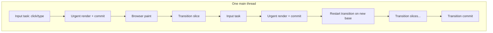
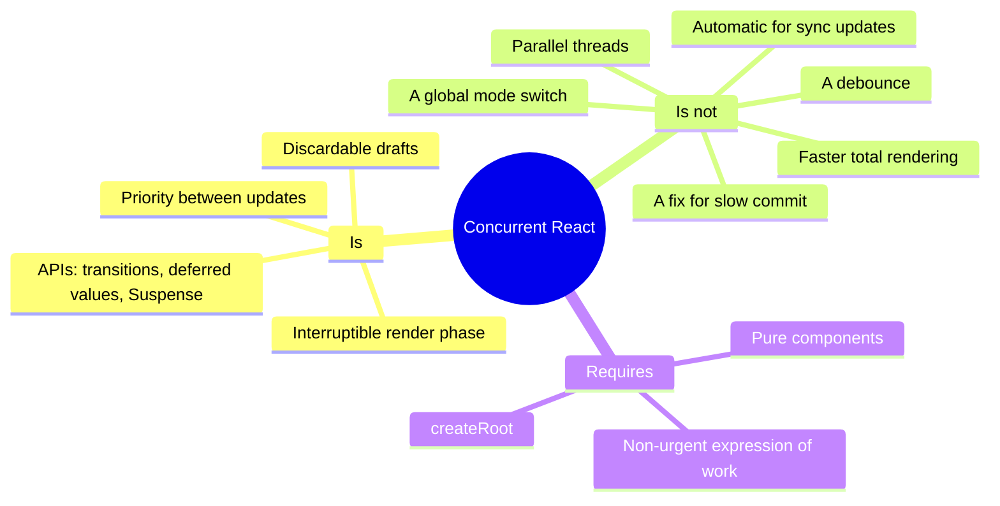

# 02 / 16 — Concurrent React and Common Misconceptions

## 1. Lesson metadata

| | |
|---|---|
| **Level** | Professional |
| **Study time** | 5–6 hours (reading 2.5 h, experiments 1.5 h, exercises 1.5 h) |
| **Prerequisites** | [13 — Scheduling and update priorities](./13-scheduler-and-priorities.md), [14 — Lanes](./14-lanes.md), [15 — Interruptible, restartable, abandoned renders](./15-interruptible-restartable-abandoned-rendering.md), [11 — Render phase vs commit phase](./11-render-phase-and-commit-phase.md), [00/11 — Event loop, tasks, microtasks](../00-web-and-javascript-foundations/11-event-loop-tasks-microtasks.md) |
| **Next** | [17 — How hooks attach to Fiber](./17-hooks-and-fiber-state.md) |
| **Related** | [22 — Automatic batching](./22-automatic-batching.md), [23 — Transitions and deferred rendering](./23-transitions-and-deferred-rendering.md), [24 — Suspense and thrown thenables](./24-suspense-conceptual-internals.md), [28 — Strict Mode behavior](./28-strict-mode-behavior.md), [Phase 3/22 — Modern hooks and APIs](../03-react-state-and-hooks/22-modern-hooks-and-apis.md), [Phase 9/06 — Concurrent rendering in practice](../09-advanced-rendering-and-ecosystem/06-concurrent-rendering-in-practice.md) |

**Learning objectives.** After this lesson you can:
1. Define "concurrent React" precisely: what it *is* (a rendering capability plus a set of APIs that use it) and what it is not (a mode switch, threads, a speed-up).
2. Trace the terminology history (Concurrent Mode → concurrent features) so you can read old articles critically.
3. Refute at least twenty common misconceptions with a concrete mechanism and a demonstration.
4. Choose correctly among `startTransition`, `useTransition`, `useDeferredValue`, debounce, and plain state for a given latency problem.
5. Explain the React 19 changes that make transitions able to wrap async functions, and the caveat about updates after `await`.
6. Predict render sequences produced by `useDeferredValue` and transitions.
7. Diagnose "I added concurrent features and nothing improved" using the Performance panel.

**Concepts covered:** concurrent rendering as a capability, opt-in via `createRoot`, concurrent features (transitions, deferred values, Suspense, selective hydration), non-blocking vs blocking updates, urgency vs priority, pending state, `useTransition` vs `startTransition`, `useDeferredValue` (including the React 19 initial-value argument), async transitions (Actions), stale-while-revalidate UI, why concurrency is not parallelism, what code is "concurrent-safe".

> **Version-sensitive.** Official guidance is on <https://react.dev> (API reference pages for `useTransition`, `startTransition`, `useDeferredValue`, `Suspense`, `StrictMode`). Behaviors below are described for React 19.x as the curriculum baseline. Where behavior depends on internals (which lanes are time-sliced, how multiple transitions are batched), it is labelled *implementation detail* and you are directed to <https://github.com/facebook/react>. When this lesson and the current react.dev text differ, react.dev wins.

---

## 2. Deep conceptual explanation

### 2.1 What problem is this lesson solving?

"Concurrent React" is the most mis-explained topic in the React ecosystem. Articles from 2018–2021 described different, sometimes abandoned, ideas under the same name. Teams adopt `useTransition` hoping for speed-ups, find none, and conclude it "doesn't work". Others avoid it because they heard it "breaks libraries" or "runs components in parallel". Both groups are working from wrong mental models.

This lesson is a consolidation and a correction pass. You already know the mechanisms ([13](./13-scheduler-and-priorities.md), [14](./14-lanes.md), [15](./15-interruptible-restartable-abandoned-rendering.md)); here we pin the *vocabulary* and *claims*, so that when someone says "this is fixed by concurrent mode" you can say what is true, what is false, and what to measure.

### 2.2 A definition you can defend in a design review

> **Concurrent React** is React's ability to prepare multiple versions of the UI at the same time-ish — meaning that a render for one update can be paused, resumed, restarted or discarded when other, more urgent updates arrive — and the set of APIs and behaviors built on that ability (transitions, deferred values, Suspense for data, selective hydration, streaming).

Three consequences to memorize:

1. It is a **capability of the renderer**, not a thing you "turn on" for a component. You opt into the *features* (by using `startTransition` etc.). The capability is available because the app uses `createRoot`.
2. It is about **scheduling and prioritization of one thread's work**. Nothing runs in parallel in JavaScript ([00/01](../00-web-and-javascript-foundations/01-how-the-browser-works.md)).
3. Its output is **the same UI** that sequential rendering would eventually produce. It changes *when* and *which intermediate states* the user sees, never the final result for the same inputs (assuming pure components).

### 2.3 Terminology history (so old articles make sense)

| Era | Term | What it meant | Status |
|---|---|---|---|
| ≈ 2016–2017 | "Fiber" | The reimplementation of the reconciler ([08](./08-why-fiber.md)) | Still the architecture |
| ≈ 2017–2019 | "Async rendering" / "time slicing" / "Suspense" demos | Experiments shown in conference talks | Concepts survive; names fade |
| ≈ 2019–2021 | **"Concurrent Mode"** | A global *mode* of a root (`ReactDOM.createRoot` / `unstable_createRoot`) that changed behavior everywhere (e.g., all updates potentially concurrent) | **Superseded.** The "mode" framing was dropped before React 18. |
| React 18 (2022) | **"Concurrent features" / "concurrent rendering"**, gradual adoption | `createRoot` is the opt-in to a *renderer* that supports interruption; but behavior changes only where you use new APIs | Current |
| React 18 → 19 | Same, plus **Actions** (async transitions), `useOptimistic`, `use` | Concurrent features generalized to async flows | Current baseline |
| React 19.x | New features that build on scheduling: Suspense pre-warming of suspended siblings (19.0), the `Activity` component and Chrome performance tracks (19.2), stable `<ViewTransition>` for transition-marked updates (19.3) | Current. Verified against the react.dev release posts (2026-10-22); latest release at that date is 19.3.x. |

So when an old blog post says "Concurrent Mode makes your whole app …", it describes a design that was changed. Be especially suspicious of `ReactDOM.unstable_createRoot`, `SuspenseList`-era claims, and any statement that the app "is in Concurrent Mode".

### 2.4 What `createRoot` does and does not change

Compared to legacy `ReactDOM.render` (removed in React 19; [legacy](./03-initial-mount-and-updates.md) only):

| Capability | Legacy root | `createRoot` |
|---|---|---|
| Time-sliced rendering of non-urgent work | No | Yes (only for non-blocking lanes) |
| Automatic batching of updates outside React event handlers (timeouts, promises, native handlers) | No (batched only inside React events) | **Yes** ([22](./22-automatic-batching.md)) |
| Transitions and `useDeferredValue` that actually defer | They degrade to synchronous | Yes |
| Suspense fallbacks for data, streaming SSR/selective hydration | Partial/none | Yes |
| Strict Mode double-invocation extras (effect re-run on mount) | Limited | Yes |
| Behavior of a plain `setState` in a click handler | Sync render and commit | **Sync render and commit** (unchanged!) |

The last row is the root of most disappointment: upgrading to `createRoot` does not make existing code non-blocking.

### 2.5 Urgent vs non-urgent: what React actually distinguishes

React's public vocabulary has two buckets ([`useTransition` docs](https://react.dev/reference/react/useTransition)): **urgent updates** (typing, clicking, pressing — direct interaction feedback) and **transition updates** (UI changes from one view to another that may lag). Internally this becomes many lanes ([14](./14-lanes.md)), but for design purposes you decide a single thing: *does the user expect this change to be reflected immediately, or can it follow?*

Everything in this lesson follows from two rules:
- **Rule 1.** Urgent work is never delayed by non-urgent work *beyond the cost of one uninterruptible unit* (one component function; one commit).
- **Rule 2.** Non-urgent work may be done more than once and may be shown late, in exchange for Rule 1.

### 2.6 The API surface (React 19)

| API | Purpose | Notes |
|---|---|---|
| `startTransition(fn)` (imported from `react`) | Mark the state updates called inside `fn` as non-urgent | No `isPending`. Usable anywhere (e.g., in a router or library). |
| `const [isPending, startTransition] = useTransition()` | Same, plus a boolean for "a transition started by this hook is pending" | `isPending` is *not* "data loading"; it is "a transition is not yet committed". |
| `useDeferredValue(value, initialValue?)` | Returns a value that lags behind `value` during urgent updates; React re-renders in the background with the new value | `initialValue` (React 19): value used for the first render before a background render with the real value (react.dev `useDeferredValue` reference). |
| `<Suspense fallback>` + `use(promise)` / lazy | Declaratively wait for something while rendering | Transition-aware: avoids hiding already-revealed content. See [24](./24-suspense-conceptual-internals.md). |
| `flushSync(fn)` | The opposite direction: force a sync render/commit | Escape hatch. |
| `useSyncExternalStore` | Safe reading of external mutable data | Forces sync updates ([15 §2.9](./15-interruptible-restartable-abandoned-rendering.md)). |
| `useOptimistic`, Actions (`<form action>`, `useActionState`) | Async mutations as transitions with optimistic UI | Covered in [Phase 3/22](../03-react-state-and-hooks/22-modern-hooks-and-apis.md) and [Phase 9/13](../09-advanced-rendering-and-ecosystem/13-forms-actions-and-mutations.md). |

### 2.7 Misconception catalogue

Each row: the claim, the reality, the mechanism, and an experiment. (Experiments assume React 19, `createRoot`, a production build or Strict Mode noted explicitly.)

**M1. "Concurrent React runs components in parallel / on multiple threads."**
Reality: one thread. React interleaves its work with other tasks. Experiment: a `while` loop in any component blocks a transition render exactly as long as it takes; no other thread shortens it.

**M2. "Concurrent rendering makes rendering faster."**
Reality: it generally makes **total work larger** (discarded renders, double renders with deferred values) and makes **urgent updates faster to respond**. Throughput goes down; latency for interaction goes down. If a profile shows the same total scripting time but shorter input delay, it worked.

**M3. "Upgrading to React 18/19 makes my app concurrent."**
Reality: the renderer is capable; behavior changes only for updates in non-blocking lanes and for features that rely on them. A click-handler `setState` still renders synchronously.

**M4. "`startTransition` delays the update by some time (like debounce)."**
Reality: no timer. The update is rendered as soon as the main thread is free and nothing more urgent is pending. On an idle machine a transition can commit within the same few milliseconds. Debounce enforces a *minimum wait*; a transition enforces *priority*. Demonstration in §5.2.

**M5. "`useDeferredValue` is debounce."**
Reality: no fixed delay; it re-renders immediately in the background at lower priority and the background render is **interruptible**. Debounce also avoids *work* (and network requests) by skipping intermediate values; `useDeferredValue` may still render for intermediate values if time allows, and it does **not** debounce side effects like fetches unless you key them on the deferred value (in which case the effect runs per *committed* deferred value, which is fewer than keystrokes, but not time-bounded).

**M6. "Transitions make the data fetch faster / cancel stale fetches."**
Reality: transitions govern *rendering*. Network requests are untouched. Abandoning a render does not cancel a promise. For cancellation: `AbortController` ([Phase 6/02](../06-data-fetching-and-state-ecosystems/02-cancellation-and-race-conditions.md)).

**M7. "React can interrupt my component function in the middle."**
Reality: only between fibers ([15 §2.2](./15-interruptible-restartable-abandoned-rendering.md)).

**M8. "Concurrent rendering can leave the DOM in a half-updated state."**
Reality: render never touches the attached DOM; commit is synchronous and atomic from the user's perspective ([11](./11-render-phase-and-commit-phase.md)).

**M9. "Concurrent features cause race conditions in my state."**
Reality: state updates are applied in dispatch order (§2.7 rebasing in [15](./15-interruptible-restartable-abandoned-rendering.md)); the final state is order-consistent. Race conditions arise from *your* async code (fetch responses arriving out of order) — and transitions don't fix or cause that.

**M10. "`setState` is asynchronous because of concurrent rendering."**
Reality: `setState` has always *enqueued* an update; whether and when React re-renders depends on batching and lanes. Batching is [22](./22-automatic-batching.md); it is a separate feature that merely also shipped with `createRoot`. A discrete-event `setState` is rendered synchronously at the end of the event, long before any asynchronous scheduling.

**M11. "Strict Mode's double render is concurrent rendering."**
Reality: Strict Mode (development only) deliberately double-invokes render functions and re-runs effects on mount to expose impurity ([28](./28-strict-mode-behavior.md)). It happens even for sync updates. It *simulates* the consequence of concurrency (render may run more than once) but is not itself concurrency.

**M12. "`isPending` means data is loading."**
Reality: `isPending` is true from the start of the transition until the transition's updates are committed. It can be true while no network request is made (a slow render) and false while data is still loading (if you show fallbacks elsewhere or the fetch is in an effect). Treat it as "UI update in flight".

**M13. "Wrapping state updates in `startTransition` makes controlled inputs smoother."**
Reality: docs explicitly say transition updates can't control text inputs. The input's value must be urgent ([15 D2](./15-interruptible-restartable-abandoned-rendering.md)).

**M14. "I should put all my setState calls in transitions to be safe."**
Reality: transitions make the update *late* and *abandonable*. Urgent feedback (button pressed state, checkbox toggle, input text) must be urgent. Over-using transitions produces UIs that feel sluggish and mispredict (e.g., selection highlight lagging behind a click).

**M15. "Concurrent React requires rewriting my components."**
Reality: pure components need no change. Code that *relied* on single-invocation render, on legacy lifecycles (`componentWillMount`, `componentWillReceiveProps`, `componentWillUpdate` — unsafe lifecycles, legacy), or on mutable globals read in render needs fixing. Strict Mode reveals these ahead of time.

**M16. "`startTransition(async () => { await …; setState(…) })` keeps the later `setState` in the transition."**
Reality (React 19 docs): `startTransition` accepts async functions (Actions), and the *synchronous part* before the first `await` is tracked; state updates **after** an `await` are not automatically marked as transitions — wrap them in another `startTransition`. This is a documented caveat reflecting JavaScript's lack of async context propagation (react.dev's `startTransition` reference calls this "a known limitation that we will fix in the future"; verified 2026-10-22).

**M17. "Suspense is a concurrent-only feature."**
Reality: Suspense for `lazy` code splitting worked in legacy roots; Suspense for data and its *transition-aware* behavior need the concurrent renderer. SSR streaming and selective hydration also rely on it.

**M18. "A transition's fallback never shows."**
Reality: a transition avoids showing a fallback *for boundaries already revealed* (keeps old UI). A boundary that is **new** in the transition (first time shown) may still show its fallback. Docs: transitions "only wait long enough to avoid hiding already revealed content."

**M19. "Concurrent React fixes slow commit phases."**
Reality: commit is synchronous; huge DOM mutations, layout effects, and browser layout/paint costs are untouched ([20](./20-commit-and-dom-mutation.md), [21](./21-browser-paint-and-react-updates.md)).

**M20. "If I use `useDeferredValue`, expensive children re-render less."**
Reality: they render **more** often total (urgent pass with the old value — bailed out if memoized — plus the background pass). To benefit, the expensive child must be wrapped in `memo` (or otherwise bail out) so the *urgent pass skips it*. Without `memo`, the urgent pass re-renders the slow child with the stale value (same output but same cost), then renders again: strictly worse.

**M21. "Concurrent rendering means effects can run in the middle of a render."**
Reality: effects run only after commit ([18](./18-effects-and-their-timing.md)).

**M22. "Transitions and `useDeferredValue` work with any external store."**
Reality: updates caused by `useSyncExternalStore` stores are forced synchronous to avoid tearing; they cannot be deferred ([15 §2.9](./15-interruptible-restartable-abandoned-rendering.md)). Many state libraries (Redux with `useSelector`, Zustand) are built on it; to defer *rendering derived from store values*, copy the value into a deferred value inside React (`useDeferredValue(storeValue)`), which then defers rendering of consumers of the deferred value.

**M23. "Server Components / SSR are concurrent React."**
Reality: they use features related to Suspense and streaming, but concurrency (interruptible client renders) is a client-reconciler behavior. See [26](./26-ssr-and-client-rendering.md), [27](./27-react-server-components-intro.md).

**M24. "Time slicing is 5 ms."**
Reality: the Scheduler's default frame interval is on the order of 5 ms *at the time of writing* — an implementation detail; it can be tuned or changed, and the yield decision can depend on other signals. Do not design around a number.

**M25. "Concurrent mode was removed."**
Reality: the *mode* framing was removed; the underlying capability is core to React 18+.

### 2.8 The mental model in one picture



Nothing overlaps in time. Concurrency is **interleaving with reprioritization**, plus the right to discard.

---

## 3. Internal mechanics

### 3.1 Public guarantees

1. Components must be pure; render may be invoked repeatedly, partially, or never committed ([12](./12-why-rendering-must-be-pure.md)).
2. A transition update is not rendered synchronously in response to the event that created it; urgent updates are.
3. A committed UI is a consistent function of state (no tearing for React state).
4. Final state respects dispatch order.
5. `isPending` from `useTransition` reflects the transition lifecycle (true until committed).
6. Per the `useTransition` docs, multiple concurrent transitions may be batched together (*"React currently batches them together; this is a limitation that may be removed in a future release"*). Do not rely on independent completion of two transitions (wording checked against react.dev/reference/react/useTransition on 2026-10-22).

### 3.2 Teaching model: priority as a total preorder

Treat every update as having a priority tier: **sync (discrete input) > blocking default > transition > idle/offscreen**. The rule of the scheduler: *render the highest tier that has pending work, restart if that tier differs from the one in progress*. Transitions of the same tier are combined. Time slicing applies to tiers at or below "transition". See [14](./14-lanes.md) for why real React uses a bitmask of lanes (many transition lanes, entanglement) instead of a flat ordering.

### 3.3 What `startTransition` does mechanically (conceptual)

1. Sets a module-level flag ("current transition context") for the duration of the *synchronous* call to your callback.
2. Any `setState` executed while the flag is set reads the flag in the dispatch function and obtains a *transition lane* instead of the lane derived from the current event priority.
3. Restores the flag when your callback returns (and for async callbacks, tracks the returned promise to hold `isPending` true until it settles — React 19 behavior). *Verified by execution on React 19.3.1 with `startTransition(async () => { setA(1); await sleep(20); setB(1); startTransition(() => setC(1)); })`: renders were `pending=true a=0 b=0 c=0`, then `pending=true a=0 b=1 c=0` (the post-`await` `setB` is an ordinary update and commits at once, while `pending` stays true), then `pending=false a=1 b=1 c=1` (the pre-`await` `setA` and the re-wrapped `setC` commit together when the action settles).*
4. Nothing else. There is no queue of transitions with timers.

Because the flag is set only during the synchronous callback, state updates after an `await` (outside the call stack of your callback) are not marked (M16). The same reason explains why `setTimeout(() => setX(…))` inside `startTransition` does not make that update a transition: the timeout callback runs later, outside the flag's scope.

*Implementation detail:* the flag is an internal variable; names such as `ReactSharedInternals.T` in recent versions represent the current transition object. The *behavior* (synchronous scope) is documented; the variable is not.

### 3.4 What `useDeferredValue` does mechanically (conceptual)

```text
function useDeferredValue(value, initialValue) {
  const [deferred, setDeferred] = hidden state initialized to (initialValue ?? value)
  if (value !== deferred (Object.is) AND the current render is urgent) {
      return old deferred;                       // urgent render sees old value
      // + schedule a transition-priority render in which `deferred` becomes `value`
  } else {
      return value;                              // in the deferred render it equals value
  }
}
```

The real implementation avoids a separate state hook but the observable behavior matches: a sync render with the *old* value, then a lower-priority render with the *new* value. Because the second render is a normal interruptible render, new keystrokes can restart it, as in [15 §4.1](./15-interruptible-restartable-abandoned-rendering.md).

Consequence for hooks: `useDeferredValue` uses internal hook state, so it must obey the Rules of Hooks ([17](./17-hooks-and-fiber-state.md)).

### 3.5 Why `memo` is required for deferral to pay off

During the urgent pass, the parent re-renders (its own state changed) and gets the **old** deferred value. If the slow child is not memoized, React re-renders it (same props reference? no, the child element is new) — React's default is to re-render children when the parent renders ([01](./01-what-triggers-a-render.md)). The slow child therefore costs its full price in the urgent render, defeating the purpose. With `memo`, props are shallow-equal (same old deferred value) so React bails out of the child during the urgent pass ([Phase 3/12](../03-react-state-and-hooks/12-react-memo.md)).

### 3.6 Concurrent-safety checklist (what your code must satisfy)

- No side effects in render, in `useMemo`/`useState` initializers, or in reducers/updaters.
- No reads of mutable external data in render (except via `useSyncExternalStore`).
- No assumptions that mount happens once (Strict Mode will re-mount).
- Effects must have cleanups that make them idempotent across mount/unmount/mount.
- Refs: write in effects/events, not render.

---

## 4. Step-by-step execution walkthrough

### 4.1 `useDeferredValue` while typing "a" then "b" quickly

Code (abbreviated; see §5.2):

```tsx
const [text, setText] = useState("");
const deferred = useDeferredValue(text);
return <><input value={text} onChange={e => setText(e.target.value)} /><SlowList text={deferred} /></>;
```

Assume `SlowList` is `memo`ized and takes ≈200 ms to render.

| Step | Event | Render attempt | Values seen by components | Commit | Screen |
|---|---|---|---|---|---|
| 1 | Page load | Mount render | `text=""`, `deferred=""` | Commit 0 | empty input, list for `""` |
| 2 | Type `a` | **Render A1** (urgent): parent `text="a"`; `useDeferredValue` returns **`""`** (old) and schedules a background render | `SlowList text=""` → bailout (memo) | **Commit 1** | input `a`; list unchanged |
| 3 | idle slice | **Render A2** (transition-priority): parent `text="a"`, `deferred="a"`; `SlowList` renders (sliced if multiple rows/fibers) | — | not yet | |
| 4 | 80 ms later, type `b` (A2 is mid-way) | **Render B1** (urgent): parent `text="ab"`, `deferred` returns `"a"` (the last *committed* deferred value? see note) → `SlowList` bailout; A2 discarded (restart) | | **Commit 2** | input `ab`; list unchanged |
| 5 | | **Render B2** (background): `deferred="ab"`; `SlowList` renders from scratch | | after ≈ 200 ms: **Commit 3** | list for `ab` |

Note on step 4: the deferred value seen by the urgent pass is the one from the **last committed** state of the deferred lane, i.e., `""`, since A2 never committed. Therefore B1 returns `""` (not `"a"`). The visible list stays at the `""` results. The sequence of values the list ever sees is `""` → `"ab"`; `"a"` was skipped entirely. (The conceptual model here is documented by react.dev; mechanisms such as how the background pass obtains its value are internal.)

Predict how many times `SlowList` *function* was invoked: A2 partially (≈ some rows), B2 fully. The user perceives zero input lag.

### 4.2 The same typing with debounce (300 ms)

Input is urgent anyway (`text` state). `debouncedText` updates 300 ms after the last keystroke. After `a`: render (urgent, text=a). 300 ms of silence → `setDebounced("a")` — but at ≈80 ms `b` arrives, resetting the timer. After `b`: 300 ms → `setDebounced("ab")` → **sync-lane or default-lane render of SlowList = 200 ms blocking**: if the user types `c` during that 200 ms, the keystroke is **delayed** by up to 200 ms, because the render isn't sliced and blocks the main thread. Debounce avoided intermediate renders, but when the render happens it is unprotected. The two techniques are complementary: debounce *what you ask for*, transitions protect *how the render runs* (§7).

### 4.3 Async transition (React 19)

```tsx
const [isPending, startTransition] = useTransition();
function save(name: string) {
  startTransition(async () => {
    const result = await updateName(name);       // network
    startTransition(() => setSavedName(result)); // re-enter the transition after the await
  });
}
```

1. Click handler calls `save`. `startTransition` begins; `isPending` becomes true (urgent commit showing "Saving…").
2. The async function's synchronous prefix runs; `await` yields.
3. While the request is in flight the UI remains interactive; `isPending` stays true until the promise settles and the follow-up transition is processed.
4. After the promise resolves, the inner `startTransition` marks `setSavedName` as a transition update; render; commit. `isPending` becomes false in the same commit.

If the inner `startTransition` is omitted, `setSavedName` would be an ordinary default-lane update, processed possibly *before* `isPending` clears, creating a brief inconsistent state ("Saving…" with the new name). React's docs describe this caveat (the "wrap updates after `await` in another `startTransition`" limitation); treat the exact observable flicker as version-dependent.

---

## 5. Code examples

### 5.1 Minimal example — what a plain click handler does *not* get from `createRoot`

```tsx
import { createRoot } from "react-dom/client";
import { useState } from "react";

function burn(ms: number) {
  const end = performance.now() + ms;
  while (performance.now() < end) {}
}

function Heavy({ n }: { n: number }) {
  burn(300);                       // a single 300 ms component
  return <p>n = {n}</p>;
}

function App() {
  const [n, setN] = useState(0);
  return (
    <>
      <button onClick={() => setN((x) => x + 1)}>increment</button>
      <Heavy n={n} />
    </>
  );
}

createRoot(document.getElementById("root")!).render(<App />);
```

**Predict:** click rapidly five times. Does the page stay responsive because we used `createRoot`?

**Result:** No. Each click renders synchronously (discrete event → sync lane) for 300 ms; the clicks queue as input tasks; the page behaves like React 17. 5 clicks → n = 5 after ≈ 1.5 s, five commits (each click's handler runs after the previous render completes).

**Why:** blocking lane + single 300 ms fiber: no yielding, no abandoning.

**Variation:** `startTransition(() => setN(x => x + 1))`. The click handler returns immediately; the transition render of `Heavy` is still one uninterruptible 300 ms function, but the *button* stays responsive between renders. Five rapid clicks: the first transition render starts (300 ms, can't be interrupted inside `Heavy`), additional clicks add updates to the same lane; after the first render completes React finds more pending transition updates and re-renders; because transitions are batched/entangled the final n is 5 after one or two further renders — *not* 5 × 300 ms. Count of `Heavy` invocations: between 2 and 5. **Trade-off:** the UI doesn't freeze between clicks, but still cannot render `Heavy` faster; to make it truly responsive, split or reduce `Heavy`.

### 5.2 Practical example — three ways to keep a filter responsive

```tsx
import { memo, useDeferredValue, useMemo, useState, useTransition, useEffect } from "react";

const ITEMS: readonly string[] = Array.from({ length: 5000 }, (_, i) => `Item ${i}`);

function burn(ms: number) {
  const end = performance.now() + ms;
  while (performance.now() < end) {}
}

const Row = memo(function Row({ label }: { label: string }) {
  burn(0.05);              // 5000 rows × 0.05 ms ≈ 250 ms per full render
  return <li>{label}</li>;
});

const List = memo(function List({ query }: { query: string }) {
  const visible = useMemo(
    () => (query ? ITEMS.filter((s) => s.includes(query)) : ITEMS),
    [query],
  );
  return <ul>{visible.map((s) => <Row key={s} label={s} />)}</ul>;
});

/** A) Deferred value: you own only the input state. */
export function WithDeferredValue() {
  const [query, setQuery] = useState("");
  const deferredQuery = useDeferredValue(query);
  const stale = query !== deferredQuery;
  return (
    <>
      <input value={query} onChange={(e) => setQuery(e.target.value)} aria-label="Filter" />
      <div style={{ opacity: stale ? 0.6 : 1 }}>
        <List query={deferredQuery} />
      </div>
    </>
  );
}

/** B) Transition: you own the state setter. */
export function WithTransition() {
  const [query, setQuery] = useState("");
  const [applied, setApplied] = useState("");
  const [isPending, startTransition] = useTransition();
  return (
    <>
      <input
        value={query}
        aria-label="Filter"
        onChange={(e) => {
          setQuery(e.target.value);
          startTransition(() => setApplied(e.target.value));
        }}
      />
      <div style={{ opacity: isPending ? 0.6 : 1 }}>
        <List query={applied} />
      </div>
    </>
  );
}

/** C) Debounce: wait for typing to stop, then render synchronously. */
export function WithDebounce() {
  const [query, setQuery] = useState("");
  const [debounced, setDebounced] = useState("");
  useEffect(() => {
    const id = setTimeout(() => setDebounced(query), 300);
    return () => clearTimeout(id);               // cleanup: restarts the timer on each keystroke
  }, [query]);
  return (
    <>
      <input value={query} onChange={(e) => setQuery(e.target.value)} aria-label="Filter" />
      <List query={debounced} />
    </>
  );
}
```

**Line notes.**
- `List`/`Row` are `memo` so the urgent pass bails out when `query` (the `List` prop) hasn't changed (§3.5).
- `stale = query !== deferredQuery` is the idiom for showing pending UI with deferred values; `useDeferredValue` has no `isPending`.
- `useMemo` in `List` avoids re-filtering on unrelated renders; the expensive part here is the `Row` count; `useMemo` doesn't help slicing.
- In C the `useEffect` cleanup is essential; without it every keystroke leaves a timer ([06 — effect cleanup](../03-react-state-and-hooks/06-effect-cleanup.md)).

**Predict:** type `1`, pause 1 s, then type `2`, `3` rapidly. How does each variant behave while the list renders?

| Variant | Input latency during list render | Number of list commits for fast `1 2 3` | Notes |
|---|---|---|---|
| A (`useDeferredValue`) | Low: urgent renders interleave (only `<input>` + stale wrapper) | 1 (typically; up to 3 if typing slower than render) | List may show old results while pending |
| B (transition) | Low | same as A | Same mechanics; you control which state is deferred |
| C (debounce 300 ms) | Low *before* the debounce fires; **High** during the synchronous list render (≈ 250 ms) after it fires | 1 | Fewest renders, but unprotected once it renders |

**Why:** A and B tag the list render as interruptible; C turns it into a blocking render at the moment it runs.

### 5.3 Incorrect example — "everything is a transition"

```tsx
function Toggle() {
  const [open, setOpen] = useState(false);
  const [, startTransition] = useTransition();
  return (
    <>
      <button
        aria-expanded={open}
        onClick={() => startTransition(() => setOpen((o) => !o))}   // BUG
      >
        Details
      </button>
      {open && <Details />}                                          {/* heavy */}
    </>
  );
}
```

**Predict:** what does the user experience on a slow device?

**Result:** The button's pressed/expanded state (`aria-expanded`) does not update until the whole `Details` render completes (the update is a single state shared by the button and the panel). The click feels dead for the duration of the heavy render, and impatient users click again, toggling it closed. Because the same state drives both feedback and heavy content, wrapping *the whole state* in a transition delays the feedback.

**Why wrong:** you need two pieces of information: *urgent* ("the user pressed the button") and *non-urgent* ("the details panel content"). One state variable cannot be both.

### 5.4 Corrected implementation

```tsx
function Toggle() {
  const [open, setOpen] = useState(false);              // urgent: button state
  const [showDetails, setShowDetails] = useState(false); // non-urgent: heavy content
  const [isPending, startTransition] = useTransition();

  return (
    <>
      <button
        aria-expanded={open}
        aria-busy={isPending}
        onClick={() => {
          const next = !open;
          setOpen(next);                                  // immediate feedback
          startTransition(() => setShowDetails(next));    // heavy content follows
        }}
      >
        Details
      </button>
      {showDetails && <Details />}
    </>
  );
}
```

Trade-off: two states can disagree briefly (`open` true while `showDetails` false) — that is the *point* (feedback first), but make sure the intermediate UI is coherent (a spinner or skeleton region, `aria-busy`). Often the better fix is to make `Details` cheaper (lazy-load, virtualize) and not use a transition at all.

### 5.5 Advanced example — instrumenting a deferred value and measuring input delay

```tsx
import { Profiler, useDeferredValue, useLayoutEffect, useState, type ProfilerOnRenderCallback } from "react";

const onRender: ProfilerOnRenderCallback = (id, phase, actualDuration, baseDuration, startTime, commitTime) => {
  console.info("[commit]", id, phase, actualDuration.toFixed(1) + "ms");
};

function Probe({ label, value }: { label: string; value: string }) {
  console.info("[render]", label, JSON.stringify(value));     // render phase: may fire without commit
  useLayoutEffect(() => {
    console.info("[layout]", label, JSON.stringify(value));    // commit phase: one per commit
  });
  return null;
}

export function Instrumented() {
  const [text, setText] = useState("");
  const deferred = useDeferredValue(text);
  return (
    <Profiler id="demo" onRender={onRender}>
      <input value={text} onChange={(e) => setText(e.target.value)} aria-label="Type here" />
      <Probe label="urgent" value={text} />
      <Probe label="deferred" value={deferred} />
    </Profiler>
  );
}
```

Add a PerformanceObserver (Event Timing API) to see input latency (support varies; Chromium and recent Safari/Firefox expose parts of it; check MDN's compatibility table):

```ts
new PerformanceObserver((list) => {
  for (const e of list.getEntries() as PerformanceEventTiming[]) {
    if (e.name === "keydown" || e.name === "input") {
      console.info(`${e.name}: delay=${(e.processingStart - e.startTime).toFixed(0)}ms, total=${e.duration}ms`);
    }
  }
}).observe({ type: "event", durationThreshold: 16, buffered: true });
```

**Predict (React 19, production build, no Strict Mode, type `a` once on an idle page):**

```
[render] urgent "a"
[render] deferred ""        <- old deferred value in the urgent pass
[layout] urgent "a"
[layout] deferred ""
[commit] demo update …
[render] urgent "a"         <- background pass
[render] deferred "a"
[layout] urgent "a"
[layout] deferred "a"
[commit] demo update …
```

**Why:** two render+commit cycles per urgent keystroke (urgent then deferred). In development with Strict Mode every `[render]` line doubles. A discarded background pass would show `[render]` lines with no matching `[layout]`/`[commit]`.

**Trade-off:** instrumentation itself (console I/O) adds cost; use sparingly or sample in production RUM.

---

## 6. Visual explanations

### 6.1 Misconception map



### 6.2 Latency vs throughput

```text
Without transition (typing 3 chars, 300ms list render each):
input: |type|====list 300====|type|====list 300====|type|====list 300====|
latency of 2nd char: up to 300ms (queued behind render)

With transition:
input: |type|R|slice|slice|type|R|slice|slice|type|R|slice|slice|slice|...|commit|
latency of each char: ≈ one slice (≤ ~5ms of React work + handler)
total CPU spent on list: more (two abandoned partial renders)
list shown: only the final value, ≈ 300ms after last keystroke
```

### 6.3 Choosing a tool

```mermaid
flowchart TD
  Q[Interaction feels slow] --> M{Measure: where is the time?}
  M -->|Network| N[Fetching: cache, parallelize, cancel]
  M -->|React render of a large subtree| R{Can you remove the work?}
  R -->|yes| X[Virtualize, colocate state, memo, move computation]
  R -->|no| S{Do you own the setter?}
  S -->|yes| T[startTransition / useTransition]
  S -->|no (prop/lib value)| D[useDeferredValue + memo]
  M -->|Commit / layout / paint| L[Reduce DOM size, avoid layout thrash; concurrency doesn't help]
  M -->|One slow component function| W[Optimize that function or worker]
```

---

## 7. Alternative approaches and trade-offs

| Criterion | `startTransition` / `useTransition` | `useDeferredValue` | Debounce | Throttle | `flushSync` | Do less work |
|---|---|---|---|---|---|---|
| **Readability** | High | Highest | Medium (timers/cleanup) | Medium | Low | High |
| **Input responsiveness during heavy render** | Excellent | Excellent | Poor *during* render | Poor during render | Worst | Excellent |
| **Total CPU** | Higher (aborted work) | Higher (two passes) | Lower (skips intermediates) | Lower | Lowest | Lowest |
| **Avoids network chatter** | No | No (unless keyed on deferred value; still not time-bounded) | **Yes** | Yes | No | Depends |
| **Needs setter ownership** | Yes | No | No | No | Yes | — |
| **Works with `useSyncExternalStore` values** | No (updates forced sync) | Partially (defer the *derived render*) | Yes | Yes | n/a | Yes |
| **Complexity of correctness** | Low (pure render) | Low (+ `memo`) | Medium (cleanups, stale closures) | Medium | Low but risky | Varies |
| **Lag is bounded by CPU, not time** | Yes | Yes | No (fixed delay) | No | n/a | n/a |

**Scenario where debounce (or "do less") beats transitions:** a search box hitting an API per keystroke. Transitions do not reduce the number of requests; debounce does (or cancelation with `AbortController`). Likewise, if the heavy work is in an *event handler* (not render), transitions are irrelevant.

**Scenario where nothing concurrent helps:** page load. The initial render of a large, mostly-new tree is a mount in the default lane; the user sees nothing until it commits. Reduce work: code splitting, SSR/streaming ([26](./26-ssr-and-client-rendering.md)), Suspense boundaries with fallbacks.

---

## 8. Best practices and anti-patterns

**Do**
- Decide urgency per *piece of state*, not per feature. Split state into "what the user just did" and "what that implies".
- Pair `useDeferredValue` with `memo` on the slow consumer.
- Display stale/pending state (`isPending`, `query !== deferred`) with a non-layout-shifting cue (opacity, a status region with appropriate ARIA, not a spinner that remounts).
- Keep Strict Mode on in development; it surfaces render impurity that concurrency would otherwise expose in production.
- Measure with CPU throttling before and after.

**Beginner mistakes**
- Treating `startTransition` as "async" or "defer by N ms".
- Placing `isPending` on the wrong element (it should reflect the *affected region*).
- Using transitions for controlled input text.

**Experienced-developer mistakes**
- Introducing transitions to hide a slow component rather than fixing it.
- Forgetting that updates after `await` are not in the transition (M16).
- Using `useDeferredValue` with a freshly created object each render (`useDeferredValue({ a, b })`): `Object.is` always differs, causing endless background re-renders. Pass primitives or stable references (documented).
- Assuming transitions are independent (documented limitation: batched together).
- Putting `useTransition` in a shared library hook and leaking `isPending` semantics to consumers.

**Smells:** `startTransition` around everything in a handler; transitions with no visible pending UI; `useDeferredValue` on a value whose consumer is not memoized; fetch-in-effect keyed on a deferred value without cancellation.

**Justified exceptions**
- Wrapping a *router navigation* in a transition so that the current page stays visible: the recommended pattern (frameworks do this internally).
- Using both debounce and a transition (debounce the request key; transition the render of the response).

---

## 9. Real-world application

**Data grid with column filters (dashboard).** Filter text boxes are urgent; the 10k-row grid re-render is a transition. Constraint: screen-reader users must be told results changed; add a polite live region updated in the *commit* of the results (e.g., a layout/passive effect keyed on committed results count), not on keystrokes. Also virtualization, because commit remains synchronous.

**Checkout with address autocomplete (e-commerce).** Request per keystroke (debounced + `AbortController`), suggestion list renders in a transition, "Place order" button stays urgent. Constraint: payment-critical buttons must never be behind a transition — a pending order click must visibly register immediately (`useFormStatus`/`useActionState` for Actions; [Phase 9/13](../09-advanced-rendering-and-ecosystem/13-forms-actions-and-mutations.md)).

**Navigation in a multi-team shell.** Route changes are transitions: old page stays interactive while the new page's Suspense data loads; a top progress bar bound to `isPending` communicates progress. Constraint: pages from different teams with differing suspension behavior; use a shared router-level transition policy instead of ad-hoc ones.

**Realtime trading view.** Price ticks arrive through `useSyncExternalStore` (forced sync); the detail panel for a selected instrument is a transition. Constraint: no tearing (single snapshot), no stale price shown as "live" — label deferred panels with timestamps.

---

## 10. Debugging and troubleshooting

**Symptom: "I added `useDeferredValue` and the input is still laggy."**
1. Record a Performance trace while typing at 4× CPU throttle.
2. Check that the slow child is `memo`ized: in the urgent render commit, the Profiler should show the slow component as *not rendered* ("Did not render" in DevTools Profiler when "Record why each component rendered" is enabled; [30](./30-react-devtools-profiler.md)).
3. If it re-rendered in the urgent pass, props changed or `memo` is defeated (inline objects/functions) → fix props stability.
4. Verify there is only one slow fiber: slicing needs many fibers.
5. Check for a `useSyncExternalStore` source forcing sync updates.

**Symptom: "The transition's loading indicator flashes / `isPending` never turns true."**
`isPending` is set in an urgent update; if the transition completes within the same commit batch it may never paint as true (fine). If the update after an `await` isn't wrapped (M16), `isPending` may become false before the data renders.

**Symptom: "After moving to React 18/19, a library double-subscribes / double-fires."**
Strict Mode effect re-run: the library doesn't clean up properly. Fix the cleanup or the library version; do not remove Strict Mode.

**Symptom: "Transition seems to never finish under websocket load."**
Expiration/starvation ([15 §2.10](./15-interruptible-restartable-abandoned-rendering.md)). Throttle/coalesce updates.

**Validation of any fix:** compare INP/event timing and long-task distribution before and after under the same throttled scenario; confirm final UI equals the non-concurrent result (correctness unchanged).

---

## 11. Exercises

### Level A — Knowledge
A1. Define concurrent React in two sentences without using the words "parallel" or "mode".
A2. List three differences between `createRoot` and legacy `ReactDOM.render` behavior.
A3. What does `isPending` represent?
A4. Why does `useDeferredValue` need `memo` on the slow child to be useful?
A5. State the documented caveat about updates after `await` inside `startTransition`.

### Level B — Code comprehension
B1. In §5.2 variant A, user types `x` and waits 2 s. List the renders (urgent/deferred) and commits.
B2. What does this log, in production, for one change?
```tsx
function C({ q }: { q: string }) {
  const d = useDeferredValue({ q });
  console.log("render", d.q);
  return null;
}
```
(Parent re-renders with a new `q` once.)
B3. Which of these updates are transitions? (a) `startTransition(() => setA(1))`; (b) `startTransition(() => { setTimeout(() => setB(1), 0) })`; (c) `startTransition(async () => { await x(); setC(1) })`; (d) `startTransition(async () => { setD(1); await x(); })`.
B4. A teammate claims "this makes the click handler async": `onClick={() => startTransition(() => setOpen(true))}`. Evaluate.

### Level C — Implementation
C1. Implement `useDebouncedTransitionValue<T>(value: T, ms: number): [T, boolean]` that debounces *and* defers rendering, returning a pending flag. Explain what each layer buys.
C2. Write a `<PendingRegion isPending>` component that dims content, sets `aria-busy`, and does not shift layout.

### Level D — Debugging
D1. "We moved the search `<input>`'s `onChange` into `startTransition` to fix lag. Now characters are dropped on Android." Explain and fix.
D2. "`useDeferredValue(filters)` where `filters` is built as `{ status, owner }` inside the component causes the list to re-render continuously (CPU 100%)." Explain and fix.

### Level E — Architecture and engineering decisions
E1. Your team wants a lint rule "always wrap setState calls in startTransition". Argue against, and propose alternative guidance.
E2. A design-system `<Tabs>` should keep the old tab visible while a new tab's content loads. Decide how transitions and Suspense should be exposed in its API (props, hooks, defaults) and what you will document.

### Level F — Expert challenge
F1. You're told "concurrent features broke our analytics: page-view events fire twice." The events are sent from `useEffect` in a layout component and from render in a data hook. Produce a diagnosis plan that separates Strict Mode effects, abandoned renders, and real double navigation; fix each; and write a regression test strategy.

---

## 12. Detailed answers and explanations

> Attempt the exercises first.

**A1.** Concurrent React is the renderer's ability to start rendering an update, pause it, and abandon or restart it when more urgent updates arrive, while the committed UI stays consistent; and the APIs (transitions, deferred values, Suspense) that use that ability to keep interaction feedback fast. Wrong answers: "React runs in multiple threads" (one thread); "it's Concurrent Mode" (obsolete framing).

**A2.** Any three: time-sliced non-urgent renders; automatic batching outside React events; transitions/deferred values that actually defer; Suspense for data/streaming/selective hydration; Strict Mode's mount re-run behavior. Also: legacy root removed in React 19.

**A3.** The transition started via that `useTransition` hook has not yet committed (including, in React 19, the pending state of an async function passed to `startTransition`). It is not "network pending". It is initiated by an urgent update and cleared in the commit of the transition.

**A4.** Without `memo`, the urgent pass (with the stale deferred value) re-renders the slow child because parent re-rendered; cost is paid at urgent priority, so no responsiveness gain, plus a second background render. With `memo`, same-prop bailout makes the urgent pass cheap.

**A5.** The synchronous portion is marked; updates after `await` are outside the transition scope and must be wrapped in another `startTransition` (check react.dev for current text).

**B1.** Urgent render (`text="x"`, deferred `""`) → commit; background render (`deferred="x"`) → commit. Two renders of the parent and probes, two commits; `List` renders once (second pass). After 2 s idle both done. Wrong: "one render" (the urgent pass is distinct), "List rendered twice" (memo bails out the first).

**B2.** Each render creates a new object, so `Object.is(value, previousDeferred)` is always false. In the urgent render the hook therefore returns the *old* object (log `render a`, i.e. `d.q` is the previous `q`) and schedules one background (deferred-lane) render; in that background render React is already rendering deferred work, so the hook simply adopts the new object (log `render b`) and does **not** schedule another pass. Result: exactly two logs for one change (`render a`, `render b`), not a loop. The cost is real but bounded: *every* urgent render of this component with a fresh object spawns one extra background render, even when `q` did not change (the docs advise passing primitives or objects created outside render). *Verified by execution (React 19.3.1, 2026-10-22): `render a` -> `render a` (urgent, `d.q` stale) -> `render b` (deferred), then stable.* Fix: `useDeferredValue(q)` and build the object after.

**B3.** (a) yes. (b) no — the timeout callback runs after the synchronous scope. (c) no for `setC(1)` (after await). (d) yes for `setD(1)` (synchronous prefix before the first await). Important: in (d) the transition's `isPending` remains true until the promise settles.

**B4.** Incorrect. The handler is synchronous; `startTransition` runs its callback immediately and marks the state update lane. The handler still completes in the same tick. The *render* is what's deferred, and only relative to urgent work.

**C1.**
```tsx
import { useDeferredValue, useEffect, useState } from "react";

export function useDebouncedTransitionValue<T>(value: T, ms: number): [T, boolean] {
  const [debounced, setDebounced] = useState(value);
  useEffect(() => {
    const id = setTimeout(() => setDebounced(value), ms);
    return () => clearTimeout(id);
  }, [value, ms]);
  const deferred = useDeferredValue(debounced);
  return [deferred, debounced !== deferred || value !== debounced];
}
```
Debounce layer: reduces the *number of heavy renders/requests* by waiting ms after the last change; deferred layer: when the heavy render does run, it's interruptible. `pending` is true during the debounce window and during the background render. Edge: `setDebounced(value)` on a timeout is a default-lane update; `useDeferredValue` converts the *consumer* render into a background render. Objects as `T`: must be stable. Alternative: wrap `setDebounced` in `startTransition` and use `useTransition`'s `isPending`.

**C2.**
```tsx
export function PendingRegion({ isPending, children }: { isPending: boolean; children: React.ReactNode }) {
  return (
    <div aria-busy={isPending} style={{ opacity: isPending ? 0.6 : 1, transition: "opacity 120ms" }}>
      {children}
    </div>
  );
}
```
Notes: opacity doesn't shift layout; `aria-busy` is a hint to AT (support varies); also provide a live region (`role="status"`) when results count changes if announcement matters. The CSS transition delays the dim slightly, avoiding flashing for quick updates.

**D1.** Controlled input value is set in a transition → the urgent event's render sees the old value and React restores the DOM value; subsequent keystrokes act on stale text; IME composition (common on Android keyboards) is especially sensitive. Fix: `setText` urgent; derive heavy results through transition/deferred (as §5.2). Verification: type fast with 6× throttle; no characters lost; list lags only.

**D2.** New object identity each render ⇒ `Object.is` difference ⇒ every urgent render spawns an extra background render (B2; it does not loop forever, but it doubles the renders and defeats the point of deferring). Fix: `const status = useDeferredValue(statusRaw)`, or memoize the object with `useMemo`, or defer primitives separately. Validate in Profiler: render count stabilizes.

**E1. Evaluation criteria:** understands urgency semantic; identifies cost (staleness, extra CPU, update ordering surprises, inputs); proposes policy keyed on *user-perceived feedback vs derived content*; offers tooling (profiling budgets, INP monitoring), not blanket rules. Good answer: transitions *delay* updates; for feedback state that is harmful; blanket wrapping also dilutes the benefit because everything is in the same lane. Recommend: default urgent; use transitions for navigation and large derived views; lint for misuse (`startTransition` containing input setState) is more feasible than lint for omission; add performance tests/INP alerts for omission.

**E2.** Good API: `<Tabs>` accept `value`/`onValueChange` and *not* swallow transitions: docs say "call `onValueChange` inside `startTransition` if content suspends"; or provide `useTransition` internally with `isPending` exposed via `data-pending` attribute and render prop. Consider: controlled vs uncontrolled; focus management (tab semantics independent of transition: selected tab indicator should be urgent!). Subtle point: the *tab trigger's selected indicator* is urgent; the *panel content* is transitional; so implement two states or use `data-state` from the urgent state and render the panel from a transitioned copy. Document: Suspense boundaries should be inside the panel, not around the tab list; a11y roles. A wrong answer is to wrap `onValueChange` in `startTransition` by default (the selected indicator would lag).

**F1. Plan.**
1. Reproduce in dev with Strict Mode on and off; production build to see real behavior. Page-view in `useEffect`: Strict Mode re-runs mount effect once (dev only) → duplicate in dev only; fix with idempotent logic keyed to the navigation (e.g., dedupe by `location.key` in a ref set inside effect) *or* better, send from the router's navigation event, not from component lifecycle.
2. Render-sent events: abandoned/doubled renders → never fire analytics in render. Move into effects/event handlers.
3. Real double navigation: check router logs/Network; if prod still double, trace.
4. Regression: unit test for the analytics hook with `<StrictMode>` wrapper asserting a single *logical* event (dedupe key), E2E test in Playwright counting beacon requests per navigation in a prod build; lint rule banning network/analytics calls in render (via naming convention or import restriction).
Expected pitfalls: asserting render counts in tests; removing Strict Mode to "fix".

---

## 13. Senior engineer interview questions

**Q1. "What is concurrent React, in your words?"**
*Strong answer:* A renderer capability: render work is divisible and revocable, so React can respond to urgent input while preparing a non-urgent UI version; APIs (transitions, deferred values, Suspense) let you mark what's non-urgent. Single-threaded; trades extra CPU for lower interaction latency; the committed output remains consistent and pure components behave the same. Caveat: it doesn't speed up an atomic slow component or commit.

**Q2. "`useDeferredValue` vs debounce — when each?"**
*Strong answer:* Debounce reduces the *number* of operations, time-based, good for requests; deferred values re-prioritize render work, CPU-based, no fixed delay, good when the cost is rendering and you want the freshest value as soon as CPU permits. They compose. Mention `memo` requirement and that deferred values do not cancel network calls.

**Q3. "A teammate says transitions caused a flaky E2E test. Why might that be, and what's the right fix?"**
*Strong answer:* Transitions delay the visible commit; tests that assert immediately after the click can race. The test should wait for the *user-visible outcome* (`findBy…`, Playwright auto-waiting) rather than sleeping; if you assert pending UI, use `isPending` indicators. Don't disable transitions in tests.

**Q4. "Does concurrent rendering make my app's state inconsistent?"**
*Strong answer:* No for React state: updates apply in dispatch order via queues with rebasing; each commit is coherent. Inconsistency appears with mutable external data read in render (tearing), which `useSyncExternalStore` solves by forcing sync updates. Intermediate commits can differ from sequential, so derived state must be derived, not duplicated.

**Q5. "How do you migrate a legacy codebase to `createRoot` safely?"**
*Strong answer:* Turn on Strict Mode in a branch; fix effect cleanup bugs and render side effects; address automatic-batching behavioral changes (code that relied on synchronous state flush after `setState` in timeouts: use `flushSync` if truly needed); remove unsafe lifecycles; test third-party libraries (check for `useSyncExternalStore` support); roll out with canaries/feature flags; then adopt transitions selectively where profiling shows benefits. (See [Phase 10/13](../10-production-engineering/13-application-migrations.md).)

**Q6. "Why can't I put an `await` inside `startTransition` and expect everything after it to be a transition?"**
*Strong answer:* React tracks "current transition" through a synchronous scope around the callback; JS has no built-in async context propagation, so after an `await` React can't know the continuation belongs to the transition. Hence the docs require re-wrapping. (Language-level async context proposals might eventually help; check current docs.)

---

## 14. Further learning resources

| Resource | URL | Covers / why | Level | Study |
|---|---|---|---|---|
| React — `useTransition` | <https://react.dev/reference/react/useTransition> | API, caveats (inputs, multiple transitions batched, async) | Intermediate | Reference, Caveats, Troubleshooting |
| React — `startTransition` | <https://react.dev/reference/react/startTransition> | Standalone transition API | Intermediate | Whole page |
| React — `useDeferredValue` | <https://react.dev/reference/react/useDeferredValue> | Deferred rendering, `initialValue`, `Object.is` caveat | Intermediate | Whole page |
| React — `Suspense` | <https://react.dev/reference/react/Suspense> | Transition-aware fallbacks | Intermediate | "Preventing already revealed content from hiding" |
| React — `StrictMode` | <https://react.dev/reference/react/StrictMode> | What dev-only checks simulate | Beginner–Int. | Whole page |
| React 18 release post | <https://react.dev/blog/2022/03/29/react-v18> | Terminology of concurrent rendering and gradual adoption | Intermediate | Concurrent React sections |
| React 19 release post | <https://react.dev/blog/2024/12/05/react-19> | Actions (async transitions) | Intermediate | "Actions" |
| React 19.2 release post | <https://react.dev/blog/2025/10/01/react-19-2> | Newer scheduling-related features (`Activity`, performance tracks, `useEffectEvent`) | Intermediate | Skim; see also the [React 19.3 post](https://react.dev/blog/2026/09/09/react-19-3) |
| React source | <https://github.com/facebook/react> | Ground truth for scheduling behavior | Advanced | `ReactFiberWorkLoop`, `ReactFiberLane`, `ReactFiberHooks` |
| MDN — Event Timing API | <https://developer.mozilla.org/en-US/docs/Web/API/PerformanceEventTiming> | Measuring input delay for §5.5 | Intermediate | Overview |
| web.dev — INP | <https://web.dev/articles/inp> | The metric concurrency aims to improve | Intermediate | Whole page |

---

## 15. Knowledge checkpoint

**You should now understand**
- Concurrent React = interruptible, discardable render work plus APIs that exploit it; one thread; capability not mode.
- Why `createRoot` alone does not change a click-handler update, and what it does change.
- The precise difference between transitions, deferred values, debounce, and `flushSync`.
- The async-transition scope caveat and the `Object.is` pitfall.
- A catalogue of ≥ 20 misconceptions and the mechanism behind each correction.

**You should be able to explain without notes**
- Why `useDeferredValue` without `memo` is worse than nothing.
- Why total CPU goes up while latency goes down.
- Why `isPending` is not "loading".

**You should be able to implement**
- A split-state urgent/non-urgent component, a pending region, a debounce+defer hook.

**You should be able to debug**
- "Still laggy after adding transitions", "double analytics events", "transition never finishes".

**Before moving on:** read [17 — How hooks attach to Fiber](./17-hooks-and-fiber-state.md) to see the data structures (per-fiber hook lists and update queues) that `useState`, `useTransition` and `useDeferredValue` rely on.
