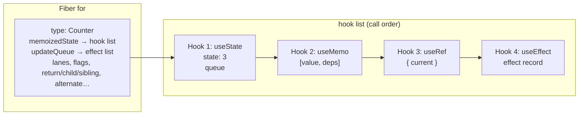
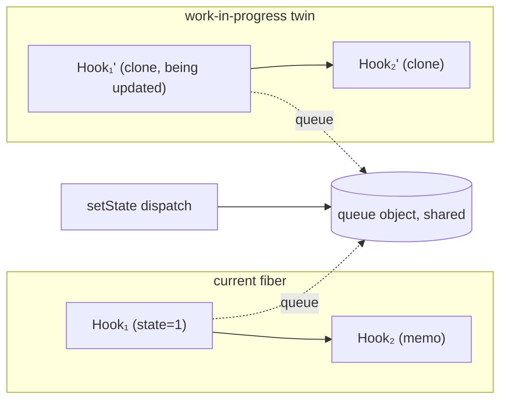

# 02 / 17 — How Hooks Attach to Fiber

## 1. Lesson metadata

| | |
|---|---|
| **Level** | Professional |
| **Study time** | 6–7 hours (reading 3 h, experiments 1.5 h, exercises 2 h) |
| **Prerequisites** | [09 — Fiber nodes and units of work](./09-fiber-nodes-and-units-of-work.md), [10 — Current and work-in-progress trees](./10-current-and-work-in-progress-trees.md), [11 — Render phase vs commit phase](./11-render-phase-and-commit-phase.md), [15 — Interruptible, restartable, abandoned renders](./15-interruptible-restartable-abandoned-rendering.md), [01/14 — State as a snapshot](../01-react-fundamentals/14-state-as-a-snapshot.md), [01/15 — Update queues and batching](../01-react-fundamentals/15-update-queues-and-batching.md), [00/06 — Lexical scope and closures](../00-web-and-javascript-foundations/06-lexical-scope-and-closures.md) |
| **Next** | [18 — Effects and their timing](./18-effects-and-their-timing.md) |
| **Related** | [07 — Identity, keys, and reconciliation](./07-identity-keys-and-reconciliation.md), [Phase 3/01 — `useState` internals and update semantics](../03-react-state-and-hooks/01-usestate-internals-and-update-semantics.md), [Phase 3/16 — Rules of Hooks and composition](../03-react-state-and-hooks/16-rules-of-hooks-and-composition.md), [Phase 3/10 — `useRef`](../03-react-state-and-hooks/10-useref-and-mutable-references.md) |

**Learning objectives.** After this lesson you can:
1. Explain where a function component's state *physically* lives and why it survives re-renders even though the function's locals do not.
2. Describe the conceptual data structure behind hooks: a per-fiber, call-order-indexed list of hook records, each with a state slot and an update queue.
3. Derive the Rules of Hooks from that data structure rather than memorizing them.
4. Explain how `useState`'s setter finds its component, why it has a stable identity, and how the "eager state" bailout works.
5. Describe the dispatcher mechanism: how the same `useState` import behaves differently on mount, update, and outside render.
6. Describe how `useMemo`, `useCallback`, `useRef`, `useEffect`, `useContext`, `useId`, `useTransition`, `useDeferredValue` map onto the same machinery (and where they diverge).
7. Predict what happens to hook state on: re-render, key change, reorder, unmount, Suspense suspension, Strict Mode double-invocation, discarded concurrent renders, error boundaries.
8. Build a ~100-line working toy hooks runtime and use it to reproduce the classic hook-order bugs.

**Concepts covered:** `fiber.memoizedState` as a hook list, hook objects, update queues (circular pending list, base queue), dispatcher, `renderWithHooks`-style entry, mount vs update dispatchers, cursor/call-order matching, setter binding to fiber+queue, eager state, reducer-based `useState`, effect lists (`updateQueue` on fiber), dependency arrays as stored previous values, `useRef` as a stable box, context subscriptions vs hooks list, render-phase updates and re-render limit, hooks and Strict Mode / concurrent restarts, how DevTools reads hooks.

> **Implementation-detail warning.** Everything about the *shape* of hook records, queue fields, flag names and function names is an implementation detail of `react-reconciler` and has changed repeatedly (React 16.8 → 17 → 18 → 19). The **public guarantees** are: hooks are identified by call order within a component; state belongs to the component instance (its fiber), is preserved across renders, and is discarded on unmount; setters are stable; reducers/updaters are pure and may be called more than once. Field and function names in this lesson were checked against `ReactFiberHooks.js` on `main` and a live fiber on `react-dom@19.3.1` on 2026-10-22, and are described *conceptually* (e.g., `memoizedState`, `baseState`, `baseQueue`, `queue`, `next`, `dispatchSetState`, `renderWithHooks`, `updateWorkInProgressHook`). They are given so you can *find* things. **Read the real code in `packages/react-reconciler/src/ReactFiberHooks.js` at <https://github.com/facebook/react> for the version you use**; trust it over this text.

---

## 2. Deep conceptual explanation

### 2.1 What problem is this lesson solving?

A function component is a plain function. Call it twice and the second call knows nothing about the first: its local variables are gone. Yet `const [count, setCount] = useState(0)` returns the *previous* count on the second call. Where is `count` stored? Who knows that *this particular* call to `useState` is "the first hook of the `Counter` that is the third child of `Sidebar`"? How does `setCount` know which component to re-render? How can `useEffect` compare this render's dependencies with the last render's?

Until you can answer these, several things feel like arbitrary rules or magic:

- Why can't hooks be called conditionally or in loops?
- Why does changing a component's `key` reset its state?
- Why do stale closures happen in effects and event handlers?
- Why is the `setState` identity stable but a `useCallback` result not always?
- Why does a discarded concurrent render not "leak" state?
- Why does `useRef` not trigger a render but `useState` does?
- Why does a custom hook behave as if its state is "inside" the calling component?

All follow from one design: **hooks are slots in a list attached to the component's fiber, matched by call order.**

### 2.2 The core idea in one paragraph

Each component instance in the tree is a **fiber** ([09](./09-fiber-nodes-and-units-of-work.md)). Fibers are heap objects that persist between renders (as the pair *current* / *work-in-progress* twin, [10](./10-current-and-work-in-progress-trees.md)). For function components, the fiber carries a **singly linked list of hook records**, hanging off a field conventionally named `memoizedState`. When React renders the component it sets a module-level **"currently rendering fiber"** and a **cursor** at the head of that list, then calls your function. Each `use*` call advances the cursor by one slot and reads/writes that slot. State persists because the *slots live on the fiber*, not in your function's stack frame. The "magic" is that your function is always called while React has pointed a global at the right fiber.



### 2.3 Why *call order*? (the design alternatives)

React needs a key to connect "this call" with "that slot". Options considered by any hooks-like design:

| Option | How it would work | Why it was not chosen (as publicly explained by the React team) |
|---|---|---|
| **Name-based**: `useState("count", 0)` | Slot keyed by user-provided string | Custom hooks compose: two custom hooks both calling `useState("value")` would collide; every composition requires namespacing. Adds boilerplate. |
| **Source-location-based** (compiler assigns ids) | Compiler tags each call site | Needs a build step; breaks for the same custom hook called twice in one component (same site, two logical instances) unless extended with call counting anyway. |
| **Call-order-based** (chosen) | Nth call → Nth slot | Composes naturally (each call gets the next slot, regardless of nesting). Cost: the order must be identical every render ⇒ the Rules of Hooks. |
| **Object/instance-based** (classes) | `this.state.foo` | Works but needs `this`, bindings, lifecycle fragmentation, harder reuse (HOCs, render props). |

The React team has explained this trade-off in the Hooks FAQ and RFC (see §14 for pointers; exact URLs were checked on 2026-10-22). The important engineering point: the Rules of Hooks are not style; they are the *precondition for the slot matching algorithm to work*.

### 2.4 Anatomy of a hook record (conceptual)

A single hook record has these conceptual fields (recent React names; verified on 19.3.1 by inspecting `fiber.memoizedState`: every hook record has exactly `memoizedState`, `baseState`, `baseQueue`, `queue`, `next`):

| Field | Purpose |
|---|---|
| `memoizedState` | The hook's value as of the last committed/processed render. For `useState` it is the state; for `useMemo` it is `[value, deps]`; for `useRef` it is the `{ current }` box; for `useEffect` it is the effect record. |
| `baseState` | The state value *before* any skipped updates; used for **rebasing** ([15 §2.7](./15-interruptible-restartable-abandoned-rendering.md)). |
| `baseQueue` | Updates that were skipped (lower priority) or must be replayed. |
| `queue` | The persistent **update queue** object for state hooks: pending updates, dispatch function, last rendered reducer and state. `null` for hooks without updates (memo, ref, …). |
| `next` | The next hook record in the list (or `null`). |

And an **update** object (conceptual): `{ lane, action, hasEagerState, eagerState, next }` where `action` is either the new value or an updater function (React treats `useState` as `useReducer` with a built-in reducer), and `next` links updates in a **circular** list whose handle is `queue.pending` (it points at the *last* update so that both enqueue-at-end and iterate-from-first are O(1)).

The queue-and-rebase behavior is exactly what [15 §2.7](./15-interruptible-restartable-abandoned-rendering.md) described, now with concrete homes: `queue.pending` collects new updates; during render they are moved into the hook's `baseQueue`; processing walks `baseQueue`, applying updates whose lane is in the current render lanes and recording the first skipped update to set `baseState`.

### 2.5 The dispatcher: one `useState`, three behaviors

The function you import (`useState` from `react`) does very little: it reads a module-level "current dispatcher" object and forwards the call:

```text
// react package (conceptual)
function useState(initial) {
  const dispatcher = ReactSharedInternals.H;     // "H" = current hooks dispatcher in recent versions
  return dispatcher.useState(initial);           // (older versions: ReactCurrentDispatcher.current)
}
```

React *swaps* the dispatcher depending on what it is doing:

| Situation | Dispatcher in effect | `useState` does |
|---|---|---|
| Component's first render (**mount**) | "OnMount" dispatcher | Create a new hook record, append to the list, initialize state (run initializer), create the queue and bound setter. |
| Re-render of a mounted component (**update**) | "OnUpdate" dispatcher | Take the *next* hook record from the previous render's list (cloned into the WIP fiber), process its queue, return the new state. |
| Re-render *caused by a render-phase update* (**rerender**) | "OnRerender" dispatcher | Process only the render-phase updates, to produce a fresh state in the same pass. |
| Outside any render (module scope, event handler, effect callback) | "Invalid hook call" dispatcher | Throws/warns: *"Invalid hook call. Hooks can only be called inside of the body of a function component."* |
| Dev only: nested hook inside another hook (e.g., `useState` inside `useMemo`'s callback) | "InvalidNested" dispatcher | Dev error: "Do not call Hooks inside useEffect(...), useMemo(...), or other built-in Hooks." |

This explains the three most common error messages in React: invalid hook call (dispatcher is `null`/invalid — usually duplicate React copies or a call outside render), "Rendered more hooks than during the previous render", and "Rendered fewer hooks than expected". It also explains why mocking `react` in tests or bundling two copies of React breaks hooks: the *library's* `useState` and the *renderer's* dispatcher sit in different module instances, so the dispatcher is never set.

### 2.6 Entry point: how a render of a function component starts

Conceptually, in the render phase, when `beginWork` ([09](./09-fiber-nodes-and-units-of-work.md)) reaches a function-component fiber, it calls a helper (named `renderWithHooks` in the source) that:

1. Resets per-render module state: the "currently rendering fiber" (the WIP fiber), a hook cursor (`currentHook`, `workInProgressHook`), clears the WIP fiber's `memoizedState` and `updateQueue` (for effects).
2. Chooses the dispatcher: **mount** if there is no current fiber or the current fiber has no hook list; otherwise **update**.
3. Calls `Component(props, …)`. Hooks run, building (mount) or cloning (update) the hook list on the WIP fiber.
4. After the call: restores the *invalid* dispatcher so stray hook calls fail loudly. Checks hook count consistency (dev and prod check "fewer hooks").
5. If a render-phase update happened (`setState` during render), loops: re-invokes `Component` with the OnRerender dispatcher until stable, up to a limit (25 iterations, `RE_RENDER_LIMIT` in `ReactFiberHooks`; error "Too many re-renders. React limits the number of renders to prevent an infinite loop."; the constant is an implementation detail).
6. Returns the element(s) to reconcile.

Note step 1: the WIP fiber's hook list is **rebuilt by cloning** from the current fiber's list as each hook is called (a helper conventionally named `updateWorkInProgressHook`). That is why hook state for an *update* is derived from `current`, and why an abandoned WIP render ([15](./15-interruptible-restartable-abandoned-rendering.md)) leaves the current hook list untouched.

### 2.7 How the setter finds its component

On **mount**, `useState` creates the queue and a dispatch function by *partial application*:

```text
const queue = { pending: null, lanes: NoLanes, dispatch: null, lastRenderedReducer, lastRenderedState: initialState };
const dispatch = dispatchSetState.bind(null, currentlyRenderingFiber, queue);
queue.dispatch = dispatch;
return [hook.memoizedState, dispatch];
```

(Names conceptual.) Therefore the setter you receive is `dispatchSetState` with its first two arguments pre-filled: **the fiber** that rendered at mount time and **the queue**. Consequences:

- **Stable identity.** The same bound function is returned on every render because it is stored with the queue (not created per render). That is why `setCount` is safe to omit from dependency arrays (the linter knows this for `useState`/`useReducer` dispatchers) — it's a documented guarantee: "React guarantees that the `set` function has a stable identity".
- **Which fiber?** The fiber captured at mount time may be the *current* twin or its *alternate* depending on how the double-buffering flipped; React handles this by marking lanes on both twins on the path up to the root (a function conventionally named `markUpdateLaneFromFiberToRoot` / `enqueueConcurrentHookUpdate`). You never need to care; it is why a `setState` call from a stale closure still reaches the live component.
- **Unmounted components.** Calling the setter after unmount no-ops (older versions warned "Can't perform a React state update on an unmounted component"; this warning was removed in React 18 because it was commonly a false alarm).
- **Where the update goes.** `dispatchSetState` allocates an *update* object, assigns it a **lane** based on the current event priority or transition context ([14](./14-lanes.md)), appends it to the queue's circular `pending` list, and calls the scheduling function (`scheduleUpdateOnFiber`) to mark pending lanes up the tree and ensure the root is scheduled. **It does not render.**

### 2.8 Eager state and the "bail out" quirk

Before scheduling, `dispatchSetState` has an optimization: if the fiber currently has **no pending work** (conceptually `fiber.lanes === NoLanes` and the alternate too), it can compute the next state **immediately** with `queue.lastRenderedReducer` and compare with `Object.is` to the last rendered state. If equal, React stores the update with `hasEagerState` (so the render phase need not recompute it) and **does not schedule a render at all**. That is why `setCount(sameValue)` usually causes no re-render. The *quirk* (documented on react.dev for `useState`): React may still call your component one more time before bailing out, because its eager check is conservative — "If the new value you provide is identical to the current `state`, as determined by an `Object.is` comparison, React will skip re-rendering the component and its children. This is an optimization. Although in some cases React may still need to call your component before skipping the children, it shouldn't affect your code." This is directly observable and is not a bug.

Design implication: the eager path **runs your updater function during `setState`** (outside render) when a queue is empty. So updaters can be called in event handlers as well as in render. They must be pure either way.

### 2.9 `useState` is `useReducer`

Internally, `useState(initial)` is `useReducer(basicStateReducer, initial)` where `basicStateReducer(state, action)` returns `typeof action === "function" ? action(state) : action`. Hence:

- `setState(fn)` and `setState(value)` flow through the same queue, preserving order.
- `useState`'s initializer (`useState(() => expensive())`) runs only on mount, in the mount dispatcher. It may run twice in Strict Mode dev ([28](./28-strict-mode-behavior.md)), and on *every* abandoned mount attempt.
- `useReducer`'s `reducer` is stored as `lastRenderedReducer`; React *may use the latest reducer from the current render* when processing updates, which is why reducers declared inline and capturing props work: the reducer used is the one of the render that is processing the update. (Pure reducers matter more than their identity.)

### 2.10 The other hooks, as slots

| Hook | What its slot's `memoizedState` holds | Re-render behavior | Notes |
|---|---|---|---|
| `useState` / `useReducer` | state value (+ `queue`) | processes queue; returns new state | Setter bound to fiber+queue. |
| `useRef` | `{ current: initial }` created once on mount | returns the **same object** every render | No queue, no scheduling. Mutating `.current` is invisible to React. In React 19, `ref` as a prop is unrelated machinery (fiber `ref` field). |
| `useMemo` | `[value, deps]` | compares `deps` with the stored array elementwise via `Object.is`; if equal returns stored `value`, else calls your function and stores the new pair | A *performance hint*, not a semantic guarantee: React may discard cached values (documented: "may choose to forget"), e.g., for offscreen content. |
| `useCallback` | `[callback, deps]` | same as `useMemo` but stores the function itself | `useCallback(fn, deps)` ≡ `useMemo(() => fn, deps)`. |
| `useEffect` / `useLayoutEffect` / `useInsertionEffect` | an **effect record**: `{ tag, create, destroy (via inst), deps, next }` | compares `deps`; if unchanged: re-stores record without the "has effect" tag so the commit skips it; if changed or no deps: tags it and flags the fiber | Effect records are *also* linked into a circular list on `fiber.updateQueue` (`lastEffect`) that the commit phase iterates ([18](./18-effects-and-their-timing.md)). The hook list holds the effect so next render can find previous `deps`/`destroy`. |
| `useContext` | **nothing in the hook list** | reads the context's current value from the provider (nearest ancestor, or default); records a *dependency* on the fiber (`fiber.dependencies`) so that provider value changes can schedule this fiber | Unique: `useContext` is not matched by slot; but it still must obey Rules of Hooks (and in React 19, `use(Context)` may be called conditionally). See [Phase 3/13](../03-react-state-and-hooks/13-usecontext-and-propagation.md). |
| `useId` | the generated id string | stable per mounted hook (derived from tree position on server/hydration, or a counter on client) | Hydration-safe ids. |
| `useTransition` | internally two hooks: a state slot for `isPending` and a function slot for the bound `startTransition` | The pair is stable | `isPending` toggling is a state update ([16](./16-concurrent-react-misconceptions.md)). |
| `useDeferredValue` | the last *deferred* value | returns the old value during urgent renders; schedules a deferred re-render | See [16 §3.4](./16-concurrent-react-misconceptions.md). |
| `useSyncExternalStore` | snapshot + subscription bookkeeping | re-reads snapshot each render, validates before commit, subscribes in an effect | Forces sync updates. |
| `useOptimistic`, `useActionState`, `useFormStatus` | specialized state + queues (Actions) | integrate with transitions | Volatile; see [Phase 3/22](../03-react-state-and-hooks/22-modern-hooks-and-apis.md). |
| `use(promise)` / `use(context)` | **not a regular slot hook** | `use` may be called conditionally and in loops; promises are tracked in a separate per-render "thenable state" array indexed by `use` call order | Still call-order-based for promises, but separate from the hook list (it does not occupy a hook slot; `use(context)` reads context like `useContext`). |

### 2.11 Why state survives re-renders but resets on key change

State lives on the fiber. A re-render keeps the same fiber (same type, same position/key; [07](./07-identity-keys-and-reconciliation.md)), so the hook list is cloned forward. If reconciliation decides the element is a *different* identity (different `type` at that position, or a different `key`), React creates a **new fiber** with **no hook list**: the new fiber mounts, hooks initialize, and the old fiber (with its hook list) is deleted — queues, refs, effect records and all (their cleanups run in commit). That is the whole story behind "reset state with a key" ([01/16](../01-react-fundamentals/16-state-preservation-and-reset.md)). Nothing special is needed in the hooks code.

### 2.12 What a "stale closure" is, structurally

Each render creates new closures (event handlers, effect callbacks) capturing *that render's* variables: `count` is a `const` bound to the value returned by `useState` in that call. The hook slot holds the *latest* committed state; the closure holds an *older* value. An effect whose dependencies are `[]` has `create` stored in the effect record from the first render; its closure sees the first render's `count` forever. The setter (stable) always reaches the queue; the *value* the closure sees does not update. Fixes: dependencies, updater functions (`setCount(c => c + 1)` which reads the queue's current state, not the closure), refs for "latest value" boxes, or `useEffectEvent` (stable since React 19.2; see [18](./18-effects-and-their-timing.md)). See [Phase 3/05](../03-react-state-and-hooks/05-effect-dependencies-and-stale-closures.md).

### 2.13 Misconceptions

| Misconception | Reality |
|---|---|
| "Hooks store state in the closure of the function." | State lives in the fiber's hook list. The closure just holds a *snapshot* of that state for the render. |
| "`useState` returns a new setter each render." | Stable identity (guaranteed by docs). |
| "Hooks are matched by name / variable name." | Matched by call order only. Renaming variables changes nothing; reordering calls does. |
| "Rules of Hooks are style conventions enforced by lint." | They are correctness conditions of the slot-matching algorithm. Lint merely detects violations statically. |
| "`useRef` is a hook with special powers." | It's just a slot holding `{ current }` with no update queue. |
| "`useMemo` guarantees the value is never recomputed." | It is a performance optimization; React may recompute (e.g., after discarding caches) and it also recomputes in Strict Mode dev renders. |
| "A custom hook has its own state." | A custom hook is just a function that calls other hooks; the slots go into the *calling component's* list. Two components calling the same custom hook have separate slots. |
| "State updates mutate the hook's state object." | The queue is processed during render to produce a new value; the stored `memoizedState` is replaced, never mutated in place by React. (Mutating state objects yourself breaks `Object.is` bailouts.) |
| "Hooks work in classes via bridging." | No. Hooks require a function component fiber (or a custom hook called from one). |
| "The order of effects equals the order of hooks." | Effects within one component run in hook order, but across components the order depends on the commit traversal ([18](./18-effects-and-their-timing.md)). |
| "Strict Mode's second render uses fresh state." | The second invocation re-runs with the same hook slots. In React 19, `useMemo`/`useCallback` results from the first invocation are reused for the second (documented in the React 19 release notes; verified by execution on 19.3.1). Initializers and reducers may be called twice. |

---

## 3. Internal mechanics

### 3.1 Public guarantees

1. Hooks are identified by call order within one component function invocation; call them at the top level, unconditionally, in the same order ([Rules of Hooks](https://react.dev/reference/rules/rules-of-hooks)).
2. State and refs persist for the lifetime of the component instance; they reset when the instance is unmounted (or its identity changes by `key`/type).
3. `set` functions from `useState`/`useReducer` have a stable identity; `dispatch` too.
4. `useState`/`useReducer` initial state is used only on mount; initializer functions may be called twice in dev.
5. Updater functions and reducers must be pure; they may be called more than once.
6. `setState` enqueues; it does not synchronously change the `state` variable seen by the current render's closure.
7. Hooks can only be called while React is rendering a component or another hook.

### 3.2 Teaching model

```text
fiber (per component instance)
  └─ memoizedState: Hook₁ → Hook₂ → Hook₃ → …       (call order)
  └─ updateQueue:  circular list of effect records   (for commit)
  └─ dependencies: contexts read (for propagation)

render(Component, fiber):
   currentlyRenderingFiber = fiber
   cursor = head of previous list (or none on mount)
   result = Component(props)         // each use* call: slot = next(cursor)
   assert cursor reached end (same number of hooks)
   currentlyRenderingFiber = null
```

### 3.3 Implementation details

- The same module defines three-ish groups of hook implementations: `mount*`, `update*`, `rerender*` (e.g., `mountState`, `updateState`, `rerenderState`, `mountEffect`, `updateEffect`), plus dev-only wrappers that record the *names* of hooks per call (`hookTypesDev`) so React can print a table "Previous render / Next render" when order changes ("React has detected a change in the order of Hooks called by …").
- In **production** the order check is mostly *count-based*: if the hook count differs, an error is thrown; if the count is equal but the order changed (e.g., swapping two `useState` calls conditionally), React cannot tell and silently mismatches slots — state values land in the wrong variables. The dev name check catches many such cases; the lint rule catches most statically.
- `memoizedState` on a *class* fiber holds the state object and `stateNode` holds the instance; on a *host* fiber `memoizedState` is unused; the field is overloaded by fiber type.
- Effect records moved from holding `destroy` directly to referencing a shared `inst` object in recent versions so that stale effect records can still find the latest cleanup; irrelevant to behavior but relevant when reading code.
- Hook list walking uses two cursors: `currentHook` (in the *current* fiber's list) and `workInProgressHook` (building the WIP list). `updateWorkInProgressHook` creates the WIP hook as a clone of the `currentHook`'s fields (sharing `queue` by reference!). Sharing the queue object between twins is how an update dispatched against either twin is visible to both.
- If the component bails out (props equal, no pending lanes), React **does not call the component at all** and reuses the current fiber's hook list; there is also an "bailout on already-rendered hooks" path (`bailoutHooks`) that clears flags when a re-render produced equal state/props.
- Lanes for state updates: `queue.lanes` plus fiber `lanes`/`childLanes`; the update's `lane` is used when processing (skip vs apply). See [14](./14-lanes.md).

### 3.4 Memory model

Every mounted function component owns: one fiber (plus lazily one alternate), a hook list, one queue per state hook, one effect record per effect hook, and one closure per effect/memo/callback currently stored. Memory is therefore proportional to hooks × instances. Heavy inline closures captured by effect/memo records can retain large objects until the next render replaces them or the component unmounts — relevant to memory leaks ([Phase 7/19](../07-performance/19-memory-leaks.md)).

### 3.5 How DevTools reads hooks

React DevTools' Components pane shows "hooks" for a selected function component. It does not read an official API: it uses a helper that *re-invokes the component with a special dispatcher* (an inspecting dispatcher that records calls) and/or walks `memoizedState`, to produce a tree of primitive hooks and custom hooks (named by the call stack). That is why custom hook names appear in DevTools nested by the function that called the primitives, and why `useDebugValue` exists. This is an implementation detail of the `react-debug-tools` package.

---

## 4. Step-by-step execution walkthrough

### 4.1 Component under study

```tsx
function Counter({ step }: { step: number }) {
  const [count, setCount] = useState(0);          // hook 1
  const doubled = useMemo(() => count * 2, [count]); // hook 2
  const renders = useRef(0);                      // hook 3
  useEffect(() => {                               // hook 4
    document.title = `count ${count}`;
    return () => { document.title = ""; };
  }, [count]);
  return <button onClick={() => setCount((c) => c + step)}>{count} / {doubled}</button>;
}
```

### 4.2 Mount

1. Parent's reconciliation creates a new fiber for `Counter`: `memoizedState = null` and `current === null`.
2. `beginWork` → `renderWithHooks`: sets `currentlyRenderingFiber = WIP`, dispatcher = **mount**.
3. `useState(0)` → `mountState`: creates **Hook₁** `{ memoizedState: 0, baseState: 0, baseQueue: null, queue, next: null }`, creates `dispatch`, appends Hook₁ as head (`WIP.memoizedState = Hook₁`), returns `[0, dispatch]`.
4. `useMemo` → `mountMemo`: computes `0`, creates **Hook₂** `memoizedState = [0, [0]]`; appended after Hook₁.
5. `useRef(0)` → **Hook₃** `memoizedState = { current: 0 }`.
6. `useEffect(create, [0])` → `mountEffect`: creates an effect record `E { tag: Passive|HasEffect, create, inst: { destroy: undefined }, deps: [0] }`; **Hook₄.memoizedState = E**; pushes E onto `WIP.updateQueue` list; marks the fiber with the passive flag.
7. Returns the `<button>` element; children reconcile (host fiber).
8. Commit (later): the DOM is created; passive effects are scheduled; after the passive flush, `create()` runs and its returned cleanup is saved on `E.inst.destroy`.

### 4.3 Click: `setCount(c => c + 1)` with `step = 1`

1. The handler runs (discrete event). `dispatchSetState(fiber, queue, action)`:
   - allocates update `U1 { lane: SyncLane, action: fn, hasEagerState: false, next }`
   - fiber has no pending work → computes **eager** state: `fn(0) = 1`; `Object.is(1, 0)` false → so **not** a bailout; stores `hasEagerState = true, eagerState = 1`.
   - appends `U1` to `queue.pending`; marks lanes on fiber and ancestors; schedules root.
2. End of event: React renders the root with `SyncLane`. `Counter`'s fiber has pending lanes → `beginWork` calls `renderWithHooks` (update dispatcher).
3. `useState` → `updateState` → `updateReducer`: moves `queue.pending` into `baseQueue`, walks it: `U1.lane` ∈ render lanes → apply (uses `eagerState` since reducer unchanged) → new state `1`; `hook.memoizedState = 1`, `baseState = 1`, `baseQueue = null`. Returns `[1, dispatch]` — **same `dispatch`**.
4. `useMemo` → `updateMemo`: previous `[0, [0]]`; new deps `[1]`; `Object.is(1, 0)` false → recompute `2` → `[2, [1]]`.
5. `useRef` returns the same box.
6. `useEffect` → `updateEffect`: previous record's deps `[0]` vs `[1]` differ → new record tagged `HasEffect`; the fiber is flagged; the old `destroy` remains available via `inst`.
7. Returned element reconciles: the button's text children change → host update flagged.
8. Commit: DOM text updated. Passive phase: *cleanup of previous effect* (`document.title = ""`), then new `create` (`document.title = "count 1"`).

### 4.4 Re-render caused only by parent (`step` changes from 1 to 5)

`useState` returns `1` unchanged (queue empty). `useMemo` deps `[1]` equal → returns cached `2` (no call). `useEffect` deps `[1]` equal → the new record is *not* flagged `HasEffect`; commit skips it. The button element is new (new `onClick` closure capturing `step = 5`), so the host fiber's props differ by function identity and an update flag is set (React DOM updates event props without touching the DOM for handlers, see [20](./20-commit-and-dom-mutation.md)).

### 4.5 Unmount / key change

The fiber is deleted. In commit: effect cleanups run (passive cleanup in the passive phase, layout cleanups in mutation), the hook list becomes unreachable and is GC'd; any later call to `setCount` is a no-op.

### 4.6 Abandoned concurrent render

During a transition render of `Counter` (rendered with updated `count = 2` in a draft), the WIP hook list for the draft holds `memoizedState = 2`, memo `[4, [2]]`. The render is discarded. The current fiber's hook list still holds `memoizedState = 1`, memo `[2,[1]]`, effect deps `[1]`. The queue (shared) still has the transition update in `pending`/`baseQueue` → the next attempt recomputes. No side effects (document.title) happened. ([15](./15-interruptible-restartable-abandoned-rendering.md)).

---

## 5. Code examples

### 5.1 Minimal example — hook order is the API

```tsx
import { useState } from "react";

export function Profile({ user }: { user: { name: string } | null }) {
  const [tab, setTab] = useState<"info" | "posts">("info");
  // …
  return <button onClick={() => setTab("posts")}>{user?.name ?? "guest"} / {tab}</button>;
}
```

**Predict:** is this component legal? What if we add `if (!user) return null;` *above* `useState`?

**Result:** As written it is legal: hooks run unconditionally at the top. With `if (!user) return null;` *before* the `useState`, a render with `user === null` calls zero hooks and a later render with a user calls one: "Rendered more hooks than during the previous render" (or the reverse: "Rendered fewer hooks than expected. This may be caused by an accidental early return statement."). Fix: call hooks first, return conditionally after.

**Why:** the hook list from the first render has N slots; the cursor must end exactly at the end after each render.

### 5.2 Practical example — a custom hook is just more slots

```tsx
import { useCallback, useEffect, useRef, useState } from "react";

/** Debounced value with a cancel handle. Everything below becomes slots in the *caller's* hook list. */
export function useDebounced<T>(value: T, ms: number): { debounced: T; cancel: () => void } {
  const [debounced, setDebounced] = useState(value);          // slot A (state + queue)
  const timer = useRef<ReturnType<typeof setTimeout> | null>(null); // slot B (ref box)

  const cancel = useCallback(() => {                         // slot C ([fn, deps])
    if (timer.current !== null) clearTimeout(timer.current);
    timer.current = null;
  }, []);

  useEffect(() => {                                          // slot D (effect record)
    timer.current = setTimeout(() => setDebounced(value), ms);
    return cancel;
  }, [value, ms, cancel]);

  return { debounced, cancel };
}

// usage: two independent instances in one component → two independent groups of 4 slots
function Search() {
  const [q, setQ] = useState("");
  const a = useDebounced(q, 200);   // slots 2–5 of Search's list
  const b = useDebounced(q, 1000);  // slots 6–9
  /* … */
  return <input value={q} onChange={(e) => setQ(e.target.value)} />;
}
```

**Line notes.**
- The hook returns a new object each call; its *identity* is unstable (don't use as a dependency); `cancel` is stable because its `useCallback` deps are `[]`.
- `timer` is a ref because the timer id is mutable data that must not trigger renders, and effect cleanup must see the latest id.
- `setDebounced` stability lets us omit it from deps (the lint rule knows).
- Cleanup order for changed deps: the previous effect's cleanup (`cancel`) runs before the next `create` in the passive flush.

**Why this matters:** the two calls produce independent state because they occupy different slots — the name `useDebounced` doesn't matter; position does.

### 5.3 Incorrect example — conditional and looped hooks

```tsx
function Broken({ showExtra, items }: { showExtra: boolean; items: string[] }) {
  if (showExtra) {
    const [extra, setExtra] = useState("x");          // BUG: conditional hook
  }
  const [value, setValue] = useState("v");
  items.forEach((i) => {
    useEffect(() => { console.log(i); }, [i]);          // BUG: hook in a loop
  });
  return null;
}
```

**Predict:** `showExtra` toggles from `true` to `false`; what happens?

**Result:** First render: two `useState` slots (slot 1 = extra, slot 2 = value) + N effects. Second render: only one `useState` call. The cursor gives it slot 1 (`"x"`), so `value` reads the *extra* slot's state; then the first `useEffect` call receives slot 2 (a state hook, not an effect hook); React detects a mismatch (dev: "React has detected a change in the order of Hooks"; or throws an error because the effect update implementation reads `memoizedState` expecting an effect record). In production builds without the dev check, behaviors range from silent wrong data to thrown TypeErrors. For `items` length changes, the count of hooks changes → "Rendered more/fewer hooks".

**Why wrong:** order and count must be stable.

### 5.4 Corrected implementation

```tsx
function Fixed({ showExtra, items }: { showExtra: boolean; items: string[] }) {
  const [extra, setExtra] = useState("x");       // always called
  const [value, setValue] = useState("v");
  useEffect(() => {                              // one effect that handles a list
    for (const i of items) console.log(i);
  }, [items]);
  return showExtra ? <Extra value={extra} onChange={setExtra} /> : null;
}
```

Alternatives when per-item state is genuinely needed: **extract a child component per item** (each gets its own fiber and hook list; the list is rendered with keys) — this is the idiomatic answer, because the component boundary is exactly how you create "a hook per item".

### 5.5 Advanced example — a toy hooks runtime (~120 lines)

This toy reproduces the structural ideas: hook list on a per-instance object, cursor, dispatcher-free simplified `current` pointer, stable setters, queues, memo/ref/effect slots, cleanups-before-setups, hook-count validation. It is **not** React (no lanes, scheduling, concurrency).

```ts
type Deps = readonly unknown[] | undefined;
type Cleanup = void | (() => void);

interface Hook {
  state: unknown;
  next: Hook | null;
}
interface StateCell<S> {
  value: S;
  queue: Array<S | ((prev: S) => S)>;
  dispatch: (a: S | ((prev: S) => S)) => void;
}
interface EffectCell {
  create: () => Cleanup;
  deps: Deps;
  destroy: (() => void) | undefined;
}

let current: Instance<any> | null = null;           // "currentlyRenderingFiber"

class Instance<P> {
  private head: Hook | null = null;
  private tail: Hook | null = null;                  // used while mounting
  private cursor: Hook | null = null;                // used while updating
  isMount = true;
  dirty = false;
  private pendingEffects: EffectCell[] = [];

  constructor(private readonly component: (p: P) => string) {}

  /** The "mount/update dispatcher" collapsed into one method. */
  nextHook(): Hook {
    if (this.isMount) {
      const h: Hook = { state: undefined, next: null };
      if (this.tail) this.tail.next = h; else this.head = h;
      this.tail = h;
      return h;
    }
    const h = this.cursor;
    if (h === null) throw new Error("Rendered more hooks than during the previous render.");
    this.cursor = h.next;
    return h;
  }

  scheduleEffect(e: EffectCell) { this.pendingEffects.push(e); }

  /** render + "commit" + passive effects, synchronously, for demonstration. */
  render(props: P): string {
    current = this;
    this.cursor = this.head;
    this.pendingEffects = [];
    let out: string;
    try {
      out = this.component(props);
    } finally {
      current = null;                                // later stray hook calls fail loudly
    }
    if (!this.isMount && this.cursor !== null) {
      throw new Error("Rendered fewer hooks than expected.");
    }
    this.isMount = false;
    this.dirty = false;
    // passive-effect flush: all cleanups first, then all setups (like React)
    for (const e of this.pendingEffects) e.destroy?.();
    for (const e of this.pendingEffects) {
      const d = e.create();
      e.destroy = typeof d === "function" ? d : undefined;
    }
    return out;
  }
}

function inst(): Instance<any> {
  if (current === null) throw new Error("Invalid hook call.");
  return current;
}

export function useState<S>(initial: S | (() => S)): [S, StateCell<S>["dispatch"]] {
  const i = inst();
  const hook = i.nextHook();
  if (i.isMount) {
    const cell: StateCell<S> = {
      value: typeof initial === "function" ? (initial as () => S)() : initial,
      queue: [],
      dispatch: (a) => { cell.queue.push(a); i.dirty = true; },   // bound to THIS instance's cell: stable identity
    };
    hook.state = cell;
  }
  const cell = hook.state as StateCell<S>;
  for (const a of cell.queue) cell.value = typeof a === "function" ? (a as (p: S) => S)(cell.value) : a;
  cell.queue = [];
  return [cell.value, cell.dispatch];
}

export function useRef<T>(initial: T): { current: T } {
  const i = inst();
  const hook = i.nextHook();
  if (i.isMount) hook.state = { current: initial };
  return hook.state as { current: T };
}

function depsChanged(a: Deps, b: Deps): boolean {
  if (a === undefined || b === undefined) return true;
  return a.length !== b.length || a.some((x, k) => !Object.is(x, b[k]));
}

export function useMemo<T>(factory: () => T, deps: readonly unknown[]): T {
  const i = inst();
  const hook = i.nextHook();
  const prev = hook.state as { value: T; deps: Deps } | undefined;
  if (prev === undefined || depsChanged(prev.deps, deps)) {
    hook.state = { value: factory(), deps };
  }
  return (hook.state as { value: T }).value;
}

export function useEffect(create: () => Cleanup, deps?: Deps): void {
  const i = inst();
  const hook = i.nextHook();
  const prev = hook.state as EffectCell | undefined;
  if (prev === undefined) {
    const cell: EffectCell = { create, deps, destroy: undefined };
    hook.state = cell;
    i.scheduleEffect(cell);
  } else if (depsChanged(prev.deps, deps)) {
    prev.create = create;                       // keep `destroy` from the previous run
    prev.deps = deps;
    i.scheduleEffect(prev);
  }                                            // else: unchanged → skipped (no HasEffect tag)
}

export { Instance };
```

Demonstration:

```ts
const log: string[] = [];
let setCount!: (a: number | ((p: number) => number)) => void;

function Counter({ step }: { step: number }): string {
  const [count, set] = useState(0);
  setCount = set;
  const doubled = useMemo(() => count * 2, [count]);
  const renders = useRef(0);
  renders.current++;                                   // (impure; demo only)
  useEffect(() => {
    log.push(`effect ${count}`);
    return () => log.push(`cleanup ${count}`);
  }, [count]);
  return `count=${count} doubled=${doubled} step=${step} renders=${renders.current}`;
}

const c = new Instance(Counter);
console.log(c.render({ step: 1 }));
setCount((n) => n + 1);
console.log(c.render({ step: 1 }));
console.log(c.render({ step: 5 }));
console.log(log);
```

**Predict the output** before reading on.

```
count=0 doubled=0 step=1 renders=1
count=1 doubled=2 step=1 renders=2
count=1 doubled=2 step=5 renders=3
[ 'effect 0', 'cleanup 0', 'effect 1' ]
```

**Explanation.** Render 1 mounts: slot order state, memo, ref, effect; effect runs after "commit". `setCount` enqueues; render 2 drains the queue (`count = 1`), memo deps changed → recomputed, effect deps changed → previous cleanup (closure over `count = 0`, hence `cleanup 0`) then new setup (`effect 1`). Render 3 changes only `step`: no hook slot is affected; the effect is skipped. The `renders` ref survived all renders: the same box each time.

**Reproduce the Rules-of-Hooks bug:**

```ts
function Cond({ flag }: { flag: boolean }): string {
  let first = "";
  if (flag) { const [x] = useState("first"); first = x; }
  const [y] = useState("second");
  return `${first}|${y}`;
}
const k = new Instance(Cond);
console.log(k.render({ flag: true }));    // "first|second"
try { k.render({ flag: false }); } catch (e) { console.log(String(e)); } // Error: Rendered fewer hooks than expected.
```
Had the toy lacked the count check, the second render would have returned `"|first"`: `y` reading slot 1. With *equal counts but different order* (swap which hook runs under the condition), even our check would stay silent — exactly the production gap in §3.3.

**Trade-offs.** The toy re-renders synchronously and has no queues-with-lanes; but the hook-list-plus-cursor structure *is* the essence. Exercise C1 adds `useReducer` and `useCallback`.

---

## 6. Visual explanations

### 6.1 Render-time pointer picture

```mermaid
sequenceDiagram
  participant RWH as renderWithHooks
  participant G as module state (currentlyRenderingFiber, cursor, dispatcher)
  participant C as Component()
  participant U as useState/useMemo/...
  RWH->>G: set fiber = WIP, cursor = head of prev list, dispatcher = Update
  RWH->>C: call Component(props)
  C->>U: useState(0)
  U->>G: read dispatcher, advance cursor
  U-->>C: [state, dispatch]
  C->>U: useMemo(...)
  U->>G: advance cursor
  U-->>C: value
  C-->>RWH: element
  RWH->>G: dispatcher = Invalid; check cursor at end
```

### 6.2 Twin fibers share queues



### 6.3 Update queue with a skipped update (rebasing)

```text
queue.pending (circular): last → U3 → U1 → U2 → (back to U1)    # `pending` points at the last update

Render at lanes {Sync}:    U1(Sync) apply
                           U2(Transition) SKIP → baseState := value after U1 ... base queue starts at U2
                           U3(Sync) apply (and cloned into baseQueue to replay after U2)
hook.memoizedState = state after U1,U3           (what the user sees)
hook.baseState     = state after U1               (where replay will start)
hook.baseQueue     = U2 → U3'                     (replayed when Transition lane renders)
```

---

## 7. Alternative approaches and trade-offs

How can per-component state be modeled? Criteria compare React's hooks with alternatives you will meet.

| Approach | Composition of reusable stateful logic | Order constraints | Identity/reset semantics | Concurrency-safety | Notes |
|---|---|---|---|---|---|
| **Hooks (call-order slots)** | Excellent (custom hooks) | Strict (Rules of Hooks) | Fiber identity (`key`/type) | Yes (queues on fibers) | Current standard. |
| Class components (`this.state`) *(legacy)* | Weak (HOCs, render props) | None | Instance identity | Yes, but lifecycle API had unsafe methods | Historical; still supported. |
| Signals-style fine-grained reactivity (Solid, Preact Signals) | Excellent | None (dependency tracking at read) | Owner scopes | N/A (different model) | Not React's model; different trade-offs: no re-render of components, but tracking requires special primitives. |
| External store + `useSyncExternalStore` | Good | None | Store identity | Forced sync | State outside the tree: survives unmount, shared across components. |
| Named-slot state (hypothetical) | Poor (collisions) | None | — | — | Why React didn't choose it. |

**Scenario where hooks-in-fiber state is *not* the best fit:** state that must **outlive** the component or be shared across unrelated trees (user session, cache, router). Putting it in a component's fiber ties lifetime to mount/unmount (and to `key` changes) — a very common source of "my state resets when I navigate". Use context + state high in the tree, or an external store (TanStack Query for server state, Zustand/Redux for client state; [Phase 6](../06-data-fetching-and-state-ecosystems/10-zustand.md)).

---

## 8. Best practices and anti-patterns

**Do**
- Call hooks at the top level, before any early return.
- Extract a component when you need "a hook per item".
- Use updater functions when the next state depends on previous state (they read the queue's state, not the closure).
- Treat hook *return values* as immutable snapshots.
- Name custom hooks `useX`; lint rules and DevTools rely on it.

**Beginner mistakes**
- Hooks in conditions/loops/nested functions/event handlers.
- Expecting `setState` to update the variable in the same invocation.
- Believing a custom hook shares state between components.

**Experienced-developer mistakes**
- Using `useRef` for state that should trigger UI (mutating `.current` then expecting updates).
- Using `useMemo` for semantic guarantees (e.g., stable identity required for correctness) instead of structural fixes; React may discard caches.
- Calling the setter during render for *other* components.
- Storing derived values in state, then syncing with effects (stale intermediate commits: [Phase 3/17](../03-react-state-and-hooks/17-derived-state.md)).
- Depending on hook identity of a custom-hook-returned object.
- Relying on dev-only warning absence for correctness of hook order.

**Smells:** `// eslint-disable-next-line react-hooks/rules-of-hooks`; a hook call after a `return`; a `use*`-named function that does not call any hooks (it should be a plain function); passing hooks around as values.

**Justified exceptions**
- `use(promise)` / `use(Context)` can be called conditionally (React 19 docs): they're not slot-based in the same way. Still only during render.
- Wrapping a hook in a component with conditional rendering (not conditional hook calls).
- Disabling the exhaustive-deps lint with a documented reason (e.g., intentional "run once" effect with a ref for the latest values).

---

## 9. Real-world application

**Form field arrays (e-commerce checkout, multiple addresses).** Variable-length list of addresses, each with validation state. Anti-pattern: `addresses.map(() => useState(...))`. Correct: `<AddressRow key={a.id}>` with local state; constraint: identity must be stable (`a.id`), not index, or state will jump between rows on delete ([07](./07-identity-keys-and-reconciliation.md)); if the form needs to submit all values, lift state or use a reducer at the parent ([Phase 3/21](../03-react-state-and-hooks/21-forms-and-complex-state.md)).

**Dashboards with tabs.** Switching tabs unmounts panels → hook state reset (filters lost). Constraint: product wants filters preserved. Options: keep panels mounted but hidden (cost: effects/subscriptions keep running; consider the `Activity` component, stable since React 19.2), lift filters to URL state ([Phase 6/18](../06-data-fetching-and-state-ecosystems/18-url-state-management.md)), or an external store.

**Realtime feeds.** A component that subscribes in `useEffect` and stores messages in `useState`: understand that each message triggers `dispatchSetState`; at high rates the queue has many updates processed in one render (batched), which is good; but each update allocation is garbage. Use a ref/buffer and flush on animation frame for very high rates.

**Multi-team design systems.** A shared `useControllableState` hook is used across 200 components; a bug where it conditionally calls `useState` based on `props.value !== undefined` is catastrophic because the order changes when a consumer flips from uncontrolled to controlled. Correct implementation calls `useState` unconditionally and chooses which value to return. Constraint: public API must warn on controlled/uncontrolled flips rather than silently changing hook order.

---

## 10. Debugging and troubleshooting

**Symptom: "Rendered more hooks than during the previous render."**
1. The stack trace points at the component. Look for early returns above hooks, hooks in conditions/loops, or a component that *renders different hook-bearing implementations under the same element type/position* (e.g., `Comp = flag ? A : B` is fine, since type differs → remount; but `function C(){ return flag ? useA() : useB() }` is not).
2. Check that the component is not being called *as a function* by a parent (`{Child()}` instead of `<Child />`): then the child's hooks join the parent's list and change count with the parent's conditions.
3. Fix by moving the hook above the return or splitting components. Validate: toggle the condition in the UI and watch the error disappear; add `eslint-plugin-react-hooks` to CI.

**Symptom: "Invalid hook call."**
1. Cause A: hook called outside a component/custom hook (event handler, effect callback, class component).
2. Cause B: two copies of `react` (mismatched renderer/library): run `npm ls react` / check bundler aliases; in a monorepo, dedupe.
3. Cause C: `react` and `react-dom` versions mismatch.
4. Validate: `console.log(React1 === React2)` across packages (or `npm ls react`) shows a single copy.

**Symptom: "State resets when …"**
Identity changed: different `key`, component defined inside another component (new type every render → remount; [07](./07-identity-keys-and-reconciliation.md)), parent switched branches. Use DevTools to see whether the component *unmounts* (highlight updates, "components" tree flicker) and check where the component is defined.

**Symptom: "Effect uses an old value."**
Stale closure (§2.12): inspect which render's closure the effect was created in (log inside). Fix with deps, updater, or ref.

**Symptom: "Two instances of the same custom hook share state unexpectedly."** They do not; the shared thing is a module-level variable *inside* the hook file. Search for `let` at module scope.

**DevTools tips.** In the Components tab, select the component → "hooks" section lists each hook in order with its current value; the order shown is the slot order. Use "Highlight updates" and the Profiler's "why did this render" ([30](./30-react-devtools-profiler.md)) ("Hook 3 changed").

---

## 11. Exercises

### Level A — Knowledge
A1. Where does a function component's state physically live?
A2. Why are hooks matched by call order rather than by name?
A3. Why does `setCount` have a stable identity, and what two things is it bound to?
A4. What does `useRef` store in its slot, and why does mutating `.current` not re-render?
A5. Name the three error messages caused by dispatcher/order problems and a cause for each.

### Level B — Code comprehension
B1. Given the toy runtime in §5.5, what does this print?
```ts
function T(): string {
  const [a] = useState(1);
  const [b] = useState(() => a + 1);
  return `${a},${b}`;
}
const t = new Instance(T);
console.log(t.render(undefined as never), t.render(undefined as never));
```
B2. In React, a component has `const [n, setN] = useState(0)` and an effect `useEffect(() => { const id = setInterval(() => setN(n + 1), 1000); return () => clearInterval(id); }, [])`. What does the UI show after 5 seconds? Explain with the hook-list model.
B3. Component `A` renders `<B />` and `B` has two `useState`s. Component `A` is replaced with `<B key={id} />` and `id` changes. Which hook lists exist before/after?
B4. `const [s, setS] = useState(0); setS(0); setS(0);` is called in an event handler when `s` is `0`. How many renders? Explain eager state and the documented quirk.

### Level C — Implementation
C1. Extend the toy with `useReducer<S, A>(reducer, initial)` and `useCallback`. Show that `useState` can be implemented via your `useReducer`.
C2. Add a dev-only `hookTypes` check to the toy: store the hook kind per slot on mount and throw a descriptive error when the kind at a slot differs on update.

### Level D — Debugging
D1. This list component loses typed text in row 2 when row 1 is deleted. Find the cause, explain using hook lists, fix.
```tsx
{rows.map((r, i) => <RowEditor key={i} row={r} />)}
```
D2. A teammate wrote: `function useThing(enabled: boolean) { if (!enabled) return null; const [x] = useState(0); return x; }` and the app crashes when `enabled` flips. Explain and give two fixes.
D3. "`useCallback` doesn't stop my child re-rendering". Component: `const onSave = useCallback(() => save(data), [data])` passed to a non-memoized `<Child onSave={onSave}/>`. Explain.

### Level E — Architecture and engineering decisions
E1. You maintain a design-system `useControllableState`. Propose its implementation and the policy for controlled/uncontrolled flips, grounded in hook-order constraints.
E2. A team wants to preserve each tab's state when switching tabs. Compare: keep mounted (hidden), `Activity` (stable since 19.2), lift state, URL state, external store. Choose for a dashboard with 6 heavy tabs.

### Level F — Expert challenge
F1. Explain, using hook lists, queues and twin fibers, why this works correctly in concurrent React and what would break if hook state lived in the *work-in-progress* fiber only: a transition render of a component is abandoned after calling `setState` updaters, then an urgent update is processed, then the transition is retried.

---

## 12. Detailed answers and explanations

> Attempt the exercises first.

**A1.** In a linked list of hook records referenced from the component's fiber (`fiber.memoizedState` for function components), not in the function's closure or stack. Each render, the same fiber (the twin pair) supplies the list. Wrong: "in the closure", "in the component instance" (no instance for function components; the fiber is the instance in practice).

**A2.** Composition without naming collisions: custom hooks call primitives; call order naturally allocates the right number of slots, with no coordination between independent hook authors. Cost is the Rules of Hooks. Name-based schemes force unique names; source-location schemes need compilers and break for repeated calls of one custom hook.

**A3.** It's `dispatchSetState` partially applied with the fiber (captured at mount) and the hook's queue; stored on the queue so each render returns the same function. Stability is a documented guarantee. Bound to *queue* is what makes the update land in the right hook; bound to *fiber* is what lets React schedule the correct component.

**A4.** A `{ current }` object created once on mount; later renders return the same object. There is no queue and no scheduling call when `.current` is written, so React never learns of the change. Use state when the UI depends on it.

**A5.** "Invalid hook call" (hook outside render, duplicate React copies, mismatched versions); "Rendered more hooks than during the previous render" (extra hook calls, e.g., hooks after a condition that flipped true); "Rendered fewer hooks than expected" (early return before hooks, conditional hooks that skipped).

**B1.** Mount: `a = 1`; second `useState` initializer `() => a + 1` = 2. Render 1 returns `"1,2"`. Render 2: initializers are not re-run on update (the cell exists) → `"1,2"`. Output: `1,2 1,2` (printed on one line with a space). Why: initial state is only used on mount. Trap: thinking `b` recomputes when `a` changes.

**B2.** UI shows `1` forever (after the first tick). The effect with `[]` deps was created in render 1, closing over `n = 0`; each interval callback calls `setN(0 + 1)`. After the first tick state is 1; subsequent `setN(1)` is `Object.is`-equal → no change (eager bailout). The effect record in the hook list is never replaced (deps unchanged), so the old closure persists. Fix: `setN((x) => x + 1)`, which reads the queue's current state. Wrong answer: "it counts to 5" — only if deps included `n`.

**B3.** Before: `A`'s fiber (its own hook list), child `B` fiber (two state hooks) with stateful values. After the `key` change: the old `B` fiber is deleted (hook list discarded, cleanups run); a new `B` fiber mounts with fresh hook list, initial state, new effect runs. `A`'s list is unaffected. State "reset by key".

**B4.** Usually 0 renders (if the fiber has no pending work): the first `setS(0)` computes eagerly `0`; equal to current → bail out without scheduling. Second same. Edge: if the fiber has pending lanes (another update queued), eager computation is skipped; the updates are processed during render; React may call the component once and then bail out of children when state is unchanged (documented quirk). So "0 or 1 calls of the component, children not re-rendered, DOM unchanged".

**C1.**
```ts
type Reducer<S, A> = (s: S, a: A) => S;
interface ReducerCell<S, A> { value: S; queue: A[]; dispatch: (a: A) => void; reducer: Reducer<S, A> }

export function useReducer<S, A>(reducer: Reducer<S, A>, initial: S): [S, (a: A) => void] {
  const i = inst();
  const hook = i.nextHook();
  if (i.isMount) {
    const cell: ReducerCell<S, A> = {
      value: initial, queue: [], reducer,
      dispatch: (a) => { cell.queue.push(a); i.dirty = true; },
    };
    hook.state = cell;
  }
  const cell = hook.state as ReducerCell<S, A>;
  cell.reducer = reducer;                                  // latest reducer wins
  for (const a of cell.queue) cell.value = cell.reducer(cell.value, a);
  cell.queue = [];
  return [cell.value, cell.dispatch];
}

export function useCallback<T extends (...a: never[]) => unknown>(fn: T, deps: readonly unknown[]): T {
  return useMemo(() => fn, deps);
}

export function useStateViaReducer<S>(initial: S): [S, (a: S | ((p: S) => S)) => void] {
  return useReducer<S, S | ((p: S) => S)>(
    (s, a) => (typeof a === "function" ? (a as (p: S) => S)(s) : a),
    initial,
  );
}
```
Notes: `useCallback` is literally `useMemo(() => fn, deps)`. The reducer is replaced each render (matching React's "latest reducer" behavior). `useStateViaReducer` shows `useState` ≡ `useReducer(basicStateReducer)`; the initializer-function form is omitted for brevity. Edge: if `S` itself is a function, the `typeof` check is ambiguous: React has the same property (hence you need `setS(() => fn)`).

**C2.** Add `kind: string` to `Hook`; `nextHook(kind)` takes a kind, sets it on mount; on update compares:
```ts
if (h.kind !== kind) throw new Error(`Hook order changed: slot expected "${h.kind}" but got "${kind}".`);
```
and call sites pass `"state" | "ref" | "memo" | "effect"`. Mirrors React's dev-only `hookTypesDev` check. Edge: same-kind swaps (two `useState` in swapped order) still go undetected: only lint or discipline catches them.

**D1.** Index keys: after deleting row 0, the old row-1 `RowEditor` fiber (key 1) now receives `row` = old row 2's data? Precisely: new list has length n-1, keys `0..n-2`; the fiber with key 0 (old row 0) now gets props of old row 1; fiber for key 1 (old row 1, whose state was the typed text) now gets old row 2 data and keeps its own typed text; the last fiber (key n-1) is deleted. State (typed text) stays with *positions*, data moves, so row 2's text appears on the wrong row. Fix: `key={r.id}` with a stable unique id; state follows identity; the deleted row's fiber (and hooks) is deleted ([07](./07-identity-keys-and-reconciliation.md)).

**D2.** The early `return null` before `useState` makes the hook count depend on `enabled`. Flip false→true: "Rendered more hooks..."; true→false: "Rendered fewer...". Fixes: (1) call `useState` unconditionally and return `enabled ? x : null`; (2) split into `useThing` (unconditional) and a component that conditionally renders a child using it (so the hook lives in a component that mounts/unmounts). Any rule that changes the *count* across renders is invalid; unmounting is the sanctioned way to change the set of hooks.

**D3.** `useCallback` only preserves the function identity; it does not prevent the child from re-rendering when the parent renders. Re-rendering children on parent render is React's default; to benefit, `Child` must be `memo`-wrapped so the stable prop can be compared. Even then, `data` changes create new `onSave`. Without `memo` the `useCallback` is pure overhead. ([Phase 3/11, 12](../03-react-state-and-hooks/11-usememo-and-usecallback.md).)

**E1. Evaluation criteria:** hook order unconditional; correct API semantics; dev warnings; React 19 baseline. Example: 
```ts
function useControllableState<T>({ value, defaultValue, onChange }: { value?: T; defaultValue: T; onChange?: (v: T) => void }) {
  const [internal, setInternal] = useState(defaultValue);       // always called
  const isControlled = value !== undefined;
  const wasControlled = useRef(isControlled);
  if (process.env.NODE_ENV !== "production" && wasControlled.current !== isControlled) {
    console.error("Component changed between controlled and uncontrolled.");   // dev warning
  }
  const current = isControlled ? (value as T) : internal;
  const set = useCallback((next: T) => {
    if (!isControlled) setInternal(next);
    onChange?.(next);
  }, [isControlled, onChange]);
  return [current, set] as const;
}
```
Policy: *warn, don't reorder hooks*; keep `useState` unconditionally; document that flipping is unsupported. Note: reading `wasControlled.current` during render for a dev warning is a benign ref *read*; writing it in an effect is the proper place if you update it. Common wrong answer: `const [state] = isControlled ? [value] : useState(...)`.

**E2. Evaluation criteria:** cost of keeping mounted (effects/subscriptions/memory), complexity, sharing/deep-linking needs, correctness of resets, availability of features (`Activity` needs React 19.2+). Example answer for 6 heavy tabs: persist *user-meaningful* state (filters, sort, selection) in the URL or a store (cheap, survives reload, shareable), and let heavy tab *subtrees* unmount (free memory/effects); use hidden-mounted only for tabs with expensive-to-rebuild transient state (e.g., a chart zoom) and few instances; evaluate `Activity` when it fits since it preserves state while pausing effects (react.dev/reference/react/Activity). Not recommended: keeping all six fully mounted with live subscriptions.

**F1. Answer.** In the transition render the WIP fiber's hook list is built by cloning from `current`; updaters run against the clone's `memoizedState`/`baseState` while *reading* queue entries that live in the **shared queue** (and base queue on the current hook). Abandoning drops the clone; `current`'s hooks and the shared queue still hold the updates (they were never removed from the persistent structures — the processing results go into the WIP hook only, and base-queue/pending bookkeeping is committed to `current` by the pending→base move which keeps updates until they are processed in a committed render). The urgent update is appended and processed with rebasing: the transition update is skipped and kept in `baseQueue`. After urgent commit, the retry renders from `baseState` and replays. If state lived only in the WIP fiber, the abandon would drop user input (updates lost) and state would reflect an uncommitted render. This is why updates live in queues attached to the *persistent* twin, plus the "base" bookkeeping. (⚠ The exact moment `pending` is moved onto the *current* hook's `baseQueue` is an implementation subtlety designed precisely so that an interrupted render does not lose updates; read `updateReducerImpl` in the source.)

---

## 13. Senior engineer interview questions

**Q1. "How does React know which state belongs to which `useState` call?"**
*Strong answer:* Call order. The fiber holds a linked list of hook records; during render a cursor advances one record per hook call. Mount creates records, update reads them. That's why hooks can't be conditional: it would desynchronize call sites from slots. The model also explains custom hooks (they just allocate more slots in the caller's list) and key-based resets (new fiber → new list).

**Q2. "Why is the `useState` setter stable?"**
*Strong answer:* It's created once at mount as `dispatch.bind(null, fiber, queue)` and stored on the queue, so every render returns the same function. It targets a queue, not a render's closure; consequently it's safe in deps and can be called from stale closures (but the *state value* in those closures is stale; use updater form).

**Q3. "What's the difference between `useRef` and `useState` at the data-structure level?"**
*Strong answer:* Both occupy a slot. State's slot has an update queue and dispatch that schedules a render; ref's slot is a plain `{ current }` box returned by identity; mutation is invisible to React. Use ref for values that shouldn't affect output (timers, DOM nodes, latest-value boxes), state for values that drive the UI.

**Q4. "Walk me through what happens at `setState` in a click handler until the DOM updates."**
*Strong answer:* Dispatch allocates an update with a lane derived from the event priority, enqueues it on the hook's circular queue, optionally eager-computes and bails out if equal, marks lanes up the fiber path, schedules the root. At the end of the event the sync lane renders: `renderWithHooks` swaps in the update dispatcher, `useState` processes the queue (apply/skip by lane), component returns new elements, reconciliation produces flags, commit applies DOM changes, then effects. (Cross-reference [03], [11].)

**Q5. "A hook order bug appears only in production. Why might dev have caught it?"**
*Strong answer:* Dev tracks hook *names* per slot and warns on mismatch; prod checks only counts (and may throw on type confusion). Bugs where the count is the same but the order differs can silently mismatch in prod. Enforce with the lint rule and Strict Mode in dev, test both paths of conditions.

**Q6. "How does `useMemo` relate to `useCallback`, and can I rely on `useMemo` for correctness?"**
*Strong answer:* `useCallback(fn, d)` is `useMemo(() => fn, d)`. Both store `[value, deps]` in the slot. React may discard cached values (docs: don't rely for semantic guarantees), also double-invokes in dev Strict Mode. Use for performance only; if correctness needs identity stability, restructure (state, refs, constants).

**Q7. "How would you explain a stale closure to a junior using fibers?"**
*Strong answer:* Each render's handlers close over that render's snapshot values. The fiber's hook slot always holds the latest state, but a closure created in render 1 can't see it unless it goes through the queue (updater function) or a ref. Effects with stale deps keep the old `create` function in their record until deps change.

---

## 14. Further learning resources

| Resource | URL | Covers / why | Level | Study |
|---|---|---|---|---|
| React — Rules of Hooks | <https://react.dev/reference/rules/rules-of-hooks> | The official rules, with rationale | Beginner–Int. | Whole page |
| React — Built-in React Hooks | <https://react.dev/reference/react/hooks> | Hook reference index | All | Skim index |
| React — State: A Component's Memory | <https://react.dev/learn/state-a-components-memory> | Official explanation of state across renders | Beginner | Whole page, "Meet your first Hook" |
| React — State as a Snapshot | <https://react.dev/learn/state-as-a-snapshot> | Snapshot semantics behind stale closures | Intermediate | Whole page |
| React — Queueing a Series of State Updates | <https://react.dev/learn/queueing-a-series-of-state-updates> | Updater functions and the queue | Intermediate | Whole page |
| React — Preserving and Resetting State | <https://react.dev/learn/preserving-and-resetting-state> | Identity-driven state lifetime | Intermediate | Whole page |
| React — `useState` reference | <https://react.dev/reference/react/useState> | Stable setter, eager bailout caveat, Strict Mode double-calls | Intermediate | Caveats |
| React source: `ReactFiberHooks` | <https://github.com/facebook/react/blob/main/packages/react-reconciler/src/ReactFiberHooks.js> *(path checked 2026-10-22)* | Ground truth for everything in §2.4–2.10 | Advanced | `renderWithHooks`, `mountState`, `updateReducer`, `dispatchSetState` |
| React repository | <https://github.com/facebook/react> | Navigate to `packages/react-reconciler` | Advanced | Directory listing |
| Hooks FAQ, "How does React associate Hook calls with components?" | <https://legacy.reactjs.org/docs/hooks-faq.html> *(legacy docs site; link checked 2026-10-22)* | The official explanation of call-order design | Intermediate | The question in the title |
| Overreacted — "Why Do Hooks Rely on Call Order?" | <https://overreacted.io/why-do-hooks-rely-on-call-order/> | Dan Abramov's design-alternatives walkthrough | Intermediate | Whole post |

---

## 15. Knowledge checkpoint

**You should now understand**
- Hook state lives in a call-order-indexed list on the fiber; render sets a global pointer so each `use*` finds its slot.
- The dispatcher swap that gives hooks different meanings in mount/update/outside render.
- The setter is a bound function over fiber and queue with stable identity; `dispatchSetState` enqueues, optionally eager-bails-out, and schedules.
- `useState` ≡ `useReducer`; `useCallback` ≡ `useMemo`; `useRef` is a box slot; `useContext` is dependency-registered, not slot-based.
- Why abandoned concurrent renders cannot leak state or lose updates; why `key` resets state; why stale closures occur.

**You should be able to explain without notes**
- The Rules of Hooks as consequences of the data structure.
- The difference between "no re-render" (eager bailout) and "re-render but bail out of children".
- How two calls of the same custom hook stay independent.

**You should be able to implement**
- A mini hooks runtime with state, memo, ref, effect, reducer; a hook-order validator.

**You should be able to debug**
- "Rendered more/fewer hooks", "Invalid hook call", "state jumps rows", "effect sees old value".

**Before moving on:** read [18 — Effects and their timing](./18-effects-and-their-timing.md), which follows the effect records created here from render to commit to the passive flush.
