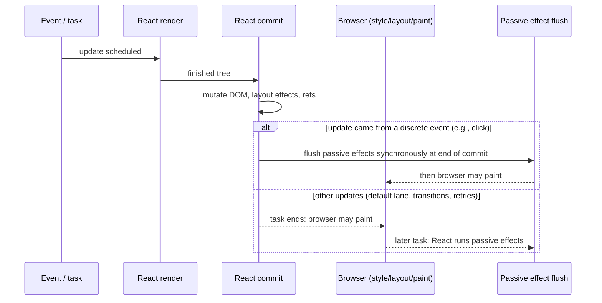
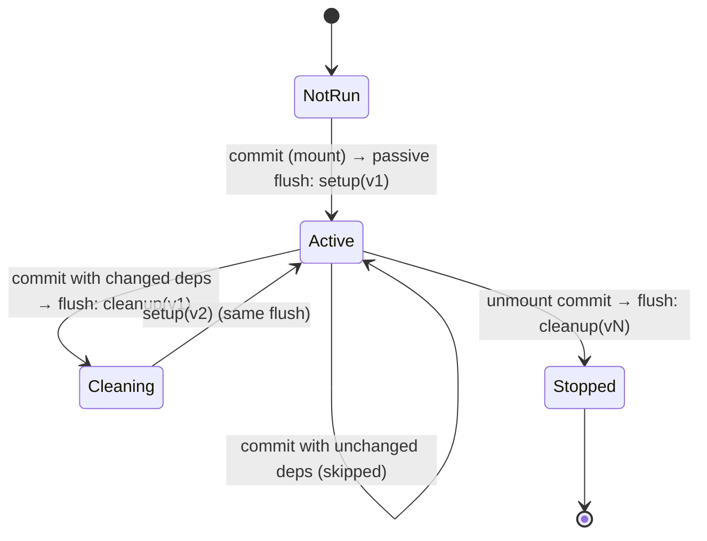
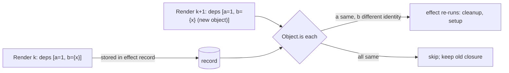

# 02 / 18 — Effects and Their Timing

## 1. Lesson metadata

| | |
|---|---|
| **Level** | Advanced |
| **Study time** | 6 hours (reading 2.5 h, experiments 1.5 h, exercises 2 h) |
| **Prerequisites** | [11 — Render phase vs commit phase](./11-render-phase-and-commit-phase.md), [12 — Why rendering must be pure](./12-why-rendering-must-be-pure.md), [15 — Interruptible, restartable, abandoned renders](./15-interruptible-restartable-abandoned-rendering.md), [17 — How hooks attach to Fiber](./17-hooks-and-fiber-state.md), [01/17 — Lifecycle concepts](../01-react-fundamentals/17-lifecycle-concepts.md), [00/11 — Event loop, tasks, microtasks](../00-web-and-javascript-foundations/11-event-loop-tasks-microtasks.md) |
| **Next** | [19 — Layout vs passive effects](./19-layout-vs-passive-effects.md) |
| **Related** | [20 — Commit work and DOM mutations](./20-commit-and-dom-mutation.md), [21 — Browser paint and React updates](./21-browser-paint-and-react-updates.md), [28 — Strict Mode behavior](./28-strict-mode-behavior.md), [Phase 3/04 — `useEffect` synchronization](../03-react-state-and-hooks/04-useeffect-synchronization.md), [Phase 3/06 — Effect cleanup](../03-react-state-and-hooks/06-effect-cleanup.md), [Phase 3/07 — You might not need an effect](../03-react-state-and-hooks/07-you-might-not-need-an-effect.md) |

**Learning objectives.** After this lesson you can:
1. State what an Effect *is* (a description of how to synchronize a component with an external system, run as a consequence of committed renders) and what it is not (a lifecycle hook, an event handler, a data-flow tool).
2. Place passive effect execution precisely relative to render, commit, layout effects, and browser paint, for each kind of triggering event.
3. Predict the exact order of cleanups and setups across a component tree for mount, update, and unmount, and separate the documented guarantees from implementation details.
4. Explain how dependency arrays work mechanically (`Object.is` against the previously stored array) and how closures make effects "see" specific renders.
5. Explain Strict Mode's mount-unmount-mount simulation and use it to validate cleanup logic.
6. Write effects that are race-safe and idempotent: subscriptions, fetch with cancellation, imperative widgets.
7. Diagnose "runs twice", "runs every render", "runs too late", "runs with stale data", "never cleans up".

**Concepts covered:** passive effect, effect record, effect flags, deferred execution, flush before next render, synchronous flush for discrete-event results, cleanup semantics, dependency comparison, closure capture per render, effect ordering (children before parents), unmount ordering, Strict Mode effect re-run, error handling in effects, effects and hidden/suspended trees, synchronization mental model, event handler vs effect distinction, `useEffectEvent` (stable since React 19.2).

> **Version-sensitive.** The *documented* contract is: "Effects run after the browser has painted *when possible*; React may run them earlier; cleanups run before re-running and on unmount; in Strict Mode development React runs an extra setup+cleanup cycle on mount." The *internal* details — which task runs the flush, how it is prioritized, traversal order inside a flush — shifted between React 17, 18, and 19 and may shift again. Checked on 2026-10-22 against <https://react.dev/reference/react/useEffect>, the source (`ReactFiberCommitWork`, `ReactFiberWorkLoop` in <https://github.com/facebook/react>) and by execution on React 19.3.1. `useEffectEvent` has been stable since React 19.2 (react.dev/reference/react/useEffectEvent).

---

## 2. Deep conceptual explanation

### 2.1 What problem is this lesson solving?

A React component is a pure description of UI for given props/state ([12](./12-why-rendering-must-be-pure.md)). But real applications must interact with things React does not own: the document title, a WebSocket, a map widget, `localStorage`, an analytics SDK, a third-party video player, `IntersectionObserver`, timers. Such interactions are **side effects**. They cannot live in render (render may run multiple times, never commit, or be discarded). They need a place that:

1. Runs only for **committed** UI (so they reflect what the user actually sees),
2. Runs **after** the DOM exists (so they can measure, focus, attach),
3. Can **undo** itself when the UI changes or disappears,
4. Does **not block** painting unless explicitly requested.

`useEffect` is that place. It is the answer to "what do I do when React has updated the screen and I need to synchronize something *else* with it?"

Official framing (see react.dev [Synchronizing with Effects](https://react.dev/learn/synchronizing-with-effects) and [Lifecycle of Reactive Effects](https://react.dev/learn/lifecycle-of-reactive-effects)): **Effects let you specify side effects that are caused by rendering itself, rather than by a particular event.** Think of an effect as a *synchronization process* that starts, stops, and restarts as its inputs change — not as "componentDidMount/Update".

### 2.2 Event handlers vs effects: the first design decision

| Question | Event handler | Effect |
|---|---|---|
| What *caused* this work? | A specific user action (click, submit, key) | The component being displayed with certain props/state |
| When does it run? | When the event fires | After a commit in which its dependencies changed (or on mount) |
| Does it re-run when values change? | No (one event, one execution) | Yes (when deps change) after cleaning up the previous run |
| Typical use | POST on submit, navigate, start a download | Connect to a chat room *while* `roomId` is shown; subscribe to a store; set up a widget; log a page view |
| Where does it see props/state? | In the closure of the render in which the handler was created | In the closure of the render in which the effect was created |

If you can state the work as "when the user does X, do Y", it is an event handler. If you can state it as "while this component shows with value V, keep external system S in sync with V", it is an effect. Misplacing the first kind in an effect is the most common cause of double-fire bugs ([Phase 3/07](../03-react-state-and-hooks/07-you-might-not-need-an-effect.md)).

### 2.3 The anatomy of an effect

```tsx
useEffect(() => {
  // SETUP: connect / subscribe / start
  const connection = createConnection(serverUrl, roomId);
  connection.connect();
  return () => {
    // CLEANUP: disconnect / unsubscribe / stop (must undo exactly what setup did)
    connection.disconnect();
  };
}, [serverUrl, roomId]); // DEPENDENCIES: reactive values read inside the effect
```

- **Setup** runs after the commit that mounted the component, and after each commit in which dependencies changed — *after* the previous run's cleanup.
- **Cleanup** runs (a) before the setup runs again with new values, and (b) when the component unmounts. It closes over the **same render's** values as the setup it belongs to.
- **Dependencies** are the *reactive values* (props, state, and anything computed from them in the component body) the effect reads. React compares each to the value stored from the previous render using `Object.is`.

Three forms:

| Call | Meaning |
|---|---|
| `useEffect(fn)` | No dependency array: run after **every** commit of this component (cleanup before each). |
| `useEffect(fn, [])` | Run once after mount (setup), cleanup on unmount (plus Strict Mode dev extras). |
| `useEffect(fn, [a, b])` | Run after mount and after any commit where `a` or `b` changed. |

### 2.4 When does a passive effect run? (the timing contract)

The word *passive* contrasts with *layout* effects. A passive effect's execution is **decoupled** from the commit: it is scheduled during commit and runs afterward.



What the docs promise ([`useEffect` reference](https://react.dev/reference/react/useEffect)): effects run after the browser paints *"in most cases"*, but React may run them sooner — particularly, if the update was caused by a discrete user interaction such as a click, React ensures effects flush before the next discrete event, and as of React 18 will flush them synchronously within the commit task *so that the effect's results are visible to the next interaction*. Do not write code that depends on either "after paint" or "before paint". If you need to run before paint, use `useLayoutEffect` ([19](./19-layout-vs-passive-effects.md)); if you need to run strictly after paint for correctness (rare), schedule it yourself (`requestAnimationFrame` + `setTimeout`).

#### The three rules that make effects safe to reason about

1. **Effects only exist for committed renders.** A render that is discarded never schedules effects ([15](./15-interruptible-restartable-abandoned-rendering.md)).
2. **Effects from commit N are fully flushed before render N+1 begins its work.** If a new render starts while passive effects are pending, React runs them first (conceptually: a `flushPassiveEffects` call at the start of rendering the root). Hence effects never overlap across commits and always see the DOM of the commit that scheduled them (modulo your own changes).
3. **Within one flush: all cleanups, then all setups.** React runs the cleanup of *every* effect that needs to re-run (or whose component unmounted), and only then the setups. A setup in component B can therefore rely on cleanups in component A (from the same commit) having completed.

(Rule 2 and 3 are the documented/observable behavior in React 17+; the traversal details are implementation details.)

### 2.5 Closures: an effect belongs to *a render*

```tsx
function Timer({ step }: { step: number }) {
  const [count, setCount] = useState(0);

  useEffect(() => {
    const id = setInterval(() => setCount((c) => c + step), 1000);  // sees `step` of THIS render
    return () => clearInterval(id);
  }, [step]);                                                        // new interval when `step` changes
  return <p>{count}</p>;
}
```

Every render of `Timer` creates a new function for the effect. React stores the function in the effect record ([17 §2.10](./17-hooks-and-fiber-state.md)) *only if it will run*; if dependencies are unchanged the new function is thrown away and the **previous render's** function stays active. This is both how effects avoid unnecessary re-subscription and how they get stale closures when you lie about dependencies. The linter rule (`react-hooks/exhaustive-deps`) exists to keep the stored function consistent with the values it reads.

### 2.6 Why the cleanup must be symmetric

The cleanup is not "undo the last thing", it is "stop what *this* setup started". Think of setup/cleanup as `start`/`stop` for a process whose parameters are the dependencies. Strict Mode (dev only) tests this by running **setup → cleanup → setup** on mount: if your effect is a correct start/stop pair, the extra cycle is invisible. If it isn't (e.g., a subscription that is never removed, a fetch that logs twice, a counter incremented in setup), the extra cycle exposes it immediately — long before it appears as a production bug under fast navigation or concurrent restarts ([28](./28-strict-mode-behavior.md)).

### 2.7 Why setup/cleanup also run on **dependency change**, not just mount/unmount

A common beginner model borrows from classes: "`componentDidMount` once, `componentDidUpdate` sometimes, `componentWillUnmount` once". Effects are different: the unit is *a synchronization with particular values*. Changing `roomId` from "a" to "b" means "stop being connected to room a; start being connected to room b". That is cleanup(a) followed by setup(b), regardless of whether the component re-mounted. This single mental shift eliminates most `useEffect` confusion; see [01/17](../01-react-fundamentals/17-lifecycle-concepts.md) for the class-lifecycle comparison.

### 2.8 Misconceptions

| Misconception | Reality |
|---|---|
| "`useEffect` is `componentDidMount`." | It synchronizes with values; it runs on mount *and* on dependency change, with cleanup in between. |
| "`useEffect(fn, [])` runs exactly once." | In production, once per mount. In Strict Mode dev, setup → cleanup → setup on mount. After remount (key change, `Activity` hidden then visible) it runs again; a Suspense fallback hiding already-visible content re-runs only the *layout* effects (verified on 19.3.1: layout cleanup and setup ran, passive effects were left alone). |
| "Effects run after paint, always." | Usually; not guaranteed. Discrete-event updates flush synchronously at end of commit ([11 §2.6](./11-render-phase-and-commit-phase.md)). |
| "Effects run in the order components appear (parent first)." | Mount/update effects run children first (post-order); unmount cleanups of deleted subtrees run parent first. Treat cross-component order as unspecified. |
| "Effects run on every render." | Only on commits where deps changed (or no array). Renders that bail out or are discarded don't run effects. |
| "`setState` in an effect is bad." | Not inherently; it triggers another render after paint (visible if it changes layout). Often a sign the state is derivable ([Phase 3/17](../03-react-state-and-hooks/17-derived-state.md)); legitimate when syncing from an external system. |
| "An empty dependency array means the effect never uses props/state." | It means *you told React it doesn't*. If the code does read reactive values, you get stale closures. |
| "Cleanup runs after the next setup." | Cleanup runs *before* the next setup, for all effects in the flush. |
| "Cleanup sees the latest props." | It sees the props/state of the render that created that effect. |
| "Fetching in `useEffect` is the recommended data strategy." | It works but is a low-level tool with race, waterfall, and caching problems; prefer framework/data libraries or `use` + Suspense ([Phase 6](../06-data-fetching-and-state-ecosystems/01-fetch-lifecycle.md)). |
| "Effects can block paint." | Passive effects can delay *later* frames if they are slow (they run on the main thread) and — when flushed synchronously for discrete events — delay the paint that follows. Only layout effects are *designed* to run before paint. |

---

## 3. Internal mechanics

### 3.1 Public guarantees

1. `useEffect` setup runs only after the component has been committed to the screen (never during render).
2. If dependencies are unchanged between renders, the effect is not re-run (comparison via `Object.is`).
3. Before re-running an effect, React runs the cleanup returned by its previous run, with the values from that previous render.
4. On unmount, React runs the cleanup of the last setup.
5. React may run effects after paint or earlier; code must not depend on which.
6. In Strict Mode development, React runs an additional setup+cleanup cycle on mount (and may re-run for hidden/shown content in future).
7. Effect functions should not be `async`; they must return `undefined` or a cleanup function.
8. State updates inside effects cause new renders; React guards against infinite synchronous loops with a nested-update limit for layout-phase updates; for passive effects it warns for "maximum update depth" patterns.

### 3.2 Teaching model

```text
RENDER (pure): Component() runs; useEffect(create, deps) call compares deps with stored record.
               if changed: mark effect record "HasEffect"; flag the fiber "Passive".   [no user code runs]

COMMIT: (sync) DOM mutations, layout effects, ref attach.
        if fiber tree contains any "Passive" flags → remember "pending passive effects for root".
        schedule a task to flush them (or flush now if the render was from a sync lane).

FLUSH PASSIVE (task or end of commit):
        1. for each deleted subtree & each updated fiber with HasEffect: run old cleanup  (destroy)
        2. for each fiber with HasEffect:                             run create; store returned cleanup
        (new renders triggered by setState inside are scheduled, not run inline)
```

### 3.3 Implementation details

- **Flags.** Fibers have bit-flag fields; a `Passive` flag on a fiber and `subtreeFlags` propagated upward let the commit know whether anything in a subtree has passive effects, so the flush can skip clean subtrees. Individual effect records carry a tag with bits like `HasEffect`, `Layout`, `Passive`, `Insertion`.
- **Scheduling the flush.** After the layout phase, if there are passive effects, React schedules a Scheduler callback (conceptually at "normal" priority, wrapping a call to `flushPassiveEffects`). In the `SyncLane` case (and for roots not in legacy mode) React calls `flushPassiveEffects` synchronously at the end of commit. Only `SyncLane` renders flush synchronously (`includesSyncLane(pendingEffectsLanes)` in `completeRoot`, verified on `main`); transition, default and continuous renders flush in a scheduled task; see `completeRoot`, `commitRoot` and `flushPendingEffects` in `ReactFiberWorkLoop` (React 18 used `commitRootImpl`/`flushPassiveEffects`; the code was restructured in 19).
- **Pending state.** A module-level variable keeps the root and lanes with pending passive effects. Because render of the next update starts by calling the flush if anything is pending, effect ordering across commits is serialized.
- **Traversal.** Newer versions implement the passive mount and unmount passes as recursive traversals that process **children first, then the fiber**, with special handling for deleted subtrees (visited before the rest, parent-to-child). Older versions (React 16/17) kept a flat array of effects. Results: the observable order described in §2.4 rule 3.
- **Errors.** Errors thrown in setup or cleanup are captured and routed to the nearest error boundary (as with render errors, but happening after commit, so the boundary re-renders in a new commit). Other effects of the same flush still run (verified on 19.3.1: a throwing setup in one component did not stop a sibling's setup, and the boundary rendered its fallback).
- **Cleanup reference.** In recent versions `destroy` is kept on a shared `inst` object referenced by effect records across renders, so that when a new record replaces the previous one, the latest cleanup can still be found ([17 §3.3](./17-hooks-and-fiber-state.md)).
- **Dev double-invocation.** A dev-only function iterates the tree and invokes layout and passive cleanup/setup for newly mounted components to simulate unmount/remount (names conceptually `commitDoubleInvokeEffectsInDEV`). It is compiled out of production.

### 3.4 What the browser does around the flush

```text
Task A (discrete event e.g. click)
  handler runs → setState queued
  [microtask] React renders + commits (sync lane)
  [end of commit] passive effects flushed synchronously   <— effect code runs HERE (before paint)
Browser: rendering opportunity → style → layout → paint

Task B (e.g. setTimeout/transition/default lane)
  React renders + commits
  [end of commit] passive effects scheduled via Scheduler (MessageChannel task)
Browser: rendering opportunity → paint                   <— paint happens BEFORE effects
Task C (Scheduler task)
  passive effects flushed                                 <— effect code runs HERE (after paint)
```

Two consequences:
- Visual changes made by a passive effect (e.g., `setState` that changes layout) show up in a *subsequent* frame when the effect ran after paint ⇒ flicker (see [19](./19-layout-vs-passive-effects.md)).
- A slow effect that runs in Task A delays the paint for the click (hurting INP's presentation delay); a slow effect in Task C delays *subsequent* input (input delay for the next interaction).

---

## 4. Step-by-step execution walkthrough

### 4.1 Instrumented tree

```tsx
import { useEffect, useLayoutEffect, useState } from "react";

function log(s: string) { console.log(s); }

function Child({ label }: { label: string }) {
  log(`render child(${label})`);
  useLayoutEffect(() => {
    log(`layout setup child(${label})`);
    return () => log(`layout cleanup child(${label})`);
  });
  useEffect(() => {
    log(`passive setup child(${label})`);
    return () => log(`passive cleanup child(${label})`);
  });
  return <p>{label}</p>;
}

export function Parent() {
  const [n, setN] = useState(0);
  log(`render parent(${n})`);
  useLayoutEffect(() => {
    log(`layout setup parent(${n})`);
    return () => log(`layout cleanup parent(${n})`);
  });
  useEffect(() => {
    log(`passive setup parent(${n})`);
    return () => log(`passive cleanup parent(${n})`);
  });
  return (
    <>
      <button onClick={() => setN(n + 1)}>+</button>
      <Child label={`n=${n}`} />
    </>
  );
}
```

(No dependency arrays on purpose: every commit re-runs every effect, which is the clearest ordering probe.)

### 4.2 Mount (production build or Strict Mode off)

Order printed:

```
render parent(0)
render child(n=0)
layout setup child(n=0)
layout setup parent(0)
passive setup child(n=0)
passive setup parent(0)
```

Walkthrough:
1. **Render phase** (top-down): parent function runs; child function runs.
2. **Commit**: DOM inserted; **layout** phase traverses children first → child layout setup then parent layout setup.
3. **Passive flush** (after commit; for the initial mount this is the default lane, so it's scheduled after the browser has had a chance to paint): children first → child passive setup then parent.

### 4.3 Click on "+" (discrete event, update)

```
render parent(1)
render child(n=1)
layout cleanup child(n=0)
layout cleanup parent(0)
layout setup child(n=1)
layout setup parent(1)
passive cleanup child(n=0)
passive cleanup parent(0)
passive setup child(n=1)
passive setup parent(1)
```

Walkthrough:
1. Handler: `setN(1)` (sync lane).
2. Render: top-down; both function bodies run (child not memoized).
3. Commit — mutation phase: DOM text node updated; **layout effect cleanups** for updated components run during the mutation traversal (children first). Then layout phase: **layout setups** (children first).
4. End of commit: because the update came from a discrete event, **passive effects are flushed synchronously**: all passive cleanups (children first, with the *previous render's* values: `n=0`), then all passive setups with the new values.
5. Browser paints afterwards.

Cross-component order is the implementation's current behavior (verified on 19.3.1: update-time cleanups `C1, C2, P`, then setups `C1, C2, P`); the guaranteed parts are "all cleanups before any setup (in one flush)" and "cleanup uses previous render's values".

### 4.4 The same update from a `setTimeout` (default lane)

Same relative order, but the **passive** lines (cleanup + setup) appear *after the browser paints*. The first six lines (render, layout) happen in one task; the last four happen in a later scheduler task. You can observe this by adding `requestAnimationFrame(() => log("rAF"))` inside the timeout callback: `rAF` typically prints between the layout lines and the passive lines.

### 4.5 Unmount (Parent removed by its parent)

```
layout cleanup parent(1)          // deletion: parent's own layout cleanup first
layout cleanup child(n=1)
passive cleanup parent(1)
passive cleanup child(n=1)
```

Walkthrough: In commit, the deleted subtree is traversed; layout cleanups run during the mutation phase (host nodes removed), then passive cleanups are scheduled for the flush. For deletions the order in current implementations is parent-then-child (verified on 19.3.1 for both layout and passive cleanups), the opposite of mount order. Do not write code that depends on it (a child cleanup must not require the parent's resource to still exist; use context/refs defensively).

### 4.6 Strict Mode (development) on mount

With `<StrictMode>`, after the initial commit React simulates an unmount/remount of the new tree's effects:

```
render parent(0)  (×2)   // render invoked twice; the second output is not used (logs dimmed in browsers)
render child(n=0) (×2)
layout setup child(n=0)
layout setup parent(0)
passive setup child(n=0)
passive setup parent(0)
--- simulated unmount/remount (dev only) ---
layout cleanup parent(0)? / child ...      // order is an implementation detail
passive cleanup ...
layout setup ...
passive setup ...
```

The simulated phase runs layout cleanups, passive cleanups, then layout setups, passive setups (verified on 19.3.1: `layout cleanup`, `ref null`, `passive cleanup`, then `ref attach`, `layout setup`, `passive setup`), with refs also detached and re-attached in React 19. If your effect is a proper start/stop, nothing visible changes except extra logs.

---

## 5. Code examples

### 5.1 Minimal example — observing when a passive effect runs relative to paint

```tsx
import { useEffect, useLayoutEffect, useState } from "react";

export function PaintProbe() {
  const [n, setN] = useState(0);

  useLayoutEffect(() => {
    performance.mark(`layout-${n}`);
  });

  useEffect(() => {
    performance.mark(`passive-${n}`);
    // requestAnimationFrame callbacks run at the next rendering opportunity (before that frame's paint)
    requestAnimationFrame(() => performance.mark(`raf-after-passive-${n}`));
  });

  return (
    <button
      onClick={() => {
        // Not a discrete React event on purpose: schedule the state change from a timer
        setTimeout(() => setN((v) => v + 1), 0);
      }}
    >
      {n}
    </button>
  );
}
```

**Predict:** in the Performance panel's *Timings* track, in what order do `layout-1`, `passive-1`, `raf-after-passive-1` appear, and relative to the paint of the "1"?

**Result (typical Chrome):** `layout-1` (end of commit), then the browser's rendering opportunity (style, layout, **paint** of "1"), then — in a later task — `passive-1`. The rAF scheduled inside the passive effect fires on the *next* frame. Because the update came from a timer, it is a default-lane update and the passive effect is deferred.

**Why:** [§3.4](#34-what-the-browser-does-around-the-flush). **Caveat:** the browser might not paint between the commit task and the passive task if no rendering opportunity occurs (e.g., two tasks quickly in succession), so "after paint" is a tendency, not a promise. Compare with a real click handler calling `setN` directly: `passive-1` appears *before* the paint.

### 5.2 Practical example — subscription with correct cleanup (and why it's an effect)

```tsx
import { useEffect, useState } from "react";

type Status = "connecting" | "open" | "closed";

export function useWebSocketStatus(url: string): Status {
  const [status, setStatus] = useState<Status>("connecting");

  useEffect(() => {
    setStatus("connecting");                    // synchronize *state* with the new connection attempt
    const ws = new WebSocket(url);
    ws.onopen = () => setStatus("open");
    ws.onclose = () => setStatus("closed");
    return () => {
      ws.onopen = null;
      ws.onclose = null;                         // avoid setState from a discarded connection
      ws.close();
    };
  }, [url]);

  return status;
}
```

**Line notes.**
- `[url]`: reactive input. Change the URL → cleanup closes the old socket, setup opens the new one: exactly "synchronize with `url`".
- Unhooking `onclose` before `close()` prevents the old socket's close event from setting `status = "closed"` *after* a new connection has started (a classic race).
- `setStatus("connecting")` at the top of the effect is a legitimate "effect sets state to reflect external system start". (If `status` could be derived without an effect, don't use one; here the state mirrors an external system.)
- Strict Mode dev: connects, closes, reconnects. Your server sees two connections; acceptable in dev, and the cleanup guards against stale callbacks. For a connection with side effects that must not duplicate (e.g., "join room" with presence), the server must be idempotent or the client must debounce connect.

**Trade-offs.** Raw `useEffect` + `WebSocket` is fine for a small component; a production system wants reconnection/backoff, multiplexing, and sharing across components — move this into a store/service and subscribe with `useSyncExternalStore` ([Phase 6/17](../06-data-fetching-and-state-ecosystems/17-real-time-websockets-subscriptions.md)).

### 5.3 Incorrect example — fetch in an effect with a race condition

```tsx
function UserCard({ userId }: { userId: string }) {
  const [user, setUser] = useState<User | null>(null);

  useEffect(() => {
    fetch(`/api/users/${userId}`)
      .then((r) => r.json())
      .then(setUser);                // BUG: no cleanup; out-of-order responses can win
  }, [userId]);

  return <p>{user?.name}</p>;
}
```

**Predict:** user navigates quickly `userId = "1"` → `"2"`; response for 2 arrives first, response for 1 arrives later. What does the card show?

**Result:** user 1's data (stale) is displayed under `userId = "2"`: the late response calls `setUser` after the newer one. Strict Mode dev additionally fires the request twice.

**Why:** the effect for `userId="1"` is cleaned up (nothing to clean), but its pending promise continues and its `.then(setUser)` closure is still live. Effects don't cancel async work for you.

### 5.4 Corrected implementation

```tsx
import { useEffect, useState } from "react";

interface User { id: string; name: string }
type State = { status: "loading" } | { status: "ok"; user: User } | { status: "error"; error: unknown };

function UserCard({ userId }: { userId: string }) {
  const [state, setState] = useState<State>({ status: "loading" });

  useEffect(() => {
    const controller = new AbortController();
    setState({ status: "loading" });
    fetch(`/api/users/${encodeURIComponent(userId)}`, { signal: controller.signal })
      .then((r) => {
        if (!r.ok) throw new Error(`HTTP ${r.status}`);
        return r.json() as Promise<User>;
      })
      .then((user) => setState({ status: "ok", user }))
      .catch((error: unknown) => {
        if (error instanceof DOMException && error.name === "AbortError") return; // expected on cleanup
        setState({ status: "error", error });
      });
    return () => controller.abort();            // cancels the in-flight request for THIS userId
  }, [userId]);

  if (state.status === "loading") return <p>Loading…</p>;
  if (state.status === "error") return <p role="alert">Failed to load user.</p>;
  return <p>{state.user.name}</p>;
}
```

**Why correct:** each effect run owns an `AbortController`; the cleanup aborts that run's request; the aborted promise rejects with `AbortError`, which we ignore; the late response from user 1 can never call `setState` after user 2's effect has started. (Alternative "ignore flag": `let ignore = false; … if (!ignore) setState(…); return () => { ignore = true; }`, which doesn't cancel network traffic but prevents stale commits.)

**Still not ideal:** no caching, no dedupe, request starts only after the component committed (a waterfall). For production data fetching use a library or framework data loading ([Phase 6](../06-data-fetching-and-state-ecosystems/08-tanstack-query.md)).

### 5.5 Advanced example — a "latest value" ref and a stable subscription

Problem: subscribe once to a store, but call the *latest* callback prop without resubscribing every render.

```tsx
import { useEffect, useRef } from "react";

export function useEvent<A extends unknown[], R>(handler: (...args: A) => R): (...args: A) => R {
  const ref = useRef(handler);
  useEffect(() => {
    ref.current = handler;               // update AFTER commit: never write refs during render
  });
  return useRef((...args: A) => ref.current(...args)).current; // stable identity
}

export function useWindowEvent<K extends keyof WindowEventMap>(
  type: K,
  listener: (e: WindowEventMap[K]) => void,
): void {
  const stable = useEvent(listener);
  useEffect(() => {
    window.addEventListener(type, stable);
    return () => window.removeEventListener(type, stable);
  }, [type, stable]);                    // `stable` never changes → resubscribes only when `type` changes
}
```

**Line notes.**
- `useEvent` here is a *userland approximation*. React 19.2 shipped the official [`useEffectEvent`](https://react.dev/reference/react/useEffectEvent) hook for exactly this purpose ("Effect Events"; verified on 19.3.1: `useEffect(() => { onE(); }, [])` logged the latest `theme` it was created with). Prefer it in new code; it has restrictions (only call it from effects, do not pass it around or put it in dependency arrays) that `eslint-plugin-react-hooks` v6+ enforces.
- The ref is updated in an effect so it reflects the *committed* props. A subtle gap: between commit and effect flush, a callback invoked sees the previous handler. For discrete-event commits the flush is synchronous; for others it's after paint — an event handler firing in that gap uses the previous closure. `useLayoutEffect` closes the gap at the cost of running before paint. This is a real trade-off in the community implementations.
- `useRef(...).current` for the stable function is creating the arrow inline each render but only the first is kept (cheap).

**Trade-off.** Do not use this to silence exhaustive-deps for effects that genuinely depend on changing inputs (like `roomId`); a "latest ref" is for *callbacks that should read fresh values without causing resubscription*, not for data that should re-synchronize.

### 5.6 Ordering experiment for tests and learning

Write a test (React Testing Library) that renders `Parent` from §4.1 inside `StrictMode` and asserts on the *relative* guarantees (cleanups before setups, previous values in cleanups), not full order:

```tsx
it("runs all cleanups before any setup within one flush and cleanups see old values", async () => {
  const events: string[] = [];
  /* render <Parent/> with log pushing to `events`, click "+" via userEvent */
  const firstSetupAfterClick = events.findIndex((e) => e.startsWith("passive setup") && e.includes("1"));
  const lastCleanupAfterClick = events.map((e, i) => (e.startsWith("passive cleanup") ? i : -1)).filter((i) => i >= 0).at(-1)!;
  expect(lastCleanupAfterClick).toBeLessThan(firstSetupAfterClick);
});
```

**Why test the relative property:** it's a public guarantee; full orderings are implementation details that may change.

---

## 6. Visual explanations

### 6.1 Lifecycle of one effect across renders



### 6.2 Where the code runs, by phase

```text
              RENDER            COMMIT                                   AFTER
              (pure)   | mutation | layout |                  | paint | passive flush |
Component()    ✔
useMemo fn     ✔
ref callbacks                       ✔(attach)
useLayoutEffect                 cleanup  setup
useEffect                                                              cleanup → setup
event handler:  runs outside all of the above, in its own task
```

### 6.3 Dependency comparison



---

## 7. Alternative approaches and trade-offs

Where should "do something outside React" live?

| Approach | Runs for | Cleanup built in | Concurrent-safe | Complexity | Best for |
|---|---|---|---|---|---|
| **Event handler** | A specific user action | n/a | Yes | Lowest | Submitting, navigating, sending analytics for a click |
| **`useEffect`** | Committed renders where deps changed | Yes | Yes (only committed) | Medium | Synchronizing external systems with props/state |
| **`useLayoutEffect`** | Same, but before paint | Yes | Yes | Medium (blocks paint) | Measure-then-adjust DOM ([19](./19-layout-vs-passive-effects.md)) |
| **`useSyncExternalStore`** | Subscribing to external stores | Built in | Designed for it | Low | Reading a store/`matchMedia`/`navigator.onLine` into render |
| **Ref callback** | Element attach/detach | Cleanup function (React 19) | Yes | Low | Per-element setup (observers, focus) |
| **Derive during render** | Every render | n/a | Yes | Lowest | Values computable from props/state (no effect!) |
| **Data library / `use` + Suspense** | Data fetching | Library-managed | Yes | Varies | Server state with caching, dedupe, retries |
| **Key-based reset** | Remount | Yes | Yes | Low | Resetting local state when an identity changes |
| **Event-driven store/service (outside React)** | App lifetime | Manual | N/A | Higher | Long-lived connections shared across components |

**Scenario where `useEffect` is the right tool but a naïve version is wrong:** synchronizing a third-party map with React state needs *two* effects (create/destroy the map instance once; update center/zoom on change) rather than one effect that recreates the map each time — splitting by *separate synchronization concerns* is the rule of thumb in the docs ("each effect should represent a separate synchronization process").

**Scenario where an effect is the *wrong* tool:** transforming data for display (`useEffect(() => setFiltered(items.filter(...)), [items])`) — compute during render; it avoids an extra render and a stale frame.

---

## 8. Best practices and anti-patterns

**Do**
- Write the effect as "start synchronization" and the cleanup as "stop it"; keep them symmetric.
- List every reactive value used inside; trust the lint rule (`react-hooks/exhaustive-deps`); restructure code instead of suppressing.
- Split unrelated synchronizations into separate effects.
- Make setup idempotent enough to survive Strict Mode's extra cycle.
- Use `AbortController`/ignore flags for async work.
- Prefer derivation, event handlers, `key`, `useSyncExternalStore`, or data libraries when they fit.

**Beginner mistakes**
- Using an effect to compute derived state.
- Omitting dependencies to "run once".
- Forgetting cleanup for listeners/timers/subscriptions.
- Making the effect callback `async` (returns a promise, not a cleanup).
- Updating state in an effect without a guard, causing a render loop.

**Experienced-developer mistakes**
- Using effects to coordinate parent/child state ("lift state instead").
- Chaining effects: effect A sets state that triggers effect B... (a render-per-link chain; usually derivable or event-based).
- Using refs to dodge dependencies and creating hidden coupling.
- Fetching in effects across a deep tree, causing waterfalls.
- Assuming effect order across components (e.g., parent effect reading a ref set by child effect: works by current order but isn't guaranteed).

**Smells:** `// eslint-disable-next-line react-hooks/exhaustive-deps` without comment; effects that only call `setState` with a pure function of props; `useEffect(() => {...}, [])` containing references to props; `isMounted` flags (usually hide a missing cleanup).

**Justified exceptions**
- A deliberate "once per mount" analytics call keyed by a ref guard, accepting dev double-fire (or handled by deduplicating on the server).
- Disabling exhaustive-deps when you use the *latest ref* pattern and document why.
- Using an effect to focus an element after mount (imperative external system: the DOM).

---

## 9. Real-world application

**Analytics page views (e-commerce).** Requirement: one `page_view` per route change. Effects keyed on `location.pathname` fire after commit, which means the DOM reflects the page; but Strict Mode dev fires twice, and concurrent restarts do not (effects only for committed). Constraint: the analytics SDK may be slow; send via `navigator.sendBeacon` and dedupe by navigation id. Better: fire from the router's navigation event instead of a component lifecycle.

**Realtime dashboard with subscriptions.** A widget subscribes to a symbol's price stream by `symbol`. Dependency change = unsubscribe old, subscribe new. Constraint: unsubscribing must not drop messages in flight to the *new* symbol; use per-subscription handles and ignore messages whose symbol mismatches. At scale a shared connection manager multiplexes; each component effect just registers/unregisters interest (ref-counted).

**Forms with autosave.** An effect that saves draft changes after 1 s of inactivity: setup starts a timer, cleanup clears it (debounce through cleanup). Constraint: on unmount, flush the pending save synchronously (cleanup should perform a final save) or you lose data; consider `visibilitychange`/`pagehide` events for tab close ([00/13](../00-web-and-javascript-foundations/13-browser-events-and-propagation.md)).

**Authentication token refresh.** An effect schedules a refresh `timeout` based on `expiresAt`; cleanup clears it; multiple tabs coordinate via `BroadcastChannel` — but the coordination state belongs in a shared service, not component effects.

**Third-party widgets in a micro-frontend shell.** Each team's widget has an imperative `mount(el)`/`unmount()` API. Wrap in a component whose effect mounts into a ref'd element and whose cleanup unmounts. Constraint: Strict Mode dev will mount/unmount/mount — widgets must tolerate that; test with Strict Mode on.

---

## 10. Debugging and troubleshooting

**Symptom: "My effect runs twice on mount."**
1. Is Strict Mode on (dev)? Check `<StrictMode>` in `main.tsx`. If the second run disappears in a production build, that's it.
2. If it's real in prod: look for a remount (changed `key`, parent conditionally rendering a different tree shape, a component defined inside another component, routing re-creating the layout).
3. Fix by making the effect idempotent (proper cleanup) and, if needed, eliminating the remount.
4. Validate in dev with Strict Mode on, and with a production build.

**Symptom: "Effect runs on every render."**
Dependency identity changes each render (object/array/function created in render). Log previous vs next deps; stabilize with `useMemo`/`useCallback` (only if the effect truly needs that identity), move the object *inside* the effect, depend on primitives, or move the function out of the component. See [Phase 3/05](../03-react-state-and-hooks/05-effect-dependencies-and-stale-closures.md).

**Symptom: "Effect uses stale value."**
Missing dependency or `[]` with props use. Validate with exhaustive-deps; restructure: updater form, event/latest-value pattern, or include the dep and handle cleanup properly.

**Symptom: "Infinite loop / 'Maximum update depth exceeded'."**
Effect sets state that is in its own deps and changes every time (e.g., sets a new object). Break the cycle: derive instead, use updater with equality guard, or remove the state.

**Symptom: "Effect runs too late; flicker."**
The effect measures/changes layout after paint → use `useLayoutEffect` ([19](./19-layout-vs-passive-effects.md)) or avoid the second render by deriving.

**Symptom: "Cleanup never runs / leak."**
No cleanup returned; cleanup closes over the wrong handle (a new reference each time); listener options mismatch (`capture`) so `removeEventListener` doesn't remove. Check DevTools: Memory → heap snapshot, event listeners in Elements → Event Listeners panel; Performance monitor → "JS event listeners" count rising after navigation.

**Tooling.**
- React DevTools Profiler: commit details show which effects fired? (It marks components that re-rendered; for effects, use logging.) "Highlight updates" shows renders, not effects.
- Performance panel: "Timings" with `performance.mark` in effects to see their position relative to frames.
- A `useEffect`-timeline helper: `useEffect(() => { console.timeStamp("effect") })`.

---

## 11. Exercises

### Level A — Knowledge
A1. Define "passive effect" and contrast with "layout effect" in one sentence each.
A2. What triggers an effect to re-run, mechanically?
A3. In a single passive flush with two effects that both re-run, in what order do their cleanups and setups run relative to each other?
A4. Why must effect callbacks not be `async`?
A5. Name two reasons Strict Mode re-runs effects on mount in development.

### Level B — Code comprehension
B1. For `useEffect(() => { console.log(a); return () => console.log("c", a); }, [a])`, with `a` going 1 → 2 → 3, list the log lines in order (production, no Strict Mode).
B2. For §4.1 `Parent`, change both `Child` effects to have dependency array `[label]` and the parent effects to `[]`. After one click, which lines print?
B3. What does the user see, and why, here?
```tsx
function C() {
  const [x, setX] = useState(0);
  useEffect(() => { setX(1); }, []);
  return <span>{x}</span>;
}
```
(Consider paint order for a default-lane mount.)
B4. Is the effect below correct? What is the symptom if `roomId` changes while a message is in flight?
```tsx
useEffect(() => {
  const c = createConnection(roomId);
  c.connect();
  c.on("message", (m) => setMessages((prev) => [...prev, m]));
}, [roomId]);
```

### Level C — Implementation
C1. Implement `useInterval(cb: () => void, ms: number | null)` that always calls the latest `cb`, pauses on `null`, and cleans up. Explain each hook.
C2. Implement `useDocumentTitle(title: string)` that restores the previous title on unmount, correct under Strict Mode.
C3. Implement `useOnClickOutside(ref, handler)` with a stable listener and no stale handler.

### Level D — Debugging
D1. "Our toast shows twice in dev but once in prod." The code: `useEffect(() => { toast("Welcome"); }, []);`. Diagnose; propose three fixes with trade-offs.
D2. The following effect sometimes shows the previous product's price. Fix it.
```tsx
useEffect(() => {
  getPrice(productId).then(setPrice);
}, [productId]);
```
D3. "The ResizeObserver callback keeps firing after navigation and throws because the element is gone." Diagnose and fix.

### Level E — Architecture and engineering decisions
E1. Your app has 40 components each opening their own WebSocket to the same endpoint in effects. Propose an architecture that keeps components simple, uses effects/stores correctly, and handles Strict Mode, reconnection and teardown.
E2. A teammate proposes a lint rule banning `useEffect` entirely in favor of libraries. Evaluate the proposal.

### Level F — Expert challenge
F1. You observe that INP degrades after a click: a profile shows a 90 ms task after React's commit that contains `passive setup` code of 12 components, before the first paint. Explain *why* effect code ran before paint, what the user feels, and design three mitigations with their risks (one of which must not change the semantic of the effects).

---

## 12. Detailed answers and explanations

> Attempt the exercises first.

**A1.** *Passive effect* (`useEffect`): scheduled by commit and run afterwards, usually after paint, not blocking the screen update. *Layout effect* (`useLayoutEffect`): runs synchronously in commit after DOM mutation and before the browser paints; can block paint. Wrong: "passive means runs only when idle" (no guarantee of idle).

**A2.** During render, `useEffect` compares the new dependency array element-by-element with the stored one using `Object.is`; if any differs, or there is no array, the effect record is tagged to run and the fiber flagged. In commit, the flagged fiber's effect is executed in the passive flush (cleanup of the previous record, then setup of the new). Wrong: "when a variable referenced inside changes" — React doesn't track reads; only the array you provide.

**A3.** All cleanups (for every effect in the flush that re-runs or whose component unmounted) run first; then all setups. So effect X's setup can never run before effect Y's cleanup if both are in the same flush.

**A4.** An `async` function returns a promise; React expects a cleanup function or `undefined`. It would treat the promise as the cleanup (dev warning), and the cleanup would never run properly. Use an inner async function: `useEffect(() => { let ignore = false; (async () => { … })(); return () => { ignore = true; }; }, [])`.

**A5.** (1) To expose effects with missing/incorrect cleanup (a mounted→unmounted→mounted component must end up in the same state as mounted once). (2) To prepare for features that preserve state while hiding/showing UI (e.g., `<Activity>`, stable since 19.2: hiding runs all effect cleanups and showing re-runs the setups, verified on 19.3.1), which will destroy and recreate effects without losing component state.

**B1.** Mount: `1`. Update to 2: cleanup `c 1`, setup `2`. Update to 3: `c 2`, `3`. Full: `1, c 1, 2, c 2, 3`. Unmount adds `c 3`. Wrong: expecting `c 2` before `2` showing *new* value; cleanup closes over its own render's `a`.

**B2.** After click (`n` 0→1): render parent(1), render child(n=1) (child not memoized so renders), layout effects: no deps → still all re-run: `layout cleanup child(n=0)`, `layout cleanup parent(0)`, `layout setup child(n=1)`, `layout setup parent(1)` — unchanged since only *passive* effects got deps. Passive: child `[label]` changed (`n=0`→`n=1`): `passive cleanup child(n=0)`, `passive setup child(n=1)`. Parent passive `[]` → untouched (stale `n=0` captured if it logged `n`). So printed: renders, four layout lines, then two child passive lines. Parent's passive setup/cleanup lines absent.

**B3.** First commit shows `0`; layout phase done; browser (default lane mount) typically paints `0`; then the passive effect runs `setX(1)` → second render/commit → `1`. User may see a one-frame flash of `0`. If the initial render was caused by a discrete event's commit, the passive effect flushes before paint and the `setX(1)` render is processed... after the flush, as a new update (sync lane? it's scheduled from passive effects — typically default lane, so still could paint `0` first). The correct lesson: avoid initializing state through an effect; use initial state/derive. If it must be measured post-layout, use `useLayoutEffect`.

**B4.** No cleanup: when `roomId` changes, the old connection remains connected and its `message` handler keeps appending to `messages` — duplicated or wrong-room messages. Add `return () => { c.off("message", handler); c.disconnect(); }`; name the handler so it can be removed.

**C1.**
```tsx
import { useEffect, useRef } from "react";

export function useInterval(cb: () => void, ms: number | null): void {
  const saved = useRef(cb);
  useEffect(() => { saved.current = cb; });            // always the latest callback (after commit)
  useEffect(() => {
    if (ms === null) return;                            // paused
    const id = setInterval(() => saved.current(), ms);
    return () => clearInterval(id);
  }, [ms]);                                             // restarts only when the delay changes
}
```
Notes: ref avoids resubscribing on every `cb` identity change; two effects because they synchronize two different things; when `ms === null` the effect returns `undefined` (no cleanup needed). Edge: if `cb` changes between commit and effect flush, a tick in that gap uses the old callback; accept or use `useLayoutEffect` for the ref update. Tests: fake timers and Strict Mode wrapper.

**C2.**
```tsx
import { useEffect } from "react";

export function useDocumentTitle(title: string): void {
  useEffect(() => {
    const previous = document.title;
    document.title = title;
    return () => { document.title = previous; };
  }, [title]);
}
```
Strict Mode: setup (prev = A, set B) → cleanup (restore A) → setup (prev = A, set B): idempotent. Nested components: the last cleanup restores the earlier title; with two components using it simultaneously, order-dependent restores can leave a stale title — a registry/stack in a shared module solves it.

**C3.**
```tsx
import { useEffect, useRef, type RefObject } from "react";

export function useOnClickOutside<T extends HTMLElement>(ref: RefObject<T | null>, handler: (e: PointerEvent) => void): void {
  const latest = useRef(handler);
  useEffect(() => { latest.current = handler; });
  useEffect(() => {
    const onDown = (e: PointerEvent) => {
      const el = ref.current;
      if (el && !el.contains(e.target as Node)) latest.current(e);
    };
    document.addEventListener("pointerdown", onDown);
    return () => document.removeEventListener("pointerdown", onDown);
  }, [ref]);
}
```
Notes: `ref` is stable; `pointerdown` unifies mouse/touch; `contains(e.target)` handles portals poorly (React portals bubble synthetic events but DOM containment differs) — document the limitation.

**D1.** Strict Mode dev runs the mount effect twice. Not a prod bug, but it reveals that "show toast on mount" is not an effect-shaped problem (no external system to sync). Fixes: (1) move to where the cause is — e.g., after login success in the event handler/Action: best; (2) guard with a module-level or ref flag (`useRef` resets on Strict Mode's simulated remount? In Strict Mode the component state/refs **persist** across the simulated unmount/mount, so a ref guard works in dev but also means that a real remount later won't toast, which may be wanted or not); (3) dedupe in the toast library by id. Trade-offs: (1) requires restructuring; (2) hides legit remounts; (3) library dependency.

**D2.** Race: late response for the previous product overwrites. Fix with ignore flag or `AbortController`:
```tsx
useEffect(() => {
  let ignore = false;
  getPrice(productId).then((p) => { if (!ignore) setPrice(p); });
  return () => { ignore = true; };
}, [productId]);
```
Also reset price (or show loading) when `productId` changes, otherwise the old price is displayed under the new product until the response arrives. Prefer data library for caching.

**D3.** Missing `observer.disconnect()` in cleanup (or observing a detached element). Fix: `const ro = new ResizeObserver(cb); ro.observe(el); return () => ro.disconnect();` with `el` read from the ref *inside* the effect and guard null; if the element is replaced, use a ref callback instead (React 19 supports cleanup return from ref callbacks). Validate: navigate away/back; observers count shouldn't grow (DevTools Memory heap snapshot; filter "ResizeObserver").

**E1.** Evaluation criteria: single connection, ref-counted subscriptions, lifecycle independent of component mounts, Strict Mode tolerance, reconnection with backoff, testability, no per-component effect duplication. Good design: a `RealtimeClient` module (or class) outside React owning the socket, with `subscribe(topic, cb): unsubscribe` and ref-counting per topic; components call `useSyncExternalStore(client.subscribe(topic), client.getSnapshot(topic))` or `useEffect(() => client.subscribe(topic, setX), [topic])`. Strict Mode double subscription is harmless due to ref counting (subscribe/unsubscribe/subscribe leaves count 1; the socket is closed only after a short grace period to avoid thrash). Risks: grace-timer complexity, memory with abandoned topics. Rejected alternative: one socket per component (40 sockets, server load, inconsistent state).

**E2.** Evaluation criteria: acknowledges that many effects are avoidable (derivation, events, libraries) but not all: subscriptions, imperative widgets, focus, observers legitimately need effects (or `useSyncExternalStore`, ref callbacks). A blanket ban would push people to hacks (`useLayoutEffect`, ref callbacks abused), or class components. Good answer: restrict *specific patterns* via lint (e.g., `setState` directly in an effect with derived value, `fetch` in effects when a data layer exists), keep `exhaustive-deps` as error, encourage review checklists, measure.

**F1.** Why before paint: the render came from a discrete event (sync lane), so React flushes passive effects synchronously at the end of commit — same task, before the browser's rendering opportunity ([11 §2.6](./11-render-phase-and-commit-phase.md)). The user feels delayed visual feedback for the click (presentation delay in INP) because the effects (12 setups) must finish first. Mitigations: (1) *Reduce/relocate the work* — keep semantics: make the heaviest setups lazy (initialize on idle with `requestIdleCallback`/`scheduler.postTask` inside the setup; the effect still "starts" the sync but defers heavy work), risk: ordering and readiness; (2) *Make the triggering update a transition or non-discrete* so effects flush after paint — risk: urgent feedback delayed/hybrid semantics; (3) *Eliminate unnecessary effects*: derived values, event handlers (the click is the cause) — highest payoff, requires refactor; (4) *Batch registrations into one shared effect/service* (one subscription manager rather than 12 setups); risk: new abstraction. The one that doesn't change semantics: (1)/(4) change *when* heavy work happens but not what the effects accomplish; verify via Performance panel: the long task should shrink or move after the paint.

---

## 13. Senior engineer interview questions

**Q1. "When exactly does `useEffect` run?"**
*Strong answer:* After a commit, never during render. Usually after the browser has had a chance to paint, because React schedules the flush as a task after commit; but for results of discrete events React flushes passive effects synchronously at the end of the commit, so they may run before paint. Before any new render starts, pending effects are flushed. Within a flush, all cleanups run before any setup. Don't depend on paint ordering; use layout effects when you need pre-paint.

**Q2. "Why does Strict Mode run my effect twice, and what should I do?"**
*Strong answer:* It simulates mount → unmount → mount to ensure effects are symmetric and idempotent, since React may unmount/remount UI while preserving state in the future and since fast navigation causes similar sequences. Fix the cleanup rather than silencing; for non-idempotent side effects (analytics), move them to events or dedupe server-side. Verify behavior in a production build.

**Q3. "Can an effect see stale props? When and why?"**
*Strong answer:* Yes, if its dependency array omits something it uses: React keeps the old effect function (closing over the old render's values) until deps change. Cleanups also see their own render's values, which is correct. Fix via correct deps, updater functions, or an Effect-Event/latest-ref pattern for callbacks.

**Q4. "Order of effects between parent and child?"**
*Strong answer:* For mount/update, children's effects before parents'; within one component in hook order; cleanups all before setups in a flush. For deleted subtrees, parent cleanup tends to run first. Guarantees are weaker than implementation; designs shouldn't depend on cross-component effect order.

**Q5. "Why is fetching in `useEffect` considered a smell, and when is it okay?"**
*Strong answer:* It starts after commit (waterfalls), has no caching/deduping, needs manual race handling, double-fires in dev, and duplicates logic across components. Fine for small apps/prototypes or when you encapsulate it in a well-tested hook with abort; better to use a data layer or framework loaders / Suspense with `use`.

**Q6. "How do effects interact with concurrent rendering?"**
*Strong answer:* They don't run for discarded renders; the committed result determines effects. Thus effects are the safe place for side effects; render must remain pure. Transition commits flush passive effects after paint typically; urgent ones may flush synchronously. Effects from commit N finish before render N+1 begins.

---

## 14. Further learning resources

| Resource | URL | Covers / why | Level | Study |
|---|---|---|---|---|
| React — Synchronizing with Effects | <https://react.dev/learn/synchronizing-with-effects> | Official model of effects, Strict Mode | Intermediate | Whole page |
| React — Lifecycle of Reactive Effects | <https://react.dev/learn/lifecycle-of-reactive-effects> | Start/stop synchronization, deps | Intermediate | Whole page |
| React — You Might Not Need an Effect | <https://react.dev/learn/you-might-not-need-an-effect> | When *not* to use effects | Intermediate | Whole page |
| React — Separating Events from Effects | <https://react.dev/learn/separating-events-from-effects> | Event vs effect; Effect Events (`useEffectEvent`, stable since 19.2) | Advanced | Whole page |
| React — Removing Effect Dependencies | <https://react.dev/learn/removing-effect-dependencies> | Fixing dependency issues properly | Advanced | Whole page |
| React — `useEffect` reference | <https://react.dev/reference/react/useEffect> | Timing statements, caveats, troubleshooting | Intermediate | Caveats |
| React — `StrictMode` reference | <https://react.dev/reference/react/StrictMode> | Extra setup+cleanup cycle | Beginner–Int. | "Fixing bugs found by re-running Effects" |
| React source | <https://github.com/facebook/react> | `ReactFiberCommitWork`, `ReactFiberWorkLoop` (passive effect flush) | Advanced | Search "flushPassiveEffects" |
| MDN — AbortController | <https://developer.mozilla.org/en-US/docs/Web/API/AbortController> | Cancelling fetches in cleanups | Beginner–Int. | Overview |
| MDN — `requestAnimationFrame` | <https://developer.mozilla.org/en-US/docs/Web/API/Window/requestAnimationFrame> | Frame timing for probing effect timing | Intermediate | Overview |
| HTML Standard — Event loops | <https://html.spec.whatwg.org/multipage/webappapis.html#event-loops> | Where paint opportunities occur between tasks | Advanced | Update the rendering |

---

## 15. Knowledge checkpoint

**You should now understand**
- Effects as synchronizations that start/stop with values, scheduled by commit and run via a flush that may be before or after paint.
- The guaranteed ordering properties (cleanups-before-setups, previous-render closures in cleanups, flush-before-next-render) vs implementation-specific traversal order.
- How dependency arrays and closures determine what an effect "sees".
- Why Strict Mode's extra cycle is a feature, and how to write symmetric effects.
- Why discarded renders never run effects, and why effects are the safe place for side effects.

**You should be able to explain without notes**
- The four moments: render, commit/layout, paint, passive flush, and which kinds of updates collapse them.
- Why `useEffect(fn, [])` is not `componentDidMount`.
- Why async work needs its own cancellation.

**You should be able to implement**
- Race-safe fetch/subscription effects, `useInterval`, `useDocumentTitle`, `useOnClickOutside`.

**You should be able to debug**
- Double-firing, stale values, infinite loops, leaked listeners, flicker from late effects.

**Before moving on:** read [19 — Layout vs passive effects](./19-layout-vs-passive-effects.md) for the pre-paint counterpart and the exact reasons to choose it.
