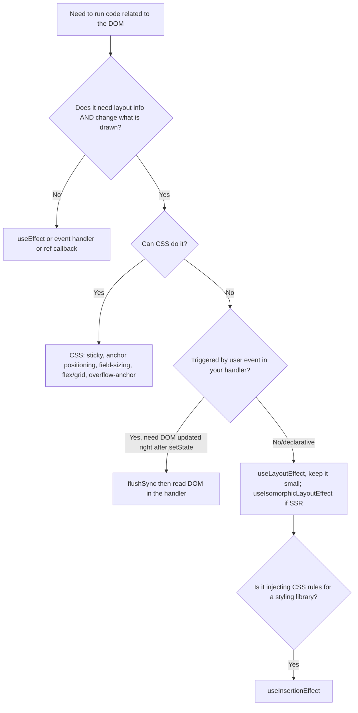
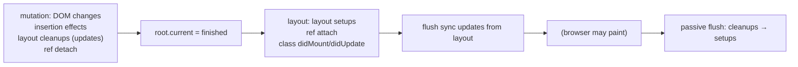

# 02 / 19 — Layout vs Passive Effects

## 1. Lesson metadata

| | |
|---|---|
| **Level** | Advanced |
| **Study time** | 5–6 hours (reading 2 h, experiments 1.5 h, exercises 2 h) |
| **Prerequisites** | [11 — Render phase vs commit phase](./11-render-phase-and-commit-phase.md), [17 — How hooks attach to Fiber](./17-hooks-and-fiber-state.md), [18 — Effects and their timing](./18-effects-and-their-timing.md), [00/03 — Browser rendering pipeline](../00-web-and-javascript-foundations/03-browser-rendering-pipeline.md), [00/04 — DOM structure and mutation](../00-web-and-javascript-foundations/04-dom-structure-and-mutation.md) |
| **Next** | [20 — Commit work and DOM mutations](./20-commit-and-dom-mutation.md) |
| **Related** | [21 — Browser paint and React updates](./21-browser-paint-and-react-updates.md), [Phase 3/08 — `useLayoutEffect`](../03-react-state-and-hooks/08-uselayouteffect.md), [Phase 3/09 — `useInsertionEffect`](../03-react-state-and-hooks/09-useinsertioneffect.md), [Phase 9/01 — SPA, SSR, SSG, streaming](../09-advanced-rendering-and-ecosystem/01-spa-ssr-ssg-streaming.md) |

**Learning objectives.** After this lesson you can:
1. State precisely where layout effects, insertion effects, ref attachment and passive effects sit in the commit and relative to browser style/layout/paint.
2. Explain, using the browser pipeline, why a measure-then-adjust pattern flickers with `useEffect` and not with `useLayoutEffect`.
3. Explain why `setState` inside a layout effect yields two React renders but one browser paint, and what it costs.
4. Choose between `useEffect`, `useLayoutEffect`, `useInsertionEffect`, ref callbacks, `flushSync`, CSS-only solutions and `useSyncExternalStore` for a given DOM-timing problem.
5. Write correct layout-effect code for tooltips/popovers, auto-sizing, scroll anchoring and FLIP-style animations, and keep it cheap.
6. Handle server rendering/hydration correctly for layout-dependent code.
7. Diagnose flicker, layout shift, forced synchronous layout, and "layout effect makes interactions slow" with DevTools.

**Concepts covered:** pre-paint vs post-paint execution, synchronous re-render before paint, forced synchronous layout (layout thrashing), `getBoundingClientRect`/`scrollHeight` reads, insertion effects for CSS-in-JS, ref attachment timing, class lifecycle equivalence (`componentDidMount`/`DidUpdate` ≈ layout), SSR/hydration and `useLayoutEffect`, isomorphic layout effect, priority of updates scheduled from each effect kind, `flushSync`, measuring and budgets.

> **Version-sensitive.** The *public* contract (layout effects run synchronously after DOM mutation before paint; passive effects run later and may run before or after paint) is stable. Which lane an update scheduled *inside* an effect gets, the exact traversal order, the SSR warning behavior and hidden-subtree (Suspense/`Activity`) handling of layout effects changed across 17/18/19. Checked on 2026-10-22 against <https://react.dev/reference/react/useLayoutEffect>, <https://react.dev/reference/react/useInsertionEffect>, the source in <https://github.com/facebook/react> (`ReactFiberCommitWork`) and by execution on React 19.3.1. Internal function names here are given conceptually.

---

## 2. Deep conceptual explanation

### 2.1 What problem is this lesson solving?

[18](./18-effects-and-their-timing.md) established that `useEffect` runs *after* the commit, typically after paint. That is exactly right for most side effects: subscribing, logging, fetching — the user should see the update ASAP and background work can follow. But some work must run **after React has changed the DOM and before the browser draws it**, because the work *depends on* layout (sizes, positions, scroll offsets) and *affects* what should be drawn:

- Position a tooltip next to its anchor using the tooltip's measured size.
- Auto-grow a `<textarea>` to its content height.
- Restore a scroll position after prepending content.
- Choose between rendering a horizontal menu or an overflow "More…" button by measuring available width.
- Start a FLIP animation from the element's previous box to its new box.

If these ran after paint the user would see one intermediate frame of wrong layout: **flicker**. `useLayoutEffect` exists to run measure/adjust code before the browser paints. This lesson explains how it works, what it costs, and when it is *not* the answer.

### 2.2 The three effect hooks and one ref mechanism, side by side

| Mechanism | When it runs (within commit / after) | Can read layout of the *new* DOM? | Blocks paint? | Can call `setState`? | Typical use |
|---|---|---|---|---|---|
| **`useInsertionEffect`** | During the **mutation** phase, before layout effects and before refs/layout reads are meaningful | No (DOM for this commit may not be complete) | Yes (sync) | No (cannot schedule updates; warns) | Injecting `<style>` rules for CSS-in-JS libraries |
| **Ref callback** (attach/detach) | **Layout** phase (attach) / mutation phase (detach) | Yes, element exists | Yes (sync) | Allowed but discouraged | Capturing a node; observers tied to an element's lifetime |
| **`useLayoutEffect`** | **Layout** phase: synchronously after all DOM mutations of the commit, before the browser paints | **Yes** | **Yes** | Yes → processed synchronously before paint | Measure-then-adjust, scroll/focus restoration |
| **`useEffect`** | **After** commit (flush may be before or after paint) | Yes | No by design (but see [18 §3.4](./18-effects-and-their-timing.md)) | Yes → new render, not before this paint (generally) | Subscriptions, logging, fetch, non-visual sync |

### 2.3 The browser pipeline recap and where each sits

From [00/03](../00-web-and-javascript-foundations/03-browser-rendering-pipeline.md) the browser (when a rendering opportunity occurs) runs: *rAF callbacks → style recalculation → layout → paint (record) → composite*. React's commit mutates the DOM synchronously inside one task. DOM mutation only marks style/layout as *dirty*; actual recomputation is lazy. Two things force it earlier:

1. A **layout read** (`getBoundingClientRect`, `offsetHeight`, `scrollHeight`, `getComputedStyle(...)` of layout-dependent properties) *forces synchronous layout*: the browser flushes pending style/layout now to return a correct value.
2. The rendering opportunity itself.

```mermaid
sequenceDiagram
  participant R as React commit (one task)
  participant D as DOM (dirty flags)
  participant L as Layout engine
  participant P as Paint
  R->>D: mutation phase: insert/update nodes (marks dirty)
  R->>R: layout phase: useLayoutEffect setup runs
  R->>L: effect calls getBoundingClientRect() → forced synchronous layout
  L-->>R: accurate rect
  R->>D: effect calls setState → React re-renders & re-commits synchronously (before returning)
  Note over R,D: still the same task; no paint yet
  R-->>P: task ends → browser rendering opportunity
  P->>P: style, layout (again if dirty), paint ONE final frame
```

What the user sees is only the **final** DOM state at the end of the task. That is why "two renders, one paint" is correct for layout effects: the intermediate DOM is never painted.

### 2.4 Why `useEffect` flickers for measure-and-adjust

With `useEffect`, after the first commit (with the unadjusted position) the task can end and the browser may paint the unadjusted frame (default-lane updates and non-discrete events). Then the effect runs, measures, calls `setState(adjusted)`, React re-renders in a *new* task, and a second frame paints the adjusted layout. Result: one frame in the wrong place — visible as a jump.

**Nuance (important and often misunderstood).** For a **discrete event** such as a click, React flushes passive effects synchronously at the end of commit ([11 §2.6](./11-render-phase-and-commit-phase.md), [18 §3.4](./18-effects-and-their-timing.md)). So the effect *runs* before paint. But a `setState` called **inside a passive effect** is scheduled with at most default priority (React lowers the priority of updates scheduled from passive effects: `lowerEventPriority(DefaultEventPriority, renderPriority)` in `flushPassiveEffects`, verified in source; react.dev's `useEffect` page says the same: "React may allow the browser to repaint the screen before processing the state updates inside your Effect"), so the re-render triggered by the effect is scheduled as a *separate task*, and the browser may paint in between. Consequence: **do not assume `useEffect` after a click is safe for visual adjustments**; it sometimes looks fine in development and flickers on slower machines. Layout effect `setState`s, by contrast, are processed synchronously before the commit returns — a guarantee, not an optimization.

### 2.5 `setState` in a layout effect: what exactly happens

1. Commit runs layout effects; one calls `setPos(measured)`.
2. React marks the update as **sync lane** (updates scheduled during the layout phase are processed synchronously at the end of the commit; React flushes the "sync callback queue" before yielding to the browser).
3. React immediately renders and commits again (another full render+commit — it may re-run layout effects and cleanups for components affected).
4. Only then does the task end; paint happens once.

Costs: the render work is paid *twice* before the first paint — so the latency to first paint = render₁ + commit₁ + layout effects + render₂ + commit₂. For small trees that's microseconds; for a large tree re-rendered by a layout-effect `setState` it is a long blocking task. Mitigation: keep the state change local to a small component (position of a tooltip), not the whole page.

### 2.6 Class lifecycle equivalence (and why porting classes to `useEffect` flickered)

`componentDidMount` / `componentDidUpdate` ran synchronously in the layout phase, *before paint*. Porting them naïvely to `useEffect` changed timing from before-paint to after-paint, which is why early hooks adopters saw flicker bugs and the docs said "`useLayoutEffect` fires in the same phase as `componentDidMount` and `componentDidUpdate`". The reverse port (everything to layout effects) causes slower paints. Match the *need*, not the old lifecycle name ([01/17](../01-react-fundamentals/17-lifecycle-concepts.md)).

### 2.7 Misconceptions

| Misconception | Reality |
|---|---|
| "`useLayoutEffect` runs before render." | It runs after React mutated the DOM (commit), before the browser paints. |
| "`useLayoutEffect` makes things faster." | It makes things *consistent* (no intermediate frame). It delays paint by the effect's duration; it is never faster than `useEffect` for first paint. |
| "Two `setState`s (one in layout effect) cause two paints." | Two renders/commits, one paint, because the second render completes synchronously before the browser gets control. |
| "Use `useLayoutEffect` for anything DOM-related." | Only when you must *read layout and write something that changes what's drawn* before paint. Most DOM work (add listener, focus on mount [debatable], start observer) is fine in `useEffect`. |
| "`useEffect` always runs after paint." | Not guaranteed ([18](./18-effects-and-their-timing.md)). |
| "Layout effects don't run on the server, so it's safe in SSR." | They don't run, but older versions warned; and your first server HTML has no layout adjustments, so the client must be able to correct it (flash at hydration). |
| "Reading `offsetHeight` in an effect is free." | It forces synchronous layout; free only if layout was going to be needed anyway before paint (it will be, but repeated read/write cycles thrash). |
| "`useInsertionEffect` is just an earlier layout effect." | It's for style injection only: runs before layout reads are valid, cannot update state, refs are not attached. |
| "`flushSync` and `useLayoutEffect` do the same." | `flushSync` is called *by you* in an event handler to force the DOM to be up-to-date *right after the call*; `useLayoutEffect` is declarative per component. They compose. |
| "Layout effects fire when layout changes." | They fire when React *commits* and the effect's deps changed — not on browser resize/reflow. Use `ResizeObserver` for external size changes. |

---

## 3. Internal mechanics

### 3.1 Public guarantees

1. `useLayoutEffect` callbacks run synchronously after React has performed all DOM mutations of the commit and before the browser paints.
2. `setState` calls inside layout effects (and in `componentDidMount`/`DidUpdate`) are processed synchronously, before the browser paints.
3. `useLayoutEffect` cleanup runs before the next layout setup and on unmount; React runs layout cleanups for a commit before running its layout setups.
4. Refs are attached before layout effects of the *same* commit run for ancestors that own those refs (children are finished first).
5. On the server, layout effects do not run (and in versions before React 19 there was a warning; check current behavior).
6. `useInsertionEffect` runs before any DOM reads from layout effects and cannot schedule updates.

### 3.2 Teaching model of the commit with all effect kinds

```text
commit(finishedWork):
  [before mutation]  getSnapshotBeforeUpdate (class) — legacy
  [mutation]         for each fiber (children first):
                       deletions: detach refs, layout cleanups, remove DOM
                       placements/updates: DOM mutations
                       function components: insertion effect cleanup+setup,
                                            layout effect CLEANUP (update case)
  root.current = finishedWork
  [layout]           for each fiber (children first):
                       function components: layout effect SETUP
                       class: componentDidMount/Update
                       host components: attach refs
  flush any sync updates scheduled in layout (re-render + re-commit)
  schedule passive effects (or flush now for discrete-event commits)
→ browser paint opportunity
→ passive flush: all cleanups, then all setups
```

### 3.3 Implementation details

- Effect kinds share one record structure with a **tag** bitmask: `Insertion`, `Layout`, `Passive`, plus `HasEffect`. `commitHookEffectListUnmount(tag)`/`commitHookEffectListMount(tag)` iterate the fiber's circular effect list and run the ones matching the tag.
- **Layout effect cleanups for updated components run in the mutation phase**, interleaved with DOM mutation traversal (so a cleanup of a layout effect may observe a DOM partially mutated by siblings/children processed earlier). Rule: cleanups should not rely on reading the *old* layout; if you need a pre-mutation snapshot of layout, capture it earlier (an event handler, `ResizeObserver`, scroll listener) or use `flushSync` to read the DOM before changing state, then act after. This is the "no `getSnapshotBeforeUpdate` for function components" gap.
- **Sync flush after layout.** After the layout phase, `flushSyncCallbacks`-style logic runs, so updates scheduled during layout are rendered before returning to the browser. The nested-update limit (a counter of consecutive layout-phase updates; `NESTED_UPDATE_LIMIT = 50` in `ReactFiberWorkLoop`; verified by execution: an unconditional layout-effect `setState` throws "Maximum update depth exceeded") throws "Maximum update depth exceeded" to prevent infinite synchronous loops.
- **Priority of updates from effects.** In `flushPassiveEffects`, React sets the current update priority to the lower of the render's priority and default priority, so `setState` inside a `useEffect` is not treated as sync. Updates from layout effects run in the commit's own priority context (sync for discrete).
- **Hidden trees.** When Suspense hides already-visible content (to show a fallback) React runs the *layout* effect cleanups of the hidden subtree and re-runs setups when revealed, while passive effects remain (verified on 19.3.1: the layout cleanup ran when the fallback hid the content and the layout setup re-ran on reveal, while passive effects were untouched; with `<Activity mode="hidden">` both kinds are cleaned up and re-run on show). Treat "effects clean up when UI hides" as a design constraint.
- **SSR.** `react-dom/server` ignores effects. Older versions warned about `useLayoutEffect` on the server because the first paint (server HTML) cannot include its adjustments; the warning was removed in React 19 (verified: `renderToString` on 19.3.1 logs nothing).
- **Dev double invocation.** Strict Mode re-runs layout effects as part of the mount simulation ([28](./28-strict-mode-behavior.md)).

### 3.4 Forced synchronous layout and thrashing

`getBoundingClientRect()` after a DOM write asks the browser to flush style and layout *now*. This is a "forced synchronous layout". In a single layout effect that's cheap if it happens once: the browser must do layout before paint anyway; computing it earlier costs nothing extra **if nothing dirties layout afterward**. The expensive pattern:

```text
for each of 200 items: read height (forces layout) → write style (dirties) → next item read (forces layout again)
```

→ 200 layouts. Fix: batch reads, then batch writes. In React terms: don't loop `useLayoutEffect` per row doing read-write; measure all in one effect (or one parent effect) and write once, or restructure with CSS.

Even the "good" layout-effect pattern pays an extra layout: effect reads (layout #1), `setState` changes DOM (dirties), the browser layouts again before paint (layout #2). Budget ≈ 2 layouts per frame for that pattern; fine for a tooltip, painful for a 5,000-node table.

### 3.5 Ordering between layout effect, ref callback and children

Within the layout phase, traversal is children-first. For this tree:

```tsx
<Parent>            // useLayoutEffect P
  <Child ref=…>     // useLayoutEffect C, host <div> with ref
```

Order: host `<div>` ref attached (as the host fiber is a descendant visited first) → `Child`'s layout setup (C) → `Parent`'s layout setup (P). So in `Parent`'s layout effect, refs and DOM of the whole subtree are ready, which is why parents can measure children but children cannot assume the parent's *own* effects have run.

---

## 4. Step-by-step execution walkthrough

### 4.1 Tooltip placement: passive vs layout (timeline, scenario with hover)

Component: `<Tooltip anchorRef content>` renders a `<div role="tooltip" style={{ top, left }}>`. Initial position `{top: 0, left: 0}`; an effect measures the anchor and the tooltip and sets the final position. Triggered by `onMouseEnter` on the anchor (a continuous-priority event in React; not flushed synchronously).

**With `useEffect`:**

| Step | Task | What happens | DOM / screen |
|---|---|---|---|
| 1 | Task 1 (mouseenter handler) | `setOpen(true)` | — |
| 2 | Task 1 end (React work) | Render: `Tooltip` rendered with `pos = {0,0}`; Commit: tooltip `<div>` inserted at `top:0,left:0`. Passive effect **scheduled** (continuous-priority commit). | DOM has tooltip at (0,0), not yet painted |
| 3 | Browser rendering opportunity | Style → layout → **paint**: tooltip drawn at the top-left corner | **Frame A: user sees tooltip in the wrong place** |
| 4 | Task 2 (Scheduler) | Passive flush: effect measures, `setPos({top: 120, left: 340})` | — |
| 5 | Task 2/3 | Render + commit: style updated | DOM updated |
| 6 | Next rendering opportunity | Paint | **Frame B: tooltip jumps to the right place** |

**With `useLayoutEffect`:**

| Step | Task | What happens | DOM / screen |
|---|---|---|---|
| 1 | Task 1 | `setOpen(true)` | — |
| 2 | Task 1 end | Render #1 (`pos` 0,0); Commit #1: insert tooltip; **layout phase**: effect measures (forced sync layout), `setPos(final)` | DOM (0,0) → no paint yet |
| 3 | Same task | React processes the sync update: Render #2, Commit #2: style updated to final; layout effect re-runs only if deps changed | DOM at final position |
| 4 | Browser rendering opportunity | Paint | **Frame A is the final position; no flicker** |

Counts: React renders: 2 for both variants; commits: 2 for both; **paints that include the tooltip:** `useEffect`: 2 (wrong, then right); `useLayoutEffect`: 1. Time to first paint is *longer* in the layout version by render₂+commit₂+measure, a few hundred microseconds here.

### 4.2 Same component, triggered by a click (discrete)

Click handler `setOpen(true)` (sync lane). After commit #1, passive effects flush **synchronously** at the end of commit (before paint). The effect measures and calls `setPos(final)`. That update is scheduled with default-or-lower priority (verified in source and by execution), so the second render happens in another task. Therefore the browser **may** paint between: flicker is *possible* even for clicks. In practice, many apps get "lucky" and don't see it when the task boundary resolves with no paint opportunity in between. Don't rely on luck.

### 4.3 Auto-growing textarea (typing)

Typing is a discrete event. With `useLayoutEffect(() => { el.style.height = "auto"; el.style.height = el.scrollHeight + "px"; }, [value])`:

1. Keystroke → `setValue` (sync lane) → render → commit (DOM textarea `value` updated).
2. Layout effect runs: set `height: auto` (dirties layout), read `scrollHeight` (**forces layout**), set `height` (dirties layout). Direct DOM mutation (no React state), so no second React render.
3. Paint once with the correct height.

With `useEffect` the same code runs before paint for a discrete event (synchronous flush) and works — but because there is no React state set, the *only* risk is a non-discrete trigger (e.g., value set programmatically from a timer) where the effect runs after paint and the height snaps afterward.

Note this variant mutates the DOM *directly* in the effect instead of via state. It's legitimate for "imperative adjustments of an element React doesn't track" (height here isn't in React's `style` prop). It becomes a problem if React also manages `style.height`: the next render may overwrite it ([20](./20-commit-and-dom-mutation.md)).

### 4.4 Unmount and cleanup order

On unmount of a component with both kinds: layout cleanups run in the mutation phase (before the DOM node is removed or as part of its removal), passive cleanups run later in the passive flush. So a *layout* cleanup can still touch the DOM node (verified on 19.3.1: in a layout cleanup during unmount `ref.current` was still the node and `isConnected` was `true`), while a *passive* cleanup runs after the node is gone from the document: reading `ref.current` in a passive cleanup is `null` (verified on 19.3.1). Capture the node in a local variable during setup if cleanup needs it:

```tsx
useEffect(() => {
  const el = ref.current;           // captured now; cleanup uses `el`, not ref.current
  if (!el) return;
  const ro = new ResizeObserver(onResize);
  ro.observe(el);
  return () => ro.disconnect();
}, []);
```

---

## 5. Code examples

### 5.1 Minimal example — make the flicker visible

```tsx
import { useEffect, useLayoutEffect, useRef, useState } from "react";

function Box({ useLayout }: { useLayout: boolean }) {
  const ref = useRef<HTMLDivElement>(null);
  const [width, setWidth] = useState(0);
  const useIt = useLayout ? useLayoutEffect : useEffect;   // constant per component type, see note

  useIt(() => {
    const el = ref.current;
    if (el) setWidth(el.getBoundingClientRect().width);
  }, []);

  return (
    <div ref={ref} style={{ resize: "horizontal", overflow: "auto", width: 200, border: "1px solid" }}>
      measured width: {width}
    </div>
  );
}
```

Note: choosing a hook with a ternary like `useIt` is allowed *only because* `useLayout` never changes for a given mounted component (if it flipped, hook identity/order would change). Prefer two components in real code.

**Predict:** mount the component via a `setTimeout` (so it's a default-lane commit). With `useEffect`, what text does the first painted frame show? With `useLayoutEffect`?

**Result:** `useEffect`: first frame shows `measured width: 0`, then a frame later `202` (a one-frame flash; use CPU throttling and the Performance panel's screenshots to see it). `useLayoutEffect`: first frame shows `measured width: 202` (border included in `getBoundingClientRect`; content-box 200 + 2px border), no flash. Both variants end at 202, not 200, because `getBoundingClientRect` includes the border (default `content-box` sizing: 200 content + 2 × 1px border). (jsdom has no layout engine, so this number was derived from the CSS box model, not measured by execution.)

**Why:** [§4.1]. **Trade-off:** `useLayoutEffect` delays first paint by the extra render.

### 5.2 Practical example — a popover that positions itself and flips

```tsx
import { useLayoutEffect, useRef, useState, type ReactNode, type RefObject } from "react";

interface Position { top: number; left: number; placement: "bottom" | "top" }

export function Popover({
  anchorRef,
  open,
  children,
}: {
  anchorRef: RefObject<HTMLElement | null>;
  open: boolean;
  children: ReactNode;
}) {
  const popRef = useRef<HTMLDivElement>(null);
  const [pos, setPos] = useState<Position | null>(null);

  useLayoutEffect(() => {
    if (!open) { setPos(null); return; }
    const anchor = anchorRef.current;
    const pop = popRef.current;
    if (!anchor || !pop) return;

    // READS first (single forced layout)
    const a = anchor.getBoundingClientRect();
    const p = pop.getBoundingClientRect();
    const vh = document.documentElement.clientHeight;
    const vw = document.documentElement.clientWidth;

    // compute (pure)
    const placement: Position["placement"] = a.bottom + p.height > vh && a.top - p.height > 0 ? "top" : "bottom";
    const top = (placement === "bottom" ? a.bottom : a.top - p.height) + window.scrollY;
    const left = Math.min(Math.max(a.left, 8), vw - p.width - 8) + window.scrollX;

    // WRITE once, via state
    setPos((prev) =>
      prev && prev.top === top && prev.left === left && prev.placement === placement ? prev : { top, left, placement },
    );
  }, [open, anchorRef]);

  if (!open) return null;
  return (
    <div
      ref={popRef}
      role="dialog"
      style={{
        position: "absolute",
        top: pos?.top ?? 0,
        left: pos?.left ?? 0,
        visibility: pos ? "visible" : "hidden",     // avoid showing the unpositioned first commit even if effect timing slips
      }}
    >
      {children}
    </div>
  );
}
```

**Line notes.**
- Reads before computing, one write (`setPos`) — one forced layout.
- The functional `setPos` returns `prev` when unchanged so React bails out and no second render occurs when positions are stable (important: the effect runs again if `open`/`anchorRef` change only).
- `visibility: hidden` until measured: a belt-and-braces pattern that protects against the effect timing assumption (e.g., if someone changes it to `useEffect`, you get delayed show, not a flash in the wrong place). It keeps layout space (unlike `display: none`, which would make the measurement zero).
- Does not react to window resize or content-size changes: add `ResizeObserver`/`resize` listeners that call the same measure function (an *external* trigger, so it belongs in a `useEffect` that subscribes and, on events, sets state).
- Accessibility: focus management, `aria-*` linking and Escape handling are separate concerns; in production use a primitive from a headless library ([Phase 5/07](../05-design-patterns/07-headless-components.md)) or the native Popover API / CSS anchor positioning where supported *(check browser support at time of use)*.

**Trade-offs:** a layout effect plus a state update means two renders for each open; scope them to this component (they are) so cost stays tiny.

### 5.3 Incorrect example — layout effect as a general-purpose "run early" tool

```tsx
function Page({ id }: { id: string }) {
  const [data, setData] = useState<Data | null>(null);

  useLayoutEffect(() => {                     // BUG: network + heavy work blocks paint
    fetch(`/api/data/${id}`).then((r) => r.json()).then(setData);
    expensiveSynchronousIndexBuild(window.__BIG_TABLE__);   // 120 ms of CPU
  }, [id]);

  return <Table data={data} />;
}
```

**Predict:** What does the user perceive on navigation to this page?

**Result:** The browser cannot paint the new page's initial UI until the 120 ms synchronous work completes (it's inside the commit task). The fetch itself isn't blocking (async), but starting it earlier doesn't help meaningfully (it starts 120 ms before paint instead of after, a small gain at the cost of a visible freeze). Layout effects run on the critical path; INP/LCP get worse.

**Why wrong:** nothing here depends on layout or affects what's drawn. `useLayoutEffect` is for *visual consistency*, not "earlier".

### 5.4 Corrected implementation

```tsx
function Page({ id }: { id: string }) {
  const [data, setData] = useState<Data | null>(null);

  useEffect(() => {
    const controller = new AbortController();
    fetch(`/api/data/${id}`, { signal: controller.signal })
      .then((r) => r.json() as Promise<Data>)
      .then(setData)
      .catch(() => { /* aborted or failed: handle in real code */ });
    return () => controller.abort();
  }, [id]);

  const index = useMemo(() => buildIndex(window.__BIG_TABLE__), []);   // or move to a worker
  return <Table data={data} index={index} />;
}
```

Better still: move the heavy index to a worker or build it lazily in idle time; and fetch through the framework/data layer (see [18 §5.4](./18-effects-and-their-timing.md), [Phase 6](../06-data-fetching-and-state-ecosystems/08-tanstack-query.md)). Note `useMemo` runs in render (blocking too); it only avoids repeating the cost.

### 5.5 Advanced example — scroll anchoring when prepending items, with SSR-safe layout effect

```tsx
import { useEffect, useLayoutEffect, useRef, type ReactNode } from "react";

/** No-op on the server; layout effect in the browser. Avoids server warnings in versions that emit them. */
const useIsomorphicLayoutEffect = typeof window !== "undefined" ? useLayoutEffect : useEffect;

interface Message { id: string; text: string }

export function MessageList({ messages }: { messages: readonly Message[] }): ReactNode {
  const scrollerRef = useRef<HTMLDivElement>(null);
  const distanceFromBottom = useRef(0);         // updated by scroll events (outside render)
  const firstIdRef = useRef<string | undefined>(undefined);

  const onScroll = () => {
    const el = scrollerRef.current;
    if (el) distanceFromBottom.current = el.scrollHeight - el.clientHeight - el.scrollTop;
  };

  useIsomorphicLayoutEffect(() => {
    const el = scrollerRef.current;
    if (!el) return;
    const firstId = messages[0]?.id;
    const prepended = firstIdRef.current !== undefined && firstId !== firstIdRef.current;
    firstIdRef.current = firstId;
    if (prepended) {
      // Older messages were added at the top: keep the viewport anchored to the same content.
      el.scrollTop = el.scrollHeight - el.clientHeight - distanceFromBottom.current;
    }
  }, [messages]);

  return (
    <div ref={scrollerRef} onScroll={onScroll} style={{ height: 400, overflowY: "auto" }}>
      {messages.map((m) => <p key={m.id}>{m.text}</p>)}
    </div>
  );
}
```

**Line notes.**
- The `distanceFromBottom` is captured by the scroll handler *before* the content grows — solving the "no snapshot-before-update for function components" gap (§3.3). Reading `scrollHeight` in render would be an impure DOM read that may be stale.
- `typeof window !== "undefined"` is a module-level constant, so hook identity is stable per environment (safe under the Rules of Hooks).
- Writing `scrollTop` directly (not state) avoids a second React render; the browser applies scroll position before the paint because we're in the same task.
- Edge cases: images loading later change `scrollHeight` (use `ResizeObserver` or fixed aspect ratios); the browser's native **scroll anchoring** (`overflow-anchor`) already handles many prepend cases in Chromium/Firefox — test before adding code (support differs; Safari historically lacked it; check MDN). The layout-effect solution is the portable fallback.
- Strict Mode: effect runs twice on mount; `firstIdRef` logic is idempotent.

**Trade-off:** more code than CSS; prefer CSS (`overflow-anchor`, `flex-direction: column-reverse` for chat) when it satisfies requirements — see §7.

### 5.6 Insertion effect (for library authors; know it, rarely write it)

```tsx
import { useInsertionEffect } from "react";

const injected = new Set<string>();

export function useStyleRule(id: string, css: string): void {
  useInsertionEffect(() => {
    if (injected.has(id)) return;
    injected.add(id);
    const style = document.createElement("style");
    style.dataset.rule = id;
    style.textContent = css;
    document.head.appendChild(style);
  });
}
```

**Why insertion effect:** CSS-in-JS libraries must insert `<style>` rules **before** layout effects (and before layout reads) so measurements see the right styles; doing it in render is impure (render may be discarded, leaving rules), doing it in a layout effect is too late for sibling layout reads. Constraints: cannot call `setState`, refs aren't attached, do not read layout. For application code, prefer static CSS, CSS Modules, or a library that already handles this ([Phase 3/09](../03-react-state-and-hooks/09-useinsertioneffect.md)). Cleanup of injected rules and SSR style extraction are the hard parts; this snippet omits both.

---

## 6. Visual explanations

### 6.1 Frame timeline: three strategies

```text
Strategy A: useEffect, non-discrete trigger
|task: render+commit (pos 0,0)|  paint(A: wrong) |task: passive effect→setPos|task: render+commit|paint(B: right)|

Strategy B: useLayoutEffect
|task: render+commit(0,0) → layout effect measure → setPos → render+commit(final)| paint (right) |

Strategy C: derive without measuring (CSS / known size)
|task: render+commit(final)| paint (right) |
```

### 6.2 Decision tree



### 6.3 Commit with all hooks



---

## 7. Alternative approaches and trade-offs

For "measure and adjust" problems:

| Approach | Flicker-free | Main-thread cost | Complexity | SSR/hydration | Maintainability | Best when |
|---|---|---|---|---|---|---|
| **Pure CSS** (sticky, grid/flex, `overflow-anchor`, CSS anchor positioning, `field-sizing: content`) | Yes | Lowest (browser-native) | Low | Excellent | High | Supported layout can be expressed declaratively; check browser support |
| **`useLayoutEffect` + state** | Yes | Medium (extra render + forced layout) | Medium | Needs two-pass/hidden-until-measured | Medium | Dynamic measurements React must know about |
| **`useLayoutEffect` + direct DOM write** | Yes | Low (no re-render) | Medium | Needs care | Medium–Low (React may overwrite) | Imperative one-off adjustments (textarea height, scroll) |
| **`useEffect` + state** | **No** (flash possible) | Low | Low | Fine | High | Non-visual sync or when flash is acceptable |
| **`ResizeObserver` callback** | After layout, before next paint (RO runs in the rendering steps, before paint) | Low | Medium | Fine | Medium | Reacting to *external* size changes |
| **`flushSync` + read in handler** | Yes | High if overused | Low | n/a | Low–Medium | Needing updated DOM synchronously inside an event handler (e.g., scroll into view new item) |
| **Render twice deliberately** (first render hidden/measuring offscreen) | Yes | High | High | Complex | Low | Virtualized lists with unknown row heights (library territory) |
| **Library primitive** (Floating UI, Radix, react-aria) | Yes | Optimized | Low for you | Handled | High | Overlays, tooltips, popovers: don't hand-roll |

**Scenario where `useLayoutEffect` is NOT the best choice:** an auto-height textarea — modern CSS `field-sizing: content` (where supported) removes JS entirely. **Scenario where `useEffect` is better despite a visible layout dependency:** analytics reporting of element visibility; a one-frame delay is irrelevant, and delaying paint is harmful. **Scenario where nothing helps:** layout depends on async data (fonts, images): reserve space (`aspect-ratio`, `font-display`, explicit sizes) to avoid shifts ([21](./21-browser-paint-and-react-updates.md), Core Web Vitals CLS in [Phase 7/21](../07-performance/21-web-vitals-and-budgets.md)).

---

## 8. Best practices and anti-patterns

**Do**
- Default to `useEffect`. Reach for `useLayoutEffect` when you can name the *visible glitch* it prevents and verify it in a trace.
- Keep layout effects tiny: read, compute, write once. No network, no heavy loops.
- Batch reads before writes; avoid read-after-write in loops.
- Hide-until-measured (`visibility: hidden`) as defense-in-depth for overlays.
- Capture nodes in locals for cleanups; don't read `ref.current` in cleanup.
- Use `useIsomorphicLayoutEffect` in shared libraries that render on the server.
- Prefer library primitives for overlays.

**Beginner mistakes**
- Using `useLayoutEffect` "to be safe".
- Calling `setState` in a layout effect on every render without equality guards (infinite synchronous loop → "Maximum update depth exceeded").
- Measuring in render (`ref.current?.offsetWidth` in the function body).

**Experienced-developer mistakes**
- Layout effects in list items (1,000 rows × forced layout).
- Writing DOM properties React also controls (`style.height`), then fighting reconciliation.
- Forgetting that window resize / content changes don't re-run the effect.
- Assuming effect after click is flicker-free because "passive effects flush synchronously for clicks".
- Putting data fetching in layout effects.

**Smells:** a layout effect with an empty body except `setState(measure())` in a component rendered in large lists; `useLayoutEffect` imports in files that run on the server without a guard; `requestAnimationFrame` inside a layout effect to "wait for layout" (usually means you wanted a `ResizeObserver` or you don't need to wait).

**Justified exceptions**
- A layout effect that updates a ref/imperative value (no state) for a *global* behavior like focus trapping is acceptable even if not strictly visual — if it must happen before the next paint to avoid focus flashes.
- Two-pass layout in design-system primitives where measuring is the only way.

---

## 9. Real-world application

**Design system overlays (multi-team).** One `Popover` primitive serves 300 usages. A flicker fix in the primitive (layout effect + hidden-until-measured) benefits all teams. Constraints: it must work in SSR (no-op on server), in Strict Mode, with scroll containers, portals, and RTL; accessibility (focus management, `aria-expanded`). Governance: document that overlays are built from the primitive, with a lint rule against custom `getBoundingClientRect` effects.

**Data grid with sticky columns and measured widths.** Column widths computed from header cells; recomputation on every data update would thrash layout if done per cell. Compute once per commit in a *single* layout effect at the grid level, apply via CSS variables on the container (`style.setProperty`), and let cells use `var(--col-3-width)`: one forced layout, zero per-cell React state.

**Rich text / chat UI.** Scroll anchoring on prepend, "stick to bottom" on append when the user is at the bottom; both implemented in a layout effect keyed on messages; measurement of images is the hard part (reserve aspect-ratio boxes). Constraint: virtualization changes the DOM children count; combine with a virtualization library's scroll APIs ([Phase 7/09](../07-performance/09-windowing-and-virtualization.md)).

**Dashboards with animated reorder (FLIP).** Record the old rects before state changes (in the event handler or via `flushSync` + read), then in a layout effect compute new rects, apply inverse transforms, and animate to identity with the Web Animations API. Constraint: animations on `transform`/`opacity` run on the compositor and survive main-thread jank ([00/01](../00-web-and-javascript-foundations/01-how-the-browser-works.md)); keep layout effect work O(visible items).

**Forms.** Focus the first invalid field after a failed submit: do it in an effect after the error state commits (`useEffect` is fine; a one-frame delay in focus is invisible). Scrolling the invalid field into view with smooth scroll: also fine after paint.

---

## 10. Debugging and troubleshooting

**Symptom: "Tooltip/popover appears in the wrong place for a split second."**
1. Record a Performance trace with screenshots at 4× CPU throttle; step through frames.
2. Identify the first frame containing the element. Is it positioned wrongly? Then the position was computed after paint.
3. Check the hook: `useEffect` doing measurement + `setState`? Switch to `useLayoutEffect` and/or hide until measured.
4. Validate: the first frame containing the element is already correct; no layout shift is reported (Layout Shift track / CLS).

**Symptom: "Interaction feels slower after switching to `useLayoutEffect`."**
1. In the trace find the long task containing the commit; open Bottom-Up to see time in your effect and in "Layout" (purple).
2. Check for forced reflow warnings (Performance panel flags "Forced reflow" in the event log) and for read-write-read cycles in loops.
3. Reduce the scope: smaller component owning the state; batch reads; use CSS variables to avoid per-item state.
4. Validate with INP/Event Timing and trace comparison.

**Symptom: "Maximum update depth exceeded" from a layout effect.**
The effect sets state to a new object each time and the effect depends on that state (or no deps). Add an equality guard (`setPos(prev => same ? prev : next)`), narrow deps, or move computation out of state.

**Symptom: "Warning/mismatch about `useLayoutEffect` on the server" (older versions) or hydration mismatch.**
Use the isomorphic pattern; ensure server and first client render produce the same markup (don't branch on `window` in render; set measured state after hydration in the effect); see [26](./26-ssr-and-client-rendering.md), [25](./25-hydration-and-selective-hydration.md).

**Symptom: "Effect cleanup reads `ref.current` and it's `null`."**
Capture the element in a local variable during setup.

**Tooling checklist.** Performance panel (screenshots, Layout/Recalculate Style entries, Forced reflow), Rendering tab → "Layout Shift Regions" and "Paint flashing", React DevTools Profiler (commit count per interaction: layout-effect state updates show as an extra commit), `performance.mark` inside effects.

---

## 11. Exercises

### Level A — Knowledge
A1. In which commit sub-phase do layout effect setups run? Cleanups (update case)?
A2. Why is `useLayoutEffect` + `setState` "two renders but one paint"?
A3. What may `useInsertionEffect` do that `useLayoutEffect` may not, and what may it not do?
A4. Give two reasons `useEffect` is the default.
A5. Why does reading `getBoundingClientRect()` have a performance cost, and when is that cost effectively free?

### Level B — Code comprehension
B1. Order the following for a mount of `Parent > Child`: `Parent` render, `Child` render, `Child` layout setup, `Parent` layout setup, `Child` passive setup, `Parent` passive setup, ref attach on Child's host div, first browser paint (default-lane mount).
B2. In §5.2, the first commit renders the popover hidden at (0,0). Explain why `visibility: hidden` instead of `display: none`, and what breaks if we use `display: none`.
B3. What does this log, and why is it a problem?
```tsx
useLayoutEffect(() => {
  console.log(ref.current?.offsetHeight);
  setCount((c) => c + 1);
});
```
B4. A layout effect with deps `[]` positions a tooltip once. The window is resized. What happens, and what is the fix?

### Level C — Implementation
C1. Implement `useMeasure<T extends HTMLElement>(): [RefObject<T | null>, DOMRect | null]` with a layout effect for the initial measurement and a `ResizeObserver` for updates, SSR-safe.
C2. Implement a `FlipList` hook `useFlip(keys: string[])` that animates items between old and new positions using the Web Animations API with a layout effect. Describe where you record the "first" positions.

### Level D — Debugging
D1. A modal's first frame appears scrolled to the wrong offset, then jumps. Code uses `useEffect(() => { el.scrollTop = saved; }, [])`. Diagnose and fix; consider SSR.
D2. After switching a table's cell component to `useLayoutEffect(() => setW(ref.current!.offsetWidth))`, scrolling is janky. Explain and propose a redesign.
D3. A shared component library warns "useLayoutEffect does nothing on the server" in your SSR logs. What are your options?

### Level E — Architecture and engineering decisions
E1. Your design system must offer `Tooltip`, `Popover`, `Select` and `Combobox`. Decide: build positioning in-house with layout effects, or adopt a library, or rely on native Popover API/CSS anchor positioning. Provide criteria, a recommendation and a migration/verification plan.
E2. Your team wants a lint rule that forbids `useLayoutEffect` outside `packages/ui-primitives`. Evaluate.

### Level F — Expert challenge
F1. Design a measurement-driven "priority+" navigation that shows as many items as fit and collapses the rest into a "More" menu, correct in SSR, without flicker, resilient to font loading and resizing, and cheap in a page with 20 instances. Specify render passes, hooks used, observers, and failure modes.

---

## 12. Detailed answers and explanations

> Attempt the exercises first.

**A1.** Layout setups: **layout** sub-phase (after DOM mutation and the root swap), children first. Layout cleanups for updated components: **mutation** sub-phase (interleaved with DOM mutations); for deleted components also mutation. ([11 §2.5](./11-render-phase-and-commit-phase.md).) Wrong: "cleanups run in the layout phase" (that's setup).

**A2.** Updates scheduled in layout are processed synchronously before the commit call returns to the event loop. So React renders and commits twice in the same task; the browser only gets a rendering opportunity after the task, painting the final DOM. Intermediate DOM is never presented.

**A3.** Insertion effect may run before any layout effects/reads and before DOM-dependent code of this commit sees the DOM — used for injecting `<style>` rules. It may not schedule updates (`setState`), read layout reliably, or use refs (not attached yet). Layout effects can do all of those.

**A4.** (1) It doesn't block paint, so slow work cannot delay visuals; (2) most side effects (subscribe, log, fetch) don't depend on layout. Also: it's the documented recommendation; fewer synchronous commits.

**A5.** It forces the browser to compute style/layout synchronously to return accurate values. The cost is effectively free when layout would have been computed before paint anyway and you do not dirty layout afterwards in a way that requires recomputation (one read pass). It's expensive in read-write-read loops (thrashing) and when the DOM is large.

**B1.** Order: `Parent` render, `Child` render, ref attach (Child's host div; during layout traversal, children first), `Child` layout setup, `Parent` layout setup, first browser paint (typically; default-lane mount), `Child` passive setup, `Parent` passive setup. The placement of ref attach relative to `Child`'s layout setup is by traversal: host child fibers are visited before the component fiber; implementation order, but the guarantee is that refs are attached by the time the owner's layout effects run. Wrong: passive before paint (not guaranteed for mount).

**B2.** `visibility: hidden` keeps the element in layout with its real size, so `getBoundingClientRect()` returns the true width/height; `display: none` makes rect zero (no box), so measured placement is wrong (would place incorrectly and may place at a degenerate position). Use `visibility`, or `opacity: 0`, or position offscreen.

**B3.** Every commit runs the effect (no deps), which sets state, scheduling another render, whose commit re-runs the effect... an infinite synchronous loop: React throws "Maximum update depth exceeded" after ~50 nested layout updates. Log shows the same height many times. Fix: add deps or functional update with guard; here the state is irrelevant to the measurement.

**B4.** Nothing: the effect doesn't re-run on resize, so the tooltip stays at the old position (stale). Fix: also listen to `resize` (and scroll containers) or use `ResizeObserver` on the anchor, calling the same measure function from event callbacks (these run outside React's phases: `setPos` there is a normal update), and clean up the observer.

**C1.**
```tsx
import { useCallback, useEffect, useLayoutEffect, useRef, useState, type RefObject } from "react";

const useIsoLayoutEffect = typeof window !== "undefined" ? useLayoutEffect : useEffect;

export function useMeasure<T extends HTMLElement>(): [RefObject<T | null>, DOMRect | null] {
  const ref = useRef<T>(null);
  const [rect, setRect] = useState<DOMRect | null>(null);

  const update = useCallback(() => {
    const el = ref.current;
    if (!el) return;
    const next = el.getBoundingClientRect();
    setRect((prev) =>
      prev && prev.width === next.width && prev.height === next.height && prev.x === next.x && prev.y === next.y ? prev : next,
    );
  }, []);

  useIsoLayoutEffect(() => { update(); }, [update]);          // initial measure before paint

  useEffect(() => {
    const el = ref.current;
    if (!el || typeof ResizeObserver === "undefined") return;
    const ro = new ResizeObserver(() => update());            // later size changes
    ro.observe(el);
    return () => ro.disconnect();
  }, [update]);

  return [ref, rect];
}
```
Notes: equality guard prevents loops; observer callbacks run before paint in the browser's rendering steps, and their `setState`s (default priority from a non-React event) may render after the next paint (one-frame lag acceptable for resize); `getBoundingClientRect` position (x,y) changes without size change won't fire RO — document that it measures size primarily; SSR: `rect` is `null` on server and first client render, so consumers must render something sensible with `null` (hydration-safe).

**C2.** Sketch: record "first" rects *before* state change — in the event handler that reorders (or in a ref updated on every layout effect run, holding the rects of the *previous commit*, which are the old positions for the next). In the layout effect (keyed on `keys`), measure "last" rects (current commit), compute `dx = first.left - last.left`, `dy = ...`, apply `el.animate([{ transform: `translate(${dx}px, ${dy}px)` }, { transform: "none" }], { duration: 200, easing: "ease-out" })`, then store `last` as next "first". Elements are found via a `Map<string, HTMLElement>` populated by ref callbacks. Edge cases: items added/removed (skip those without both rects), interrupted animations (cancel previous animation before measuring: `getAnimations()`), reduced-motion (`matchMedia("(prefers-reduced-motion: reduce)")`). Cost: O(n) reads then O(n) writes, in that order, once per commit.

**D1.** Effect after paint (for a mounted modal triggered by a non-discrete path or even discrete due to the second render) → frame shows offset 0 then jumps. On SSR/hydration the saved offset may be unknown at first render. Fix: `useLayoutEffect` (or `useIsomorphicLayoutEffect`) to set `scrollTop` before paint; for hydration, ensure content height exists before scrolling (otherwise `scrollTop` clamps); consider `scroll-snap`/CSS or `scrollIntoView` after layout. Validate in trace screenshots.

**D2.** One forced layout per cell (read after write chain across hundreds of cells), plus one React state update per cell → hundreds of extra renders per scroll commit. Redesign: measure once at table level (or let CSS grid handle widths with `table-layout`/`grid-template-columns`), propagate via CSS variables, virtualize rows; avoid per-cell state.

**D3.** Options: (1) use the isomorphic pattern inside the library (`typeof window` check) so the server never sees a layout hook; (2) upgrade React (the warning was removed in React 19); (3) restructure so that the component's server render doesn't need layout (render hidden/neutral); (4) silence is not an option because it hides the legitimate hydration-flash concern. Trade-off of (1): a module-level check can mis-detect in some environments (e.g., SSR with jsdom `window` defined; Electron workers) — document.

**E1. Evaluation criteria:** correctness across browsers (collision, flipping, scroll parents, RTL, iframes), accessibility (focus, roles), maintenance burden, bundle size, browser support horizon, testability, design flexibility. Recommendation: don't hand-roll positioning for four complex primitives; adopt a maintained positioning engine (e.g., Floating UI / Radix primitives) or native Popover API + CSS anchor positioning *where your support matrix allows*, wrapped behind your own component API so implementation can change. Verification plan: visual regression tests on scroll/resize/RTL, Playwright flicker test using screenshot sampling at throttle, performance budget for open interaction (INP). Migration: wrap, deprecate custom, canary teams.

**E2.** Partial merit: centralizing layout-effect usage prevents misuse and perf regressions; but a blanket rule blocks legitimate local needs (scroll anchoring in product code), encourages workarounds (`ref` callbacks with `queueMicrotask`) and bureaucracy. Better: lint rule requiring a justification comment (`// layout-effect: prevents flicker of X`), review checklist, performance budgets, and documentation + primitives for the common cases.

**F1.** Design outline. Render passes: (1) *Server/first render*: render all items with a `data-measuring` attribute and CSS `overflow: hidden; flex-wrap: nowrap` so excess items are clipped; hide the "More" until known (reserve its width). (2) *Layout effect*: measure container width and each item's width (one read pass; cache widths by item key; fonts may change them), compute `visibleCount`, `setVisibleCount` (guarded). (3) *ResizeObserver* on the container updates `visibleCount`; (4) *Font loading*: `document.fonts.ready.then(update)` re-measures. 20 instances: use one shared `ResizeObserver`; measurement is O(items) per instance but no per-item state. SSR: server cannot measure → render all items clipped (CSS handles visual) and hide overflow items with `visibility: hidden` via CSS container queries or `:has` where possible (check browser support); hydrate without mismatch since the first client render equals the server's. Failure modes: font swap alters widths → re-measure; items with dynamic content change → observe items too; infinite loops if "More" width affects container width → treat "More" as fixed reserved space; accessibility: overflow menu must be keyboard-operable, and hidden items must be removed from tab order (`inert`). Alternative: pure CSS with `container-type: inline-size`, wrap + `max-height` trick, or multiple precomputed breakpoints.

---

## 13. Senior engineer interview questions

**Q1. "When do you use `useLayoutEffect` vs `useEffect`?"**
*Strong answer:* Default `useEffect`. Use `useLayoutEffect` when the effect reads layout and synchronously updates something that affects what the next frame draws (position, size, scroll) — preventing a one-frame intermediate. It runs after DOM mutation and before paint, blocks paint, and re-renders synchronously. Keep it tiny. Insertion effect only for CSS-in-JS. Prefer CSS and library primitives when possible.

**Q2. "Why can `useEffect` flicker even when effects 'flush synchronously for clicks'?"**
*Strong answer:* The effect function may run before paint, but `setState` inside it is scheduled at default (or lower) priority and processed in a later task, so the browser can paint in between. Layout-phase updates are flushed synchronously before returning to the browser. The click-sync flush only applies to effect *execution*, not to the render the effect triggers.

**Q3. "What does it cost to measure in a layout effect?"**
*Strong answer:* A forced synchronous layout (cheap if nothing is dirtied afterward, since layout was due anyway), plus possibly a second render+commit and a second layout if you set state; scales with DOM size. Avoid read/write interleaving across many nodes; batch; scope.

**Q4. "How do you handle layout effects with SSR?"**
*Strong answer:* The server never runs them; the server HTML is the unadjusted version and must be acceptable (or hidden until measured). Make the first client render equal the server render for hydration, then adjust in a layout effect. Use an isomorphic hook to avoid server warnings in versions that emit them, or defer to CSS to avoid JS measurement.

**Q5. "How would you detect forced layout and flicker in production?"**
*Strong answer:* Lab: Performance panel "Forced reflow", screenshots strip, CLS regions. Field: CLS and INP via RUM (web-vitals library), Long Animation Frames API (check MDN for current browser availability) attributing script/layout time; add `performance.measure` around critical layout effects behind a sample rate.

**Q6. "A parent needs to know a child's size. Where do you measure?"**
*Strong answer:* In the child via a ref + `ResizeObserver`/layout effect and lift the number up via a callback/state in the parent (or CSS variables) — the parent's layout effect can read child DOM since children's refs are attached before; but updating parent state forces re-rendering the subtree; prefer CSS or localized state when possible.

---

## 14. Further learning resources

| Resource | URL | Covers / why | Level | Study |
|---|---|---|---|---|
| React — `useLayoutEffect` | <https://react.dev/reference/react/useLayoutEffect> | Official semantics, caveats, SSR note, tooltip example | Intermediate | Whole page |
| React — `useInsertionEffect` | <https://react.dev/reference/react/useInsertionEffect> | CSS-in-JS use case and constraints | Advanced | Whole page |
| React — `useEffect` | <https://react.dev/reference/react/useEffect> | Passive timing statements and "my effect runs before paint?" notes | Intermediate | Caveats |
| React — `flushSync` | <https://react.dev/reference/react-dom/flushSync> | Forcing sync updates and DOM reads | Advanced | Whole page |
| React — Manipulating the DOM with Refs | <https://react.dev/learn/manipulating-the-dom-with-refs> | Safe DOM access, `flushSync` with scrollIntoView | Intermediate | Whole page |
| MDN — Element.getBoundingClientRect | <https://developer.mozilla.org/en-US/docs/Web/API/Element/getBoundingClientRect> | Geometry semantics, borders | Beginner–Int. | Whole page |
| MDN — ResizeObserver | <https://developer.mozilla.org/en-US/docs/Web/API/ResizeObserver> | External size change detection | Intermediate | Whole page |
| MDN — Web Animations API (`Element.animate`) | <https://developer.mozilla.org/en-US/docs/Web/API/Element/animate> | Animating FLIP transitions | Intermediate | Whole page |
| web.dev — Avoid large, complex layouts and layout thrashing | <https://web.dev/articles/avoid-large-complex-layouts-and-layout-thrashing> | Forced synchronous layout | Intermediate | Whole page |
| Paul Irish — "What forces layout/reflow" (gist) | <https://gist.github.com/paulirish/5d52fb081b3570c81e3a> | List of layout-forcing APIs | Intermediate | Whole list |
| React source | <https://github.com/facebook/react> | `ReactFiberCommitWork` for layout/insertion/passive ordering | Advanced | Search "flushLayoutEffects" / "commitLayoutEffectOnFiber" |

---

## 15. Knowledge checkpoint

**You should now understand**
- Layout effects run synchronously after DOM mutation and before paint; passive effects after commit, possibly after paint.
- Why flicker happens, why layout effects fix it, and why "two renders, one paint" holds for layout but not for passive-effect state updates.
- The costs: delayed paint, forced layout, double render; and how to keep them small.
- Insertion effects, ref callbacks, `flushSync`, CSS, and observers as alternatives.
- SSR/hydration implications.

**You should be able to explain without notes**
- The frame-by-frame timeline of a tooltip with each effect type.
- Why `useEffect` after a click can still flicker.
- Why you shouldn't read `ref.current` in passive cleanups.

**You should be able to implement**
- A flip-aware popover, `useMeasure`, scroll anchoring, FLIP list animation.

**You should be able to debug**
- Flicker, layout shift, jank from layout thrash, "Maximum update depth" from layout effects, SSR layout effect warnings.

**Before moving on:** read [20 — Commit work and DOM mutations](./20-commit-and-dom-mutation.md) to see exactly what React does to the DOM during the mutation sub-phase that your layout effects observe.
