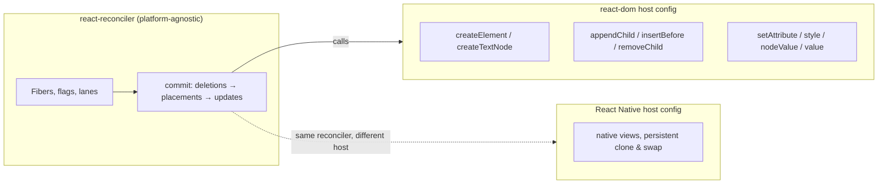
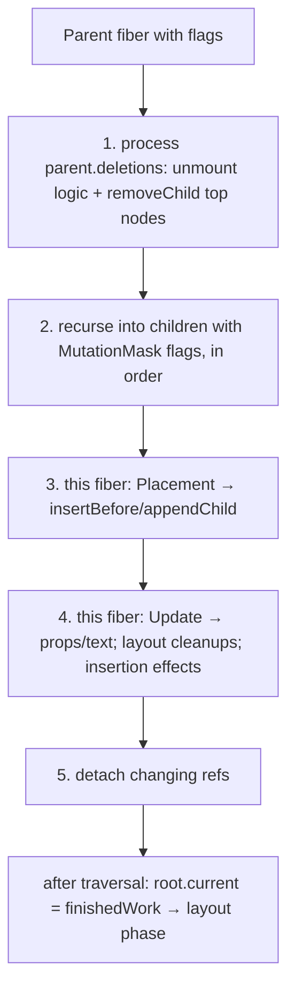

# 02 / 20 — Commit Work and DOM Mutations

## 1. Lesson metadata

| | |
|---|---|
| **Level** | Advanced |
| **Study time** | 5–6 hours (reading 2.5 h, experiments 1.5 h, exercises 1.5–2 h) |
| **Prerequisites** | [03 — Initial mount and updates](./03-initial-mount-and-updates.md), [05 — React elements vs DOM nodes](./05-elements-vs-dom-nodes.md), [06 — Reconciliation fundamentals](./06-reconciliation-fundamentals.md), [07 — Identity, keys and reconciliation](./07-identity-keys-and-reconciliation.md), [09 — Fiber nodes and units of work](./09-fiber-nodes-and-units-of-work.md), [11 — Render phase vs commit phase](./11-render-phase-and-commit-phase.md), [19 — Layout vs passive effects](./19-layout-vs-passive-effects.md), [00/04 — DOM structure and mutation](../00-web-and-javascript-foundations/04-dom-structure-and-mutation.md) |
| **Next** | [21 — Browser paint vs React updates](./21-browser-paint-and-react-updates.md) |
| **Related** | [01/10 — Event handling and the synthetic event system](../01-react-fundamentals/10-event-handling.md), [01/11 — Controlled and uncontrolled inputs](../01-react-fundamentals/11-controlled-and-uncontrolled-inputs.md), [22 — Automatic batching](./22-automatic-batching.md), [33 — Scenario B: update only text in one element](./33-scenario-b-text-update.md), [34 — Scenario C: list reorder with/without stable keys](./34-scenario-c-list-reorder.md), [31 — Reading React's source code](./31-reading-react-source.md) |

**Learning objectives.** After this lesson you can:
1. Describe what the commit phase does to the real DOM, operation by operation, and in what order (deletions, placements, updates; children before parents).
2. Explain how the render phase *prepares* DOM work (flags, detached node creation, bottom-up appending) so that commit can apply it with minimal, ordered DOM calls.
3. Predict the exact DOM mutations (via `MutationObserver` records) that result from a prop change, a text change, a keyed reorder, an insertion, a deletion and a `key` change.
4. Explain how React sets properties vs attributes, diffs `style`, handles `value`/`checked`, text content, event props and `dangerouslySetInnerHTML`.
5. Explain why React never reads the DOM to decide what to change (outside special cases) and why external mutations of React-owned nodes cause drift or crashes.
6. Integrate non-React DOM code safely (escape hatches: ref + effect on a React-owned empty container; portals).
7. Distinguish React commit cost from browser style/layout/paint cost, and measure each.
8. Distinguish the *reconciler* from the *host config* (React DOM vs other renderers).

**Concepts covered:** host config, host components/text instances, `createInstance`/`appendChild`/`insertBefore`/`removeChild`/`commitUpdate`/`commitTextUpdate` as conceptual operations, `Placement`/`Update`/`ChildDeletion`/`Ref` flags, mutation traversal and `subtreeFlags`, initial mount via detached subtree + single insertion, hiding vs removing (Suspense), property vs attribute setting, style diffing, controlled form control handling, event delegation props storage, `MutationObserver` as a measurement tool, DOM ownership.

> ⚠ **Implementation-detail warning.** The *observable* behavior (which DOM nodes are created/moved/removed, which attributes/text change) is well described by the algorithm heuristics ([06](./06-reconciliation-fundamentals.md), [07](./07-identity-keys-and-reconciliation.md)), but exact property-setting rules (e.g., which props are set as DOM properties vs attributes; boolean attribute handling; custom-element support; `value` syncing) have evolved (notably React 19 improved custom element support and unified some paths) and are in `packages/react-dom-bindings` / `ReactDOMComponent`-family files in <https://github.com/facebook/react>. Function names such as `commitMutationEffects`, `commitPlacement`, `commitDeletionEffects`, `commitUpdate`, `insertBefore`/`appendChild` in the host config are conceptual anchors; and, as checked against the `facebook/react` main branch on 2026-10-22, they do exist: the DOM host config is `packages/react-dom-bindings/src/client/ReactFiberConfigDOM.js` (`createInstance`, `appendInitialChild`, `finalizeInitialChildren`, `createTextInstance`, `commitUpdate`, `commitTextUpdate`, `appendChild`, `insertBefore`, `removeChild`, `hideInstance`, `unhideInstance`, `resetTextContent`), and the reconciler's commit code is in `packages/react-reconciler/src/ReactFiberCommitWork.js` (`commitMutationEffectsOnFiber`, `commitDeletionEffects`) and `ReactFiberCommitHostEffects.js` (`getHostSibling`, `commitPlacement`). File layout and internals move between releases, so treat the names as anchors, not API.

---

## 2. Deep conceptual explanation

### 2.1 What problem is this lesson solving?

Render computed *what should be on screen*; the commit makes the page *be that way*. Everything you have learned so far (elements, fibers, reconciliation, keys) is only valuable if it results in the **fewest, safest, correctly ordered DOM operations**. This lesson opens the commit's mutation sub-phase and answers:

- When I change one piece of state, what DOM calls actually happen? (Often: one `nodeValue` assignment. Rarely: a re-created subtree.)
- Why does a keyed list reorder do one `insertBefore` for one reorder pattern and two for another?
- How does React decide between setting a DOM *property* and an *attribute*?
- Why does React crash with "Failed to execute 'removeChild' on 'Node'" when a browser extension or my own `document.querySelector(...).remove()` touched its DOM?
- What is the "host" in "host config", and why can React Native reuse the same reconciler?
- How much of "React performance" is JS vs DOM vs browser layout/paint?

### 2.2 The reconciler never talks to the DOM directly: the host config

React is split in two layers:

| Layer | Package(s) | Knows about | Does |
|---|---|---|---|
| **Reconciler** (renderer-agnostic) | `react-reconciler` | Fibers, lanes, hooks, effects | Decides *what* to create/update/delete/move and *when*; builds flags |
| **Renderer / host config** | `react-dom` (DOM), React Native, `react-test-renderer`, custom renderers | The host platform: DOM nodes, native views, JSON trees | Implements primitive operations: create an instance, create a text instance, append child, insert before, remove child, commit prop updates, commit text updates, hide/unhide, etc. |

Conceptually the host config is an interface (named something like `HostConfig`/"renderer config") with functions such as `createInstance`, `createTextInstance`, `appendInitialChild`, `finalizeInitialChildren`, `appendChild`, `insertBefore`, `removeChild`, `commitUpdate`, `commitTextUpdate`, `hideInstance`, `unhideInstance`, `resetTextContent`, plus *mutation mode* vs *persistent mode* (React Native Fabric uses a persistent, immutable-tree style). Names verified in `ReactFiberConfigDOM.js` (2026-10-22); each renderer package supplies its own `ReactFiberConfig*` and the reconciler is bundled against it.

This is why [04](./04-virtual-dom-what-it-means.md) said the "virtual DOM" is not a DOM diff: it's a *fiber tree diff* that emits host-config calls.

### 2.3 Where DOM work is prepared: complete phase

During the render phase, `completeWork` ([09](./09-fiber-nodes-and-units-of-work.md)) for **host component fibers** does platform work that does **not** touch the live document:

**On mount (no current fiber):**
1. `createInstance(type, props, …)` → `document.createElement("div")` (or `createElementNS` for SVG/MathML) — a **detached** DOM node.
2. `appendAllChildren(instance, workInProgress)` → appends the already-created DOM nodes of *descendant host fibers* into this new node. Because `completeWork` runs bottom-up, children's DOM nodes already exist; each parent assembles its children. The whole new subtree is built bottom-up as a **detached tree**.
3. `finalizeInitialChildren(instance, type, props)` → sets properties/attributes/styles, text content, event-related bookkeeping on the detached node.
4. The fiber's `stateNode` is set to the DOM node.

**On update (current fiber exists):** `completeWork` determines whether the host node needs an update. In React 19 that test is only whether the props *object* is the same as last time (`oldProps === newProps`, `updateHostComponent` in `ReactFiberCompleteWork.js`), so a host element rendered by a re-rendered parent is flagged `Update` even if no individual prop changed (executed: the stored-props record of an unchanged `<article>` was replaced after a parent re-render, while no DOM mutation occurred). Older versions computed an **update payload** (a flat array `[propName, newValue, …]`) here via a diff function; in current React the update payload is gone: `prepareUpdate` was removed and `commitUpdate(domElement, type, oldProps, newProps, internalInstanceHandle)` diffs the old and new props itself at commit time (`updateProperties`) and then refreshes the node's stored props (`updateFiberProps`), verified in `ReactFiberConfigDOM.js` on 2026-10-22. Either way the fiber is flagged `Update`.

Key consequence: **on initial mount, an entire new subtree is constructed detached and inserted with a single `appendChild`/`insertBefore` of its root during commit.** One live-DOM insertion for N new elements (the browser then does one layout pass). You get "document fragment"-like efficiency without asking.

### 2.4 Commit: the three flag types that become DOM calls

Recall flags ([09](./09-fiber-nodes-and-units-of-work.md)): bits on fibers marking required work, with `subtreeFlags` aggregating children's flags so entire clean subtrees can be skipped.

| Flag | Meaning | DOM operation(s) |
|---|---|---|
| **`Placement`** | This fiber's host node is new or moved | `appendChild` (no later stable sibling) or `insertBefore(node, nextStableSibling)` into the nearest host parent |
| **`Update`** | Props or text changed | `commitUpdate`: apply changed props/attrs/styles; `commitTextUpdate`: `textNode.nodeValue = newText` |
| **`ChildDeletion`** | Parent has children to delete (list kept on `parent.deletions`) | `removeChild` for **each top-level host node** of the deleted subtree (not every descendant) |
| **`Ref`** | Ref attach/detach needed | Detach in mutation, attach in layout |
| **`ContentReset`** | Host element's children switch from text to elements (or vice versa) | Clear `textContent` before inserting children |
| **`Visibility`** | Suspense/Offscreen hide/show | `display: none` toggling on hidden nodes |
| Passive/Layout/etc. | Effects | Covered in [18](./18-effects-and-their-timing.md), [19](./19-layout-vs-passive-effects.md) |

### 2.5 The mutation traversal and ordering

Conceptually (for each fiber, depth-first, children first):

```text
commitMutationEffectsOnFiber(fiber):
    recursivelyTraverseMutationEffects(fiber):
        for each deletion in fiber.deletions:      // parent handles its deletions FIRST
            commitDeletionEffects(deletion)        // run unmount logic, remove top host nodes
        for each child with MutationMask in subtreeFlags:
            commitMutationEffectsOnFiber(child)
    reconcile placement (if Placement flag): insert/append this fiber's DOM
    if Update flag: commitUpdate / text update / hook insertion effects & layout cleanups
    if Ref flag:   detach old ref
```

Observations:
- **Deletions come before everything else under a parent.** This is a safety property: removing old nodes before inserting new ones keeps `insertBefore` references valid and ensures unmounting logic (cleanups, refs) runs while the DOM is still coherent.
- **Children are processed before their parent**, but a child's DOM insertion is relative to its nearest *host* ancestor. If a function component (no DOM) wraps host nodes, the "parent DOM node" is found by walking up the fiber tree to the nearest `HostComponent`/`HostRoot`/`HostPortal`.
- **Placement uses sibling lookup:** to insert fiber `F`, React finds the *next sibling host node that is already in the DOM and not itself being placed* (`getHostSibling`, a loop that may descend through function components/fragments and skip nodes flagged `Placement`). If found: `insertBefore(F.node, sibling)`; else `appendChild(parentNode, F.node)`. This is what the toy in §5.5 reproduces.
- **A function component with multiple host children** (fragment) placing → each top-level host child inserted separately, in order.

### 2.6 Setting properties: what React DOM does to a host node

This is React DOM–specific host config code. The behavior you need to know (documented in react.dev reference for built-in components, e.g. [Common components](https://react.dev/reference/react-dom/components/common)):

1. **Property vs attribute.** React sets some props as **DOM properties** (`value`, `checked`, `selected`, `htmlFor`→`for` mapping, `className`→`class`) and others as **attributes** (`aria-*`, `data-*`, most others). Boolean attributes (`disabled`, `hidden`, `checked`) accept booleans; `false` removes the attribute. Unknown attributes are passed through as strings. React 19 added full custom-element support: on the client it passes props as properties when the element instance defines a matching property, otherwise as attributes (see the [React 19 release post](https://react.dev/blog/2024/12/05/react-19), "Support for Custom Elements").
2. **`style`** is an object; React compares old vs new objects *per property*, setting changed ones via `style[prop] = value` (or `style.setProperty` for custom properties `--x`), and clearing removed ones by assigning `""`. Unchanged style properties are not touched.
3. **`className`** is set as a whole string when changed (no per-class diffing).
4. **Text children.** When a host element's only child is a string/number, React uses its text-content path (`setTextContent`); when updating, if the element has a single text-node child it sets that node's `nodeValue`, otherwise `textContent`. When children are several text fragments (`<p>a {x} b</p>` → three adjacent text children), React creates **separate text nodes** — updating `x` changes only that text node.
5. **`dangerouslySetInnerHTML`**: `innerHTML` assigned only when `__html` string changes. React does not sanitize ([Phase 10/06](../10-production-engineering/06-security-xss-csrf-csp.md)).
6. **Event props (`onClick`, …)** are **not** attached as DOM listeners per node. React attaches *one listener per event type at the root container* (event delegation, [01/10](../01-react-fundamentals/10-event-handling.md)) and, at dispatch time, finds the target fiber and walks its ancestors collecting handlers from stored props. The DOM node carries a hidden reference to its current props (conceptually via an internal property key like `__reactProps$…`) updated at commit — so a changed handler function results in a **pointer update, not a DOM operation**. (Consequence: a re-render that only changes closure identities produces no DOM mutation.)
7. **Form controls (`<input value>`)** are special: React sets `node.value` only if it differs from the current `node.value` (avoiding caret jumps), tracks value via a "value tracker" to implement `onChange`, and *restores* the controlled value after an event if state did not change ([01/11](../01-react-fundamentals/11-controlled-and-uncontrolled-inputs.md)). `defaultValue` maps to the `value` attribute for initial render. Observable detail (executed in jsdom 2026-10-22 and confirmed in `ReactDOMInput.js` `updateInput`): updating a controlled `<input value>` from `"a"` to `"b"` produces `attributes` mutation records, not only a property write: React temporarily clears and restores `name` (to keep radio groups atomic) and also mirrors the new value into the `value` *attribute* ("attribute syncing"). So a `MutationObserver` on a controlled input is noisy, and "one write per change" does not hold for form controls.
8. **`ref`** (a prop in React 19) is attached/detached in commit; ref callbacks may return a cleanup function (React 19).
9. **Removing a prop** (present before, absent now): React removes the attribute / resets the property to its default (for known props), and clears styles.

### 2.7 React does not read the DOM to diff

A defining design decision: the reconciler compares **previous props to next props** (and previous fiber to next), *never the DOM's actual state* (with narrow exceptions: controlled form control values; hydration; some `<select>` handling). If something else changes the DOM:

- **Attributes React doesn't manage:** left alone (it only writes props that changed between prop objects). A third-party script that adds a `class` to an element will see its change survive until React next sets `className` on that node, then be overwritten wholesale.
- **Props React manages:** React will *not notice* an external change. If the next render's prop equals the previous render's prop, React doesn't write → the external value remains (drift).
- **Structural changes** (removing/moving React-owned nodes): later reconciliation makes calls like `removeChild(parent, child)` with stale assumptions → `NotFoundError: Failed to execute 'removeChild' on 'Node': The node to be removed is not a child of this node`, or `insertBefore` with a missing reference node. Real-world sources: browser translation tools (they wrap/replace text nodes), extensions (grammar checkers, password managers), ad scripts, and your own `querySelector(...).remove()`.

Principle: **React owns the DOM subtree it renders into; you may own subtrees React renders as empty** (a `<div ref>` with no React children), where imperative code is free to do anything ([§5.2](#52-practical-example--integrating-a-non-react-widget-correctly)).

### 2.8 Hiding instead of removing

When a Suspense boundary that already showed content needs to show its fallback again (e.g., a non-transition update suspends), React doesn't destroy the already-rendered DOM and state; it **hides** it, setting the host elements to `display: none !important` (via `hideInstance`) and shows the fallback. When it unsuspends, React unhides (`unhideInstance`, restoring the prior display value). Similarly, `<Activity mode="hidden">` (stable since React 19.2) preserves DOM and state while visually hidden (`display: none`). Executed 2026-10-22 on react 19.3.1: with Suspense hiding, only *layout* effects are cleaned up and passive effects stay mounted; with `Activity` hidden, both layout **and passive** effects are cleaned up and re-created on reveal (state preserved, no re-init). Also, per react.dev, text-only children render nothing when hidden because there is no element to hide, and `hideInstance` on a bare text node blanks its `nodeValue`. Implications: hidden DOM remains in the document (querySelector finds it; CSS `:empty` and sibling selectors may behave unexpectedly; layout effects are cleaned up in hidden trees while DOM persists — [19 §3.3](./19-layout-vs-passive-effects.md)).

### 2.9 Cost model: three different costs

| Cost | Where it's paid | Proportional to | Observed as |
|---|---|---|---|
| **Render (JS)** | Render phase | Number of fibers rendered (+ your component code) | "Scripting" in the flame chart inside `performWorkOnRoot`/`beginWork` |
| **Commit (JS + DOM API calls)** | Commit phase | Number of fibers with flags (mutations, effects) + DOM calls | Scripting inside `commitRoot`, DOM API entries (`insertBefore`, `setAttribute`) |
| **Browser rendering** | After the commit task: style recalc, layout, paint, composite | Size of dirty region, DOM size, CSS complexity | "Recalculate Style", "Layout", "Paint" entries (purple/green) |

DOM *mutation calls* are usually cheap (they mark dirty and may run MutationObservers/custom-element reactions); the *layout and style recalculation they cause* can be expensive. A mutation that dirties a big container's layout (e.g., changing `width` on a top-level wrapper) can cost far more than hundreds of text-node updates. Two practical corollaries: (1) "React re-rendered 500 components" and "React changed 500 DOM nodes" are different numbers — most renders produce zero DOM writes; (2) the DevTools "Highlight updates" overlay shows *renders*, not DOM mutations; the Elements panel's flashing nodes (and `MutationObserver`) show *mutations*.

### 2.10 Misconceptions

| Misconception | Reality |
|---|---|
| "React re-creates the DOM on every render." | It creates DOM only for new host fibers; existing nodes are updated in place. |
| "React compares the new virtual DOM to the real DOM." | It compares new elements/props to the previous fiber/props. It doesn't read the DOM (exceptions: form controls, hydration). |
| "Every re-render touches the DOM." | Most renders with unchanged host props produce no mutations; handler identity changes don't mutate the DOM. |
| "Batching DOM writes in a fragment is something React does for lists." | React builds new subtrees detached on mount; for insertions into existing parents it inserts nodes individually (`insertBefore`/`appendChild`), relying on lazy browser layout. |
| "Changing `key` just updates the element." | A changed key creates a new fiber: the old host node is removed and a new one created (state/DOM/focus lost). |
| "Moving an item is free." | A move is `insertBefore` of existing DOM; but React's single-pass heuristic may issue several moves for patterns like "last item to front". |
| "I can safely tweak DOM that React rendered, if it's just styling." | Works until React writes the same prop (overwrites) or removes the node; ownership conflicts cause hard-to-reproduce bugs. |
| "Unmounting a big subtree removes each DOM node." | Only the top-level host nodes of the deleted subtree are removed; descendants go with them. Cleanup effects/refs still run for every fiber. |
| "`display: none` is the same as unmounting." | Hidden DOM keeps memory, state, effect subscriptions (passive) alive; unmount releases them. |
| "React batches DOM updates across renders into one reflow." | React doesn't control reflow. The browser coalesces style/layout until the next rendering opportunity or a forced read. |

---

## 3. Internal mechanics

### 3.1 Public guarantees

1. A committed render's DOM changes are applied synchronously, all before the browser paints (no half-applied state is visible).
2. React updates DOM nodes in place when element type and key match; otherwise it unmounts and recreates ([06](./06-reconciliation-fundamentals.md), [07](./07-identity-keys-and-reconciliation.md)).
3. Refs are set to the DOM node after it is attached and to `null` (or cleanup run) before it is removed.
4. Unmount cleanups (layout effects, ref detach) run before DOM removal of the node they relate to; passive cleanups run later.
5. React does not guarantee which exact DOM calls it makes (e.g., `textContent` vs `nodeValue`), only the resulting DOM.
6. React doesn't support external mutation of the DOM nodes it manages.

### 3.2 Teaching model

```text
render phase (pure, interruptible):
   completeWork(host fiber):
        mount:  node = createInstance(); append children's nodes into it; set initial props
        update: decide if props differ → flag Update
   (no live DOM touched; new nodes are detached)

commit (sync):
   mutation: deletions → placements → updates, children first
   swap root.current
   layout:   layout effects, attach refs
   (browser: style → layout → paint)
```

### 3.3 Implementation details (names verified against `main`, 2026-10-22)

- **`getHostSibling`** scans forward through the fiber `sibling` links and into `child` links of non-host fibers (function components, fragments) to find the next host node that is **not** flagged `Placement` (still in its old position) — the stable anchor. If it walks to the end of the parent without finding one, it appends. The cost can be O(n) per placement in unlucky patterns (e.g., many consecutive placements), acceptable in practice.
- **Initial mount of a subtree under an existing parent.** `completeWork` for host fibers built the detached tree; the topmost new host fiber in a new subtree carries the `Placement` flag; commit inserts it once. Descendants of a placed new fiber don't individually get placed in the live DOM.
- **Text updates.** Host text fibers flagged `Update` call `commitTextUpdate(textInstance, oldText, newText)` → `textInstance.nodeValue = newText` (verified in `ReactFiberConfigDOM.js`).
- **Event bookkeeping.** At `finalizeInitialChildren`/`commitUpdate`, React DOM stores current props on the node (`updateFiberProps`) and, for event types needed by props, ensures root-level listeners are registered (done at root creation for all supported events in React 17+, so it's a no-op at element creation).
- **`ContentReset`.** If an element previously had a single text child (set via `textContent`) and now has element children, commit clears the text first so the old text node doesn't linger.
- **Persistent mode.** Renderers such as React Native Fabric use a *persistent* host config: instead of mutating, they clone immutable host nodes and swap the root; the reconciler's flags are consumed differently (`cloneInstance`, `replaceContainerChildren`). This is why the reconciler doesn't hard-code DOM semantics.
- **Hydration.** Instead of creating DOM, hydration *claims* existing DOM nodes and checks them against fibers ([25](./25-hydration-and-selective-hydration.md)); mismatch handling differs by version.
- **Perf shortcuts.** Skipped clean subtrees via `subtreeFlags & MutationMask`; no per-node bookkeeping for unchanged elements.

### 3.4 Measuring DOM mutations: `MutationObserver`

`MutationObserver` delivers *records* (batched, microtask-timed) describing DOM changes made by anyone. It is the ground-truth tool for "what did React change?" Record types: `childList` (added/removed nodes; a *move* appears as removal + addition), `attributes` (name + old value), `characterData` (text node changes). Observers fire after the mutating task's current script completes (microtask), so a single commit produces one batch of records — convenient for assertions.

---

## 4. Step-by-step execution walkthrough

### 4.1 Update that changes text and a class

```tsx
function Demo() {
  const [n, setN] = useState(0);
  return (
    <section>
      <p className={n % 2 ? "odd" : "even"} title="static">count: {n}</p>
      <button onClick={() => setN(n + 1)}>inc</button>
    </section>
  );
}
```

DOM before (n=0): `<section><p class="even" title="static">count: 0</p><button>inc</button></section>`, where the `<p>` has **two text nodes** (`"count: "` and `"0"`).

Click:
1. Render: `Demo` re-renders; new elements; reconcile `section` (same type) → `p` (same type) → children: text `"count: "` (unchanged), text `1` (changed from `0`); `button` (unchanged props except `onClick` identity).
2. Flags: `p` fiber: `Update` (className changed); text fiber `1`: `Update`; `button`: `Update` (its `onClick` prop object changed) — but its commit is a props-pointer refresh.
3. Commit mutation traversal (children first): the changing text node: `nodeValue = "1"` → MutationObserver `characterData`. Then `p`: `className` changed → `setAttribute("class", "odd")` (or `className =`) → `attributes` record (`attributeName: "class"`, `oldValue: "even"`). `title` unchanged → no write. `button`: handler pointer updated → no DOM mutation.
4. Records seen: **2** (one `characterData`, one `attributes`). Unchanged: `"count: "` text node, `title`, button, section.

**Predict:** if the JSX were `<p>{`count: ${n}`}</p>` (one string), what changes? **Answer:** one text node; `nodeValue` assignment still a single `characterData` record (the `<p>` has a single text child). Same count of records (plus the class attribute).

### 4.2 Keyed reorder `[A,B,C]` → `[B,C,A]`

1. Render: reconcile children by key: old fibers A(0), B(1), C(2). New order B, C, A. Algorithm ([06](./06-reconciliation-fundamentals.md)): `lastPlacedIndex = 0`. B: oldIndex 1 ≥ 0 → stays, `lastPlaced = 1`. C: oldIndex 2 ≥ 1 → stays, `lastPlaced = 2`. A: oldIndex 0 < 2 → **Placement** (moved).
2. Commit: A placed; `getHostSibling` for A: no later siblings → `appendChild(ul, A.node)` (a move: DOM `appendChild` of an attached node detaches and re-inserts it).
3. MutationObserver: for A, a `childList` record with `removedNodes: [A]` and another with `addedNodes: [A]` (a move is remove + insert). B and C: no records.

**`[A,B,C]` → `[C,A,B]`:** C stays (`lastPlaced = 2`); A (0 < 2) and B (1 < 2) are moved — **two** moves, even though a human sees "move C to the front" as one. The heuristic is a single-pass, left-to-right compromise ([34](./34-scenario-c-list-reorder.md)). In practice, moving the last item to the front in huge lists is a known weak case; mitigations: avoid it (virtualize, paginate) or reorder less frequently.

### 4.3 Deleting a subtree

`<Card>` containing `<h2>`, `<p>`, `<ul>` (20 `<li>`s) is removed:
1. Parent fiber records the deletion (`deletions: [CardFiber]`), flag `ChildDeletion`.
2. Commit, parent's mutation step handles deletions first: `commitDeletionEffects(CardFiber)` walks the deleted subtree *recursively* to: detach refs, run layout-effect cleanups and class `componentWillUnmount`, schedule passive cleanups, and compute the **top-level host nodes** — here just the `Card` root `<div>`.
3. `removeChild(parentDOM, cardRootDiv)` — **one** DOM call removes all 24+ nodes.
4. Later (passive flush): passive cleanups for every deleted function component.

### 4.4 `key` change

`<Editor key={doc.id} />` with `doc.id` changing from 1 to 2: old fiber deleted (as above, including state), new fiber created via mount path: new `createElement`s are built detached; the new root inserted (`insertBefore` the old position's next sibling). Focus in an input inside is lost (the focused node was removed). This is intentional "state reset by key" ([01/16](../01-react-fundamentals/16-state-preservation-and-reset.md)).

### 4.5 Initial mount of a 500-row table under an existing `#root`

1. Render phase: 500 × (`tr` + 3 `td` + text) fibers; during completion each host fiber creates its DOM node and appends its children's nodes: a fully assembled detached `<table>`.
2. Commit: single `appendChild(container, table)`.
3. After the task, the browser performs one style+layout+paint for the whole table.

Contrast with imperatively appending rows one by one into a live table while reading layout between appends (500 forced layouts). React's mount path avoids that by construction.

---

## 5. Code examples

### 5.1 Minimal example — watching React's DOM writes with `MutationObserver`

```tsx
import { useEffect, useRef, useState } from "react";

type Rec = { type: string; target: string; detail: string };

function describe(r: MutationRecord): Rec {
  const t = r.target as HTMLElement | Text;
  const target = t.nodeType === Node.TEXT_NODE ? `#text("${t.nodeValue}")` : `<${(t as HTMLElement).tagName.toLowerCase()}>`;
  if (r.type === "attributes") return { type: "attributes", target, detail: `${r.attributeName} (was ${JSON.stringify(r.oldValue)})` };
  if (r.type === "characterData") return { type: "characterData", target, detail: `was ${JSON.stringify(r.oldValue)}` };
  return {
    type: "childList",
    target,
    detail: `+${r.addedNodes.length} −${r.removedNodes.length}`,
  };
}

export function MutationDemo() {
  const root = useRef<HTMLElement>(null);
  const [n, setN] = useState(0);

  useEffect(() => {
    const el = root.current;
    if (!el) return;
    const mo = new MutationObserver((records) => {
      console.table(records.map(describe));
    });
    mo.observe(el, { subtree: true, childList: true, attributes: true, attributeOldValue: true, characterData: true, characterDataOldValue: true });
    return () => mo.disconnect();
  }, []);

  return (
    <section ref={root}>
      <p className={n % 2 ? "odd" : "even"} title="static">count: {n}</p>
      <button onClick={() => setN((v) => v + 1)}>inc</button>
    </section>
  );
}
```

**Line notes.**
- The observer is attached in an effect after the initial commit, so the mount's own mutations aren't recorded (use `useLayoutEffect` or attach before rendering into a container if you want them).
- `console.table(records.map(describe))` prints one row per record; records arrive in one batch per task.
- `characterDataOldValue`/`attributeOldValue` make before/after visible.

**Predict:** first click (0 → 1). Which rows appear?

**Result:** two rows: `characterData` on text node `"0"` (was `"0"`), and `attributes` on `<p>` (`class`, was `"even"`). No row for `title`, the button, or the `"count: "` text node.

**Why:** [§4.1]. **Experiment:** change the JSX to `<p>{`count: ${n}`}</p>` and observe the single-text variant; replace `className` by a `style={{ color: n % 2 ? "red" : "blue" }}` and see `attributes` on `style`. **Trade-off:** `MutationObserver` itself adds overhead; use in dev/tests only.

### 5.2 Practical example — integrating a non-React widget correctly

```tsx
import { useEffect, useRef } from "react";

// A stand-in for a third-party imperative library (map, chart, editor, video player).
interface ChartHandle { update(points: readonly number[]): void; destroy(): void }
declare function createChart(el: HTMLElement, points: readonly number[]): ChartHandle;

export function Chart({ points }: { points: readonly number[] }) {
  const containerRef = useRef<HTMLDivElement>(null);
  const chartRef = useRef<ChartHandle | null>(null);

  // 1) lifecycle: create once, destroy on unmount (Strict Mode safe: create → destroy → create)
  useEffect(() => {
    const el = containerRef.current;
    if (!el) return;
    chartRef.current = createChart(el, points);
    return () => {
      chartRef.current?.destroy();
      chartRef.current = null;
    };
    // eslint-disable-next-line react-hooks/exhaustive-deps -- creation must not re-run on `points`; updates handled below
  }, []);

  // 2) data synchronization: separate concern, separate effect
  useEffect(() => {
    chartRef.current?.update(points);
  }, [points]);

  // React renders an EMPTY div: the library owns everything inside it.
  return <div ref={containerRef} style={{ height: 240 }} />;
}
```

**Line notes.**
- **Ownership boundary:** the `<div>` has no React children; React will never reconcile inside it, so the library can mutate freely. React still owns the `div` itself (its `style`, removal).
- Two effects = two separate synchronization processes ([18 §7](./18-effects-and-their-timing.md)).
- The lint suppression is deliberate and documented; the alternative is storing the initial points in a ref. Prefer restructuring so the creation effect doesn't read `points` (e.g., `createChart(el, [])` then `update(points)` in the second effect, which also runs on mount) — then no suppression is needed, and the first paint may lack data if the second effect runs after paint ⇒ a hidden-until-ready container or a layout effect if flicker matters ([19](./19-layout-vs-passive-effects.md)).
- Strict Mode dev will create, destroy, and create again: `destroy()` must fully remove what `createChart` added.
- Race: if the library creates asynchronously, guard with an `ignore` flag in the creation effect.

### 5.3 Incorrect example — mutating React-owned DOM

```tsx
function List({ items }: { items: string[] }) {
  const ref = useRef<HTMLUListElement>(null);

  return (
    <>
      <ul ref={ref}>
        {items.map((i) => <li key={i}>{i}</li>)}
      </ul>
      <button
        onClick={() => ref.current?.firstElementChild?.remove()}   // BUG: removing a React-managed node
      >
        Remove first (imperatively)
      </button>
    </>
  );
}
```

**Predict:** items `["a","b","c"]`. Click the button, then trigger a state change in the parent that makes `items = ["b","c","d"]`. What happens?

**Result:** Before the update, the DOM has `b, c` (a removed behind React's back) while React believes it has `a, b, c`. On the next commit React computes: delete `a` → `removeChild(ul, aNode)` → `NotFoundError: Failed to execute 'removeChild' on 'Node': The node to be removed is not a child of this node.` The error is thrown in the commit phase and propagates to the nearest error boundary (or unmounts the app in React 18+ without one).

**Why:** React does not read the DOM; it replays operations based on its internal tree ([§2.7]).

### 5.4 Corrected implementation

```tsx
function List({ initial }: { initial: string[] }) {
  const [items, setItems] = useState(initial);
  return (
    <>
      <ul>
        {items.map((i) => <li key={i}>{i}</li>)}
      </ul>
      <button onClick={() => setItems((prev) => prev.slice(1))}>Remove first</button>
    </>
  );
}
```

State is the single source of truth; React derives DOM. For genuinely external DOM mutation sources (browser translation tools), mitigations: `translate="no"` on dynamic regions, wrapping text in elements (`<span>{text}</span>`) so translation replaces the *span's content* rather than a bare text node React tracks, and avoiding conditional text nodes at the same level as elements (a long-standing React issue category, not an official guarantee; test your own pages with Chrome's Translate). If extensions are out of your control, an error boundary with a reload fallback and telemetry is the practical defense ([Phase 4/19](../04-react-architecture/19-error-boundaries.md)).

### 5.5 Advanced example — a toy keyed-children commit planner

This toy reproduces the *shape* of what commit does for a keyed list: deletions first, then placements (children left-to-right, anchored to the next stable sibling), plus text updates. It uses the same `lastPlacedIndex` heuristic described in [06](./06-reconciliation-fundamentals.md). It operates on plain arrays standing in for DOM children.

```ts
export interface Item { key: string; text: string }

export type Op =
  | { type: "remove"; key: string }
  | { type: "insert"; key: string; before: string | null; text: string }
  | { type: "move"; key: string; before: string | null }
  | { type: "setText"; key: string; text: string };

/** Plan the DOM operations that turn `prev` into `next` (keyed children of one parent). */
export function planKeyed(prev: readonly Item[], next: readonly Item[]): Op[] {
  const prevIndex = new Map(prev.map((p, i) => [p.key, i] as const));
  const prevText = new Map(prev.map((p) => [p.key, p.text] as const));
  const nextKeys = new Set(next.map((n) => n.key));
  const ops: Op[] = [];

  // 1) Deletions first (a parent's ChildDeletion work precedes its other mutations).
  for (const p of prev) if (!nextKeys.has(p.key)) ops.push({ type: "remove", key: p.key });

  // 2) Render-phase decision: which fibers get a Placement flag?
  const flagged = new Set<string>();
  let lastPlacedIndex = 0;
  for (const n of next) {
    const oldIndex = prevIndex.get(n.key);
    if (oldIndex === undefined) flagged.add(n.key);          // new → insert
    else if (oldIndex < lastPlacedIndex) flagged.add(n.key); // moved
    else lastPlacedIndex = oldIndex;                         // stays
  }

  // 3) Commit: walk new children in order; place flagged ones before the next stable sibling.
  next.forEach((n, i) => {
    if (flagged.has(n.key)) {
      let before: string | null = null;
      for (let j = i + 1; j < next.length; j++) {
        const k = next[j].key;
        if (prevIndex.has(k) && !flagged.has(k)) { before = k; break; }   // "getHostSibling"
      }
      ops.push(
        prevIndex.has(n.key)
          ? { type: "move", key: n.key, before }
          : { type: "insert", key: n.key, before, text: n.text },
      );
    }
    const old = prevText.get(n.key);
    if (old !== undefined && old !== n.text) ops.push({ type: "setText", key: n.key, text: n.text });
  });
  return ops;
}

/** Apply operations to an array standing in for DOM children (to verify the plan). */
export function applyOps(dom: readonly Item[], ops: readonly Op[]): Item[] {
  const list = dom.map((x) => ({ ...x }));
  for (const op of ops) {
    if (op.type === "remove") { list.splice(list.findIndex((x) => x.key === op.key), 1); continue; }
    if (op.type === "setText") { const t = list.find((x) => x.key === op.key); if (t) t.text = op.text; continue; }
    const node =
      op.type === "move"
        ? list.splice(list.findIndex((x) => x.key === op.key), 1)[0]
        : { key: op.key, text: op.text };
    const at = op.before === null ? list.length : list.findIndex((x) => x.key === op.before);
    list.splice(at, 0, node);
  }
  return list;
}
```

Running the planner on letter keys (each item's text is its lowercase key) gives:

| `prev` → `next` | Planned ops | Notes |
|---|---|---|
| `ABC` → `BCA` | `move A before null` | One move: A goes to the end. |
| `ABC` → `CAB` | `move A before null`, `move B before null` | **Two** moves: C stays; A, B move. |
| `ABCD` → `BCD` | `remove A` | Deletion only; no moves. |
| `ABC` → `XABC` | `insert X before A` | Insertion anchored to the next stable sibling. |
| `ABCD` → `DCBA` | `move C`, `move B`, `move A` (all before `null`) | D stays; three moves (n−1). |
| `ABCD` → `DBXA` | `remove C`, `move B`, `insert X`, `move A` | Deletion first, then placements left to right. |

**Line notes.**
- Step 2 corresponds to the **render phase** (reconcile children; assign flags); steps 1 and 3 to the **commit phase**. The split matters: reconciliation decides flags in an interruptible phase, commit applies them synchronously.
- `before: null` means "append".
- `applyOps(prev, planKeyed(prev, next))` equals `next` for every case above (verified 2026-10-22 by running this exact code with tsx; and the `ABC`→`BCA`, `ABC`→`CAB`-style move counts were cross-checked against real `react-dom` 19.3.1 with a jsdom `MutationObserver`: e.g. `abcd`→`dabc` produced three moves, `abcd`→`bacd` one, front insertion one `insertBefore`). Edge cases not modeled: unkeyed children, type changes (remount), fragments/portals, nested components, text-only children, `ContentReset`.

**Trade-offs.** This is intentionally a toy; real React interleaves this per fiber and handles hosts, refs, effects and hidden trees. The point is the *determinism and minimality* of the DOM operations and the "stable anchor" insertion rule.

---

## 6. Visual explanations

### 6.1 Reconciler vs host config



### 6.2 Where DOM nodes are created vs inserted

```text
RENDER (completeWork, bottom-up)               COMMIT (mutation)
  <li> created (detached)                        
  <li> created                                   
  <ul>  created, appends <li>s into itself       
  <p>   created                                  
  <div> created, appends <ul> and <p>            → ONE insertBefore/appendChild(container, <div>)
  (nothing attached to document yet)               live DOM changes here
```

### 6.3 Ordering inside commit mutation



---

## 7. Alternative approaches and trade-offs

Ways to get UI into the DOM:

| Approach | DOM writes minimal? | Readability | Safety (ownership) | Perf at scale | When to prefer |
|---|---|---|---|---|---|
| **React declarative rendering** | Yes for typical updates (prop/text diff, keyed moves) | High | High (React owns) | Good; commit cost scales with changes | Default |
| **React + imperative widget in an empty container** | N/A (library decides) | Medium | High if boundary respected | Library-dependent | Maps, charts, editors |
| **Direct DOM manipulation (vanilla)** | Can be minimal if hand-optimized | Low–Medium | Only you | Best-case optimal | Micro-widgets, perf-critical animations (outside React tree) |
| **`innerHTML` string replacement** | No (replaces subtree) | Medium | XSS risk | Poor for frequent updates | Static content; use `dangerouslySetInnerHTML` sparingly |
| **Fine-grained reactive frameworks** (signals) | Yes, per-binding | Medium | Framework-owned | Excellent for many small updates | Not React; different trade-offs (no component re-execution) |
| **Virtualization (render only visible rows)** | Yes (fewer nodes) | Medium | High | Best for huge lists | Lists > few hundred complex rows |
| **Hide with CSS vs unmount** | Hide: toggles style only | Medium | High | Hide keeps DOM+memory; unmount frees | Frequent toggles of expensive-to-recreate UI vs rarely used UI |
| **CSS animations/transitions for visual change** | Zero JS DOM writes during animation | High | High | Best (compositor) | Anything expressible in CSS |

**Scenario where React's declarative commit is *not* best:** a 60 fps drag interaction updating a transform: routing every `mousemove` through React state forces a render+commit per event; writing `el.style.transform` imperatively in a `requestAnimationFrame` (on a ref'd element React isn't updating) or using a CSS variable updated via `style.setProperty` avoids render work. React can still own the element's *existence*; the high-frequency property is "owned" imperatively — with a documented comment, and ensure React doesn't also set that same style property.

**Scenario where keeping DOM hidden beats unmounting:** a tab with an expensive chart and local zoom state that users flip back to repeatedly; hiding retains state and avoids re-creation, at the price of memory and (passive) effects staying live ([19 §3.3](./19-layout-vs-passive-effects.md)).

---

## 8. Best practices and anti-patterns

**Do**
- Let React own everything it renders; give imperative libraries a React-empty container.
- Use stable keys so moves/updates replace removals/creations ([07](./07-identity-keys-and-reconciliation.md)).
- Prefer CSS for visual changes; use CSS variables for high-frequency values.
- Measure mutations with `MutationObserver` or the Elements panel's flash (Chrome DevTools highlights DOM changes) when investigating "unnecessary" updates.
- Wrap dynamic text from the server in elements in apps used with browser translation tools, and use `translate="no"` where it matters.
- Keep commit-time work small: heavy per-node ref callbacks and layout effects multiply the commit cost.

**Beginner mistakes**
- Using `document.getElementById(...).innerHTML = ...` on React-rendered nodes.
- Believing "re-render = DOM rebuild" and over-optimizing with memoization to avoid DOM writes that never happen.
- Adding index keys to dynamic lists (causes wrong node reuse and spurious DOM updates).

**Experienced-developer mistakes**
- Fighting reconciliation: setting `style.height` imperatively while React also sets `style.height` (random overwrites).
- Assuming DOM node identity is stable across renders (it is for matching keys/types; not across remounts).
- Using `display: none` everywhere to "avoid remounting" and leaking subscriptions/memory.
- Reading layout in many components during commit (layout effects) causing forced layouts ([19](./19-layout-vs-passive-effects.md)).

**Smells:** `querySelector` in components; `ref.current.innerHTML = …` on a node that has React children; `element.appendChild` into a node React also renders children into; `useEffect(() => { document.body.classList.add(...) })` without cleanup (this one is fine if cleaned up: it's a different owner).

**Justified exceptions**
- Setting `document.title`, `<html lang>` and `<body>` classes from effects: you do not render those via React; ensure cleanup and avoid conflicts.
- Imperative `focus()`, `scrollIntoView()`, `select()` calls on refs: these change *DOM state*, not React-controlled attributes.
- Using `flushSync` to commit before reading DOM (e.g., scroll to a newly added item) — rare ([Phase 3/08](../03-react-state-and-hooks/08-uselayouteffect.md)).

---

## 9. Real-world application

**Internationalized e-commerce with translation tools.** Many shoppers use browser auto-translate. A product price rendered as `Price: {formatted}` (two adjacent text nodes) is replaced by the translator with a single `<font>` wrapper; the next stock update makes React update a text node that no longer exists → crash on the product page. Mitigation: wrap `{formatted}` in `<span>`, mark non-translatable dynamic data `translate="no"`, add telemetry in an error boundary for `NotFoundError` patterns, and test with translation enabled ([Phase 10/09](../10-production-engineering/09-internationalization.md)).

**Live trading grid.** Price cells update many times per second; most renders only change text nodes. Commit cost per tick is small (a `nodeValue` assignment per changed cell); the real cost is browser style/layout if cell width depends on content (column auto-sizing) — fix with fixed column widths (`table-layout: fixed`, CSS grid) so text changes don't dirty layout beyond the cell. Constraint: highlight flashes should use CSS animations/classes toggled sparingly (class changes cause style recalculation across subtree).

**Rich text editors and maps.** Both own subtrees (contenteditable, canvases). Embed through the empty-container pattern; synchronize external model ↔ React state via explicit events (editor `onChange` → state; props → editor commands) to avoid loops. Constraint: editor-internal DOM must never be re-rendered by React: keep it behind a `memo` boundary with stable props or a ref-only component.

**Micro-frontend shells.** Multiple React roots and non-React widgets in one page: each root owns its container; portals (`createPortal`) render a root's children into a node owned by the shell (e.g., modal host). Constraint: two roots must not render into the same container; portals preserve React context/events but DOM placement is elsewhere ⇒ CSS and a11y (focus trapping, `aria-modal`) must be handled explicitly.

**Chat with long histories.** Thousands of `<li>`s: mount cost dominated by creating nodes (render + `createElement` calls) and one huge layout; use virtualization ([Phase 7/09](../07-performance/09-windowing-and-virtualization.md)). Deletions of whole threads are cheap in DOM calls (one `removeChild`), but unmount cleanups run for every component in the thread ⇒ avoid per-message effects/subscriptions.

---

## 10. Debugging and troubleshooting

**Symptom: "NotFoundError: Failed to execute 'removeChild' on 'Node'" / "'insertBefore'…"**
1. Capture the stack; identify which component's commit threw.
2. Reproduce with and without browser extensions/translation (Incognito, extensions disabled).
3. Search the codebase for imperative DOM mutation (`remove`, `innerHTML`, `appendChild`, jQuery plugins) touching React-owned nodes.
4. Check for **conditionally rendered text nodes** adjacent to elements (translation/extension targets).
5. Fix: restore ownership boundaries, wrap text, `translate="no"`, or isolate the third-party DOM.
6. Validate: Playwright test with a script that mutates DOM like a translator (wrap text nodes in `<font>`) and ensure the app doesn't crash on the next update (or error boundary recovers).

**Symptom: "My element's attribute reverts / my manual DOM change disappears."** React wrote the same prop later (class/style overwritten). Move the manual change into React state/props or to a non-React-owned node.

**Symptom: "Component re-rendered but the DOM didn't change (or vice versa)."** Check what you're observing: DevTools "Highlight updates" = renders; Elements panel flash and `MutationObserver` = mutations. A prop change that is not DOM-visible (handler identity) → render, no mutation.

**Symptom: "Many DOM operations on a simple list update."** Index keys or changing keys (e.g., `key={Math.random()}`) → remove/insert instead of update. Log `MutationObserver` records; fix keys ([07](./07-identity-keys-and-reconciliation.md)).

**Symptom: "Commit is slow (a long task after render)."** In the Performance panel: expand the task; identify `commitRoot` portions: DOM calls (`insertBefore`, `setAttribute`), ref callbacks, layout effects; then the browser's *Recalculate Style/Layout* after it. If DOM calls dominate: too many nodes or placements → virtualize/paginate; if layout dominates: reduce layout scope (containment: `contain: layout paint`, `content-visibility: auto`; check current browser support on MDN/caniuse).

**Tooling.** Elements panel (flash on change; "Break on → subtree modifications" DOM breakpoints to catch who mutates a node), Performance panel, `MutationObserver` snippet, React DevTools (Highlight updates to compare renders vs mutations).

---

## 11. Exercises

### Level A — Knowledge
A1. Which phase creates DOM nodes for new host elements, and which phase inserts them into the live document?
A2. In what order does commit process deletions, placements and updates under one parent?
A3. When a subtree with 100 DOM nodes is unmounted, how many `removeChild` calls does React make (conceptually) and why?
A4. What does a changed `onClick` function identity do to the DOM?
A5. Why does React not read the DOM to diff?

### Level B — Code comprehension
B1. What `MutationObserver` records appear for `<p>Hello {name}</p>` when `name` changes `"Ann"` → `"Bob"`? (Assume `name` is a string.)
B2. Using the §5.5 planner, give the ops for `ABCD → CABD` and for `ABCD → ADBC`. Count moves.
B3. A parent changes `style={{ color: "red", width: 10 }}` → `style={{ color: "red", width: 20 }}`. Which style writes occur?
B4. What happens to a focused `<input>` when its parent's `key` changes vs when its own `value` prop changes?

### Level C — Implementation
C1. Write a Vitest/RTL test helper `collectMutations(container, action)` that runs `action` and returns summarized `MutationRecord`s, and use it to assert that a keyed reorder makes exactly one move.
C2. Extend the toy planner to support a changed `type` for a key (e.g., `"div"` → `"span"`), emitting a `remove` + `insert` at the same position.

### Level D — Debugging
D1. Production errors: "Failed to execute 'removeChild' on 'Node'" spike for users in certain locales, only on pages that show live-updating counters inside text like `Items: {count}`. Diagnose and give a fix.
D2. A developer sets `ref.current.style.height = "200px"` in an effect, and the component also passes `style={{ height: h }}`. The height flips unpredictably. Explain with the commit model and fix.
D3. A component re-renders 60 times/second during a drag, and the page is janky even though only one `transform` is changing. Where is the cost and how would you restructure?

### Level E — Architecture and engineering decisions
E1. You must embed a legacy jQuery date-picker plugin into a React app used by multiple teams. Design the wrapper (API, ownership boundary, effects, testing, SSR). What risks remain?
E2. Product wants a dashboard tab bar where switching tabs keeps each tab's scroll position and local state. Compare unmount, CSS hide, `Activity`, and persisting state externally; recommend one with explicit memory/effect trade-offs.

### Level F — Expert challenge
F1. Design a test-suite and runtime guard that detects "foreign DOM mutation of React-owned nodes" in production without crashing users (observability + graceful recovery), including how you'd avoid false positives from your own legitimate imperative code.

---

## 12. Detailed answers and explanations

> Attempt the exercises first.

**A1.** Render phase (`completeWork` on host fibers: `createInstance`, append children, set initial props) creates DOM nodes, detached. Commit phase (mutation, `Placement`) inserts the topmost new node into the live DOM. Wrong: "commit creates the nodes" — it inserts.

**A2.** Under one parent: deletions first (`ChildDeletion`), then children are traversed (their own deletions/placements/updates, recursively, children before parents), then the parent's own placement/update/refs. Rationale: remove old before inserting new for correct anchors and safe unmount.

**A3.** Typically **one** `removeChild` (the top-level host node), because removing an ancestor removes all descendants. React still walks the whole deleted subtree to run cleanups and detach refs. Exception: a fragment/component returning several top-level host nodes → one `removeChild` per top-level host node.

**A4.** Nothing visible: React updates the props reference stored for the node (so the delegated listener finds the new handler). No attribute/DOM write, no mutation records.

**A5.** Reading the DOM is slow (forces layout in some cases) and unreliable (third parties mutate it); the fiber tree already contains the previous state exactly. It also enables rendering to non-DOM hosts and concurrent drafts (the DOM isn't touched until commit).

**B1.** `<p>Hello {name}</p>` has two text nodes: `"Hello "` and `name`. Change → one `characterData` record on the second text node (old value `"Ann"`). Nothing else. Wrong: "the whole `p` is replaced" or "childList".

**B2.** `ABCD → CABD`: prevIndex A0 B1 C2 D3. Next: C oi 2 → lastPlaced 2 (stay); A oi 0 <2 → move; B oi 1 <2 → move; D oi 3 → stay (lastPlaced 3). Ops: A placed before next stable sibling: scanning j>1: B is flagged, D stable → `move A before D`; B: next stable is D → `move B before D`. Total **2 moves**. Final: C, A, B, D ✓. `ABCD → ADBC`: A (0) stay lastPlaced=0; D (3) stay lastPlaced=3; B (1) <3 → move; C (2) <3 → move. Ops: B before null (j>2: C flagged → null) → append; C before null. Final: A, D, B, C ✓ (D stayed; B and C moved after it). **2 moves**. Note: moving only D (one move) would be optimal for the second case; the heuristic doesn't find it.

**B3.** One write: `style.width = "20px"` (React formats numbers as px for applicable properties). `color` unchanged → no write. In MutationObserver: one `attributes` record on `style`.

**B4.** `key` change on the *parent subtree*: the input's fiber is deleted and recreated; the DOM node is replaced; focus lost, selection lost. Changing the input's `value` prop: same node; React sets `node.value` if different; focus remains (caret handled by React to avoid jumps in typical controlled flows).

**C1.**
```ts
export async function collectMutations(container: HTMLElement, action: () => void | Promise<void>): Promise<MutationRecord[]> {
  const records: MutationRecord[] = [];
  const mo = new MutationObserver((r) => records.push(...r));
  mo.observe(container, { subtree: true, childList: true, attributes: true, characterData: true });
  await action();                     // wrap in act() if using RTL
  records.push(...mo.takeRecords());  // flush any pending records synchronously
  mo.disconnect();
  return records;
}
```
Test: render keyed list `[A,B,C]`, `await collectMutations(container, () => act(() => rerender(<List ids={["B","C","A"]} />)))`; assert `childList` records show exactly one node removed and added (`removedNodes[0]` and `addedNodes[0]` both `A`) and none for B, C. jsdom's `MutationObserver` is supported. Edge: React Testing Library `act` ensures the commit happened; `takeRecords()` guards against microtask timing. Brittleness: asserting exact record counts ties tests to React's DOM strategy; prefer asserting identity (`B`'s node is the same object before/after) — a more stable proxy for "no remount".

**C2.** Add `type` to `Item`; in planning, treat a key whose `type` differs from the previous as *both* removed and new: compute `sameIdentity(n) = prev.has(key) && prevType === nextType`; for non-same-identity previous entries emit `remove` in step 1 (even if the key exists in `next`), and treat them as new (flagged) in steps 2–3. Example: `[A:div]` → `[A:span]`: ops `remove A`, `insert A(span) before null`. Edge: duplicate key/type combos; match React's rule that identity = (type, key).

**D1.** Browser auto-translate (the locale correlation) replaces text nodes with wrapper elements. React's tracked text node `count` is detached from the DOM; on the next count update it updates a stale node (no visible change) or on structural change calls `removeChild` on a node whose parent changed → NotFoundError. Fix: render dynamic text inside its own element (`Items: <span>{count}</span>`), consider `translate="no"` for non-translatable parts, wrap conditionally rendered text, and add telemetry/boundary. Validation: reproduce with Chrome auto-translate (or simulate by wrapping text nodes in `<font>`).

**D2.** Two owners for `style.height`. React writes `height` only when `h` changes; your effect writes `200px` at times unrelated to renders; whichever ran last wins, and React's next prop change overwrites yours (or React believes the DOM value equals the previous prop and won't rewrite when `h` is unchanged). Fix: choose one owner. If React: set `h` via state and remove the imperative write. If imperative: remove `height` from React's `style` and own it fully (or use a CSS variable set imperatively while React uses `height: var(--h)`).

**D3.** Cost: render + commit per `mousemove` (JS work and style recalc of a possibly large dirty subtree). Restructure: keep drag position out of React state; on `pointermove` write `el.style.transform = ...` (or `style.setProperty("--x", ...)`) on a ref'd element, batched in `requestAnimationFrame`; commit final position to state on `pointerup` (one render). Make the element its own compositor layer (`will-change: transform` sparingly; verify memory). Validate with the Performance panel: no scripting per frame beyond the rAF handler; frames at 16.7 ms.

**E1.** Evaluation criteria: ownership boundary, lifecycle (create/update/destroy), controlled/uncontrolled API, Strict Mode safety, SSR (render a placeholder input; init plugin client-side only), accessibility (plugin's own a11y vs native `<input type="date">`), tests (jsdom limits ⇒ Playwright), bundle/dependency cost (jQuery), maintenance plan to replace. Design: `<DatePicker value onChange />` rendering `<input ref>`; an effect creates the plugin on the input once (cleanup destroys), a second effect syncs `value` → plugin API, plugin events → `onChange` (guard feedback loops with equality), no React children inside the plugin's generated DOM, if the plugin appends popups to `document.body` ensure cleanup. Risks: plugin DOM outside the container; focus/keyboard behaviors; memory leaks if `destroy` is incomplete; double-init under Strict Mode; style leakage. Recommendation: time-box a replacement with the native/semantic or headless solution.

**E2.** Options: (a) *Unmount*: simplest, frees memory and effects, loses scroll/state unless persisted; (b) *CSS hide (`hidden` or `display: none`)*: preserves DOM, scroll position (note: a `display: none` scroll container loses its scroll offset in at least some browsers when re-shown, so test it; alternatives are `visibility`/offscreen positioning or saving the offset manually), state, and passive effects keep running (timers/subscriptions), higher memory; (c) *`Activity`* (stable since React 19.2): hide/show with state and DOM preserved and, as executed in the sandbox, both layout and passive effects cleaned up while hidden and re-created on reveal; hidden children still re-render at lower priority — best match on React 19.2+; (d) *External persistence (URL/store)*: robust across reloads, cheap, but requires explicit save/restore (scroll positions via refs/`sessionStorage`). Recommendation: persist the user-meaningful state (filters, selection, scroll) externally and unmount heavy tabs; use hidden-mounted or `Activity` only for the one or two tabs where rebuild cost is truly high, accept the memory budget, and test that hidden tabs don't poll or subscribe.

**F1.** Design: *Detection*: a global `error` listener / error boundary that matches `DOMException` `NotFoundError` from `removeChild/insertBefore/appendChild` and tags with route, user agent, `document.documentElement.lang`, presence of translation attributes (Chrome adds `class="translated-ltr"` on `<html>`; vendor-specific behavior that can change, so treat it as a heuristic), and a hash of extension indicators; *Telemetry*: sample rate, release tag; *Graceful recovery*: boundary fallback with "refresh" that remounts the subtree via `key` bump (React re-creates DOM from scratch), plus `translate="no"` on critical regions; *Proactive detection*: in dev/staging only, a `MutationObserver` attached to React roots that flags removals/additions of nodes not initiated during a React commit (use a module flag set during `useLayoutEffect`/commit windows — cannot be exact because React doesn't expose commit windows; heuristic: records whose target is inside a React container, occurring outside `performance.mark` windows set by a Profiler `onCommit`/`onRender` callback on a root `<Profiler>`). *False positives*: explicitly register legitimate imperative regions by `data-imperative-owner` and ignore their subtrees; exclude `body`-level portals. *Test suite*: Playwright scenario that injects translator-like mutations then triggers updates, expecting boundary recovery without a blank page. Note: detection with `MutationObserver` in production has overhead; sample.

---

## 13. Senior engineer interview questions

**Q1. "What does React actually do to the DOM when state changes?"**
*Strong answer:* Render builds the new fiber tree and flags fibers (Placement/Update/ChildDeletion/Ref). Commit applies: deletions first (one `removeChild` per top-level node), then placements via `insertBefore`/`appendChild` anchored to the next stable sibling, then updates: only changed props/styles/text (e.g., `nodeValue`). Handlers are pointer updates. Most renders produce zero or a handful of DOM writes. It never reads the DOM to diff.

**Q2. "Why can browser extensions or Google Translate break a React app?"**
*Strong answer:* React holds references to DOM nodes and replays operations based on its internal tree; translation replaces/wraps text nodes, so references go stale and later `removeChild`/`insertBefore` fail or updates apply to detached nodes. Mitigate: wrap dynamic text in elements, `translate="no"`, error boundary + reload, telemetry.

**Q3. "Is the virtual DOM what makes React fast?"**
*Strong answer:* No — it's overhead relative to hand-written DOM ops. The value is declarative programming plus acceptable performance via diffing heuristics, minimal mutations, batching and scheduling. Real performance depends on render work, DOM size/layout, and avoiding unnecessary renders/mutations (see [04]).

**Q4. "How do you integrate an imperative library safely?"**
*Strong answer:* React renders an empty container; effect creates the instance with cleanup (Strict Mode safe), a separate effect syncs props, events flow out via callbacks; avoid React-managed children inside; test destroy completeness; handle SSR (client-only init).

**Q5. "Why do keyed list reorders sometimes produce more DOM moves than necessary?"**
*Strong answer:* Single-pass `lastPlacedIndex` heuristic compares old indices left-to-right; items whose old index is less than the last placed index are moved, so moving the last element to the front moves n−1 elements. It's O(n) and simple; React favors that over finding a minimal edit script (LIS). Mitigate via data design or virtualization.

**Q6. "Where does DOM time go in a React update?"**
*Strong answer:* Three buckets: JS render, commit (DOM API calls, refs, layout effects), then browser style/layout/paint. DOM calls are cheap; their consequences (layout) can be expensive. Profile each separately; fix the dominant one (reduce render, reduce nodes/mutations, contain layout).

---

## 14. Further learning resources

| Resource | URL | Covers / why | Level | Study |
|---|---|---|---|---|
| React — Render and Commit | <https://react.dev/learn/render-and-commit> | Official: "React only changes DOM nodes if there's a difference between renders" | Beginner | "Step 3: React commits changes to the DOM" |
| React — Common components (props for DOM elements) | <https://react.dev/reference/react-dom/components/common> | `style`, `className`, `ref`, `dangerouslySetInnerHTML`, event handler props | Beginner–Int. | Whole page |
| React — Manipulating the DOM with Refs | <https://react.dev/learn/manipulating-the-dom-with-refs> | Safe imperative access; warnings about modifying DOM React manages | Intermediate | "Best practices for DOM manipulation with refs" |
| React — `createPortal` | <https://react.dev/reference/react-dom/createPortal> | Rendering into other DOM containers | Intermediate | Whole page |
| React — Input component | <https://react.dev/reference/react-dom/components/input> | Controlled vs uncontrolled DOM behavior | Intermediate | Caveats |
| React — Integrating with non-React widgets (the older "Escape Hatches" content) | <https://react.dev/learn/synchronizing-with-effects> | Effect patterns for imperative APIs | Intermediate | "Controlling non-React widgets" |
| MDN — MutationObserver | <https://developer.mozilla.org/en-US/docs/Web/API/MutationObserver> | Observing DOM changes, record types | Intermediate | Whole page |
| MDN — Node.insertBefore / removeChild | <https://developer.mozilla.org/en-US/docs/Web/API/Node/insertBefore> | Semantics of the primitives React calls | Beginner | Whole page |
| MDN — `translate` attribute | <https://developer.mozilla.org/en-US/docs/Web/HTML/Global_attributes/translate> | Preventing auto-translation | Beginner | Whole page |
| React source | <https://github.com/facebook/react> | `ReactFiberCommitWork`, `ReactFiberCompleteWork`, `react-dom-bindings` | Advanced | Search "commitMutationEffects", "getHostSibling" |
| React repository issue tracker (search "removeChild Google Translate") | <https://github.com/facebook/react/issues> | History/discussion of translation-induced crashes | Intermediate | Search results |

---

## 15. Knowledge checkpoint

**You should now understand**
- Render prepares DOM (detached nodes, flags); commit applies deletions → placements → updates, children first, synchronously.
- How props, styles, text, handlers and form values reach the DOM, and that handlers don't touch the DOM.
- The `lastPlacedIndex` heuristic and stable-sibling anchoring; why some reorders cost multiple moves.
- React never reads the DOM to diff, so foreign mutations cause drift or crashes; how to draw ownership boundaries.
- The three costs (render, commit, browser rendering) and how to separate them in a trace.

**You should be able to explain without notes**
- What happens in the DOM for a text change, a class change, an insertion, a deletion, and a key change.
- Why a deleted subtree costs one `removeChild` but many cleanups.
- How the reconciler/host-config split enables React Native etc.

**You should be able to implement**
- A `MutationObserver` test helper, an imperative-widget wrapper, a toy keyed commit planner.

**You should be able to debug**
- `removeChild` crashes, overwritten manual DOM changes, unexpected DOM churn from bad keys, slow commits vs slow layout.

**Before moving on:** read [21 — Browser paint vs React updates](./21-browser-paint-and-react-updates.md), which connects the commit's DOM mutations to the browser's style/layout/paint and to what the user perceives.
