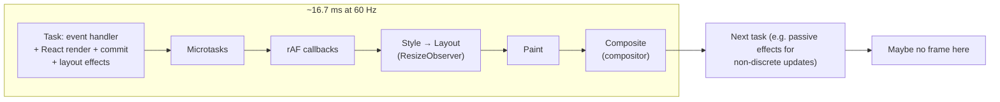
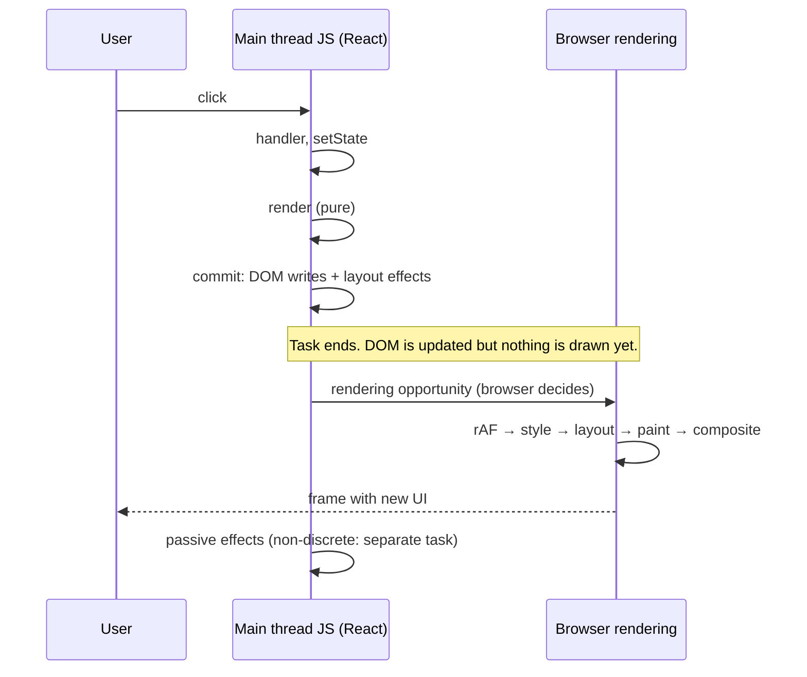
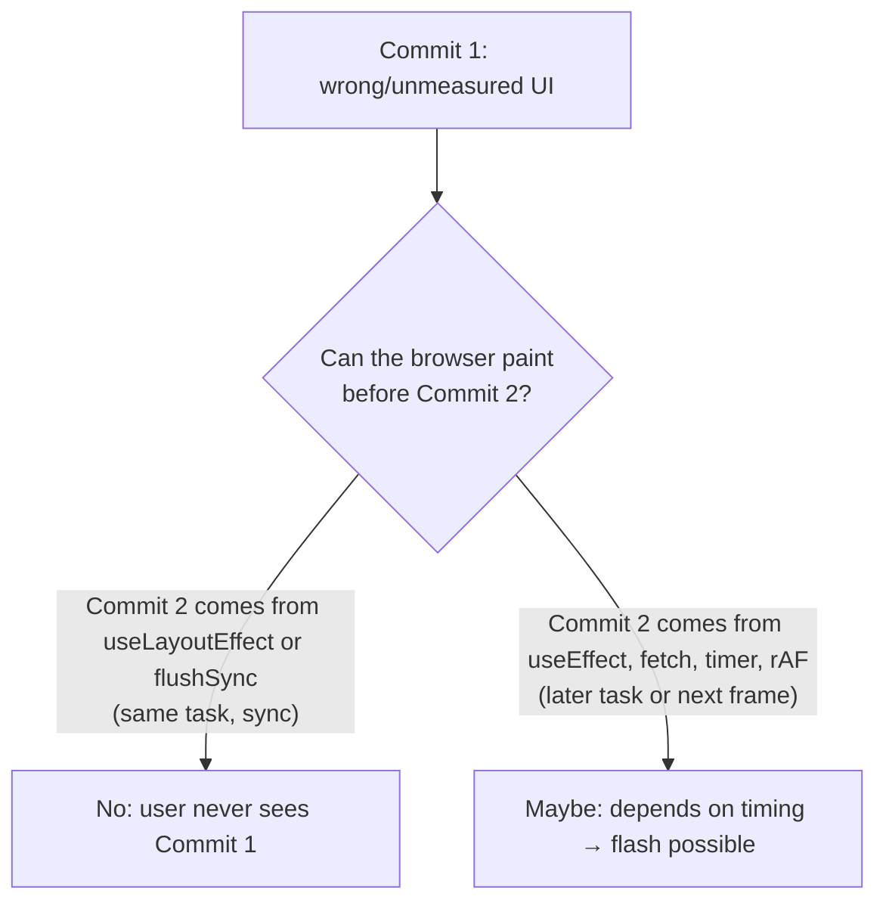

# 02 / 21 — Browser Paint vs React Updates

## 1. Lesson metadata

| | |
|---|---|
| **Level** | Advanced |
| **Study time** | 5–6 hours (reading 2.5 h, experiments 1.5 h, exercises 1.5–2 h) |
| **Prerequisites** | [02 — Invocation vs render vs reconcile vs commit vs layout vs paint](./02-render-reconcile-commit-paint.md), [11 — Render phase vs commit phase](./11-render-phase-and-commit-phase.md), [13 — Scheduling and update priorities](./13-scheduler-and-priorities.md), [15 — Interruptible, restartable, abandoned renders](./15-interruptible-restartable-abandoned-rendering.md), [18 — Effects and their timing](./18-effects-and-their-timing.md), [19 — Layout vs passive effects](./19-layout-vs-passive-effects.md), [20 — Commit work and DOM mutations](./20-commit-and-dom-mutation.md), [00/03 — Browser rendering pipeline](../00-web-and-javascript-foundations/03-browser-rendering-pipeline.md), [00/11 — Event loop, tasks, microtasks](../00-web-and-javascript-foundations/11-event-loop-tasks-microtasks.md) |
| **Next** | [22 — Automatic batching](./22-automatic-batching.md) |
| **Related** | [23 — Transitions and deferred rendering](./23-transitions-and-deferred-rendering.md), [30 — DevTools Profiler](./30-react-devtools-profiler.md), [33 — Scenario B: update only text in one element](./33-scenario-b-text-update.md), [35 — Scenario D: transition vs urgent interaction](./35-scenario-d-transition-vs-urgent.md), [Phase 3 / 08 — `useLayoutEffect`](../03-react-state-and-hooks/08-uselayouteffect.md), [Phase 7 / 18 — React vs browser bottlenecks](../07-performance/18-react-vs-browser-bottlenecks.md), [Phase 7 / 20 — Long tasks and the main thread](../07-performance/20-long-tasks-and-main-thread.md) |

**Learning objectives.** After this lesson you can:
1. Explain that React **updating the DOM** and the browser **painting** are two separate events, separated by (at least) the end of the current JavaScript task, and that the browser alone decides when a frame is produced.
2. Place every React-visible moment (event handler, render, commit mutation, layout effects, passive effects, `requestAnimationFrame` callbacks, style/layout/paint/composite) on one timeline, for both discrete and non-discrete updates.
3. Predict whether a user can observe an intermediate state (a "flash") between two React commits, and fix flashes with `useLayoutEffect` or a better data flow instead of guessing.
4. Explain why a long render or a long commit produces dropped frames and unresponsive input, and why time slicing lets the browser paint *between* render slices but never in the *middle* of a commit.
5. Explain why `flushSync`, `useLayoutEffect` and forced layout reads do not "paint sooner", and what they actually change.
6. Start CSS transitions on freshly mounted elements correctly, and decide when to bypass React state for per-frame animation.
7. Measure *React time* (Profiler), *main-thread time* (Performance panel), and *time to next paint* (a probe) separately, and attribute a slow interaction to the right layer.
8. Label which statements are public guarantees, which are the teaching model, and which are implementation details that can change between React versions.

**Concepts covered:** rendering opportunity, frame, task vs frame, `requestAnimationFrame` ordering, style/layout/paint/composite, forced synchronous layout, commit atomicity vs paint, layout-effect blocking semantics, passive-effect timing (discrete vs non-discrete), time slicing and yielding, input latency and Interaction to Next Paint, flash of intermediate UI, mount-time CSS transitions, compositor-only animations, imperative per-frame updates, measuring after-paint, Suspense reveal throttling, view transitions (volatile).

> ⚠ **Implementation-detail warning.** The *guarantees* in this lesson are the documented ones: the render/commit split, "layout effects run before the browser repaints", "updates inside a layout effect are flushed synchronously before the browser paints", `flushSync` semantics, and the event-loop rules in the HTML Standard. Everything about *how* the Scheduler yields (`MessageChannel`, slice length, `shouldYield`), how passive effects are flushed for discrete events, how Suspense fallbacks are throttled, and how lanes map to event types is an **implementation detail** that has changed across 16 → 17 → 18 → 19 and may change again. Where a number appears (for example "about 5 ms slices"), it is a conceptual anchor, not a contract. Spot-checked against react 19.3.1 in jsdom on 2026-10-22 (ordering claims in §5.1 and §3.3 reproduced; paint itself cannot be observed in jsdom). Verify anything finer in the source ([31 — Reading React's source code](./31-reading-react-source.md)).

---

## 2. Deep conceptual explanation

### 2.1 What problem is this lesson solving?

Lesson 20 ended with the commit phase: React calls DOM methods, synchronously, in one uninterrupted block. A very common reading of that is: "React updated the DOM, so the user now sees the new UI." That sentence is false in a precise, testable way, and the gap between "the DOM changed" and "pixels changed" is the source of three recurring families of bugs and misunderstandings:

1. **Flashes and layout jumps.** A component renders, the browser paints it, an effect measures it, state changes, React re-renders, the browser paints again. The user saw the first frame. (Tooltips at `(0,0)`, content shifting after measurement, an animation that starts from the wrong place.)
2. **Phantom performance numbers.** The React Profiler reports a 4 ms commit, but the interaction feels like 300 ms. React's own work was cheap; the browser then spent time on style, layout and paint of a very large DOM, or JavaScript elsewhere blocked the frame. Conversely a "slow React render" is blamed for what is really a long layout.
3. **Wrong fixes.** `flushSync` is added to "make it update faster"; `setTimeout(…, 0)` is sprinkled in to "wait for the DOM"; `useLayoutEffect` is used for everything "to be safe", which then blocks paint.

All three are cured by one model: **JavaScript work and frame production are interleaved on the same main thread, and the browser — not React — decides when frames happen.** React's job is to make the DOM correct and to cooperate with the browser by *not hogging the thread* (time slicing) and by *not exposing half-finished states* (atomic commit).

### 2.2 Tasks and frames are different units

The browser's event loop ([00/11](../00-web-and-javascript-foundations/11-event-loop-tasks-microtasks.md)) runs **tasks**: one event handler, one timer callback, one message event, one script evaluation. After each task, it runs **all microtasks**. Then — only if the browser decides there is a *rendering opportunity* — it runs the **update-the-rendering** steps. Roughly (the HTML Standard defines the precise order; this is a teaching summary):

1. Run `requestAnimationFrame` callbacks (and, in the standard's ordering, resize/scroll/media-query steps and animation-event steps before them).
2. Recalculate styles.
3. Calculate layout (if dirty).
4. Run `ResizeObserver` callbacks (these can dirty layout again and loop).
5. Run `IntersectionObserver` notifications (sampling).
6. Paint (record display lists), then hand layers to the compositor, which rasterises and **composites** and presents a frame to the screen.

Properties that matter for React:

- **Not every task is followed by a rendering opportunity.** At 60 Hz the opportunity comes about every 16.7 ms; at 120 Hz about every 8.3 ms; in a background tab there may be none. Ten 1 ms tasks can run between two frames. *Public guarantee* (HTML Standard): the user agent *may* skip rendering; it renders only when "it would make a visible difference" and at a cadence it chooses.
- **While a task runs, no frame can be produced** for main-thread-driven visuals. The main thread cannot run style/layout/paint while it is busy executing JavaScript. (Compositor-driven effects — scrolling in many cases, CSS `transform`/`opacity` animations — can continue; see §2.9.)
- **DOM mutations are just writes to a data structure.** They mark style/layout dirty. Nothing is drawn until the next update-the-rendering step.

Consequence: *two commits in the same task cannot both be seen by the user.* Only the last state is painted. And *a commit in task N and a commit in task N+1 can both be seen* if a rendering opportunity falls between them.

### 2.3 What React guarantees about its own side of the boundary

React exposes a small set of *documented* statements about this boundary:

| Statement | Source of the guarantee |
|---|---|
| Rendering is separate from the commit; the commit applies DOM changes **synchronously** and is not interrupted by the browser or by another render. | [Render and commit](https://react.dev/learn/render-and-commit) |
| `useLayoutEffect` runs **after** the DOM mutations of the commit and **before** the browser repaints. State updates scheduled inside it are processed synchronously **before** the browser paints. | [`useLayoutEffect` reference](https://react.dev/reference/react/useLayoutEffect) |
| `useEffect` is for effects that are not required to run before paint. React *may* run it before or after paint; do not rely on either. | [`useEffect` reference](https://react.dev/reference/react/useEffect) (as of 2026-10-22 the reference says only that React runs the setup function "when your component commits", and points to `useLayoutEffect` for effects that must run before paint; it makes no "after paint" promise) |
| `flushSync` forces the updates inside its callback to be processed (render + commit) **synchronously** before it returns. | [`flushSync` reference](https://react.dev/reference/react-dom/flushSync) |
| Updates marked as transitions are interruptible and do not block urgent updates. | [`startTransition` reference](https://react.dev/reference/react/startTransition) |

Notice what is *absent*: no statement says "React paints", "React schedules paint", or "after `setState` the user sees X within N ms". React cannot paint. It can only (a) leave the main thread free soon enough for the browser to do it and (b) choose *which DOM state* exists when the browser does.

### 2.4 The three questions to ask about any visual update

For any UI change in a React app, ask these in order:

1. **When does React finish committing the DOM state I care about?** (Which lane/priority; how long render takes; whether it suspends; whether it is a transition.)
2. **Can the browser paint between that commit and any later commit that would change the state again?** (Effects that set state, `requestAnimationFrame` chains, multiple tasks.)
3. **How much main-thread work must the browser do after the commit before it can show pixels?** (Style/layout/paint of the changed region; image decode; font loading.)

Questions 1 and 3 are performance; question 2 is *correctness of the visual experience*. Most flash bugs are answers to question 2.

### 2.5 Time slicing: where paint can and cannot happen

In concurrent rendering, the render phase for non-urgent lanes ([14 — Lanes](./14-lanes.md)) is performed in small slices. Between slices, React's scheduler yields to the main thread. *Teaching model:* the browser can run other tasks — including a rendering opportunity — between slices. *Implementation detail:* yielding is done by posting a new task (historically with `MessageChannel`, with a slice on the order of a few milliseconds) rather than by waiting for the next frame; React does not wait for `requestAnimationFrame`.

Therefore:

- **During a time-sliced render, the user sees the *old* UI.** The work-in-progress tree is not attached to the DOM ([10 — Current and work-in-progress trees](./10-current-and-work-in-progress-trees.md)). Paint between slices repaints the *current* committed DOM — possibly with an urgent update (typing) committed in between, which is the whole point of [23 — Transitions](./23-transitions-and-deferred-rendering.md).
- **The commit is one block.** All DOM mutations and all layout effects for that commit run in one task without yielding. A frame cannot be painted halfway through them. This is why you never see "half a commit" on screen (atomic *visual* commit), even though the DOM was mutated step by step.
- **A sync render (urgent update from a discrete event, `flushSync`) is not sliced.** It runs to completion in the current task, so a slow urgent render blocks the next frame.

### 2.6 Effects relative to paint

From [19](./19-layout-vs-passive-effects.md): layout effects run synchronously after DOM mutation within the commit; passive effects are scheduled after. Relative to paint:

| Moment | Relation to paint | Guarantee level |
|---|---|---|
| Render function body | Before DOM changes; before paint | Public (render is pure; may run many times) |
| Commit DOM mutations | Same task; before paint | Public |
| `useLayoutEffect` / ref callbacks / class `componentDidMount` | Same task as commit; **before paint** | Public (layout effects block paint) |
| `useEffect` for a **non-discrete** update (for example data arrival, timer) | Typically **after** paint (scheduled in a later task), not guaranteed | Teaching model |
| `useEffect` for an update caused by a **discrete event** (click, keydown) | React ≥ 18 flushes these synchronously at the end of the commit, i.e. **possibly before paint** | Documented in the [React 18 upgrade guide](https://react.dev/blog/2022/03/08/react-18-upgrade-guide) ("Consistent useEffect timing: React now always synchronously flushes effect functions if the update was triggered during a discrete user input event"); the exact mechanism is implementation detail |
| `requestAnimationFrame` callback registered during the commit | Next rendering opportunity, **before** that frame's style/layout/paint | Public (HTML Standard) |

The practical rule: **never use `useEffect` timing to reason about whether a user sees an intermediate frame, in either direction.** If an intermediate frame would be wrong, make the code not depend on that timing (compute during render, use a layout effect, or restructure).

### 2.7 Why `useLayoutEffect` blocks, and what it does *not* do

A layout effect runs in the commit task. If it does heavy work, the whole task takes longer, so the next rendering opportunity is later: you *delayed* paint. In exchange you get one thing: **you can read layout and re-render before the user sees anything.** That exchange is valuable only when the first render's visual output would otherwise be wrong (measured tooltips, scroll restoration, positioning, focus-driven layout).

It does not make the update "faster": it moves your measure-and-adjust step *ahead of* paint so that the very first frame is the corrected one.

Reading layout (`getBoundingClientRect`, `offsetHeight`, `getComputedStyle(...).someLayoutProp`) inside a layout effect forces the browser to compute **style and layout synchronously right now** because the DOM is dirty from the commit. That work would have happened at the next rendering opportunity anyway, so for a single read it is not wasted; for *interleaved* read/write cycles ("layout thrashing") it is repeated many times and is a cost.

### 2.8 `flushSync` is about ordering, not speed

`flushSync(() => setState(x))` makes React render and commit synchronously, inside the call. After `flushSync` returns, the DOM reflects the update and layout effects have run; pending passive effects may also be flushed (the [`flushSync` reference](https://react.dev/reference/react-dom/flushSync) says it "may run pending Effects"; in a sandbox run on react 19.3.1 the passive effect of a `flushSync` update ran before `flushSync` returned). It lets you read the *updated DOM* in the same handler:

```ts
flushSync(() => setTodos((t) => [...t, newTodo]));
listRef.current?.lastElementChild?.scrollIntoView();  // DOM already has the new item
```

It does **not** cause a paint. The browser still paints at the next rendering opportunity, after your handler returns. And it costs: it opts out of batching and concurrent features for that update, and it forces the work to complete in the current task.

### 2.9 What the compositor can do while the main thread is busy

Modern browsers run some visual work off the main thread:

- **Compositor-driven animations.** CSS animations/transitions on `transform` and `opacity` (and, where supported, other compositor-friendly properties) can continue while the main thread is blocked, *provided the element is already promoted to its own layer and no main-thread change interferes*. A janky React render will not stutter an already-running `transform` transition, but will delay anything needing style/layout/paint.
- **Scrolling.** Scrolling is frequently handled on the compositor thread; scroll *handlers* and layout-dependent content still run on the main thread (the specifics depend on browser, device and event-listener passivity).

This is why "animate with `transform`, not `top`/`left`" ([00/03](../00-web-and-javascript-foundations/03-browser-rendering-pipeline.md)) interacts with React: moving a thing every frame by changing React state means main-thread work (render, commit, style, layout/paint) per frame; moving it by writing `transform` via a ref (or CSS) can bypass React and, with CSS, even the main thread.

### 2.10 Interaction latency: the user-visible metric

The thing the user experiences is **input → next frame that reflects it**. The web-performance metric for it is *Interaction to Next Paint* (INP): it measures, per interaction, the delay until the next paint after input — comprising *input delay* (main thread busy when the input arrives), *processing time* (your handlers, React render and commit, effects that run before that paint), and *presentation delay* (style, layout, paint, composite until the frame is shown). React's Profiler sees only part of the middle component. The model for this lesson: **latency = wait for main thread + your JS + React + browser rendering work**.

### 2.11 Misconceptions

| Misconception | Reality |
|---|---|
| "After `setState` the screen has the new state." | `setState` schedules work. Even after commit, the screen updates only at the next frame, which the browser decides. |
| "React commit = paint." | The commit mutates the DOM. Style, layout, paint and composite happen later, in the browser's rendering steps. |
| "`useEffect` always runs after paint, `useLayoutEffect` always before." | Layout effects: always before paint (guaranteed). Passive effects: *usually* after, but React may flush them before paint (discrete events, later updates in the same flush, `flushSync`). |
| "A 5 ms commit in the Profiler means a 5 ms update." | The Profiler measures React's work. Browser style/layout/paint and any other JS in the task are not included. |
| "`useLayoutEffect` is just a faster `useEffect`." | It is a *blocking* effect. It delays paint by exactly the time it takes and exists to let you correct the first frame. |
| "`setTimeout(fn, 0)` waits for paint." | It waits for a later task; a frame may or may not have been painted in between. |
| "Concurrent rendering means React renders in a background thread." | Rendering still happens on the main thread; time slicing yields between slices so the browser can paint and handle input. |
| "Two `setState` calls = two paints." | Two `setState` calls in one event batch into one render ([22](./22-automatic-batching.md)); even separate commits in the same task are painted at most once. |
| "`flushSync` makes the browser paint now." | It only makes React commit now. |
| "If I don't see a flash on my fast laptop, it doesn't exist." | Flashes depend on frame timing and CPU speed. Throttle CPU in DevTools. A bug that depends on timing is still a bug. |

---

## 3. Internal mechanics

### 3.1 Public guarantees

1. **Commit is synchronous and uninterrupted** with respect to rendering: once React starts applying a commit, it finishes (including layout effects) before returning control. *(Render and commit docs.)*
2. **Layout effects precede paint.** Any state update inside a layout effect is handled before the browser paints. *(`useLayoutEffect` docs.)*
3. **`flushSync` is synchronous.** After it returns, the DOM has been updated for updates inside the callback. *(`flushSync` docs.)*
4. **Event-loop and rendering order** is defined by the HTML Standard's event-loop processing model: task, microtasks, then (optionally) update-the-rendering with `requestAnimationFrame` callbacks before style/layout/paint. *(HTML Standard.)*
5. **Browsers may skip frames.** There is no guarantee of a paint at any specific time, and none while the page is hidden.

### 3.2 Teaching model

A simplified timeline for one click that sets state in an event handler:

```text
[Task: click event]
  your onClick runs                       (JS)
  setState called -> update queued with a high ("discrete") priority
  handler returns
  [microtask checkpoint] React flushes the sync-lane update (render -> commit)
        render: component functions run (pure)
        commit: DOM mutations; layout effects; (for discrete events) passive effects flushed
[browser: rendering opportunity?]
  rAF callbacks -> style -> layout -> paint -> composite
[Task: later tasks...]
        passive effects for non-discrete updates run here
```

And for a *transition* update:

```text
[Task] startTransition(setState) queued in a transition lane
[Task] render slice 1 (≤ a few ms) -> yield
[browser: may paint the OLD UI or handle input]
[Task] render slice 2 -> yield ... (urgent updates may interrupt and restart)
[Task] render finishes -> commit (sync, atomic) -> layout effects
[browser: next rendering opportunity paints the new UI]
```

This is the **teaching model**: it conveys the shape — urgent work first, sliced work in between paints, atomic commit — without committing to exact queueing mechanics.

### 3.3 Implementation details (version-specific; spot-checked on react 19.3.1)

- **Where the sync lane flushes.** For discrete events React ≥ 18 flushes the synchronous lane in a microtask scheduled by the update (executed on 19.3.1: after `button.click()` returned, `render`, layout effect and passive effect had not yet run; they ran in the following microtask checkpoint, before any rAF or timer). Which exact hook does this has varied; do not rely on whether it is "in the event handler's microtask checkpoint" or "right after dispatch". What you can rely on: *before the browser can paint after the handler.* Also in 18+, with the legacy root API removed in 19, all updates use the concurrent root semantics; there is no "legacy sync mode" to fall back to.
- **Yielding.** The scheduler package yields by posting a task, using `setImmediate` where it exists (Node.js and jsdom), otherwise `MessageChannel` (the browser case), with a `setTimeout` fallback (`packages/scheduler/src/forks/Scheduler.js`). The slice is on the order of a handful of milliseconds. Yielding does **not** align with frames; two or three slices may run per frame or one slice per several frames, depending on the time the browser spends on other tasks.
- **Passive-effect flush.** Passive effects from a commit are scheduled with the scheduler at normal priority. If the commit came from a discrete event (or a sync-lane update), React flushes them at the end of the commit instead. Before any new render begins, React flushes pending passive effects from the previous commit. (This last property — "pending passive effects are flushed before the next render" — is why a render never sees stale effects.)
- **Suspense fallback throttling.** React may deliberately delay revealing content or fallback so that rapid resolve/suspend cycles do not flicker (`FALLBACK_THROTTLE_MS = 300` in `ReactFiberWorkLoop.js` on `main`, checked 2026-10-22). Its existence and duration are implementation details. See [24 — Suspense conceptual internals](./24-suspense-conceptual-internals.md).
- **Profiler timestamps.** `Profiler` `actualDuration` and the DevTools flame graph measure React's render (and in the DevTools commit panel, commit) time. They do not include browser rendering steps after the task ends.
- **Scheduling APIs.** Browsers are adding `scheduler.postTask`/`scheduler.yield` and `isInputPending`. React's scheduler may adopt some of them; treat adoption as version-specific.

### 3.4 Forced synchronous layout (browser behavior)

When the DOM has been mutated and JavaScript then asks for a value that depends on layout (`offsetWidth`, `getBoundingClientRect()`, `scrollHeight`, `getComputedStyle(el).width`, …), the browser must recompute style and layout *immediately* to answer. This is a **forced synchronous layout** (a.k.a. forced reflow). It is correct behavior, not a bug, but costs time proportional to the dirty region. It also has a useful side effect: it **flushes pending style changes**, which matters for CSS transitions (§5.4).

### 3.5 Measuring "after paint"

There is no direct "painted" event. Two practical probes:

- **Approximate-after-paint idiom:** request an animation frame, then queue a task from inside it. The rAF callback runs *before* that frame's paint; the task queued from it runs *after* the frame finishes (in practice). It is a heuristic with known caveats (browser variations, background tabs).
- **Event Timing / `PerformanceObserver`:** for user interactions, the `event` entry type's `duration` is measured until the next paint (rounded to 8 ms). This is the same data INP uses. `PerformanceObserver` also exposes `longtask` entries (tasks over 50 ms) in Chromium-based browsers.

---

## 4. Step-by-step execution walkthrough

We will trace one component in four situations. Component:

```tsx
function Tooltip({ anchor, children }: { anchor: HTMLElement | null; children: React.ReactNode }) {
  const ref = useRef<HTMLDivElement>(null);
  const [pos, setPos] = useState({ top: 0, left: 0 });

  useEffect(() => {                       // variant A (uses passive effect)
    if (!anchor || !ref.current) return;
    const a = anchor.getBoundingClientRect();
    const t = ref.current.getBoundingClientRect();
    setPos({ top: a.top - t.height - 8, left: a.left + (a.width - t.width) / 2 });
  }, [anchor]);

  return <div ref={ref} style={{ position: "fixed", top: pos.top, left: pos.left }}>{children}</div>;
}
```

### 4.1 Situation 1 — tooltip shown by a click, positioned with `useEffect`

Setup: a click handler sets `anchor`, which mounts `Tooltip`.

1. **Task: click.** Handler runs; `setAnchor(el)`; handler returns.
2. **Sync lane flush.** React renders `Tooltip` with `pos = {0,0}`. Output: `div` at `top: 0; left: 0`.
3. **Commit.** `div` is inserted. `ref.current` is set. Layout effects: none. For a *discrete* event, React flushes the passive effect at the end of the commit (documented in the React 18 upgrade guide as consistent `useEffect` timing for discrete events), so the effect runs **in the same task**, before paint:
   - `getBoundingClientRect()` ×2 force style + layout; the tooltip is measured at `(0,0)`.
   - `setPos(...)` is called inside the effect: schedules another render. Because the effect was flushed in a sync context the new update is also processed promptly; it renders and commits with the correct position.
4. **Rendering opportunity.** Paint shows the *corrected* position — no flash.

*Predict:* Did the user ever see the tooltip at the top-left corner? In this specific trace (discrete event, fast machine), probably not. But this is **not guaranteed by React**, and Situation 2 shows the same code flashing.

### 4.2 Situation 2 — same component, anchor arrives from a non-discrete update

Setup: the anchor is set from a `setTimeout` or after a `fetch` resolves (non-discrete; default lane).

1. **Task: timer.** `setAnchor(el)` runs; update queued at default priority; the scheduler posts a task.
2. **Task: React render + commit** (a separate task). DOM now has the tooltip at `(0,0)`. Layout effects: none. The passive effect is *scheduled*, not run.
3. **Rendering opportunity may occur here.** The browser's next frame is allowed to fall between the commit task and the passive-effect task. If it does, the frame **paints the tooltip at `(0,0)`**.
4. **Task: passive effects.** Effect measures, `setPos`. Another render + commit; the next frame shows the right position.

The user saw a one-frame flash only if a rendering opportunity fell in the gap — non-deterministic, more likely on slow devices and when the commit task was heavy. These are the worst bugs: they pass on the developer's machine.

### 4.3 Situation 3 — same component with `useLayoutEffect`

Replace `useEffect` with `useLayoutEffect`:

1. Render at `(0,0)` → commit inserts `div` → **layout effect runs inside the commit**, measures (forced layout), calls `setPos`.
2. A state update in a layout effect is processed **synchronously before paint** (guarantee): React discards nothing of the first commit's DOM (it is already applied) and immediately renders and commits again with the corrected position, in the same task.
3. Next rendering opportunity paints the corrected state only.

Costs: two renders and two commits instead of one (the first commit's DOM state is never seen), and the paint is delayed by the measuring and the second render. It is the *minimal-visual-defect* solution when you cannot know the position before rendering.

### 4.4 Situation 4 — eliminating the second render altogether

If the position can be computed with CSS (anchor positioning, `position: absolute` within a positioned wrapper, `transform: translate(-50%, -100%)`), there is nothing to measure in JS, no second render, no effect. This is an *alternative* to `useLayoutEffect`, not a variant of it (§7). The best flash fix is often "don't need to measure".

### 4.5 Timeline for a 300 ms render, urgent vs transition

Setup: typing in a search box filters a 10,000-row list; filtering render costs ~300 ms.

*Urgent (no transition):*

1. keydown → `onChange` → `setQuery`, `setFiltered` (batched).
2. Sync render: 300 ms blocking. No rendering opportunity inside the task.
3. Commit; layout. Browser then paints: **the text appears in the input ~300 ms late**. At 60 Hz roughly 18 frames were dropped.

*With the filter in `startTransition` or the list using `useDeferredValue`:*

1. keydown → `setQuery` (urgent, sync lane) and `startTransition(() => setFilter(q))`.
2. Urgent render + commit: the input updates in ~1–2 ms. Next frame paints the typed character.
3. Transition render in slices: each slice ≲ a few ms; frames paint in between (old list, new input value). If the user types again, the in-progress transition render is abandoned and restarted with the new value ([15](./15-interruptible-restartable-abandoned-rendering.md)).
4. Transition finishes → atomic commit → the next frame shows the filtered list.

Total React work is not smaller (possibly larger because of restarts); the *latency of the urgent update* is. Pair with [35 — Scenario D](./35-scenario-d-transition-vs-urgent.md).

---

## 5. Code examples

### 5.1 Minimal example — logging the order of events relative to paint

```tsx
import { useEffect, useLayoutEffect, useState } from "react";

function afterNextPaint(cb: () => void): void {
  requestAnimationFrame(() => {
    // Runs before this frame's paint. A task queued from here runs after it (heuristic).
    const ch = new MessageChannel();
    ch.port1.onmessage = () => {
      ch.port1.close();
      cb();
    };
    ch.port2.postMessage(null);
  });
}

export function OrderProbe() {
  const [n, setN] = useState(0);

  console.log("render", n);

  useLayoutEffect(() => {
    console.log("layout effect", n);
    requestAnimationFrame(() => console.log("rAF (before paint)", n));
    afterNextPaint(() => console.log("after paint (approx)", n));
  }, [n]);

  useEffect(() => {
    console.log("passive effect", n);
  }, [n]);

  return <button onClick={() => setN((x) => x + 1)}>clicked {n}</button>;
}
```

**Line notes.**
- `afterNextPaint` uses `requestAnimationFrame` to land *inside* a rendering opportunity, then a `MessageChannel` message to run in a *later task*. The message task cannot start until the current task (the rAF callback, and the paint that follows it in the same rendering step) completes. It is a probe, not an API to ship in product code.
- `OrderProbe` logs the order for a click (a discrete event).

**Predict** (click once, after the initial mount; ignore StrictMode in development for now): what is the order of the logs?

**Reveal.** `render 1` → `layout effect 1` → `passive effect 1` → `rAF (before paint) 1` → `after paint (approx) 1`. (Executed on react 19.3.1 + jsdom 2026-10-22 for the first four; jsdom has no real frames, so the "after paint" step is the standard's model, not measured.)
Why: for a discrete event React 18+ flushes the passive effect at the end of the commit, in the same task, so it comes before the rAF callback (a later rendering step). If you trigger the state change from `setTimeout` instead, `passive effect` is scheduled as a separate task and its position relative to `rAF` is **not deterministic in browsers**: both orders can occur (jsdom's emulated rAF always printed passive first in our run, so this particular claim is unresolved by execution). In development with `<StrictMode>`, on mount (not on click) the component renders twice and effects mount, unmount and mount again ([28](./28-strict-mode-behavior.md)); a click's re-render also runs the render function twice but does not remount.

### 5.2 Practical example — a tooltip without flash, using `useLayoutEffect`

```tsx
import { useLayoutEffect, useRef, useState, type ReactNode } from "react";
import { createPortal } from "react-dom";

type Pos = { top: number; left: number };

export function Tooltip({ anchor, children }: { anchor: HTMLElement; children: ReactNode }) {
  const ref = useRef<HTMLDivElement>(null);
  const [pos, setPos] = useState<Pos | null>(null);

  useLayoutEffect(() => {
    const el = ref.current;
    if (!el) return;
    const a = anchor.getBoundingClientRect();
    const t = el.getBoundingClientRect();
    setPos({
      top: a.top - t.height - 8,
      left: a.left + (a.width - t.width) / 2,
    });
  }, [anchor, children]);

  return createPortal(
    <div
      ref={ref}
      role="tooltip"
      style={{
        position: "fixed",
        top: pos?.top ?? 0,
        left: pos?.left ?? 0,
        visibility: pos ? "visible" : "hidden",   // belt and braces: first commit is never visible
      }}
    >
      {children}
    </div>,
    document.body,
  );
}
```

**Line notes.**
- `useLayoutEffect` guarantees the first (unpositioned) commit is never painted; `visibility: hidden` on the unpositioned state is an extra safeguard: even if you later switch to `useEffect` for a good reason, the unpositioned frame is invisible. It still occupies layout (needed for the measurement; `display: none` would measure 0).
- `[anchor, children]` re-measures when content changes. `children` as a dependency is a reference that changes on every parent render, so the effect re-runs (and `setPos` with a new object re-renders) — this can loop if the parent re-renders because of `pos`. Here `Tooltip`'s own state change does not re-render the parent, so `children` is stable across the tooltip's own updates. If your content is not stable, prefer a `ResizeObserver` on the tooltip (see §5.5).
- Rendering through a portal avoids being clipped by ancestors with `overflow: hidden`.

**Trade-off.** Blocks paint for the duration of two measurements and one extra render. For one tooltip, negligible; for hundreds of simultaneously mounted measured elements (e.g. every row of a table), measure in a batch or avoid measurement.

### 5.3 Incorrect example — measuring in `useEffect` and starting a transition in the same frame

```tsx
function Collapse({ open, children }: { open: boolean; children: React.ReactNode }) {
  const ref = useRef<HTMLDivElement>(null);
  const [height, setHeight] = useState<number | "auto">(0);

  useEffect(() => {
    if (!ref.current) return;
    setHeight(open ? ref.current.scrollHeight : 0);
  }, [open]);

  return (
    <div style={{ height, overflow: "hidden", transition: "height 200ms" }}>
      <div ref={ref}>{children}</div>
    </div>
  );
}
```

**Predict:** What does the user see when `open` flips from `false` to `true` on a slow machine?

**Reveal.** Commit 1 renders with `open = true` but `height` still `0` (state not yet updated), then the passive effect measures and sets `height = scrollHeight`. If a frame paints between the commits it is the unchanged collapsed state (harmless), and then the transition from `0` to the target animates correctly. The bug shows up elsewhere: **on first mount with `open = true`** the initial render has `height: 0`, the effect sets the target; because the element mounted with `height: 0` and then changed, you see a collapse-open animation on mount that you may not want, *or* — if the browser coalesces both style states before computing the first style — no animation at all. Which of the two you get depends on timing: that nondeterminism is the defect. Also, when `open` flips to `false` after the content changes, `scrollHeight` is stale by one commit. The fix is to make the logic independent of timing:

### 5.4 Corrected implementation — controlled start state, forced style flush, no timing dependence

```tsx
import { useLayoutEffect, useRef, useState, type ReactNode } from "react";

export function Collapse({ open, children }: { open: boolean; children: ReactNode }) {
  const inner = useRef<HTMLDivElement>(null);
  const [height, setHeight] = useState<number>(open ? -1 : 0); // -1 means "auto on first render"
  const mounted = useRef(false);

  useLayoutEffect(() => {
    const el = inner.current;
    if (!el) return;
    if (!mounted.current) {
      mounted.current = true;          // first layout: no animation
      setHeight(open ? el.scrollHeight : 0);
      return;
    }
    const target = open ? el.scrollHeight : 0;
    setHeight(target);
  }, [open]);

  return (
    <div
      style={{
        height: height === -1 ? "auto" : height,
        overflow: "hidden",
        transition: mounted.current ? "height 200ms ease" : "none",
      }}
    >
      <div ref={inner}>{children}</div>
    </div>
  );
}
```

**Notes.** The exact animation recipe for height transitions is not unique (CSS `grid-template-rows: 0fr → 1fr`, `interpolate-size`, or the Web Animations API avoid JavaScript measurement entirely in modern browsers — check browser support). The point here is the *timing contract*: the measurement and the style change happen in a layout effect; the first mount is deliberately non-animated; and the code never depends on whether a frame fell between two commits. Note `mounted.current` is read during render (a ref read in render is discouraged — [Phase 3 / 10](../03-react-state-and-hooks/10-useref-and-mutable-references.md)); here it only toggles a style hint, but if you want the strictest purity, derive "animate" from state instead.

### 5.5 Advanced example — getting a CSS transition to start on a newly mounted element

CSS transitions run only when the browser has computed a *before* style and then sees a changed *after* style. If an element is inserted with its final class, there is no "before", so no transition. React does not give you a hook "after the first style computation", so you create one explicitly:

```tsx
import { useLayoutEffect, useRef, useState } from "react";

export function FadeIn({ children }: { children: React.ReactNode }) {
  const ref = useRef<HTMLDivElement>(null);
  const [shown, setShown] = useState(false);

  useLayoutEffect(() => {
    const el = ref.current;
    if (!el) return;
    void el.offsetWidth;        // force style/layout flush: commits the "before" style (opacity: 0)
    setShown(true);             // processed synchronously before paint: next commit sets opacity: 1
  }, []);

  return (
    <div ref={ref} style={{ opacity: shown ? 1 : 0, transition: "opacity 300ms" }}>
      {children}
    </div>
  );
}
```

**Line notes.**
- `void el.offsetWidth` reads layout → forces the browser to resolve style with `opacity: 0` and record it as the transition's starting style.
- `setShown(true)` inside the layout effect is flushed before paint (guarantee). The second commit changes `opacity` to `1` on an element whose "before" style is known → the transition runs.
- Without the forced read, both style changes may be coalesced into one style resolution before the first paint, and the element appears at full opacity instantly.
- Alternatives: `requestAnimationFrame` twice (works but timing-dependent in principle), CSS `@starting-style` (supported in current Chromium and other modern browsers; check compatibility), or the Web Animations API (`el.animate(...)`) from a ref callback — which does not depend on style-change detection at all.

**React 19 detail.** A ref callback may return a cleanup function (ref cleanup), so `el.animate(...)` can be started in a ref callback and cancelled in its cleanup, with no state:

```tsx
function FadeInWAAPI({ children }: { children: React.ReactNode }) {
  return (
    <div
      ref={(el) => {
        if (!el) return;
        const anim = el.animate([{ opacity: 0 }, { opacity: 1 }], { duration: 300, fill: "backwards" });
        return () => anim.cancel();   // ref cleanup functions are React 19+ (verified: returned cleanup ran on unmount in react 19.3.1)
      }}
    >
      {children}
    </div>
  );
}
```

Note: the inline ref callback is a new function each render, so React calls the old cleanup and the new callback on every re-render of this component — the animation would restart. Keep the ref callback stable with `useCallback` if the component re-renders, or restrict to a component that renders once.

### 5.6 Advanced example — per-frame updates without per-frame React renders

A draggable element updated through state re-renders the component at pointer-event rate:

```tsx
// Per-frame React renders: simple, but main-thread cost per move
const [x, setX] = useState(0);
<div onPointerMove={(e) => setX(e.clientX)} style={{ transform: `translateX(${x}px)` }} />
```

Alternative: write the style imperatively, once per frame, and commit to React state only at the end:

```tsx
import { useEffect, useRef, useState } from "react";

export function Draggable() {
  const el = useRef<HTMLDivElement>(null);
  const latestX = useRef(0);
  const raf = useRef<number | null>(null);
  const [committedX, setCommittedX] = useState(0);

  useEffect(() => () => { if (raf.current !== null) cancelAnimationFrame(raf.current); }, []);

  const schedule = () => {
    if (raf.current !== null) return;
    raf.current = requestAnimationFrame(() => {
      raf.current = null;
      if (el.current) el.current.style.transform = `translateX(${latestX.current}px)`;
    });
  };

  return (
    <div
      ref={el}
      style={{ transform: `translateX(${committedX}px)`, touchAction: "none", willChange: "transform" }}
      onPointerMove={(e) => {
        if (e.buttons === 0) return;
        latestX.current = e.clientX;
        schedule();                      // at most one DOM write per frame, no React render
      }}
      onPointerUp={() => setCommittedX(latestX.current)}   // one React render at the end
    />
  );
}
```

**Trade-offs.** The DOM node is now partly *outside* React's control: React's `style` object only mentions `transform` at commit; if React re-renders mid-drag with a different `committedX`, it would reset `transform` — here it does not because `committedX` is unchanged, but in general you must guarantee React and your imperative writes never fight over the same property. Use this technique only for measured per-frame hot paths (drag, resize, canvas-like interaction), and keep the imperative part small and ref-scoped ([20 §5.2](./20-commit-and-dom-mutation.md) on DOM ownership).

### 5.7 Advanced example — a small frame-time probe for development

```ts
// Logs interactions that take more than `thresholdMs` to reach the next paint.
export function observeSlowInteractions(thresholdMs = 100): () => void {
  if (typeof PerformanceObserver === "undefined") return () => {};
  const po = new PerformanceObserver((list) => {
    for (const entry of list.getEntries() as PerformanceEventTiming[]) {
      if (entry.duration >= thresholdMs) {
        console.warn(
          `${entry.name} took ${entry.duration}ms to next paint ` +
            `(input delay ${(entry.processingStart - entry.startTime).toFixed(0)}ms, ` +
            `processing ${(entry.processingEnd - entry.processingStart).toFixed(0)}ms)`,
        );
      }
    }
  });
  try {
    po.observe({ type: "event", durationThreshold: 16, buffered: true });
  } catch {
    return () => {};                // entry type unsupported
  }
  return () => po.disconnect();
}
```

**Notes.** `PerformanceEventTiming` is available in the TypeScript DOM lib in recent versions; if your TS version lacks it, declare a minimal interface. `duration` is rounded to 8 ms and runs until the next paint; `processingStart - startTime` is the input delay (main thread was busy); `processingEnd - processingStart` is the handler time. React render and commit for a discrete update typically land inside the processing window; presentation delay is `startTime + duration - processingEnd`. Support differs across browsers (Chromium-based browsers have led; check MDN for current support): feature-detect as shown.

---

## 6. Visual explanations

### 6.1 One frame on the main thread



### 6.2 The same state change, painted or not



### 6.3 Where a flash can occur



### 6.4 Time slicing and paint

```text
time →
Urgent render:  |=====300ms render+commit=====|[paint late]
Transition:     |urgent 2ms|P|s1|P|s2|P|s3|P|s4|commit|P(new list)
                 P = browser may run a frame; s = render slice (old UI still on screen)
```

---

## 7. Alternative approaches and trade-offs

Problem: *the first rendered frame must not show the unmeasured/uncomputed state.*

| Approach | How it avoids the flash | Costs | Best when |
|---|---|---|---|
| **A. Compute during render** (props/state/CSS) | There is no intermediate state | None extra; needs information available at render | Position derivable from data; CSS can express it |
| **B. `useLayoutEffect` + state** | Second commit happens before paint | Delays paint; extra render; runs on every measured mount | Layout-dependent output that needs JS measurement |
| **C. CSS only** (anchor positioning, `transform: translate`, `grid` tricks, `@starting-style`) | No JS, no React round-trip | Browser support constraints; less flexible | Static or relative positioning; entry animations |
| **D. `useEffect` + hide until ready** (`visibility: hidden`) | Intermediate frame is invisible | An extra frame of latency before visible; two commits | Non-critical measurement, avoiding layout-effect cost |
| **E. Imperative write in ref callback** (ref callback measures and writes `style`) | No second React render | DOM written outside React; must not conflict with React-managed props | Hot paths, many instances |
| **F. `ResizeObserver` + state** | Reacts to later size changes | Callback runs after layout, before paint in the same frame (so a state update will paint one frame later in the worst case); possible loops | Content changes size over time |

**A scenario where `useLayoutEffect` is *not* the best answer.** A virtualised table with 500 mounted rows, each measuring its own height to feed a virtualiser. A layout effect per row is 500 forced layouts in one commit task, each possibly dirtying layout for the next (interleaved reads and writes if rows write styles). Use a single `ResizeObserver` shared by all rows (observer callbacks are batched and delivered after layout, before paint), measure in one pass (batched reads, then batched writes), or let a library handle it. Here a small visual imperfection for one frame is cheaper than long blocking commits.

Another scenario: **animated numbers or scroll-linked effects.** If the visual depends on a per-frame source (pointer, scroll, rAF), re-rendering React per frame is usually the wrong layer (§5.6): prefer CSS (scroll-driven animations where supported), WAAPI, or direct style writes.

---

## 8. Best practices and anti-patterns

### 8.1 Practices

1. **Reason with the timeline.** For any flash, draw the commits and ask whether a rendering opportunity can fall between them (§2.4).
2. **Compute, don't synchronise.** Derive visuals during render ([Phase 3 / 17 — Derived state](../03-react-state-and-hooks/17-derived-state.md)); an effect that sets state to mirror something is both a render and a flash waiting to happen.
3. **Use `useLayoutEffect` surgically**: measurement, scroll position, focus/selection restoration that must happen before the user sees the frame. Keep the body tiny; batch DOM reads before writes.
4. **Keep urgent updates cheap; defer the expensive ones** with transitions or `useDeferredValue` ([23](./23-transitions-and-deferred-rendering.md)). The metric to defend is *time to next paint after input*.
5. **Animate compositor properties** (`transform`, `opacity`) with CSS or WAAPI; do not drive them with per-frame React state unless you have measured and accepted the cost.
6. **Measure in three layers**: Profiler (React), Performance panel (main thread, style/layout/paint), Event Timing/INP (user-visible latency). Throttle CPU (4×–6×) when reproducing.
7. **Make correctness independent of paint timing.** If the code is correct whether or not a frame lands between two commits, the bug class disappears.

### 8.2 Anti-patterns

| Anti-pattern | Why it fails | Fix |
|---|---|---|
| `useEffect` that measures and sets state to position something | Flash on slow frames; two commits | Layout effect, CSS, or hide-until-measured |
| `useLayoutEffect` everywhere "to be safe" | Blocks paint for work that does not need it; SSR warnings in React 18 and earlier | Default to `useEffect`; promote with a reason |
| `setTimeout(…, 0)` to "wait for the DOM" | After commit, the DOM *is* there when your effect runs; the timeout adds a task and non-determinism | Use effect/layout effect/ref callback |
| `flushSync` in handlers "for speed" | Forces sync render, defeats batching, blocks the frame | Only when you must read the updated DOM in the same handler |
| Reading layout in a loop with writes | Layout thrash; forced layout per iteration | Read all, then write all |
| Per-frame `setState` for pointer/scroll animation | A render and commit per frame; main-thread bound | Imperative `style`/WAAPI/CSS; commit final state to React |
| Measuring React commit time and concluding "the page is fast" | Ignores browser rendering and INP | Add Performance panel and Event Timing |
| Using the "after paint" probe in product code to sequence logic | Heuristic; breaks in background tabs | Use effects and explicit events (`transitionend`, `animationend`) |

### 8.3 Justified exceptions

- **A one-frame flash is acceptable** for non-critical visuals (a skeleton → content swap) where complexity of avoiding it exceeds its value. Decide with evidence; state it.
- **`flushSync`** is correct for "insert then scroll to/focus the new element" and similar when the DOM must be updated before the next statement ([`flushSync` docs](https://react.dev/reference/react-dom/flushSync)).
- **`useLayoutEffect` with heavy work** is acceptable when the alternative is visibly wrong output and the cost is bounded (a single element).

---

## 9. Real-world application

| Domain | Where paint/update timing matters | Engineering constraint |
|---|---|---|
| **E-commerce** | Add-to-cart badge, mini-cart drawer animate; image gallery zoom | Drawer opens on click (discrete). Keep the open handler's render cheap; open animation via CSS transform; lazy-load content after open with a transition so the first frame is immediate. |
| **Dashboards** | Large tables filtering on typing; live charts updating at 1–10 Hz | Typing must paint within a frame; filter via `useDeferredValue`; chart updates coalesced to ≤ one commit per frame; avoid layout-affecting changes per tick. |
| **Finance** | Price tickers flashing green/red on change | The *intentional* flash is a CSS animation retriggered on value change: use `key={tick.id}` (remount) or WAAPI; the flash must not depend on whether React re-rendered between paints. |
| **Forms** | Validation messages that shift layout; auto-resize textareas | Auto-resize measures `scrollHeight` → `useLayoutEffect` to avoid a one-frame jump; reserve space for messages to avoid layout shift (CLS). |
| **Auth/Redirect** | Flash of logged-out UI before session check | First render must be a neutral state, not logged-out UI; do not rely on an effect to redirect before the content paints. |
| **Realtime chat** | Auto-scroll to the newest message | After inserting a message: layout effect (or `flushSync` + `scrollIntoView`) so scroll is adjusted before paint; keep "user scrolled up" state to avoid stealing scroll. |
| **Multi-team design system** | Shared `Popover`, `Tooltip`, `Modal` used in 100 places | A flash in the shared component is a flash everywhere; fix once, with a layout effect or CSS, and test on throttled CPU in a visual test ([Phase 8 / 12](../08-testing-and-quality/12-visual-regression.md)). |

---

## 10. Debugging and troubleshooting

### 10.1 "I see a one-frame flash of the wrong UI"

*Reproduce.* DevTools → Performance → CPU 4× or 6× slowdown. Record while triggering. Or Rendering → Frame Rendering Stats. Or capture a screen recording at 60 fps and step frames.

*Investigate.*
1. In the Performance recording, zoom to the interaction. Find the **commit** (a block of "Run Microtasks"/React internals with DOM calls) and the **Frames** lane. Is there a frame between commit 1 and the task that does commit 2?
2. Identify what triggered commit 2: a passive effect (task after the frame), a `fetch().then` (later task), `requestAnimationFrame` callback, or a layout effect (same task).
3. In the React DevTools Profiler, check the "why did this render" list for the second render: "Hooks changed" pointing to a `setState` in an effect.

*Root cause.* Commit 2 is scheduled in a later task than commit 1.

*Fix/validate.* Move the dependent computation into render, use `useLayoutEffect`, hide until ready, or restructure so there is one commit. Validate by recording again: no frame between them; or the frame shows the right state. Re-test under CPU throttling.

### 10.2 "Profiler says commit is fast, but the interaction is slow"

*Investigate.* Performance panel: look at **the same task** after React's commit. Large "Recalculate Style", "Layout" (note the number of nodes affected), "Paint" slices are browser cost. Check Event Timing for input delay: a long task before your handler explains slowness unrelated to your component.

*Root causes.* Huge DOM subtree (fix: virtualise; [Phase 7 / 09](../07-performance/09-windowing-and-virtualization.md)), expensive CSS selectors/layout (`contain`, `content-visibility`), forced layouts in effects, image decode, layout thrash, third-party scripts.

### 10.3 "A CSS transition doesn't run for a newly mounted element"

Cause: no "before" style. Fix: §5.5. Validate: in DevTools → Animations panel or the Elements → "Computed" transition entries.

### 10.4 "My effect-driven animation starts from the wrong position"

Cause: effect runs after a frame already painted the start state, or the browser coalesced styles. Fix: layout effect/ref callback/WAAPI; do not guess with timeouts.

### 10.5 "`useLayoutEffect` warns on the server"

Older React versions warned that `useLayoutEffect` does nothing on the server. React 19 no longer emits this warning: `renderToString` of a component with `useLayoutEffect` logged nothing to `console.error` on react-dom 19.3.1 (executed 2026-10-22). The guidance remains: layout effects never run during server rendering; if the first paint depends on one, the server HTML shows the unmeasured state ([25 — Hydration](./25-hydration-and-selective-hydration.md)).

### 10.6 "Input feels laggy after typing, but only on slow devices"

Check that the controlled input's state update is urgent and that expensive derived rendering is deferred. Throttle CPU; record; look for a single long task from keydown to commit. Fix with transition/deferred value; confirm the task splits into short tasks.

---

## 11. Exercises

### Level A — Knowledge
A1. List, in order, what the browser does in an "update the rendering" step. Which of these can run JavaScript?
A2. State the three documented guarantees about `useLayoutEffect`, `flushSync` and commit atomicity that this lesson relies on.
A3. Why can two commits in one task never both be visible?
A4. What does the React Profiler's commit duration include and exclude?
A5. Name two things that make a rendering opportunity not occur.

### Level B — Code comprehension
B1. In §5.1, a click is replaced by `setTimeout(() => setN(n => n + 1), 0)`. Which statements about the log order are guaranteed, and which are not?
B2. In §5.5, remove the `void el.offsetWidth` line. Predict what happens and explain why it may *sometimes* still work.
B3. In §5.6, explain why a re-render mid-drag with an unchanged `committedX` does not reset `transform`, and what would happen if `committedX` changed.

### Level C — Implementation
C1. Write `useMeasure<T extends HTMLElement>()` returning `[ref, rect]` that measures in a layout effect on mount and on resize (`ResizeObserver`), avoiding a one-frame flash on mount.
C2. Implement `useAfterPaintCallback(cb, deps)` for **test/diagnostic** use only, and document its limits.
C3. Convert the pointer-driven slider in §5.6 into one that also supports keyboard arrows through React state, keeping the imperative path for pointer moves.

### Level D — Debugging
D1. A modal mounts and its `autoFocus` input scrolls the page after a visible jump. The code focuses the input in `useEffect`. Diagnose and fix.
D2. A list `scrollTop` restoration works in development but jumps on a slow phone. Code restores in `useEffect`. Diagnose and fix.
D3. Profiler shows 6 ms commits; INP in the field is 450 ms for "open filter panel". List five hypotheses and the measurement that confirms each.

### Level E — Architecture decisions
E1. Your design system exposes `<Popover>`. Decide: CSS anchor positioning vs JS measurement with `useLayoutEffect` vs a positioning library. Consider browser support, flash risk, SSR, bundle size, and maintenance.
E2. A real-time dashboard receives 200 messages/second. Decide how to bound commits per frame and what the user-visible update cadence should be.
E3. Decide whether a team rule "never use `useLayoutEffect`" or "always use `useLayoutEffect` for measurement" is correct. Provide a better rule.

### Level F — Expert challenge
F1. Build an experiment (describe the harness) that demonstrates the non-determinism of passive-effect timing relative to paint for non-discrete updates: how do you count painted frames between two commits, and how do you control CPU load? State what you would expect and which factors would invalidate the experiment.

---

## 12. Detailed answers and explanations

> Attempt the exercises first.

**A1.** Order (teaching summary of the HTML Standard): `requestAnimationFrame` callbacks (after resize/scroll/animation-event steps), style recalculation, layout, `ResizeObserver` callbacks (may dirty layout; loops until stable or an error is reported), `IntersectionObserver` notifications, paint, composite. JavaScript can run in rAF callbacks, `ResizeObserver` callbacks and (queued) observer callbacks. *Evaluation:* must say JS can run *inside* the rendering step, which is why rAF-based work is before paint and why ResizeObserver callbacks can force another layout.

**A2.** (1) Layout effects run after DOM mutation and before the browser repaints; updates scheduled in them are flushed synchronously before paint. (2) `flushSync` processes updates in its callback synchronously (render + commit) before it returns. (3) Commit applies all DOM mutations and layout effects synchronously and uninterrupted; React does not yield mid-commit, so partial commits are not paintable. *Wrong answer:* "layout effects run before the DOM updates" — that is `useInsertionEffect`'s territory ([Phase 3 / 09](../03-react-state-and-hooks/09-useinsertioneffect.md)).

**A3.** Paint happens only in a rendering step, which requires the task (and microtasks) to finish. Both commits mutate the same DOM; when the browser renders, it sees only the final DOM. *Edge:* if between commits the code forced layout, layout is computed but still nothing is painted.

**A4.** Includes: render duration of components in the profiled commit, and (in DevTools commit view) React's commit work. Excludes: style/layout/paint/composite, work outside React in the same task, input delay before the task, image decode, and later tasks. Therefore Profiler numbers are a lower bound of interaction latency.

**A5.** Page hidden/background tab; browser deciding there is no visible change or throttling due to power saving; main thread continuously busy with tasks (rendering is starved while tasks keep coming? — the browser interleaves rendering, but a *single* long task blocks it); unsupported refresh synchronisation, e.g. the document is not being displayed. *Evaluation:* any two valid. Do not claim a specific browser's policy.

**B1.** Guaranteed: `render 1` precedes `layout effect 1`; layout effect precedes the rAF it registers; the rAF callback precedes the "after paint (approx)" probe it enables (which is queued from inside the rAF); `passive effect` after `render` and after React commits. Not guaranteed: whether `passive effect 1` comes before or after `rAF (before paint)`, and whether the rAF callback runs in the very next frame (the opportunity may be skipped). Reason: a non-discrete update's passive effects are scheduled as a scheduler task whose order relative to the rendering step is browser-dependent. *Common wrong answer:* "passive effects always after paint". They commonly are, but the guarantee does not exist.

**B2.** Without the read, the browser may never resolve the "before" style (`opacity: 0`) prior to the second commit's `opacity: 1`, since both commits occur within one task and style is resolved lazily at the next rendering step (or on a forced read). Both style values are folded; the element appears at `opacity: 1` with no transition. It may sometimes still work if something else forces style computation between commits (a library reading layout, a ResizeObserver callback, a different effect) or if the commits are separated across a frame. *Lesson:* the behaviour is implicit and fragile; the explicit read (or WAAPI) makes it deterministic.

**B3.** React compares the previous and next `style` props; with equal `transform` strings it issues no DOM write for that property, so the imperative `transform` remains. If `committedX` changes, React writes `transform` to the new committed value, overwriting the imperative one (a visible jump if they differ). Therefore the two writers must agree or never overlap: here `onPointerUp` sets `committedX = latestX` so both coincide at the end of the drag.

**C1.** Sample:

```tsx
import { useLayoutEffect, useRef, useState } from "react";

export function useMeasure<T extends HTMLElement>() {
  const ref = useRef<T | null>(null);
  const [rect, setRect] = useState<DOMRectReadOnly | null>(null);

  useLayoutEffect(() => {
    const el = ref.current;
    if (!el) return;
    setRect(el.getBoundingClientRect());            // first measurement before paint
    const ro = new ResizeObserver(([entry]) => setRect(entry.target.getBoundingClientRect()));
    ro.observe(el);
    return () => ro.disconnect();
  }, []);

  return [ref, rect] as const;
}
```

Evaluation: initial measure in layout effect; observer subscribed and cleaned up; null-safe; consumers must render something sensible when `rect === null` (hidden or placeholder). Edge cases: `ResizeObserver` delivers an initial callback after observing (so the first measurement may duplicate; harmless); `getBoundingClientRect` includes transforms, `contentRect` does not — choose deliberately; SSR renders `null`.

**C2.** Sample: wrap §5.1's `afterNextPaint` in `useEffect`, calling it when deps change, with an `active` flag to prevent calls after unmount. Limits to document: heuristic; no paint in background tabs → callback may be delayed; not a substitute for `transitionend`/events; must not be used in product logic; flaky in tests (use fake timers carefully; rAF is mocked in jsdom with its own timing).

**C3.** Keep `committedX` as React state; keyboard handler calls `setCommittedX((x) => x ± 10)`, and a `useLayoutEffect` on `committedX` assigns `latestX.current = committedX` (so the next drag begins from the committed position) and does not write to the DOM (React already does through `style`). Pointer path unchanged. Evaluation: single source of truth reconciled at commit; no double writers.

**D1.** Cause: the modal is painted unfocused at its initial scroll position; the effect then focuses, causing the browser to scroll to the focused element → the user sees a jump (one frame). Fixes: `autoFocus` (React calls `focus()` during commit), or focus in a layout effect / ref callback, with `focus({ preventScroll: true })` if you manage scroll. Validate with 6× CPU throttling.

**D2.** Cause: the first frame painted at `scrollTop = 0`, then the effect restores. Slow devices land a frame between. Fix: restore in `useLayoutEffect` (needs the content already laid out; the list must be rendered with its height before). Edge: if content loads asynchronously, restore after the data's commit in a layout effect keyed on the data; with virtualisation, restore via the virtualiser API.

**D3.** (1) Input delay: another long task when the click arrives → Event Timing `processingStart - startTime`. (2) Forced layouts in handler → Performance panel "Layout" purple blocks with warnings. (3) Large DOM insertion → style/layout/paint size after commit. (4) Image/font decode → "Decode Image" tasks. (5) Passive effects heavy before paint (discrete events flush them early) → effect timings in the flame chart; React Profiler shows effect time in newer DevTools versions (not verified here). (6) Third-party scripts. Each hypothesis has a distinct signature in either the main-thread flame chart or Event Timing breakdown. *Evaluation:* ≥5 with measurement, separating input delay / processing / presentation delay.

**E1.** Open-ended. Criteria: acknowledges anchor positioning (CSS) availability varies and may need a fallback; JS measurement gives control but has flash/SSR issues and layout cost; positioning libraries solve collision, scroll parents and portals but add bytes and API surface. Example answer: use a positioning library behind the design system's `Popover` API (so consumers do not care); render hidden until positioned (`visibility: hidden`); measure in a layout effect; provide a CSS-anchor implementation when baseline support is acceptable (track support); document SSR behaviour (renders hidden; positioned on client); test flash with CPU throttling and visual regression. Reasoning: shared components amplify defects; swapping implementation behind a stable API is the migration path.

**E2.** Criteria: decouple *arrival rate* from *render rate*. Buffer messages (ref or external store), flush at most once per animation frame or on a fixed cadence (e.g. 100–250 ms for numbers humans read), render derived snapshots (`useSyncExternalStore` with throttled notifications), mark heavy list updates as transitions where applicable (not external-store updates: per the [`useSyncExternalStore` reference](https://react.dev/reference/react/useSyncExternalStore), a store mutation during a transition makes React redo that update as a blocking one), drop/aggregate intermediate values. State the UX decision: humans cannot read 200 changes/s; display latest value with a cadence. Validate by commit count/s in the Profiler and INP.

**E3.** Neither is correct. Better rule: "Default to `useEffect`. Use `useLayoutEffect` only to read layout/DOM and synchronously update before paint when the intermediate state would be visibly wrong; keep it short; prefer CSS or derived values when possible." Justify with the blocking cost and the flash cost; add lint/review checklist items asking "what is the intermediate frame?".

**F1.** Evaluation criteria: harness mounts a component that sets state from a non-discrete source (timer or `fetch` mock) with a passive effect that sets state; count frames between commit 1 and commit 2 using a rAF loop recording `performance.now()` and a `MutationObserver` recording commit times (or React `Profiler` `onRender`); control load with a synthetic busy-loop task before commit 1 and CPU throttling; run N≥1000 trials; report the fraction with ≥1 frame between. Expectation: nonzero on loaded or slow runs, ~0 on idle fast runs for discrete events. Invalidating factors: browser/power throttling, background tab, headless frame scheduling differences, React version differences in effect flushing, StrictMode double effects in dev, DevTools open, sampling resolution of rAF. Strong answers also run the same harness with `useLayoutEffect` to show frames between = 0 as a control.

---

## 13. Senior engineer interview questions

**Q1. After `setState` returns, is the UI updated?**
No on two counts. React has only queued work; after it renders and commits, the DOM is updated but the browser must still run style/layout/paint in a later rendering step. A senior answer separates "state updated" (next render), "DOM updated" (commit), and "pixels updated" (next frame).

**Q2. Why does `useLayoutEffect` exist if it blocks paint?**
Because some code must run after DOM mutation but before the user sees it: measure then adjust. The blocking is the mechanism that makes the first frame correct; the cost is the delay and the second render. If you do not need to prevent a visible intermediate frame, a passive effect is cheaper for latency.

**Q3. A tooltip flashes at the top-left on slow devices only. Explain.**
Measurement happens in a passive effect; for non-discrete updates the commit and effect are separate tasks, so a frame can land in between. Fast devices rarely have a frame fall in the gap. Fix with a layout effect, hidden-until-measured, or CSS positioning.

**Q4. Does concurrent rendering use another thread?**
No. Rendering is on the main thread, sliced into small tasks with yielding; the benefit is responsiveness because the browser can handle input and paint between slices, and an in-progress render can be abandoned.

**Q5. Why can't React paint between mutations in a commit?**
Painting requires the main thread to finish the task; the commit is a synchronous block, so no rendering step can run until it completes. That provides the visual atomicity of a commit regardless of how many DOM calls it makes.

**Q6. When is `flushSync` justified?**
When code must read or interact with the updated DOM immediately after a state change (scroll to the new item, focus, integrating with a third-party widget). It is not a performance tool: it forces synchronous work, bypasses batching and does not trigger paint.

**Q7. How do you decide whether a slow interaction is React's fault?**
Separate input delay, processing (JS, React render/commit, effects before paint) and presentation delay (style/layout/paint). Use Event Timing/INP and the Performance panel, then the Profiler for the React part. React is at fault only if render/commit dominate; otherwise the DOM size, layout, third-party JS or input delay is.

**Q8. Why do some CSS transitions not run on newly mounted elements, and how do you fix it?**
Transitions need a computed "before" style. Elements inserted with final styles have none; both style changes may be coalesced before the first style resolution. Fix by forcing a style flush (layout read) between initial and final, using `@starting-style`, or using WAAPI.

**Q9. When would you bypass React state for animation?**
When the animation source is per-frame (pointer, scroll, rAF) and measurements show render/commit cost per frame matters. Use direct style writes (one per frame), CSS, or WAAPI; keep a clear ownership rule so React and the imperative code do not write the same property; commit final state to React.

**Q10. What are React's guarantees about `useEffect` and paint, and why should you avoid depending on them?**
Only that effects run after commit; React may run them before or after paint, depending on event type and scheduling, and that behaviour changed in React 18. Code whose correctness depends on a frame having been painted (or not) is version- and device-sensitive.

---

## 14. Further learning resources

| Resource | URL | Covers / why | Level | Study |
|---|---|---|---|---|
| React docs — Render and commit | <https://react.dev/learn/render-and-commit> | Official model of render, commit and browser paint | Beginner | Whole page, especially "Epilogue: Browser paint" |
| React docs — `useLayoutEffect` | <https://react.dev/reference/react/useLayoutEffect> | Guarantee that layout effects run before paint; measurement pitfalls | Intermediate | Whole page |
| React docs — `useEffect` | <https://react.dev/reference/react/useEffect> | When effects run relative to paint; caveats | Intermediate | "Caveats" |
| React docs — `flushSync` | <https://react.dev/reference/react-dom/flushSync> | Synchronous flushing semantics and caveats | Intermediate | Whole page |
| React docs — `startTransition` / `useTransition` | <https://react.dev/reference/react/useTransition> | Interruptible, non-blocking updates | Intermediate | Reference + usage |
| React blog — React 18 upgrade guide | <https://react.dev/blog/2022/03/08/react-18-upgrade-guide> | Automatic batching and consistent `useEffect` timing for discrete events | Intermediate | Relevant sections |
| MDN — `requestAnimationFrame` | <https://developer.mozilla.org/en-US/docs/Web/API/Window/requestAnimationFrame> | Callback timing relative to repaint | Beginner | Whole page |
| MDN — Event loop | <https://developer.mozilla.org/en-US/docs/Web/JavaScript/Event_loop> | Tasks, microtasks, run-to-completion | Beginner | Whole page |
| MDN — `PerformanceObserver` | <https://developer.mozilla.org/en-US/docs/Web/API/PerformanceObserver> | Observing `longtask` and `event` timing entries | Intermediate | Whole page |
| MDN — Web Animations API | <https://developer.mozilla.org/en-US/docs/Web/API/Web_Animations_API> | Imperative animations without style-change detection | Intermediate | "Using the Web Animations API" |
| HTML Standard — Event loop processing model | <https://html.spec.whatwg.org/multipage/webappapis.html#event-loop-processing-model> | Normative "update the rendering" order | Advanced | The "update the rendering" steps |
| web.dev — Interaction to Next Paint | <https://web.dev/articles/inp> | Definition and breakdown of INP | Intermediate | Whole page |
| Chrome DevTools — Performance panel | <https://developer.chrome.com/docs/devtools/performance> | Reading frames, tasks, style/layout/paint | Intermediate | Reference/"Analyze runtime performance" |
| React source | <https://github.com/facebook/react> | Scheduler and reconciler implementation | Advanced | `packages/scheduler`, `packages/react-reconciler` |

---

## 15. Knowledge checkpoint

**You should now understand**
- React's commit and the browser's paint are separate events separated by at least the end of the current task, and the browser alone schedules frames.
- Where each React-visible phase lies relative to rendering opportunities, and which relationships are guaranteed versus implementation detail.
- How time slicing, atomic commit, `flushSync` and layout effects each interact with paint.
- Why Profiler numbers are a lower bound of interaction latency.

**You should be able to explain without notes**
- Why a `useEffect`-positioned tooltip flashes only sometimes.
- Why `useLayoutEffect` prevents the flash and what it costs.
- Why `flushSync` does not paint faster and why a CSS transition may not run on a mounted element.

**You should be able to implement**
- A flash-free measured component; a mount-time fade with a forced style flush or WAAPI; a one-write-per-frame imperative drag; an INP-style slow-interaction logger.

**You should be able to debug**
- Flashes via throttled Performance recordings; "fast Profiler, slow interaction" via Event Timing and style/layout/paint attribution; transitions that never start.

**Before moving on:** read [22 — Automatic batching](./22-automatic-batching.md): it explains how multiple `setState` calls become one render and commit, which determines *how many* DOM states can exist per task — the other half of the question this lesson answered.
