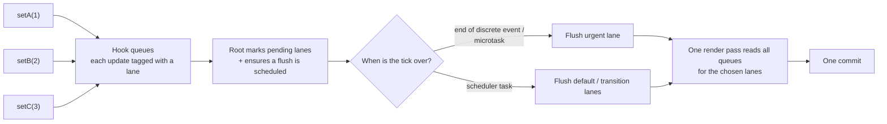
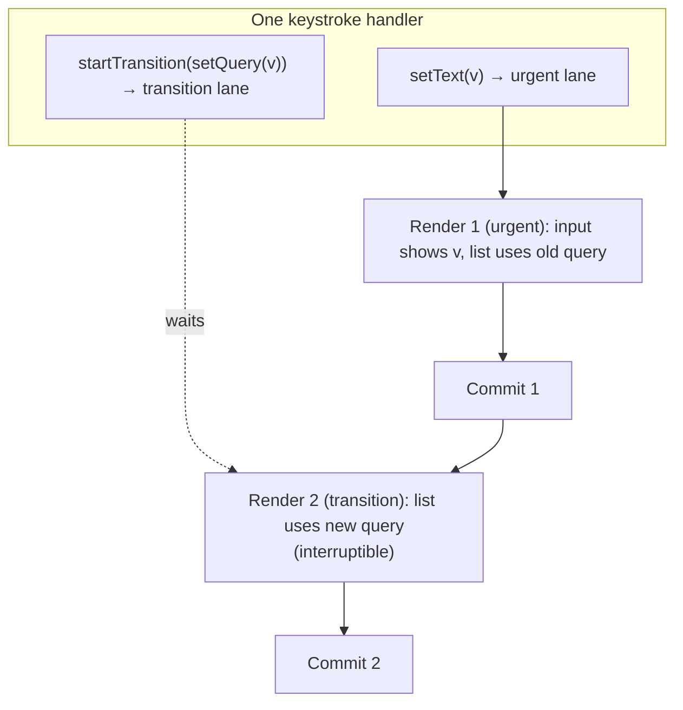

# 02 / 22 — Automatic Batching

## 1. Lesson metadata

| | |
|---|---|
| **Level** | Advanced |
| **Study time** | 4–5 hours (reading 2 h, experiments 1 h, exercises 1–1.5 h) |
| **Prerequisites** | [01/15 — Update queues and batching (first look)](../01-react-fundamentals/15-update-queues-and-batching.md), [01 — What triggers a render](./01-what-triggers-a-render.md), [02 — Render, reconcile, commit, paint](./02-render-reconcile-commit-paint.md), [11 — Render phase vs commit phase](./11-render-phase-and-commit-phase.md), [13 — Scheduler and priorities](./13-scheduler-and-priorities.md), [14 — Lanes](./14-lanes.md), [18 — Effects and their timing](./18-effects-and-their-timing.md), [21 — Browser paint and React updates](./21-browser-paint-and-react-updates.md) |
| **Next** | [23 — Transitions and deferred rendering](./23-transitions-and-deferred-rendering.md) |
| **Related** | [Phase 3 / 01 — `useState` internals](../03-react-state-and-hooks/01-usestate-internals-and-update-semantics.md), [Phase 3 / 02 — Functional state updates](../03-react-state-and-hooks/02-functional-state-updates.md), [29 — Reasoning about unnecessary renders](./29-reasoning-about-unnecessary-renders.md), [35 — Scenario D: transition vs urgent](./35-scenario-d-transition-vs-urgent.md) |

**Learning objectives.** After this lesson you can:
1. State the *public guarantee* of batching (fewer renders than setter calls when updates are scheduled together) and distinguish it from the *implementation* that provides it.
2. Predict, for any mix of event handlers, promises, timers, native listeners and transitions, how many renders and commits occur in React 17 (legacy root) versus React 18/19 (`createRoot`).
3. Explain **why** batching exists: avoiding intermediate, inconsistent, wasted renders, and giving React room to prioritize.
4. Explain why updates with *different priorities are not batched together*, and why this does not contradict "automatic batching".
5. Use `flushSync` correctly (and know when it is a smell), including the places it cannot be called.
6. Reason about batching boundaries in async code (`await`), class components, third-party callbacks, and tests (`act`).
7. Diagnose "my component rendered N times" and "my DOM read is stale after `setState`" bugs.

**Concepts covered:** batching, render coalescing, update lanes as batching keys, discrete vs continuous vs default updates, legacy root vs concurrent root, `ReactDOM.render` removal, `unstable_batchedUpdates`, `flushSync`, microtask-scheduled flush, render-phase updates, batching across components, `act()`.

> ⚠ **Version-sensitive.** The *behavior* "all updates in the same tick are batched under `createRoot`" is the React 18+ public contract. The scheduling machinery that realizes it (lanes, microtask flush, Scheduler tasks) is an **implementation detail** described here as a teaching model and may change. Timelines in this lesson were re-run on react/react-dom 19.3.1 (jsdom, real `click()`, no `act`) on 2026-10-22. React 19 removed the legacy root entirely (`ReactDOM.render`), so the "React 17 behavior" described below can only be observed today in React 17 or in a React 18 app that still uses legacy `render`.

---

## 2. Deep conceptual explanation

### 2.1 What problem is this lesson solving?

A single user action often changes several pieces of state:

```tsx
function handleAddToCart() {
  setItems([...items, product]);
  setTotal(total + product.price);
  setLastAdded(product.name);
}
```

If React rendered after *each* setter call you would get three renders, and the first two would show **inconsistent UI**: a cart containing the new item but the old total, or a total that includes the item but a banner that does not mention it. Each of those renders is also wasted work, because the user can only ever see the last one.

*Batching* is React's answer: updates scheduled close together are **collected** and processed by **one** render pass (followed by one commit). You still call setters imperatively and independently; React decides when to turn them into UI.

The "automatic" in *automatic batching* is a React 18 term. It means that React no longer requires that the updates were scheduled inside a React-managed event handler for this to work. Before React 18, batching was a side effect of *where* you were called from. In React 18 and later, it is a property of *when* you called.

### 2.2 Definitions

| Term | Meaning |
|---|---|
| **Update** | A request to change state: a `setState`/`dispatch` call, a context value change, a root `render()`, a store notification. Creating an update does not run any component. |
| **Batch** | A set of updates that are applied together by a single render pass. |
| **Batching** | The policy/mechanism that groups updates into batches. |
| **Flush** | Performing the pending render (and commit) for the updates currently queued. |
| **Legacy root** | A root created with the old `ReactDOM.render` API (React ≤ 18; removed in 19). Uses the pre-18 synchronous rendering mode. |
| **Concurrent root** | A root created with `createRoot` / `hydrateRoot`. Enables concurrent features, including automatic batching. |
| **Discrete event** | A user event with a clear start and end where the UI must respond right away: `click`, `keydown`, `submit`, `input`/`change` on form controls. |
| **Continuous event** | A stream of events such as `pointermove`, `scroll`, `mouseenter`. |

### 2.3 The one-sentence rule and its refinement

**Rule of thumb (works for 95% of questions):** *Under `createRoot`, every state update scheduled during the same synchronous run of JavaScript (and, in practice, updates scheduled before React gets to flush) is applied in one render.*

Refinement, which is what experts need:

1. **Same tick, same priority → same render.** Updates scheduled within one synchronous call stack with the same priority end up in the same render.
2. **Different priority → different renders (possibly).** If one update is urgent (typing) and another is a transition, React renders the urgent one first and the transition afterwards (see [23](./23-transitions-and-deferred-rendering.md)).
3. **`await` ends the tick.** Code after an `await` runs in a later microtask or task. Updates scheduled there form their *own* batch; updates before the `await` may already have been rendered.
4. **`flushSync` forces the boundary.** It says "render now, exclusively these updates (plus whatever must go with them)".

### 2.4 A short history

| Version | Behavior |
|---|---|
| ≤ 16, 17 (legacy mode) | Batched **only inside React event handlers** (and lifecycle methods run by React). In `setTimeout`, promise callbacks, native event listeners: each setter call triggered a **synchronous** render. |
| 18 with `ReactDOM.render` (legacy root) | Same as 17. Compatibility mode. |
| 18 with `createRoot` | **Automatic batching** everywhere. Rendering is no longer synchronous per setter. |
| 19 | Legacy root removed (`ReactDOM.render`, `hydrate` gone). Only `createRoot`/`hydrateRoot`. Batching semantic is the 18 one. |

The React team's own announcement is the reactwg discussion "Automatic batching for fewer renders in React 18" <https://github.com/reactwg/react-18/discussions/21> (fetched and checked while writing this lesson). It states that batching is when React groups multiple state updates into a single re-render, that before 18 this happened only in React event handlers, and that `flushSync` is the opt-out.

### 2.5 Why was the old behavior tied to event handlers?

In the pre-18 architecture, React ran `onClick` handlers inside a function (conceptually `batchedUpdates(handler)`): it set a "we are inside a batch" flag, ran your code, cleared the flag, and then flushed. Code that React did not wrap (a `setTimeout` callback) saw the flag cleared, so every `setState` was *immediately synchronous*: the component re-rendered and committed before `setState` returned.

That created two problems:

1. **Inconsistent semantics.** Moving identical code from an `onClick` to a `setTimeout` changed render count and could change what the UI showed in between.
2. **No room for scheduling.** If every setter call renders synchronously, React cannot postpone, reorder or interrupt low-priority work. Concurrent rendering requires that `setState` means *"record that this should change"*, not *"change it now"*.

Automatic batching is therefore **a prerequisite for concurrent rendering**, not just a convenience. It is the same decoupling of *scheduling an update* from *performing a render* that [01](./01-what-triggers-a-render.md) §2.6 introduced.

### 2.6 Relation to JavaScript and the browser

Batching rides on the event loop ([Foundations 11](../00-web-and-javascript-foundations/11-event-loop-tasks-microtasks.md)):

- JS runs a task to completion. Everything your handler does synchronously is *one* uninterrupted stretch, and React gets no chance to render in the middle of it (it is not preemptive; it only runs when you call into it or yield).
- Therefore "updates in the same synchronous stretch" is a natural batch boundary.
- After the stretch, React (or the browser) needs to *flush*. React can do that at the end of the event dispatch, in a **microtask**, or in a later **task** via its scheduler. Which mechanism is used depends on the update's priority. This is an implementation detail, but it explains the observable rule that "an `await` is a boundary".

### 2.7 Common misconceptions

| Misconception | Reality |
|---|---|
| "Batching merges state updates into one object like class `setState`." | Hooks do not merge. Each state variable has its own queue. Batching merely means **one render reads all queues**. `setA(1); setA(2)` processes both in order (final `2`); there is still one render. |
| "Batching delays `setState` by a debounce interval." | There is no timer-based delay. The render happens as soon as React flushes, usually before the next browser paint opportunity for discrete events. |
| "In React 18 `setState` is async." | `setState` is *always* just an enqueue; that is not new. What changed is that outside event handlers it no longer *also* renders synchronously inside the setter call. |
| "Automatic batching means one render per event loop tick, no matter what." | Different priorities are separate batches, and `flushSync` forces splits. A transition update plus an urgent update from the same handler render at least twice. |
| "If I `await` something, React batches before and after." | No. Updates before the `await` are scheduled and normally rendered before your code resumes; updates after the `await` form a new batch. |
| "Batching is why I can't read the new state right after `setState`." | The reason is the **snapshot** semantics ([01/14](../01-react-fundamentals/14-state-as-a-snapshot.md)): the variable in the running closure is a constant. Even with a synchronous render, the old closure would still see the old value. |
| "`unstable_batchedUpdates` is needed in React 18." | It still exists but is unnecessary for batching under `createRoot`. |
| "`flushSync` is how you make state updates synchronous in general." | It is an escape hatch for integration with non-React code that must observe the DOM immediately. It is slow and can force Suspense fallbacks to show. |

---

## 3. Internal mechanics

> **Labels used in this section.**
> **Public guarantee** = documented, safe to rely on.
> **Teaching model** = an accurate-enough story to predict behavior.
> **Implementation detail** = how current React happens to do it; may change.

### 3.1 Public guarantees

1. Under a `createRoot`/`hydrateRoot` root, state updates scheduled together are batched into a single render, regardless of where they were scheduled from (event handler, timeout, promise, native listener). *(React blog/working-group docs for 18; react.dev "Queueing a Series of State Updates".)*
2. After a **discrete** event such as a click, React finishes the resulting DOM updates before the next discrete event is handled. *(From the 18 working-group post: "for discrete user events … the DOM is fully updated before the next event is handled".)*
3. `flushSync(() => { setX(...) })` applies that update synchronously, so the DOM is updated when `flushSync` returns. It may also flush other pending work (updates, Effects) as needed. *(react.dev `flushSync`.)*
4. Setting state never changes the already-running render's variables.

What React does **not** promise: exactly how many renders occur (Strict Mode, Suspense retries, interrupted/restarted transitions and bail-outs all affect it), nor *which* mechanism flushes.

### 3.2 Teaching model: "pending lane set + a flush trigger"



Conceptually:

1. Each setter call creates an **update object**, assigns it a **lane** (a priority bucket derived from the context in which it was called, see [14 — Lanes](./14-lanes.md)), appends it to the hook's queue, and marks the fiber and its ancestors up to the root as having pending work.
2. The root records which lanes are pending. Calling the root-level "ensure scheduled" logic is *idempotent per lane*: the second, third, … setter call in the same tick finds that a flush for that lane is already scheduled and does not schedule another.
3. When the flush runs, React picks the highest-priority pending lane group, renders **every** update in those lanes (this is the batch), and commits.

**Key insight:** *the batch key is the lane.* Same lane → same render. Different lane → React may render them in separate passes (it can also *entangle* some lanes so they render together; that is detail we do not rely on).

### 3.3 Where the lane comes from (teaching model)

The lane is assigned from the **event priority context** at the time of the setter call:

| Where the setter is called | Typical priority | Typical flush mechanism *(implementation detail)* |
|---|---|---|
| Discrete event handler (click, keydown, submit, input) | Highest (sync-like) | In a microtask scheduled by the setter call, i.e. right after the handler returns and before the browser can handle the next event or paint (executed on 19.3.1: `render` had not run when `button.click()` returned). Exception: an event that targets a **controlled form input** (`onChange` on `<input value>`) is flushed synchronously at the end of the dispatch, because React's event finisher calls `flushSyncWork()` before restoring controlled state (`ReactDOMUpdateBatching.js`; executed on 19.3.1) |
| Continuous event handler (pointermove, scroll) | High (but not sync) | Scheduler task |
| Everything else (timeouts, promise callbacks, native listeners that are not wrapped by React, `useEffect` bodies, `root.render`) | Default | Scheduler task (a macrotask, soon after the current stack unwinds) |
| Inside `startTransition` | Transition lanes | Scheduler task, interruptible |
| Inside `flushSync` | Sync lane, flushed immediately | Right when `flushSync` ends |
| Retries after Suspense / offscreen work | Retry / idle lanes | Scheduler |

*Implementation detail.* The first row is worth noting: in React 18+ a sync-lane update (discrete event, `flushSync`) is flushed without going through the Scheduler: React queues a microtask when the update is scheduled and flushes sync work there (or earlier inside `flushSync`); for other lanes React uses its own scheduler (a `setImmediate`/`MessageChannel`-based loop). Neither the lane names nor these mappings are public API. Neither the lane names nor these mappings are public API. Read `ReactFiberLane.js` / `ReactFiberRootScheduler.js` / `ReactFiberWorkLoop.js` in `packages/react-reconciler/src` (all exist on `main`, checked 2026-10-22) only if you want to see today's actual constants.

### 3.4 Why an `await` is a boundary

Consider:

```tsx
async function onClick() {
  setStatus("saving");          // (1)
  await api.save(draft);        // (2)
  setStatus("saved");           // (3)
  setSavedAt(Date.now());       // (4)
}
```

- (1) runs inside the click's discrete event: lane = sync-ish. It is flushed in a microtask right after the handler returns. The browser gets to paint "saving" if the render is quick (see [21](./21-browser-paint-and-react-updates.md)).
- (2) returns a promise; the handler function returns to React; the event ends.
- Much later the promise settles; the continuation (3)(4) runs in a **microtask**, outside any React event context. Lane = default. (3) and (4) both enqueue; React schedules one flush; one render updates both.

So the total is **2 renders** (not 4 and not 1). In React 17 legacy mode it would be 3: (1) batched inside the handler, but (3) and (4) each rendered synchronously.

### 3.5 What exactly is "the same tick" for a promise continuation?

Two setters in the *same* continuation are always batched (same synchronous stretch). Two setters in *different* continuations are **not guaranteed** to be batched:

```tsx
Promise.resolve().then(() => setA(1));
Promise.resolve().then(() => setB(1));
```

Both callbacks run as microtasks back-to-back within one task drain. A default-lane flush is scheduled as a task, which cannot run until the microtask queue is empty, so in practice you get one render. But if the first continuation had been scheduled for a *sync* lane (flushed in a microtask), the render could land between them. **Do not design code that relies on either outcome.** Treat the number of renders between *separate* async continuations as unspecified.

### 3.6 Render-phase and effect-phase updates

- **During render** you may call the setter of *the component being rendered* (the "derived state" pattern, [01/…](../01-react-fundamentals/12-component-purity.md) and Phase 3). React discards that render's output and immediately re-runs the component before committing: no extra commit, no extra DOM work. This is not batching; it is a restart.
- Calling the setter of a **different** component during render is an error/warning ("Cannot update a component while rendering a different component"). It violates purity ([12](./12-why-rendering-must-be-pure.md)).
- **Inside an effect**, setters enqueue like anywhere else, but the lane is chosen from the context: updates from a passive effect that ran as a consequence of a discrete event are flushed with sync-like priority; others default. Layout-effect updates are flushed synchronously before the browser paints (see [19](./19-layout-vs-passive-effects.md)) so users do not see the intermediate frame. These details are implementation-level; rely on "layout-effect updates are applied before paint" (documented in the `useLayoutEffect` reference) and not more.

### 3.7 `flushSync` mechanics

`flushSync(fn)` conceptually:

1. Temporarily sets the current update priority to *sync/discrete*.
2. Runs `fn`; any setter inside is assigned the sync lane.
3. When `fn` returns, synchronously flushes pending work of the sync lane: render + commit (including layout effects).
4. It may also run pending passive effects before rendering, because those effects could contain updates that must be ordered before this one. (The react.dev page says it "may run pending Effects and synchronously apply any updates they contain".)

Consequences (documented): it can force Suspense boundaries to show fallbacks; it is a no-op with a warning when called during render or inside effects/lifecycles; it hurts performance.

### 3.8 Interplay with Strict Mode

Strict Mode double-invokes component bodies and updater functions in development ([28](./28-strict-mode-behavior.md)). That doubles *invocations*, not *renders/commits*. When counting renders for batching experiments, count **commits** (an effect with no dependency array logs once per commit; Strict Mode double-effects apply only on mount).

### 3.9 Interplay with external stores

`useSyncExternalStore` updates are intentionally **synchronous** (they must not tear, [Phase 3/20](../03-react-state-and-hooks/20-usesyncexternalstore-and-external-stores.md)). Multiple store notifications in the same tick still coalesce into one render because the sync flush is scheduled once, but store-driven updates cannot be deferred by transitions: the [`useSyncExternalStore` reference](https://react.dev/reference/react/useSyncExternalStore) says that if the store is mutated during a transition update, React re-checks `getSnapshot` before committing and, on a change, restarts that update as a blocking one.

---

## 4. Step-by-step execution walkthrough

Component:

```tsx
import { useEffect, useState } from "react";

export function Demo() {
  const [a, setA] = useState(0);
  const [b, setB] = useState(0);

  // Commit counter: runs after every commit (no dependency array).
  useEffect(() => {
    console.log("commit", { a, b });
  });

  function onClick() {
    setA((x) => x + 1);
    setB((x) => x + 1);
    setTimeout(() => {
      setA((x) => x + 10);
      setB((x) => x + 10);
    }, 0);
  }

  return <button onClick={onClick}>{a}/{b}</button>;
}
```

**Predict:** after one click in React 18 (`createRoot`), what is logged? What would React 17 log?

Timeline (React 18 `createRoot`, single click, ignoring the mount log):

| # | What happens | Updates queued | Renders | Commits | DOM effect |
|---|---|---|---|---|---|
| 1 | Browser dispatches `click`. React's event system runs `onClick` with the discrete-event priority. | | | | |
| 2 | `setA(x => x+1)` → update `u1` (sync-ish lane) on `a`'s hook queue; fiber + ancestors flagged. Flush scheduled. | a: [u1] | 0 | 0 | none |
| 3 | `setB(x => x+1)` → update `u2` on `b`. Flush is already scheduled; nothing more to schedule. | b: [u2] | 0 | 0 | none |
| 4 | `setTimeout(...)` registers a timer. `onClick` returns. | | | | |
| 5 | Right after the handler returns (microtask): React flushes sync-lane work. **Render**: `Demo` runs once; `a`=1, `b`=1. | | 1 | | none yet |
| 6 | **Commit**: text node of the button changed from `0/0` to `1/1`. Passive effect scheduled (the click was discrete, so it is flushed promptly). | | | 1 | `0/0` → `1/1` |
| 7 | Passive effect runs: logs `commit { a: 1, b: 1 }`. | | | | |
| 8 | Timer fires (new task). `setA(x => x+10)`: default lane; flush scheduled via scheduler. `setB(...)`: already scheduled. | a:[u3] b:[u4] | | | |
| 9 | Flush: **one render**, `a`=11, `b`=11. | | 2 | | |
| 10 | Commit: text `1/1` → `11/11`. Effect logs `commit { a: 11, b: 11 }`. | | | 2 | `1/1` → `11/11` |

**Result React 18:** `commit {a:1,b:1}` then `commit {a:11,b:11}`. Two commits for four setter calls.

**Result React 17 (legacy):** the click part is batched (one render, log `{1,1}`), but in the `setTimeout` each setter renders synchronously: after `setA(+10)` a render with `a=11, b=1` is committed (an **inconsistent intermediate state**, painted only if the browser got a frame, but always rendered and effect-logged), then after `setB(+10)` another with `11/11`. Logs: `{1,1}`, `{11,1}`, `{11,11}`: three commits.

That inconsistent `{11,1}` render is precisely what batching eliminates.

---

## 5. Code examples

### 5.1 Minimal example: observing batching with a commit counter

```tsx
import { useEffect, useRef, useState } from "react";

export function BatchProbe() {
  const [count, setCount] = useState(0);
  const [flag, setFlag] = useState(false);
  const commits = useRef(0);

  useEffect(() => {
    commits.current += 1;
    console.log(`commit #${commits.current}`, { count, flag });
  });

  function viaHandler() {
    setCount((c) => c + 1);
    setFlag((f) => !f);
  }

  function viaTimeout() {
    setTimeout(() => {
      setCount((c) => c + 1);
      setFlag((f) => !f);
    }, 0);
  }

  function viaPromise() {
    fetch("/api/ping").finally(() => {
      setCount((c) => c + 1);
      setFlag((f) => !f);
    });
  }

  return (
    <>
      <p>{count} / {String(flag)}</p>
      <button onClick={viaHandler}>handler</button>
      <button onClick={viaTimeout}>timeout</button>
      <button onClick={viaPromise}>promise</button>
    </>
  );
}
```

**Predict:** under `createRoot`, how many commits does each button cause (ignoring the first two logs caused by Strict Mode's mount-time effect replay)? What about under React 17?

**Result (React 18/19):** 1 commit per button press. **React 17:** handler 1, timeout 2, promise 2.

**Why:** all three scheduled their setters in one synchronous stretch; under `createRoot` the lane's flush is scheduled once. In 17 only the handler was inside React's `batchedUpdates`.

**Line notes.**
- `useEffect` without a dependency array runs after **every commit**, giving a commit counter that is immune to Strict Mode's double *render* (Strict Mode only repeats effect setup/cleanup on mount, [28](./28-strict-mode-behavior.md)).
- `commits` is a ref so incrementing it does not itself cause a render.
- We use updater functions (`c => c + 1`) so the code is correct regardless of batching, a habit that matters ([Phase 3/02](../03-react-state-and-hooks/02-functional-state-updates.md)).

### 5.2 Practical example: a save flow with optimistic status

```tsx
import { useState } from "react";

type Status = "idle" | "saving" | "saved" | "error";

interface Draft { title: string; body: string }
interface Saved { id: string; updatedAt: string }

declare function saveDraft(d: Draft): Promise<Saved>;

export function DraftEditor() {
  const [draft, setDraft] = useState<Draft>({ title: "", body: "" });
  const [status, setStatus] = useState<Status>("idle");
  const [saved, setSaved] = useState<Saved | null>(null);
  const [error, setError] = useState<string | null>(null);

  async function onSave() {
    setStatus("saving");           // render #1 (flushed at end of click)
    setError(null);                // batched with the line above
    try {
      const result = await saveDraft(draft);
      setSaved(result);            // ┐ batched together (same continuation)
      setStatus("saved");          // ┘ render #2
    } catch (e) {
      setError(e instanceof Error ? e.message : "Unknown error");  // ┐
      setStatus("error");                                          // ┘ render #2'
    }
  }

  return (
    <form onSubmit={(e) => { e.preventDefault(); void onSave(); }}>
      <input
        value={draft.title}
        onChange={(e) => setDraft({ ...draft, title: e.target.value })}
      />
      <textarea
        value={draft.body}
        onChange={(e) => setDraft({ ...draft, body: e.target.value })}
      />
      <button disabled={status === "saving"}>Save</button>
      {status === "saved" && saved && <p>Saved at {saved.updatedAt}</p>}
      {error && <p role="alert">{error}</p>}
    </form>
  );
}
```

**Predict:** how many renders for a successful save? For a failed save? Could the user ever see `status === "saved"` with `saved === null`?

**Answer:** 2 renders in each case (saving; then outcome). No: `setSaved` and `setStatus` are in the same continuation, so they commit together; the UI is never in the half-updated state. That consistency is the real benefit.

**Design note.** Four `useState` calls whose values must change *together* are a smell: consider a single `useReducer` or a discriminated-union state `{ status: "saved"; saved: Saved }` so that impossible combinations cannot exist *even without* relying on batching ([Phase 3/03](../03-react-state-and-hooks/03-usereducer-and-reducer-architecture.md)). Batching is a performance and consistency optimization, not a substitute for a state model that makes illegal states unrepresentable.

### 5.3 Incorrect example: relying on a render between two setters

```tsx
function Wizard() {
  const [step, setStep] = useState(1);
  const [message, setMessage] = useState("");

  function next() {
    setStep(2);
    // Wrong assumption: "the component has re-rendered, so step is 2 now"
    if (step === 2) {
      setMessage("Welcome to step 2");
    }
  }
  /* … */
}
```

**Why wrong:** `step` is the constant from the closure of *this* render (`1`). There is no scenario, batched or not, in which `step` becomes `2` inside the running `next` invocation. React 17's synchronous rendering in a timeout would render a *new* `Wizard` invocation with a *new* `next`; the old closure still sees `1`. Fix by computing from the value you set:

```tsx
function next() {
  const nextStep = 2;
  setStep(nextStep);
  if (nextStep === 2) setMessage("Welcome to step 2");
}
```

or better, **derive** the message from `step` during render and don't store it.

### 5.4 Incorrect example: relying on synchronous DOM updates after a setter

```tsx
function Chat() {
  const [messages, setMessages] = useState<string[]>([]);
  const listRef = useRef<HTMLUListElement>(null);

  function send(text: string) {
    setMessages([...messages, text]);
    // Wrong: the new <li> has not been committed yet
    listRef.current!.lastElementChild?.scrollIntoView();
  }
  /* … */
}
```

**Why wrong:** at that line, no render has happened; `lastElementChild` is the *old* last message.

### 5.5 Corrected: effect, ref callback, or `flushSync`

**Option 1 (preferred): scroll in an effect that reacts to the data change.**

```tsx
useEffect(() => {
  listRef.current?.lastElementChild?.scrollIntoView({ block: "end" });
}, [messages.length]);
```

This is declarative: whenever the list grows, scroll. It also handles messages that arrive from the network, not just ones the user sent.

**Option 2: `flushSync` when imperative ordering inside a handler matters.**

```tsx
import { flushSync } from "react-dom";

function send(text: string) {
  flushSync(() => {
    setMessages((m) => [...m, text]);
  });
  // The DOM now contains the new <li>.
  listRef.current?.lastElementChild?.scrollIntoView();
}
```

**Trade-offs.** `flushSync` renders and commits *right now* and may flush other pending work, defeating batching for this update; it can also force Suspense fallbacks to show. Use it when you integrate with imperative APIs (print dialogs, third-party widgets, focus/scroll management that must happen in the same event). The effect approach is cleaner, and it happens *after* commit but before paint when you use `useLayoutEffect`.

### 5.6 Advanced example: batching versus priorities in one handler

```tsx
import { startTransition, useState } from "react";

export function Search({ items }: { items: string[] }) {
  const [text, setText] = useState("");
  const [query, setQuery] = useState("");

  function onChange(e: React.ChangeEvent<HTMLInputElement>) {
    const value = e.target.value;
    setText(value);                         // urgent (lane A)
    startTransition(() => setQuery(value)); // transition (lane B)
  }

  const visible = items.filter((i) => i.includes(query));
  return (
    <>
      <input value={text} onChange={onChange} />
      <ul>{visible.map((i) => <li key={i}>{i}</li>)}</ul>
    </>
  );
}
```

**Predict:** per keystroke, how many renders, and what are the values of `text` and `query` in each?

**Answer.** At least two renders (it can be more if a newer keystroke interrupts the transition render):
1. Urgent render: `text = "abc"`, `query = "ab"` (still old). The input shows the new character immediately. The list is *not* recomputed against the new query (it filters with `"ab"`).
2. Transition render: `text = "abc"`, `query = "abc"`. The list updates.

They are **not batched into one render**, deliberately. If they were, the input would have to wait for the expensive list render. Batching is *per priority*. See [23](./23-transitions-and-deferred-rendering.md) for the full mechanics.

### 5.7 Advanced example: bridging a non-React event source

```tsx
import { useEffect, useState } from "react";

interface Tick { price: number; volume: number }
declare const socket: {
  addEventListener(type: "message", cb: (e: { data: string }) => void): void;
  removeEventListener(type: "message", cb: (e: { data: string }) => void): void;
};

export function Ticker() {
  const [price, setPrice] = useState(0);
  const [volume, setVolume] = useState(0);

  useEffect(() => {
    const onMessage = (e: { data: string }) => {
      const t = JSON.parse(e.data) as Tick;
      setPrice(t.price);     // native listener: not a React event
      setVolume(t.volume);   // React 18+: batched with the line above
    };
    socket.addEventListener("message", onMessage);
    return () => socket.removeEventListener("message", onMessage);
  }, []);

  return <p>{price} ({volume})</p>;
}
```

In React 17 this component could render a price with the previous volume for one commit (worse: it was a synchronous render per message *field*). In 18+ it renders once per message. If messages arrive faster than the main thread can render (hundreds per second), each message still enqueues updates; React may coalesce several messages into one render if they arrive before a flush runs, but it makes no guarantee. For high-frequency feeds, batch explicitly in your own code (buffer + `requestAnimationFrame`) or use `useSyncExternalStore` with a store that exposes snapshots at a controlled rate ([Phase 6/17](../06-data-fetching-and-state-ecosystems/17-real-time-websockets-subscriptions.md)).

---

## 6. Visual explanations

### 6.1 Render counts per scheduling context

```text
Call site                           React 17 (legacy root)      React 18/19 (createRoot)
----------------------------------  --------------------------  ------------------------
onClick   { setA; setB }            1 render                    1 render
setTimeout{ setA; setB }            2 renders (sync each)       1 render
promise.then{ setA; setB }          2 renders                   1 render
native addEventListener{ setA; setB } 2 renders                 1 render
onClick { setA; await x; setB }     1 + 1  = 2 renders          1 + 1 = 2 renders
onClick { setA; flushSync(setB) }   flushSync flushes at its end   flushSync forces a render at its end
                                    (A may ride along)           (A, same lane, may ride along)
```

(The `flushSync` row is *typical*; the exact split depends on which lanes are pending. Do not build logic on it.)

### 6.2 Lane-keyed batching



### 6.3 Timeline: why `await` splits batches

```text
 task: click event
 ├─ setStatus("saving")  ─┐
 ├─ setError(null)       ─┴─► flush at end of event ─► RENDER 1 ─► COMMIT 1
 └─ await api.save()  (handler returns)

 …network time passes; main thread is free; user can interact…

 task/microtask: promise resolution
 ├─ setSaved(result) ─┐
 └─ setStatus("saved")┴──► scheduled flush ──► RENDER 2 ──► COMMIT 2
```

---

## 7. Alternative approaches and trade-offs

Ways to control "how many renders / when does DOM update":

| Approach | Renders | Consistency | Complexity | Testability | When to prefer |
|---|---|---|---|---|---|
| Rely on automatic batching (default) | Minimal | High if updates are in same tick | None | High | Almost always |
| Single state object / `useReducer` | Minimal, independent of batching | Highest (atomic transition) | Medium | High (pure reducer) | Multiple values that must change together; async flows |
| Derived values (compute in render) | None extra | Perfect | Low | High | Anything that can be computed from existing state |
| `flushSync` | One render *per call*, synchronous | Immediate DOM | Low code, high cost | Medium | Integrating with DOM-reading imperative code in the same event |
| `useLayoutEffect` after the update | Extra synchronous re-render before paint | No flicker | Medium | Medium | Measure-then-adjust layout (see [19](./19-layout-vs-passive-effects.md)) |
| Manual buffering (rAF/timer) before `setState` | Fewer than events | Controlled | Medium | Medium | Very high-frequency sources (sockets, pointer streams) |
| `startTransition` / `useDeferredValue` | Extra deliberate renders, interruptible | Urgent part immediate | Low | Medium | Expensive secondary UI ([23](./23-transitions-and-deferred-rendering.md)) |
| `unstable_batchedUpdates` | Legacy root only | n/a | Low | n/a | Only in legacy apps/libraries targeting React ≤ 17 |

**When the recommended approach (rely on automatic batching) is NOT best.** Consider a form submit that must (1) disable the button, (2) *measure* the new button width, (3) animate it. Step 2 requires the DOM after step 1; batching would put them in one flush after your handler, and measuring in the handler would read stale layout. There the right tool is `flushSync` (or better, a layout effect keyed to the status). Another case: a numeric-input component that must reflect each keystroke to an imperative third-party masking library: synchronous DOM state matters more than render count.

---

## 8. Best practices and anti-patterns

**Do**
- Write updates as pure `set` calls and trust batching; keep handlers free of "I must render now" assumptions.
- Use updater functions when the new value depends on the previous one (batching guarantees *order*, not that the closure variable moves).
- Model values that change together as a single transition (reducer, union state).
- Count commits (effect without deps, Profiler) when verifying render counts. Don't count `console.log` in the body under Strict Mode.
- Keep `flushSync` calls inside event handlers.

**Beginner mistakes**
- Expecting `setState(x); console.log(state)` to print `x`.
- "Fixing" stale reads with `setTimeout(…, 0)` hacks instead of effects/derived state.
- Believing two `setState` calls "cost twice" and trying to merge them manually into one object just to avoid a second render (they don't cost twice inside one tick).

**Experienced-developer mistakes**
- Porting React 17 tests that assert two renders after `act(() => { setTimeout })` without updating them.
- Reading layout inside event handlers right after a setter, and "fixing" with `flushSync` everywhere (flushSync in hot paths turns O(1) renders per tick into O(n)).
- Using `flushSync` inside `useEffect` (no-op with a warning) or inside render.
- Building a mental model of "one render per tick" and then being surprised by transitions, Suspense retries and Strict Mode.
- Depending on the *number* of renders for correctness (e.g., counting renders to trigger side effects). Renders are not a public event.

**Smells**
- Many related `useState`s updated in lock-step.
- `flushSync` outside of event handlers.
- Comments like "must be async so React batches".
- `unstable_batchedUpdates` in modern code.

**Justified exceptions**
- `flushSync` for print preparation, scroll/focus restoration, or third-party widget synchronization.
- Intentional re-render before the next step: `flushSync(() => setX())` then `inputRef.current.focus()` when focusing a just-mounted element and a ref callback/effect would be awkward.

---

## 9. Real-world application

**E-commerce checkout.** Clicking "Apply coupon" updates `coupon`, `discount`, `total`, and `message`. With batching the cart summary never shows a coupon code with an unchanged total. Constraint: the API call is async, so the *response* continuation is its own batch; the pre-request "applying…" state is another. Design the state as `{ status: "applying" } | { status: "applied", discount, total }` so the model is correct even if a future refactor splits the updates across ticks.

**Trading dashboard.** A socket delivers 200 messages/s into 20 `useState`s via a native listener. Under 17, each setter rendered synchronously: 4000 renders/s. Under 18, setters in one message batch to one render per message (200/s), and bursts may coalesce further. Constraint: that still might be too many; engineering fix: buffer messages in a ref and flush on `requestAnimationFrame`, or use a store with throttled snapshots. Batching reduced the worst case but did not solve the architectural problem.

**Forms with async validation.** On blur you call `setTouched(true)`, then await a uniqueness check, then `setError(...)` and `setValidating(false)`. Two batches. Constraint: out-of-order responses ([Phase 6/02](../06-data-fetching-and-state-ecosystems/02-cancellation-and-race-conditions.md)); batching does not address races.

**Map or canvas library integration.** A third-party map invokes your callback outside React on every drag step; you update `center` and `zoom`. Batching makes them atomic. When the library expects the DOM to reflect state inside its callback (e.g., popups positioned from the updated DOM), use `flushSync` narrowly and document why.

**Multi-team UI shell.** A micro-frontend host and guest each have a React root. Batching is per root's scheduler state but both share the main thread; updates in different roots flush as separate renders. Do not assume cross-root batching.

---

## 10. Debugging and troubleshooting

### Symptom A: "My component renders twice after one click."
1. Is Strict Mode on? Component bodies run twice in dev ([28](./28-strict-mode-behavior.md)). Count commits instead (effect without deps or React DevTools Profiler "commits" bar).
2. Are there two priorities involved (urgent + transition)? Expected: ≥ 2 commits.
3. Is a parent re-rendering, so your component re-renders as a child ([01 §2.7](./01-what-triggers-a-render.md))? Highlight updates / Profiler "why did this render".
4. Is there an effect that sets state ("effect-then-state" cascade)? Passive effect → `setState` → second commit. That is two batches by construction.
5. Is `await` between the setters?

### Symptom B: "After `setState`, my DOM query returns the old node."
Root cause: reading DOM before commit. Validate by logging in an effect keyed to the state (the new DOM is there). Fix with an effect/ref callback, or `flushSync` if the logic must live in the handler.

### Symptom C: "Tests that passed in 17 fail in 18: render count is 1 instead of 2."
Root cause: tests mounted with legacy `render` before; with `createRoot` (RTL ≥ 13), batching is on. Fix assertions to assert **outcomes** (DOM), not render counts. Wrap state-changing code outside React events in `act()` so React flushes before assertions ([Phase 8/04](../08-testing-and-quality/04-testing-async-updates.md)).

### Symptom D: "Class component reads `this.state` right after `setState` in a timeout and gets the old value."
Under 18 with `createRoot`, `this.state` is not updated synchronously in timeouts (reactwg discussion #21). Read from the updater callback/`componentDidUpdate`; `flushSync` restores sync behavior if you must.

### Symptom E: "Too many re-renders" invariant.
Unconditional setter during render → render-phase update loop. Batching has nothing to do with it; React limits nested updates (a few dozen, as an implementation safeguard) and throws.

### DevTools workflow
1. React DevTools → Profiler → record one interaction.
2. The commit list shows how many commits happened. Select each; the flame graph and "why did this render?" (enable "Record why each component rendered") list changed hooks.
3. Compare React 17 vs 18 behavior by switching the root API in a sandbox, not by reading blog posts.
4. Validate a fix by repeating the same interaction and confirming commit count and content of each commit.

---

## 11. Exercises

### Level A — Knowledge
A1. Define batching in one sentence and state what React version introduced *automatic* batching.
A2. In React 17, which scheduling contexts were batched and which were not?
A3. Why does React 18's automatic batching require a `createRoot` root?
A4. What is the relationship between batching and lanes?
A5. Name two situations in which two setter calls in the same handler do **not** result in a single render.

### Level B — Code comprehension
B1. Assume React 18, `createRoot`, no Strict Mode. How many commits after one click?
```tsx
function C() {
  const [n, setN] = useState(0);
  const [m, setM] = useState(0);
  useEffect(() => { console.log("commit", n, m); });
  return <button onClick={() => { setN(1); setN(2); setM(3); }}>go</button>;
}
```
B2. Same component but the handler is:
```tsx
async () => { setN(1); await Promise.resolve(); setN(2); setM(3); }
```
How many commits, and which values are logged? (Do not rely on microtask ordering for your answer; argue from guarantees where you can, and say where you cannot.)
B3. What does this log?
```tsx
function onClick() {
  setN(n + 1);
  setN(n + 1);
  setN((x) => x + 1);
}
```
if `n` is `0`, and what is the final state?
B4. Will the DOM node reflect the new text on the `console.log` line?
```tsx
flushSync(() => setText("hi"));
console.log(ref.current?.textContent);
```

### Level C — Implementation
C1. Write a hook `useBatchedSocket<T>(url: string, onFlush: (batch: T[]) => void)` that buffers messages and delivers them once per animation frame, so React gets at most one update per frame regardless of message rate.
C2. Implement `AddItem` that appends to a list and then scrolls the new item into view, once with `flushSync`, once with an effect. State when you would choose each.

### Level D — Debugging
D1. A teammate reports: "I upgraded to React 18 and my analytics `useEffect` that depends on `[a, b]` fires fewer times." Explain what changed and whether it is a bug.
D2. Find the bug:
```tsx
function Toggle() {
  const [open, setOpen] = useState(false);
  const panelRef = useRef<HTMLDivElement>(null);
  function toggle() {
    setOpen(!open);
    if (!open) panelRef.current?.querySelector("input")?.focus();
  }
  return <>
    <button onClick={toggle}>toggle</button>
    {open && <div ref={panelRef}><input /></div>}
  </>;
}
```

### Level E — Architecture and engineering decisions
E1. Your design-system's `Select` component sets `open`, `highlightIndex`, `query`, and `announcement` in response to keyboard events. A reviewer says "batching makes this fine". Evaluate and propose the state model.
E2. A legacy part of the app uses `ReactDOM.render` roots for widgets embedded in a server-rendered page. Plan migration to `createRoot`, including how to detect behavior that depended on non-batched renders.

### Level F — Expert challenge
F1. You maintain a library that wraps a non-React event source and calls user-provided callbacks that set state. Consumers on React 17 and 18+ both use it. Design the API so that (a) updates from one source event are consistent in both versions, and (b) the library never calls `flushSync` or `unstable_batchedUpdates` unconditionally. Explain what you would test and where it will still behave differently.

---

## 12. Detailed answers and explanations

> Attempt the exercises first.

**A1.** Batching groups multiple state updates into one render/commit. Automatic batching (all contexts) arrived in **React 18**, for roots created with `createRoot`. Wrong answer: "16.8 with hooks"; hooks did not change batching.

**A2.** Batched: updates inside React event handlers (and React-run lifecycles). Not batched: `setTimeout`/`setInterval`, promise callbacks, native `addEventListener` callbacks, `fetch().then`; each setter rendered synchronously.

**A3.** Automatic batching rests on the decoupling of "schedule update" from "render" via the concurrent root's lane scheduling. The legacy root keeps the synchronous per-update render outside `batchedUpdates` for backward compatibility. (The react-18 working group describes legacy mode as a compatibility path; React 19 removed it.)

**A4.** Each update is assigned a lane. The flush picks lane groups and renders all pending updates in them in one pass, so *same lane → same batch*; different lanes can be processed in different passes. Lanes are an implementation detail, but the priority-keyed behavior (urgent vs transition) is observable.

**A5.** Examples: (1) the setters are separated by an `await`; (2) one is inside `startTransition` and one is not (different priorities); (3) one is wrapped in `flushSync`; (4) a setter in the handler triggers a render-phase or effect-phase follow-up update (extra commit); (5) a legacy (React ≤ 17 / legacy root) timeout context. Any two are fine.

**B1.** **1 commit.** `setN(1)` then `setN(2)`: replacement updates are processed in order; final `n = 2`. `setM(3)`. Log: `commit 2 3`. (Plus the mount log `commit 0 0`, which is a commit but not "after the click".) Wrong answer "3": confuses setter calls with renders. Wrong answer "`commit 1 3`": ignores that the second replacement overrides the first.

**B2.** The guarantee-based answer: `setN(2)` and `setM(3)` run in the same continuation, so they are definitely batched with each other. Whether `setN(1)` is rendered alone first depends on whether React's flush of the click's update runs before your continuation resumes. On react 19.3.1 the executed result is **two commits**: `commit 1 0` then `commit 2 3`. The reason is mechanical: `setN(1)` queues React's flush microtask *before* `await Promise.resolve()` queues the continuation, so React's flush runs first. That is an implementation detail (where the sync-lane flush is placed relative to microtasks), so the exercise's lesson is: never write code whose correctness depends on it.

**B3.** Closure `n = 0`. `setN(0+1)` → replace with 1. `setN(0+1)` → replace with 1. `setN(x => x+1)` → applied to the queue's running value `1` → `2`. Final state **2**, one commit. This is the classic "functional updater reads the queue, replacement reads the closure" ([01/15](../01-react-fundamentals/15-update-queues-and-batching.md)).

**B4.** Yes. `flushSync` renders and commits before it returns, so `ref.current.textContent` is `"hi"` (assuming the ref's element renders `text`). Caveat: if `flushSync` is called inside an effect/lifecycle/render, React logs "flushSync was called from inside a lifecycle method. React cannot flush when React is already rendering" (reproduced on 19.3.1) and does not flush synchronously there, so the DOM is not yet updated.

**C1. Reference solution**
```tsx
import { useEffect, useRef } from "react";

export function useBatchedSocket<T>(url: string, onFlush: (batch: T[]) => void): void {
  const onFlushRef = useRef(onFlush);
  useEffect(() => { onFlushRef.current = onFlush; });   // latest callback without re-subscribing

  useEffect(() => {
    const buffer: T[] = [];
    let raf = 0;

    const ws = new WebSocket(url);
    ws.onmessage = (e: MessageEvent<string>) => {
      buffer.push(JSON.parse(e.data) as T);
      if (!raf) {
        raf = requestAnimationFrame(() => {
          raf = 0;
          const batch = buffer.splice(0, buffer.length);  // drain
          onFlushRef.current(batch);                      // consumer does ONE setState
        });
      }
    };
    return () => {
      ws.close();
      if (raf) cancelAnimationFrame(raf);
    };
  }, [url]);
}
```
Notes: React's batching coalesces setters *within* a tick but cannot know you want one update per frame; this moves the policy to your code. Edge cases: updating the ref in an effect without deps is fine; a ref updated during render would be a purity violation ([12](./12-why-rendering-must-be-pure.md)). Clean-up cancels the frame so no update fires after unmount. A stricter implementation would also flush on `close`.

**C2.**
```tsx
// flushSync version
function add(text: string) {
  flushSync(() => setItems((xs) => [...xs, text]));
  listRef.current?.lastElementChild?.scrollIntoView();
}
// effect version
useEffect(() => {
  listRef.current?.lastElementChild?.scrollIntoView();
}, [items.length]);
```
Choose the effect when the list can grow from any source (the usual case) or when you do not want to disable batching. Choose `flushSync` when the scroll must happen in the same event for an imperative reason (e.g., you immediately call `.focus()` on the new node and a ref callback is impractical). Evaluation criteria: the answer recognizes that `flushSync` is synchronous render+commit and costs perf.

**D1.** Not a bug. Before 18, an effect depending on `[a, b]` could run twice when `a` and `b` were set in a timeout/promise (two commits). Under automatic batching they commit together, so the effect runs once with consistent values. If analytics counted both transitions, the fix is to log the *event* at the source (handler), not infer events from effect runs.

**D2.** `open` is the closure value from the render where `toggle` was created. When `open` is `false` the panel does not exist in the DOM: `panelRef.current` is `null` and `focus()` is never called; even after `setOpen(true)` the DOM is not updated at that line. Fixes: focus in an effect (`useEffect(() => { if (open) panelRef.current?.querySelector("input")?.focus(); }, [open])`), or `autoFocus` on the input, or `flushSync` + focus in the handler. Also prefer `setOpen(o => !o)`.

**E1.** Evaluation criteria: recognizes that batching helps only within a tick and depends on call sites; identifies illegal intermediate states (e.g., `highlightIndex` pointing past a filtered list); proposes a reducer with an action per keyboard event so each event is a single atomic transition; derives `announcement` instead of storing it; mentions testing the reducer purely. Example answer: *"Batching makes the common path render once, but correctness shouldn't depend on it. Make `query` and `highlightIndex` one reducer state, derive `visibleOptions` and `announcement` during render, and the state is consistent even if a future change introduces an `await` or `startTransition` between updates."*

**E2.** Evaluation criteria: inventory roots; migrate leaf roots first; replace `render(<App/>, el)` with `createRoot(el).render(<App/>)` (and `hydrate` with `hydrateRoot`) ahead of the React 19 upgrade because the legacy APIs are removed there ([upgrade guide](https://react.dev/blog/2024/04/25/react-19-upgrade-guide)); keep a feature flag per root; detect dependence on non-batched renders by (a) running tests with `createRoot`, (b) searching for class components reading `this.state` after `setState` in timers/promises, (c) searching for code reading DOM right after setters in non-React callbacks, (d) Profiler commit comparisons on key flows; fix with updaters, effects, or localized `flushSync`; use `unstable_batchedUpdates` nowhere.

**F1.** Evaluation criteria. A good answer: (1) deliver *one callback per source event* with a payload containing everything the consumer needs, so consumers can perform a single setter or a reducer dispatch regardless of batching; (2) never promise that state is updated when the callback returns; (3) document that under React ≤ 17 legacy roots consumers who call several setters in the callback need to wrap them (or call a single dispatch); optionally expose an `unstable_batchedUpdates`-style `batch` option supplied by the consumer (dependency injection rather than a hard import); (4) test with both roots (RTL's legacy render for 17, `createRoot` for 18+) asserting outcomes, not render counts; (5) remaining differences: render counts, class `this.state` timing, and whether intermediate states are observable.

---

## 13. Senior engineer interview questions

**Q1. "What changed about batching in React 18 and why?"**
*Strong answer:* Before, batching applied only to updates inside React-controlled event handlers; elsewhere each setter rendered synchronously. In 18, with `createRoot`, setters only enqueue updates tagged with a priority; a flush renders everything pending for a priority at once. The reason is not only fewer renders: concurrent rendering needs `setState` to mean "schedule", otherwise React cannot interrupt, reorder, or prioritize. Fewer inconsistent intermediate renders is the visible benefit.

**Q2. "Two `setState` calls: when would they cause two renders in React 18?"**
*Strong answer:* When separated by an `await` or other async boundary, when they have different priorities (one in a transition), when one is in `flushSync`, when one is triggered by an effect or render-phase follow-up, or when something interrupts and restarts rendering. And Strict Mode doubles invocations (not commits).

**Q3. "Is `flushSync` a way to get the old behavior? When would you use it?"**
*Strong answer:* It forces a synchronous render+commit for that update so imperative code can read the updated DOM. Legit uses: print flows, scroll/focus restoration, third-party integration. Costs: defeats batching/prioritization, can force Suspense fallbacks, may flush pending effects, no-op in render/effects. Prefer effects, ref callbacks, or derived state.

**Q4. "Why can't I read the new state right after calling the setter, even in 17 where the render was synchronous?"**
*Strong answer:* Because the variable is a per-render constant captured by the closure. A synchronous render would create a *new* closure for the *next* render; the running function keeps the old one. Batching is orthogonal.

**Q5. "How would you verify that a refactor reduced renders?"**
*Strong answer:* Profile the same interaction before and after; compare commit counts and per-component render reasons; avoid `console.log` in render under Strict Mode; assert outcomes in tests, not counts. Measure user-facing metrics (INP, long tasks) rather than render count in isolation.

**Q6. "What breaks if a library is written against React 17 batching assumptions?"**
*Strong answer:* Libraries that call multiple setters from native callbacks and relied on synchronous intermediate renders (reading DOM after the first setter), class-based code reading `this.state` after `setState` in timers, tests asserting render counts. Fix by changing to updaters, effects, single reducer dispatch, and localized `flushSync`.

---

## 14. Further learning resources

| Resource | URL | Covers / why | Level | Study |
|---|---|---|---|---|
| React docs: Queueing a Series of State Updates | <https://react.dev/learn/queueing-a-series-of-state-updates> | Batching and updater functions | Intermediate | Whole page |
| React docs: `flushSync` | <https://react.dev/reference/react-dom/flushSync> | Semantics, caveats, no-op in effects (verified) | Intermediate | Caveats, usage |
| reactwg/react-18 #21: Automatic batching for fewer renders in React 18 | <https://github.com/reactwg/react-18/discussions/21> | Original announcement and class-component caveat (verified) | Intermediate | Whole post |
| React 19 upgrade guide | <https://react.dev/blog/2024/04/25/react-19-upgrade-guide> | `ReactDOM.render` / `hydrate` removal (verified) | Intermediate | "Removed: `react-dom` APIs" |
| React docs: `createRoot` | <https://react.dev/reference/react-dom/client/createRoot> | Concurrent root API | Beginner | Usage |
| React source: reconciler | <https://github.com/facebook/react/tree/main/packages/react-reconciler> | Lanes, work loop (read for orientation; names change) | Advanced | `ReactFiberLane`, `ReactFiberWorkLoop` *(file names verified on `main`, 2026-10-22)* |
| MDN: Event loop | <https://developer.mozilla.org/en-US/docs/Web/JavaScript/Event_loop> | Tasks/microtasks, which determines "tick" boundaries | Intermediate | Whole page |

Links not marked verified were not fetched while writing; use site search if one has moved.

---

## 15. Knowledge checkpoint

**You should now understand**
- Batching is "one render for many updates in the same tick and priority"; in React 18+ it does not depend on where the update came from.
- The batch key is the update's priority (lane), so urgent and transition updates render separately.
- `await`, `flushSync`, and transitions create batch boundaries.
- Why batching is a prerequisite for concurrent features.

**You should be able to explain without notes**
- Why `setTimeout { setA; setB }` renders once in 18 and twice in 17.
- Why reading state or DOM right after a setter returns stale data.
- Why two setters in one handler may still cause two commits.

**You should be able to implement**
- A buffered event source feeding a single setter per frame.
- `flushSync`-based and effect-based scroll-after-append.
- A reducer that makes multi-field transitions atomic without relying on batching.

**You should be able to debug**
- Unexpected commit counts using the Profiler and an effect-based commit counter.
- Stale DOM reads after setters, and tests that break when moving to `createRoot`.

**Before moving on:** read [23 — Transitions and deferred rendering](./23-transitions-and-deferred-rendering.md); it builds directly on the "batching is per priority" idea.
