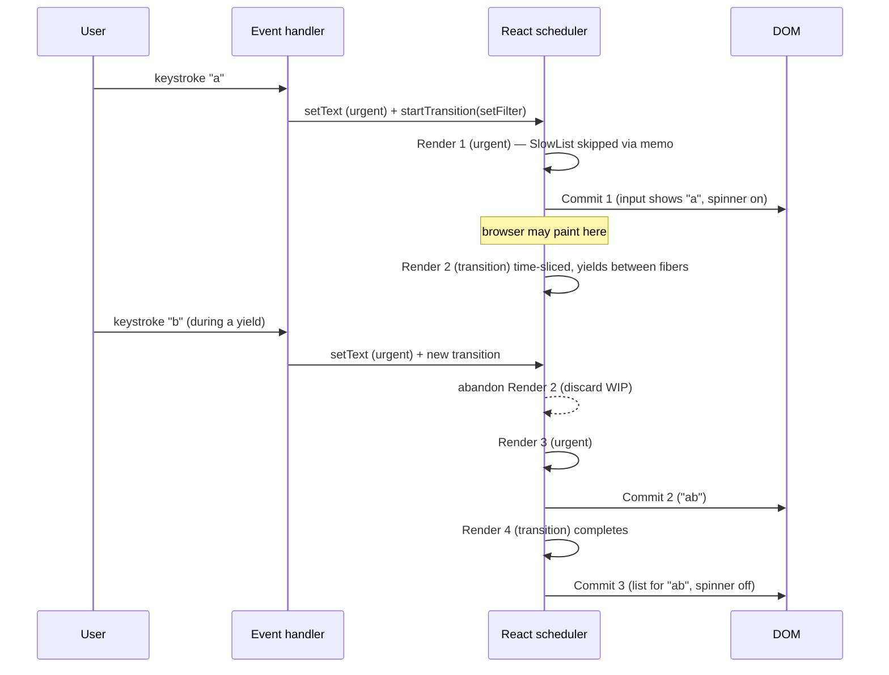
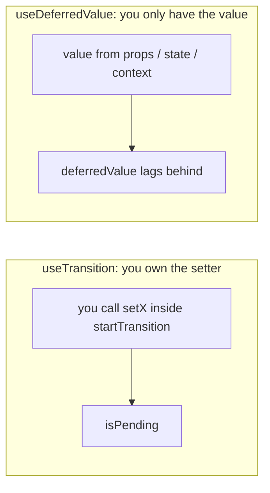

# 02 / 23 — Transitions and Deferred Rendering

## 1. Lesson metadata

| | |
|---|---|
| **Level** | Advanced |
| **Study time** | 5–6 hours (reading 2.5 h, experiments 1.5 h, exercises 1.5–2 h) |
| **Prerequisites** | [22 — Automatic batching](./22-automatic-batching.md), [13 — Scheduler and priorities](./13-scheduler-and-priorities.md), [14 — Lanes](./14-lanes.md), [15 — Interruptible, restartable, abandoned renders](./15-interruptible-restartable-abandoned-rendering.md), [16 — Concurrent React and common misconceptions](./16-concurrent-react-misconceptions.md), [11 — Render phase vs commit phase](./11-render-phase-and-commit-phase.md), [12 — Why rendering must be pure](./12-why-rendering-must-be-pure.md) |
| **Next** | [24 — Suspense and thrown thenables](./24-suspense-conceptual-internals.md) |
| **Related** | [35 — Scenario D: transition vs urgent](./35-scenario-d-transition-vs-urgent.md), [Phase 3 / 22 — Modern hooks and APIs](../03-react-state-and-hooks/22-modern-hooks-and-apis.md), [Phase 7 / 12 — `useTransition` in practice](../07-performance/12-usetransition-in-practice.md), [Phase 7 / 13 — `useDeferredValue` in practice](../07-performance/13-usedeferredvalue-in-practice.md), [Phase 7 / 14 — Debounce and throttle](../07-performance/14-debounce-and-throttle.md) |

**Learning objectives.** After this lesson you can:
1. Define *urgent* versus *transition* updates and explain what a transition changes (the **priority** and **interruptibility** of a render) and what it does not (the amount of work, the thread, the network).
2. Predict the exact sequence of renders, commits, `isPending` values and discarded work for a transition that is (a) uninterrupted, (b) interrupted by an urgent update, (c) superseded by another transition, (d) suspended.
3. Explain `useDeferredValue` as "a value that lags behind, rendered in the background" and compare it to `useTransition` and debouncing.
4. Describe how a transition interacts with Suspense (previous UI stays, no fallback for already-revealed content) and with error boundaries.
5. Use React 19 **async Actions** inside `startTransition`, including the "wrap updates after `await` again" limitation.
6. Explain the rebasing model that keeps final state correct when urgent and transition updates interleave.
7. Diagnose "my transition does nothing" bugs: unmemoized children, controlled inputs in transitions, updates after `setTimeout`, single slow component, non-Suspense data.

**Concepts covered:** urgent vs non-urgent updates, `startTransition`, `useTransition`/`isPending`, `useDeferredValue` (+ `initialValue`), transition lanes, interruption and restart, abandoned work, update rebasing, Suspense integration, async Actions, expiration/starvation protection, transition vs debounce/throttle, where transitions cannot help.

> ⚠ **Version-sensitive.** `startTransition`, `useTransition`, `useDeferredValue` shipped in React 18. React 19 adds: async functions in transitions ("Actions") with `isPending` covering the whole async span, and `useDeferredValue(value, initialValue)`. React docs state two current limitations that may be lifted later: updates after an `await` need another `startTransition`, and multiple concurrent transitions are batched together. Re-checked against the [`useTransition`](https://react.dev/reference/react/useTransition) and [`useDeferredValue`](https://react.dev/reference/react/useDeferredValue) pages (react.dev v19.3) on 2026-10-22: the `await` limitation ("currently require wrapping any set functions after the await in an additional startTransition") and `useDeferredValue(value, initialValue?)` are still documented. The timelines in §3.2, §4.1, §4.2 and the `isPending`/async-Action claims were executed on react/react-dom 19.3.1 in jsdom (see the notes under each).

---

## 2. Deep conceptual explanation

### 2.1 What problem is this lesson solving?

Two kinds of updates compete for the single main thread ([Foundations 01](../00-web-and-javascript-foundations/01-how-the-browser-works.md)):

- **Direct manipulation:** typing, clicking, pressing a key. The user expects the UI to answer within about a frame or two. Delay here is felt as *input lag*.
- **Navigation/derived content:** switching a tab, filtering a 5,000-row table, loading a new route. Users tolerate a short delay here as long as the UI stays *alive* and they can see that something is happening.

Without scheduling help, both kinds are the same to React: a `setState` triggers a render of everything affected, synchronously to completion. If rendering the table takes 300 ms, the keystroke that caused it cannot be shown until those 300 ms are over: the input feels broken even though the code is "correct".

Transitions let you say, per update: *"this one is allowed to lag; if something more important arrives, drop what you are doing for it."*

### 2.2 The mental model in one paragraph

An update inside `startTransition` is labeled **non-urgent**. React still renders it, but (1) it renders it **after** pending urgent updates, (2) it renders it in a way that can **yield** to the browser between components, (3) if an urgent update arrives *during* that render, React **abandons the in-progress tree** (the work-in-progress tree from [10](./10-current-and-work-in-progress-trees.md)), handles the urgent update, and then **restarts** the transition render from scratch with the latest state, and (4) the screen keeps showing the **old committed UI** until the transition render completes and commits. Nothing partial is ever shown.

### 2.3 Definitions

| Term | Meaning |
|---|---|
| **Urgent update** | A state update that must be reflected immediately: results of discrete user input. Default priority for updates from event handlers. |
| **Transition** | A non-urgent update marked by `startTransition` / `useTransition`. It transitions the UI from one view to another. |
| **Action** *(React 19 term)* | A function passed to `startTransition` (sync or async) or a form `action`; React tracks it as a unit with a pending state. |
| **`isPending`** | Boolean from `useTransition`: `true` from the start of the Action until its updates are committed. |
| **Deferred value** | The result of `useDeferredValue(v)`: lags `v` during updates, converges when background render completes. |
| **Interruption** | Pausing/abandoning an in-progress render because higher-priority work arrived. |
| **Restart** | Starting a new render pass from the root of the work-in-progress, discarding the previous partial work. |

### 2.4 The public API surface

```tsx
import { startTransition, useTransition, useDeferredValue } from "react";

// 1. Standalone (no isPending; usable outside components, e.g. from a router/data library)
startTransition(() => { setTab("posts"); });

// 2. Hook (gives isPending)
const [isPending, startTransition] = useTransition();

// 3. Deferred value
const deferredQuery = useDeferredValue(query);            // React 18+
const deferred2 = useDeferredValue(query, "");            // React 19: initialValue
```

Documented rules (react.dev):

- `startTransition(action)` calls `action` **immediately and synchronously**; every state update scheduled *synchronously* during that call is marked as a transition.
- The function you pass must be synchronous for updates *in its synchronous part*. Updates scheduled later (e.g. in `setTimeout`) are **not** transitions. In React 19, `async` functions are allowed, but state updates after an `await` must be wrapped in another `startTransition` to be marked.
- Transition updates **cannot control text inputs**: a controlled `<input>`'s `value` state must be updated urgently, otherwise typed characters would visibly lag or revert.
- A transition is **interrupted** by other (urgent) updates; this is expected.
- If a function passed to `startTransition` throws or returns a rejected promise, the hook version surfaces the error to the nearest error boundary; the standalone function cannot, because it is not associated with a component.
- Multiple ongoing transitions are currently **batched together** (documented limitation).

### 2.5 What a transition does NOT do

| Not true | Truth |
|---|---|
| "The render runs on another thread." | Same main thread. React slices rendering into units (between fibers) and yields to the browser between them; total CPU work is the same or *higher* (abandoned work is wasted). |
| "It makes slow components fast." | It makes the *rest of the UI* responsive while the slow work happens. Time-to-finish for the transition is not reduced. |
| "It delays by some milliseconds." | There is no timer ([`useDeferredValue` docs](https://react.dev/reference/react/useDeferredValue): "no fixed delay caused by `useDeferredValue` itself"). The background render starts as soon as the urgent one finishes. |
| "It prevents network requests." | Not at all. It only affects *rendering* of results. Debouncing is the tool for reducing requests. |
| "Wrapping any `setState` in `startTransition` is free." | Costs: an extra urgent render (for `isPending`), possible wasted renders if interrupted, and stale UI during the lag. Do it where the render is measurably expensive. |
| "A single 200 ms component can be interrupted halfway." | React yields *between* components (fibers). A component function in progress runs to completion. Interruptibility granularity is the component. |
| "Transitions work with any data fetching." | Showing the old UI while new data loads requires **Suspense-enabled** data (`use(promise)`, `lazy`, framework loaders). `useEffect`-fetch data is invisible to Suspense and thus to transitions ([24](./24-suspense-conceptual-internals.md)). |

### 2.6 Relation to JavaScript and the browser

React cannot preempt JavaScript. "Interrupting" a render means: after finishing a unit of work (one fiber), React's work loop checks "should I yield?" (conceptually, has this slice used its time budget, is there more urgent work?). If yes, it returns control to the event loop (typically by scheduling its own continuation as a new task, see [13](./13-scheduler-and-priorities.md)). While control is out, the browser can run input handlers, which may enqueue urgent updates. When React resumes, it notices the pending urgent lane and abandons the transition render.

So the entire feature is cooperative scheduling over run-to-completion tasks: *chunking plus prioritization*, exactly the "chunking work to stay responsive" idea from the Browser lesson, built into the renderer.

### 2.7 Transition vs debounce vs throttle

| | Debounce | Throttle | Transition / deferred value |
|---|---|---|---|
| What it limits | *How often* an update starts | *How often* an update is allowed | *How urgently* a render runs; can be dropped when stale |
| Fixed delay | Yes (you choose ms) | Yes | No; adapts to device speed |
| Wasted work | None (skips) | None (skips) | Possible (abandoned renders) |
| Reduces network requests | Yes | Yes | No |
| Keeps UI responsive during render | Only if delay > render time | Same | Yes (urgent updates preempt) |
| Complexity | Low | Low | Low |

They solve different problems and compose: debounce the *request*, defer the *render*.

### 2.8 Common misconceptions (summary)

1. "`isPending` means the network request is in flight." It means the **transition Action** (including awaited work in an async Action) has not yet been committed.
2. "I should wrap `setState` that controls an input." No ([§2.4](#24-the-public-api-surface)).
3. "`useDeferredValue` debounces." No fixed delay; adapts.
4. "Transitions guarantee the old UI stays." Only if the new render *suspends* via a Suspense-integrated source or the render is simply still in progress. If a *new* Suspense boundary mounts (first appearance), its fallback does show.
5. "A transition can never starve." React has anti-starvation (expiration) logic so stale low-priority work eventually renders even under constant urgent input. Implementation detail, but confirmed in `ReactFiberLane.js` on `main` (`computeExpirationTime`, `markStarvedLanesAsExpired`, 2026-10-22): transition and default lanes expire after `transitionLaneExpirationMs` (5000 ms), sync/input lanes after `syncLaneExpirationMs` (250 ms); idle/offscreen lanes never expire.

---

## 3. Internal mechanics

> **Labels.** **Public guarantee** = documented. **Teaching model** = accurate-enough to predict. **Implementation detail** = current React internals, may change.

### 3.1 Public guarantees

1. Updates marked as transitions are lower priority than urgent updates and **may be interrupted**.
2. A transition render is not committed partially. The previous committed UI stays on screen until the transition commits (or is abandoned).
3. For Suspense-integrated reads, a transition avoids showing a fallback for *already revealed* content (react.dev Suspense: "A Transition doesn't wait for *all* content to load. It only waits long enough to avoid hiding already revealed content").
4. `isPending` is `true` from the first `startTransition` call until all Actions complete and the final state is shown.
5. `useDeferredValue`'s background re-render is **interruptible**: a new value restarts it from scratch; if the background render suspends, the user sees the old deferred value, not the fallback.
6. Inside a transition, `useDeferredValue` returns the new value directly (the update is already deferred).

### 3.2 Teaching model: lanes and the "skip, then rebase" queue

Recall from [14](./14-lanes.md): each update gets a lane. A transition's updates get one of the *transition lanes*; an ordinary event handler's get a *sync-like lane*.

A render pass is started *for a set of lanes*. While processing a hook's update queue ([Phase 3/01](../03-react-state-and-hooks/01-usestate-internals-and-update-semantics.md)), React **skips** updates whose lane is not part of the lanes being rendered, but keeps them in the queue and **rebases**: it remembers the state *before* the skipped update (the "base state") and replays the skipped update (and every later update, in original order) the next time those lanes render.

Example (teaching model). `count` starts at `1`:

1. In a transition: `setCount(c => c + 1)` (T)
2. Then an urgent update: `setCount(c => c * 2)` (U)

| Render | Lanes rendered | Queue processing | Result shown |
|---|---|---|---|
| 1 (urgent) | urgent only | skip T; apply U on top of base `1` → `2`. Base state stays `1` with T pending. | `2` |
| 2 (transition) | transition + urgent | start from base `1`: apply T → `2`; apply U again → `4` | `4` |

Final state `4` is what you get by applying both updates **in the order they were called** (`(1+1)*2`). (Executed on 19.3.1: the component rendered `2`, then `4`.) The urgent render showed an intermediate `2` that is *consistent from the urgent update's point of view* but never equals the "true" final result. That intermediate is why UI that reads a mix of urgent and transition state must tolerate "new text, old results".

**Public guarantee** (implied by the docs on update queues and Actions): the final committed state reflects all updates applied in call order. **Teaching model**: skipping and rebasing. **Implementation detail**: base state/base queue fields on the hook, lane masks.

### 3.3 Where interruption happens

Teaching model of the work loop:

```text
renderRootConcurrent(lanes):
  workInProgress = (re)start from root if lanes differ from last time
  while workInProgress and not shouldYield():
     performUnitOfWork(workInProgress)          // one fiber: call component, reconcile children
  if workInProgress remains: return "exited incomplete"  -> scheduler continues later
  else: commit
```

- **Concurrent (time-sliced) render** is used for transition lanes (and default lane work in concurrent roots, with time slicing for non-blocking lanes).
- **Sync lane** render does not call `shouldYield()`: it runs to completion.
- If, between slices, a higher-priority lane appears, the root's "next lanes to work on" calculation picks the urgent lane. Because the current WIP tree was built for different lanes, React **throws it away** (prepares a fresh WIP from `current`) and starts the urgent render. Later, the transition lane is rendered again from scratch.

*Implementation detail:* React may reuse already-completed subtrees through bailouts on the next pass if props/state/context are unchanged, so "from scratch" means "from the root of the pass"; unchanged parts bail out cheaply.

### 3.4 `isPending` is itself a (tiny) urgent update

`startTransition` from `useTransition` does two things conceptually:

1. Schedules `setIsPending(true)` as an **urgent** update (so the pending indicator appears immediately).
2. Runs your action; its updates are transition-lane, and `setIsPending(false)` is scheduled *in the same transition* so it commits atomically with the new UI.

Hence the sequence for an uninterrupted tab switch: **commit 1**: old tab, `isPending = true`; **commit 2**: new tab, `isPending = false`. (Executed on 19.3.1 with a deliberately slow tab: `Tabs render about/pending=true` -> commit -> `Tabs render posts/pending=false` -> `SlowPosts` render -> commit.)

### 3.5 Suspense interaction (teaching model)

If a transition render suspends (a component reads a not-yet-resolved promise via `use`/`lazy`), then:

- If the suspended boundary is **already showing content** (previously revealed), React does **not** commit the fallback. It keeps the old UI, marks the transition as still pending and **retries** when the promise resolves.
- If the suspended content would be a **new** Suspense boundary that was not previously on screen, React commits its fallback (the user has nothing to keep looking at), but only that boundary's fallback, not outer ones that were already revealed. (Behavior documented on the Suspense page: "Nested boundaries that are new in the update still show their own fallbacks.")
- Resolution of the promise schedules a retry (a "retry lane"). The transition is committed when a pass completes without suspending. See [24](./24-suspense-conceptual-internals.md) and [36](./36-scenario-e-suspend.md).

### 3.6 Async Actions (React 19)

```tsx
startTransition(async () => {
  const saved = await updateQuantity(newQty);   // awaited work is part of the Action
  startTransition(() => {                       // required: marks the update as a transition
    setQty(saved);
  });
});
```

- `isPending` stays `true` across the `await`.
- Documented reason for the second `startTransition`: after `await`, React has lost the async scope ("a JavaScript limitation… in the future, when AsyncContext is available, this limitation will be removed").
- **No ordering guarantee between Actions**: two overlapping async Actions can finish in either order. For ordered/queued submissions React recommends `useActionState` or `<form>` actions (both covered in [Phase 3/22](../03-react-state-and-hooks/22-modern-hooks-and-apis.md)).
- Errors thrown by the Action propagate to the nearest error boundary when using the hook.

### 3.7 `useDeferredValue` mechanics

Conceptually `useDeferredValue(value)` is a hook with a bit of state: the last "committed" deferred value.

1. **First render ever**: returns `value` itself (unless `initialValue` is given, in which case it returns `initialValue` and schedules a background render with `value`).
2. **Update where `value` changed (by `Object.is`)**: returns the **old** deferred value in the current (urgent) render, and schedules a **transition-like background render** in which it will return the new `value`.
3. **Background render** can be interrupted/restarted whenever `value` changes again or an urgent update arrives.
4. When the background render commits, the deferred value equals `value`; `value !== deferredValue` is how you detect staleness (`isStale`).

Implications:

- The consumer(s) that read `deferredValue` must be **cheap to skip** in the urgent render. If the child that uses it is not wrapped in `memo`, it re-renders anyway in the urgent pass because the *parent* re-rendered, and the whole benefit disappears (documented: "the slow child component must be wrapped in `memo`").
- Passing a **new object created during render** each time makes `Object.is` fail every render → infinite background re-renders. Defer primitives or stable references.
- There is no fixed delay: if the machine is fast the lag is imperceptible.

### 3.8 Expiration and starvation

Low-priority lanes carry an *expiration*. When a lane has waited long enough, React renders it **without allowing it to be interrupted/time-sliced further** (conceptually, treating it as blocking). This prevents a user who types continuously from keeping the transition result perpetually stale. Implementation detail (constants checked in `ReactFiberLane.js`): durations and mechanism are not public; do not tune code around them.

### 3.9 Effects, refs and purity under transitions

- Abandoned transition renders **never commit**: no effects run for them, no refs are attached, no DOM changes.
- Components may be **called more than once** for one eventual commit (restart). Your render must be pure ([12](./12-why-rendering-must-be-pure.md)): a counter in module scope incremented during render will show inflated numbers under transitions.
- Layout/passive effects run only for the committed transition render, with the normal timing ([18](./18-effects-and-their-timing.md), [19](./19-layout-vs-passive-effects.md)).

---

## 4. Step-by-step execution walkthrough

### 4.1 Scenario: tab switch with a slow tab

```tsx
import { memo, useState, useTransition } from "react";

type TabId = "about" | "posts" | "contact";

export function Tabs() {
  const [tab, setTab] = useState<TabId>("about");
  const [isPending, startTransition] = useTransition();

  function select(next: TabId) {
    startTransition(() => {
      setTab(next);
    });
  }

  return (
    <div>
      <nav>
        {(["about", "posts", "contact"] as const).map((id) => (
          <button key={id} aria-current={tab === id} onClick={() => select(id)}>
            {id}
          </button>
        ))}
        {isPending && <span role="status">Loading…</span>}
      </nav>
      {tab === "about" && <About />}
      {tab === "posts" && <SlowPosts />}   {/* renders 500 <Post/>, ~1 ms each */}
      {tab === "contact" && <Contact />}
    </div>
  );
}
```

**Predict:** the user clicks "posts", then 100 ms later clicks "contact". What is committed, in order? What happens to the work done on `SlowPosts`?

| t (ms) | Event | Lanes | Render / commit | Screen (DOM) |
|---|---|---|---|---|
| 0 | click "posts" → `select("posts")` | urgent: `setIsPending(true)`; transition: `setTab("posts")`, `setIsPending(false)` | | `about` visible |
| ~1 | End of event: flush urgent lane | | Render 1 (urgent): `tab = "about"`, `isPending = true`. Commit 1. | `about` + "Loading…" |
| ~2 | Scheduler starts transition render | transition | Render 2 begins: `tab = "posts"`; `SlowPosts` + 500 `Post` fibers to render. Time-sliced: ~5 ms slices | unchanged (still `about`) |
| 100 | click "contact" lands during a yield. Handler runs: `setIsPending(true)` (urgent), transition `setTab("contact")`, `setIsPending(false)` | urgent + new transition | | |
| ~101 | urgent lane flush → React **abandons** render 2 (≈ 100 ms of work for `SlowPosts`, discarded) | | Render 3 (urgent): `tab` is still `"about"` (committed), `isPending = true` (already `true`, so `setIsPending(true)` changes nothing). In our 19.3.1 run this render was **not committed separately** (no second commit effect fired). | `about` + "Loading…" (no visible change) |
| ~102 | Transition lane re-render. **Teaching model:** base state for `tab` is `"about"`; the queue holds T1 (`posts`) and T2 (`contact`); processing in order yields `"contact"`. | transition (both transition updates in same lane group: documented "ongoing transitions are batched together") | Render 4: `tab = "contact"`, `isPending = false`. `Contact` is cheap → completes. Commit 2 (the next commit after the first click's commit). | `contact`, no spinner |

Final result: **`SlowPosts` never rendered to the screen**, and ~100 ms of CPU were wasted. The user never saw a half-rendered posts list, never lost the ability to click. Compare without a transition: the first click would freeze the page for ~500 ms and the second click would wait in the input queue; the user would see `posts` flash, then `contact`.

**Note on the exact number of commits.** Executed on react 19.3.1 (jsdom, a second click fired 20 ms into the `SlowPosts` render): `SlowPosts` started rendering once, was abandoned, and never committed; the only commits were `about/pending=true` and finally `contact/pending=false`. Because `isPending` was already `true`, there is no separate urgent-only commit for the second click. Whether a separate commit appears in other situations depends on timing. The table is the *teaching model*; use the Profiler to see real commits.

### 4.2 Scenario: `useDeferredValue` while typing

```tsx
import { memo, useDeferredValue, useState } from "react";

export function Search({ items }: { items: readonly string[] }) {
  const [query, setQuery] = useState("");
  const deferredQuery = useDeferredValue(query);
  const isStale = query !== deferredQuery;

  return (
    <>
      <input value={query} onChange={(e) => setQuery(e.target.value)} />
      <div style={{ opacity: isStale ? 0.6 : 1 }}>
        <Results items={items} query={deferredQuery} />
      </div>
    </>
  );
}

const Results = memo(function Results({ items, query }: { items: readonly string[]; query: string }) {
  const matches = items.filter((s) => s.toLowerCase().includes(query.toLowerCase()));
  return <ul>{matches.map((s) => <li key={s}>{s}</li>)}</ul>;
});
```

User types `a` (assume `Results` takes 150 ms):

| Step | What React does |
|---|---|
| 1 | `setQuery("a")` (urgent, from `onChange`). |
| 2 | Render A (urgent): `query = "a"`, `deferredQuery = ""` (old). `Results` props `{items, query: ""}` unchanged → `memo` bails out, 0 ms. Input shows `a`; wrapper dims (`isStale`). Commit A. Browser paints: the user sees `a` in the box right away. |
| 3 | `useDeferredValue` has scheduled a background render with `"a"`. Render B (transition-like): `deferredQuery = "a"`; `Results` re-renders, 150 ms, time-sliced. |
| 4 | If the user types `b` at t = 60 ms: urgent update → abandon render B, Render C (urgent): `query = "ab"`, deferred still `""` → cheap, commit. Then new background render D with `"ab"`. |
| 5 | When a background render completes uninterrupted → commit: `deferredQuery = "ab"`, `isStale` false, list shows results for `ab`. |

The *input never lags* regardless of the 150 ms cost, and the results never show a result for `a` when the user already typed `ab` if the user keeps typing fast (work for `a` was abandoned).

---

## 5. Code examples

### 5.1 Minimal: the smallest useful transition

```tsx
import { useState, useTransition } from "react";

export function Filter({ rows }: { rows: readonly string[] }) {
  const [text, setText] = useState("");          // urgent: controls the input
  const [filter, setFilter] = useState("");      // transition: drives the slow list
  const [isPending, startTransition] = useTransition();

  return (
    <>
      <input
        value={text}
        onChange={(e) => {
          setText(e.target.value);
          startTransition(() => setFilter(e.target.value));
        }}
      />
      {isPending && <small>Filtering…</small>}
      <SlowList rows={rows} filter={filter} />
    </>
  );
}
declare function SlowList(p: { rows: readonly string[]; filter: string }): JSX.Element;
```

**Predict:** per keystroke, which commits occur? Does `SlowList` re-render in the first one?

**Answer.** Commit 1 (urgent): `text` new, `filter` old, `isPending = true`. `SlowList` is a child of `Filter`, so unless it is memoized it **does re-render** in this urgent pass with the old `filter`: the pass is as slow as the list! This is the most common transition bug. Fix: `const SlowList = memo(...)` so that the unchanged `filter` prop makes the urgent render skip it. Commit 2 (transition): `filter` new, `isPending = false`.

**Line notes.** `setText` is urgent because a controlled input must reflect keystrokes (documented: text inputs can't be controlled by transition updates). `setFilter` is the expensive piece. `isPending` drives feedback.

### 5.2 Practical: route-like navigation with Suspense

```tsx
import { Suspense, startTransition, use, useState } from "react";

type Page = { kind: "home" } | { kind: "user"; id: string };

const cache = new Map<string, Promise<User>>();
interface User { id: string; name: string }
function loadUser(id: string): Promise<User> {
  let p = cache.get(id);
  if (!p) {
    p = fetch(`/api/users/${id}`).then((r) => r.json() as Promise<User>);
    cache.set(id, p);
  }
  return p;
}

export function App() {
  const [page, setPage] = useState<Page>({ kind: "home" });

  function go(next: Page) {
    startTransition(() => setPage(next));   // standalone startTransition: no isPending needed
  }

  return (
    <>
      <button onClick={() => go({ kind: "home" })}>Home</button>
      <button onClick={() => go({ kind: "user", id: "42" })}>User 42</button>
      <Suspense fallback={<p>Loading page…</p>}>
        {page.kind === "home" ? <Home /> : <UserPage id={page.id} />}
      </Suspense>
    </>
  );
}

function UserPage({ id }: { id: string }) {
  const user = use(loadUser(id));            // suspends until the cached promise resolves
  return <h1>{user.name}</h1>;
}
declare function Home(): JSX.Element;
```

**Predict:** when on Home and clicking "User 42" (not cached), does the "Loading page…" fallback show?

**Answer: No.** The boundary already shows `Home`. The transition render suspends on `UserPage`; because the boundary is already revealed, React keeps `Home` on screen and retries when the promise resolves. If the same click were *not* in a transition, React would hide `Home` and show the fallback. **If you want a pending hint, use `useTransition` and show `isPending`.**

**Notes.** The promise is **cached** outside render: creating a new promise per render would loop (react.dev `use`: "Promises must be cached"). In real apps your router or data library does this.

*Framework note:* many router/framework navigation APIs wrap navigations in transitions themselves (the Next.js App Router does; check your router's docs) before adding your own.

### 5.3 Incorrect: transition on a controlled input

```tsx
function BadInput() {
  const [value, setValue] = useState("");
  const [, startTransition] = useTransition();
  return (
    <input
      value={value}
      onChange={(e) => startTransition(() => setValue(e.target.value))}   // WRONG
    />
  );
}
```

**Why wrong.** The DOM input has already changed (browser typing). React's controlled input logic needs the state to match at the end of the event; if the state update is deferred, React restores the old value, and the typed characters flicker or revert, particularly with fast typing. Documented limitation. **Corrected:** keep a synchronous `value` state for the input and transition a *separate* derived state (§5.1), or use `useDeferredValue(value)`.

### 5.4 Incorrect: `setTimeout` inside `startTransition`

```tsx
startTransition(() => {
  setTimeout(() => setTab("posts"), 0);   // NOT a transition
});
```

The callback is called synchronously, but the `setTab` happens later outside the transition scope, so it is an ordinary default-priority update. Fix: put the timeout outside and call `startTransition(() => setTab(...))` inside the timeout callback.

### 5.5 Incorrect: assuming it fixes a single slow component

```tsx
function Heavy() {
  const start = performance.now();
  while (performance.now() - start < 300) {}   // 300 ms of synchronous work
  return <div>done</div>;
}
```

Even in a transition, once React calls `Heavy`, the main thread is blocked for 300 ms; React can only yield *before or after* it. Fix by making the work smaller (split into many components so React can yield between them, virtualize, memoize with `useMemo`), moving it off thread (worker), or removing it.

### 5.6 Corrected and advanced: deferred value with `initialValue` (React 19)

```tsx
import { useDeferredValue, useState, memo } from "react";

export function LiveSearch() {
  const [query, setQuery] = useState("");
  // On the very first render, Results receives "" (cheap); then a background render
  // with the real value is scheduled. Without initialValue, the first render uses `query` directly.
  const deferredQuery = useDeferredValue(query, "");
  return (
    <>
      <input value={query} onChange={(e) => setQuery(e.target.value)} />
      <Results query={deferredQuery} />
    </>
  );
}
declare const Results: React.MemoExoticComponent<(p: { query: string }) => JSX.Element>;
```

Use `initialValue` when the *first* render also should be fast (for example, `query` initial state comes from the URL). React 19+ only (documented as `useDeferredValue(value, initialValue?)`); on 18 the second argument does not exist, so TypeScript will reject it (React 18 typings). Executed on 19.3.1: with `useDeferredValue('final', 'init')` the first render returned `'init'`, followed by a render returning `'final'`.

### 5.7 Advanced: async Action with pending UI (React 19)

```tsx
import { useState, useTransition } from "react";

declare function updateQuantity(qty: number): Promise<number>;

export function QuantityStepper({ initial }: { initial: number }) {
  const [qty, setQty] = useState(initial);
  const [isPending, startTransition] = useTransition();
  const [error, setError] = useState<string | null>(null);

  function change(next: number) {
    setError(null);
    startTransition(async () => {
      try {
        const saved = await updateQuantity(next);   // server round-trip
        startTransition(() => setQty(saved));       // required after await
      } catch (e) {
        // This runs after await: a plain setState is fine, it is not a transition
        setError(e instanceof Error ? e.message : "Failed");
      }
    });
  }

  return (
    <div aria-busy={isPending}>
      <button disabled={isPending} onClick={() => change(qty - 1)}>−</button>
      <output>{qty}</output>
      <button disabled={isPending} onClick={() => change(qty + 1)}>+</button>
      {error && <p role="alert">{error}</p>}
    </div>
  );
}
```

**Predict:** at which moments is `isPending` true, and what does the user see if the server takes 800 ms?

**Answer.** `isPending` is true from the click until the inner `startTransition(() => setQty(saved))` commits. For 800 ms the buttons are disabled and the displayed `qty` is the **old** value (unless you add `useOptimistic`, [Phase 3/22](../03-react-state-and-hooks/22-modern-hooks-and-apis.md)). `setError` in the `catch` is a normal update (default priority); that is acceptable because errors should show promptly. If the promise rejects, `isPending` returns to false once the Action finishes.

**Trade-off.** Disabling buttons prevents racing Actions (no ordering guarantee across Actions). For rapid-fire edits use `useActionState` or queueing.

---

## 6. Visual explanations

### 6.1 Urgent vs transition timeline



### 6.2 What the user sees

```text
Without transition:
 keystroke ──[ render input + 300ms list ]──► paint        input lags 300ms per key

With transition:
 keystroke ──[ render input ]► paint            (≈ few ms)
            ──[ list slice ][yield][list slice][yield]… ► paint list when complete
 next key  ─────────────^ interrupts: list work restarted with the new value
```

### 6.3 `useTransition` vs `useDeferredValue`: who owns the state?



Use `useTransition` when *you control the code that sets state*. Use `useDeferredValue` when the value arrives from somewhere you do not control (a prop from a parent, a library hook).

### 6.4 State queue with skip and rebase (teaching model)

```text
base=1   queue: [T: c=>c+1 (transition lane)] [U: c=>c*2 (urgent lane)]

Render urgent lanes only:      1 --skip T--> 1 --U--> 2     shown: 2
                               (base stays 1, queue keeps T and U)

Render transition+urgent:      1 --T--> 2 --U--> 4          shown: 4 (commit; queue cleared)
```

---

## 7. Alternative approaches and trade-offs

Making an expensive derived UI responsive:

| Approach | Responsiveness | Wasted work | Network effect | Complexity | When to prefer |
|---|---|---|---|---|---|
| Do nothing | Poor if render > frame | None | none | None | Render is cheap (< ~10 ms) |
| `memo` + state colocation | Good: removes work | None | none | Low | The work is *unnecessary*; always check first ([29](./29-reasoning-about-unnecessary-renders.md)) |
| `useTransition` | Good for the rest of the UI | Yes, when interrupted | none | Low | You control the setter; need `isPending` |
| `useDeferredValue` | Good | Yes | none | Low | Value comes from props/other source; stale-UI pattern |
| Debounce | Delays start; no interrupt | None | **Fewer requests** | Low | Network cost per change |
| Throttle | Rate limits | None | Fewer requests | Low | Continuous events |
| Virtualization | Excellent for long lists | None | none | Medium | Render cost scales with row count ([Phase 7/09](../07-performance/09-windowing-and-virtualization.md)) |
| Web Worker | Excellent for CPU-bound | None | none | Medium–High | Work is not React rendering (parse/sort/index) |
| Server-side filtering | Offloads | None | Requests | Medium | Data set large; correctness |

**When the generally recommended approach (reach for transitions for slow UI) is NOT best.**
- The slowness is a *single* heavy component: transitions cannot slice inside it; virtualize or compute elsewhere.
- Rendering 10,000 DOM rows: the commit (DOM mutation) is synchronous and not interruptible; the render being interruptible does not help the commit. Virtualize.
- The expensive thing is a **network request**: debounce or cancel; transitions do not reduce requests.
- Wasted CPU matters (battery-constrained device, huge tree): abandoned renders are pure waste; a debounce may use less energy.
- You need strict ordering or a lock (payments): transitions give no ordering guarantees between Actions; use form actions / `useActionState`.

---

## 8. Best practices and anti-patterns

**Do**
- Split **urgent state** (what the user is touching) from **transition state** (what is expensive).
- Memoize the expensive consumer (`memo`), or the work (`useMemo`), so the urgent pass can skip it.
- Show a pending indicator (`isPending`) for transitions that may take noticeable time; dim stale content (`isStale`).
- Make rendering pure; assume any component may render more than once per commit.
- Keep transition callbacks small and synchronous in their first part.
- Measure with Profiler/Performance panel before and after.

**Beginner mistakes**
- Wrapping every `setState` in `startTransition`.
- Putting the controlled input's setter in a transition.
- Forgetting `memo`, so the "urgent" render is as slow as before.
- Expecting spinners from `useEffect`-based fetching to be suppressed by transitions.

**Experienced-developer mistakes**
- Using transitions as the first resort instead of removing unnecessary work.
- Assuming `isPending` signals the network, not the Action.
- Reading `isPending` to gate logic (e.g., "if not pending then submit") and racing.
- Relying on ordering of two overlapping async Actions.
- Using `useDeferredValue` with an object literal (`useDeferredValue({a, b})`) → perpetual re-render.
- Putting side effects in render "because it's only called once".

**Smells:** `startTransition(() => { setA(); setB(); setC(); setD(); })` for unrelated updates; transitions around tiny state; nested `startTransition` without async reason; spinners everywhere because every route is a transition with no content-aware boundaries.

**Justified exceptions:** wrapping a cheap update in a transition to *participate in Suspense-friendly navigation* (avoid hiding existing content) is legitimate even if render cost is small.

---

## 9. Real-world application

**Enterprise data grid with filters (finance back-office).** 20,000 transactions; filter by text and amount range; client-side. Rendering visible rows is virtualized (~40 rows), but computing the filtered/sorted index is 120 ms. Design: `text` and `range` in urgent state; derive the filtered index with `useMemo` keyed on `useDeferredValue({...})`? No: an object literal would re-defer forever; defer primitives (`deferredText`, `deferredMin`, `deferredMax`) or memoize the object. Constraint: p75 devices are 4× slower than dev laptops; verify with CPU throttling. Deferral keeps typing at ~60 fps; the table dims until the index is ready.

**E-commerce category navigation.** Clicking a category should keep the current product grid visible until the next grid is ready (avoid flicker), but show a thin progress bar. Use route navigation via a transition (usually done by your router) and `useTransition`'s `isPending` for the bar. Constraint: SEO and back-button behavior are the router's job; transitions only manage the render.

**Dashboard with live widgets.** A heavy chart re-renders whenever a date range changes. The range picker itself must be instant. Use a transition for the chart's data state. Constraint: the data fetch must be Suspense-enabled (or the chart shows stale data until your `useEffect` completes, which transitions cannot hide).

**Forms with server-validated submission (auth/profile).** Submit button runs an async Action: `isPending` disables the button. Constraint: errors after `await` must be handled (`try/catch` plus state); server may return field errors; for multi-submit semantics use `useActionState`.

**Realtime feed.** Incoming messages are urgent (they must appear promptly); the analytics sidebar derived from them is deferred via `useDeferredValue(messages)` (an array reference changes per message: fine, but ensure the sidebar is memoized and cheap to skip).

**Multi-team shell.** A host app wraps micro-frontend navigation in transitions; each remote must keep render pure and not rely on being rendered exactly once. Constraint: error boundaries around remotes because a thrown error in a transition goes to the nearest boundary (documented).

---

## 10. Debugging and troubleshooting

### Symptom A: "I wrapped my update in `startTransition` and typing is still laggy."
1. Profile one keystroke. Is the *first* commit slow? Then the urgent pass still renders the expensive subtree.
2. Check whether the expensive child is `memo`ized and whether any of its props change identity each render (inline objects/functions/arrays).
3. Check that the transitioned state is the one that actually feeds the expensive render. (A common mistake: the transitioned setter is for a state that only feeds a cheap label.)
4. Check for a single slow component (long uninterrupted function in the flame chart).
5. Check for layout/DOM commit cost: huge DOM updates are in the commit and cannot be sliced.
6. Validate: after fixing, the first commit after the keystroke should be a few ms and the long work should appear as many short tasks (yields) in the Performance panel.

### Symptom B: "The list never shows intermediate results / lags way behind."
Expected if the user types faster than the render completes: abandoned work. If a result never appears while typing continuously, check for expiration behavior (should eventually render) and for an *always-changing dependency* (object literal passed to `useDeferredValue`).

### Symptom C: "Fallback shows even though I used a transition."
- The data source is not Suspense-enabled: transitions cannot see it.
- The boundary is **new** in this update (first time on screen), so there is nothing to keep.
- The update that suspends is not inside the transition (e.g., triggered by a separate `setState` outside).
- `flushSync` or a sync-lane update forced the render.
- The boundary's `key` changed (new boundary instance).

### Symptom D: "`isPending` stays true forever."
An async Action's promise never settles, or the Suspense data promise never resolves, or the post-`await` update was not wrapped and a Suspense read inside it is still pending. Inspect the promise; add timeouts/abort handling.

### Symptom E: "State updates after `await` don't behave like a transition."
Documented React 19 limitation: wrap the setter after `await` in another `startTransition`.

### Symptom F: "Component logs more times than commits."
Restarted/abandoned renders and Strict Mode. Use an effect-based commit counter to count commits; use Profiler's "Record why each component rendered".

### DevTools workflow
1. React DevTools Profiler: record typing; inspect commits: an urgent commit followed by a transition commit.
2. Chrome Performance panel: observe many short tasks vs one long task. React 19.2+ adds [React Performance tracks](https://react.dev/reference/dev-tools/react-performance-tracks) (Scheduler and Components tracks) to Chrome's Performance panel; they appear in development and profiling builds (see the react.dev page for exactly which).
3. CPU throttle 4–6× to mimic mid-range phones.
4. Validate with the same interaction and compare INP/long-task metrics, not just commit counts.

---

## 11. Exercises

### Level A — Knowledge
A1. List three differences between an urgent update and a transition update.
A2. What does `isPending` represent, and why is it itself updated urgently at the start?
A3. State why transition updates must not control text inputs.
A4. What does it mean that `useDeferredValue` has "no fixed delay"?
A5. In React 19, why must a `setState` after `await` inside an async Action be wrapped in another `startTransition`?
A6. When does a Suspense boundary **not** show its fallback in a transition?

### Level B — Code comprehension
B1. Given `SlowList` is **not** memoized in §5.1, describe the first commit after a keystroke and its cost.
B2. Predict the final committed value and the sequence of rendered values for `count` (start `1`): in one click handler `startTransition(() => setCount(c => c + 1)); setCount(c => c * 2);`
B3. What is wrong with:
```tsx
const deferred = useDeferredValue({ q: query, page });
```
B4. Does this mark `setTab` as a transition? Why / why not?
```tsx
startTransition(async () => {
  await save();
  setTab("done");
});
```
B5. What are the values of `isPending` over time for an async Action that awaits 500 ms then wraps its update in `startTransition`?

### Level C — Implementation
C1. Implement a `TabbedPanel` with three tabs where one is slow (simulate with an artificial loop in many small children). Add `isPending` styling. Verify with the Profiler that the click commit is cheap.
C2. Implement `useStaleIndicator<T>(value: T)` returning `{ deferred, isStale }` using `useDeferredValue`.
C3. Implement a search box that debounces *requests* (300 ms), uses `useDeferredValue` for rendering, and dims stale results. Explain what each technique contributes.

### Level D — Debugging
D1. "My transition causes the input to drop characters." Given code that wraps the input's `setValue` in `startTransition`, explain and fix.
D2. "I used `useDeferredValue(query)` but the list still lags my typing." Code: child `Results` takes `query={deferredQuery}` and `items`, is not memoized. Diagnose and fix.
D3. "Transition shows the fallback spinner every time." Data is loaded via `useEffect` + `useState`. Diagnose and give two fix options.
D4. A counter incremented in module scope during render shows 3× the expected value under transitions. Explain.

### Level E — Architecture and engineering decisions
E1. Your table filter has: 5,000 rows virtualized, filter compute 80 ms, 3 columns of text. Choose among memo/useMemo, `useDeferredValue`, `useTransition`, debounce, worker. Justify with criteria.
E2. Your router wraps navigations in transitions. Design the loading UX: where does `isPending` come from, where do Suspense boundaries go, and what should happen with rapid double navigation?
E3. A teammate proposes making every `setState` in the app a transition "for performance". Write the review response.

### Level F — Expert challenge
F1. Design an experiment (code + measurements) to show that a transition does not reduce total CPU time, and quantify the waste from interruption for a list render of 1,000 components at various typing speeds. State what you would record and how you would interpret results; include the effect of `memo`.

---

## 12. Detailed answers and explanations

> Attempt the exercises first.

**A1.** (1) Priority: urgent first; transition after. (2) Interruptibility: urgent render of the sync lane runs to completion; transition render is time-sliced and can be abandoned. (3) Visibility: urgent updates show as soon as committed; transition renders never show partially: old UI stays until the new tree is complete. (4) Suspense: transitions avoid hiding revealed content; urgent updates show fallbacks. Any three.

**A2.** `isPending` is `true` from the first `startTransition` call until the Action's updates (including awaited work in React 19) are committed. It is updated urgently at the start so the indicator can appear immediately; its reset to false is part of the transition so that it commits with the new UI atomically.

**A3.** A controlled input's DOM value changes before React runs; React must set the state in the same event or it reverts the DOM to the old state. A deferred update lags, causing flicker/dropped characters. Use a synchronous state for the input and a separate transition state/deferred value for the expensive part.

**A4.** No timer: React starts the background render as soon as the urgent render finishes. The lag equals the time needed to render plus interruption; fast machines show imperceptible lag.

**A5.** After `await`, JS has left the synchronous scope where React marked updates as transitions; React cannot know the continuation belongs to that Action (no AsyncContext yet), so you re-mark it. Docs state the limitation may be removed when AsyncContext is available.

**A6.** (1) The boundary already shows content and the update causing suspension is in a transition (or deferred value): React keeps the old content. (2) Not applicable for new boundaries: they show their own fallback. The wrong answer "never in a transition" ignores new boundaries.

**B1.** Commit 1 (urgent) re-renders `Filter`, whose child `SlowList` is a plain function component re-created in the new render's output; React re-renders it because its parent re-rendered (props object is new even if values equal; default bail-out requires identical props, [01 §3.3](./01-what-triggers-a-render.md)). So the "urgent" commit costs as much as the slow list, with the *old* filter, achieving nothing but a wasted render. Fix: `memo(SlowList)`. Also: if `rows` or `filter` were new identity each render, memo would not help.

**B2.** Matches §3.2 with start `1`: urgent render: skip +1, apply `*2` → shows `2`; transition render: `1+1=2`, `*2=4` → shows `4`. Final `4`. Sequence of *rendered* values: `2` then `4`. The wrong answer "`3`" would imply the urgent update was applied before the transition (it wasn't, calling order) and "`2` final" would drop the transition update. Caveat: the intermediate `2` may be committed (painted) briefly.

**B3.** A new object each render → `Object.is` always differs → React schedules a background render each time → every background render re-renders with a fresh object → endless deferral. Defer primitives separately or memoize the object with `useMemo`. (Docs: pass primitives or objects created outside render.)

**B4.** `setTab("done")` after `await` is **not** a transition (React 19 limitation). The part before the `await` and `isPending` tracking are covered, but the update itself is at default priority. Fix: `startTransition(() => setTab("done"))` after the `await`.

**B5.** `false` → (click) `true` → remains `true` during the 500 ms await → commit of the inner transition → `false`. The inner commit and `isPending = false` are in the same commit.

**C1. Reference sketch**
```tsx
const Posts = memo(function Posts() {
  return <ul>{Array.from({ length: 500 }, (_, i) => <SlowItem key={i} i={i} />)}</ul>;
});
function SlowItem({ i }: { i: number }) {
  const t = performance.now(); while (performance.now() - t < 1) {}
  return <li>Post {i}</li>;
}
```
Many small `SlowItem`s are essential: React can yield between them. A single 500 ms component wouldn't be interruptible. Verify in the Profiler: first commit tiny; second commit ~500 ms of work spread across many tasks in the Performance panel.

**C2.**
```tsx
function useStaleIndicator<T>(value: T) {
  const deferred = useDeferredValue(value);
  return { deferred, isStale: !Object.is(value, deferred) };
}
```
Note: the stale check uses the same `Object.is` semantics React uses.

**C3.** Debounce reduces *requests* (network/server cost) by waiting 300 ms of quiet; `useDeferredValue` keeps the UI responsive while *rendering* results; dimming (`isStale`) tells the user results are old. They are complementary. Evaluation criteria: debounced value stored in state or computed in an effect with cleanup; results rendering memoized; abort/ignore stale fetch responses ([Phase 6/02](../06-data-fetching-and-state-ecosystems/02-cancellation-and-race-conditions.md)).

**D1.** The state used as the input's `value` is updated in a transition, so the controlled input reverts the DOM value at the end of the event. Fix: `const [text, setText] = useState("")` updated synchronously, plus separate `[filter, setFilter]` updated inside `startTransition`, or `useDeferredValue(text)`.

**D2.** `Results` re-renders in the urgent pass because its parent re-rendered and `Results` is not memoized, so the deferred value is irrelevant to the cost of the urgent render. Fix: wrap `Results` in `memo` and keep prop identities stable (`items` stable; do not pass inline objects).

**D3.** `useEffect` data is not visible to Suspense; the component renders "loading" state itself (a spinner you wrote) instead of suspending. Options: (1) switch to a Suspense-enabled source (`use(promise)` with a cached promise, a library with Suspense support, framework loaders); (2) keep effect-based fetching and implement stale-while-loading yourself (keep previous data in state and show `isLoading` dimming) without relying on transitions.

**D4.** Renders can be repeated (restarts after interruption, Strict Mode double render) and a render's output may be discarded; counting renders at module scope is an impure side effect. Count commits in effects or use the Profiler.

**E1.** Evaluation criteria: first removes work (virtualization is already done; `useMemo` the filtered index keyed on the filter inputs), measures the 80 ms on throttled CPU, picks `useDeferredValue` on the text (value arrives from a controlled input you own; `useTransition` also works, but `useDeferredValue` avoids splitting setters), notes debounce is unnecessary for client-only compute but needed if filtering hits the server, and considers a worker only if the compute grows or blocks even in slices (a *single* 80 ms synchronous `filter` over an array is not time-sliced by React: a transition cannot interrupt a pure JS loop inside one component; this may argue for a worker or incremental compute). Example good answer: *"`useMemo` + `useDeferredValue` helps the input but the 80 ms filter still blocks once it runs because it's inside a render function. If INP on throttled hardware still exceeds budget, move the compute to a worker and render results when ready."*

**E2.** Evaluation criteria: `isPending` from the router's `useTransition`/navigation state exposed to a global progress bar; Suspense boundaries around route content (outer) and slow widgets (inner) so inner loading does not block navigation; keys on boundaries only when route identity changes; rapid double navigation → second navigation supersedes (abandon first) which transitions support; handle focus and scroll restoration after commit; test with throttling.

**E3.** Evaluation criteria for review: transitions only help when render is expensive and there's a responsive urgent counterpart; every use adds an extra urgent render and wasted renders; they cannot be used for inputs; they hide ordering issues; propose measuring and applying selectively; offer guidelines (navigation and heavy derived views).

**F1.** Evaluation criteria: controlled benchmark with a component list of 1,000 items each costing ~0.2 ms; scripted typing at multiple speeds (e.g., 50/100/200 ms intervals) using Playwright, fixed CPU throttle; record counts of renders per item (instrumented via Profiler `onRender` or effect counters, not render-body counters under Strict Mode), commits, total scripting time via Performance trace, and INP/longest task; compare variants: plain state, transition, deferred+memo, debounce. Expected interpretation: transitions improve input latency (longest task and INP) but total scripting time ≥ plain; waste grows with typing speed relative to render time; memo reduces both. Valid conclusions mention measurement noise, warmup, and production vs development builds (development builds are slower and double-render in Strict Mode).

---

## 13. Senior engineer interview questions

**Q1. "What does `startTransition` actually do? Does it run work in the background?"**
*Strong answer:* It marks updates scheduled during its (synchronous) callback as low priority. React renders them after urgent updates, in time-sliced fashion, yielding between components, and abandons/restarts that work if urgent updates arrive. There is no second thread; the benefit is that urgent work (typing) can preempt. Total CPU work isn't reduced and may increase from abandoned renders.

**Q2. "`useTransition` vs `useDeferredValue`: when each?"**
*Strong answer:* `useTransition` when you control the code that sets state and want `isPending`; `useDeferredValue` when you only receive a value (props/context/library) or want the "stale UI while updating" pattern with minimal code. Both rely on the same lane mechanism; both need the expensive child to skip work in the urgent pass (memo).

**Q3. "Why does a transition not show the fallback when navigating?"**
*Strong answer:* Because React treats the update as non-urgent: if rendering suspends in a boundary that already shows content, React delays the commit and keeps the old UI; it avoids hiding revealed content. Requirements: data must suspend (Suspense-enabled), and the boundary must already be revealed (new boundaries show fallbacks).

**Q4. "How do urgent and transition updates to the *same* state stay consistent?"**
*Strong answer:* Update queues store updates with lanes; a render for urgent lanes skips transition updates but keeps base state so that the transition render later replays all updates in order. The final state equals applying updates in call order; intermediate urgent renders may show states without the transition's effects.

**Q5. "A colleague wrapped `setTimeout(() => setX())` in `startTransition`. Review."**
*Strong answer:* The `setX` is not marked as a transition because it runs after the synchronous scope. Put the transition inside the timeout callback. Also ask why a timeout is needed; maybe debounce/`useDeferredValue` is the real need.

**Q6. "Can transitions fix a slow component?"**
*Strong answer:* Only relative to *other* work. React can't interrupt inside a component function; slicing happens between fibers. Fix slow components by reducing work, memoizing, virtualizing, or moving computation off the main thread.

**Q7. "Explain the React 19 change for async transitions and its limitation."**
*Strong answer:* Async functions can be passed to `startTransition`; `isPending` spans the awaited work. State updates after an `await` need their own `startTransition` because React cannot track async context across `await`. No ordering guarantee across overlapping Actions; use `useActionState` or form actions for queued semantics. (Verify against the current docs; React states this limitation may be removed.)

---

## 14. Further learning resources

| Resource | URL | Covers / why | Level | Study |
|---|---|---|---|---|
| React docs: `useTransition` | <https://react.dev/reference/react/useTransition> | Semantics, caveats, async Actions (verified) | Intermediate | Caveats, Usage |
| React docs: `startTransition` | <https://react.dev/reference/react/startTransition> | Standalone API | Intermediate | Reference |
| React docs: `useDeferredValue` | <https://react.dev/reference/react/useDeferredValue> | Deferral, `initialValue`, interruptible (verified) | Intermediate | Usage, Caveats |
| React docs: `<Suspense>` | <https://react.dev/reference/react/Suspense> | Transitions with Suspense; nested boundaries (verified) | Intermediate | "Preventing already revealed content from hiding" |
| React 19 release post | <https://react.dev/blog/2024/12/05/react-19> | Actions, `useDeferredValue` `initialValue` (verified) | Intermediate | Actions, useDeferredValue |
| reactwg/react-18 discussions | <https://github.com/reactwg/react-18/discussions> | Design discussions for concurrent features (browse for transitions/startTransition threads) | Advanced | Search "startTransition" |
| React source: scheduler and reconciler | <https://github.com/facebook/react/tree/main/packages> | `scheduler`, `react-reconciler`: read to see lanes and time-slicing | Advanced | Orientation only; names change |

---

## 15. Knowledge checkpoint

**You should now understand**
- Transitions change priority and interruptibility, not thread or work amount.
- The urgent render must be cheap (memo) for transitions to help.
- Previous UI stays; fallbacks are suppressed for revealed boundaries; new boundaries show theirs.
- Skip-and-rebase keeps final state correct.
- Async Actions in React 19 and their limitations.

**You should be able to explain without notes**
- The commits and discarded work in a tab switch interrupted by another click.
- Why `memo` is required for `useDeferredValue` to help.
- Why controlled inputs cannot be updated in transitions.

**You should be able to implement**
- Tab navigation with `isPending`, a deferred search with stale styling, an async Action stepper, and a debounced + deferred search.

**You should be able to debug**
- "Transition doesn't help" by analyzing the first commit, memo effectiveness, single slow components, and non-Suspense data.

**Before moving on:** read [24 — Suspense and thrown thenables](./24-suspense-conceptual-internals.md); transitions' Suspense behavior is the first half of that story.
