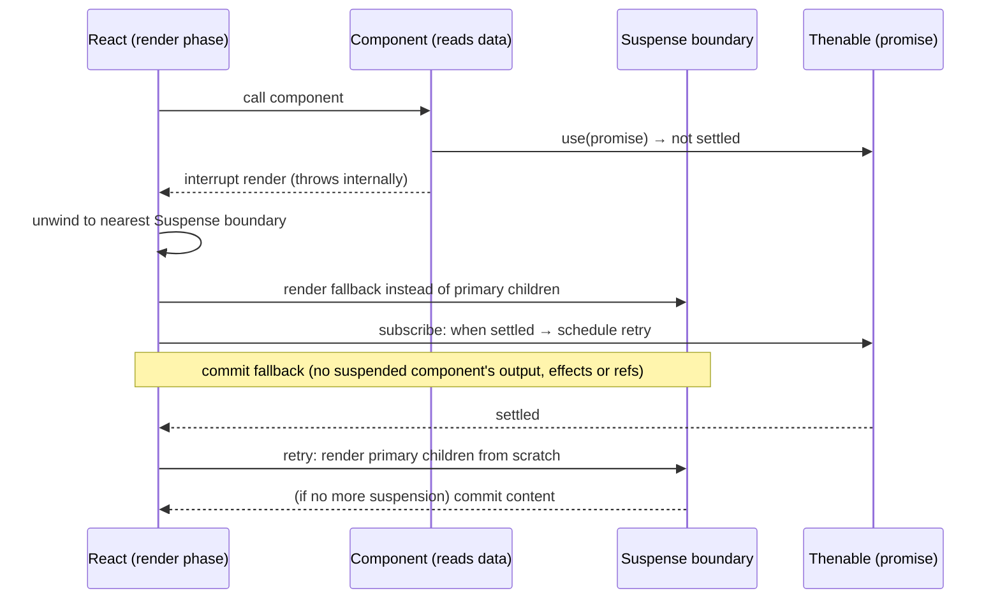
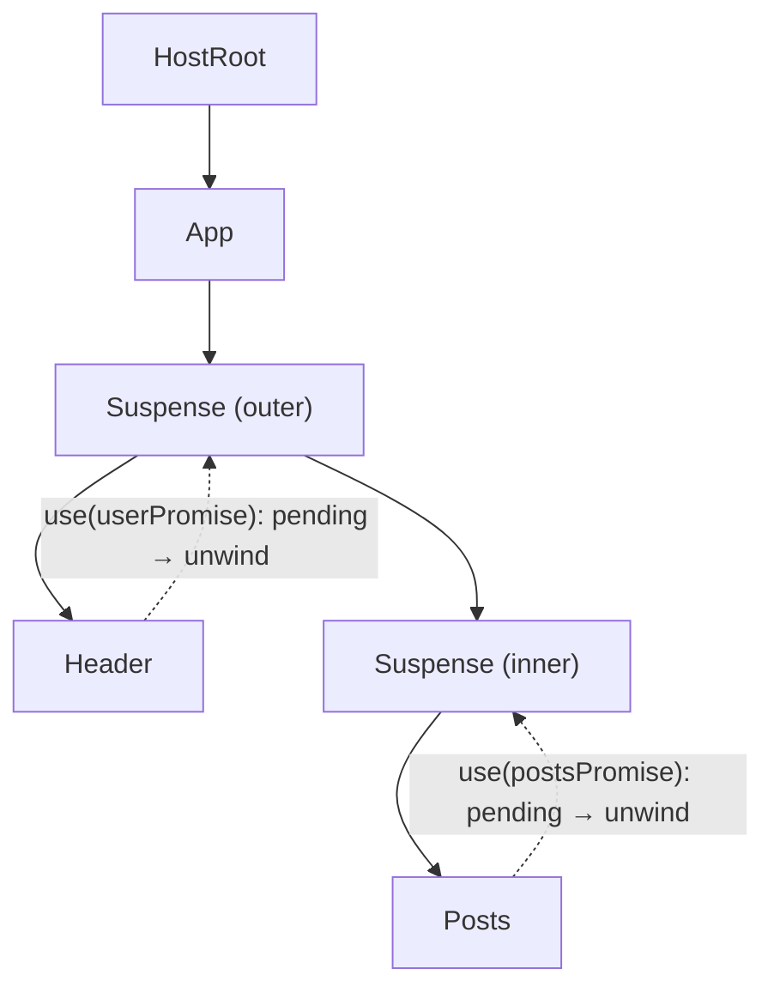
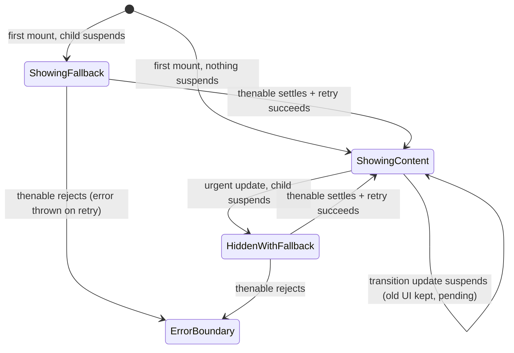

# 02 / 24 — Suspense and Thrown Thenables

## 1. Lesson metadata

| | |
|---|---|
| **Level** | Professional (Advanced+) |
| **Study time** | 6 hours (reading 2.5 h, experiments 1.5 h, exercises 2 h) |
| **Prerequisites** | [10 — Current and work-in-progress trees](./10-current-and-work-in-progress-trees.md), [11 — Render phase vs commit phase](./11-render-phase-and-commit-phase.md), [12 — Why rendering must be pure](./12-why-rendering-must-be-pure.md), [15 — Interruptible, restartable, abandoned renders](./15-interruptible-restartable-abandoned-rendering.md), [23 — Transitions and deferred rendering](./23-transitions-and-deferred-rendering.md), [Foundations 12 — Promises and async/await](../00-web-and-javascript-foundations/12-promises-and-async-await.md) |
| **Next** | [25 — Hydration and selective hydration](./25-hydration-and-selective-hydration.md) |
| **Related** | [36 — Scenario E: component suspends](./36-scenario-e-suspend.md), [Phase 6 / 13 — Suspense data loading](../06-data-fetching-and-state-ecosystems/13-suspense-data-loading.md), [Phase 9 / 05 — Suspense architecture](../09-advanced-rendering-and-ecosystem/05-suspense-architecture.md), [Phase 7 / 17 — Network waterfalls](../07-performance/17-network-waterfalls.md), [Phase 7 / 15 — Code splitting and lazy loading](../07-performance/15-code-splitting-and-lazy-loading.md) |

**Learning objectives.** After this lesson you can:
1. Explain **why** Suspense exists: letting a component say "I cannot render yet" from *inside* render, without every ancestor threading `isLoading` flags.
2. Describe the *protocol* in the teaching model: a component interrupts render by throwing a **thenable**; the nearest Suspense boundary catches it; React discards the attempt, shows the fallback, subscribes to the thenable, and **retries from scratch** when it settles.
3. Distinguish **public API** (`<Suspense>`, `use`, `lazy`, transitions, `useDeferredValue`) from **implementation detail** (the throw mechanism, thenable status tracking, Offscreen/hidden trees, lanes).
4. Predict what is rendered, committed, discarded and shown for first mount, updates (with and without transitions), nested boundaries and sibling components, in React 18 and React 19.
5. Explain why a Promise created during render causes an infinite loading loop and how caching fixes it.
6. Explain what happens to state, effects and DOM when already-visible content re-suspends.
7. Design boundary placement for loading sequences and avoid fetch waterfalls.

**Concepts covered:** Suspense boundary, fallback, thenable, `use`, `lazy`, retry, ping, thenable status caching, suspended render discarded, hidden primary tree, layout-effect cleanup on hide, sibling pre-warming (React 19), reveal throttling, transitions with Suspense, error boundaries with Suspense, waterfalls, server behavior (summary).

> ⚠ **Version-sensitive (React 18 vs 19).**
> - **React 19:** when a component suspends, React *immediately commits the fallback of the nearest boundary without waiting for the sibling tree to render*, then schedules another render to "pre-warm" the suspended siblings. In 18, siblings were rendered first and then the fallback was committed. (Source: React 19 Upgrade Guide, "Improvements to Suspense"; re-read on 2026-10-22 and reproduced on react 19.3.1: for `<Suspense><A/><B/></Suspense>` with `A` suspending, the first pass logged only `A`, the fallback committed, then a second pre-warm pass rendered `A` again and `B`.)
> - **React 19:** `use(promise)` is stable (and still is in 19.3). In 18 it was not part of the stable API (`lazy`, framework integrations, and libraries' own thenable-throwing were the paths).
> - **React 18 vs ≤17:** concurrent roots handle suspended trees by *not committing* them. Legacy-mode (`ReactDOM.render`) Suspense had different, quirky semantics; legacy roots no longer exist in 19.
> - Anything about *how* React unwinds, marks fibers, or tracks thenables below is an **implementation detail**.
> - **React 19.2 / 19.3:** the client behaviors in this lesson still hold (verified in the sandbox on 19.3.1). 19.2 additionally batches reveals of *server-streamed* Suspense boundaries so they match the client's 300 ms behavior ([19.2 release post](https://react.dev/blog/2025/10/01/react-19-2)) and added `<Activity>` (see §3.5).

---

## 2. Deep conceptual explanation

### 2.1 What problem is this lesson solving?

Asynchronous data makes components *conditionally unable to render*. Before Suspense, the usual pattern was:

```tsx
function Profile({ id }: { id: string }) {
  const [user, setUser] = useState<User | null>(null);
  const [loading, setLoading] = useState(true);
  useEffect(() => { /* fetch, then setUser, setLoading(false) */ }, [id]);
  if (loading) return <Spinner />;
  return <h1>{user!.name}</h1>;
}
```

This has structural problems:

1. **Every component owns its own loading UI.** Ten components → ten spinners popping in at different times (layout shift, "popcorn UI").
2. **Fetch-after-render waterfalls.** Child components cannot start fetching until the parent has rendered, committed, and run its effect.
3. **Race conditions** around stale responses ([Phase 6/02](../06-data-fetching-and-state-ecosystems/02-cancellation-and-race-conditions.md)).
4. **No coordination.** The parent cannot say "show one loading state until *all* of these are ready" or "keep the old page until the new one is ready".

Suspense moves the *"not ready yet"* decision out of component state and into the **rendering protocol**: a component may *suspend*; the nearest ancestor `<Suspense>` decides what to show instead. UI loading states become **declarative and placed by composition** rather than coded per leaf.

### 2.2 Definitions

| Term | Meaning |
|---|---|
| **Suspense boundary** | A `<Suspense fallback={…}>` element. It defines "the unit that loads together". |
| **Suspend** | A component, during render, signals it cannot produce output yet because it depends on something pending. |
| **Fallback** | The UI shown in place of the boundary's children while any of them is suspended. |
| **Thenable** | Any object with a `.then` method (a Promise is a thenable). |
| **Primary children** | The boundary's real content (as opposed to the fallback). |
| **Retry** | Re-rendering the suspended part once the thenable settles. |
| **Pre-warming** *(React 19)* | After committing the fallback, rendering the suspended siblings anyway so that their lazy loads / reads start early. |
| **Reveal** | The moment a boundary replaces its fallback with content. |

### 2.3 Public API: what you may rely on

```tsx
import { Suspense, lazy, use } from "react";

const Chart = lazy(() => import("./Chart"));          // suspends until the module loads

function Albums({ promise }: { promise: Promise<Album[]> }) {
  const albums = use(promise);                         // suspends until the promise resolves
  return <ul>{albums.map((a) => <li key={a.id}>{a.title}</li>)}</ul>;
}

<Suspense fallback={<Skeleton />}>
  <Chart />
  <Albums promise={albumsPromise} />
</Suspense>
```

What activates a boundary (per the react.dev `<Suspense>` page): lazy components, `use(promise)` (the promise must be cached/stable across renders), data streamed from Server Components / Suspense-enabled frameworks, stylesheets with `precedence`, and large streamed server HTML boundaries. **Suspense does not detect data fetched in an Effect or event handler.**

What you are told **not** to do: throw promises yourself, or read `promise.status`/`promise.value`. Those are the protocol underneath, not API.

### 2.4 The teaching-model protocol in one picture



Key facts encoded in that diagram:

- The component **does not return**. Whatever JSX it would have produced is never created.
- The component is **not paused and resumed**. Its work is discarded, and on retry the function runs from the top. (JavaScript functions cannot be suspended mid-flight without generators; React chose "throw and re-run".)
- The decision "what to show" belongs to the **boundary**, found by walking *up* the fiber tree.

### 2.5 Why "throw"?

Component functions are ordinary synchronous functions. React needs a way to abort the call stack from deep inside arbitrarily nested calls (`useUser()` called inside a custom hook inside a component) *and* to return control to the nearest handler up the *component tree*. JavaScript has exactly one built-in non-local exit: **throwing**. So the (historical, still conceptual) mechanism is: *throw something that is not an `Error` but a thenable*. React's render loop catches it, sees "this is a thenable, not a failure", and treats it as a suspend signal. (Compare algebraic effects: Suspense is a limited, one-shot form of "perform an effect that the handler resolves later".)

*Implementation detail.* With `use`, current React does not throw the user's promise itself; it records the thenable's status and throws an internal sentinel. The react.dev `use` page warns that wrapping `use` in `try/catch` is wrong because "`use` throws internally to integrate with Suspense" (the catch would swallow the signal). Executed on 19.3.1: a `catch` around `use(pendingPromise)` received an error whose message begins "Suspense Exception: This is not a real error! It's an implementation detail of `use` to interrupt the current render", and React also logged "`use` was called from inside a try/catch block". The pre-`use` community protocol (libraries throwing promises) is not a supported application-level API.

### 2.6 Relation to JavaScript and the browser

Promises are microtask-scheduled; a promise can only settle between tasks. When React suspends and the promise settles later, React's `then` callback runs in a microtask and *schedules* a retry (via the scheduler, [13](./13-scheduler-and-priorities.md)); the actual retry render happens in a later task. The main thread is free the entire time. Therefore *suspending costs no blocking*; its cost is **wasted partial render work** and **latency** (data arrives only after the request, plus the retry).

### 2.7 Common misconceptions

| Misconception | Reality |
|---|---|
| "Suspense is a data-fetching library." | It is a **coordination mechanism** for "not ready" states. Data libraries / frameworks integrate with it. |
| "Suspense makes my `useEffect` fetches show a fallback." | No. The component renders; nothing signals "not ready". |
| "The suspended component resumes where it left off." | It is re-run from the start on retry. Anything before the suspension point re-executes. |
| "Each suspended component shows its own fallback." | The **nearest ancestor boundary** shows one fallback for *all* its suspended descendants. |
| "State set before suspending is kept." | On **first mount**, a suspended tree's state is *not* preserved ("React does not preserve any state for renders that got suspended before they were able to mount for the first time", react.dev). |
| "Fallback appears if anything is slow." | Only when something *suspends*. Slow synchronous render is not Suspense. |
| "A rejected promise shows the fallback forever." | A rejected thenable makes the retry render throw the error → nearest **error boundary**. |
| "Creating the promise inside the component is fine." | A new promise per render means each retry suspends again, forever. Promises must be cached/stable. |
| "Suspense = streaming SSR." | Streaming SSR *uses* boundaries as units; but client Suspense exists without any server rendering. |

---

## 3. Internal mechanics

> **Labels.** **Public guarantee**: documented. **Teaching model**: faithful enough to predict behavior. **Implementation detail**: today's React internals; check the source before depending on specifics.

### 3.1 Public guarantees

1. A `<Suspense>` boundary shows `fallback` while any descendant suspends (via supported sources) and shows the children when all have resolved.
2. React does not preserve state for subtrees that suspended before ever mounting; on retry it re-renders from scratch.
3. A suspended render's output is **never committed** as content: no DOM nodes, refs, layout or passive effects for the suspended subtree. (In concurrent roots.)
4. If already-visible content suspends again due to a **non-transition** update, the boundary shows its fallback again; if the update is inside a transition or caused by `useDeferredValue`, previous content stays.
5. When React must hide already-visible content because it suspended, it **cleans up layout effects** in that content and re-fires them on reveal (documented on the Suspense page).
6. React reveals suspended content **at most once every 300 ms**, measured from the last reveal; boundaries that become ready within that window are revealed together. (Documented; the numeric value is documented but could be tuned.)
7. A Promise passed to `use` must be **stable across renders** (cached) for the app to make progress.
8. Errors from rejected thenables surface to the nearest **error boundary** (`use` docs).

### 3.2 Teaching model: boundary as a try/catch for rendering

Think of `<Suspense>` as the component-tree analogue of:

```ts
function renderBoundary(children, fallback) {
  try {
    return renderTree(children);          // may throw a "not ready" signal from deep inside
  } catch (signal) {
    if (isNotReadySignal(signal)) {
      subscribe(signal, () => scheduleRetry(thisBoundary));
      return renderTree(fallback);
    }
    throw signal;                          // real errors continue to the error boundary
  }
}
```

Differences from a literal try/catch: React's tree is not a call stack (it is a Fiber linked list walked iteratively, [09](./09-fiber-nodes-and-units-of-work.md)), so "catch" means *unwind* the work loop to the nearest ancestor fiber of type Suspense and re-process it in "fallback mode".

### 3.3 A runnable emulation (no React) of the protocol

Not React code, but a minimal faithful model of *thenable-throwing with a cache*. It makes the protocol concrete:

```ts
type Status<T> =
  | { state: "pending"; promise: Promise<void> }
  | { state: "fulfilled"; value: T }
  | { state: "rejected"; error: unknown };

const cache = new Map<string, Status<unknown>>();

function read<T>(key: string, load: () => Promise<T>): T {
  const entry = cache.get(key) as Status<T> | undefined;
  if (!entry) {
    const promise = load().then(
      (value) => { cache.set(key, { state: "fulfilled", value }); },
      (error) => { cache.set(key, { state: "rejected", error }); },
    );
    cache.set(key, { state: "pending", promise });
    throw promise;                       // "not ready": caught by the boundary
  }
  if (entry.state === "pending") throw entry.promise;
  if (entry.state === "rejected") throw entry.error;   // a real error
  return entry.value;
}

function renderWithBoundary<T>(component: () => T, fallback: () => T, retry: () => void): T {
  try {
    return component();
  } catch (e) {
    if (e && typeof (e as PromiseLike<unknown>).then === "function") {
      (e as PromiseLike<unknown>).then(retry, retry);   // subscribe once; re-run later
      return fallback();
    }
    throw e;
  }
}
```

Observations that transfer to real React:
- First `read` starts the load **inside the render** (render-as-you-fetch would start it earlier), throws, boundary shows fallback, subscribes `retry`.
- On retry, the cache entry is fulfilled; `read` returns synchronously; no suspension.
- If the cache were keyed per render (new promise each time), `retry` would find a *new pending* entry each time: infinite fallback. This is the "promises must be cached" rule.
- Rejections are thrown as real errors and not subscribed as retries.

*Not how React is implemented*, but the observable contract (throw → boundary → fallback → retry from scratch → synchronous read on success) matches.

### 3.4 Teaching model: what React does on a suspension

Within the render phase ([11](./11-render-phase-and-commit-phase.md)):

1. The work loop is processing the WIP tree and calls component `X`. `X` reads an unresolved thenable → render of `X` is aborted.
2. React marks `X`'s fiber as *incomplete* and starts **unwinding**: it walks up `return` pointers looking for the nearest Suspense boundary fiber that can capture. Error boundaries are found by the same unwinding mechanism (with a different capture condition), which is why both are "boundaries".
3. If no Suspense boundary is found: in a concurrent root (the only kind in React 19) the render simply **suspends without committing**, waiting indefinitely for the thenable; the previous UI stays and the update is retried when the thenable settles. The old error "A component suspended while responding to synchronous input" is now thrown only for *legacy* roots, which React 19 removed (`ReactFiberThrow.js` on `main`: "In a concurrent root, suspending without a Suspense boundary is allowed. It will suspend indefinitely without committing."). Executed on react 19.3.1: `root.render(<Suspender/>)` with no boundary rendered nothing until the promise resolved, and a `flushSync(() => setState(...))` update that suspended with no boundary neither threw nor committed until resolution. Practical advice is unchanged (add a boundary or use a transition so the user sees something sensible), but do not expect that error message in React 19.
4. The boundary is flagged "capture" and **re-processed**: this time React renders the **fallback** subtree.
5. A **listener is attached** to the thenable (a "ping" or "retry" listener); when the thenable settles, React schedules a **retry lane** render on that boundary (conceptually with a priority distinct from normal updates, so retries do not preempt urgent work).
6. The rest of the render completes; the **commit** applies fallback DOM.
7. When the thenable settles → retry render of the boundary's primary children; if all reads succeed, commit content and remove fallback.

### 3.5 First mount vs update: what happens to the primary tree

**Initial mount of a boundary that suspends.** The primary children never committed, so there is nothing to hide. Teaching model: React commits **fallback only**. In the retry, the primary children are rendered from scratch and committed, replacing the fallback.

**Update to a boundary already showing content, non-transition.** The primary tree *is* in the DOM. To show the fallback, React **hides** the primary tree (conceptually it keeps the fibers and DOM nodes alive but marks them hidden, using style `display: none` on top-level host nodes) and mounts the fallback next to it. When the data arrives it unhides. Consequences:
- Component **state in the hidden primary tree is preserved** (the components are not unmounted). Executed on react 19.3.1: state set to `7` before an urgent re-suspend was still `7` after reveal, and the `useState` initializer ran once; the hidden DOM carried `style="display: none !important"` (also see §5.5).
- **Layout effects are cleaned up** on hide and re-run on reveal (documented). Executed on 19.3.1 with `[]`-dependency effects: **passive effects were *not* cleaned up** when Suspense hid the content (they stay mounted), unlike `<Activity mode="hidden">`, which cleans up both. That passive-effect behavior is an implementation detail, not documented.
- DOM nodes remain, so third-party widgets inside keep their DOM state.

**Update inside a transition.** React *doesn't commit* the in-progress new tree at all; the old tree stays visible untouched, and React waits to retry ([23 §3.5](./23-transitions-and-deferred-rendering.md)). Nothing is hidden because nothing was replaced.

### 3.6 Sibling behavior: React 18 vs 19

Consider:

```tsx
<Suspense fallback={<Skeleton />}>
  <A />   {/* suspends on first read */}
  <B />   {/* would start its own lazy load / read when rendered */}
</Suspense>
```

| | React 18 | React 19 |
|---|---|---|
| Sibling `B` rendered in the same pass as suspended `A`? | Yes: React continues rendering siblings, then commits the fallback. | No: React stops at `A`'s suspension and commits the fallback "immediately … without waiting for the entire sibling tree to render". |
| When does `B` start loading (e.g., `lazy`)? | In that same render pass. | In a **second, scheduled "pre-warm" render** after the fallback commit. |
| Visible effect | Fallback appears after sibling render work. | Fallback appears faster; siblings still pre-warmed. |

Quote from the Upgrade Guide: "This change means Suspense fallbacks display faster, while still warming lazy requests in the suspended tree." Practical consequence: in 19, **a sibling's own `use()` reads start slightly later** than in 18 if the first suspender is ahead of it in render order. Hence the advice to *start fetches before rendering* (route loaders, Server Components, event handlers), never as a side effect of render order.

### 3.7 What is cached where?

React does **not** cache your promise. You (or your framework/library) must provide a *stable* promise:

- `use(promiseFromProps)` where the parent created it once (e.g., in an event handler, route loader, or Server Component).
- `use(cache.get(key) ?? start(key))` with a module/global or framework-managed cache. (React's `cache()` function is for **Server Components** to dedupe per-request work; its use on the client is not the recommended pattern; see [React docs `cache`](https://react.dev/reference/react/cache).)

*Implementation detail (confirmed on 19.3.1: `promise.status === "fulfilled"`, `promise.value` set after `use` observed it):* React annotates a thenable with `status`/`value`/`reason`-style fields so that, on retry, a fulfilled promise can be read synchronously without suspending again. The `use` docs explicitly tell you not to read those fields yourself.

### 3.8 Error + Suspense composition

```tsx
<ErrorBoundary fallback={<ErrorPanel />}>
  <Suspense fallback={<Skeleton />}>
    <Albums promise={albumsPromise} />
  </Suspense>
</ErrorBoundary>
```

Order matters: the error boundary sits **outside**, because a rejected promise surfaces as a thrown error on retry; a Suspense boundary does not catch errors. If you want "retry" UX, the error boundary needs a reset that also **creates a new promise**; resetting with the same rejected promise would fail again immediately.

### 3.9 Priority of retries and "fallback throttling"

Retries are scheduled in their own low-priority lanes ([14](./14-lanes.md)) so they don't interrupt typing. Documented: reveals are throttled to once per 300 ms so the UI doesn't flash multiple tiny reveals; boundaries ready within the window appear together. This is observable: in the sandbox a promise that resolved at 100 ms was not revealed until about 310 ms after mount (see §4.1). The constant is `FALLBACK_THROTTLE_MS = 300` in `ReactFiberWorkLoop.js`; the documented sentence is the most you should rely on.

### 3.10 Server and hydration (preview)

On the server, a suspended boundary's fallback goes into the HTML (streaming SSR sends the shell first and replaces the fallback when the content resolves: [26](./26-ssr-and-client-rendering.md)). During client hydration, a boundary can be hydrated independently ("selective hydration", [25](./25-hydration-and-selective-hydration.md)). The same protocol is reused across client render, server stream, and Server Components.

---

## 4. Step-by-step execution walkthrough

### 4.1 First mount with nested boundaries

```tsx
import { Suspense, use } from "react";

interface User { name: string }
interface Post { id: number; title: string }

declare const userPromise: Promise<User>;     // created once, outside render
declare const postsPromise: Promise<Post[]>;  // created once, outside render

function Page() {
  return (
    <Suspense fallback={<p>Page skeleton</p>}>
      <Header />
      <Suspense fallback={<p>Posts skeleton</p>}>
        <Posts />
      </Suspense>
    </Suspense>
  );
}

function Header() {
  const user = use(userPromise);
  return <h1>{user.name}</h1>;
}

function Posts() {
  const posts = use(postsPromise);
  return <ul>{posts.map((p) => <li key={p.id}>{p.title}</li>)}</ul>;
}
```

**Predict:** `userPromise` resolves at 100 ms, `postsPromise` at 400 ms. What does the user see at t = 0, 100, 400 ms (React 19)? How many commits? (Hint: remember the documented 300 ms reveal throttle, §3.9.)

| t | Event | Render phase | Commit | DOM |
|---|---|---|---|---|
| 0 | `root.render(<Page/>)` | Render `Page` → outer `Suspense` → `Header` calls `use(userPromise)` → pending → **suspends**. Unwind to the **outer** boundary (nearest ancestor of `Header`). (React 19: does not render `Posts` in this pass.) Render outer fallback. Attach retry listener to `userPromise`. | Commit 1 | `<p>Page skeleton</p>` |
| ~1 | (React 19) Pre-warm render scheduled: renders outer primary children again but ignoring the suspension to reach siblings: `Posts` reached, `use(postsPromise)` pending → suspends inner boundary... *teaching model*: the purpose is to start reads/lazy loads early. No commit visible. | pre-warm render | none | unchanged |
| 100 (ping) → **≈310 (commit)** | `userPromise` fulfilled → ping → retry outer boundary; the reveal is held back by the 300 ms throttle (measured: header appeared at ~310 ms) | Render outer primary: `Header` reads `user` OK. Inner `Suspense` → `Posts` → `postsPromise` pending → suspends; nearest boundary is the **inner**; show inner fallback; subscribe to `postsPromise`. | Commit 2 | `<h1>Ada</h1><p>Posts skeleton</p>`; outer skeleton removed |
| 400 (ready) → **≈610 (commit)** | `postsPromise` fulfilled → retry inner boundary; throttled again, 300 ms after the previous reveal (measured ~611 ms) | Render `Posts` → ok | Commit 3 | `<h1>Ada</h1><ul>…</ul>` |

Notes:
- Inner boundary gives a **loading sequence** instead of a single all-or-nothing reveal. Moving it removes/adds stages. Boundary placement = UX design.
- Executed on react 19.3.1 (MutationObserver timestamps): skeleton at ~6 ms, `<h1>Ada</h1>` + posts skeleton at ~310 ms (not 100), list at ~611 ms (not 400). So the table's *ordering and commit count* hold (3 commits), but the *times* are shifted by the documented 300 ms reveal throttle. If both promises resolved within the same 300 ms window of a prior reveal, React would merge reveals.
- The pre-warm row is *teaching model*; whether it visibly separates in a profiler varies by version/timing.

### 4.2 Update inside the visible page: non-transition vs transition

```tsx
function Profile() {
  const [id, setId] = useState("1");
  const promise = useMemo(() => loadUser(id), [id]);   // cached per id elsewhere ideally
  return (
    <>
      <button onClick={() => setId("2")}>Next</button>
      <Suspense fallback={<p>Loading…</p>}>
        <UserCard promise={promise} />
      </Suspense>
    </>
  );
}
```

*(In real code, create the promise in the handler/loader and store it in state. `useMemo` as a semantic guarantee of caching is **not** supported ([Phase 3/11](../03-react-state-and-hooks/11-usememo-and-usecallback.md)). It is here only to keep the example compact.)*

**Click "Next" (non-transition):**
1. Urgent render: `promise` changes → `UserCard` calls `use` → pending → suspends.
2. Boundary already showing content → React **hides** the existing `UserCard` DOM and shows `Loading…`; layout effects in `UserCard` cleaned up.
3. When promise resolves → retry → content unhidden/replaced; layout effects re-run.

**Click "Next" inside `startTransition`:**
1. Transition render: `UserCard` suspends.
2. Boundary already revealed → **no fallback**. Old `UserCard` for user 1 stays visible; `isPending` (if `useTransition`) is true.
3. Resolve → retry → commit the new card.

---

## 5. Code examples

### 5.1 Minimal: `lazy` + `Suspense`

```tsx
import { Suspense, lazy, useState } from "react";

const HeavyChart = lazy(() => import("./HeavyChart"));   // default export required

export function Dashboard() {
  const [show, setShow] = useState(false);
  return (
    <>
      <button onClick={() => setShow(true)}>Show chart</button>
      {show && (
        <Suspense fallback={<p>Loading chart…</p>}>
          <HeavyChart />
        </Suspense>
      )}
    </>
  );
}
```

**Predict:** first click: how many commits and what appears? Second time (after remount)?

**Answer.** Click → render: `show = true`; `Suspense` is new (mounted in this update), `HeavyChart` is a `lazy` component whose loader starts → suspends → boundary (new) commits its fallback: **commit 1** shows `Loading…`. When the module resolves → retry → **commit 2** shows the chart. Second time (module cached by the bundler/browser *and* `lazy` caches its result) the lazy component resolves synchronously and no fallback appears.

**Notes.** `lazy` caches the promise/result internally; you must declare it at module scope (not inside a component) or it would be recreated every render. ([Phase 7/15](../07-performance/15-code-splitting-and-lazy-loading.md).)

### 5.2 Practical: render-as-you-fetch with a cache

```tsx
import { Suspense, use, useState, useTransition } from "react";

interface Product { id: string; name: string; price: number }

// A tiny cache. Real apps: TanStack Query suspense APIs, a framework loader, or RSC.
const productCache = new Map<string, Promise<Product>>();
export function prefetchProduct(id: string): Promise<Product> {
  let p = productCache.get(id);
  if (!p) {
    p = fetch(`/api/products/${id}`).then((r) => {
      if (!r.ok) throw new Error(`HTTP ${r.status}`);
      return r.json() as Promise<Product>;
    });
    productCache.set(id, p);
  }
  return p;
}

export function Catalog({ ids }: { ids: readonly string[] }) {
  const [selected, setSelected] = useState(ids[0]!);
  const [isPending, startTransition] = useTransition();

  return (
    <div>
      <ul>
        {ids.map((id) => (
          <li key={id}>
            <button
              onMouseEnter={() => void prefetchProduct(id)}        // start early: no waterfall
              onClick={() => startTransition(() => setSelected(id))}
            >
              {id}
            </button>
          </li>
        ))}
      </ul>
      <div style={{ opacity: isPending ? 0.5 : 1 }}>
        <ErrorBoundary fallback={<p role="alert">Could not load product.</p>}>
          <Suspense fallback={<p>Loading product…</p>}>
            <ProductView promise={prefetchProduct(selected)} />
          </Suspense>
        </ErrorBoundary>
      </div>
    </div>
  );
}

function ProductView({ promise }: { promise: Promise<Product> }) {
  const p = use(promise);
  return <h2>{p.name}: {p.price}</h2>;
}

declare function ErrorBoundary(p: { fallback: React.ReactNode; children: React.ReactNode }): JSX.Element;
```

**Predict:** hovering over button `b` for 200 ms then clicking it: which UI shows during the click?

**Answer.** If the request finished while hovering, the cached promise is already settled. React has never "seen" it through `use`, so conceptually it attaches a handler and may suspend the render for a very short time (about one microtask) before it can read the value (implementation detail; with a hand-annotated `status: "fulfilled"` thenable `use` reads synchronously, and React itself sets `status`/`value` on the thenable after first observing it, confirmed on 19.3.1). Because the click is inside a transition, no fallback is shown either way; at worst `isPending` flashes briefly. If the request had *not* finished, the old product stays visible with `isPending` true until it does.

**Why this design.** Fetch starts from an *event*, not from render; render only *reads*. The cache key guarantees promise identity. `prefetchProduct(selected)` called in render is idempotent because it reads the cache. The error boundary resets by remounting with a `key` (not shown) and by evicting the failed cache entry.

**Trade-offs.** A hand-rolled cache lacks eviction, invalidation, retries, deduping with other consumers; prefer a data library or framework in production ([Phase 6/07–08](../06-data-fetching-and-state-ecosystems/08-tanstack-query.md)).

### 5.3 Incorrect: a new promise every render

```tsx
function Albums({ artistId }: { artistId: string }) {
  const albums = use(fetch(`/api/artists/${artistId}/albums`).then((r) => r.json())); // WRONG
  return <ul>{(albums as Album[]).map((a) => <li key={a.id}>{a.title}</li>)}</ul>;
}
```

**Why wrong.** Each render makes a *new* pending promise; React suspends; when it resolves, the retry re-runs `Albums` from scratch → creates **another** new promise → suspends again. The user sees the fallback forever and the server sees repeated requests. React.dev: "Promises must be cached" (a new Promise during render makes React suspend again on every render).

**Corrected.** Create the promise outside render (event handler, loader, parent that holds it in state, Server Component) or read from a cache keyed by `artistId` (§5.2).

### 5.4 Incorrect: expecting `useEffect` data to trigger the fallback

```tsx
function Albums({ id }: { id: string }) {
  const [albums, setAlbums] = useState<Album[]>([]);
  useEffect(() => { fetch(`/api/${id}`).then((r) => r.json()).then(setAlbums); }, [id]);
  return <ul>{albums.map((a) => <li key={a.id}>{a.title}</li>)}</ul>;
}
// <Suspense fallback={<Spinner/>}><Albums id="1"/></Suspense>  ← never shows the spinner
```

The component renders immediately with `[]`, so the boundary has nothing to wait for; the list stays empty until the effect finishes. Either implement your own `isLoading` UI or move to a Suspense-integrated source.

### 5.5 Experiment: does hidden content keep state?

Use this to verify §3.5 for **your** React version rather than trusting this lesson:

```tsx
import { Suspense, use, useEffect, useLayoutEffect, useState } from "react";

function Counter({ gate }: { gate: Promise<void> | null }) {
  const [n, setN] = useState(0);
  useLayoutEffect(() => {
    console.log("layout setup");
    return () => console.log("layout cleanup");
  });
  useEffect(() => {
    console.log("passive setup");
    return () => console.log("passive cleanup");
  });
  if (gate) use(gate);               // suspends while gate pending
  return <button onClick={() => setN(n + 1)}>count {n}</button>;
}

export function Lab() {
  const [gate, setGate] = useState<Promise<void> | null>(null);
  return (
    <>
      <button onClick={() => setGate(new Promise((r) => setTimeout(r, 1500)))}>
        suspend counter for 1.5s
      </button>
      <Suspense fallback={<p>Loading…</p>}>
        <Counter gate={gate} />
      </Suspense>
    </>
  );
}
```

Procedure: click the counter a few times (`count 3`), click "suspend…", watch the console and the DOM (Elements panel: the counter's `<button>` gets `display: none`), wait for reveal, check whether the count is still `3` and which effects re-ran. (Per the docs you should see `layout cleanup` on hide and `layout setup` on reveal. Executed on 19.3.1: that is what happens, state is preserved, and the passive effect is **not** cleaned up by the hide itself. Because the effects in this lab have no dependency array, they also re-run on the commit that reveals the content, so you will additionally see a `passive cleanup`/`passive setup` pair at reveal; use `[]` dependencies to isolate hide/reveal behavior.) Note the `gate` stays set after the first suspension but the promise is settled so no further suspending (a settled promise read via `use` returns). Also try wrapping the click in `startTransition` and compare: no fallback, no cleanup.

### 5.6 Advanced: nested boundaries to design a loading sequence

```tsx
<Suspense fallback={<PageShellSkeleton />}>           {/* stage 1: header+nav only */}
  <Layout>
    <Suspense fallback={<FeedSkeleton />}>             {/* stage 2 */}
      <Feed />
      <Suspense fallback={<CommentsSkeleton />}>       {/* stage 3: independent, non-critical */}
        <Comments />
      </Suspense>
    </Suspense>
  </Layout>
</Suspense>
```

Guidelines (aligned with react.dev's "don't put a boundary around every component"): boundaries around units that **should appear together**; put non-critical, slow content in its own boundary so it doesn't hold back critical content; avoid so many boundaries that the page "pops in" in a jittery order; reserve space in skeletons to avoid layout shift ([Phase 7/21](../07-performance/21-web-vitals-and-budgets.md)).

### 5.7 Advanced: preventing waterfalls

```tsx
// Waterfall: B can't even start until A has resolved (B is a child of A).
function A({ idA }: { idA: string }) {
  const a = use(load(idA));
  return <B idB={a.nextId} />;           // B starts reading only after A's data exists
}

// Parallel: start both at the same time, from an event/loader.
const pA = load(idA); const pB = load(idB);
<Suspense fallback={<Skeleton />}><A promise={pA} /><B promise={pB} /></Suspense>
```

Sometimes a dependency is real (B's input comes from A). Then the waterfall is inherent; solve it on the server (join the data in one request/RSC) or prefetch speculatively. Siblings, by contrast, are parallel in React 19 only thanks to **pre-warming** and are best started from the same loader.

---

## 6. Visual explanations

### 6.1 Fiber-tree view of the unwind



`Header` suspends → the nearest Suspense ancestor is the outer one → the entire outer subtree's primary content (including the inner boundary) is replaced by the outer fallback until `Header` is ready.

### 6.2 State machine of a boundary (teaching model)



### 6.3 Waterfall vs parallel timeline

```text
Waterfall (fetch-on-render, nested):
  render A ─ fetch A ─────────────► resolve ─ render B ─ fetch B ─────────► resolve ─ render C
  |------------------ 300ms -------------|----------------- 300ms ------------|
  total ≈ 600 ms+

Parallel (render-as-you-fetch):
  event/loader: fetch A ─────► resolve
                fetch B ─────► resolve          (both in flight together)
  render A,B (suspend once) ─────────────► retry ─ commit
  total ≈ 300 ms + render
```

---

## 7. Alternative approaches and trade-offs

Handling "data isn't here yet":

| Approach | Loading UI placement | Waterfall risk | Race risk | Complexity | Works with transitions? | Prefer when |
|---|---|---|---|---|---|---|
| `useEffect` + `useState` + `isLoading` | Per component, manual | High | High unless guarded | Medium | No (invisible) | Small apps, imperative needs, no library |
| Suspense with `use(promise)` | By boundary placement | Low if fetch outside render | Low (identity-based) | Medium (needs caching) | **Yes** | New code with a cache/loader |
| Data library (TanStack Query) with `isPending` | Per component | Medium | Handled by library | Low | Partial (`useSuspenseQuery` for Suspense) | Most client-state-of-server apps ([Phase 6/08](../06-data-fetching-and-state-ecosystems/08-tanstack-query.md)) |
| Router loaders / framework data APIs | Route-level | Low | Low | Low (framework) | Often built in | Route-bound data |
| Server Components with `async` | Server + boundary | Lowest (server-colocated) | n/a | Framework-dependent | Yes | App Router style apps ([27](./27-react-server-components-intro.md)) |
| Skeleton/placeholder with optimistic UI | Per component | n/a | n/a | Low | n/a | Data you can pre-render/predict |

**When Suspense is NOT the best tool.**
- The loading state is *inherently local and rich*, e.g., an inline spinner in a button with inline error handling, or a file upload with progress. `isPending` from an Action or local state expresses that better.
- You need to *keep showing old data and refresh in the background* with explicit control over staleness (data libraries do this with `isFetching`).
- You can't guarantee stable promises (no cache layer) and writing one is out of scope.
- The tree contains code that is not idempotent on re-render (heavy side effects before the read).

---

## 8. Best practices and anti-patterns

**Do**
- Treat boundaries as **UX design**: decide the loading sequence first, then place boundaries.
- Start fetches **outside render** (event, loader, parent state, server) and pass the promise (or use a cache).
- Put an **error boundary** outside Suspense for data that can fail; give it a reset path that recreates the promise.
- Navigate with **transitions** so that already visible content isn't replaced by a spinner.
- Reserve skeleton dimensions; avoid layout shift.
- Keep code *before* a suspending read **pure and cheap**: it re-runs on every retry.
- Use `key` on a boundary or parent to deliberately reset it when the *identity* of the content changes (e.g., different user).

**Beginner mistakes**
- Creating promises in render.
- Expecting effect-fetched data to suspend.
- One giant boundary at the app root (empty-page spinner for any suspension).
- A boundary around every component (popcorn).

**Experienced-developer mistakes**
- try/catch around `use`.
- Relying on `promise.status` from user code.
- Starting requests as side effects of *render order* (breaks when React reorders/prewarms or when siblings are skipped).
- Putting expensive synchronous work before the suspending read.
- Assuming one fallback per suspended component.
- Forgetting that hidden content on re-suspend still *exists* (timers/subscriptions in passive effects continue: Suspense hiding cleans up layout effects only, verified on 19.3.1; `<Activity mode="hidden">` cleans up both).

**Smells:** `Suspense` with no `ErrorBoundary` and fallible data; `lazy()` called inside a component; nested boundaries with identical fallbacks (consider merging); a fallback that is heavier than the content.

**Justified exceptions:** a boundary tightly around a single widget that is allowed to load independently (chart, map) even though "one boundary per page" is the default advice.

---

## 9. Real-world application

**E-commerce product page.** Critical: product title, price, add-to-cart. Non-critical: reviews, recommendations. Outer shell appears immediately; critical data resolved in one boundary; reviews and recommendations each in their own boundary. Constraints: LCP element must not sit behind a slow boundary; SEO requires critical content in server HTML (streaming SSR, [26](./26-ssr-and-client-rendering.md)); reserve space to avoid CLS.

**Admin dashboard with independent widgets.** Each widget (revenue chart, orders table, alerts) in its own boundary so a slow report doesn't block others; error boundaries per widget so one failing API does not blank the dashboard. Constraint: many widgets × many requests → rate limiting and waterfalls; start all requests from a route loader.

**Authenticated app shell.** User/session must be known before rendering anything personalized: a top-level boundary with a skeleton shell (nav, layout) and `use(sessionPromise)`; unauthorized responses throw an error caught by an auth-aware error boundary that redirects ([Phase 9/12](../09-advanced-rendering-and-ecosystem/12-auth-boundaries.md)).

**Forms/wizards.** Lazy-load step bundles with `lazy` inside a transition so moving to the next step doesn't flash a spinner; validation uses Actions, not Suspense.

**Realtime views.** Suspense is poor for continuously updating data (a stream isn't "ready once"); use stores/subscriptions ([Phase 6/17](../06-data-fetching-and-state-ecosystems/17-real-time-websockets-subscriptions.md)) and use Suspense only for the initial snapshot.

---

## 10. Debugging and troubleshooting

### Symptom A: "The fallback shows forever."
1. Is the promise created during render (new identity each time)? Log `Object.is(prevPromise, promise)` across renders or inspect via a memoized key.
2. Does the promise ever settle? Check the Network panel and any `AbortController` that might cancel and never reject.
3. Is a parent re-creating the promise on every render (inline in JSX props)?
4. Is the `key` of the boundary or its parent changing on each render (remounting)?
5. Validate: after caching, the component should render content on the retry commit.

### Symptom B: "State resets every time my component loads."
First mount suspension discards state (documented). Move state *above* the boundary, or restructure so suspended content doesn't own long-lived state. Check for `key` changes.

### Symptom C: "Spinner flashes for fast data."
Reveal throttling means fallbacks may stay a bit longer than the data delay; and fallback commit is immediate. Options: use a transition so existing content stays; delay showing spinners via CSS (`animation-delay` / opacity transition) so that fast loads never show them; reduce boundary scope.

### Symptom D: "My `useEffect` didn't run / ran twice around loading."
Suspended-before-mount subtrees never ran effects. For hidden-and-revealed content, layout effects are cleaned and re-run (documented); passive-effect behavior while hidden is not part of the contract: write effects that tolerate setup → cleanup → setup (same discipline as Strict Mode, [28](./28-strict-mode-behavior.md)).

### Symptom E: "Console shows 'A component suspended while responding to synchronous input'."
An update scheduled at sync priority suspended with no boundary able to hold the old UI. Wrap the update in `startTransition` or add a Suspense boundary appropriate to show a fallback. This message comes from the legacy-root path and is no longer thrown in React 19 (concurrent roots just wait without committing); you may still meet it in React 18 apps.

### Symptom F: "Rejected promise: error boundary didn't catch it."
The error is thrown during a retry render *under* the error boundary only if the boundary is an ancestor of the component calling `use`. Event handlers' errors are not caught by error boundaries; promises you `.then` yourself aren't either.

### DevTools workflow
1. React DevTools Components panel: suspended components show a "Suspended" indicator; you can **force a suspense fallback** on a boundary from DevTools to test fallbacks without throttling (feature may vary with DevTools version).
2. Profiler: look at the commits; a suspended render appears as a commit with the fallback, then a later commit with content. In Chrome's Network panel apply throttling to produce slow loads reproducibly.
3. Add temporary `console.log` at the top of the component **before** the `use` call: it will log on every retry (confirming re-run from scratch). Remember Strict Mode doubling.

---

## 11. Exercises

### Level A — Knowledge
A1. What does "suspend" mean for a component? Who handles it?
A2. Why must the promise passed to `use` be stable across renders?
A3. Name three supported sources that activate Suspense and one common source that does not.
A4. What happens to a component's state if it suspends on first mount?
A5. State the React 19 change regarding siblings of a suspended component.
A6. Where must an error boundary go relative to a Suspense boundary, and why?

### Level B — Code comprehension
B1. `Header` suspends until 100 ms and `Posts` until 400 ms, with *no* inner boundary (a single boundary around both). What does the user see, and how many commits are there?
B2. In the §4.2 example, what changes if the "Next" click is inside `startTransition`?
B3. This component logs `"A"` at the top and then calls `use(promise)` of a promise that resolves in 100 ms. How many times is `"A"` logged in production? Why?
B4. What does the user see with this code, assuming `getData()` takes 500 ms?
```tsx
function C() {
  const data = use(getData());   // returns a new Promise each call
  return <p>{data}</p>;
}
```
B5. Does `<Suspense>` here ever show its fallback?
```tsx
function C() {
  const [d, setD] = useState<string | null>(null);
  useEffect(() => { getData().then(setD); }, []);
  return <p>{d ?? "…"}</p>;
}
```

### Level C — Implementation
C1. Implement `useResource<T>(key: string, load: () => Promise<T>): T` (a hook wrapping a cache + `use`) with eviction support for errors.
C2. Implement an `ErrorBoundary` with a `reset` that evicts failed cache entries and re-renders.
C3. Implement a skeleton-with-delay: a fallback component that renders nothing for 200 ms and then a skeleton (to avoid flashes for fast loads).

### Level D — Debugging
D1. "My page shows the fallback after every state update, even typing in an input."
D2. "After hiding and revealing, a chart's resize listener leaks." Explain with layout/passive effects and fix.
D3. "In production, one slow widget blocks the whole page from displaying." Find and fix the boundary design.
D4. "In React 19, my second `lazy` component starts loading later than in 18." Explain.

### Level E — Architecture and engineering decisions
E1. Propose boundary placement for an e-commerce product page (title, gallery, price, reviews, recommendations, cart).
E2. Compare Suspense-based loading to TanStack Query's `isPending` flags for a dashboard with 12 widgets. Which would you pick, with what criteria?
E3. Design navigation loading UX for a SPA: spinner policy, transitions, error recovery.

### Level F — Expert challenge
F1. Write a precise description (as would be reviewed by a React core member) of how `use(promise)` behaves for (a) an already-resolved promise React has never seen, (b) one it saw earlier, (c) a rejected promise. Mark which parts are public guarantees, and design an experiment to test each claim on a given React version.

---

## 12. Detailed answers and explanations

> Attempt the exercises first.

**A1.** The component, during render, cannot produce output because it depends on something pending (a promise read via `use`, a lazy module). React interrupts the render, finds the nearest Suspense boundary, shows its fallback, and retries when the dependency resolves. Wrong: "the component is paused and later resumes" (it re-runs from the start).

**A2.** Because after the promise settles React *re-renders from scratch*; if the render creates a new promise, React sees a new pending thenable and suspends again, endlessly. A stable identity lets React see the settled promise on retry and return its value.

**A3.** Supported: `lazy`, `use(promise)`, Suspense-enabled frameworks/Server Components streaming, stylesheets with `precedence`. Not supported: data fetched in `useEffect` or event handlers (not signalled to React).

**A4.** It is discarded. Docs: "React does not preserve any state for renders that got suspended before they were able to mount for the first time." On retry the component renders from scratch with initial state.

**A5.** React 19 commits the nearest boundary's fallback immediately without rendering the rest of the sibling tree, then schedules a pre-warm render of the siblings to start lazy requests early. React 18 rendered siblings first, then committed the fallback.

**A6.** *Outside* (ancestor of) the Suspense boundary. A rejected thenable surfaces as a thrown error in the retry render; Suspense doesn't catch errors, but the error boundary above it does. If the error boundary were inside the Suspense, errors thrown by the Suspense's content would escape past it.

**B1.** One boundary around both: `Header` suspends first (100 ms). t = 0: Commit 1 with fallback. t = 100: retry; `Header` OK, `Posts` pending → suspends → fallback remains (no commit of partial content; possibly no visible commit). t = 400: retry succeeds → Commit 2 with both. So the user sees the skeleton until 400 ms. Wrong answer: "header appears at 100 ms": that needs an inner boundary around `Posts`. In React 19 pre-warming may start `Posts`' reads earlier, but visibility doesn't change.

**B2.** Inside a transition, the new `promise` makes `UserCard` suspend in a transition render; the already-visible user 1 card stays on screen (no hide, no fallback, no layout-effect cleanup); `isPending` (if used) is true until the new content commits.

**B3.** At least twice in production: once on the first attempt (suspends at `use`), once on the retry after resolution (possibly more if React retries or re-renders for other reasons). The code before `use` re-runs. In development, Strict Mode doubles each. Never count on the exact number.

**B4.** Fallback forever (new promise each retry). Each retry triggers another `getData()` call; with a slow API you might see repeated network requests. This is the A2 bug.

**B5.** Never. The effect-based fetch is invisible to Suspense; "…" is the component's own state.

**C1. Reference solution**
```tsx
import { use } from "react";

const entries = new Map<string, Promise<unknown>>();

export function evict(key: string): void { entries.delete(key); }

export function useResource<T>(key: string, load: () => Promise<T>): T {
  let p = entries.get(key) as Promise<T> | undefined;
  if (!p) {
    p = load();
    entries.set(key, p);
    // Don't keep failed promises forever: allow retry after the error surfaces.
    p.catch(() => { /* error is surfaced by `use` to the error boundary */ });
  }
  return use(p);
}
```
Notes: this is a *hook-shaped* function but contains no hooks besides `use`, which may be called conditionally. The `p.catch(() => {})` prevents "unhandled rejection" noise while `use` still throws the error to the boundary because `use` reads the original promise's rejection (the derived promise from `.catch` isn't the one stored). Edge cases: unbounded cache growth, no invalidation, key collisions, SSR (module-level cache shared between requests would leak data between users: **never** use a module-level cache on a server without per-request scoping).

**C2.**
```tsx
import { Component, type ReactNode } from "react";

interface Props { children: ReactNode; fallback: (reset: () => void, error: Error) => ReactNode; onReset?: () => void }
interface State { error: Error | null }

export class ErrorBoundary extends Component<Props, State> {
  state: State = { error: null };
  static getDerivedStateFromError(error: Error): State { return { error }; }
  reset = () => { this.props.onReset?.(); this.setState({ error: null }); };
  render() {
    return this.state.error ? this.props.fallback(this.reset, this.state.error) : this.props.children;
  }
}
// usage: <ErrorBoundary onReset={() => evict("user:1")} fallback={(reset) => <button onClick={reset}>Retry</button>}>
```
Error boundaries must be class components as of today (no hook equivalent in React itself); many apps use the `react-error-boundary` package (evaluate its maintenance status before adopting). Evaluation: reset **must** evict the rejected cache entry, or the retry re-throws immediately.

**C3.**
```tsx
function DelayedSkeleton({ delayMs = 200 }: { delayMs?: number }) {
  const [show, setShow] = useState(false);
  useEffect(() => {
    const id = setTimeout(() => setShow(true), delayMs);
    return () => clearTimeout(id);
  }, [delayMs]);
  return show ? <Skeleton /> : null;
}
```
Caveat: effects in a fallback run only once the fallback is committed; fine. A CSS alternative (`animation-delay` + `opacity`) avoids JS. Trade-off: delayed skeleton leaves empty space; reserve layout space to avoid shift.

**D1.** Likely the state update is urgent and the updated state feeds a suspending read (new promise per keystroke) → fallback. Fix: separate input state from the suspended key; apply the query through a transition or `useDeferredValue` so that the old content stays; cache by key so repeated queries don't refetch.

**D2.** Hidden content's layout effects are cleaned up on hide; passive effects (where the resize listener probably lives) are **not** cleaned up by Suspense hiding (verified on 19.3.1), so they stay mounted. If the listener is added in `useEffect`, it stays attached while hidden (a "leak" only if it does something visible). Fix: put DOM-measurement/subscription code that must pause while hidden into `useLayoutEffect` with cleanup, or write effects to be idempotent and cheap while hidden. (If the content can be hidden by your own design rather than by Suspense, `<Activity mode="hidden">` cleans up passive effects too.) Passive-effect behavior on a Suspense hide is undocumented; re-check with §5.5 when upgrading.

**D3.** Probably one boundary around all widgets or at the root. Fix: separate boundaries per independent widget (and error boundaries). Add a shell boundary for critical content.

**D4.** React 19 stops rendering siblings after the first suspension and commits the fallback; the sibling's `lazy` initialization (and hence network request) happens in the follow-up pre-warm render, so it begins slightly later. Solution: preload (`import()` in an event or route loader) for known-needed chunks.

**E1.** Evaluation criteria: critical path (title, price, add-to-cart, gallery's first image) in the shell or one tight boundary so LCP isn't deferred; reviews and recommendations each in separate non-critical boundaries below the fold; cart widget separate (user-specific, may fail independently) with its own error boundary; skeletons with reserved dimensions; SSR streaming for SEO. Example reasoning: *"Price and add-to-cart must not wait on recommendations; hence recommendations get their own boundary. Reviews matter for SEO, so render them on the server, but behind their own boundary so a slow reviews service doesn't delay TTFB for the shell."*

**E2.** Criteria: number of independent fetches; need for background refresh, retries, caching policy; testing; team familiarity; waterfall control; error isolation. A good answer: use TanStack Query (cache, retries, dedupe) and, for the loading UX, either `isPending` per widget (simple, local) or `useSuspenseQuery` with boundaries per widget (coordinated loading, transitions friendly). Prefer Suspense if you want declarative loading placement and transition behavior; prefer flags if widgets have bespoke inline loading states. Note the library solves caching and promise identity; Suspense solves coordination.

**E3.** Criteria: wrap route changes in transitions; show global pending bar from `isPending`; Suspense boundaries at layout (persist shell) and content level; delayed skeleton for new boundaries; error boundary per route with retry that evicts cache; handle rapid navigation (latest wins); preserve scroll/focus; measure INP.

**F1.** Evaluation criteria: claims must be careful. Example: (a) A resolved promise that React has not seen: React cannot synchronously read its value; it attaches a handler and suspends the component for a short time until it observes the resolution (implementation detail; executed on 19.3.1 for an initial mount outside a transition: `Promise.resolve(v)`, a 0 ms timeout and a 50 ms timeout promise **all** mounted the fallback once before showing content, and the component function was invoked 2-4 times; inside a transition no fallback is shown for a boundary that is already revealed, and a promise carrying `status: "fulfilled"` is read synchronously). (b) A promise seen before with status fulfilled: `use` returns the value synchronously without suspending. (c) Rejected: the retry render throws the rejection reason to the nearest error boundary. **Public guarantees:** pending → suspend; fulfilled → returns value; rejected → throws to error boundary; the promise must be stable. **Not public:** status fields, single-microtask suspension, which render pass. Experiment: counter of component invocations (outside React state, in a module variable) and an instrumented `Suspense` fallback component that logs mounts; test with `Promise.resolve(v)`, a promise resolved after 0 ms and 50 ms, a promise with pre-set `status: "fulfilled"` fields (just as an experiment), and a rejected promise; run in a production build, with `createRoot`, without Strict Mode, inside and outside transitions, and record fallback mounts, invocation counts, and thrown errors.

---

## 13. Senior engineer interview questions

**Q1. "How does Suspense work under the hood?"**
*Strong answer:* A component signals "not ready" by interrupting its render with a thenable (in the stable API through `use`/`lazy`; historically by throwing the promise). React unwinds to the nearest Suspense boundary, renders the fallback, subscribes to the thenable, and when it settles schedules a retry that re-renders the primary children from scratch. Suspended output is never committed. I'd note this is an implementation detail and that API users shouldn't throw promises themselves.

**Q2. "Why does my component re-run its code before `use(...)` multiple times?"**
*Strong answer:* Suspension discards the partial render. Retry re-executes from the top. So code before the read must be pure and cheap; side effects belong in effects or event handlers.

**Q3. "What changed about Suspense in React 19?"**
*Strong answer:* `use` is stable; when a component suspends, React commits the nearest fallback immediately without rendering siblings first and then pre-warms the siblings with a follow-up render, so fallbacks appear faster while lazy requests still get warmed. Also the removal of legacy roots makes the older legacy Suspense behavior irrelevant. I'd tell teams to start fetches outside render because sibling read timing is now later than before.

**Q4. "How do Suspense and transitions interact?"**
*Strong answer:* Non-urgent updates that suspend in an already revealed boundary keep the old UI and don't show a fallback, avoiding hiding content; new boundaries still show their fallback. Urgent updates that suspend hide existing content and show the fallback. `useDeferredValue` gives the same stale-while-revalidating behavior without owning the setter.

**Q5. "Where do you put Suspense boundaries?"**
*Strong answer:* Around units that should reveal together, ordered by user-perceived importance; non-critical slow content gets its own boundary; there's an app/route shell boundary; error boundaries outside Suspense; avoid both mega-boundaries and boundary-per-component. Reserve space for skeletons to avoid layout shift, and verify with profiling and RUM.

**Q6. "What are the failure modes of a hand-rolled promise cache?"**
*Strong answer:* Unbounded growth, no invalidation, key mistakes, stale errors cached forever, server-side leakage between requests with module-level caches, no dedupe/abort, no retry. Use a library/framework.

**Q7. "Can Suspense handle realtime data?"**
*Strong answer:* Only for the initial snapshot. Suspense models "wait until ready once". Updates after that come through subscriptions/stores; throwing for every update would flash fallbacks. Combine with `useSyncExternalStore`.

---

## 14. Further learning resources

| Resource | URL | Covers / why | Level | Study |
|---|---|---|---|---|
| React docs: `<Suspense>` | <https://react.dev/reference/react/Suspense> | What activates it, transitions, nested boundaries, hydration, layout effect cleanup (verified) | Intermediate | Entire page |
| React docs: `use` | <https://react.dev/reference/react/use> | Promise semantics, caching, error handling (verified) | Intermediate | "Streaming data from server to client", caveats |
| React docs: `lazy` | <https://react.dev/reference/react/lazy> | Code splitting | Beginner | Usage |
| React 19 Upgrade Guide | <https://react.dev/blog/2024/04/25/react-19-upgrade-guide> | "Improvements to Suspense": immediate fallback + pre-warming (verified) | Intermediate | Suspense section |
| React 19 release post | <https://react.dev/blog/2024/12/05/react-19> | `use`, Server Components overview (verified) | Intermediate | Whole |
| reactwg/react-18 #37 | <https://github.com/reactwg/react-18/discussions/37> | New Suspense SSR architecture, selective hydration (verified) | Advanced | Whole post |
| React source | <https://github.com/facebook/react/tree/main/packages/react-reconciler> | Unwinding and Suspense handling; names change, read for orientation only | Advanced | Search for "Suspense" in reconciler files *(`ReactFiberThrow.js`, `ReactFiberBeginWork.js`, `ReactFiberWorkLoop.js` exist on `main`, checked 2026-10-22)* |
| TanStack Query docs | <https://tanstack.com/query> | Suspense queries (`useSuspenseQuery`) | Intermediate | Suspense guide *(see the Suspense page of the TanStack Query v5 docs)* |

---

## 15. Knowledge checkpoint

**You should now understand**
- Suspense is a rendering-protocol feature: interrupt, unwind to boundary, fallback, retry from scratch.
- Which behaviors are public (boundary semantics, state not preserved on first mount, transitions keep UI, layout-effect cleanup) and which are implementation details.
- The React 19 immediate-fallback + pre-warm behavior vs React 18.
- Why promise identity and error boundaries are essential.

**You should be able to explain without notes**
- The timeline of nested boundaries on first mount.
- Why effect-based fetching does not suspend.
- Why a new promise in render loops forever.

**You should be able to implement**
- A cached `use`-based resource, an error boundary with reset, a delayed skeleton, a nested-boundary loading sequence, a prefetch-on-hover flow.

**You should be able to debug**
- Fallback-forever, state resets on load, spinner flash, hidden-content effect leaks, waterfall timings.

**Before moving on:** read [25 — Hydration and selective hydration](./25-hydration-and-selective-hydration.md); boundaries become the unit of hydration there.
