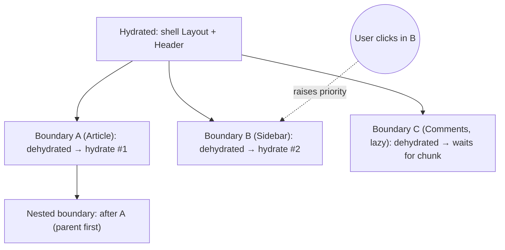
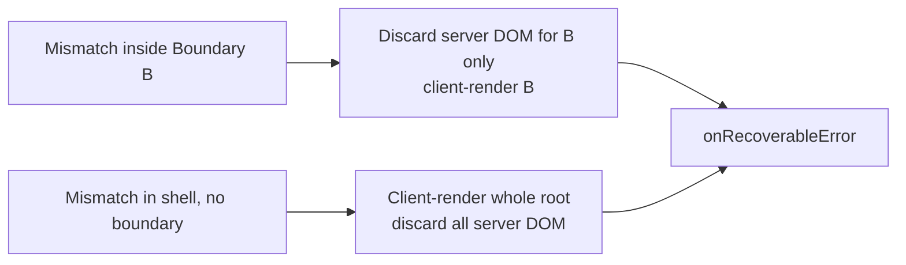

# 02 / 25 — Hydration and Selective Hydration

## 1. Lesson metadata

| | |
|---|---|
| **Level** | Professional (Advanced+) |
| **Study time** | 6 hours (reading 2.5 h, experiments 1.5 h, exercises 2 h) |
| **Prerequisites** | [03 — Initial mount and updates](./03-initial-mount-and-updates.md), [10 — Current and work-in-progress trees](./10-current-and-work-in-progress-trees.md), [11 — Render phase vs commit phase](./11-render-phase-and-commit-phase.md), [18 — Effects and their timing](./18-effects-and-their-timing.md), [24 — Suspense and thrown thenables](./24-suspense-conceptual-internals.md), [Foundations 02 — HTML parsing, DOM, CSSOM](../00-web-and-javascript-foundations/02-html-parsing-dom-cssom-render-tree.md), [Foundations 13 — Browser events and propagation](../00-web-and-javascript-foundations/13-browser-events-and-propagation.md) |
| **Next** | [26 — SSR vs client rendering](./26-ssr-and-client-rendering.md) |
| **Related** | [37 — Scenario F: hydration mismatch](./37-scenario-f-hydration-mismatch.md), [Phase 9 / 01 — SPA, SSR, SSG, streaming](../09-advanced-rendering-and-ecosystem/01-spa-ssr-ssg-streaming.md), [Phase 9 / 02 — Hydration internals deep dive](../09-advanced-rendering-and-ecosystem/02-hydration-internals-deep-dive.md), [27 — React Server Components: model](./27-react-server-components-intro.md), [28 — Strict Mode](./28-strict-mode-behavior.md) |

**Learning objectives.** After this lesson you can:
1. Define hydration precisely: *the process of attaching a React tree to existing server-produced DOM instead of creating DOM*, and state what it **does** and **does not** do (it renders the full tree on the client, it does not patch attributes).
2. Explain why the client render must produce **the same output** as the server HTML, and enumerate the usual mismatch sources.
3. Describe React's recovery behavior on mismatches (documented vs implementation detail) and what it costs.
4. Explain **selective hydration**: Suspense boundaries as independently hydratable units, streaming, parent-before-child ordering, and interaction-driven prioritization.
5. Explain the "uncanny valley" (visible but not interactive) and where time goes: HTML, JS download, hydration render, effects.
6. Apply the right fix per mismatch class: effect-based client-only rendering, `useSyncExternalStore` with `getServerSnapshot`, `suppressHydrationWarning`, deterministic `useId`.
7. Differentiate React 18 and 19 hydration behavior (error diff reporting, third-party tags, `ReactDOM.hydrate` removal).

**Concepts covered:** `hydrateRoot`, dehydrated DOM, hydration cursor (conceptual), hydration mismatch, recoverable errors (`onRecoverableError`), Suspense boundary as hydration unit, streaming HTML, selective hydration, hydration priority, dehydrated boundary markers (implementation detail), code splitting and hydration, `useId`, `useSyncExternalStore` `getServerSnapshot`, `suppressHydrationWarning`, two-pass rendering, hydration cost and INP.

> ⚠ **Version-sensitive.**
> - `ReactDOM.hydrate` was deprecated in React 18 and **removed in React 19**; use `hydrateRoot` (React 19 Upgrade Guide).
> - React 19 logs **one** hydration error with a *diff* of the mismatch instead of several messages (React 19 release post, fetched), and **skips unexpected tags in `<head>` and `<body>`** (inserted by browser extensions / third-party scripts) instead of treating them as mismatches.
> - **Events before hydration (checked in `ReactDOMEventListener.js` / `ReactDOMEventReplaying.js` on `main` and executed on react-dom 19.3.1, 2026-10-22):** a *discrete* event such as `click` that targets a not-yet-hydrated boundary is **not queued for later replay**; React attempts **synchronous hydration** of the blocking boundary and, if that succeeds, dispatches the event right then (a `click()` fired synchronously after `hydrateRoot` ran its handler). If the boundary cannot hydrate yet (for example its `lazy` chunk has not loaded), the event is **dropped**. Only *continuous* events (focus, hover, drag/pointer-move kinds) are queued and replayed. None of this is documented API, so still do not design correctness around it. See also <https://github.com/reactwg/react-18/discussions/37>.
> - Exact markers (`<!--$-->` and friends), internal function names and recovery granularity are **implementation details**.

---

## 2. Deep conceptual explanation

### 2.1 What problem is this lesson solving?

A client-rendered SPA ships an empty `<div id="root">`; the user sees nothing until JS downloads, parses, runs and React builds the DOM ([Foundations 01 §2.6](../00-web-and-javascript-foundations/01-how-the-browser-works.md)). **Server-side rendering** produces real HTML on the server so the browser can show content immediately (fast first paint, crawlable content). But HTML is inert: no event handlers, no state, no effects. The page looks done and does nothing.

**Hydration** is the step that makes server HTML *live*: React runs your components in the browser, **matches** the output to the existing DOM nodes, and takes ownership of them (so later updates are normal client updates). The term is a metaphor: the HTML is "dry" until React adds the "water" of interactivity.

Why not just throw the HTML away and render client-side? Because that would discard the benefit: re-creating the whole DOM causes flicker, loses scroll/focus/selection/form input typed in the meantime, and wastes the browser's already-parsed, already-painted nodes.

### 2.2 Definitions

| Term | Meaning |
|---|---|
| **SSR** | Producing HTML for a React tree on a server (`react-dom/server`). Detailed in [26](./26-ssr-and-client-rendering.md). |
| **Hydration** | Client-side process of rendering the tree *against existing DOM*, claiming nodes and making them interactive. API: `hydrateRoot`. |
| **Dehydrated** | State of server-produced DOM not yet claimed by React. |
| **Mismatch** | The client render produces a tree whose structure/text differs from the server HTML at some position. |
| **Recoverable error** | A hydration error React can recover from by client-rendering instead; reported through `onRecoverableError`. |
| **Hydration unit** | The granularity at which React hydrates independently: the root, or a Suspense boundary. |
| **Selective hydration** | Hydrating Suspense boundaries independently, in an order influenced by user interaction, without waiting for the full app. |
| **TTI-gap / uncanny valley** | The period when the page looks ready but event handlers are not yet attached. |

### 2.3 The API (public)

```tsx
import { hydrateRoot } from "react-dom/client";

hydrateRoot(document.getElementById("root")!, <App />, {
  onRecoverableError(error, errorInfo) { reportToMonitoring(error, errorInfo.componentStack); },
  identifierPrefix: "app1-",     // must match the server's identifierPrefix when using useId
});
```

From react.dev (`hydrateRoot`, fetched):
- It "expects the rendered content to be **identical** with the server-rendered content. You should treat mismatches as bugs and fix them."
- "React recovers from some hydration errors, but **you must fix them like other bugs.** In the best case, they'll lead to a slowdown; in the worst case, event handlers can get attached to the wrong elements."
- There are **no guarantees that attribute differences will be patched up** (validation would be too expensive); React will **not** patch mismatched *text content* either.
- If your app is client-rendered with no server HTML, use `createRoot`, not `hydrateRoot`.
- Calling `root.render` *before* hydration finishes clears the server HTML and switches the root to client rendering.
- Apps may hydrate the whole document: `hydrateRoot(document, <App />)`.
- Options include `onCaughtError`, `onUncaughtError`, `onRecoverableError`, `identifierPrefix`, `formState`.

### 2.4 What hydration is NOT

| Misconception | Reality |
|---|---|
| "Hydration downloads data/state from the server." | It re-runs your components in the browser. Any data your components need must be available on the client too (serialized props/state, a data cache, or RSC payload). |
| "Hydration patches the DOM to match the client render." | It *verifies structure* and attaches; in development it warns on mismatches; in production attribute differences may silently persist. Treat mismatch as a bug. |
| "React only hydrates event handlers." | React runs **all component code** (render phase) for the hydrated tree and then effects. The cost is proportional to the component tree, not just the number of handlers. |
| "Server HTML is interactive because the browser can do links/forms." | Native links and `<form>` do work without JS (progressive enhancement) but React-managed handlers don't. |
| "Hydration is the same as the initial client render." | Same render phase work, but *no DOM creation*; commit does claim/attach instead of insert; effects and refs run at the end. Mismatch handling and Suspense behavior differ. |
| "SSR makes the app faster." | SSR improves *time to first meaningful paint* but adds server work, bytes (HTML + serialized data), and the hydration cost; TTI can be later than a CSR app if hydration is heavy. |
| "`useEffect` runs on the server." | No. Effects, layout effects and refs only run in the browser after hydration. |

### 2.5 Why the output must match (first principles)

React's tree-diffing assumes that its *current tree* ([10](./10-current-and-work-in-progress-trees.md)) corresponds to the DOM. On a normal mount React creates DOM from the fibers, so correspondence is by construction. In hydration, the DOM is **given**, and React *infers* the correspondence by walking the DOM in parallel with the fiber tree: "the next host fiber I render should correspond to the next DOM node". If the client render would produce a `<span>` but the next DOM node is a `<div>`, the correspondence is broken: attaching handlers or later patches (`setAttribute`, remove child) would go to the wrong node, or react would remove nodes it believes it owns. Matching is therefore a **safety invariant**, not a stylistic preference.

### 2.6 Relation to JavaScript and the browser

- The browser has already parsed the server HTML into a DOM and probably painted it (first paint precedes JS execution). The HTML parser also **normalizes**: invalid nesting (`<p><div>…</div></p>`, `<a>` inside `<a>`, `<tr>` outside table) is rewritten by the parser, so DOM ≠ the string the server sent ([Foundations 02](../00-web-and-javascript-foundations/02-html-parsing-dom-cssom-render-tree.md)). React's client render keeps the *invalid* structure → mismatch.
- JS for hydration is a script download + parse + run on the main thread; hydration render is main-thread work that can produce long tasks ([Foundations 01 §2.5](../00-web-and-javascript-foundations/01-how-the-browser-works.md)).
- React attaches its event listeners at the **root container** (event delegation), so "attaching handlers" is mostly about fibers existing for the target node, not about per-node listener registration. The DOM nodes remain the same objects the parser produced.

---

## 3. Internal mechanics

> **Labels.** **Public guarantee** documented. **Teaching model** accurate enough to predict. **Implementation detail** may change; check the source.

### 3.1 Public guarantees

1. `hydrateRoot(container, element)` attaches React to existing HTML in `container` and takes over managing its DOM.
2. The client's first render must equal the server's output; mismatches are bugs, React may recover, and may not patch attributes.
3. Effects (`useEffect`, `useLayoutEffect`) and refs run only on the client, after hydration commits.
4. Suspense boundaries are units of selective hydration; the server can stream; React can hydrate parts before others ("Selective Hydration" is an integrated optimization described on the Suspense page).
5. During server rendering, React includes a boundary's **fallback** in the HTML if its content isn't ready; on the client it replaces the fallback when content arrives (Suspense docs).
6. `useId` generates ids that match between server and client; `identifierPrefix` must match for multiple roots.
7. `useSyncExternalStore` accepts `getServerSnapshot`, used during server rendering and **hydration**, so that a value known only on the client can differ without a mismatch error.
8. `suppressHydrationWarning` silences the warning on **one element, one level deep**; React will not patch the mismatch.

### 3.2 Teaching model: hydration as "render with a cursor"

Normal mount (concept, from [03](./03-initial-mount-and-updates.md)):

```text
render phase: build WIP fibers; for host components create DOM nodes (detached)
commit phase: insert the DOM tree into the container; run layout effects; later passive effects
```

Hydration (teaching model):

```text
render phase: build WIP fibers; for each host fiber, instead of creating DOM,
              CLAIM the next existing DOM node under a "hydration cursor":
                 - compare element type to node name (div vs span) → mismatch if different
                 - compare text fiber content to the text node → mismatch if different
                 - (dev only) compare props/attributes → warn (no patch)
              advance the cursor depth-first, mirroring the fiber walk
commit phase: no insertion; props that need to be set imperatively (event wiring,
              autofocus, certain form values) are applied; layout effects, refs; then passive effects
```

Key properties of this model:

- The render phase work is **full** (all components run), so hydration time scales with your component code, not with the HTML size alone.
- Because it uses the same Fiber render loop, hydration is **interruptible/time-sliced** in concurrent roots. Hydration of low-priority parts can yield to input.
- The cursor mirrors the DOM: this is why *extra text nodes, whitespace between elements, or browser-inserted elements* can desynchronize it.

*Implementation detail:* names such as "hydration cursor / next hydratable instance" are conceptual; the actual mechanism lives in `ReactFiberHydrationContext.js` in the reconciler (exists on `main`, checked 2026-10-22).

### 3.3 Mismatch handling (teaching model with documented edges)

When the cursor cannot claim a node:

1. React treats it as a hydration error.
2. **If the mismatch occurs inside a Suspense boundary**, React can discard the server HTML *for that boundary* and **client-render that boundary's content** from scratch (the rest of the page remains hydrated).
3. **If there is no enclosing boundary**, recovery may mean client-rendering **the whole root** (throwing away all server DOM beneath it).
4. The error is reported through **`onRecoverableError`** (and logged to the console in dev with, in React 19, a single message including a diff).
5. **Attribute** differences are the one common category that is *not* fatal: in dev React logs a warning ("A tree hydrated but some attributes of the server rendered HTML didn't match the client properties. This won't be patched up"); in production nothing is logged and the server's attribute value simply stays. **Text and element (tag/missing/extra node) mismatches are errors** in both dev and production: React reports a recoverable error (production: minified error #418) and client-renders the nearest Suspense boundary, or the whole root if there is none.

Executed on react-dom 19.3.1 (`renderToString` into jsdom, then `hydrateRoot`, `NODE_ENV` development and production): text mismatch, extra server element and missing server element each produced one recoverable error and the DOM ended up with the *client* output with no server nodes reused (no boundary); the same text mismatch inside `<Suspense>` re-rendered only that boundary (the sibling `<h1>` node was reused); a `className` mismatch left the server's `class` in place with no recoverable error; `suppressHydrationWarning` on an element with a differing text child kept the server text and reported nothing.

The exact granularity, which categories are fatal, and the exact warnings changed across 17 → 18 → 19. The docs' stable advice: *fix mismatches*. The costs of recovery: throwing away server DOM and re-creating it (flicker, lost state typed by the user, wasted work, possibly layout shift) and a full client render.

Corollary: **boundaries limit the blast radius of a mismatch** (a performance-and-safety argument for placing Suspense boundaries around volatile, client-dependent areas such as personalized widgets).

### 3.4 Streaming and dehydrated Suspense boundaries

With streaming SSR (`renderToPipeableStream`, [26](./26-ssr-and-client-rendering.md)):

1. The server sends the **shell**: everything outside Suspense boundaries, plus *fallbacks* for boundaries not ready.
2. When a boundary's content resolves on the server, React sends a chunk containing the HTML for that content **and a small inline script** that swaps the fallback with the content in the browser's DOM (without React running on the client yet). (react.dev `renderToPipeableStream`: "…React will send the remaining HTML along with an inline `<script>` tag that replaces the loading fallback with that HTML.")
3. The browser therefore shows progressively revealed content even before React's JS has loaded: "The HTML content from the server will get progressively revealed before any of the `<script>` tags load."

At hydration time, each boundary exists in the DOM in one of these conceptual states:

| State | Meaning | Marker *(implementation detail)* |
|---|---|---|
| **Completed** | Server rendered content in HTML | a pair of comment nodes around the content (`<!--$-->` … `<!--/$-->`) |
| **Pending** | Server hasn't finished; fallback in DOM; content will be streamed | `<!--$?-->` with a placeholder |
| **Client-render needed** | Server errored for this boundary; fallback in HTML; client should render | `<!--$!-->` |

These comment markers are how the client "finds" boundaries in the DOM. They are visible in the Elements panel of DevTools and are useful for debugging, but they are **not** a public format. Do not parse or depend on them.

### 3.5 Selective hydration: what changed in React 18

Before React 18 (`ReactDOM.hydrate`), hydration was **all-or-nothing and synchronous**:
- The server had to render the **entire** page before sending HTML (`renderToString`), so one slow data source blocked everything.
- The client had to **load all JS** for the page before hydrating anything; code-split components could not be hydrated because their code wasn't there.
- Hydration was one long synchronous task, then the page became interactive all at once. Nothing was interactive during it.

React 18's new Suspense SSR architecture (reactwg/react-18 #37, fetched):
- **Streaming HTML**: slow parts show fallbacks while the rest streams.
- **Selective hydration**: "hydration happens for entire `<Suspense>` boundaries" rather than per component; each boundary can hydrate when *its* code and HTML are ready. A heavy widget no longer blocks interactivity elsewhere.
- **Interaction-driven prioritization**: if the user interacts with a not-yet-hydrated boundary, React can raise that boundary's hydration priority (hydrate it first/synchronously for the event), then continue with the rest.
- **Parent before child**: React hydrates parent boundaries before their children so components always have their props/context.
- **Time-slicing**: hydration work is interruptible (concurrent root), so input handlers of already-hydrated regions stay responsive.

### 3.6 Suspense during hydration: what if a boundary suspends?

If a component inside a not-yet-hydrated boundary suspends (a `lazy` chunk isn't loaded; data not ready):
- React does **not** replace the existing server HTML with the fallback. The server content **remains on screen**, still dehydrated, until the dependency resolves.
- When the code/data arrives, React retries hydrating that boundary.

This is what makes **code splitting and hydration compatible**: `lazy` components inside boundaries can be hydrated after their chunks load without blocking everything else. This is an architectural result described in the React 18 working group; executed on 19.3.1 (server HTML for a boundary whose `lazy` child had not loaded stayed in the DOM, no fallback, until the chunk resolved, after which the button was interactive). Confirm in your framework with the experiment in §5.6.

### 3.7 Event handling before hydration

The user may click before hydration. Teaching model:
1. React's root listeners may not yet exist (script not loaded) → the click does nothing (native behavior only: links navigate, forms submit natively).
2. If the listener exists but the target's boundary is not hydrated, React hydrates that boundary synchronously for a discrete event and then dispatches the event if hydration succeeded; if it cannot hydrate yet, the discrete event is dropped (see the verified note at the top). It is not replayed later.
3. Design guidance: make critical actions work **without JS** (real `<a href>` and `<form action>`), and don't depend on the first click being replayed.

### 3.8 Effects and hydration

After hydration commit, effects run like on mount (layout effects first, then passive). Therefore **`useEffect` is the safe place for client-only work**: `window`, `localStorage`, measuring. A common pattern is a "client-only" state set in an effect, which causes a *second render* after hydration with client-only values:

```tsx
const [mounted, setMounted] = useState(false);
useEffect(() => setMounted(true), []);
return mounted ? <ClientOnly /> : <Placeholder />;
```

Trade-off: guaranteed hydration match (the first client render equals the server's), but an extra render and a visible change after hydration.

### 3.9 `useSyncExternalStore` and `getServerSnapshot`

```tsx
const online = useSyncExternalStore(
  (cb) => { addEventListener("online", cb); addEventListener("offline", cb);
            return () => { removeEventListener("online", cb); removeEventListener("offline", cb); }; },
  () => navigator.onLine,     // client snapshot
  () => true,                 // server snapshot (also used during hydration)
);
```

During server render and during hydration React uses `getServerSnapshot`; after hydration it re-checks and, if the client snapshot differs, schedules a client re-render. This is the *public, supported* way to read a browser-only value without a mismatch. (See [Phase 3/20](../03-react-state-and-hooks/20-usesyncexternalstore-and-external-stores.md).) The server snapshot **must** equal what the server rendered.

### 3.10 `useId`

`useId` derives ids from the component's *position in the tree* (not from a global counter), so server and client generate the same id for the same position, regardless of render order or concurrency. If server and client trees differ in structure, ids diverge: another reason to keep trees identical. Use `identifierPrefix` on both `renderToPipeableStream` and `hydrateRoot` when multiple React roots coexist on a page.

### 3.11 Strict Mode and hydration

In development, Strict Mode double-invokes component bodies during hydration too, and replays effects (setup → cleanup → setup) after hydration commit ([28](./28-strict-mode-behavior.md)). Pure components are unaffected; impure render code (e.g., `Date.now()` in render) is exactly what also causes hydration mismatches, so Strict Mode + hydration warnings are *two views of the same bug class*.

---

## 4. Step-by-step execution walkthrough

### 4.1 One page, three boundaries, streaming + selective hydration

```tsx
// App.tsx (rendered on the server and hydrated on the client)
import { Suspense, lazy } from "react";

const Comments = lazy(() => import("./Comments"));   // code-split, heavy

export function App() {
  return (
    <Layout>                                         {/* shell */}
      <Header />                                     {/* in shell */}
      <Suspense fallback={<ArticleSkeleton />}>      {/* boundary A */}
        <Article />                                  {/* slow server data */}
      </Suspense>
      <Suspense fallback={<SidebarSkeleton />}>      {/* boundary B */}
        <Sidebar />                                  {/* interactive widgets */}
      </Suspense>
      <Suspense fallback={<CommentsSkeleton />}>     {/* boundary C */}
        <Comments />                                 {/* lazy chunk */}
      </Suspense>
    </Layout>
  );
}
```

**Predict:** Server data for `Article` takes 800 ms; `Sidebar` is instant; `Comments` instant on server. JS bundle arrives at t = 1,000 ms; `Comments` chunk arrives at t = 1,800 ms. At t = 1,200 ms the user clicks a button inside `Sidebar`. What happens?

Timeline (teaching model; times illustrative):

| t (ms) | Server | Browser DOM / paint | React on client |
|---|---|---|---|
| 0 | Starts render; shell + fallback A, finished content B and C are written; flush | Receives HTML progressively: layout, header, skeleton A, sidebar content, comments content visible (inert). First paint. | Nothing (script not loaded; `bootstrapScripts` tag in HTML starts download) |
| 800 | `Article` data resolves; streams A's HTML + swap script | Inline script swaps skeleton A → article. Visible. | Still nothing |
| 1,000 | | | Bundle executes; `hydrateRoot` starts. Hydrates shell. Boundaries A, B, C are *dehydrated*; React queues them for hydration (parent-first; order by priority) |
| 1,050 | | | Hydrates A (Article); time-sliced |
| 1,200 | | User clicks a Sidebar button (boundary B not yet hydrated) | React notices the event target is inside dehydrated boundary B → **hydrates B synchronously, ahead of C**, then dispatches the click to B's now-attached handler (a discrete event is not queued for replay; had B been unable to hydrate, the click would be dropped). |
| 1,300 | | | B hydrated and interactive. C needs `Comments` chunk: not loaded → hydration of C **suspends**; server HTML for comments **stays visible** (no fallback) |
| 1,800 | | | Chunk loaded → retry hydrate C → interactive |

Outcomes: no boundary blocked another; the user saw all content by 800 ms; interactivity arrived region-by-region between 1,000 and 1,800 ms, with the user's own interaction steering the order.

### 4.2 The same page in the pre-18 model (for contrast)

`renderToString` waits for *all* data (800 ms) before sending any HTML; first paint at ≥ 800 ms. The client must load **all** JS (including comments chunk) then hydrate everything in one synchronous task at ~1,800 ms. Clicking at 1,200 ms: nothing happens, no way to prioritize. Entire page interactive at ~1,800 ms + hydration time.

### 4.3 Mismatch walk-through

```tsx
function Clock() {
  return <p>Now: {new Date().toLocaleTimeString()}</p>;
}
```

- Server renders `Now: 10:04:31 AM`.
- 600 ms later (hydration) client renders `Now: 10:04:32 AM`.
- The text node mismatches → a recoverable hydration error (dev message "Hydration failed because the server rendered text didn't match the client"; production error #418), and React discards the server DOM for the nearest Suspense boundary (or the whole root) and client-renders it. Executed on 19.3.1 in dev and production: the final DOM showed the *client's* time. The user sees a re-render/flicker and pays for the throw-away work. (The server text stays only for an element carrying `suppressHydrationWarning`.) Fix options in §5.3.

---

## 5. Code examples

### 5.1 Minimal: server entry and client entry

```tsx
// server.tsx (Node + Express-like; framework-free for teaching)
import { renderToPipeableStream } from "react-dom/server";
import type { Request, Response } from "express";
import { App } from "./App";

export function handle(req: Request, res: Response) {
  let didError = false;
  const { pipe, abort } = renderToPipeableStream(<App url={req.url} />, {
    bootstrapScripts: ["/client.js"],
    onShellReady() {                       // shell (outside any Suspense) is ready
      res.statusCode = didError ? 500 : 200;
      res.setHeader("content-type", "text/html");
      pipe(res);                           // start streaming
    },
    onShellError(error) {                  // nothing was sent yet: safe to send a fallback page
      console.error(error);
      res.statusCode = 500;
      res.setHeader("content-type", "text/html");
      res.send("<!doctype html><h1>Something went wrong</h1>");
    },
    onError(error) { didError = true; console.error(error); },
  });
  setTimeout(() => abort(), 10_000);      // never let a slow boundary hang the response forever
}
```

```tsx
// client.tsx (the bundle named in bootstrapScripts)
import { hydrateRoot } from "react-dom/client";
import { App } from "./App";

hydrateRoot(document, <App url={location.pathname} />);   // App renders <html>… (whole document)
```

**Line notes.**
- `onShellReady`: per react.dev, "fires right after the initial shell has been rendered. You can set the status code and call `pipe` here to start streaming." Once streaming starts you can't change the status code (hence the `didError` flag; it only reflects errors that occurred while generating the shell).
- `onShellError` fires when the shell fails; no bytes have been sent, so you can emit a different HTML shell.
- `abort()` makes React "flush the remaining loading fallbacks as HTML, and … attempt to render the rest on the client".
- The same `App` and **same props** (here `url`) feed both server and client. Props that differ (e.g., server-only data) are the most common source of mismatch. In real apps serialize the data (or use a framework/RSC).
- `hydrateRoot(document, …)` requires the app to render the `<html>` element.

Frameworks (Next.js, React Router, TanStack Start, Remix lineage) wrap all of this. Do **not** hand-roll in production unless you know why. This snippet is for understanding.

### 5.2 Practical: a browser-only value without mismatch (`useSyncExternalStore`)

```tsx
import { useSyncExternalStore } from "react";

function subscribe(cb: () => void) {
  const mq = window.matchMedia("(prefers-color-scheme: dark)");
  mq.addEventListener("change", cb);
  return () => mq.removeEventListener("change", cb);
}

export function useIsDark(): boolean {
  return useSyncExternalStore(
    subscribe,
    () => window.matchMedia("(prefers-color-scheme: dark)").matches,
    () => false,                       // server snapshot: also what hydration's first render uses
  );
}

export function ThemeBadge() {
  const dark = useIsDark();
  return <span>{dark ? "Dark" : "Light"} mode</span>;
}
```

**Predict:** for a dark-mode user, what is in the server HTML, what does the first client render use, and what does the user see?

**Answer.** Server HTML: `Light mode` (server snapshot `false`). First client render during hydration uses `getServerSnapshot` → `Light` → **matches**, no error. Right after hydration React compares with `getSnapshot()` → `true` → schedules a re-render → `Dark mode`. The user may see a brief `Light` flash; the correctness problem (mismatch) is gone; the flash is the unavoidable price of unknown-on-server data. To avoid the flash for theme specifically, apply the theme in a tiny inline script before paint (CSS class on `<html>`), which is outside React (see your framework's theming guidance; Phase 9 covers framework architecture).

### 5.3 Incorrect: `typeof window` branch; corrected options

```tsx
// WRONG: server renders the else branch, client's first render takes the if branch
function Greeting() {
  if (typeof window !== "undefined") {
    return <p>Hello from {navigator.language}</p>;
  }
  return <p>Hello</p>;
}
```

Server HTML: `<p>Hello</p>`; client's first render: `<p>Hello from en-GB</p>` → mismatch. (react.dev lists exactly this as a cause.)

**Fix A (two-pass, effect-based):**
```tsx
function Greeting() {
  const [lang, setLang] = useState<string | null>(null);
  useEffect(() => setLang(navigator.language), []);
  return <p>Hello{lang ? ` from ${lang}` : ""}</p>;
}
```
First client render equals server; effect updates. Cost: extra render, visible change.

**Fix B (`useSyncExternalStore`)**: as §5.2 (preferred for values that can change over time).

**Fix C (`suppressHydrationWarning`)** for *known, intentional* text differences:
```tsx
<time dateTime={iso} suppressHydrationWarning>{new Date(iso).toLocaleString()}</time>
```
Only one level deep, a warning silencer, not a patch. Prefer formatting deterministically (fixed locale and `timeZone: "UTC"`) on both sides, or send the pre-formatted string from the server.

**Fix D (render on client only)**: wrap the subtree in a Suspense boundary whose content throws on the server so the server emits the fallback; the client renders content after hydration (documented on the Suspense page: throw in the server branch to opt out of server rendering for that boundary). Use for charts/maps that cannot render on the server.

### 5.4 Incorrect: non-deterministic render values

```tsx
function Row() {
  const id = Math.random().toString(36).slice(2);          // WRONG for SSR
  return <label htmlFor={id}>Name<input id={id} /></label>;
}
```
Server and client ids differ (mismatch + broken label association). Fix with `useId`:
```tsx
function Row() {
  const id = useId();
  return <><label htmlFor={id}>Name</label><input id={id} /></>;
}
```

### 5.5 Incorrect: invalid HTML nesting

```tsx
<p>
  <div>Hello</div>   {/* browser parser closes the <p> before <div> */}
</p>
```
Server string: `<p><div>Hello</div></p>`. The browser's parser produces `<p></p><div>Hello</div><p></p>` (or similar). React's client render expects `p > div` → mismatch (React also warns in dev about invalid nesting). Fix the markup (`<div>` or `<span>`/semantic alternatives) so the string and DOM tree agree.

### 5.6 Advanced: observing selective hydration and recovery in practice

```tsx
// client.tsx
import { hydrateRoot } from "react-dom/client";

hydrateRoot(document, <App />, {
  onRecoverableError(error, info) {
    // Hydration mismatches that React recovered from are reported here.
    console.warn("[hydration recoverable]", error, info.componentStack);
    navigator.sendBeacon?.("/rum/hydration-error", JSON.stringify({
      message: String(error), stack: info.componentStack,
    }));
  },
});
```

Experiment checklist (to repeat §3.5/§3.6 in a browser; the lazy-chunk case was already reproduced in jsdom):
1. In Chrome DevTools → Network, throttle to Fast 3G; block the `Comments` chunk URL.
2. Load the page: confirm content visible (HTML) while JS pending.
3. Click a button in the sidebar before the main bundle loads: it does nothing (no JS).
4. After the bundle loads but with the comments chunk blocked, confirm the comments' server HTML stays visible (no fallback) and the sidebar is interactive.
5. Unblock the chunk: confirm the comments become interactive.
6. Inspect the Elements panel for the comment-node markers (`<!--$-->`, etc.) to see boundaries (implementation detail, for learning only).

### 5.7 Advanced: mismatch monitoring in production

`onRecoverableError` is your canary. Count by `error.message` + component stack; alert when the rate per page view exceeds a baseline (a deploy or a third-party script usually causes spikes). Store the page URL, user agent, and (in staging) a hash of the server HTML vs client DOM to reproduce. Pair with RUM for INP and TTI to quantify user impact.

---

## 6. Visual explanations

### 6.1 Timeline: CSR vs SSR+hydration vs streaming+selective

```text
CSR:         |--HTML shell--|----JS download----|-run-|-render+commit-|          first content at the end
SSR+hydrate: |--server render--|--HTML--|paint| ..JS download.. |--hydrate (sync)--|  interactive
Streaming +  |shell|paint|..stream B..|swap|...JS...|hydrate shell|hydrate A|hydrate B|hydrate C|
selective:                                     (content visible earlier; interactivity piecewise,
                                                 order influenced by user input)
```

### 6.2 Dehydrated tree and hydration order



### 6.3 Mismatch recovery blast radius



### 6.4 What happens to one text node

```text
Server HTML:   <p>Hello Ada</p>
Client render: <p>Hello Ada</p>      → claim OK, no work on DOM text

Server HTML:   <p>Hello Ada</p>
Client render: <p>Hello Grace</p>    → mismatch: warn in dev; React will not patch text;
                                        recovery may client-render the nearest boundary/root
```

---

## 7. Alternative approaches and trade-offs

Getting content to users and making it interactive:

| Approach | First content | Interactivity | Server cost | JS cost | Complexity | Prefer when |
|---|---|---|---|---|---|---|
| Client-only (SPA, `createRoot`) | Late (after JS) | At first render | Static hosting | Full bundle | Low | Authenticated app shells where SEO is irrelevant, simple infra |
| SSR + whole-app hydration (`renderToString` + `hydrate`, legacy) | Early | After all JS + sync hydrate | Per request | Full | Medium | Legacy only |
| Streaming SSR + selective hydration | Early, progressive | Piecewise, interaction-prioritized | Per request, streamed | Full (but not blocking) | High (framework) | Content sites with slow data, large pages |
| Static generation (SSG) + hydration | Earliest (CDN) | After JS | Build-time | Full | Medium | Mostly-static pages ([Phase 9/01](../09-advanced-rendering-and-ecosystem/01-spa-ssr-ssg-streaming.md)) |
| Server Components + hydrate only client components | Early | Only for client components | Per request/build | **Smaller** | High (framework/bundler) | Content-heavy apps; reduce hydration ([27](./27-react-server-components-intro.md)) |
| Islands / partial hydration (non-React-native frameworks) | Early | Island by island | Varies | Minimal | Framework-specific | Largely static sites; outside React's model |
| Progressive enhancement (native forms/links first) | Early | Works without JS | Per request | Optional | Medium | Forms and critical actions ([Phase 9/11](../09-advanced-rendering-and-ecosystem/11-progressive-enhancement.md)) |

**When SSR+hydration is NOT the best choice.**
- Behind-login dashboards with highly personalized, rapidly changing data: SSR cost + hydration for no SEO/first-paint gain; a CSR shell with good caching may be faster to ship and cheaper to run.
- Very JS-heavy interactive tools (editors, canvases): hydration cost is large and server HTML of little value.
- Teams without capacity to operate SSR: server runtime, cold starts, cache layers, data serialization, and mismatch bugs are real operational costs.
- Pages whose critical content depends on browser-only data (viewport, local storage): you'd render placeholders anyway.

---

## 8. Best practices and anti-patterns

**Do**
- Render the **same tree** on server and first client render. Anything environment-specific goes through effects, `useSyncExternalStore` (with server snapshot), or a client-only boundary.
- Format dates/numbers deterministically (explicit locale and time zone) or pass server-formatted strings.
- Use `useId` for ids; never `Math.random()`/counters.
- Wrap slow or volatile regions in **Suspense boundaries** to limit both streaming latency and mismatch blast radius.
- Report `onRecoverableError` to monitoring.
- Keep HTML valid; run an HTML validator in CI for server output.
- Make critical actions work without JS (links, forms).

**Beginner mistakes**
- `typeof window` branches in render.
- `new Date()`, `Math.random()`, `localStorage` reads in render.
- Treating hydration warnings as noise.
- Sprinkling `suppressHydrationWarning` everywhere.

**Experienced-developer mistakes**
- Hydrating huge trees synchronously with no boundaries.
- Passing different data to server and client renders (stale serialized props, time-based props, A/B variants decided client-side).
- Third-party scripts mutating DOM before hydration (analytics, consent banners, extension injections).
- Treating SSR as a free performance win without measuring TTI/INP and server cost.
- Depending on event replay.
- Loading everything eagerly: no code-splitting boundaries, so hydration of one area waits for all JS.

**Smells:** a `mounted` flag that wraps the whole page; `suppressHydrationWarning` on large containers; huge serialized state blobs in HTML; hydration warnings that "only happen sometimes" (time/random/locale).

**Justified exceptions:** `suppressHydrationWarning` on timestamps; wrapping the *whole* personalized part in a client-only boundary even if it costs a flash; client-only rendering of canvas/maps.

---

## 9. Real-world application

**E-commerce category page (SEO + conversion).** Product grid and filters must be in server HTML for crawlers and fast LCP. Price/stock are real-time and personalized; render them in Suspense boundaries so the grid isn't blocked and mismatches (currency/locale) are contained. Constraint: filter controls must be usable early: native `<form method="get">` filters work before hydration; React enhances them afterward. Hydration weight is dominated by product card components: keep cards lean or server-only (RSC).

**Marketing/landing page.** Mostly static: SSG + minimal hydration. Third-party tag managers inject elements: React 19 ignores unexpected `<head>`/`<body>` tags, but injected nodes *inside* the React root still break matching; keep them outside the root.

**Authenticated dashboard.** SEO irrelevant; first paint of skeleton shell then data. CSR may suffice; if SSR is used for faster perceived load, SSR only the shell and stream widgets. Constraint: user-specific data must not leak between users through shared module caches on the server ([24 C1 caveat](./24-suspense-conceptual-internals.md)).

**Financial reporting with locale formatting.** Server and client in different time zones/locales produce different strings. Constraint: deterministic formatting with explicit `timeZone`/`locale`, or send ISO strings and format on the client after hydration in an effect/store.

**Multi-team shell with embedded widgets.** Several roots on one page require `identifierPrefix` for `useId` collisions; each team's root hydrates independently; one team's mismatch must not break the others: separate roots and boundaries help.

**Realtime feed.** SSR the initial snapshot; hydrate; then subscribe in an effect. Constraint: messages arriving between server render and hydration must be reconciled (snapshot version) or the first client render won't match: use the server snapshot for the first client render and apply newer data after hydration.

---

## 10. Debugging and troubleshooting

### Symptom A: Console warning "Hydration failed because the server rendered HTML didn't match the client" (React 18: several messages; React 19: a single message with a diff)
1. Read the diff (19) or the component stack (18/19): it points to the element/text where server and client differ (`+ Client` / `- Server`).
2. Classify: text, attribute, tag/structure, extra/missing node.
3. Common causes: time/random/locale in render; `typeof window` branches; browser-only APIs; invalid HTML nesting; data differences; extensions or scripts mutating DOM; whitespace.
4. Reproduce in an incognito window without extensions to rule out extension noise (React 19 mitigates head/body injections but not all).
5. Fix per §5.3; confirm the warning disappears and `onRecoverableError` is silent.
6. In dev, check Strict Mode's double render isn't masking differences (`Date.now()` called twice yields different values).

### Symptom B: "Page flashes / content jumps right after load."
Likely hydration recovery: React discarded server DOM and client-rendered. Check `onRecoverableError` and the Network/Performance timeline for a big commit right after hydration. Fix the mismatch; add boundaries to localize.

### Symptom C: "Clicks do nothing for a few seconds after the page looks ready."
Uncanny valley: JS not loaded or hydration is a long task. Check: bundle size/waterfall, long tasks during hydration (Performance panel: "Hydrate"/scripting), main-thread contention from third-party scripts. Fixes: code-split non-critical components into boundaries (selective hydration), reduce JS, defer third parties, use Server Components for non-interactive parts ([27](./27-react-server-components-intro.md)), make critical actions work natively.

### Symptom D: "Event handler attached to the wrong element / wrong item acts."
Docs' "worst case", mostly from older React versions or from DOM that React did not detect as mismatched. A structural mismatch can desynchronize the cursor so fibers claim the wrong DOM nodes (common with conditionally rendered siblings differing server vs client). In React 18/19 most tag/extra/missing-node mismatches are detected and trigger a client re-render instead (executed on 19.3.1). Find the first mismatch; the later behavior is collateral.

### Symptom E: "Works in dev, mismatch only in production (or vice versa)."
Different data/env (env vars at build vs runtime), minification affecting `useId`? (no), different serialization, CDN caching of HTML that is stale relative to JS (HTML from old deploy + new JS). Check cache headers and deploy atomicity ([Phase 10/02](../10-production-engineering/02-deployment-workflows.md)).

### Symptom F: "`useLayoutEffect` warning on the server."
React 18 and older warn that `useLayoutEffect` does nothing on the server; React 19 no longer logs that warning (no `console.error` from `renderToString` on 19.3.1, executed). The underlying rule is stable: layout effects never run during server rendering, so don't rely on them for first-render output; use `useEffect` or `useSyncExternalStore`.

### DevTools workflow
1. Elements panel: check the server-produced DOM (View Source shows the original HTML; Elements shows the live DOM); look for comment markers.
2. Performance panel: record page load; find the hydration scripting chunk; check whether it's one long task or many slices; INP for early interactions.
3. React DevTools: Profiler shows the hydration commit as the first commit; Components tab shows boundaries.
4. Network: confirm streaming (chunked HTML arrives progressively) and that bootstrap scripts load in parallel.

---

## 11. Exercises

### Level A — Knowledge
A1. Define hydration in one sentence, and say what it does *not* download.
A2. Why must the first client render equal the server HTML? Give two concrete failure outcomes.
A3. Which lifecycle parts (render, layout effects, passive effects, refs) run on the server, and which on the client during hydration?
A4. What is the hydration unit introduced by streaming SSR/selective hydration in React 18?
A5. What does `suppressHydrationWarning` do and not do?
A6. Name three sources of hydration mismatch.
A7. What replaced `ReactDOM.hydrate` and in which React version was the old API removed?

### Level B — Code comprehension
B1. For `<p>{typeof window === "undefined" ? "server" : "client"}</p>`, what does the server emit, what does the first hydration render produce, and what does the user end up seeing in production?
B2. What happens here with `useSyncExternalStore(sub, () => 2, () => 1)` in a component rendering `<span>{n}</span>`? List the HTML, the first client render and the final state.
B3. Why is `<p><div/></p>` a hydration problem even though React renders it "fine" on the client alone?
B4. In the §4.1 timeline, why doesn't `Comments`' fallback appear at t = 1,000 when the chunk isn't loaded?
B5. What is wrong with this root?
```tsx
const root = createRoot(document.getElementById("root")!);
root.render(<App />);   // the container already contains server-rendered HTML
```

### Level C — Implementation
C1. Write a `<ClientOnly>` component that renders `children` only after hydration and a `fallback` before, and explain its trade-off.
C2. Write a `useLocalStorageValue(key, serverValue)` hook with `useSyncExternalStore` that is hydration-safe and updates across tabs (`storage` event).
C3. Write an `onRecoverableError` handler that deduplicates and batch-reports errors with page URL and component stack.

### Level D — Debugging
D1. A dev sees "Text content does not match server-rendered HTML" for a `<time>` element. Provide three fixes with trade-offs.
D2. After deployment, hydration errors spike only for 2% of sessions. Hypothesize causes and describe an investigation.
D3. Clicking "Add to cart" immediately after load does nothing the first time but works the second. Explain, propose two mitigations.
D4. A third-party consent script injects a `<div>` as the *first child of `#root`*. What happens, and where should the script inject?

### Level E — Architecture and engineering decisions
E1. Decide SSR vs CSR for (a) a logged-in analytics dashboard, (b) a public product page, (c) a documentation site. Justify with criteria.
E2. Where do you place Suspense boundaries on a product page to maximize selective hydration benefit while limiting mismatch blast radius?
E3. Design a policy for locale/time formatting across server and client in a multi-region product.

### Level F — Expert challenge
F1. Design an experiment to measure the effect of selective hydration on INP and TTI for a page with 5 boundaries: variants (single boundary, five boundaries, five boundaries with lazy components), throttling, metrics, expected results, and threats to validity.

---

## 12. Detailed answers and explanations

> Attempt the exercises first.

**A1.** Hydration attaches a React tree to server-produced DOM by rendering the components in the browser and claiming existing nodes instead of creating them. It downloads no state; component code must have the data it needs on the client too. (Wrong: "React fetches state from the server HTML".)

**A2.** React infers the DOM↔fiber correspondence from the DOM instead of building it. If they differ: (1) the wrong DOM nodes get handlers/updates ("event handlers can get attached to the wrong elements", per docs); (2) React discards server DOM and client-renders (flicker, lost typed input, wasted work); (3) stale text/attributes remain because React doesn't patch them.

**A3.** Server: only the render phase of components (no effects, no refs, no layout effects, no state updates after render). Client during hydration: render phase (again, full), then commit: refs attached, layout effects, then passive effects.

**A4.** The Suspense boundary. ("hydration happens for entire `<Suspense>` boundaries" per the 18 working group post.)

**A5.** It silences the dev warning for one element's attributes/text difference, one level deep. It does not patch the mismatch and doesn't make the trees equal; use it only for unavoidable differences like timestamps.

**A6.** Any three: time/date, randomness, locale/time zone, `typeof window` branches, `window.matchMedia`/storage in render, server-vs-client data differences, invalid HTML nesting, whitespace differences, DOM mutated by extensions/third-party scripts.

**A7.** `hydrateRoot` from `react-dom/client`. `ReactDOM.hydrate` was deprecated in 18 and removed in React 19.

**B1.** Server emits `<p>server</p>`. First hydration render produces `client` → text mismatch. Dev: warning. Production: React doesn't patch text, so the user keeps seeing `server` (unless recovery client-renders the boundary/root, in which case `client` appears after a re-render). Either way a bug. Fix with effect or `useSyncExternalStore`.

**B2.** Server HTML `<span>1</span>` (server snapshot). Hydration's first render uses the server snapshot `1` → matches. After hydration React checks `getSnapshot()` → `2` ≠ `1` → schedules a re-render → DOM `<span>2</span>`. No mismatch error.

**B3.** The HTML parser, not React, builds the server DOM, and it auto-closes `<p>` before `<div>`, so the DOM tree differs from the fiber tree (`p > div` on the client). On a pure client render React creates DOM by `createElement`/`appendChild`, which doesn't apply parser rules, so `p > div` exists. Also React warns in dev (invalid nesting). Fix markup.

**B4.** During hydration, a suspended boundary does not replace the existing server HTML with its fallback; the server-rendered content stays (still dehydrated) until the dependency resolves. (Fallbacks are for *client* renders and for server HTML for pending boundaries.)

**B5.** `createRoot` + `render` on a container that has server HTML: it clears and client-renders (wasting the SSR; flicker). Should be `hydrateRoot(container, <App />)`. (react.dev: if app has server HTML use `hydrateRoot`; the reverse, `hydrateRoot` without server HTML, is unsupported.)

**C1. Reference solution**
```tsx
import { useEffect, useState, type ReactNode } from "react";

export function ClientOnly({ children, fallback = null }: { children: ReactNode; fallback?: ReactNode }) {
  const [mounted, setMounted] = useState(false);
  useEffect(() => { setMounted(true); }, []);
  return <>{mounted ? children : fallback}</>;
}
```
Trade-offs: guaranteed match (server and first client render both output `fallback`), but children are absent in server HTML (SEO), cause a second render, and may cause layout shift unless the fallback reserves space. Use for genuinely client-only widgets.

**C2.**
```tsx
import { useSyncExternalStore } from "react";

export function useLocalStorageValue(key: string, serverValue: string | null): string | null {
  const subscribe = (cb: () => void) => {
    const handler = (e: StorageEvent) => { if (e.key === key || e.key === null) cb(); };
    window.addEventListener("storage", handler);
    return () => window.removeEventListener("storage", handler);
  };
  return useSyncExternalStore(
    subscribe,
    () => localStorage.getItem(key),
    () => serverValue,
  );
}
```
Notes: `storage` events fire in *other* tabs, not the one that wrote; same-tab writes need your own notification (custom event or wrapper). `subscribe` identity changing each render causes resubscribe (move it outside/`useCallback` keyed on `key`). `getSnapshot` must return a stable (primitive or cached) value: a string is fine. Accessing `localStorage` can throw (privacy modes): wrap in try/catch in production.

**C3.**
```ts
const seen = new Set<string>();
const queue: Array<{ message: string; stack: string | null | undefined; url: string }> = [];
let timer: number | undefined;

export function onRecoverableError(error: unknown, info: { componentStack?: string | null }) {
  const message = error instanceof Error ? error.message : String(error);
  const key = message + (info.componentStack ?? "").slice(0, 200);
  if (seen.has(key)) return;
  seen.add(key);
  queue.push({ message, stack: info.componentStack, url: location.href });
  timer ??= window.setTimeout(() => {
    navigator.sendBeacon("/rum/hydration", JSON.stringify(queue.splice(0)));
    timer = undefined;
  }, 2000);
}
```
Evaluation: dedupe, batching, `sendBeacon` for reliability on unload, no PII.

**D1.** (1) Deterministic formatting: fixed locale/time zone on server and client (best, no flash). (2) `suppressHydrationWarning` on the `<time>`: keeps server text until the next client update; may show server-timezone text to the user; fine for non-critical timestamps. (3) Render a neutral string on the server (ISO) and format in an effect (`useState` + `useEffect`), accepting a post-hydration update. (4) `useSyncExternalStore` with a server snapshot if the value is external. Trade-offs: flash vs SEO vs complexity.

**D2.** Hypotheses: stale cached HTML with newer JS (deploy skew), CDN/personalization variants, locale/time zone differences, A/B variant mismatch, browser extensions, specific browsers (Safari parser differences), third-party scripts, ad blockers removing nodes. Investigation: segment `onRecoverableError` events by UA, locale, deployment id, route; compare HTML payloads; reproduce with that locale/timezone/extension; fix and verify via metric drop.

**D3.** Uncanny valley: before JS loaded/hydrated the handler doesn't exist; the first click is lost (no guaranteed replay); by the second click hydration finished. Mitigations: make "Add to cart" a real `<form method="post">`; hydrate critical areas first (boundary + priority, smaller JS for them); disable the button until hydrated with a visual state (needs client signal) or show a "loading" cursor; reduce JS/long tasks.

**D4.** Injecting inside the React root changes the DOM React expects: the cursor mismatches at the first child; React 19's tolerance applies to unexpected tags in `<head>`/`<body>` (document-level), not to arbitrary nodes in the app container. Fix: inject into `document.body` outside `#root` (or after hydration), or use a portal/placeholder that React owns.

**E1.** (a) Dashboard: CSR (or SSR shell only): no SEO need, data personal and volatile; hydration cost without payoff; caching/security complexity of SSR. (b) Product page: SSR/SSG + streaming, SEO/LCP-critical, shared content cacheable; personalized parts in boundaries. (c) Docs: SSG; mostly static, hydration minimal (consider Server Components or islands-like partial hydration). Criteria: SEO, first-paint, interactivity needs, personalization, cache-ability, ops cost.

**E2.** Shell (title, price, add-to-cart) outside slow boundaries but inside a boundary of its own only if data is slow; separate boundaries for reviews, recommendations, personalized banner; lazy-load heavy widgets inside boundaries so their JS doesn't gate hydration of the rest. Avoid wrapping the whole page in one boundary; avoid boundaries so granular that streaming creates jitter. Justify with mismatch containment.

**E3.** Policy: store/transport time as ISO/UTC; format with `Intl.DateTimeFormat` using an explicit locale and time zone derived from the request (and shared with client via serialized props), not from `navigator`/server defaults; test with multiple TZ via CI environment variables; lint for `toLocale*` without args in render; use `<time dateTime>`.

**F1.** Evaluation criteria: realistic page; controlled throttled network/CPU profiles; variants as specified; metrics: TTFB, FCP, LCP, TTI-proxy (time until interactive for a specific button—measure with a scripted click and first handler response), INP of scripted interactions at several times after load, hydration long task durations (via Performance trace or `PerformanceObserver` long tasks), JS bytes; repeated runs (≥ 20) with medians and percentiles; Production build; compare with and without Strict Mode off (dev only). Expected: multiple boundaries reduce the longest hydration task and improve early-interaction INP; lazy components shift JS off the critical path but may delay their own interactivity; total hydration CPU may be similar or slightly higher. Threats: dev vs prod builds, caches, server variance, synthetic click vs real users, extension noise, browser differences.

---

## 13. Senior engineer interview questions

**Q1. "What is hydration and why is it needed?"**
*Strong answer:* SSR delivers HTML that is inert; hydration runs the component tree on the client, matches it to the existing DOM, and takes over so state, handlers and effects work. It's needed because HTML can't carry closures/state; the cost is running all component code again on the client.

**Q2. "Why does React require identical server/client output?"**
*Strong answer:* Hydration infers the fiber↔DOM mapping by walking the DOM alongside the render. A difference means attaching/patching the wrong nodes; React may recover by client-rendering but can't safely patch attributes, so it's a correctness issue first and a performance issue second.

**Q3. "What's selective hydration and what problem did it solve?"**
*Strong answer:* Pre-18, hydration was all-or-nothing: the server had to render everything before sending, the client had to load all JS, and hydration was one sync task. With streaming + Suspense boundaries as hydration units, parts hydrate independently, code-split parts don't block others, hydration is interruptible, and interaction can reprioritize boundaries. Parent-before-child ordering preserves props/context. Benefits: better TTI/INP on content-heavy pages.

**Q4. "How do you handle a value that only exists in the browser (e.g., window width)?"**
*Strong answer:* Don't read it in render. Options: `useSyncExternalStore` with `getServerSnapshot` (supported, with a post-hydration update), effect-based state (two-pass render), or a client-only boundary. Prefer CSS (media queries) over JS for layout so no JS value is needed.

**Q5. "Hydration warnings only occur for some users. How would you debug?"**
*Strong answer:* `onRecoverableError` telemetry segmented by locale/time zone/UA/extension/deploy version; look for time/locale formatting, A/B variants, stale HTML vs new JS, injected DOM. Reproduce with matching settings; fix root cause; verify the rate drops.

**Q6. "When is SSR + hydration the wrong choice?"**
*Strong answer:* Auth-gated, highly dynamic apps with no SEO need; very interactive tools; teams without ops capacity; when hydration cost would delay interactivity beyond what SSR saves. Alternatives: CSR with a skeleton shell, SSG, or reducing hydration with Server Components.

**Q7. "What did React 19 change about hydration?"**
*Strong answer:* One error with a diff instead of multiple messages; unexpected tags in `<head>`/`<body>` from extensions/third parties are skipped (and third-party stylesheets are preserved if React must re-render the whole document); `ReactDOM.hydrate` removed in favor of `hydrateRoot`; new root options for error callbacks. (Verify details against the release notes of your version.)

---

## 14. Further learning resources

| Resource | URL | Covers / why | Level | Study |
|---|---|---|---|---|
| React docs: `hydrateRoot` | <https://react.dev/reference/react-dom/client/hydrateRoot> | Mismatch rules, `suppressHydrationWarning`, options (verified) | Intermediate | Entire page |
| React docs: `renderToPipeableStream` | <https://react.dev/reference/react-dom/server/renderToPipeableStream> | Streaming, shell, status codes (verified) | Intermediate | Usage, "Streaming more content" |
| React docs: `<Suspense>` | <https://react.dev/reference/react/Suspense> | Server behavior, hydration notes (verified) | Intermediate | "Providing a fallback for server errors and client-only content" |
| reactwg/react-18 #37: New Suspense SSR Architecture in React 18 | <https://github.com/reactwg/react-18/discussions/37> | Origin of streaming + selective hydration (verified) | Advanced | Whole post |
| React 19 release post | <https://react.dev/blog/2024/12/05/react-19> | Hydration error diffs, third-party tag tolerance (verified) | Intermediate | "Improvements" sections |
| React 19 upgrade guide | <https://react.dev/blog/2024/04/25/react-19-upgrade-guide> | `hydrate` removal (verified) | Intermediate | Removed APIs |
| React docs: `useId` | <https://react.dev/reference/react/useId> | Stable ids for SSR | Intermediate | Reference |
| React docs: `useSyncExternalStore` | <https://react.dev/reference/react/useSyncExternalStore> | `getServerSnapshot` | Advanced | "Adding support for server rendering" |
| web.dev: Rendering on the Web | <https://web.dev/articles/rendering-on-the-web> | SSR/CSR/static trade-offs | Intermediate | Whole |

---

## 15. Knowledge checkpoint

**You should now understand**
- Hydration = render the whole tree on the client against existing DOM, claiming nodes; matching is a safety invariant.
- Mismatch sources, recovery blast radius, and why boundaries limit it.
- Streaming + selective hydration: boundary as unit, parent-first, interaction priority, suspended boundaries keeping server HTML.
- React 18 vs 19 differences: removal of `hydrate`, diffed errors, third-party tag tolerance; event replay is unspecified.

**You should be able to explain without notes**
- Why `typeof window` in render breaks hydration.
- What the user sees between first paint and interactivity and how to shrink it.
- Why `useSyncExternalStore` with `getServerSnapshot` is the hydration-safe pattern.

**You should be able to implement**
- Server/client entries with streaming, `ClientOnly`, hydration-safe browser-value hooks, recoverable-error reporting.

**You should be able to debug**
- Mismatch warnings (diff reading and classification), uncanny-valley delays, deploy-skew errors, third-party DOM injection.

**Before moving on:** read [26 — SSR vs client rendering](./26-ssr-and-client-rendering.md) for the server half of this story, then return to [37 — Scenario F: hydration mismatch](./37-scenario-f-hydration-mismatch.md) when it is available.
