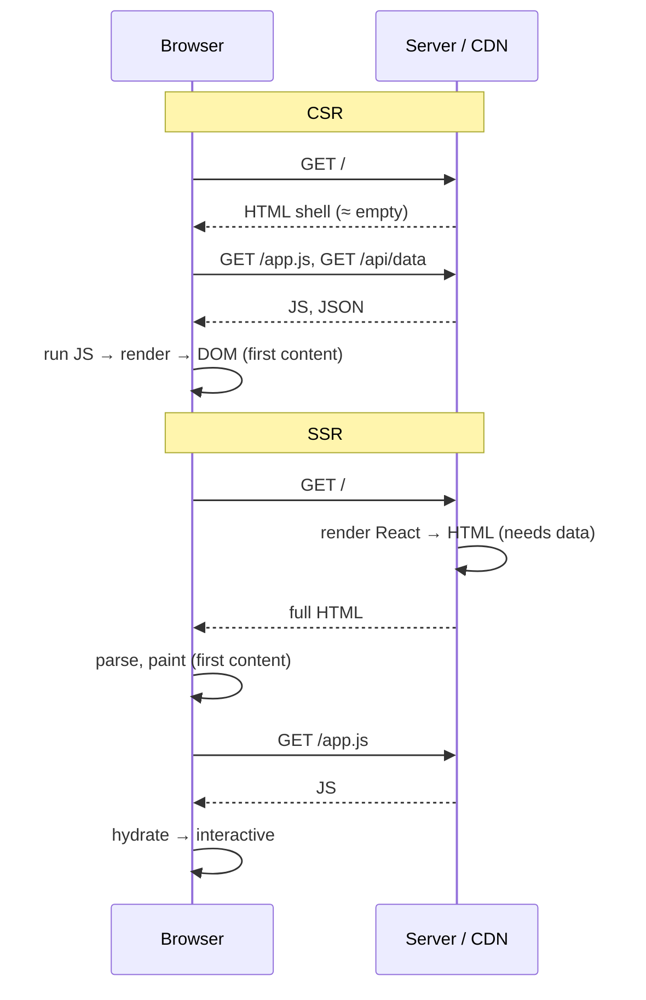
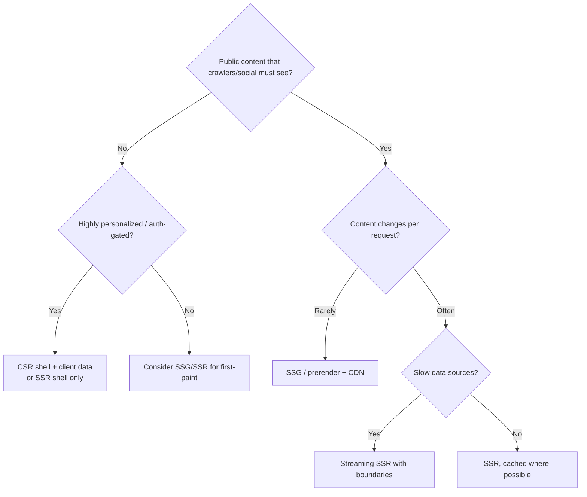
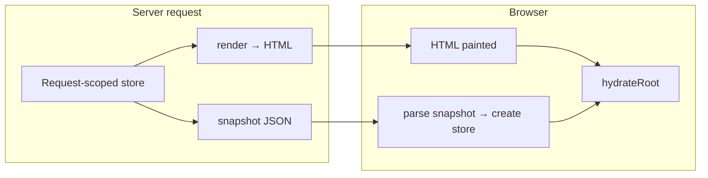

# 02 / 26 — SSR vs Client Rendering

## 1. Lesson metadata

| | |
|---|---|
| **Level** | Advanced |
| **Study time** | 5 hours (reading 2 h, experiments 1.5 h, exercises 1.5 h) |
| **Prerequisites** | [03 — Initial mount and updates](./03-initial-mount-and-updates.md), [11 — Render phase vs commit phase](./11-render-phase-and-commit-phase.md), [18 — Effects and their timing](./18-effects-and-their-timing.md), [24 — Suspense and thrown thenables](./24-suspense-conceptual-internals.md), [25 — Hydration and selective hydration](./25-hydration-and-selective-hydration.md), [Foundations 01 — How the browser works](../00-web-and-javascript-foundations/01-how-the-browser-works.md), [Foundations 15 — HTTP, caching and navigation](../00-web-and-javascript-foundations/15-http-caching-and-navigation.md) |
| **Next** | [27 — React Server Components: model](./27-react-server-components-intro.md) |
| **Related** | [Phase 9 / 01 — SPA, SSR, SSG, streaming](../09-advanced-rendering-and-ecosystem/01-spa-ssr-ssg-streaming.md), [Phase 9 / 09 — Framework architecture](../09-advanced-rendering-and-ecosystem/09-framework-architecture.md), [Phase 6 / 14 — Server-side data loading](../06-data-fetching-and-state-ecosystems/14-server-side-data-loading.md), [Phase 10 / 06 — Security: XSS, CSRF, CSP](../10-production-engineering/06-security-xss-csrf-csp.md), [37 — Scenario F: hydration mismatch](./37-scenario-f-hydration-mismatch.md) |

**Learning objectives.** After this lesson you can:
1. Compare client-side rendering (CSR), server-side rendering (SSR), static generation / prerendering (SSG) and streaming SSR on **what the browser receives, when content is visible, when it is interactive, and who pays the cost**.
2. State precisely what React code runs on the server and what never does (effects, refs, event handlers, layout effects, browser APIs).
3. Choose between the React server APIs (`renderToString`, `renderToPipeableStream`, `renderToReadableStream`, `prerender`, `prerenderToNodeStream`) and explain the contract of `onShellReady`, `onAllReady`, `onShellError`, `onError`, and `abort`.
4. Design the data hand-off from server to client (serialization, per-request state) and avoid the classic cross-request leak and script-injection vulnerabilities.
5. Explain why server rendering is CPU work on the server's event loop and what that means for throughput and streaming.
6. Make a defensible rendering-strategy decision for a given page using measurable criteria (LCP, TTFB, INP, SEO, personalization, caching, cost).
7. Identify what React 19 changed for server rendering (static prerender APIs, document metadata, `hydrate` removal).

**Concepts covered:** CSR, SSR, SSG/prerender, streaming, shell, onShellReady/onAllReady, status codes with streaming, server-vs-client execution, per-request isolation, serialization & escaping, TTFB/FCP/LCP/TTI/INP, server cost, CDN caching, crawler behavior, progressive enhancement, `renderToString` limitations, React 19 `react-dom/static`.

> **Version-sensitive & framework-sensitive.** The React server APIs below were checked against react.dev (`renderToPipeableStream`, `renderToString`, React 19 post) and **executed on react-dom 19.3.1 in Node on 2026-10-22** (streamed chunks, `onShellReady`/`onAllReady` timing, error-in-boundary fallback, `abort()`, `prerender`, context-as-provider, `renderToString` with a suspending child). React 19.2 added `resume`/`resumeAndPrerender` (partial pre-rendering) and batches reveals of streamed Suspense boundaries ([19.2 post](https://react.dev/blog/2025/10/01/react-19-2)). Frameworks (Next.js, React Router framework mode, TanStack Start, Remix lineage) hide these APIs and change quickly; every claim about *frameworks* here should be re-checked against their current docs. APIs such as resource-preloading helpers (`preload`, `preinit`) are summarized only generally.

---

## 2. Deep conceptual explanation

### 2.1 What problem is this lesson solving?

"Where does React run, and when?" has a different answer depending on the rendering strategy. Teams pick SSR because "it's good for SEO" or CSR because "it's simpler", and then discover costs they did not model: hydration cost, server CPU, cache invalidation, data leaks between users, mismatch bugs, TTFB regressions. This lesson gives a causal model so the trade-off becomes calculable rather than ideological.

### 2.2 The four strategies, defined by the *first response*

| Strategy | What the browser gets first | Who runs React first | Visible when | Interactive when |
|---|---|---|---|---|
| **CSR** (SPA) | Near-empty HTML shell + scripts | The browser | After JS downloads, runs, fetches data, renders | Immediately after the first render (no hydration) |
| **SSR (request-time)** | Full HTML for *this* request | The server, then the browser (hydration) | As soon as HTML arrives and is parsed | After JS downloads and hydration |
| **SSG / prerender (build-time)** | Full HTML generated *ahead of time*, served from CDN | A build process, then the browser | Earliest (static file + CDN) | After JS + hydration |
| **Streaming SSR** | HTML shell immediately; rest arrives in chunks | The server (progressively), then the browser | Progressively | Piecewise ([25](./25-hydration-and-selective-hydration.md)) |

Mixed strategies per route are normal: marketing pages SSG, product pages SSR + streaming, account pages CSR.

### 2.3 The browser timeline (from the Foundations lesson, applied)



Observations:

- CSR's critical path is **HTML → JS → data → render**: *three sequential round trips* before content (a "waterfall"), unless you inline data or preload.
- SSR moves the *data fetch and render* to the server, which is typically close to the data (low latency), and sends content with the first response. The JS download then happens in parallel with the user *looking* at content.
- But SSR adds **server time before the first byte** (TTFB grows by render + data time) unless you stream.

### 2.4 What React code runs where

| Piece | Server render | Client first render (CSR) | Client hydration |
|---|---|---|---|
| Component function body (render phase) | Yes | Yes | Yes (again) |
| `useState` initializer / `useReducer` init | Yes | Yes | Yes |
| `useMemo` / `useCallback` | Yes (computed) | Yes | Yes |
| `useContext`, `useId` | Yes | Yes | Yes |
| `use(promise)` / Suspense | Yes (server waits or streams) | Yes | Yes |
| `useEffect` | **No** | Yes (after commit) | Yes (after hydration commit) |
| `useLayoutEffect` | **No** (older versions warn) | Yes | Yes |
| Refs (`ref` prop / callbacks) | **No** | Yes | Yes |
| Event handlers | Not run (not attached) | Yes | Yes (after hydrated) |
| `useSyncExternalStore` | `getServerSnapshot` | `getSnapshot` | `getServerSnapshot` then re-check |
| `window`, `document`, `localStorage` | **Do not exist** (in Node) | Exist | Exist (but reading in render breaks matching) |
| `useActionState` initial / `formState` | Supported with server action results via `formState` options | n/a | `hydrateRoot` `formState` option must match |

The server executes **only the render phase** (pure function of props/state-initializers/context). There is no commit on the server, hence no effects, refs, or DOM.

### 2.5 Server rendering is *synchronous CPU work* (per tree segment)

Rendering a React tree on the server runs your component functions in the Node.js (or edge runtime) JavaScript engine. The server's main thread is as precious as the browser's:

- `renderToString` is **fully synchronous**: it blocks the event loop for the entire render of the page. Under load, concurrent requests queue, raising latency for everyone.
- The streaming APIs yield between chunks and can be *aborted*, but the total CPU consumed per request is similar; streaming mostly changes **when bytes leave** (TTFB) and allows slow data to not block fast content.
- Throughput planning: if a page costs 20 ms CPU to render, one Node process caps at ~50 pages/s regardless of network speed. SSR therefore has an infrastructure cost that CSR (static hosting) does not.

### 2.6 Common misconceptions

| Misconception | Reality |
|---|---|
| "SSR is for SEO." | Modern crawlers can run JS (with caveats), but SSR/SSG also improve first paint, social previews (which don't run JS), and resilience. SEO is one reason, not the only one. |
| "SSR means no client JS." | The page still needs JS to be interactive (hydration), unless you ship none. |
| "SSR is always faster." | It improves time-to-first-content for many pages; it can worsen TTFB and delay interactivity if hydration is heavy. |
| "`useEffect` runs on the server." | Never. |
| "I can use `window` as long as I check `typeof window`." | Branching *in render* creates hydration mismatches ([25 §5.3](./25-hydration-and-selective-hydration.md)). |
| "`renderToString` is the SSR API." | It is the oldest/simplest, with limited Suspense support, no streaming. React docs recommend the streaming APIs where streams are supported. |
| "SSG = no server." | SSG pre-renders HTML at build/deploy time; dynamic parts still need client rendering or an API. |
| "The server sends my React state to the client." | Only what you serialize. State created by hooks on the server is discarded; the client recomputes it by running components again. |
| "Module-level caches are fine in SSR." | A module-level cache on a long-lived server is shared across requests and users: a security issue. |

---

## 3. Internal mechanics

> **Labels.** **Public guarantee** documented. **Teaching model** predictive. **Implementation detail** may change.

### 3.1 Public guarantees (react.dev; re-checked and executed 2026-10-22)

1. `renderToPipeableStream(reactNode, options)` is the Node.js streaming API; Web Streams runtimes use `renderToReadableStream`.
2. The **shell** is "the part of your app outside of any `<Suspense>` boundary" and "determines the earliest loading state that the user may see". `onShellReady` fires "right after the initial shell has been rendered. You can set the status code and call `pipe` here to start streaming."
3. `onAllReady` fires "when all rendering is complete, including both the shell and all additional content". Starting the stream there gives no progressive loading; documented use: crawlers and static generation.
4. `onShellError` fires if the initial shell fails; "no bytes were emitted from the stream yet", so you can output a fallback HTML shell.
5. `onError` fires on **any** server error, recoverable or not; default only `console.error`; if you override it for logging you should still call `console.error`.
6. "Once you start streaming, you can no longer set the response status code."
7. If a component throws on the server inside a Suspense boundary, React "will not abort the server render"; it emits the closest boundary's fallback and the **client retries**. If the retry succeeds, the user never sees the server error.
8. `abort()` flushes remaining loading fallbacks as HTML and attempts to render the rest on the client.
9. `renderToString` renders synchronously, doesn't wait for data, and has only limited Suspense support: if a component suspends, the nearest boundary's fallback is rendered into the HTML; the real content doesn't appear until client code loads. Executed on 19.3.1: the output contains the fallback wrapped in `<!--$!-->...<!--/$-->` plus a `<template data-msg="Switched to client rendering because the server rendering aborted due to: The server used \"renderToString\" which does not support Suspense...">` marker (the client then renders the real content). React recommends streaming APIs where available; `renderToString` remains for environments without streams.
10. React 19 adds static prerender APIs in `react-dom/static` (`prerender`, `prerenderToNodeStream`) that "wait for all data to load before returning the static HTML stream", but do not stream content as it loads.
11. `<title>`, `<meta>`, `<link>` rendered inside components are hoisted to `<head>`, working with client-only apps, streaming SSR and Server Components (React 19 post).

### 3.2 Teaching model of a streaming render

```mermaid
sequenceDiagram
  participant Req as Request handler
  participant R as React server renderer
  participant D as Data sources
  participant Res as HTTP response
  Req->>R: renderToPipeableStream(<App/>)
  R->>R: render tree depth-first
  R->>D: component reads data (use / async RSC)
  D--xR: pending → this boundary suspends
  R->>R: continue other branches; record pending boundary
  R-->>Req: onShellReady (shell + fallbacks complete)
  Req->>Res: set status, pipe(res) → shell bytes flushed
  D-->>R: data resolved
  R->>R: render pending boundary
  R->>Res: append boundary HTML chunk + small swap script
  R-->>Req: onAllReady (everything done)
  R->>Res: end
```

Points:
- **The shell must not suspend** for `onShellReady` to fire quickly; boundary placement decides the user's first visible state (react.dev: shell should feel "minimal but complete", a skeleton of the layout).
- Pending boundaries are emitted later with an inline script that replaces the fallback. These scripts are why streaming works *before any of your JS loads*.
- Out-of-order streaming: boundaries complete in data-arrival order, not tree order.

### 3.3 Status codes and error semantics

With buffered rendering (CSR shell, `renderToString`, `onAllReady`), you know the full outcome and can send 404/500/redirect properly. With streaming you must decide the **status code at `onShellReady`**:

- Shell error → `onShellError` → send 500 and an error page (nothing sent yet).
- Error *inside* a boundary after streaming started → still 200 (the user gets a fallback, the client retries). To reflect "an error occurred outside the shell during shell generation" use a flag set in `onError` (documented pattern, with the caveat that it's not exhaustive).
- **Not-found and redirects must be decided before the shell flushes**: put route/data checks that determine 404/redirect *outside* any Suspense boundary or resolve them before calling `renderToPipeableStream`. Frameworks encode this in loaders.

### 3.4 Static prerendering (`prerender`, React 19)

```tsx
import { prerender } from "react-dom/static";

export async function renderStaticPage(): Promise<string> {
  const { prelude } = await prerender(<App />, { bootstrapScripts: ["/main.js"] });
  return await new Response(prelude).text();   // prelude is a ReadableStream of HTML
}
```

`prerender` resolves after **all data** has loaded (suspended boundaries are awaited), so the output is the *final* HTML: ideal for SSG, build steps, and "static shells". Contrast with `renderToString` (doesn't wait) and `renderToPipeableStream` (streams). `prerenderToNodeStream` is the Node streams variant.

### 3.5 Serialization boundary: what crosses from server to client

React sends **HTML**, not component state. The client re-runs components during hydration, so it needs *the same inputs*:

| Input | How it reaches the client | Pitfalls |
|---|---|---|
| Props from the URL (route, query) | Client derives from `location` | Must be identical to what the server used |
| Fetched data | Serialized in the HTML (JSON in a `<script>`), then loaded into the client's cache/store before hydration | Escaping (XSS), size bloat, staleness |
| User/session | Cookie → server reads; client gets sanitized public subset | Never serialize secrets/tokens unintentionally |
| Feature flags / AB variants | Serialize the decided variant | Deciding variant client-side → mismatch |
| Locale/timezone | Serialize | Formatting differences |
| (With RSC) component output | RSC payload (React's wire format) | See [27](./27-react-server-components-intro.md) |

**Escaping rule.** Embedding JSON in HTML script tags is an XSS vector: a string containing `</script>` terminates the tag. Escape `<` (to the JSON escape `\u003c`), U+2028/2029, and prefer `type="application/json"` data scripts parsed with `JSON.parse` over assigning to a global with executable script. See [Phase 10/06](../10-production-engineering/06-security-xss-csrf-csp.md) and your CSP nonce strategy (`nonce` option exists on the server APIs).

### 3.6 Per-request isolation (the leak)

On the **client** a module-level singleton exists once per user session: fine. On a **server**, the same module instance serves *all requests* until the process restarts. Therefore:

- State that varies by user/request (current user, query client, i18n locale, theme, request-scoped caches) must be created **per request** and passed down via props/context, never stored in module scope.
- Libraries that use global stores (some state managers, data caches) need an SSR setup that creates a store per request. Many frameworks provide `Provider` factory patterns for this. Check each library's SSR guide.
- React's own `cache` function (for Server Components) is scoped to a request/render, which is one reason it exists. See [27](./27-react-server-components-intro.md).

### 3.7 Streaming and caching

- HTML for **public, non-personalized** pages can be cached at a CDN (SSG or "stale-while-revalidate" for SSR output): the single biggest cost lever.
- Streaming responses are cacheable like any other response as a whole, but partial/personalized content breaks sharing: separate personalized fragments (client-fetched or in boundaries) from the cacheable shell. Frameworks' partial prerendering/"static shell + dynamic holes" concepts address this; React 19.2 added the primitives (`prerender` with an abort signal returning `postponed` state, then `resume`/`resumeAndPrerender`, per the 19.2 post), but the framework-level behavior is a volatile area: check current framework docs.
- `Cache-Control` and `Vary` (e.g., `Vary: Cookie`) determine correctness. A page personalized by cookie that is cached publicly is a data-leak incident.

### 3.8 Crawlers and bots

react.dev notes crawlers receive final HTML if you wait (`onAllReady`) but must wait for *all* data, which can be slow or fail. Some architectures use `onAllReady` for bots and `onShellReady` for users. This is delivery-timing differentiation, not content differentiation: serving **different content** to crawlers than to users is cloaking and violates search engine guidelines. Check current search engine guidelines; modern crawlers also execute JavaScript, so measure with their testing tools before adding complexity.

### 3.9 Performance model (metrics)

Let:
- `T_html` = time to first byte of HTML; `T_js` = JS download+parse+execute; `T_data` = data fetch time; `T_render_server`, `T_render_client`, `T_hydrate`.

| Metric | CSR | SSR (non-streaming) | Streaming SSR | SSG |
|---|---|---|---|---|
| TTFB | low (static shell) | `T_data + T_render_server` (high) | shell time (low) | CDN latency (lowest) |
| FCP/LCP content | `T_html + T_js + T_data + T_render_client` | ≈ TTFB + parse | shell early; LCP depends on boundary containing the LCP element | ≈ TTFB + parse |
| Interactive | at first render | `max(content, T_js) + T_hydrate` | piecewise | `T_js + T_hydrate` |
| Server cost | ~0 | high | high | ~0 per request |

These are *models*. The only way to know your numbers is measurement (lab + RUM: LCP, INP, TTFB). A critical consequence: the LCP element should be in the **shell or in the earliest boundary**, not behind a slow Suspense boundary.

---

## 4. Step-by-step execution walkthrough

### 4.1 One request, three architectures

Page: `/product/42` with: header (static), product info (API 120 ms), reviews (API 700 ms). Server ↔ API latency is 10 ms; user ↔ server RTT 100 ms, bundle 300 KB parsed in 150 ms on user's phone; JS arrives 400 ms after HTML.

**A. CSR.**

| t (ms) | Event |
|---|---|
| 0 | Browser requests `/product/42` |
| 100 | HTML shell arrives (static host) |
| 100–500 | Download JS (arrives at 500) |
| 650 | JS parsed/executed; React mounts; effects/loader start fetch of product + reviews (RTT 100 + API) |
| 650 + 100 + 120 | Product info arrives (≈ 870); renders; **first meaningful content ≈ 900 ms** |
| ≈ 1,550 | Reviews arrive (700 ms API): second reveal |
| Interactive | at ≈ 900 (the product info section); no hydration |

**B. SSR, non-streaming (`renderToString`-like: wait for everything).**

| t (ms) | Event |
|---|---|
| 0 | Request |
| 50 | Reaches server (half RTT); server fetches product (10+120) and reviews (10+700) → **waits ~710 ms** for the slower |
| ~770 | Render 20 ms; send HTML |
| 870 | HTML arrives (half RTT): **FCP/LCP ≈ 900 ms**: not better than CSR here! Because the slow reviews API blocks the whole page |
| 870–1,270 | JS download (400 ms) |
| 1,270–1,420 | Parse; hydrate (≈ 100–200 ms) → interactive ≈ 1,450 |

**C. Streaming SSR with a boundary around reviews.**

| t (ms) | Event |
|---|---|
| 50 | Server starts render; header + product info resolve in ~130 ms; reviews pending |
| ~200 | `onShellReady`: pipe shell + product info + reviews fallback |
| 300 | HTML arrives and paints: **LCP ≈ 300 ms** |
| ~760 | Reviews resolve on server; chunk + swap script streamed; arrives ≈ 810: reviews appear (no JS needed) |
| ~700 | JS download complete (300 + 400 ms after HTML) |
| ~850–1,000 | Hydrate shell/product; reviews boundary hydrates after its HTML is present |
| Interactive | ≈ 1,000 ms for the product section |

Takeaway: SSR **without streaming and with a slow dependency** can be *no better* than CSR; streaming + boundary placement is what delivers the benefit. Numbers are illustrative; the shape of the argument is what you should be able to reproduce.

### 4.2 Execution of one SSR request in React terms

1. HTTP handler receives request; creates **per-request** objects (store, locale, session snapshot).
2. Calls `renderToPipeableStream(<App … />, options)`.
3. React renders components depth-first; hooks run (`useState` initial values, `useMemo`, `useContext`); effects/refs are skipped; Suspense boundaries with pending reads are recorded.
4. When the shell is complete → `onShellReady`: handler sets headers/status and `pipe(res)`.
5. React writes HTML; for each pending boundary, later writes chunk + swap script.
6. Stream ends; request-scoped objects are garbage-collected.
7. In the browser: HTML parsed/painted; `bootstrapScripts` load; `hydrateRoot` runs ([25](./25-hydration-and-selective-hydration.md)).

---

## 5. Code examples

### 5.1 Minimal: `renderToString` (the simplest server render) and its limits

```tsx
import { renderToString } from "react-dom/server";

function Hello({ name }: { name: string }) {
  return <h1>Hello, {name}</h1>;
}

const html = renderToString(<Hello name="Ada" />);
// html === '<h1>Hello, Ada</h1>'
```

**Predict:** what does this return if `Hello` calls `useEffect(() => { console.log("x") }, [])`? And if it contains `<Suspense fallback={<p>…</p>}><Lazy/></Suspense>`?

**Answer.** The effect never runs and nothing is logged (no commit phase on the server). With a suspended `Lazy`, `renderToString` does **not wait**; the string contains the boundary's `fallback` (`<p>…</p>`) and the real content appears only after client JS loads (react.dev `renderToString`). For streaming or waiting, use `renderToPipeableStream` / `prerender`.

*(Also note: the output is a plain string; hydration markers may be present in real output for text nodes/Suspense boundaries. The exact string for complex trees is an implementation detail. Do not compare against hard-coded HTML in tests; use DOM-based assertions.)*

### 5.2 Practical: streaming server with per-request state and safe serialization

```tsx
// server.tsx
import { renderToPipeableStream } from "react-dom/server";
import type { Request, Response } from "express";
import { App } from "./App";
import { createStore } from "./store";

function serializeForScript(data: unknown): string {
  return JSON.stringify(data)
    .replace(/</g, "\\u003c")          // prevents </script> breakout and <!--
    .replace(/
/g, "\\u2028")
    .replace(/
/g, "\\u2029");
}

export function render(req: Request, res: Response) {
  const store = createStore({ locale: req.acceptsLanguages("en", "de") || "en" }); // PER REQUEST
  let didError = false;

  const { pipe, abort } = renderToPipeableStream(
    <App store={store} url={req.url} />,
    {
      bootstrapScripts: ["/client.js"],
      onShellReady() {
        res.statusCode = didError ? 500 : 200;
        res.setHeader("content-type", "text/html; charset=utf-8");
        pipe(res);
      },
      onShellError(err) {
        console.error(err);
        res.statusCode = 500;
        res.setHeader("content-type", "text/html; charset=utf-8");
        res.end("<!doctype html><h1>Something went wrong</h1>");
      },
      onError(err) { didError = true; console.error(err); },
    },
  );
  res.on("close", () => abort());                   // client disconnected: stop work
  setTimeout(() => abort(), 10_000);                // cap total render time
}
```

Where does the serialized store go? The App itself should render a data script **inside the tree** at a place that is rendered after the data is available, e.g.:

```tsx
function StoreSnapshot({ store }: { store: { snapshot(): unknown } }) {
  return (
    <script
      type="application/json"
      id="__STORE__"
      dangerouslySetInnerHTML={{ __html: serializeForScript(store.snapshot()) }}
    />
  );
}
```

and the client hydrates the store before `hydrateRoot`:

```tsx
const raw = document.getElementById("__STORE__")?.textContent ?? "{}";
const store = createStore(JSON.parse(raw));
hydrateRoot(document, <App store={store} url={location.pathname} />);
```

**Notes.**
- A snapshot placed too early in the stream misses data that resolves later; production frameworks solve this by streaming data chunks alongside HTML. For a hand-rolled solution, place the snapshot after the suspending content *or* per boundary. This is exactly the complexity frameworks absorb: **prefer a framework**.
- `res.on("close", abort)` prevents wasted work when clients disconnect; `abort()` after completion is harmless. (Executed on react-dom 19.3.1 in Node: calling `abort()` from the response's `close` handler after a completed render did nothing and raised no `onError`. Aborting a render with a still-pending boundary flushed its fallback with a client-render marker and reported the abort through `onError`.)
- The `store` is created per request: no cross-user leak.
- `dangerouslySetInnerHTML` is acceptable *only* because the content is escaped JSON; the name is a reminder, not a prohibition.

### 5.3 Incorrect: module-level state on the server

```tsx
// store.ts
export const currentUser = { value: null as null | { id: string; name: string } };   // WRONG on server

// server handler
currentUser.value = await getUser(req);       // request A sets Ada
const html = renderToString(<Greeting />);    // meanwhile request B overwrote it with Grace
```

**Why wrong.** Node handles requests concurrently on one module instance; `await` points interleave requests, so A can render Grace's data: a **cross-user data leak**. Fix: create per-request context and pass via props/React context:

```tsx
const UserContext = createContext<User | null>(null);
renderToPipeableStream(<UserContext value={user}><App /></UserContext>, …);   // React 19: context as provider
```

(`<Context>` as a provider is React 19, confirmed on 19.3.1 with `renderToString`; use `<UserContext.Provider>` in 18.)

### 5.4 Incorrect: browser API in render

```tsx
function Width() {
  return <p>Width: {window.innerWidth}</p>;    // ReferenceError on the server: window is not defined
}
```
Fix: measure in an effect, use CSS for responsive layout, or `useSyncExternalStore` with a server snapshot ([25](./25-hydration-and-selective-hydration.md)).

### 5.5 Corrected/advanced: static prerender with `prerender`

```tsx
// build-time script (Node ≥ 18, ESM)
import { prerender } from "react-dom/static";
import { writeFile } from "node:fs/promises";
import { App } from "./App";

const routes = ["/", "/pricing", "/about"];
for (const route of routes) {
  const { prelude } = await prerender(<App url={route} />, { bootstrapScripts: ["/client.js"] });
  const html = await new Response(prelude).text();
  await writeFile(`dist${route === "/" ? "/index" : route}.html`, html);
}
```

**Trade-offs.** SSG gives CDN-speed HTML and zero request-time server cost, but content is as stale as the last build; personalization must happen client-side; large sites need incremental builds/revalidation (a framework feature). `prerender` waits for *all* data: a slow dependency slows the build, not the user. (`prerender` returns a Web stream; in Node you may prefer `prerenderToNodeStream`.)

### 5.6 Advanced: choosing `onShellReady` vs `onAllReady`

```tsx
const isBot = /bot|crawl|spider|facebookexternalhit|Slackbot/i.test(req.get("user-agent") ?? "");

const { pipe } = renderToPipeableStream(<App />, {
  bootstrapScripts: ["/client.js"],
  [isBot ? "onAllReady" : "onShellReady"]() {
    res.statusCode = didError ? 500 : 200;
    res.setHeader("content-type", "text/html");
    pipe(res);
  },
  onError(e) { didError = true; console.error(e); },
});
```

**Why people do this.** Social/preview crawlers that don't run JS need final HTML; `onAllReady` gives them complete content with proper status. **Caveats.** The content must be the *same* as users eventually see (only delivery timing differs). UA sniffing is brittle; prefer robust framework-level mechanisms and test with the crawlers' tools. Slow data makes bots wait or time out: set timeouts. Many frameworks implement this for you; check before duplicating.

### 5.7 Advanced: React 19 metadata in server-rendered components

```tsx
function ProductPage({ product }: { product: { name: string; description: string } }) {
  return (
    <article>
      <title>{product.name}</title>
      <meta name="description" content={product.description} />
      <h1>{product.name}</h1>
    </article>
  );
}
```

React 19 hoists `<title>`/`<meta>`/`<link>` into `<head>` and the feature works with client-only apps, streaming SSR and Server Components (React 19 post). The exact hoisting and ordering edge cases (e.g., metadata inside Suspense boundaries that stream late) are subtle; for SEO-critical metadata resolve it **in the shell** (outside boundaries) or via your framework's metadata API. Executed on 19.3.1: a `<title>` rendered deep inside `<body>` was emitted inside `<head>` by `renderToString`; check your framework for late-streamed cases.

### 5.8 Client entries compared

```tsx
// CSR (SPA): no server HTML
import { createRoot } from "react-dom/client";
createRoot(document.getElementById("root")!).render(<App />);

// SSR/SSG: server HTML exists
import { hydrateRoot } from "react-dom/client";
hydrateRoot(document.getElementById("root")!, <App />);
```

Using the wrong one wastes the SSR (`createRoot` clears and re-renders) or is unsupported (`hydrateRoot` with no server HTML, per react.dev).

---

## 6. Visual explanations

### 6.1 Critical path comparison

```text
CSR:    [HTML]─[JS download]─[JS run]─[fetch data]─[render]━━ content ━━ interactive
SSR:    [server: data+render]─[HTML]━━ content ━━ ...[JS download]─[hydrate]━━ interactive
Stream: [shell]━━ content ━━ [chunk]━━ more content ━━ ...[JS]─[hydrate A][hydrate B]…
SSG:    [CDN HTML]━━ content ━━ ...[JS]─[hydrate]━━ interactive
```

### 6.2 Decision tree (starting point, not a rule)



### 6.3 Where state lives across the server/client boundary



---

## 7. Alternative approaches and trade-offs

| Criteria | CSR (SPA) | SSR (request-time) | Streaming SSR | SSG / prerender | RSC-based framework |
|---|---|---|---|---|---|
| First content | Slowest | Fast (if data fast) | Fast, progressive | Fastest | Fast, progressive |
| TTFB | Low | Higher | Low (shell) | Lowest | Low (shell) |
| Interactivity | Immediate after render | After hydration | Piecewise | After hydration | Less hydration (only client components) |
| SEO / social previews | Poor without extras | Good | Good (bots may wait) | Excellent | Good |
| Personalization | Easy | Easy (not CDN-cacheable) | Easy | Hard (client-side) | Easy (server) |
| Server cost | Static hosting | High | High | Build time only | High |
| Complexity | Low | Medium–High | High | Medium | High (framework) |
| Failure modes | Blank page without JS | Mismatch, leaks, server load | + status-code/streaming subtleties | Stale content | Boundary/serialization rules |
| Team skills | Frontend | Frontend + server | + streaming | Frontend + build | Framework-specific |

**When the commonly recommended approach (SSR for public sites) is NOT best.**
- A public site where all pages change daily at most: **SSG with CDN** beats SSR on speed, cost, and resilience.
- An internal dashboard behind SSO: CSR avoids SSR cost and mismatch risk; add skeletons.
- A tiny team without server ops: a static CSR app on a CDN may ship faster and fail more gracefully, accepting weaker first-paint. Revisit when metrics demand it.
- Content where the LCP element depends on client-only info (e.g., viewport-specific hero chosen by JS): SSR can't know; CSS-driven responsive images solve it better.

---

## 8. Best practices and anti-patterns

**Do**
- Treat server rendering as a *production service*: timeouts, `abort`, logging via `onError`, health metrics (render time, error rates), request cancellation.
- Create all request-scoped state per request.
- Keep the shell small and meaningful; wrap slow data in boundaries; place the LCP element early.
- Serialize data with escaping; send only what the client needs.
- Decide status codes/redirects before the shell flushes.
- Cache aggressively where content is public; set `Vary` correctly otherwise.
- Make critical interactions work without JS where feasible.
- Measure with RUM (LCP, INP, TTFB) and lab traces.

**Beginner mistakes**
- Using `window`/`localStorage` in render.
- Fetching in `useEffect` and expecting SSR to include the data (the effect never runs on the server; the HTML has the loading state).
- Using `createRoot` on server-rendered markup.

**Experienced-developer mistakes**
- Module-level singletons (caches, stores) on a server.
- Serializing entire API responses (bloat) or secrets.
- Blocking on every data source before sending anything.
- Putting 404/redirect logic inside a Suspense boundary after streaming began.
- Treating SSR as a performance panacea; ignoring hydration cost and server CPU.
- Differentiating content for bots.

**Smells:** `if (typeof window)` in components; global mutable stores; HTML responses with `Cache-Control: public` and cookies; hydration warnings ignored; SSR pages whose TTFB is dominated by one slow API with no boundary.

**Justified exceptions:** a short-lived, read-only, **request-keyed** cache on the server (e.g., memoizing config) is fine if it contains no user-specific data.

---

## 9. Real-world application

**E-commerce.** Category/product pages: streaming SSR or SSG+ISR-like revalidation; price/inventory in boundaries or fetched client-side if too volatile to cache; cart/session client-side. Constraints: LCP (hero image) must be in the shell and preloaded; structured data (JSON-LD) in the shell; sale prices changing mid-flight must not cause hydration mismatches (serialize the exact price used by the server render).

**Finance dashboards.** Authenticated, personalized, volatile: CSR (or SSR of the shell). Streaming SSR with per-user data raises caching/security complexity and leak risk. Constraint: never SSR sensitive data into a shared cache; consider compliance (data in HTML logs).

**Content/marketing/docs.** SSG + CDN, minimal hydration; embed interactive islands (search, code playgrounds) as client components.

**Forms & auth flows.** Server-rendered forms with native `<form action>` work before hydration (progressive enhancement); validation duplicated on server; session cookies httpOnly; avoid putting tokens in serialized state ([Phase 9/11–13](../09-advanced-rendering-and-ecosystem/11-progressive-enhancement.md)).

**Realtime apps.** SSR the initial snapshot; subscribe on the client; reconcile messages between snapshot time and hydration.

**Multi-team platform.** One SSR host composing teams' components: define a contract for data requirements and boundary placement, enforce per-request isolation, and share error telemetry; version skew between server and client bundles is a typical outage cause ([Phase 10/13](../10-production-engineering/13-application-migrations.md)).

---

## 10. Debugging and troubleshooting

### Symptom A: "`window is not defined` / `document is not defined` on the server"
Root cause: browser global accessed during server render (including in module top-level code of imported libraries). Investigate the stack for the importing module; fix by moving usage to effects/handlers, dynamic-importing client-only libraries in client-only boundaries, or guarding library-specific usage in the module's own init (not in render). Validate by rendering on the server in CI.

### Symptom B: "HTML contains a loading spinner instead of data."
Data fetched in `useEffect` never runs on the server. Use server data loading (framework loaders, Suspense-enabled reads, RSC) so data resolves during server render.

### Symptom C: "TTFB is slow after enabling SSR."
Profile server render time and data time; if a slow API blocks the shell, add a Suspense boundary; add caching; check cold starts; use streaming; check that you're not awaiting everything before calling the render API.

### Symptom D: "Users see each other's data (!)."
Stop the incident first (disable cache/route). Likely module-level state or CDN caching of personalized HTML (`Cache-Control`/`Vary`). Audit module-level mutable variables on the server path; add per-request factories; add tests that fire concurrent requests with different identities.

### Symptom E: "Status code is 200 for pages that errored."
Streaming started before the error; the shell succeeded. Move critical checks before the shell, use `onShellError` for shell failures, track `didError` for shell-time errors; accept that errors in boundaries are client-recoverable.

### Symptom F: "Server CPU saturated under load."
`renderToString` blocking the event loop; render time per page too high; no caching. Mitigate: cache HTML, reduce component work, streaming doesn't reduce CPU; scale horizontally; consider SSG/ISR.

### Symptom G: "Hydration mismatch only on SSR pages."
See [25](./25-hydration-and-selective-hydration.md) and [37](./37-scenario-f-hydration-mismatch.md).

### DevTools workflow
1. `curl -sS -D - -o /dev/null <url>`: check status, headers (cache, vary), TTFB; `curl --no-buffer` to observe chunked streaming.
2. View Source (not Elements) to inspect server HTML.
3. Network panel: timing breakdown (waiting = TTFB), HTML chunks (Timing/“Content Download”).
4. Performance panel: record load; locate hydration scripting.
5. Lighthouse/WebPageTest/RUM to compare strategies on LCP/INP.

---

## 11. Exercises

### Level A — Knowledge
A1. List what code in a component runs on the server render and what does not.
A2. Define "shell" and say what `onShellReady` guarantees.
A3. When would you use `onAllReady` instead of `onShellReady`?
A4. What is the difference between `renderToString`, `renderToPipeableStream` and `prerender` with respect to waiting for data?
A5. Why can't you change the HTTP status code after streaming starts?
A6. What makes serializing JSON into HTML a security risk, and how do you mitigate it?

### Level B — Code comprehension
B1. What is in the HTML for this component rendered by `renderToString`?
```tsx
function Page() {
  const [items, setItems] = useState<string[]>([]);
  useEffect(() => { fetch("/api/items").then(r => r.json()).then(setItems); }, []);
  return <ul>{items.map(i => <li key={i}>{i}</li>)}</ul>;
}
```
B2. In §4.1 scenario B, which single change most improves LCP without changing the API latency?
B3. What goes wrong here?
```tsx
let cachedUser: User | undefined;
export async function getUser(req: Request) {
  cachedUser ??= await fetchUser(req.headers.get("cookie")!);
  return cachedUser;
}
```
B4. Which entry point must the client use for server-rendered HTML, and what happens if you use the other?

### Level C — Implementation
C1. Write a Node handler using `renderToPipeableStream` that: sets 200/500 properly, supports `onShellError`, aborts on client disconnect and on a 5 s timeout.
C2. Write a `serializeForScript` function and tests for strings containing `</script>`, `<!--`, and U+2028.
C3. Write a build script that pre-renders three routes using `prerender`.

### Level D — Debugging
D1. SSR pages show the user's name from a previous request occasionally under load. Diagnose and fix.
D2. After adding SSR, Lighthouse shows worse INP than before. Hypothesize and investigate.
D3. Crawlers (social preview) show a loading skeleton for your articles. Why, and what options exist?
D4. `ReferenceError: localStorage is not defined` on the server only for one route. Find the likely cause.

### Level E — Architecture and engineering decisions
E1. Choose a rendering strategy for each: (a) public blog, (b) logged-in analytics app, (c) e-commerce product page with personalized pricing, (d) status page with live updates. Justify using criteria.
E2. Design a caching strategy for SSR output with personalization (logged-in vs anonymous).
E3. Your SSR TTFB p75 is 1.6 s, caused by one slow recommendations API. Propose changes, with expected effects on TTFB/LCP/INP and risks.

### Level F — Expert challenge
F1. Build a measurement plan comparing CSR, SSR (buffered), streaming SSR and SSG for a representative page on throttled mobile: define the page, variants, metrics (lab and field), experiment controls, expected ordering of LCP/INP/TTFB, and threats to validity. Include how to separate server cost from user-visible gains.

---

## 12. Detailed answers and explanations

> Attempt the exercises first.

**A1.** Runs on server: component bodies (render phase), initializers of state, `useMemo`/`useCallback` computations, context reads, `useId`, `use(promise)`/Suspense handling, `getServerSnapshot`. Does not run: `useEffect`, `useLayoutEffect`, ref callbacks, event handlers, state updates after render, anything needing the DOM/`window`.

**A2.** The shell is everything outside Suspense boundaries (plus fallbacks for pending ones); `onShellReady` guarantees the shell finished rendering without error and you can start streaming (set status, headers, `pipe`). It does **not** guarantee that boundary content is ready.

**A3.** For crawlers/static generation or when you must send the final complete HTML with an accurate status code (and don't want progressive loading). Starting the stream at `onAllReady` forfeits progressive loading.

**A4.** `renderToString`: synchronous; doesn't wait; suspended content → fallback in HTML. `renderToPipeableStream`: waits per boundary; streams shell first, then chunks. `prerender`: waits for all data and returns final HTML (no progressive streaming).

**A5.** HTTP status and headers are sent before the body; once bytes start flowing, the status line is already sent. React docs: "Once you start streaming, you can no longer set the response status code."

**A6.** Untrusted strings inside `<script>` can terminate the script element (`</script>`) or open comments (`<!--`) and inject markup/JS. Mitigate by escaping `<` as `<` (and U+2028/2029), using JSON data blocks, applying CSP with nonces, never embedding secrets, validating data origin.

**B1.** `<ul></ul>`: the effect doesn't run on the server, so `items` is `[]`. Fix: server data loading via a Suspense-enabled mechanism or framework loader; the client hydrates with the same data.

**B2.** Add a Suspense boundary around reviews (streaming): the shell and product info are sent after ~130 ms of server work instead of waiting 710 ms; LCP drops from ≈ 900 ms to ≈ 300 ms. Alternatives (caching reviews, parallelizing) change API latency, which the question excludes.

**B3.** A module-level cache keyed by nothing: the first user's data is returned to every subsequent request until the process restarts. Fix: per-request retrieval (no module cache) or a cache keyed by a *verified* user identity with appropriate TTL and no cross-user sharing; never key by raw cookie header without care.

**B4.** `hydrateRoot` for server HTML. `createRoot` would discard the server HTML and client-render (flicker, wasted SSR). The reverse (hydrateRoot without server HTML) is unsupported.

**C1. Reference.** See §5.2 `render` function; additionally note: `res.on("close", () => abort())` and `const t = setTimeout(abort, 5000); res.on("finish", () => clearTimeout(t));`. Evaluation criteria: status code decided in `onShellReady`; `onShellError` sends 500 with an alternate shell; `onError` logs and sets a flag; abort for disconnect/timeouts; cleanup of timers; correct headers.

**C2.** Implementation as in §5.2. Tests: `serialize({a:"</script><script>alert(1)</script>"})` must not contain `</script>` literally; `"<!--"` must not appear raw; `"
"` must be escaped; and `JSON.parse(output)` must round-trip to the original. Edge cases: `undefined` values vanish in JSON; `BigInt` throws; cyclic structures throw; `Date` becomes string.

**C3.** See §5.5. Criteria: awaits `prerender`, writes `.html` per route (nested directories created), handles errors (a failing route fails the build), passes `bootstrapScripts`, sets deterministic data (no `Date.now()` in render without a fixed build time).

**D1.** Module-level mutable state or caches shared across requests (race with `await`). Fix by per-request instances; add a concurrency test sending requests with two cookies in parallel and asserting each response contains only its user's data; review libraries' SSR modes (e.g., global query clients).

**D2.** SSR can deliver content sooner but defer interactivity: users click before hydration finishes (INP samples show long input delay), and hydration is a long main-thread task. Investigate with the Performance panel (hydration chunk), INP attribution (input delay vs processing), bundle size; mitigate with boundaries for selective hydration, code splitting, reducing client JS (RSC), deferring third parties.

**D3.** The server HTML contains the loading skeleton because the article is fetched client-side (or in a streamed boundary the crawler didn't wait for). Options: resolve article content in the shell/server data loading; for bots use `onAllReady` delivery (same content, later flush); prerender (SSG) the article pages; validate with the crawler's inspection tool.

**D4.** Some component (or a library it imports) touches `localStorage` at module top-level or during render on that route; other routes don't import it. Find with the stack trace, wrap in effect/`useSyncExternalStore`/dynamic client-only import.

**E1.** (a) Blog: SSG + CDN; criteria: public, rarely changes, SEO; revalidate on publish. (b) Analytics app: CSR with skeleton; auth-gated, personalized, no SEO; if first-load speed matters, SSR the shell and stream widgets. (c) Product page: streaming SSR (or SSG + client personalization): cache the public shell; personalize price in a boundary or client fetch; avoid mismatches by serializing price. (d) Status page: SSG/SSR of a snapshot + client subscription; resilience matters: serve cached HTML during incidents.

**E2.** Separate cacheable public shell from personalized parts: CDN-cache anonymous HTML (short TTL + stale-while-revalidate), bypass or key cache by session class for logged-in users (`Vary: Cookie` only if cache supports variants, or route logged-in traffic to uncached SSR), fetch personalized fragments client-side or via streamed boundaries; purge on content change; test for leaks. Criteria: correctness (no cross-user leaks), hit rate, freshness, complexity.

**E3.** Wrap recommendations in a Suspense boundary (streaming) so TTFB drops to the shell's time (expected from 1.6 s to ~sum of other data); cache the recommendations API server-side; add timeout/fallback for the slow API; possibly move to client fetch after hydration. Effects: TTFB/LCP improve; INP unchanged unless hydration changes; risk: layout shift when recommendations pop in (reserve space), SEO impact (recommendations may not be in initial HTML unless awaited for bots).

**F1.** Evaluation criteria: same page implemented four ways with identical components/data; fixed throttling (4× CPU, Fast 3G or "Slow 4G") and device profile; ≥ 20 runs with median/p75; metrics: TTFB, FCP, LCP, TBT/long tasks, INP for scripted interactions at defined offsets, JS bytes, server CPU time per request and throughput under load (e.g., k6/autocannon) to separate server cost; field RUM if available. Expected ordering: LCP: SSG < streaming SSR ≲ SSR < CSR; TTFB: SSG/CSR < streaming < buffered SSR; INP/interactivity: CSR vs hydrated variants depends on hydration cost; server cost: SSG/CSR ≪ SSR. Threats: dev vs prod builds, cache warmth, server colocation, geographic latency, synthetic vs real users, network variance, JIT warm-up, third parties.

---

## 13. Senior engineer interview questions

**Q1. "Walk me through what happens from request to interactive in SSR."**
*Strong answer:* Request hits the server; React renders the tree to HTML (render phase only), possibly streaming; browser parses and paints; scripts download; `hydrateRoot` re-renders the tree against DOM, attaches interactivity, runs effects. Content visibility and interactivity are decoupled; the gap is the cost.

**Q2. "SSR vs SSG vs CSR: how do you choose?"**
*Strong answer:* Criteria: SEO/social, personalization, data volatility, TTFB/LCP targets, hosting/ops cost, team capacity. Public & stable → SSG; public & dynamic → streaming SSR with caching; private & dynamic → CSR (or SSR shell); and mix per route. Measure rather than assume.

**Q3. "Why can SSR make LCP worse?"**
*Strong answer:* Buffered SSR waits for the slowest data before sending anything; TTFB includes server time; a cold or overloaded server adds latency; if LCP depends on a late boundary, nothing is gained. Streaming and caching mitigate.

**Q4. "What are the security pitfalls of SSR?"**
*Strong answer:* Cross-request leaks via module state and shared caches; cached personalized HTML; XSS via unsafe serialization; leaking secrets via serialized props; SSRF via server-side fetching of user-controlled URLs; logging PII in server logs.

**Q5. "What does `onShellReady` mean and why does shell design matter?"**
*Strong answer:* Shell = everything outside boundaries; `onShellReady` marks readiness to stream the first bytes with status/headers. Boundary placement decides TTFB and the first visible UI; a shell too thin shows a spinner, too heavy delays TTFB. 404/redirect logic must resolve before it.

**Q6. "How do crawlers interact with streaming SSR?"**
*Strong answer:* Bots may need complete HTML; `onAllReady` provides it with accurate status; but must not serve different content than users get. Modern crawlers execute JS but non-JS preview bots don't; measure and test with their tools.

**Q7. "What changed in React 19 around server rendering?"**
*Strong answer:* Static prerender APIs (`prerender`, `prerenderToNodeStream`) that await all data; document metadata hoisting; `hydrate` removed; improved hydration error reporting; Server Components stable (framework-level). Verify per version.

---

## 14. Further learning resources

| Resource | URL | Covers / why | Level | Study |
|---|---|---|---|---|
| React docs: `renderToPipeableStream` | <https://react.dev/reference/react-dom/server/renderToPipeableStream> | Shell, `onShellReady`, `onAllReady`, status codes, crawlers (verified) | Intermediate | Entire page |
| React docs: `renderToString` | <https://react.dev/reference/react-dom/server/renderToString> | Limitations and alternatives (verified) | Intermediate | Caveats |
| React docs: `hydrateRoot` | <https://react.dev/reference/react-dom/client/hydrateRoot> | Client hand-off (verified) | Intermediate | Usage |
| React 19 release post | <https://react.dev/blog/2024/12/05/react-19> | Static prerender APIs, metadata | Intermediate | "Support for Document Metadata", "New React DOM Static APIs" |
| React docs: `prerender` | <https://react.dev/reference/react-dom/static/prerender> | Static prerender reference | Intermediate | Reference |
| web.dev: Rendering on the Web | <https://web.dev/articles/rendering-on-the-web> | CSR/SSR/SSG trade-offs | Intermediate | Whole |
| web.dev: Core Web Vitals | <https://web.dev/articles/vitals> | LCP/INP/CLS definitions | Beginner | Metrics |
| MDN: HTTP caching | <https://developer.mozilla.org/en-US/docs/Web/HTTP/Caching> | `Cache-Control`, `Vary` for SSR caching | Intermediate | Whole |
| Framework docs (Next.js, React Router, TanStack Start) | see each project's official docs | Implementation of the above; check current docs | Varies | Rendering/data loading sections |

---

## 15. Knowledge checkpoint

**You should now understand**
- SSR/CSR/SSG/streaming differences in first response, visibility, and interactivity.
- Only the render phase runs on the server; effects/refs/handlers do not.
- Shell/boundaries/`onShellReady`/`onAllReady` and status code constraints.
- Per-request isolation and safe serialization.
- Why SSR without streaming can be slower than CSR and how streaming/caching change that.

**You should be able to explain without notes**
- The timeline of a request in each strategy and where time is spent.
- Why `useEffect` fetching doesn't populate server HTML.
- Why module-level state on a server is a security bug.

**You should be able to implement**
- A streaming handler with correct error/status/abort behavior, a safe serializer, a prerender script.

**You should be able to debug**
- Server-only reference errors, slow TTFB, cross-user leaks, wrong status codes, bot-visible loading states.

**Before moving on:** read [27 — React Server Components: model](./27-react-server-components-intro.md), which changes *what* is rendered on the server and what is shipped to the client.
