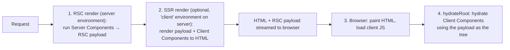
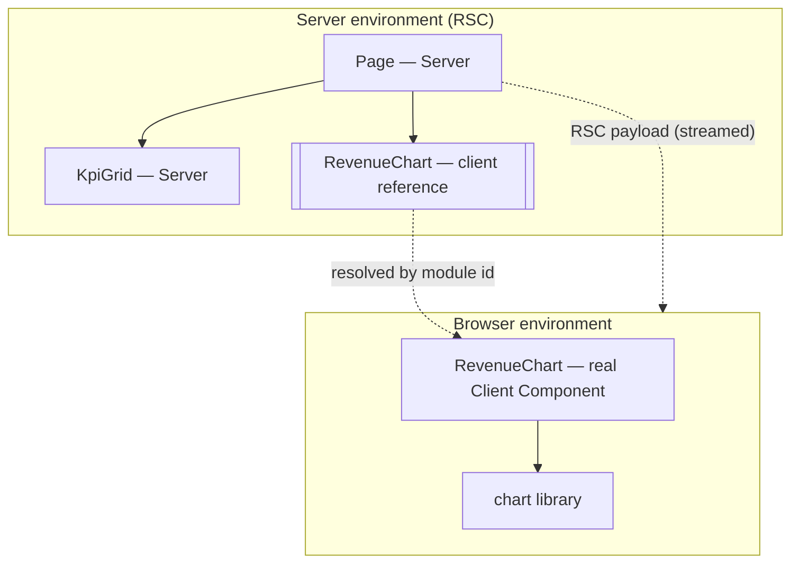

# 02 / 27 — React Server Components: The Model

## 1. Lesson metadata

| | |
|---|---|
| **Level** | Professional (Advanced+) |
| **Study time** | 6 hours (reading 2.5 h, experiments 1.5 h, exercises 2 h) |
| **Prerequisites** | [24 — Suspense and thrown thenables](./24-suspense-conceptual-internals.md), [25 — Hydration and selective hydration](./25-hydration-and-selective-hydration.md), [26 — SSR vs client rendering](./26-ssr-and-client-rendering.md), [05 — React elements vs DOM nodes](./05-elements-vs-dom-nodes.md), [Foundations 10 — Modules and dependency graphs](../00-web-and-javascript-foundations/10-modules-and-dependency-graphs.md), [Foundations 20 — Tooling, transpilation and bundling](../00-web-and-javascript-foundations/20-tooling-transpilation-and-bundling.md) |
| **Next** | [28 — Strict Mode development behavior](./28-strict-mode-behavior.md) |
| **Related** | [Phase 9 / 03 — Server components in depth](../09-advanced-rendering-and-ecosystem/03-server-components-in-depth.md), [Phase 9 / 04 — Client/server boundaries and serialization](../09-advanced-rendering-and-ecosystem/04-client-server-boundaries-and-serialization.md), [Phase 9 / 13 — Forms, actions and mutations](../09-advanced-rendering-and-ecosystem/13-forms-actions-and-mutations.md), [Phase 9 / 12 — Auth boundaries](../09-advanced-rendering-and-ecosystem/12-auth-boundaries.md), [Phase 3 / 22 — Modern hooks and APIs](../03-react-state-and-hooks/22-modern-hooks-and-apis.md) |

> ### Version and framework note (re-checked against react.dev on 2026-10-22; React is at 19.3)
> React Server Components (RSC) are a **React feature** (stable in React 19 per the React 19 release post) but their *integration* (bundler, router, caching, deployment) is **framework territory** and changes quickly. The React docs state: "the underlying APIs used to implement a React Server Components bundler or framework do not follow semver and may break between minors in React 19.x." This lesson teaches the **model**: what runs where, what crosses the boundary, and why. Framework-specific names (file conventions, caching APIs, config flags) are used only as illustrative pseudo-conventions; check your framework's current docs (Next.js App Router is the reference implementation named in the ROADMAP; alternatives exist or are emerging). The quoted semver sentence is still on react.dev's [Server Components](https://react.dev/reference/rsc/server-components) page (checked 2026-10-22).

**Learning objectives.** After this lesson you can:
1. Explain what a Server Component is, when it runs (build time or request time), what environment it runs in, and why it adds **zero client JavaScript** for its own code and dependencies.
2. Distinguish **Server Components**, **Client Components**, and **Server Functions**; explain what the `'use client'` and `'use server'` directives actually mark (and the common confusion: *there is no directive for Server Components*).
3. Distinguish **RSC from SSR**: they are orthogonal. Describe the three-stage pipeline: RSC render → (optional) SSR to HTML → client hydration of client components.
4. State which values can cross the server→client boundary (serializable props, JSX, promises, Server Functions) and which cannot (arbitrary functions, class instances).
5. Apply the composition rules (client components may receive server-rendered children; they cannot import server components).
6. Explain how a Server Component re-render (navigation/refresh) preserves client state, as a consequence of the payload being a *tree React reconciles*.
7. Identify security obligations: Server Functions are public endpoints; server-only modules/secrets must not leak.
8. Decide when RSC is the right tool and when it is not.

**Concepts covered:** Server Component, Client Component, Shared component, `'use client'` boundary, Server Function / `'use server'`, RSC payload (wire format, implementation detail), client references, async components, streaming with Suspense, serializable props, composition via `children`, promise hand-off with `use`, request-scoped caching (conceptual), RSC vs SSR vs hydration, bundle-size effects, security boundary, framework dependency.

---

## 2. Deep conceptual explanation

### 2.1 What problem is this lesson solving?

Even with SSR, React has a structural inefficiency: **every component is also shipped to the browser** so it can be re-run for hydration and later updates. A page with a Markdown renderer, a date library, and a syntax highlighter ships those libraries to every user even if the content is static. And data access still needs an API layer: the component runs in the browser, so it must call HTTP endpoints, producing waterfalls (`HTML → JS → fetch A → render → fetch B`).

Two observations motivate Server Components:

1. **Much of a UI is not interactive.** A product description, an article body, a table of rows: it needs *to be rendered*, not to be *re-rendered in the browser*. Shipping its code to the browser is waste.
2. **The server is closer to the data and can read it directly.** A component that runs on the server can query the database or read the filesystem in the component itself, without inventing an API, and without a client↔server round trip per query.

React's answer is a **new kind of component that runs only on the server** (or at build time) and whose *output* — not its code — is sent to the browser. The react.dev definition: "Server Components are a new type of Component that renders ahead of time, before bundling, in an environment separate from your client app or SSR server."

### 2.2 The three kinds of things (the vocabulary you must get right)

| Term | What it is | Where it runs | Can use state/effects/handlers? | Directive |
|---|---|---|---|---|
| **Server Component** | A component whose code and dependencies stay on the server; sends rendered output | Server (request time) or build machine | **No** hooks like `useState`/`useEffect`, no event handlers, no browser APIs | **None.** (react.dev: "there is no directive for Server Components.") |
| **Client Component** | A component (module) that is bundled for the browser; interactive | Browser *(and also pre-rendered to HTML on the server for the initial load, if SSR is used)* | Yes | `'use client'` at the top of the module |
| **Server Function** (a.k.a. Server Action in form contexts) | An async function that runs on the server but can be *called from* client code | Server (invoked over the network) | n/a (it is a function) | `'use server'` |

The single most common confusion, stated by React's docs ("There is no directive for Server Components"): **`'use server'` does not mark Server Components.** It marks Server Functions. And **`'use client'` does not mean "never rendered on the server"**: client components are typically also server-rendered to HTML for the first load; the directive marks *where the module graph crosses into the client bundle*.

Frameworks usually choose a **default**: in RSC frameworks like the Next.js App Router, components are server components unless the module (or an importer chain) opts into the client by `'use client'`. That default is a *framework/bundler convention*, not a React primitive.

### 2.3 RSC is not SSR (and the combination)

| | Server Components (RSC) | SSR (`react-dom/server`) |
|---|---|---|
| Question answered | *Which components' code lives on the server only?* | *Do I produce HTML on the server for the first paint?* |
| Output | RSC payload (React's own serialized tree format) | HTML string/stream |
| Can the client re-fetch it without a page load? | Yes (navigation fetches new payloads) | No (HTML is for initial documents) |
| Does the component's code go to the client? | No | Yes (needed for hydration) |
| Needed for SEO/first paint | Not by itself | Yes (that is its job) |

A modern RSC framework typically does **both** for the initial request:



Subsequent navigations skip stage 2 and usually fetch **only the RSC payload**, which the client React merges into the current tree.

### 2.4 What a Server Component looks like

```tsx
// app/notes/page.tsx  (framework convention; illustrative)
import { db } from "@/lib/db";                 // server-only dependency: stays on the server
import { marked } from "marked";               // 100+ KB library: never shipped to the browser
import { Expandable } from "./Expandable";      // a Client Component

interface Note { id: number; title: string; markdown: string; authorId: number }

export default async function NotesPage() {      // async Server Component
  const notes: Note[] = await db.notes.findMany();
  return (
    <ul>
      {notes.map((n) => (
        <li key={n.id}>
          <h2>{n.title}</h2>
          <Expandable>
            <div dangerouslySetInnerHTML={{ __html: marked.parse(n.markdown) as string }} />
          </Expandable>
        </li>
      ))}
    </ul>
  );
}
```

```tsx
// app/notes/Expandable.tsx
"use client";
import { useState, type ReactNode } from "react";

export function Expandable({ children }: { children: ReactNode }) {
  const [open, setOpen] = useState(false);
  return (
    <>
      <button onClick={() => setOpen((o) => !o)}>{open ? "Hide" : "Show"}</button>
      {open && children}
    </>
  );
}
```

Observations:

- `NotesPage` is `async` and `await`s the database directly. This is allowed **only** in Server Components (react.dev: "Since async components are not supported on the client, we await the promise with `use`" in client components).
- `marked` and `db` do not appear in the browser bundle. The browser receives the *rendered* `<div>` as a **prop (`children`)** to `Expandable`.
- The "server component rendered inside a client component" is possible because it is **passed as `children`**: the server renders `NotesPage`, produces the elements, and puts them into the props of `Expandable`. `Expandable` doesn't import it. (A client module cannot `import` a server component; see §3.5.)

(Mirrors the react.dev notes example. Fetched and checked while writing.)

### 2.5 What "zero client JS" really means

For a Server Component *itself*: its **function body**, **its imports** (that are not shared with client code), and its **data-access code** are not part of the bundle sent to the browser. The browser still receives:
- the *output* (as RSC payload and as HTML if SSR),
- the code of each **Client Component** it contains,
- React and the framework runtime.

Therefore "zero JS" is relative: it removes the weight of presentational and data-heavy code, not the cost of interactivity. A page full of `'use client'` components gains little.

### 2.6 Relation to JavaScript and the browser

- A Server Component executes in the same JS language, but in a **different environment** (Node/edge/build), with no DOM. Environments differ in globals, module resolution conditions (`react-server` export condition), and permissions.
- Module boundaries (`import`) are the unit of partitioning. `'use client'` is a **module-level** marker that the bundler uses to cut the module graph: everything the client module imports (transitively) is client code, even if it has no directive.
- The "wire format" between server and client is **just data over HTTP** (streamed). The browser's main thread work is: parse payload chunks, reconcile into the React tree. No `eval` of server code.

### 2.7 Common misconceptions

| Misconception | Reality |
|---|---|
| "RSC replaces SSR." | They are different axes; frameworks combine them. |
| "`'use server'` marks Server Components." | It marks **Server Functions**. Server Components need no directive. (react.dev) |
| "`'use client'` means the component never runs on the server." | Client components are usually pre-rendered to HTML on the server too; the directive defines the client bundle boundary. |
| "Server Components can't be interactive." | They can *contain* interactive Client Components as children/props; interactivity lives in the client parts. |
| "Server Components re-render when client state changes." | No. Client state changes re-render client components in the browser. Server Components re-render on the server only when the framework requests a new payload (navigation, refresh, after a Server Function invalidation). |
| "A Client Component can import a Server Component." | A client module's import graph is client code; importing a server-only module into client code breaks or leaks. Pass server output **as props/children** instead. |
| "I can pass any prop to a Client Component." | Props must be **serializable** by React's server→client protocol; plain functions and class instances are not. |
| "Server Components remove the need for an API." | For your own UI, often yes; for mobile apps, third parties, webhooks, you still need endpoints. Server Functions are *also* HTTP endpoints under the hood and need auth/validation. |
| "RSC is Next.js." | RSC is React's; Next.js App Router is currently the most complete implementation. Others exist or are emerging. |
| "Everything should be a Server Component." | Interactivity, browser APIs, local state, and realtime need Client Components. The art is putting the boundary low. |

---

## 3. Internal mechanics

> **Labels.** **Public guarantee** = documented React behavior. **Teaching model** = faithful conceptual model. **Implementation detail** = how current React/bundlers realize it; do not depend on it (and RSC bundler APIs explicitly do not follow semver).

### 3.1 Public guarantees (react.dev, verified)

1. Server Components render "ahead of time, before bundling, in an environment separate from your client app or SSR server"; they can run **once at build time** or **per request**.
2. Their code and dependencies are not included in the client bundle; the client receives rendered output.
3. **There is no directive for Server Components.** `'use client'` marks Client Components; `'use server'` marks Server Functions.
4. Server Components can be `async` and `await` in render; "React will suspend and wait for the promise to resolve before resuming rendering. This works across server/client boundaries with streaming support for Suspense."
5. Server Components can pass **data and JSX as props** to Client Components.
6. Server Components cannot create context but can render a provider imported from a Client Component module.
7. A promise created on the server may be passed as a prop to a Client Component, which reads it with `use` (and suspends under a `<Suspense>`).
8. RSC in React 19 are stable for application authors; bundler/framework integration APIs may break between minors.

### 3.2 Teaching model: two module graphs, one tree

A framework builds **(at least) two environments** from your source:

```text
Server environment (RSC):   server components + shared components + *client references* (stubs)
Client environment (browser): client components (+ their imports) + shared components + React runtime
```

- In the server environment, importing a `'use client'` module yields not the real component but a **client reference**: a serializable descriptor like `{ module: "chunk-id/Expandable", export: "Expandable" }`.
- Rendering in the server environment produces a tree where host elements (`<div>`), server-component *output*, and **client component placeholders with props** appear.
- Serializing that tree gives the **RSC payload**: a stream of chunks describing elements, props, client references, Suspense boundaries and promises.
- In the browser, React reads the payload, replaces each client reference by the actual imported component (loading its chunk if needed), and builds fibers **as if the tree were ordinary JSX**. From then on it's normal React.

### 3.3 The RSC payload (implementation detail)

Conceptually (not literal):

```text
$root: <ul>
  <li key=1>
     <h2>Intro</h2>
     <ClientRef("Expandable") props={ children: <div …>rendered HTML-ish markdown…</div> } />
  </li>
  <li key=2> …
  <Suspense fallback=…> <PromiseRef id=7 /> </Suspense>
</ul>
```

Properties worth knowing:
- It is **streamed**: chunks can arrive as server components finish; suspended parts arrive later and resolve placeholders (this is how async server components stream).
- It carries **data, not code**, for server components; for client components it carries a **reference** (module id/chunk list) the client bundle/manifest can resolve.
- It is not HTML. HTML (if any) is generated from the payload+client components in the SSR stage.
- Its format is called "Flight" in React's source/community discussions (informal name; do not depend on the format; read `packages/react-server` / `react-client` in the repo if you need specifics).

### 3.4 What can cross the boundary (serialization)

Server → client props must be serializable by React's protocol. As a checklist, matching the [`'use client'` reference](https://react.dev/reference/rsc/use-client) ("Serializable types returned by Server Components", re-read 2026-10-22; support has expanded over time, so re-check it):

| Generally serializable | Not serializable |
|---|---|
| Strings, numbers, booleans, `null`, `undefined` | Arbitrary functions (including inline handlers) |
| Plain objects and arrays (nested) | Class instances (custom prototypes) |
| `Date`, `bigint`, `Map`, `Set`, `TypedArray`/`ArrayBuffer`, other iterables of serializable values, `Symbol.for(...)` symbols (all documented) | DOM nodes, symbols not registered via `Symbol.for`, objects with a `null` prototype |
| **JSX / React elements** (including rendered server components) | Closures over server-only values |
| **Promises** (read with `use` on the client) | Anything not listed on the left (the reference's rule: if it is not in the supported list, it is unsupported) |
| **Server Functions** (functions marked `'use server'`, passed as references) | Anything containing secrets you must not expose |

A function prop from a Server Component is only legal if it is a Server Function; React transmits it as a reference that the client can *call over the network*.

### 3.5 Composition rules

1. **Server → Client:** a Server Component may import and render a Client Component, passing serializable props (including JSX children).
2. **Client → Server (via props):** a Client Component may render server-rendered output **passed to it** as `children` or props: its parent (a server component) rendered it.
3. **Client importing Server Component:** not allowed: importing from a client module makes that module *client code*. The bundler either errors or silently treats it as a client component (then server-only imports leak or fail). Rule: **client modules import only client-safe code.**
4. **Shared components:** modules with no directive and no server-only features can be imported by both sides; they behave as server components when imported from the server graph and as client components when imported from the client graph. Hooks like `useState` in a shared module will fail in the server graph.
5. **Server-only modules:** to prevent accidental client imports (DB clients, secrets), frameworks recommend a marker package (commonly `server-only`) that throws at build time if bundled for the client (`server-only` is a real npm package; its use and how it is enforced are framework/bundler-specific, so follow your framework's docs).

### 3.6 Re-rendering and state preservation

When something requires fresh server output (navigation, refresh, revalidation after a Server Function), the framework requests a **new payload** for the affected part of the tree. Because the payload is a **React element tree**, the client React runs its normal **reconciliation** ([Phase 2/06](./06-reconciliation-fundamentals.md), [07](./07-identity-keys-and-reconciliation.md)):

- Client Components whose **type and position** are unchanged keep their **state** (e.g., an open `Expandable`, input contents).
- New children props flow in as updates.
- Elements that disappear unmount.

This is why a Server Component refresh doesn't reset client UI state: *RSC is a way of feeding React new elements*, not a page reload. (The details of **which parts** the framework re-requests, and how it caches payloads, are framework behavior.)

### 3.7 Server Functions (`'use server'`)

```tsx
// actions.ts
"use server";

import { revalidate } from "@/lib/framework";   // illustrative: your framework's invalidation API

export async function addNote(formData: FormData): Promise<void> {
  const session = await getSession();                    // 1. authenticate
  if (!session) throw new Error("Unauthorized");
  const title = String(formData.get("title") ?? "").trim();
  if (title.length === 0 || title.length > 200) throw new Error("Invalid title");   // 2. validate
  await db.notes.create({ data: { title, authorId: session.userId } });              // 3. act
  revalidate("/notes");                                  // 4. refresh affected server output
}
```

- A Server Function is a **public HTTP endpoint** wearing a function's clothes. Anything callable from the client can be called by an attacker with arbitrary arguments. **Authenticate, authorize, validate** every call. (Phase 9/12–13.)
- Function arguments and return values must be serializable.
- They integrate with `<form action={fn}>`, `useActionState`, `useOptimistic`, transitions (Actions) ([Phase 3/22](../03-react-state-and-hooks/22-modern-hooks-and-apis.md), [23 §3.6](./23-transitions-and-deferred-rendering.md)).
- Progressive enhancement: a form whose `action` is a Server Function can work before hydration (framework-dependent).

### 3.8 Async components, Suspense and waterfalls

An `async` Server Component suspends the server render until its promise resolves; wrapping in `<Suspense>` lets the rest stream first ([24](./24-suspense-conceptual-internals.md), [26 §3.2](./26-ssr-and-client-rendering.md)). The classic pitfall moves to the server:

```tsx
// Sequential: B's query starts after A resolves → server waterfall (but low latency to DB)
const user = await getUser(id);
const posts = await getPosts(user.id);       // depends on user: unavoidable

// Independent: start both, then await
const [stats, alerts] = await Promise.all([getStats(), getAlerts()]);

// Or start without awaiting and stream via a promise prop
const commentsPromise = getComments(id);      // not awaited
return <><Post/><Suspense fallback={<Skeleton/>}><Comments commentsPromise={commentsPromise}/></Suspense></>;
// Client/Server child reads it with use(commentsPromise)
```

(The last pattern is from react.dev's Server Components page; `use` reads the promise in a Client Component.)

Server Component waterfalls are cheaper than browser waterfalls (server↔DB latency ≪ browser↔API latency) but still add TTFB/streaming delay.

### 3.9 Request-scoped caching

Within one render pass, several components may need the same data (e.g., the current user). React provides a `cache()` function for Server Components to **memoize an async function per request** so repeated calls dedupe without prop drilling. Scope: per render/request, not across requests (react.dev's [`cache`](https://react.dev/reference/react/cache): "React will invalidate the cache for all memoized functions for each server request"; `cacheSignal` was added in 19.2 to learn when a cache's lifetime ends). Your framework may add its own data cache layers (with their own invalidation rules), which are the most volatile part of RSC frameworks.

### 3.10 Where hydration goes

Only **Client Components** hydrate. Server Component output that is purely host elements becomes static DOM (via SSR HTML) with **no hydration work** and no JS. In practice, React still needs the RSC payload on the client to reconstruct the tree for reconciliation, so the *payload size* counts, and *client JS* drops by the code of server components and their dependencies. Selective hydration of Suspense boundaries ([25](./25-hydration-and-selective-hydration.md)) still applies to the client components inside.

### 3.11 Security model summary

| Concern | Rule |
|---|---|
| Secrets (API keys, DB credentials) | Only in server modules; guard with server-only markers; never pass as props to client components |
| Props are data you send to the browser | Everything passed to a Client Component is visible to the user (devtools, view-source of payload). Filter fields (don't pass a whole DB row) |
| Server Functions | Public endpoints: authenticate, authorize, validate, rate-limit, CSRF considerations (framework-specific) |
| Cross-request state | Module-level state on the server is shared across users ([26 §3.6](./26-ssr-and-client-rendering.md)) |
| XSS | Same as SSR: `dangerouslySetInnerHTML` with sanitized content only |

---

## 4. Step-by-step execution walkthrough

Use the notes example from §2.4 plus one interaction.

### 4.1 Initial page load (RSC + SSR + hydration)

**Predict:** where does each `console.log` appear?

```tsx
// Server Component
export default async function NotesPage() {
  console.log("A: NotesPage render");
  /* … */
}
// Client Component
"use client";
export function Expandable({ children }: { children: ReactNode }) {
  console.log("B: Expandable render");
  /* … */
}
```

| # | Step | Where | Output |
|---|---|---|---|
| 1 | Browser requests `/notes` | | |
| 2 | **RSC render**: `NotesPage` runs, awaits DB, renders markdown, creates tree containing client reference for `Expandable` with `children` | Server (RSC environment) | `A` appears in the **server terminal** (and *only there*) |
| 3 | **SSR render** (if enabled): React renders the payload tree to HTML; `Expandable` is a real component in this step | Server (SSR environment) | `B` appears in the **server terminal** |
| 4 | HTML + payload stream to browser; browser paints HTML (button "Show", content hidden) | Browser | none |
| 5 | Client JS loads: React runtime + `Expandable` chunk only (not `marked`, not `db`) | Browser | |
| 6 | `hydrateRoot` hydrates: reads payload to rebuild the tree; **runs `Expandable`** against the existing DOM | Browser | `B` appears in the **browser console** (twice in dev Strict Mode); `A` does **not** |
| 7 | Hydration commit → effects (none here) | Browser | |

So: `A` once (server); `B` on the server **and** in the browser. This surprises people who think "client component = browser only".

### 4.2 Click "Show"

1. Click handler → `setOpen(true)` (client state).
2. Browser re-renders **only `Expandable`** (client): logs `B`. `children` (server-rendered markdown element tree) is just props; shown now.
3. No server round trip; `NotesPage` does **not** re-run (no `A`).

### 4.3 Server-driven update: add a note via Server Function

1. User submits a form whose `action` is `addNote` (Server Function). Client sends a network request (serialized FormData).
2. Server runs `addNote`: auth, validation, DB insert, invalidates `/notes`.
3. Server re-runs `NotesPage` (logs `A` again) and returns a **new RSC payload** (typically in the same response as the function result, framework-dependent).
4. Client React **reconciles** the new tree into the current one: existing `<li key>`s and their `Expandable` instances persist (states preserved: previously opened notes stay open); the new `<li>` mounts.
5. `isPending` (if used in a transition/form-status) goes false at commit.

---

## 5. Code examples

### 5.1 Minimal: server + client split

```tsx
// Greeting.tsx — Server Component (no directive; framework treats as server by default)
import { LikeButton } from "./LikeButton";

export function Greeting({ name }: { name: string }) {
  return (
    <section>
      <h1>Hello, {name}</h1>
      <LikeButton initialLikes={3} />
    </section>
  );
}
```

```tsx
// LikeButton.tsx — Client Component
"use client";
import { useState } from "react";

export function LikeButton({ initialLikes }: { initialLikes: number }) {
  const [likes, setLikes] = useState(initialLikes);
  return <button onClick={() => setLikes((n) => n + 1)}>♥ {likes}</button>;
}
```

**Predict:** Which files' code is in the browser bundle? What does the browser receive for `Greeting`?

**Answer.** `LikeButton.tsx` (+ React) is in the bundle. `Greeting.tsx` is not; the browser receives the *output*: `<section><h1>Hello, Ada</h1>` plus a placeholder for `LikeButton` with prop `{ initialLikes: 3 }` (via payload/HTML). Trade-off: the boundary is at `LikeButton`, which is as low as it can be; moving `'use client'` to `Greeting.tsx` would ship `Greeting` and everything it imports.

### 5.2 Practical: dashboard page with streaming and a client chart

```tsx
// app/dashboard/page.tsx — Server Component
import { Suspense } from "react";
import { getKpis, getRevenueSeries } from "@/lib/analytics";   // server-only data access
import { RevenueChart } from "./RevenueChart";                  // Client Component
import { KpiGrid } from "./KpiGrid";                            // Server Component

export default async function DashboardPage() {
  const kpis = await getKpis();                                // fast, critical → in shell
  const seriesPromise = getRevenueSeries();                    // slow → streamed; do not await

  return (
    <main>
      <h1>Dashboard</h1>
      <KpiGrid kpis={kpis} />
      <Suspense fallback={<div style={{ height: 320 }} aria-busy="true" />}>
        <RevenueChart seriesPromise={seriesPromise} />
      </Suspense>
    </main>
  );
}
```

```tsx
// app/dashboard/RevenueChart.tsx
"use client";
import { use } from "react";
import { LineChart } from "some-chart-lib";            // heavy, browser-only, ships to client

export function RevenueChart({ seriesPromise }: { seriesPromise: Promise<{ t: number; v: number }[]> }) {
  const series = use(seriesPromise);                    // suspends until the server promise resolves
  return <LineChart data={series} />;
}
```

**Predict:** while `getRevenueSeries()` takes 1.2 s, what is visible and how does the chart arrive?

**Answer.** KPIs and a 320 px placeholder are visible from the shell; the promise resolves on the server, its value is streamed in the payload; the client `use` receives it, the boundary reveals the chart. The chart library loads in parallel as client JS. A rejected promise surfaces to the nearest error boundary on retry ([24 §3.8](./24-suspense-conceptual-internals.md)).

**Design notes.** KPIs `await`ed because they define the page; the chart's promise is *started* in the server component (so it begins early) but not awaited. The placeholder reserves height to avoid CLS. Only a plain array of numbers crosses the boundary: filter the data server-side rather than shipping full records.

### 5.3 Incorrect: hooks and handlers in a Server Component

```tsx
// WRONG: no directive; runs as a Server Component
export default function Counter() {
  const [n, setN] = useState(0);                 // Error: hooks that need client state can't run on the server
  return <button onClick={() => setN(n + 1)}>{n}</button>;   // handlers can't be serialized
}
```

**Why wrong.** Server Components don't have state or lifecycles, and event handlers are functions that can't cross the boundary. Typical framework errors say something like "You're importing a component that needs `useState`. It only works in a Client Component" *(message wording is framework/version-specific)*.

**Corrected.** Extract the interactive piece into a Client Component (`"use client"`) and compose it (§5.1).

### 5.4 Incorrect: passing a function (or class instance) across the boundary

```tsx
// Server Component
function Page() {
  const format = (n: number) => `€${n.toFixed(2)}`;
  return <PriceTag price={9.9} format={format} />;     // WRONG: function prop to a Client Component
}
```

**Why wrong.** Plain functions are not serializable; React throws at render. **Corrected:** pass the *data* and put formatting in the client component, or compute the formatted string on the server and pass the string: `formatted="€9.90"`. If the client must trigger server work, pass a **Server Function** (`'use server'`).

### 5.5 Incorrect: leaking data and secrets through props

```tsx
// Server Component
const user = await db.users.findUnique({ where: { id } });   // includes passwordHash, email, internalNotes
return <ProfileCard user={user} />;                            // WRONG: whole row is serialized to the browser
```

**Why wrong.** Everything passed to a Client Component is sent to the client. **Corrected:** project to the fields the UI needs (`{ name, avatarUrl }`) at the data layer (a DTO), or keep `ProfileCard` as a Server Component if it needs no interactivity.

### 5.6 Corrected and advanced: Server Function with `useActionState` and client composition

```tsx
// actions.ts
"use server";
export interface FormState { ok: boolean; error?: string }

export async function subscribe(_prev: FormState, formData: FormData): Promise<FormState> {
  const email = String(formData.get("email") ?? "").trim();
  if (!/^\S+@\S+\.\S+$/.test(email)) return { ok: false, error: "Enter a valid email" };
  // authorize / rate-limit here …
  await saveSubscriber(email);
  return { ok: true };
}
declare function saveSubscriber(email: string): Promise<void>;
```

```tsx
// SubscribeForm.tsx
"use client";
import { useActionState } from "react";
import { subscribe, type FormState } from "./actions";

const initial: FormState = { ok: false };

export function SubscribeForm() {
  const [state, formAction, isPending] = useActionState(subscribe, initial);
  return (
    <form action={formAction}>
      <input name="email" type="email" required />
      <button disabled={isPending}>{isPending ? "Subscribing…" : "Subscribe"}</button>
      {state.error && <p role="alert">{state.error}</p>}
      {state.ok && <p>Thanks!</p>}
    </form>
  );
}
```

**Notes.** The client imports `subscribe`, but the bundler replaces it with a *reference* to a server endpoint; the function body doesn't ship. Validation exists on the server (client `required` is a convenience). `useActionState` returns `[state, action, isPending]` (React 19). With a framework that supports it, this form works **before hydration** as a native form post. Check the progressive-enhancement behavior and CSRF protections in your framework's docs.

### 5.7 Advanced: composition pattern, context provider and server children

```tsx
// ThemeProvider.tsx
"use client";
import { createContext, use, useState, type ReactNode } from "react";

const ThemeContext = createContext<"light" | "dark">("light");
export function ThemeProvider({ children }: { children: ReactNode }) {
  const [theme] = useState<"light" | "dark">("light");
  return <ThemeContext value={theme}>{children}</ThemeContext>;   // React 19: context as provider
}
export function useTheme() { return use(ThemeContext); }

// layout.tsx — Server Component
import { ThemeProvider } from "./ThemeProvider";
export default function Layout({ children }: { children: ReactNode }) {
  return (
    <ThemeProvider>
      {children}              {/* may be Server Components: passed as children, not imported by ThemeProvider */}
    </ThemeProvider>
  );
}
```

This is the documented pattern: Server Components "cannot create context, but they can render a context provider imported from a Client Component module." The provider is a client component; its children remain server-rendered because they arrive as props. (`<ThemeContext value>` shorthand is React 19 (confirmed on 19.3.1); 18 requires `.Provider`.)

---

## 6. Visual explanations

### 6.1 One tree, two environments



### 6.2 Where each kind of component's code goes

```text
                    server bundle   client bundle   in HTML/payload as output
Server Component       yes             no              yes
Client Component       yes (for SSR)   yes             yes (SSR HTML) + hydrated
Shared component       yes             yes (if imported by a client module)  yes
Server Function body   yes             no (reference only)   n/a
```

### 6.3 Boundary placement impact

```text
Boundary too high ('use client' on layout):
  [Layout CLIENT [Header CLIENT] [Article CLIENT] [Sidebar CLIENT]]   → everything ships

Boundary low:
  [Layout SERVER [Header SERVER] [Article SERVER] [Sidebar SERVER [SearchBox CLIENT]]]   → only SearchBox ships
```

### 6.4 State preservation on server refresh

```mermaid
sequenceDiagram
  participant U as User
  participant C as Client React
  participant S as Server (RSC)
  U->>C: opens note #2 (client state in Expandable)
  U->>C: submits form → Server Function
  C->>S: call function
  S->>S: mutate DB, re-render NotesPage
  S-->>C: new RSC payload (tree)
  C->>C: reconcile tree: same keys/types → Expandable states kept
  C-->>U: new note appears; note #2 still open
```

---

## 7. Alternative approaches and trade-offs

| Criteria | CSR SPA | SSR + hydrate everything | RSC framework | SSG | Islands (non-React-native) |
|---|---|---|---|---|---|
| Client JS size | Largest | Large | **Smaller** (server code stays on server) | Large unless partial | Smallest |
| Data access | Via APIs | Via APIs/loaders | **Direct in components** | Build-time | Build/loader |
| Interactivity model | All components interactive | All hydrate | Only Client Components | All hydrate | Only islands |
| Mental model complexity | Low | Medium | **High** (two environments, serialization, caching) | Medium | Medium |
| Tooling maturity | Very high | High | Framework-dependent, evolving | High | Varies |
| Portability | High | Medium | Low (framework-coupled) | High | Low |
| Testing | Mature | Mature | **Evolving** (async server components, boundaries) | Mature | Varies |
| Security surface | Browser-only code | + server | **+ Server Functions, serialization** | Low | Varies |
| Best for | Auth-gated apps, simple infra | Content + interactivity, legacy | Content-heavy apps with scattered interactivity | Static content | Mostly static sites |

**When RSC is NOT the best choice.**
- Highly interactive, client-state-heavy apps (editors, design tools, trading terminals) where nearly everything is a Client Component: RSC adds a server and a mental model for little gain.
- Teams that cannot run/operate a server runtime or whose deployment targets are static-only.
- Apps needing offline-first/PWA behavior where server round trips for UI are unacceptable.
- Existing large SPA with a mature API layer and no bundle-size pain: migration cost may exceed benefit; adopt incrementally via route-level migration (if framework supports).
- When your team lacks framework expertise and the app is small: an SPA with a data library is simpler.

---

## 8. Best practices and anti-patterns

**Do**
- Default to Server Components; add `'use client'` only at the **lowest** component that needs state, effects, handlers or browser APIs.
- Pass the **minimum serializable data** across the boundary (DTOs, not rows).
- Compose via `children`/props to keep server output inside client wrappers.
- Mark server-only modules with the framework's guard so they can't be bundled to the client.
- Treat every Server Function as a public endpoint: authN/authZ/validation/rate limiting.
- Start independent data requests in parallel (`Promise.all`) or stream via promises + Suspense; place boundaries by UX.
- Keep Client Components small and leaf-like.
- Document boundary decisions in code review; measure bundle impact with the analyzer ([Phase 7/16](../07-performance/16-bundle-analysis.md)).

**Beginner mistakes**
- Adding `'use client'` at the top of every file "to make errors go away".
- Passing functions/handlers from server to client.
- Expecting `console.log` in a Server Component to appear in the browser.
- Using `useEffect` data fetching inside Server Components' client children when a server read would do.

**Experienced-developer mistakes**
- Treating `'use client'` as per-component rather than a **module graph cut** (everything imported transitively becomes client code).
- Leaking secrets or full records via props.
- Cross-request caches/singletons on the server.
- Sequential awaits that serialize independent queries.
- Over-reliance on framework caching without understanding invalidation; stale or leaked personalized data.
- Mixing server-only imports into shared modules.
- Not testing Server Functions with hostile input.

**Smells:** `'use client'` on layouts/pages; giant client components with all data props; Server Functions without auth checks; payload bloat (huge props); duplicated validation logic only on the client.

**Justified exceptions:** a page that is overwhelmingly interactive may legitimately put `'use client'` high; the cost is accepted knowingly and documented.

---

## 9. Real-world application

**E-commerce (product detail).** Product description, specs, breadcrumbs, structured data: Server Components (no client JS, good LCP). Gallery zoom, size selector, add-to-cart: small Client Components. Reviews: streamed boundary. Price personalization: server-side if cookie-driven (not CDN cacheable) or client-fetched. Constraints: SEO (HTML includes content via SSR), cart mutations via Server Functions with validation of price/stock **on the server** (never trust client-sent prices).

**Finance dashboard.** Account summaries and statements rendered on the server near the data (single DB round trip); charts and filters as Client Components; sensitive data never in props beyond what the user may see; audit logging in Server Functions. Constraint: regulated environments may restrict where data is rendered/cached: check framework caches.

**Auth-gated app shell.** Layout reads the session on the server (cookie), renders the user-specific nav as server output, avoiding "flash of unauthenticated UI". Constraint: authorization must be enforced in data access functions and Server Functions, *not only* in layouts (a layout check doesn't protect other entry points: Phase 9/12).

**Forms.** Server Functions with `useActionState` for validation errors, optimistic UI with `useOptimistic`; progressive enhancement. Constraint: idempotency and double-submit protection.

**Realtime.** RSC isn't a realtime transport; use client subscriptions (Client Components) for live data, and use RSC for the initial snapshot.

**Multi-team.** Boundary ownership: one team owns a Server Component page composing other teams' Client Components; contracts are **serializable prop types**; version skew between server and client bundles must be handled by deploy discipline ([Phase 10/12](../10-production-engineering/12-backward-compatibility.md)).

---

## 10. Debugging and troubleshooting

### Symptom A: "Error: hooks can only be used in Client Components" / "useState is not a function" on the server
Root cause: a component without `'use client'` that uses state/effects/handlers, or a shared module importing a client-only library. Find which module is evaluated in the server graph (stack trace). Fix: move interactive code into a Client Component; split shared modules.

### Symptom B: "Functions cannot be passed directly to Client Components…"
Root cause: non-serializable prop. Inspect the props passed at the boundary; replace by data or a Server Function; compute on the server.

### Symptom C: "My `console.log` doesn't show in the browser."
It ran on the server (terminal/log aggregator). Confirm via where it logs. Remember Client Components log in **both** environments on initial load.

### Symptom D: "Bundle is still huge."
Likely `'use client'` too high, or client components import heavy libs. Analyze the bundle ([Phase 7/16](../07-performance/16-bundle-analysis.md)); trace the import chain of the largest chunks; move heavy rendering (Markdown, syntax highlight, date formatting) to Server Components; dynamic-import heavy client widgets.

### Symptom E: "Stale data after mutation."
The framework's cache/invalidation wasn't triggered. Verify the framework's revalidation call from the Server Function; inspect caching headers/data caches; test with hard reload to differentiate client cache vs server cache. (Volatile territory: consult current framework docs.)

### Symptom F: "State resets after a server refresh."
Keys or element types changed in the payload (a parent wrapper toggles, `key` changes), so reconciliation remounted the client component. Compare tree positions before/after; stabilize keys/structure ([Phase 2/07](./07-identity-keys-and-reconciliation.md)).

### Symptom G: "Sensitive field visible in the page source/payload."
A whole record was passed to a client component or embedded in HTML. Search the network tab for the RSC payload response (and the HTML) for the field; reduce props to DTOs; audit all boundary props.

### DevTools workflow
1. Network panel: inspect the RSC payload request on navigation (content type is framework-specific) and the HTML document; look for unexpected data.
2. Source/bundle analysis: confirm server-only libs absent from client chunks.
3. React DevTools: Server Components may appear differently or not at all in the Components panel (tooling is evolving; check your DevTools version).
4. Terminal logs for server components; browser console for client components.

---

## 11. Exercises

### Level A — Knowledge
A1. What does `'use client'` mark? What does `'use server'` mark? Is there a directive for Server Components?
A2. Name three things a Server Component cannot do and why.
A3. In the RSC + SSR pipeline, how many times can a Client Component's body run for a single initial page view, and where?
A4. List four kinds of values that can cross the server→client boundary and two that cannot.
A5. Why can a Client Component render a Server Component's output even though it can't import one?
A6. Why are Server Functions a security concern?

### Level B — Code comprehension
B1. Which of these parts are in the client bundle?
```tsx
// Page.tsx (no directive)
import { Chart } from "./Chart";           // "use client"
import { format } from "date-fns";
export default async function Page() { const d = await getData(); return <Chart title={format(d.at, "PP")} points={d.points} />; }
```
B2. A Server Component passes `onSelect={(id) => router.push(id)}` to a Client Component. What happens and how do you fix it?
B3. Given a notes list where each note has a client `Expandable` with `key={note.id}`, a user opens note 2, then a Server Function adds note 4 at the end. What's the state of note 2 and why? What if the new note was inserted with an index key at the start?
B4. Where do these logs appear in a typical RSC+SSR app: (a) `console.log` in an async Server Component; (b) in a Client Component render during the first page load; (c) in a Client Component after a click?
B5. What is wrong with this?
```tsx
"use client";
import { db } from "@/lib/db";
export function Stats() { const rows = use(db.stats.findMany()); return <p>{rows.length}</p>; }
```

### Level C — Implementation
C1. Convert a CSR component that fetches `/api/products` in `useEffect` and renders a filterable list into an RSC design: which parts are server, which client, and what props cross?
C2. Write a Server Function `addTodo(prev, formData)` with auth, validation and a typed return, and the client form using `useActionState`.
C3. Implement the "server promise → client `use` + Suspense" pattern for a slow recommendations list.

### Level D — Debugging
D1. "After deploying, users sometimes see 'Failed to find Server Action' or broken buttons right after a deploy." Hypothesize (version skew) and propose mitigations.
D2. "Our client bundle grew 300 KB after adding a markdown preview." Diagnose and fix with RSC.
D3. "A user can see another user's email in the page's network response." Investigate and fix.
D4. "Typing in an input resets after the server action completes." Diagnose.

### Level E — Architecture and engineering decisions
E1. Decide boundary placement for a product listing page with filters, a sticky cart widget, infinite scroll, and an SEO-critical product grid.
E2. You manage a 200k-LOC SPA with a REST API layer. Argue for or against migrating to an RSC framework, defining criteria and an incremental plan.
E3. Write the review checklist for PRs touching `'use client'` and `'use server'` files.

### Level F — Expert challenge
F1. Write a precise explanation (suitable for an internal wiki) of "RSC vs SSR vs hydration", including a sequence diagram of an initial load and a client navigation, the artifacts exchanged (HTML, RSC payload, JS), and where state lives. Annotate which parts are React guarantees versus framework behavior.

---

## 12. Detailed answers and explanations

> Attempt the exercises first.

**A1.** `'use client'` marks a module as a Client Component boundary (the module and what it imports go into the client bundle). `'use server'` marks Server Functions (async functions callable from the client over the network). There is **no** directive for Server Components (react.dev).

**A2.** Cannot: use `useState`/`useEffect` (no commit/lifecycle on the server render), attach event handlers (functions can't be serialized and there is no DOM), use browser APIs (not in the environment), create context. They "are not sent to the browser, so they cannot use interactive APIs like `useState`" (react.dev).

**A3.** With SSR: once on the server (SSR stage), then once in the browser during hydration (twice in dev with Strict Mode), plus later updates. Without SSR (RSC only, client-rendered): only in the browser.

**A4.** Can: primitives; plain objects/arrays; JSX elements (server component output); promises (with `use`); Server Functions; (commonly) `Date`, `Map`, `Set`. Cannot: arbitrary functions/closures, class instances. (Verify exact list in current docs.)

**A5.** The server component output is created by the server and passed in as `children`/props: the client component receives *elements*, not an import of the component's code. Composition, not import.

**A6.** They are network-reachable endpoints; clients (or attackers) can call them with arbitrary arguments and without your UI. Without authN/authZ/validation/rate limits they become unauthenticated mutation endpoints.

**B1.** In the client bundle: `Chart` (+ its imports). Not: `Page`, `date-fns` (used only in the server component), `getData`. `format` runs on the server and only the formatted string crosses. Common wrong answer: "date-fns is in the bundle because it's imported": imports only matter in the *client* module graph.

**B2.** The render throws: a plain function can't cross the boundary. Fix: pass data (`id`s) and handle navigation in the client component using the router; or pass a Server Function if server work is needed; or make navigation a link (`href`) rendered by the server.

**B3.** Note 2's state is preserved: the payload's tree contains the same keyed elements; reconciliation matches by key/type, so the `Expandable` instance persists. If keys were indices and the new note were inserted at the start, indices shift: note 2 becomes the third item; React would associate the old state with the wrong note (index 1 → now different note). Use stable ids.

**B4.** (a) Server terminal/log stream only. (b) Server (SSR) logs **and** browser console (hydration). (c) Browser console only.

**B5.** A Client Component imports `db` (server-only) and calls it: the bundler tries to bundle DB code for the browser (build error or leak risk) and the client can't talk to the DB. Move data access to a Server Component (or Server Function) and pass a promise/data as props.

**C1. Evaluation criteria.** Server Component reads products (DB/API) directly and renders the static product cards (no client JS for card markup); a small Client Component owns filter inputs and filter state; options: (a) filters in the URL (`searchParams`) so the **server** re-renders the list (client component only updates the URL, via a transition), or (b) the server passes all products as serializable props and the client filters locally (only if the list is small; payload size!). Props crossing: product DTOs (id, name, price, imageUrl), not DB rows. Example answer: choose (a) for large catalogs/SEO and (b) for ≤ a few hundred items where instant client filtering matters.

**C2. Reference solution**
```tsx
// actions.ts
"use server";
import { getSession } from "@/lib/auth";
export interface TodoState { error?: string; created?: { id: string; title: string } }
export async function addTodo(_prev: TodoState, formData: FormData): Promise<TodoState> {
  const session = await getSession();
  if (!session) return { error: "Please sign in" };
  const title = String(formData.get("title") ?? "").trim();
  if (!title || title.length > 120) return { error: "Title must be 1–120 characters" };
  const created = await db.todos.create({ data: { title, ownerId: session.userId } });
  return { created: { id: created.id, title: created.title } };
}
```
Client form: as in §5.6 using `useActionState(addTodo, {})`. Evaluation criteria: authentication first; ownership from the session (never from client-provided user id); validation server-side; return DTO; no secrets; typed state.

**C3.** As §5.2: Server Component starts `const recs = getRecommendations(userId)` without awaiting; renders `<Suspense fallback={<RecsSkeleton/>}><Recs promise={recs}/></Suspense>`; `Recs` is a Client Component using `use(promise)`; or make `Recs` itself an async Server Component that `await`s, which is simpler if it needs no interactivity. Evaluation: explains why simpler option is preferred when no client interactivity is needed.

**D1.** Version skew: the open browser tab has old client code referencing server function ids/payload expectations from the previous deploy; the new server doesn't recognize them. Mitigations: framework-provided deployment IDs/skew protection; keep old server action ids alive for a window; atomic deploys with versioned asset paths; prompt reload on version mismatch; keep payload/action contracts backward compatible. (Framework-specific; verify.)

**D2.** A client component imports the markdown library (preview in the client). Move markdown parsing to a Server Component (render HTML on the server) and pass the rendered element as children; if the preview needs live typing (editor), parsing must be client-side: accept the bundle cost, or lazy-load the library only when the preview tab is opened (dynamic import) or parse on the server via a Server Function with debouncing.

**D3.** A whole user object (with email) was passed as a prop or embedded; or the data layer returned too many fields. Inspect payload/HTML; introduce DTO projection at the data-access boundary; add automated tests that serialized props never contain forbidden fields; consider taint/guard APIs where available (`experimental_taintObjectReference` / `experimental_taintUniqueValue` are listed on react.dev as available only in the Experimental channel, 2026-10-22).

**D4.** The form reset is a native behavior of React 19 form actions: after an action succeeds, uncontrolled form fields are reset automatically; or the tree remounts due to key/type change. Fix: use `defaultValue` from returned state if you need persistence; or control the input; check `key` stability. (Verify: React 19 resets uncontrolled form fields after a successful `<form action>`; see the `<form>` reference.)

**E1.** Evaluation criteria: server for grid (SEO, no JS); client for filters (but URL-driven so the server renders results), sticky cart (client, small; data via Server Function/API), infinite scroll (client observer + server-rendered pages via payload or client fetch), keep boundaries low; use Suspense for slow facets; measure LCP/INP. Example reasoning: *"The grid is the largest, least interactive part: it stays on the server. Filters are controls only; their state lives in the URL so the server can render matching products with SEO-friendly URLs. Cart is global, interactive and personalized: a Client Component with a Server Function for mutations."*

**E2.** Criteria: bundle/INP pain, SEO needs, API duplication cost, team capacity, risk, framework lock-in. Plan: introduce the framework as a shell around the SPA (catch-all route as a client app), migrate route by route (leaf-first, content-heavy pages first), keep the API layer for non-web clients, add boundaries incrementally, measure per migration, keep a rollback. Argue against if the app is dominated by interactivity and bundle size isn't a bottleneck.

**E3.** Checklist: Does each `'use client'` sit as low as possible? Are props minimal DTOs? No functions/class instances across? No server-only imports in client modules (guard marker present)? Server Functions: authN, authZ (ownership), input validation (schema), rate limiting/idempotency, error handling that doesn't leak internals, revalidation calls? No secrets in props/payload? Bundle impact checked? Tests for server functions with hostile input? Boundary documented?

**F1.** Evaluation criteria for an expert write-up: (1) three artifacts: HTML (SSR), RSC payload (React tree incl. client references), JS bundles (client components + runtime); (2) initial load: RSC render → SSR render → HTML+payload streamed → hydrate client components; (3) navigation: fetch RSC payload only → client reconciles; HTML not re-generated; (4) state: client state in client components persists across payload updates; server state ephemeral per request; (5) guarantees: semantics of Server/Client components, directives, serialization restrictions, `use` with promises, Suspense/streaming; (6) framework behavior: routing, caching, payload fetching, invalidation, bundler integration (unstable APIs; "do not follow semver"). Mark the wire format as an implementation detail.

---

## 13. Senior engineer interview questions

**Q1. "What problem do Server Components solve that SSR doesn't?"**
*Strong answer:* SSR improves first paint but still ships every component's code for hydration and still needs an API layer for data. RSC keeps non-interactive components' code and dependencies on the server, lets components read data directly, and sends their output as a React tree that the client reconciles, reducing JS and removing client-side data waterfalls. They're complementary: SSR produces HTML; RSC changes what code ships.

**Q2. "Explain `'use client'` and `'use server'`."**
*Strong answer:* `'use client'` defines a module boundary where code enters the client bundle (and which can be SSR'd and hydrated); `'use server'` marks functions callable from the client that execute on the server (public endpoints needing auth). There's no directive for Server Components. Common mistake: using `'use server'` to mark Server Components.

**Q3. "How can a Client Component contain a Server Component?"**
*Strong answer:* Through composition: a Server Component renders the Client Component and passes server-rendered elements as `children`/props. The client component never imports the server one; it receives already-rendered output (serialized). That keeps the server code off the client.

**Q4. "What's in the RSC payload and how does the client use it?"**
*Strong answer:* A streamed, serialized description of the React tree: host elements, client component references with props, Suspense boundaries, promises. The client resolves references to real components, then reconciles it as normal React. Details/format are implementation details; the guarantee is the semantics.

**Q5. "How do you keep state across server updates?"**
*Strong answer:* The payload is just elements; React reconciles by type/key/position. Stable keys and structure preserve client component state. A changed wrapper or key remounts and resets state.

**Q6. "What security risks are specific to RSC?"**
*Strong answer:* Server Functions as public endpoints, over-serialization of data in props/payload, module-level state shared across requests, accidentally importing server-only code in client modules, and framework caches leaking personalized data. Mitigate with auth/validation in every function, DTOs, server-only guards, per-request state and cache audits.

**Q7. "When wouldn't you adopt RSC?"**
*Strong answer:* Interaction-heavy apps with little static content, teams lacking server/framework ops capacity, offline-first requirements, or when existing performance is fine and migration costs dominate. Also when framework lock-in and evolving APIs are unacceptable risks.

---

## 14. Further learning resources

| Resource | URL | Covers / why | Level | Study |
|---|---|---|---|---|
| React docs: Server Components | <https://react.dev/reference/rsc/server-components> | Official model, directives, async components, promises (verified) | Intermediate | Whole page |
| React docs: Server Functions / `'use server'` | <https://react.dev/reference/rsc/server-functions> | Server Functions semantics | Intermediate | Whole page |
| React docs: `'use client'` | <https://react.dev/reference/rsc/use-client> | Boundary semantics, serializable props list | Intermediate | Whole page |
| React docs: `use` | <https://react.dev/reference/react/use> | Reading promises from Server Components (verified) | Intermediate | Streaming data section |
| React 19 release post | <https://react.dev/blog/2024/12/05/react-19> | RSC stable status, bundler API caveat (verified) | Intermediate | "Server Components" |
| reactwg/server-components | <https://github.com/reactwg/server-components> | Working-group discussions | Advanced | Browse discussions |
| React RFC: Server Components | <https://github.com/reactjs/rfcs/pull/188> | Original RFC and motivation | Advanced | Motivation sections |
| Framework docs (Next.js App Router etc.) | each framework's official site | Practical conventions, caching, deployment; check current docs | Intermediate | "Server and Client Components" |

---

## 15. Knowledge checkpoint

**You should now understand**
- Server Components run ahead of the browser and ship output, not code; Client Components are the interactive boundary; Server Functions are RPC endpoints.
- RSC ≠ SSR; frameworks use RSC render → SSR → hydration, and navigation fetches payloads.
- Serialization rules, composition rules, and why client state persists across server re-renders.
- Security obligations and framework-volatility caveats.

**You should be able to explain without notes**
- Where each log line appears for server and client components.
- Why `'use client'` should be low in the tree.
- Why passing a whole DB row to a client component is a bug.

**You should be able to implement**
- Server/client composition, streamed promise hand-off with `use`, Server Function forms with `useActionState`, DTO projection at boundaries.

**You should be able to debug**
- Serialization errors, bundle bloat, stale data after mutation, state resets after refresh, leaked fields.

**Before moving on:** read [28 — Strict Mode development behavior](./28-strict-mode-behavior.md); then [Phase 9/03](../09-advanced-rendering-and-ecosystem/03-server-components-in-depth.md) when you reach the deep dive.
