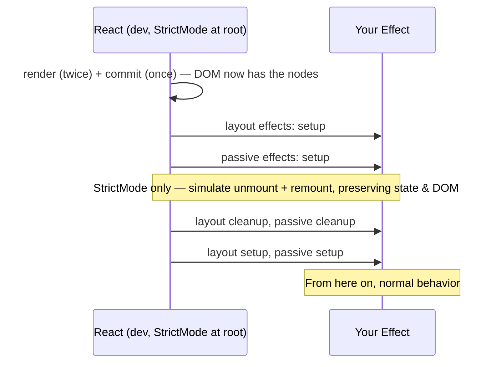
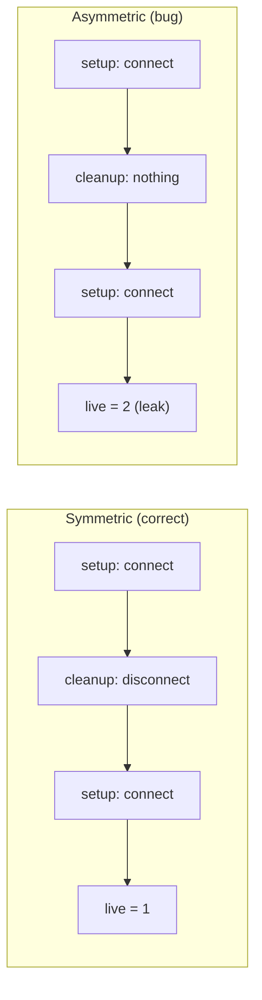

# 02 / 28 — Strict Mode Development Behavior

## 1. Lesson metadata

| | |
|---|---|
| **Level** | Advanced |
| **Study time** | 4–5 hours (reading 2 h, experiments 1 h, exercises 1.5 h) |
| **Prerequisites** | [11 — Render phase vs commit phase](./11-render-phase-and-commit-phase.md), [12 — Why rendering must be pure](./12-why-rendering-must-be-pure.md), [15 — Interruptible, restartable, abandoned renders](./15-interruptible-restartable-abandoned-rendering.md), [18 — Effects and their timing](./18-effects-and-their-timing.md), [01/12 — Component purity](../01-react-fundamentals/12-component-purity.md), [01/17 — Lifecycle concepts](../01-react-fundamentals/17-lifecycle-concepts.md) |
| **Next** | [29 — Reasoning about unnecessary renders](./29-reasoning-about-unnecessary-renders.md) |
| **Related** | [Phase 3 / 04 — `useEffect` synchronization](../03-react-state-and-hooks/04-useeffect-synchronization.md), [Phase 3 / 06 — Effect cleanup](../03-react-state-and-hooks/06-effect-cleanup.md), [Phase 3 / 07 — You might not need an effect](../03-react-state-and-hooks/07-you-might-not-need-an-effect.md), [24 — Suspense](./24-suspense-conceptual-internals.md), [25 — Hydration](./25-hydration-and-selective-hydration.md), [Phase 8 / 04 — Testing async updates](../08-testing-and-quality/04-testing-async-updates.md) |

**Learning objectives.** After this lesson you can:
1. List *exactly* what Strict Mode does in development (double invocation of pure functions, one extra effect setup→cleanup→setup cycle, one extra ref-callback cycle, deprecation warnings) and what it never does in production.
2. Explain the **purpose**: surface impurity and missing cleanup *now*, because React's concurrent features (discarded renders, restarts, hide/show with preserved state, Suspense) legitimately call your code more than once or tear effects down and rebuild them.
3. Predict the precise log sequence of a component under Strict Mode on mount, on update, and on unmount, including state initializers, updater functions, effects, layout effects and refs.
4. Distinguish *bugs revealed* by Strict Mode (non-idempotent render, leaky effects, race conditions) from *annoyances caused by it* (double network calls in dev) and fix the former properly, not by removing Strict Mode or adding "run once" ref guards.
5. State the React 18 vs React 19 differences (memoized results reused on the second render; ref-callback double invocation; no re-throw of errors; removal of legacy APIs that Strict Mode used to warn about).
6. Scope Strict Mode (whole tree vs subtree), and explain why subtrees cannot opt out.
7. Write tests that run under Strict Mode and assert resource symmetry (setup/cleanup counts).

**Concepts covered:** `<StrictMode>`, development-only checks, double render, double invocation of initializers/updaters/reducers/memo callbacks, effect re-run (simulated unmount/remount), ref-callback cycle, deprecation warnings, console dimming, idempotence, cleanup symmetry, "reusable state" / Activity-style hiding, scoping, dev vs prod performance measurement.

> **Version-sensitive.** Strict Mode is *explicitly* allowed to change what it checks between versions ("development-only"; behavior is not API). Documented on react.dev, and every sequence below was executed on react/react-dom 19.3.1 (jsdom, dev and production builds) on 2026-10-22:
> - React 18 added the **extra Effect setup+cleanup cycle** on mount.
> - React 19 makes `useMemo`/`useCallback` **reuse the first render's results during the second render** and **double-invokes ref callbacks on mount** (React 19 Upgrade Guide).
> - React 19 changed error reporting (`onCaughtError`/`onUncaughtError`, no re-throw), which affects what you see in dev consoles under error scenarios.
> Do not write code or tests that depend on *how many times exactly* something is called. Depend on the invariant: *it must be safe to call more than once*.

---

## 2. Deep conceptual explanation

### 2.1 What problem is this lesson solving?

A very common first reaction to React 18+:

> "My `useEffect` runs twice and my `console.log` prints twice. React is broken."

It is not broken. It is **Strict Mode**, which is on by default in most project templates (Vite's React template and Create-React-App-era templates render `<StrictMode><App/></StrictMode>`; frameworks commonly enable it). Strict Mode *intentionally runs your code more than once in development* to expose bugs that would otherwise appear only in rare, hard-to-reproduce situations in production, especially once concurrent rendering features are used.

The lesson's thesis: **the double invocation is a test harness for two contracts that React relies on**:

1. **Render is a pure function** of props, state and context ([12](./12-why-rendering-must-be-pure.md)). If the contract holds, calling it twice is indistinguishable from calling it once.
2. **Effects are symmetric**: every setup has a cleanup that fully undoes it, so React may stop and restart synchronization at will ([18](./18-effects-and-their-timing.md)).

If you honor the contracts, Strict Mode is invisible except for extra console output. If you don't, it makes the violation *deterministic and immediate*.

### 2.2 What Strict Mode does (the complete list, development only)

From react.dev's `<StrictMode>` reference (fetched while writing):

| Check | What happens in development | Detects |
|---|---|---|
| **Double rendering** | Component function bodies (top-level logic, not event handlers), functions passed to `useState`, state *updater* (`set`) functions, `useMemo`, `useReducer`, and some class lifecycle methods (`constructor`, `render`, `shouldComponentUpdate`) are called **twice** | Impure render: mutations of props/shared data, reads of mutable outside state, side effects in render |
| **Double Effects** | One extra **setup → cleanup → setup** cycle for every Effect on initial mount | Missing/incorrect cleanup: leaks, duplicate subscriptions/connections, non-idempotent setup |
| **Ref callbacks** | One extra setup+cleanup cycle for callback refs on initial mount | Ref callbacks that register without un-registering |
| **Deprecated API warnings** | Warns when any component uses deprecated APIs such as `UNSAFE_` lifecycles | Legacy code |
| **Console dimming** | With React DevTools installed, `console.log` calls during the *second* render appear dimmed; DevTools can suppress them entirely (setting off by default) | Noise management |

Not done: nothing is rendered twice **to the DOM**: there is one commit; the second render is a *discarded dry run* (or the first one is; which of the two results React uses is not specified, and both must be equal).

All checks are **development-only**: "they do not impact the production build".

**No opt-out inside a wrapped tree**: "There is no way to opt out of Strict Mode inside a tree wrapped in `<StrictMode>`." You can scope by wrapping only part of the app.

### 2.3 Definitions

| Term | Meaning |
|---|---|
| **Idempotent** | Calling it once or N times produces the same observable result and effects. |
| **Pure** (render) | Output depends only on inputs (props/state/context); no observable side effects. |
| **Symmetric effect** | Setup and cleanup that precisely cancel each other so setup→cleanup→setup ≡ setup. |
| **Simulated unmount/remount** | What the extra Effect cycle represents: React tearing down effects and re-creating them *without destroying state*. |
| **Reusable state** | Future/under-the-hood React capability to hide UI (e.g., Suspense hide, Activity) while preserving component state and running cleanups. Strict Mode's effect cycle prepares code for it. |

### 2.4 Why double invocation? (first principles)

Consider what React's scheduler may legitimately do ([15](./15-interruptible-restartable-abandoned-rendering.md)):

- **Render a component, then throw the result away** (an interruption by an urgent update; a transition abandoned; a Suspense retry).
- **Render a component more than once before one commit**.
- **Call effects' cleanups and setups again** when a hidden tree is revealed, when a Suspense boundary re-shows content, or (in future/other features) when a component is "offscreen".

In production, these happen only sometimes (rarely in simple apps). In development under Strict Mode they happen **every time**. That asymmetry is the point: *a bug that appears 1 time in 10,000 becomes a bug that appears every time*.

| Production event (sometimes) | Strict Mode simulation (always, in dev) |
|---|---|
| A render is discarded/restarted | Double render |
| Layout/passive effects torn down and re-run for reveals/reuse | Setup → cleanup → setup after mount |
| Ref detached and reattached when content is hidden/shown | Ref callback cycle |

### 2.5 Relation to JavaScript and the browser

- Double invocation relies on **JavaScript closures and function purity**. A function that increments a module variable, pushes into an array it received, or reads `Date.now()` has *observable* second-call differences.
- The extra Effect cycle is the same as **unmount then mount** in terms of external resources: `addEventListener`/`removeEventListener`, `WebSocket` open/close, `setInterval`/`clearInterval`, `fetch`+`AbortController`. If your setup is asymmetric, the browser keeps the leaked resource (a second socket, a second listener) so the leak is *observable* (DevTools Network, listeners).
- Network requests are *not undone by cleanup* (a sent request can't be unsent), so double effects often show **two requests** in dev. Cleanup should **ignore or abort** the first (`AbortController`, an `ignore` flag).

### 2.6 What Strict Mode is NOT

| Misconception | Reality |
|---|---|
| "React renders every component twice in production." | **Never** in production. Strict Mode is development-only. |
| "My app is slower in prod because of double rendering." | Opposite: dev is slower. Measure performance with production builds. |
| "The DOM is updated twice." | One commit. The extra render is a dry run; the extra Effect cycle touches only what your effect manipulates (and any DOM operations inside it). |
| "It's a bug in React 18; revert to React 17." | In 17 the checks were fewer; React 18 added effect re-run. Downgrading hides latent bugs. |
| "I'll fix it with `useRef(false)` and run the effect once." | That hides the symmetric-cleanup bug (§5.4). |
| "Strict Mode checks my TypeScript / lints." | It runs *your code* twice at runtime; it is not a static analyzer. |
| "Strict Mode re-runs effects on every update." | Only **once on initial mount** (simulated unmount/remount). Updates re-run effects with the normal dependency rules; renders are doubled on updates too. |
| "If effects run twice in dev, my `useEffect(…, [])` is wrong." | Not necessarily: *symmetric* effects are unaffected. It's wrong only if setup/cleanup are not symmetric. |

---

## 3. Internal mechanics

> **Labels.** **Public guarantee** = documented. **Teaching model** = predictive. **Implementation detail** = current React internals, subject to change; Strict Mode details have changed between 16/17/18/19.

### 3.1 Public guarantees

1. Strict Mode checks run **only in development**.
2. Components are re-rendered an extra time in Strict Mode (functions listed in §2.2 may be called twice).
3. Effects (and callback refs) get one extra **setup+cleanup** cycle on **initial mount** *if `<StrictMode>` is at the root* of the app (docs: "if `<StrictMode>` is not enabled at the root of the app, it will not re-run Effects an extra time on initial mount").
4. You cannot opt out inside a `<StrictMode>` tree.
5. Dev-only warnings for deprecated APIs.
6. Strict Mode does not render any visible UI and has no props.
7. With React DevTools installed, second-render `console.log`s are dimmed (optionally hidden).

**Not guaranteed:** the number of calls to any given function; which of two renders' results is used; ordering of the extra effect cycle across components; behavior of future versions.

### 3.2 Teaching model: double render

```text
renderWithHooks(Component, props):
  result = Component(props)                    // normal call: hooks state initialised/updated
  if StrictMode (dev):
     Component(props)                           // second invocation with the same hook state inputs
     // (initializers/updaters/reducers/memo callbacks inside are also called twice)
  return result (or the second; both must be equal)
```

Facts you can rely on for **prediction**:

- **Both calls see the same props, state, context.** If your function is pure, the two outputs are equal.
- **State initializers** run twice on mount: `useState(() => expensive())` calls `expensive()` twice (the second result is discarded). On updates, the *updater function* `setN(n => n + 1)` is invoked twice with the same previous value; the result is the same if pure.
- **Reducers** called twice per action processing.
- **`useMemo`** callback: Strict Mode calls it twice when it computes (executed on 19.3.1: `memo`, `memo` for one computation, again `memo`, `memo` after a dependency change); in React 19 the *second render pass* reuses the first pass's memoized result, so it does not recompute again. The same applies to the `useState` initializer: it ran twice (back to back, inside the first pass), not once per pass. Counts are version-dependent; do not depend on them.
- **Event handlers are not double-invoked** (they aren't part of render).
- **Effects' bodies are not invoked twice by the double-render check**; they follow the separate effect cycle described next.
- **Side effects of the render (mutations, `console.log`, network calls, module counters)** happen twice: that is how impurity shows.

### 3.3 Teaching model: the extra effect cycle on mount



Properties:

- It happens **once per mounted component instance, when that instance mounts**, not on subsequent updates. Executed on 19.3.1: components that mount *later* (for example `{show && <E/>}` turning true) also get setup → cleanup → setup, both with a root-level `<StrictMode>` and inside a scoped `<StrictMode>`; only the *initial mount of the whole tree* is skipped for a non-root `<StrictMode>` (see §3.7). Details have varied between versions, so design for both.
- **State and DOM are preserved** between the simulated cleanup and setup: it's not a re-mount from scratch (state initializers don't re-run for the effect cycle), it's an effect teardown/rebuild.
- Effects with dependency arrays follow normal rules afterwards: setup re-runs only when dependencies change.
- **Cross-component ordering** of the simulated cleanup/setup (e.g., whether all children's cleanups happen before parents') is not specified; avoid code that depends on it.

### 3.4 Teaching model: ref callbacks

Callback refs get the same treatment on initial mount (documented): `ref(node)` → cleanup → `ref(node)`. In React 19, ref callbacks may **return a cleanup function**; if they do, React calls it instead of calling `ref(null)` on detach. The second invocation exists "to simulate what happens when a mounted component is replaced by a Suspense fallback" (React 19 upgrade guide): when a Suspense boundary hides content, refs are detached and reattached on reveal.

```tsx
<div
  ref={(node) => {
    if (!node) return;
    const ro = new ResizeObserver(onResize);
    ro.observe(node);
    return () => ro.disconnect();        // React 19: cleanup replaces the `null` call
  }}
/>
```

TypeScript note (React 19 types): returning anything other than a function/void from a ref callback is rejected; use block bodies: `ref={(n) => { instance = n; }}` not `ref={(n) => (instance = n)}`.

### 3.5 What kinds of bugs each mechanism reveals

| Mechanism | Example bug revealed | Why it shows |
|---|---|---|
| Double render | `items.push(x)` on a prop array → two entries | The second render pushes again |
| Double render | `let nextId = 0; function Row(){ const id = nextId++ … }` → ids skip | Shared mutable module state changes per call |
| Double render | `Math.random()` / `Date.now()` driving output that is stored/compared | Two renders disagree |
| Double render | Network call or analytics in render | Two requests/events |
| Double render (updaters) | `setCount(c => { log(); return c + 1 })` → two logs; `setItems(xs => { xs.push(1); return xs })` → two pushes | Updater impure/mutating |
| Double effect | Subscription without unsubscribe → two live subscriptions | Setup ran twice, cleanup missing |
| Double effect | `setInterval` without `clearInterval` → timer runs 2× as often | Leak |
| Double effect | `fetch` response setting state after unmount; out-of-order responses | Race reveals unguarded async |
| Double effect | One-time initialization that is not idempotent (sending a "viewed" event, creating a resource) | Setup twice |
| Ref callback cycle | Registering nodes in a Map without removal → stale/duplicate entries | Setup twice, cleanup missing |

### 3.6 "Reusable state": the roadmap rationale

React's team has described (in the React 18 working group) a future/ongoing capability: React could **remove a section of UI from the screen but keep its state**, then restore it later (think back-navigation that preserves state, or tabs kept alive). When hidden, effects need to be **cleaned up** (no subscriptions running for invisible UI), and when shown again, **set up again**, with the component's state intact. That is *exactly* the simulated unmount-remount sequence: setup → cleanup → setup with preserved state. Strict Mode's extra cycle ensures your effects tolerate it. React 19.2 added `<Activity>` (stable; `mode="visible" | "hidden"`, see the [Activity reference](https://react.dev/reference/react/Activity)), which hides/shows UI while preserving state and tearing down/recreating effects: a concrete instance of this (executed on 19.3.1: hidden → layout and passive cleanups, visible → setups, state initializer not re-run). Suspense's hide-on-re-suspend behavior already does the layout-effect portion today ([24 §3.5](./24-suspense-conceptual-internals.md)).

### 3.7 Scoping

```tsx
// whole app (typical)
createRoot(document.getElementById("root")!).render(
  <StrictMode><App /></StrictMode>
);

// only a part
<>
  <Header />
  <StrictMode>
    <Dashboard />
  </StrictMode>
</>
```

- The extra *initial mount* effect cycle happens only when `<StrictMode>` is at the **root** (react.dev: "if `<StrictMode>` is not enabled at the root of the app, it will not re-run Effects an extra time on initial mount"); executed on 19.3.1: with a scoped `<StrictMode>` the components inside rendered twice but their initial-mount effect ran once. Components that mount later inside the scoped tree do get the extra cycle (see §3.3).
- Strict Mode can be nested; inner has no additional effect; no opt-out.
- Use scoping for incremental adoption in legacy apps: wrap new/cleaned areas first.

### 3.8 Interaction with other features

- **Hydration**: components are double-rendered during hydration in dev; impure render (time/random) shows both as Strict-Mode double-render inconsistencies *and* hydration mismatches ([25 §3.11](./25-hydration-and-selective-hydration.md)).
- **Transitions / Suspense**: restarts are *real* in production; Strict Mode makes them common in dev ([23 §3.9](./23-transitions-and-deferred-rendering.md)).
- **Testing**: RTL's `render` can be wrapped (`wrapper: StrictMode`) or configured globally; test with Strict Mode on to catch asymmetry ([Phase 8](../08-testing-and-quality/04-testing-async-updates.md)). `@testing-library/react` 16.x exposes `configure({ reactStrictMode: true })` (option present in 16.3.3, checked in `dist/config.js`).
- **React Compiler**: assumes purity; Strict Mode is the dev-time guard for that assumption ([Phase 9/08](../09-advanced-rendering-and-ecosystem/08-react-compiler.md); a fast-moving topic, check the current docs).
- **Error reporting (React 19)**: errors are no longer re-thrown globally; uncaught errors go to `window.reportError`; caught errors to `console.error`; configurable via `onUncaughtError`/`onCaughtError` (upgrade guide). In dev the logging may appear different from what you saw in 18; the *double-render* can duplicate log lines for errors thrown in render. Logging details vary by version (not executed here).

---

## 4. Step-by-step execution walkthrough

### 4.1 Mount, update, unmount of a single component

```tsx
import { StrictMode, useEffect, useLayoutEffect, useState } from "react";
import { createRoot } from "react-dom/client";

function Probe({ label }: { label: string }) {
  console.log(`${label} render`);
  const [n, setN] = useState(() => { console.log(`${label} init`); return 0; });

  useLayoutEffect(() => {
    console.log(`${label} layout setup`);
    return () => console.log(`${label} layout cleanup`);
  }, []);

  useEffect(() => {
    console.log(`${label} effect setup`);
    return () => console.log(`${label} effect cleanup`);
  }, []);

  return <button onClick={() => setN((x) => { console.log(`${label} updater`); return x + 1; })}>{n}</button>;
}

createRoot(document.getElementById("root")!).render(
  <StrictMode><Probe label="P" /></StrictMode>,
);
```

**Predict** (React 18/19, DevTools not installed so logs aren't dimmed; production build comparison afterwards): the full sequence of logs after load, then after one click, then after unmounting.

**Mount** (dev, Strict Mode at root):

| # | Log | Why |
|---|---|---|
| 1 | `P render` | first render call |
| 2 | `P init` | state initializer runs (first of two back-to-back calls) |
| 3 | `P init` | the initializer is double-invoked inside the same `useState` call |
| 4 | `P render` | double render (second call; React 19 reuses the state from the first pass, so the initializer does not run a third time) |
| 5 | `P layout setup` | commit → layout effects |
| 6 | `P effect setup` | passive effects (flushed after paint or in the same tick) |
| 7 | `P layout cleanup` | **simulated unmount** |
| 8 | `P effect cleanup` | |
| 9 | `P layout setup` | **simulated remount** |
| 10 | `P effect setup` | |

(Executed on react 19.3.1 in a dev build: exactly this order. The invariant is "two render calls, two initializer calls".)

**Click:**

| # | Log | Why |
|---|---|---|
| 1 | `P updater`, `P render`, `P updater`, `P render` | executed on 19.3.1: the updater ran once per render pass (two passes), each followed by the render body; the result is used consistently. Do not depend on the exact interleaving. |
| (no effect logs) | | `[]` deps: effects don't re-run on updates; the extra effect cycle is **mount only** |

**Unmount** (`root.unmount()` or conditional removal):

| # | Log |
|---|---|
| 1 | `P layout cleanup` |
| 2 | `P effect cleanup` |

(Single cleanups; Strict Mode adds nothing on a real unmount.)

**In a production build** all of that collapses to: `P render`, `P init`, `P layout setup`, `P effect setup`; click: `P updater`, `P render`; unmount: cleanups (executed on 19.3.1 with `NODE_ENV=production`).

### 4.2 The "two connections" bug, step by step

```tsx
function Chat({ roomId }: { roomId: string }) {
  useEffect(() => {
    const conn = createConnection(roomId);
    conn.connect();                 // no cleanup: BUG
  }, [roomId]);
  return <h1>{roomId}</h1>;
}
```

Dev/Strict Mode: mount → `connect()` → simulated cleanup (nothing) → `connect()` again → **two live connections** (visible: server sees two clients, DevTools Network shows two WebSockets). In production: one connection on mount — but when `roomId` changes, *the old connection is never closed* either. The Strict Mode symptom is a *loud, immediate* version of a real leak.

Fix: `return () => conn.disconnect();` Now dev: connect → disconnect → connect: exactly one live connection at the end; briefly observed churn is expected.

---

## 5. Code examples

### 5.1 Minimal: the impurity detector

```tsx
let renders = 0;                       // shared mutable state outside the component

export function Counter() {
  renders += 1;                        // side effect in render: impure
  return <p>Rendered {renders} times</p>;
}
```

**Predict:** after first mount in Strict Mode, what does the text show? In production?

**Answer.** Dev: `Rendered 2 times` (double render, and the shown output is whichever call React uses; both increment). Prod: `Rendered 1 times`. The visible discrepancy *is the bug report*: the output depends on how many times React called the function. Fix: don't mutate module state in render; derive from props/state, or count commits in an effect (an effect *is* the place for "something happened" reactions, with Strict Mode awareness).

### 5.2 Practical: a correct subscription, tested mentally under Strict Mode

```tsx
import { useEffect, useState } from "react";

interface PriceFeed {
  subscribe(symbol: string, cb: (price: number) => void): () => void;   // returns unsubscribe
}
declare const feed: PriceFeed;

export function Ticker({ symbol }: { symbol: string }) {
  const [price, setPrice] = useState<number | null>(null);

  useEffect(() => {
    const unsubscribe = feed.subscribe(symbol, setPrice);
    return unsubscribe;                       // symmetric: undoes exactly what setup did
  }, [symbol]);

  return <span>{symbol}: {price ?? "…"}</span>;
}
```

**Predict:** under Strict Mode on mount, how many `subscribe` and `unsubscribe` calls are made and how many subscriptions are live at the end?

**Answer.** `subscribe` ×2, `unsubscribe` ×1, live = 1. In production: `subscribe` ×1, live = 1. Both end in the same state ⇒ symmetric ⇒ correct. Note the setup function passes `setPrice` directly (stable identity), no stale closure issues.

### 5.3 Practical: data fetching with race protection

```tsx
import { useEffect, useState } from "react";

interface User { id: string; name: string }

export function UserCard({ id }: { id: string }) {
  const [user, setUser] = useState<User | null>(null);
  const [error, setError] = useState<string | null>(null);

  useEffect(() => {
    const controller = new AbortController();
    setUser(null);
    setError(null);

    fetch(`/api/users/${id}`, { signal: controller.signal })
      .then((r) => {
        if (!r.ok) throw new Error(`HTTP ${r.status}`);
        return r.json() as Promise<User>;
      })
      .then(setUser)
      .catch((e: unknown) => {
        if (e instanceof DOMException && e.name === "AbortError") return;   // expected on cleanup
        setError(e instanceof Error ? e.message : "Failed");
      });

    return () => controller.abort();         // cleanup cancels the request
  }, [id]);

  if (error) return <p role="alert">{error}</p>;
  return user ? <h1>{user.name}</h1> : <p>Loading…</p>;
}
```

**Predict:** in Strict Mode dev on mount, how many requests appear in the Network panel and what is the status of the first?

**Answer.** Two requests; the first shows as **(canceled)** because cleanup aborted it, the second completes. In production: one. Result state is correct in both. The *duplicate request* in dev is a feature of the simulation, not a bug; aborted requests are cheap. If duplicates are a real cost (rate limits), the answer is a **data layer with caching and dedupe** (TanStack Query, framework loaders, `use` + cache), not removing Strict Mode ([Phase 6/07–08](../06-data-fetching-and-state-ecosystems/08-tanstack-query.md)).

### 5.4 Incorrect: "run once" ref guard

```tsx
function Page() {
  const didRun = useRef(false);
  useEffect(() => {
    if (didRun.current) return;                // WRONG: "fixes" the double effect
    didRun.current = true;
    const conn = createConnection();
    conn.connect();                            // never disconnected
  }, []);
  /* … */
}
```

**Why wrong.**
1. It does not fix the bug; it **hides** the missing cleanup in dev. In production the missing cleanup still leaks on unmount (connections pile up with navigation).
2. It breaks the "reusable state" contract: when React tears down effects and rebuilds them, this effect never reconnects; the UI would be stuck with a closed or leaked connection.
3. It encodes an assumption ("the component mounts once") that is not true under Strict Mode, hot reload, Suspense hide/show, Activity, or navigation.

**Corrected:** symmetric effect: `const conn = createConnection(); conn.connect(); return () => conn.disconnect();`.

**Justified exception (documented pattern).** One-time *application-level* initialization that must not run twice in the browser (e.g., initializing an analytics SDK or reading a token) belongs **outside components** (module top-level guarded by `typeof window !== "undefined"`, or in your app entry point), not in an effect with a ref guard. react.dev's "You Might Not Need an Effect" discusses initializing the app ([Phase 3/07](../03-react-state-and-hooks/07-you-might-not-need-an-effect.md)).

### 5.5 Incorrect: mutating props or shared data in render

```tsx
function StoryTray({ stories }: { stories: { id: string; label: string }[] }) {
  stories.push({ id: "create", label: "Create Story" });     // WRONG: mutates the parent's array
  return <ul>{stories.map((s) => <li key={s.id}>{s.label}</li>)}</ul>;
}
```

Strict Mode: "Create Story" appears twice (and duplicate keys warn). Production: appears once on first render but accumulates on every *subsequent* render (array grew each time) → a real bug that Strict Mode merely made louder. **Corrected:**

```tsx
const items = [...stories, { id: "create", label: "Create Story" }];   // new array; no mutation
```

### 5.6 Incorrect: non-idempotent analytics/side-effects in render and initializers

```tsx
function Product({ id }: { id: string }) {
  track("product_viewed", { id });                         // WRONG: during render; runs twice (and on every re-render)
  const [session] = useState(() => { startSession(); return newId(); });   // WRONG: side effect in initializer
  /* … */
}
```

**Corrected.** "Product viewed" is an *event of the user seeing the page*: send it from an effect keyed on `id` with dedupe semantics at the analytics layer (in dev, accept duplicates or dedupe per `id` per page view), or better from the route/navigation layer. `startSession()` belongs in app initialization. Initializers must be pure (`newId()` returning a random id is okay *if* nothing else depends on the discarded value; strictly the discarded value is harmless but the *side effect* of `startSession()` is not).

### 5.7 Corrected/advanced: ref callback registry (React 19)

```tsx
import { useCallback, useRef } from "react";

export function useNodeRegistry<T extends HTMLElement>() {
  const nodes = useRef(new Map<string, T>());
  const register = useCallback(
    (id: string) => (node: T | null) => {
      if (!node) return;
      nodes.current.set(id, node);
      return () => { nodes.current.delete(id); };          // cleanup (React 19)
    },
    [],
  );
  return { nodes, register };
}

// usage: <li ref={register(item.id)} key={item.id}>…</li>
```

**Predict:** Strict Mode mount result for a list of 3 items: how many entries are in the map at the end, and how many `set`/`delete` calls occurred per item?

**Answer.** 3 entries; per item: `set`, `delete`, `set` (setup → cleanup → setup), so net one entry. Without the cleanup (React 18-style `ref(null)` handling that forgets to delete) the map would still hold correct nodes in this case (set is idempotent) — but registries that *append* to arrays (rather than set keys) would show duplicates, which is the documented example on react.dev. In React 18 (no ref cleanup returns), the equivalent is handling `node === null` by deleting.

### 5.8 Advanced: test your effects' symmetry under Strict Mode

```tsx
import { StrictMode } from "react";
import { render } from "@testing-library/react";
import { expect, it, vi } from "vitest";
import { Chat } from "./Chat";

it("leaves exactly one live connection and cleans up on unmount", () => {
  const live = new Set<object>();
  const connect = vi.fn(() => { const c = {}; live.add(c); return { disconnect: () => live.delete(c) }; });

  const { unmount } = render(<StrictMode><Chat roomId="a" connect={connect} /></StrictMode>);
  expect(live.size).toBe(1);                // regardless of how many times setup ran
  unmount();
  expect(live.size).toBe(0);                // symmetry: nothing leaked
  // Do NOT assert connect.mock.calls.length === 2: the count is not a public guarantee.
});
```

Key idea: **assert the end state (resources alive), not the number of calls.** Calls may differ across React versions and RTL configuration; leaks are what matter.

### 5.9 Scoping adoption

```tsx
// Adopt Strict Mode incrementally in a legacy app
function LegacyShell() {
  return (
    <>
      <OldNavigation />                       {/* not yet audited */}
      <StrictMode>
        <NewFeatureArea />                    {/* already pure/symmetric */}
      </StrictMode>
    </>
  );
}
```

---

## 6. Visual explanations

### 6.1 Production vs Strict Mode (dev) timeline for one mount

```text
Production:
  render ─► commit ─► [layout setup] ─► (paint) ─► [passive setup]

Strict Mode (dev):
  render ─ render ─► commit ─► [layout setup] ─► [passive setup]
                                └─► simulated unmount: [layout cleanup][passive cleanup]
                                └─► simulated remount: [layout setup][passive setup]
```

### 6.2 What "symmetric" means



### 6.3 Which code is doubled?

| Code | Doubled in Strict Mode? |
|---|---|
| Component body (top-level) | Yes |
| `useState(() => …)`/`useReducer` init | Yes |
| Updater functions `setX(prev => …)` | Yes |
| Reducer functions | Yes |
| `useMemo(() => …)` callback | Yes (version-dependent counts) |
| Event handlers | **No** |
| `useEffect`/`useLayoutEffect` bodies | Not by the double-render; they get the **extra setup/cleanup/setup cycle on mount** |
| Callback refs | Extra setup/cleanup cycle on mount |
| Code inside `setTimeout`, promises, etc. | No (only if triggered by something doubled) |

---

## 7. Alternative approaches and trade-offs

How to deal with "my effect/fetch runs twice in dev":

| Approach | Fixes real bug? | Code quality | Risk | Prefer when |
|---|---|---|---|---|
| Make setup/cleanup symmetric (abort/ignore/unsubscribe) | **Yes** | High | Low | Always, for effects owning external resources |
| Move fetching to a data library / framework loader | Yes (dedupe+cache) | High | Low (new dependency) | Anything beyond trivial; avoids races, duplicates |
| Replace effect with event handler or derived value | Yes (removes the effect) | High | Low | When the work is a reaction to a user action, not synchronization ([Phase 3/07](../03-react-state-and-hooks/07-you-might-not-need-an-effect.md)) |
| Module-level one-time init | Yes for app init | Medium | Low | Analytics/SDK init, feature flags |
| `useRef` "ran once" guard | **No** (hides bug) | Low | High | Almost never |
| Remove `<StrictMode>` | No (hides all bugs) | Low | High | Temporary diagnosis only |
| Suppress in DevTools (hide second-render logs) | n/a (cosmetic) | n/a | None | When noise hampers debugging |

**When the generally recommended approach (keep Strict Mode on, fix the cause) is NOT best.**
- A third-party library that is not Strict-Mode-safe (initializes a global singleton on first use, cannot be torn down): wrapping the area in a boundary where Strict Mode is absent (scoped usage) as a *temporary, documented* measure while filing an issue; or wrap the library with an adapter that provides idempotent init/destroy.
- Demos/benchmarks where you intentionally measure render counts: use a production build rather than disabling Strict Mode.
- Legacy code with hundreds of violations: incremental adoption (wrap new subtrees first) beats a big-bang fix.

---

## 8. Best practices and anti-patterns

**Do**
- Keep `<StrictMode>` enabled for development at the root of new apps.
- Write effects as **synchronization**: each setup has a cleanup that restores the prior state.
- Prefer a data-fetching library or framework loaders over hand-written fetch effects.
- Test effects/subscriptions under Strict Mode and assert end-state resources.
- Treat a Strict Mode surprise as a bug report and read it *causally*: "what did my code assume?"
- Measure performance on production builds.
- Dim or hide second-render logs via DevTools when debugging.

**Beginner mistakes**
- Disabling Strict Mode to "fix" double logs.
- Adding `useRef` guards to run once.
- Putting `fetch` in render or in `useState` initializers.
- Assuming `useEffect(…, [])` means "once per lifetime".

**Experienced-developer mistakes**
- Asserting *call counts* in tests (`toHaveBeenCalledTimes(1)`) that bake in dev/prod differences.
- Treating Strict Mode's second render as a performance problem and "optimizing" it away.
- Ignoring warnings in third-party libraries rather than adapting them.
- Writing global singletons (maps, counters) mutated in render.
- Depending on cross-component effect ordering in the simulated cycle.
- Assuming that because production doesn't double-invoke, impurity is harmless: restarts, transitions, Suspense and (potentially) the React Compiler *can* invoke or skip renders in production.

**Smells:** `// eslint-disable-next-line react-hooks/exhaustive-deps` accompanying an effect that "must run once"; effects without cleanup that touch the outside world; `useRef(false)` initialization flags; "works only in production" bug reports.

**Justified exceptions:** scoped Strict Mode around a legacy island; one-time module-level initialization; dedupe at the analytics layer instead of the component.

---

## 9. Real-world application

**Realtime trading UI.** A price subscription component leaked listeners on symbol change; in production memory and CPU grew during long sessions (users switching symbols for hours). Strict Mode showed duplicate subscriptions at first mount in dev. Constraint: the feed has a max subscription count per connection; asymmetric cleanup caused server-side throttling. Fix: symmetric subscribe/unsubscribe, dedupe subscriptions at the feed layer by symbol, add a test asserting `activeSubscriptions === 1` after mount and 0 after unmount.

**E-commerce analytics.** A "product viewed" event fired from an effect doubled in dev dashboards, confusing QA. Constraint: the metrics pipeline counted dev events in staging. Fix: send the event from the route transition layer (once per navigation), keep dev analytics disabled by environment, and document that Strict Mode double effects are expected.

**Forms with autosave.** An autosave effect started an interval and a `fetch` without cleanup; saved twice per tick in dev and leaked after unmount in prod. Fix: cleanup clears the interval and aborts in-flight saves; autosave logic moved into a reducer-driven state machine with a single timer owner.

**Third-party widgets (maps, charts).** Libraries often require `init(container)` and `destroy()`. Under Strict Mode, init→destroy→init exposes widgets that cannot re-init on the same container. Constraint: some libraries assume a single init per DOM node. Fix: create/destroy the instance inside the effect (not during render), keep instance in a ref, and guard `destroy` for idempotency; for non-compliant libs, wrap behind an adapter with its own lifecycle.

**Enterprise migration.** A 300-component app enabled Strict Mode and logged 1,200 warnings. Strategy: scope Strict Mode by route (feature-by-feature), fail CI on new Strict Mode violations in newly converted areas, track the count over time ([Phase 10/13](../10-production-engineering/13-application-migrations.md)).

---

## 10. Debugging and troubleshooting

### Symptom A: "Everything logs twice."
Strict Mode double render (and dimming in DevTools). Check production build: logs once. Not a bug unless output differs between the two logs.

### Symptom B: "My effect ran twice on mount."
Extra setup→cleanup→setup. Inspect: does the cleanup fully undo the setup? If the end state after the cycle matches a single setup (one connection, one listener), you're fine. If not, you have a leak.
Investigation: log in setup and cleanup (`console.log("setup", id)`, `console.log("cleanup", id)`); check DevTools: Network tab for sockets/requests, Memory tab for retained listeners (Event Listeners panel), `getEventListeners(window)` in the Chrome console.

### Symptom C: "Two network requests in dev."
Expected with fetch-in-effect. Verify the first is canceled or ignored; add `AbortController`; consider a data layer with dedupe. Don't count dev requests as production behavior.

### Symptom D: "Output is different between two renders" (flicker of ids, duplicated list items, random values)
Impure render. Identify mutation (prop, module variable), non-determinism (`Math.random`, `Date`), or reading something mutable. Fix by deriving from props/state or moving the effect to an effect/handler.

### Symptom E: "Works in production, breaks in Strict Mode dev (or vice versa)."
- Breaks in dev only: latent impurity/asymmetry (good catch).
- Breaks in prod only: build differences (minification, env, SSR), not Strict Mode; Strict Mode does not exist in prod.

### Symptom F: "Third-party library throws 'already initialized' in dev."
Library init is not idempotent under init→destroy→init; isolate behind an adapter, scope Strict Mode off for that area temporarily, check the library's React/Strict Mode guidance.

### Symptom G: "Test expects one call; gets two."
Test is asserting call counts under Strict Mode; assert final state/resources, not counts; or render without Strict Mode when testing logic that isn't about lifecycle, while *also* having Strict-wrapped tests for lifecycle symmetry.

### Symptom H: "ESLint says missing dependency; adding it re-runs my effect too often."
Not a Strict Mode problem. Use the correct synchronization pattern (extract non-reactive logic, `useEffectEvent` (stable since React 19.2; listed on react.dev), [Phase 3/22](../03-react-state-and-hooks/22-modern-hooks-and-apis.md)).

### DevTools workflow
1. React DevTools → Settings → "Hide logs during second render" to reduce noise (or leave dim).
2. Chrome DevTools: Network (request cancellation), Performance Monitor (listeners, JS heap), Memory (heap snapshot comparison after mount/unmount cycles).
3. Reproduce leaks by mounting/unmounting 20 times and comparing heap/listener counts.
4. Validate a fix by repeating the same test in dev (Strict) and in a production build.

---

## 11. Exercises

### Level A — Knowledge
A1. List the four categories of checks Strict Mode performs in development.
A2. Does Strict Mode affect production builds? Does it render to the DOM twice?
A3. Which of these are double-invoked: component body, `onClick` handler, `useState` initializer, `setState` updater, `useReducer` reducer, `useEffect` body?
A4. What does the extra Effect cycle simulate and why?
A5. Can you opt out of Strict Mode inside a wrapped subtree?
A6. State two React 19 changes related to Strict Mode.

### Level B — Code comprehension
B1. Under Strict Mode on initial mount, what is logged?
```tsx
function A() {
  console.log("render");
  useEffect(() => { console.log("setup"); return () => console.log("cleanup"); }, []);
  return null;
}
```
B2. The same component, after an unrelated parent re-render. What is logged?
B3. A component uses `setItems(xs => { xs.push(1); return xs; })`. What happens in Strict Mode and in production, and what is the deeper bug?
B4. After mount, how many intervals are running?
```tsx
useEffect(() => { setInterval(() => tick(), 1000); }, []);
```
B5. What is the end state (live resources) and the sequence of operations?
```tsx
useEffect(() => {
  const id = setInterval(tick, 1000);
  return () => clearInterval(id);
}, []);
```

### Level C — Implementation
C1. Write a `useEventListener(target, type, handler)` hook that is correct under Strict Mode, handles changing `handler` identity without resubscribing, and cleans up.
C2. Write a test (Vitest + RTL) that proves a component leaves no listeners after unmount under Strict Mode.
C3. Convert a fetch-in-effect component to one that is robust to Strict Mode double-effects and fast route changes (race protection).

### Level D — Debugging
D1. "Our toast shows twice in dev only." The component calls `toast.show()` in a `useEffect(() => {…}, [])`. Diagnose and give two fixes, including one that moves the call elsewhere.
D2. "IDs jump by 2 in dev: 1, 3, 5…" The component does `const id = nextId++` at the top of render with `let nextId = 0` at module level. Explain and fix.
D3. "In dev, the WebSocket connection closes and reopens right after the page loads; the user sees a flash of 'Reconnecting…'." Explain; what's the right fix?
D4. "After adding Strict Mode, our map library throws on the second init." Propose an adapter design.

### Level E — Architecture and engineering decisions
E1. Your team wants to disable Strict Mode globally "because it confuses juniors". Write the counter-argument and a mitigation plan (docs, lint rules, DevTools settings).
E2. Define a lint/test/CI policy to keep a large codebase Strict-Mode-clean.
E3. Evaluate: effect-based data fetching vs a data library vs framework loaders, with respect to Strict Mode, races, caching, and complexity.

### Level F — Expert challenge
F1. Construct a minimal component that is **correct in production without Strict Mode but breaks under a legitimate production scenario** (not Strict Mode), proving that Strict Mode's warnings are predictive. (Hint: Suspense hide/show, transitions interrupting render, or navigation remounting.) Explain the scenario step by step and the fix.

---

## 12. Detailed answers and explanations

> Attempt the exercises first.

**A1.** (1) Double invocation of render-phase functions (component body, initializers, updaters, reducers, memo callbacks, class render/constructor/sCU); (2) extra Effect setup→cleanup→setup cycle on mount; (3) extra ref-callback setup/cleanup cycle on mount; (4) deprecated-API warnings (plus DevTools console dimming for second-render logs as a usability feature).

**A2.** No effect in production: "All of these checks are development-only". It never renders to the DOM twice: there is a single commit; the extra render is a dry run.

**A3.** Doubled: component body, `useState` initializer, `setState` updater, `useReducer` reducer. Not doubled: `onClick` handlers. `useEffect` body is not doubled by the render check but receives an extra setup/cleanup/setup cycle on mount.

**A4.** It simulates unmounting and remounting the component (keeping state) to verify that the effect is symmetric. Rationale: React may tear down and recreate effects (hidden/revealed UI, reusable state, Suspense) and your code must tolerate it.

**A5.** No: "There is no way to opt out of Strict Mode inside a tree wrapped in `<StrictMode>`." You can scope Strict Mode to part of the tree so that other parts are outside it.

**A6.** (1) `useMemo`/`useCallback` reuse first-render results during the second render; (2) ref callbacks are double-invoked on mount (and may return cleanup functions); (3) errors are no longer re-thrown (new `onCaughtError`/`onUncaughtError`); (4) `ReactDOM.render` removed. Any two accepted.

**B1.** `render`, `render` (double), then `setup`, `cleanup`, `setup`. (DevTools may dim the second `render`.)

**B2.** `render` ×2 (Strict Mode doubles renders on updates too) with **no** effect logs: `[]` deps ⇒ no re-run; the extra cycle is mount-only. Common wrong answer: "setup, cleanup, setup again."

**B3.** The updater mutates and returns the **same array**: `xs` is the old state object; with two invocations, `1` is pushed twice; and because the reference doesn't change, React sees `Object.is(prev, next)` and may bail out so the UI doesn't update at all (the state was mutated but no re-render, or inconsistent re-render). In production, one push but possibly no re-render: the deeper bug is **mutating state**. Fix: `setItems(xs => [...xs, 1])`.

**B4.** Two intervals in dev (setup twice, no cleanup), one in production, and in all cases they leak after unmount. Fix: store the id and `clearInterval` in cleanup.

**B5.** Setup (`setInterval` → id1), cleanup (`clearInterval(id1)`), setup (`setInterval` → id2). End state: exactly one interval (id2). On unmount: id2 cleared.

**C1. Reference solution**
```tsx
import { useEffect, useRef } from "react";

type Target = Window | Document | HTMLElement;

export function useEventListener<K extends keyof WindowEventMap>(
  target: Window,
  type: K,
  handler: (e: WindowEventMap[K]) => void,
): void;
export function useEventListener(target: Target, type: string, handler: (e: Event) => void): void {
  const handlerRef = useRef(handler);
  useEffect(() => { handlerRef.current = handler; });          // always call the latest handler

  useEffect(() => {
    const listener = (e: Event) => handlerRef.current(e);
    target.addEventListener(type, listener);
    return () => target.removeEventListener(type, listener);    // symmetric
  }, [target, type]);                                           // handler identity not a dependency
}
```
Notes: updating the ref in an effect (not during render) keeps render pure. Under Strict Mode: add, remove, add → one listener. Edge cases: `target` must be stable (not a new object each render); on SSR the hook's effect does not run. (`useEffectEvent` is stable from React 19.2; on older versions use a ref.)

**C2. Sample test**
```tsx
import { StrictMode } from "react";
import { render } from "@testing-library/react";
import { expect, it, vi } from "vitest";

it("removes every listener it added", () => {
  const add = vi.spyOn(window, "addEventListener");
  const remove = vi.spyOn(window, "removeEventListener");
  const { unmount } = render(<StrictMode><Comp /></StrictMode>);
  unmount();
  const added = add.mock.calls.filter(([t]) => t === "resize").length;
  const removed = remove.mock.calls.filter(([t]) => t === "resize").length;
  expect(removed).toBe(added);        // symmetry, independent of the exact count
});
```
Criteria: compare added vs removed for the same event type (don't hard-code 2); wrap in Strict Mode; restore spies.

**C3.** Reference: §5.3. Evaluation: AbortController or `ignore` flag in cleanup; reset state on id change; handle abort errors silently; no state updates after unmount; ideally a library.

**D1.** The effect runs setup→cleanup→setup in dev, so `toast.show()` runs twice (the toast library doesn't tie the toast's life to the effect). Fixes: (1) show the toast from the **event** that causes it (e.g., after a successful mutation in the handler/Action), not from a mount effect; (2) if it must be effect-driven, return a cleanup that dismisses the toast (`const id = toast.show(); return () => toast.dismiss(id);`) so the net visible toasts is one. Anti-fix: ref guard.

**D2.** Render mutates a module variable; Strict Mode runs render twice so `nextId++` runs twice per component instance. Fix: `useId()` for DOM ids, or generate ids in event handlers/initializer-free state (`useState(() => crypto.randomUUID())` is fine: the discarded value is harmless), never mutate module counters in render.

**D3.** Strict Mode's simulated unmount/remount closes and reopens the connection. In production there is no extra reconnect. The "flash" is dev-only; to avoid UX noise in dev, don't show "Reconnecting…" for connection teardown caused by cleanup (track an intentional-close flag in cleanup) or debounce the indicator. The right fix is not to remove symmetry. If the server-side handshake is expensive, make the connection a shared singleton with ref-counting behind a hook (reconnects only when refcount hits zero after a short grace period).

**D4.** Adapter: `createMapAdapter(container)` returns `{ destroy() }`; guards double init by tracking an instance per container; `destroy()` is idempotent; the hook creates in effect, stores in ref, destroys in cleanup; the adapter ensures `init → destroy → init` works by fully resetting container DOM (clearing `innerHTML` or using a fresh child div per instance). If the library cannot be torn down, scope Strict Mode out of that subtree temporarily and file an issue.

**E1.** Evaluation criteria: Strict Mode converts rare production failures into deterministic dev failures; it is dev-only (no prod cost); disabling it hides the same bugs that appear with transitions/Suspense/hide-reveal; the cost is *learning friction*, solvable by documentation. Mitigation: onboarding doc "why twice"; DevTools "hide logs during second render"; lint rules (`react-hooks/exhaustive-deps`, `react-hooks/rules-of-hooks`); starter templates with example symmetric effects; code review checklist; a data library so juniors rarely write fetch effects.

**E2.** Policy: Strict Mode enabled in dev and test environments by default; tests for lifecycle-heavy components render under Strict Mode and assert end-state; ESLint with the React Hooks plugin (errors on rules-of-hooks violations, warns on exhaustive-deps); code review checklist item "every effect has a cleanup if it creates resources"; periodic audit for module-level mutable state; CI that runs a smoke e2e in dev mode (not just prod build) catching console errors; track Strict Mode warnings count in CI during migrations.

**E3.** Criteria: duplicates (Strict Mode doubles requests; libraries dedupe/cancel), race protection (manual vs built-in), caching/invalidation, SSR support, boilerplate, testing, learning curve. Recommendation: library or framework loaders for anything non-trivial; hand-written effects only for simple one-off synchronization (with abort/ignore).

**F1. Example answer.** A subscription effect without cleanup, inside content that re-suspends. Scenario: `<Suspense><Feed /></Suspense>`, `Feed` subscribes in `useLayoutEffect` without cleanup. In production with a *transition-free* update that re-suspends, React hides `Feed`, cleaning layout effects (documented), then re-shows and re-runs setup: each reveal adds another subscription (the cleanup was missing), leading to duplicate callbacks and memory growth in production without Strict Mode. Strict Mode would have shown the duplicate immediately on mount. Fix: return a cleanup. Evaluation criteria: a *production-only trigger* (Suspense hide/show, Activity, navigation remount, hot reload), the observable symptom, why Strict Mode predicts it, and the fix.

---

## 13. Senior engineer interview questions

**Q1. "Why does my `useEffect` run twice? Is it a bug?"**
*Strong answer:* In development with Strict Mode, React deliberately runs setup→cleanup→setup once on mount to verify the effect is symmetric, because React may tear down and recreate effects in production (hidden UI with preserved state, Suspense, future features). If the effect is correct, the duplicate is invisible; if not, it exposes a real leak. The fix is a proper cleanup (or removing the effect), not a ref guard or disabling Strict Mode.

**Q2. "What does Strict Mode double-invoke and why?"**
*Strong answer:* Render-phase functions: component bodies, state initializers, updater functions, reducers, memo callbacks, certain class methods, to detect impurity. React may call render multiple times (restarts, transitions, Suspense retries) or discard results, so render must be idempotent. Handlers aren't invoked twice; effects get a separate setup/cleanup cycle.

**Q3. "Strict Mode double-fires my API call. How do you handle it?"**
*Strong answer:* The second call is intended. Make the effect abort/ignore the first (AbortController or flag) so state reflects only the latest. For production-grade needs use a data layer or framework loaders with dedupe, caching and cancellation. Avoid ref guards.

**Q4. "What did React 19 change in Strict Mode?"**
*Strong answer:* Memoized results (`useMemo`/`useCallback`) are reused between the double renders; ref callbacks get the double-invocation (and may return cleanups); plus broader changes like error reporting (no re-throw; `onCaughtError`/`onUncaughtError`). I'd re-check the current docs because dev-only behavior can change.

**Q5. "How would you test lifecycle code for Strict Mode safety?"**
*Strong answer:* Render under `<StrictMode>`, then assert on live resources and balance (added vs removed listeners; open connections), not on raw call counts. Also test mount/unmount cycles repeated N times for leaks, and test rapid prop changes for races.

**Q6. "Is it a problem that Strict Mode isn't active in production?"**
*Strong answer:* No, it's a dev-time test harness; its purpose is to make rare production scenarios (restarts, hide/show) deterministic in dev. Production behavior stays single-invocation in the common path, but impure code still fails under real restarts, so the checks are predictive.

---

## 14. Further learning resources

| Resource | URL | Covers / why | Level | Study |
|---|---|---|---|---|
| React docs: `<StrictMode>` | <https://react.dev/reference/react/StrictMode> | Complete list of checks, scoping, no opt-out (verified) | Intermediate | Entire page |
| React docs: Keeping Components Pure | <https://react.dev/learn/keeping-components-pure> | Purity and Strict Mode rationale | Beginner–Int. | Whole page |
| React docs: Synchronizing with Effects | <https://react.dev/learn/synchronizing-with-effects> | Effects as synchronization; "How to handle the Effect firing twice in development" | Intermediate | Strict Mode section |
| React docs: You Might Not Need an Effect | <https://react.dev/learn/you-might-not-need-an-effect> | Alternatives to effects; app initialization | Intermediate | Initialization section |
| React 19 upgrade guide | <https://react.dev/blog/2024/04/25/react-19-upgrade-guide> | StrictMode changes (memo reuse, ref callbacks) (verified) | Intermediate | StrictMode section |
| reactwg/react-18 discussions | <https://github.com/reactwg/react-18/discussions> | Original rationale for effect re-running ("reusable state") | Advanced | Search "Strict Mode" / "reusable state" |
| React docs: `useEffect` | <https://react.dev/reference/react/useEffect> | Cleanup semantics | Intermediate | Troubleshooting |

---

## 15. Knowledge checkpoint

**You should now understand**
- Strict Mode is a dev-only test harness for purity (double render) and symmetry (extra effect cycle, ref cycle).
- Precisely what is doubled and what isn't; the log sequences for mount, update, unmount.
- Why "run once" guards and disabling Strict Mode are anti-patterns.
- The relationship to concurrent features and reusable state, and the React 18 vs 19 differences.

**You should be able to explain without notes**
- Why a correct effect looks identical with and without Strict Mode.
- Why the extra effect cycle is mount-only but double render also happens on updates.
- Why dev network calls double and how cleanup handles it.

**You should be able to implement**
- Symmetric subscriptions/listeners, abortable fetch effects, ref registries with cleanup, Strict-Mode-aware tests.

**You should be able to debug**
- Leaks, duplicate side effects, id/counter jumps, third-party init errors, and tests asserting brittle call counts.

**Before moving on:** read [29 — Reasoning about unnecessary renders](./29-reasoning-about-unnecessary-renders.md) (where you will use Strict-Mode-safe render counting) and revisit [Phase 3/04–06](../03-react-state-and-hooks/04-useeffect-synchronization.md) when you reach the effect deep-dive.
