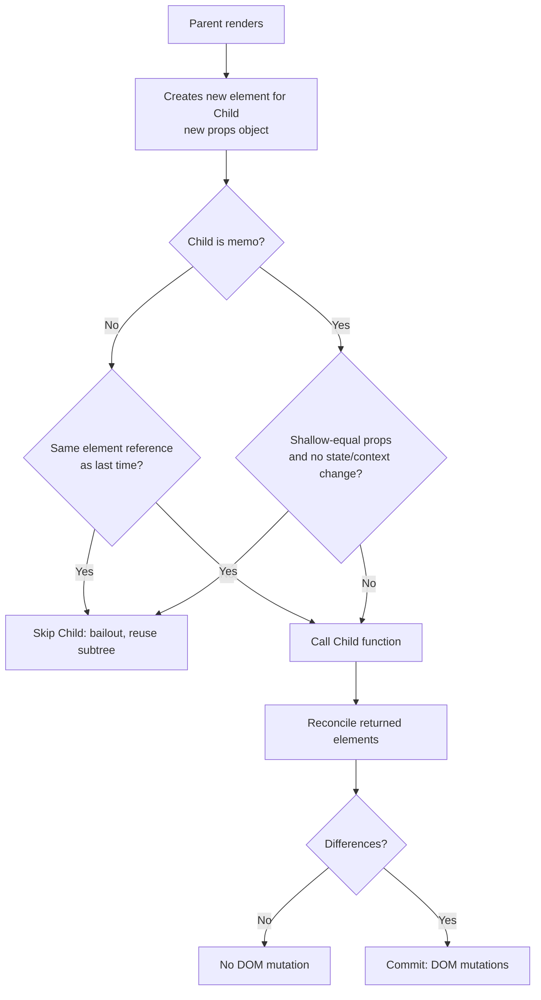
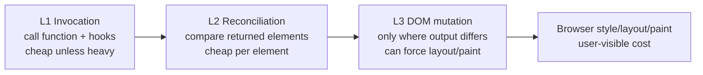
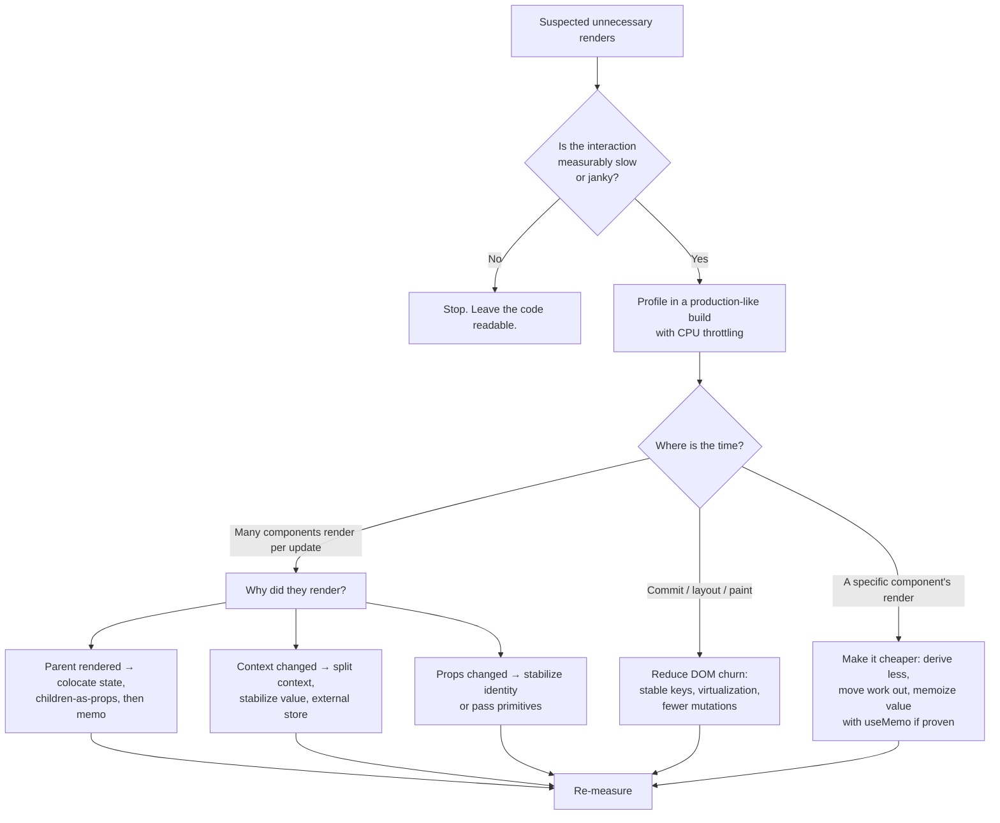

# 02 / 29 — Reasoning About Unnecessary Renders

## 1. Lesson metadata

| | |
|---|---|
| **Level** | Advanced |
| **Study time** | 4–5 hours (reading 2 h, experiments 1.25 h, exercises 1.5 h) |
| **Prerequisites** | [01 — What triggers a render](./01-what-triggers-a-render.md), [02 — Render, reconcile, commit, paint](./02-render-reconcile-commit-paint.md), [06 — Reconciliation fundamentals](./06-reconciliation-fundamentals.md), [11 — Render phase vs commit phase](./11-render-phase-and-commit-phase.md), [12 — Why rendering must be pure](./12-why-rendering-must-be-pure.md), [28 — Strict Mode behavior](./28-strict-mode-behavior.md), [01/15 — Update queues and batching](../01-react-fundamentals/15-update-queues-and-batching.md) |
| **Next** | [30 — DevTools Profiler](./30-react-devtools-profiler.md) |
| **Related** | [32 — Scenario A](./32-scenario-a-parent-rerender.md), [03/12 — `React.memo`](../03-react-state-and-hooks/12-react-memo.md), [03/18 — State colocation and lifting](../03-react-state-and-hooks/18-state-colocation-and-lifting.md), [07/03 — Why components rerender](../07-performance/03-why-components-rerender.md), [07/04 — Memoization trade-offs](../07-performance/04-memoization-trade-offs.md) |

**Learning objectives.** After this lesson you can:
1. Define "unnecessary render" precisely, and separate three different things people conflate: *a component function was called*, *the reconciler found something to change*, and *the DOM was mutated*.
2. Enumerate every mechanism that can cause a component function to be called, and say which of them are avoidable.
3. Explain the bailout mechanisms React provides (same-state bailout, same-element bailout, `memo`, context value comparison) and their documented caveats.
4. Apply a decision procedure — measure, attribute, classify, fix structurally, memoize last — instead of reflexively wrapping components in `memo`.
5. Distinguish a *harmless* extra render from a *harmful* one (expensive render, expensive commit, render that causes effects or network traffic, render that loses state).
6. Instrument a component to find out *why* it rendered, without breaking the purity rules.

**Concepts covered:** render vs commit cost, default re-render of children, referential equality of props, element identity bailout, `Object.is` state bailout, `memo`, context-triggered renders, render triggers taxonomy, "render is not a DOM update", structural fixes (colocation, children-as-props), measurement-first optimization, React Compiler as a mitigating factor, render counters, `<Profiler>`.

---

## 2. Deep conceptual explanation

### 2.1 What problem is this lesson solving?

Every React developer eventually watches `console.log("render Foo")` fire when "nothing changed" and concludes that something is wrong. Two opposite failure modes follow:

- **Under-reaction**: ignoring a genuine problem because "React is fast" — a 40 ms component re-rendering on every keystroke in an unrelated field.
- **Over-reaction**: wrapping every component in `memo`, every callback in `useCallback`, every object in `useMemo`; code gets harder to read, bugs appear (stale closures, wrong dependency arrays), and the measured speed-up is zero because the work being skipped was microseconds.

This lesson gives you the vocabulary and the decision procedure to avoid both. It is the conceptual bridge between the mechanics of Lessons 01–28 and the tooling of [Lesson 30](./30-react-devtools-profiler.md) and the performance phase.

### 2.2 Three different meanings of "render"

When someone says "this component re-rendered unnecessarily," they could mean any of three events. They have wildly different costs.

| Level | Event | Where it happens | Typical cost | Visible to the user? |
|---|---|---|---|---|
| **L1 — Invocation** | React called your component function (and any hooks inside it). | Render phase | Proportional to the work *your function does* plus allocation of new elements/props. | No |
| **L2 — Reconciliation** | React compared the returned elements with the previous fibers and found *differences* (flags such as placement/update/deletion). | End of render phase | Proportional to the number of elements returned and children compared. | No |
| **L3 — DOM mutation** | The commit applied those differences to the DOM (text node update, attribute set, insert, remove). | Commit phase | Proportional to the number of mutations, plus the browser's subsequent style/layout/paint. | Yes, if the pixels change |

The official terminology ([Render and commit](https://react.dev/learn/render-and-commit)) uses "rendering" for L1 (+L2) and "committing" for L3. A component that renders but produces the same output costs L1 + (cheap) L2 and **zero** L3: React does not touch the DOM. The react.dev page states that React only changes DOM nodes if there is a difference between renders.

> **The core principle of this lesson.** An "unnecessary render" is an L1 that produced no L3. It is *wasted work*, but *wasted work is only a problem if it is expensive or has side effects*. Most are neither.

### 2.3 Why React re-renders children by default

By default, **when a component renders, React renders all components it returns, recursively**. This is documented in the React docs ([`memo`](https://react.dev/reference/react/memo) and the "Render and commit" page: "React re-renders a component when its parent re-renders"). The reason is a deliberate design choice:

1. Props are *arbitrary JavaScript values*. React cannot know whether `{ items }` changed in a way you care about without comparing; comparison itself costs, and deep comparison of arbitrary data is unbounded.
2. A child may read mutable external things (a module variable, a `ref.current`, a context) — React cannot see those reads statically. Skipping by default would produce *stale UI bugs*, which are worse than extra work.
3. Rendering is designed to be cheap and pure ([12](./12-why-rendering-must-be-pure.md)): calling a function that returns a few objects is cheap in modern engines. The expensive parts (DOM writes) are guarded by the diff.

So React's default is **correctness first, skip-on-request**. The skip requests are `memo`, same-element bailout, and the Compiler's automatic memoization.

### 2.4 The complete list of reasons a component function is called

A component function can be invoked for exactly these reasons (conceptual taxonomy — the docs describe each separately):

| # | Reason | Avoidable? | Typical remedy |
|---|---|---|---|
| 1 | **First mount** (or remount after key/type change, or parent was conditionally absent) | No — it is the first render | Avoid unintended remounts (key/type instability) |
| 2 | **Its own state changed** (`useState`/`useReducer` setter with a different value) | No, by definition necessary — *unless state is held too high* | Colocate state; derive instead of store |
| 3 | **Its parent rendered** and returned a new element for it | Yes, via bailouts | `memo`, children-as-props, move state down |
| 4 | **A context it reads changed** (`useContext`, `use(Context)`) | Partially: only when the provider `value` is not `Object.is`-equal | Stabilize provider values; split contexts; selectors via external store |
| 5 | **A store it subscribes to changed** (`useSyncExternalStore`) | Partially | Select narrower slices; `Object.is`-stable snapshots |
| 6 | **A hook it uses scheduled an update** (e.g. a custom hook calling `setState` in an effect, a data-fetching hook) | Depends | Fix the hook's update frequency |
| 7 | **A higher-priority update restarted/re-did the render** (concurrent restarts, transitions interrupted) | Not under your control | Understand it; don't count renders as semantics |
| 8 | **Dev-only double invocation** under Strict Mode ([28](./28-strict-mode-behavior.md)) | Not a production cost | Count commits, not logs |
| 9 | **Suspense retry** after a thenable resolves | No | — |
| 10 | **Render-phase update** (calling own `setState` during render) | Usually a smell | Derive during render, or use `key` |

Reasons 1, 2, 7, 8, 9 are not "unnecessary". Reasons 3, 4, 5 are where *real* avoidable renders live. Notice that **case 3 is by far the most common** and is also the one where React's *default* behavior surprises people most.

### 2.5 The mental model: "props identity is the unit of change"

A parent that renders produces *new element objects* for every JSX expression it evaluates. Even `<Child label="static" />` allocates a new element with a new `props` object on every parent render, because JSX compiles to a function call (`jsx(Child, { label: "static" })`) that runs every time ([`05-jsx-explained`](../01-react-fundamentals/05-jsx-explained.md)). The *contents* of `props` are equal; the *identity* of the object is new.

React's internal "did anything change?" check for a function component (teaching model) looks first at **identity of the props object** (plus pending state/context work). If the props object is the same reference and the component has no pending work of its own, React can skip the component and reuse its subtree. `memo` *replaces* that identity check with a **shallow comparison of each prop** (by default `Object.is` per prop), so a new props object with identical field values also skips.



### 2.6 Documented bailouts

**1. Same-state bailout.** `setState(x)` where `x` is `Object.is`-equal to the current state: React "will skip re-rendering the component and its children" ([`useState` reference](https://react.dev/reference/react/useState), "Caveats"). The docs add a nuance worth remembering: React *may still need to call your component once more before bailing out*, but will not go deeper into the tree and will not commit changes. Practical consequence: a `console.log` in the component can fire once after a "no-op" `setState`, and that is not a bug. Executed on react 19.3.1 (jsdom, `act`): `setState(sameValue)` on a freshly mounted component called nothing; after a *real* update, a later `setState(sameValue)` called the component function once more (`P render n=1`) and did **not** render its child or commit; a further identical `setState` called nothing. The exact conditions (eager bailout before scheduling) are an implementation detail; treat "at most one extra call, no child renders, no DOM work" as the guarantee.

**2. Same-element bailout (the `children` trick).** If a parent receives `children` (elements created by an *ancestor* that is not re-rendering), those child elements keep identical identity across the parent's re-renders, so React can skip them even without `memo`. This is the basis of the "move content up / pass as children" structural fix — see [Scenario A](./32-scenario-a-parent-rerender.md). This is a consequence of how elements and props work, not a named public API; it is widely relied on and described in react.dev's guidance on [`memo`](https://react.dev/reference/react/memo) and in community material, so treat it as dependable but not as a formal guarantee.

**3. `memo(Component, arePropsEqual?)`.** Documented skip based on shallow prop comparison. Caveats the docs state: it is a *performance optimization*, not a semantic guarantee — React may still re-render a memoized component if it needs to; a memoized component still re-renders when its **own state** or a **context it consumes** changes.

**4. Context value comparison.** All consumers of a context re-render when the provider's `value` changes by `Object.is`. Consumers are *not* skipped by `memo` on intermediate components — the context change propagates to the consumer itself ([`useContext`](https://react.dev/reference/react/useContext)). A provider that creates `value={{ a, b }}` inline gives a new object on every provider render, so every consumer re-renders every time the provider's parent renders.

**5. React Compiler.** The React Compiler is a build-time tool that automatically memoizes values and components so that many manual `memo`/`useMemo`/`useCallback` calls become unnecessary. It does not change *semantics* (it relies on the rules of React being followed). As of 2026-10-22 `babel-plugin-react-compiler` is at 1.0.0 on npm (dist-tag `latest`) and react.dev has a [React Compiler](https://react.dev/learn/react-compiler) section; configuration and coverage still evolve between releases, so check the docs for your version. See [react.dev/learn/react-compiler](https://react.dev/learn/react-compiler) and the Phase 9 lesson on the compiler. The conclusion for this lesson: *write code that follows the rules (pure render, immutable updates); the Compiler can only help code that does.*

### 2.7 Why most extra renders do not matter

An L1 invocation costs roughly: calling a function, allocating a few objects, running hooks (reading memoized state), reconciling returned elements. For a typical presentational component this is microseconds. For a screen of a few hundred small components it is typically single-digit milliseconds, comfortably within a 16 ms frame budget ([00/01 §2.5](../00-web-and-javascript-foundations/01-how-the-browser-works.md)). An L1 becomes a problem when at least one of the following holds:

| Condition | Why it is harmful |
|---|---|
| **The render function does heavy synchronous work** (sorting 10⁴ items, parsing, formatting a big table) | Blocks the main thread inside the render phase; delays input handling and paint |
| **It renders very many children** (a table with thousands of rows, no virtualization) | L1 and L2 scale with elements returned, even if no DOM changes |
| **It happens at high frequency** (every keystroke, mousemove, scroll, animation frame, WebSocket tick) | Small cost × high rate = a saturated main thread |
| **The re-render has side effects** through badly written code (effect without dependencies, request in render) | Unnecessary network traffic or state loss |
| **It produces L3 churn** (unstable keys, replaced subtrees, changing `key`) | DOM destroyed and recreated; focus/scroll/state lost; layout and paint cost |
| **Dev vs production gap is misread** | Dev builds are slower and Strict Mode doubles invocations; measuring in dev exaggerates |

Rule of thumb for this curriculum: **optimize L3 churn first (correctness + user-visible cost), then expensive L1, then frequency, and only then count renders.**

### 2.8 Misconceptions

| Misconception | Reality |
|---|---|
| "A re-render updates the DOM." | Re-render calls your function and diffs. DOM changes only where the result differs ([Scenario B](./33-scenario-b-text-update.md)). |
| "Every re-render is a performance bug." | Re-rendering is the normal update mechanism. The question is cost × frequency. |
| "`memo` makes a component never re-render." | It skips when props are shallow-equal. State, context, and parent-supplied new references still trigger it. |
| "`useCallback`/`useMemo` everywhere is free insurance." | They cost memory, comparisons, and code clarity; they help only when the memoized value is consumed by something that compares identity ([03/11](../03-react-state-and-hooks/11-usememo-and-usecallback.md)). |
| "If the log shows twice, React rendered twice in production." | Under Strict Mode dev only ([28](./28-strict-mode-behavior.md)). |
| "Calling `setState` with the same value is harmless and free." | Cheap, not free: one extra component call is allowed, and for *objects* a new reference is *not equal*, so it re-renders. |
| "State inside a memoized parent protects the children." | Children inside a re-rendering parent re-render unless they or their elements are stable. |
| "A render counter tells me how many times the screen updated." | It tells you how many times a function ran. Count **commits** to count screen updates. |

---

## 3. Internal mechanics

### 3.1 Public guarantee vs teaching model vs implementation detail

| Aspect | Status |
|---|---|
| Children re-render when the parent renders (unless memoized/stable) | **Public guarantee** (documented default) |
| `memo` skips on shallow-equal props; may still re-render for state/context | **Public guarantee** |
| React only mutates DOM nodes where output differs | **Public guarantee** (docs: "React only changes the DOM if there is a difference between renders") |
| Same-state bailout skips children and DOM work; may call component once more | **Public guarantee** (docs wording) |
| Same-element reference lets React skip a subtree | **Teaching model**, derived from how fibers and `props` identity work; dependable in practice |
| Specific functions that perform the checks (`beginWork`-time comparisons, flags such as "did receive update") | **Implementation detail** — see [31](./31-reading-react-source.md), check the source |
| Eager state computation to avoid scheduling at all | **Implementation detail**, varies by version |

### 3.2 How a bailout works conceptually

During the render phase, React walks the work-in-progress tree ([09](./09-fiber-nodes-and-units-of-work.md), [10](./10-current-and-work-in-progress-trees.md)). For each fiber it asks (conceptually):

1. Did this fiber's **props object** change identity? (`oldProps !== newProps`)
2. Is there **pending work** on this fiber (state/context update scheduled for the current lanes)?
3. Did a **context** this fiber reads change?
4. (For `memo` fibers) Do the props pass the **comparison function**?

If none apply, React **bails out**: it reuses the previous child fibers (cloning them as work-in-progress if descendants have pending work, or skipping the whole subtree if no descendant has pending work). The second case matters: even when a component bails out, **descendants that scheduled their own state updates still get processed** — React finds them by following "child lanes" bookkeeping on the fiber. This is why a memoized parent does not block a deep child's `setState` from rendering.

The names and layout of these fields (lanes, child lanes, flags) are implementation details; see [14 — Lanes](./14-lanes.md) for the conceptual role.

### 3.3 Why a `memo` boundary costs something

A `memo` component adds a prop comparison on *every* parent render. For a component with 8 props, that is 8 `Object.is` calls — cheap. But:

- If the comparison *usually fails* (a prop is a fresh object each time), you pay the comparison **and** the render: strictly slower than no `memo`.
- If you pass `children` (JSX) to a memoized component, `children` is a new element each parent render, which defeats the memo unless that JSX is itself stable.

### 3.4 Commit-side cost is separate

Even when L1 runs for 500 components and L2 finds 1 difference, commit performs 1 DOM write. This is why "render count" is a poor proxy for "UI cost". Conversely, one component rendering once can cause an enormous commit (thousands of rows inserted) and a long layout/paint. See [20 — Commit and DOM mutation](./20-commit-and-dom-mutation.md) and [21](./21-browser-paint-and-react-updates.md).

---

## 4. Step-by-step execution walkthrough

We trace one click through a tree and annotate where "unnecessary" renders arise and where they are cut off.

```tsx
import { memo, useState, type ReactNode } from "react";

function Layout({ children }: { children: ReactNode }) {
  console.log("render Layout");
  return <main>{children}</main>;
}

function ExpensiveChart({ points }: { points: number[] }) {
  console.log("render ExpensiveChart");
  return <svg data-points={points.length} />;
}

const MemoChart = memo(ExpensiveChart);

function Counter() {
  const [n, setN] = useState(0);
  console.log("render Counter", n);
  return <button onClick={() => setN((x) => x + 1)}>clicked {n}</button>;
}

const POINTS = [1, 2, 3];

export function App() {
  console.log("render App");
  return (
    <Layout>
      <Counter />
      <MemoChart points={POINTS} />
      <ExpensiveChart points={POINTS} />
    </Layout>
  );
}
```

**Predict:** user clicks the button once (no Strict Mode). Which of `Layout`, `Counter`, `MemoChart`, `ExpensiveChart` log?

**Timeline.**

1. **Event.** The click handler runs inside React's event dispatch. `setN(x => x + 1)` enqueues an update on `Counter`'s hook queue and marks `Counter`'s fiber and its ancestors up to the root as having pending work ([15 — update queues and batching](../01-react-fundamentals/15-update-queues-and-batching.md), [22](./22-automatic-batching.md)). The handler returns; React schedules a render at sync/discrete priority ([13](./13-scheduler-and-priorities.md)).
2. **Render phase begins** at the root. Walking down: `App` has **no pending work** and its props (none) are unchanged → bailout; it is **not called**, so `render App` is *not* logged. The same applies to `Layout`: the `Layout` element was created by `App` (not re-run), so its props identity is unchanged and it has no pending work → bailout. Also not logged.
3. React reaches `Counter`: it has pending state → **called**. Logs `render Counter 1`. It returns `<button>` with new props; reconcile compares: children `"clicked "` (same) and `1` (changed from 0).
4. `MemoChart` and `ExpensiveChart` are **siblings** of `Counter`, children of `Layout`'s `children`. Their elements were created by `App`, which did not re-run → identical references → **not called**. (So `memo` on `MemoChart` was not even needed in this tree: the structure already protects it.)
5. **Complete phase** marks a text update on the second text node of the button.
6. **Commit** performs one DOM write: the text node's data changes from `"0"` to `"1"`.

**Answer:** only `render Counter 1` logs. This is the *structural* solution: state lives in a small leaf; everything else is elements created higher up.

Now move the state *up* into `App` (the common beginner design) and see the difference:

```tsx
export function App() {
  const [n, setN] = useState(0);
  console.log("render App", n);
  return (
    <Layout>
      <button onClick={() => setN((x) => x + 1)}>clicked {n}</button>
      <MemoChart points={POINTS} />
      <ExpensiveChart points={POINTS} />
    </Layout>
  );
}
```

Click → `App` renders (state changed), creating *new* elements for `Layout`, the button, `MemoChart`, `ExpensiveChart`. Therefore:

- `render App 1` — logged (own state).
- `render Layout` — logged (new element, new `children`; `Layout` is not memoized).
- `MemoChart` — **skipped** (`points` is the same module-level array → shallow-equal).
- `render ExpensiveChart` — logged (not memoized).
- Commit: 1 DOM write (the button's text). **L3 is identical to the previous design** even though L1 count rose from 1 to 3.

The second design is not a "bug"; it only becomes a problem when `Layout` or `ExpensiveChart` is genuinely expensive or `App`'s state changes at high frequency.

---

## 5. Code examples

### 5.1 Minimal: observe a default child re-render

```tsx
import { useState } from "react";

function Child() {
  console.log("render Child");
  return <p>I never change.</p>;
}

export function Parent() {
  const [n, setN] = useState(0);
  return (
    <>
      <button onClick={() => setN(n + 1)}>{n}</button>
      <Child />
    </>
  );
}
```

**Predict:** click twice. How many `render Child` lines?

**Result:** 2 (plus the mount: 3 total, 6 in dev with Strict Mode). `Child` receives no props and renders nothing different, yet it is called each time because `<Child />` is a new element each `Parent` render. The DOM `<p>` is never touched ([Scenario A](./32-scenario-a-parent-rerender.md) proves this with a `MutationObserver`).

### 5.2 Instrumentation: count commits, not logs

A render counter that increments *in the render body* is impure (it mutates a ref during render, [12](./12-why-rendering-must-be-pure.md)) and double-counts under Strict Mode. Acceptable for a throwaway debugging session; here are two honest variants.

```tsx
import { Profiler, useEffect, useRef, type ProfilerOnRenderCallback, type ReactNode } from "react";

// (a) Count COMMITS that included this component (effect without deps runs after every commit it participated in).
export function useCommitCount(label: string): void {
  const count = useRef(0);
  useEffect(() => {
    count.current += 1;
    console.log(`[commit] ${label} #${count.current}`);
  }); // no deps array on purpose: runs after each commit where this component rendered
}

// (b) Count commits inside a subtree using <Profiler>. Does not rely on effects.
const onRender: ProfilerOnRenderCallback = (id, phase, actualDuration, baseDuration) => {
  console.log(
    `[profiler] ${id} ${phase} actual=${actualDuration.toFixed(2)}ms base=${baseDuration.toFixed(2)}ms`,
  );
};

export function Measured({ id, children }: { id: string; children: ReactNode }) {
  return (
    <Profiler id={id} onRender={onRender}>
      {children}
    </Profiler>
  );
}
```

Line notes:
- `useEffect` with **no dependency array** runs after every commit in which *this component rendered*. Under Strict Mode in dev, effects are additionally double-invoked **on mount only**, so the first commit appears twice; later updates do not.
- `<Profiler onRender>` fires once per commit in which the Profiler or its subtree rendered (it also fires when its parent re-rendered the Profiler element while all descendants bailed out, with `actualDuration` near 0; checked on 19.3.1), receiving `phase` (`"mount" | "update" | "nested-update"`), `actualDuration` (time spent rendering this commit's changes in the subtree), and `baseDuration` (estimated time to render the whole subtree without memoization). Profiling adds overhead and, in production, requires a profiling build ([30](./30-react-devtools-profiler.md)). The callback signature in React 19.3 is `onRender(id, phase, actualDuration, baseDuration, startTime, commitTime)` (checked in the [`Profiler` reference](https://react.dev/reference/react/Profiler) on 2026-10-22; a mount-then-update run on 19.3.1 reported phases `mount` then `update`).

### 5.3 Practical: why the "memoized" list item still re-renders

```tsx
import { memo, useCallback, useState } from "react";

type Todo = { id: string; title: string; done: boolean };

const TodoRow = memo(function TodoRow({
  todo,
  onToggle,
}: {
  todo: Todo;
  onToggle: (id: string) => void;
}) {
  console.log("render row", todo.id);
  return (
    <li>
      <label>
        <input type="checkbox" checked={todo.done} onChange={() => onToggle(todo.id)} />
        {todo.title}
      </label>
    </li>
  );
});

export function TodoList({ initial }: { initial: Todo[] }) {
  const [todos, setTodos] = useState(initial);
  const [filter, setFilter] = useState("");

  // ❌ New function every render => memo on TodoRow is defeated
  // const toggle = (id: string) => setTodos(ts => ts.map(t => t.id === id ? { ...t, done: !t.done } : t));

  // ✅ Stable identity; functional update means no dependency on `todos`
  const toggle = useCallback((id: string) => {
    setTodos((ts) => ts.map((t) => (t.id === id ? { ...t, done: !t.done } : t)));
  }, []);

  const visible = todos.filter((t) => t.title.includes(filter));

  return (
    <>
      <input value={filter} onChange={(e) => setFilter(e.target.value)} />
      <ul>
        {visible.map((t) => (
          <TodoRow key={t.id} todo={t} onToggle={toggle} />
        ))}
      </ul>
    </>
  );
}
```

**Predict:** with 100 todos, typing one character into the filter that does not change `visible`: how many row renders? Toggle one todo: how many?

**Result:** Typing: `TodoList` renders; each `TodoRow` gets props `{ todo, onToggle }`; `todo` objects are the same references (immutable state), `toggle` is stable → **0 row renders**. Toggling one: the updater creates a new object only for the toggled todo; the other 99 keep identity → **1 row render**. Remove `useCallback` and **all 100** render on every keystroke even though they are wrapped in `memo`, because `onToggle` is a new function each time. This is the *only* situation where `useCallback` earns its place: feeding a memoized child ([03/11](../03-react-state-and-hooks/11-usememo-and-usecallback.md)).

### 5.4 Incorrect: memoizing while handing unstable props

```tsx
const Chart = memo(function Chart({ options }: { options: { color: string } }) {
  /* ... */
  return null;
});

function Dashboard({ color }: { color: string }) {
  return <Chart options={{ color }} />; // ❌ new object every render → memo never skips
}
```

**Why wrong:** `options` is a new object each render; shallow comparison fails by `Object.is`. **Fix options:** (1) pass primitives: `<Chart color={color} />`; (2) `useMemo(() => ({ color }), [color])` if the object shape is required; (3) provide a custom `arePropsEqual` — but that is a smell: it moves a correctness decision (stale props) into a comparison function.

### 5.5 Corrected structural fix: lift content, not memoization

```tsx
import { useState, type ReactNode } from "react";

function ColorPicker({ children }: { children: ReactNode }) {
  const [color, setColor] = useState("tomato");
  return (
    <div style={{ color }}>
      <input value={color} onChange={(e) => setColor(e.target.value)} />
      {children}
    </div>
  );
}

function SlowTree() {
  // pretend: renders thousands of nodes
  return <section>…</section>;
}

export function Page() {
  return (
    <ColorPicker>
      <SlowTree />
    </ColorPicker>
  );
}
```

Typing in the input re-renders `ColorPicker` only. `SlowTree`'s element is created in `Page`, which does not re-run, so its identity is stable and React skips it. No `memo`, no hooks, no dependency arrays. This pattern is the first thing to try; its limit is that it requires a composition-friendly tree.

### 5.6 Advanced: the same-state bailout and objects

```tsx
function Toggle() {
  const [state, setState] = useState({ on: false });
  console.log("render Toggle", state.on);
  return (
    <>
      <button onClick={() => setState({ on: false })}>set same shape</button>
      <button onClick={() => setState((s) => s)}>set same reference</button>
    </>
  );
}
```

**Predict:** click each button repeatedly (production build, no Strict Mode).

**Result:** "set same shape" creates a **new object** each time → `Object.is` is false → re-render each click. "set same reference" returns the identical object → bailout: at most one extra call right after the first no-op click (per the docs' caveat), then no further renders and no child work. Lesson: immutable updates must be *value-aware* when you want bailouts, e.g. `setState(s => s.on === next ? s : { ...s, on: next })`.

### 5.7 A dev-only "why did you render" helper (and its limits)

```tsx
import { useRef } from "react";

export function useWhyDidRender(name: string, props: Record<string, unknown>): void {
  const prev = useRef<Record<string, unknown> | null>(null);
  if (process.env.NODE_ENV !== "production") {
    const before = prev.current;
    if (before) {
      const changed = Object.keys({ ...before, ...props }).filter(
        (k) => !Object.is(before[k], props[k]),
      );
      if (changed.length > 0) console.log(`[why] ${name} props changed:`, changed);
      else console.log(`[why] ${name} rendered with identical props (parent/state/context)`);
    }
    prev.current = props; // mutating a ref during render breaks the rules of React: dev diagnostics only
  }
}
```

Line notes: it compares props with `Object.is`, the same primitive `memo` uses. The final `prev.current = props` write during render is **impure** and wrong under concurrent rendering (a discarded render updates `prev`); under Strict Mode the second invocation will always report "identical props". Use it only to explore; prefer the DevTools "Why did this render?" panel ([30](./30-react-devtools-profiler.md)), which reads React's own bookkeeping.

---

## 6. Visual explanations

### 6.1 Render cost ladder



### 6.2 Decision procedure



### 6.3 Where bailout cuts the tree

```text
App (state changed → renders)
├── Layout (new element → renders; not memoized)
│   ├── Button (new element → renders)
│   ├── MemoChart (memo, shallow-equal props → SKIPPED)  ← subtree not visited
│   │     └── Axis, Series, ... (not rendered)
│   └── ExpensiveChart (not memoized → renders, and so do its children)
```

---

## 7. Alternative approaches and trade-offs

| Approach | Readability | Runtime cost | Correctness risk | Skips what | Notes |
|---|---|---|---|---|---|
| **Do nothing** | Best | Extra L1 only | None | Nothing | Correct default; right when renders are cheap/infrequent |
| **Colocate state (push down)** | Good | Lowest | None | Siblings and unrelated trees | First choice; structural, no comparisons |
| **Lift content up / `children` prop** | Good | Lowest | None | Child subtree | Needs composition-friendly API |
| **`memo`** | Medium | Prop comparison each parent render | Stale-UI if custom comparator wrong | Component and subtree | Requires stable props |
| **`useMemo` for values** | Medium | Memory + deps comparison | Stale value if deps wrong | Recomputation | Helps with expensive computation *and* with identity for memo children |
| **`useCallback`** | Lower | Same | Stale closure bugs | Function identity churn | Only matters when a consumer compares identity |
| **Split context / selector store** | Medium | Architecture cost | Low | Consumer re-renders | See [03/13](../03-react-state-and-hooks/13-usecontext-and-propagation.md), [03/20](../03-react-state-and-hooks/20-usesyncexternalstore-and-external-stores.md) |
| **Virtualize large lists** | Medium | Complexity | Accessibility/scroll edge cases | L1/L2/L3 for off-screen rows | The right fix when the *count* is the problem |
| **Defer with transitions** | Good | Low | Staleness is visible | Blocking of urgent input | Does not reduce total work; reprioritizes it ([23](./23-transitions-and-deferred-rendering.md)) |
| **React Compiler** | Best (automatic) | Build-time | Needs rule-abiding code | Many re-renders automatically | Check coverage/version; not a substitute for good structure |

**Where the recommended approach (structural fix first) is NOT best.** In a design-system `DataGrid` that receives a large `rows` array as a prop from an app you don't control, you *cannot* restructure the parent. Memoizing `Row` with a custom stable-keyed `rows` contract (rows are immutable, identity-stable objects) is the right defense. Similarly, a global store with hundreds of subscribers needs selector-based subscriptions, not state colocation, because the state is genuinely shared.

---

## 8. Best practices and anti-patterns

### 8.1 Practices

1. **Measure first.** A render log is a hypothesis generator, not evidence of a problem ([30](./30-react-devtools-profiler.md); Phase 7 [01](../07-performance/01-measure-before-optimizing.md)).
2. **Prefer structure over memoization.** Colocate state; split components by update frequency; pass content via `children`.
3. **Keep data immutable and identity-stable** so `memo`, `Object.is` bailouts, and the Compiler can work.
4. **Pass primitives** to memoized children when possible.
5. **Memoize at boundaries that matter**: heavy subtrees, list rows in big lists, context values.
6. **Test render-critical behavior** in the profiling build with CPU throttling, not in dev.

### 8.2 Beginner mistakes

- Treating `console.log("render")` as an error indicator.
- Wrapping everything in `memo` and `useCallback` "just in case".
- Believing `useCallback` prevents the *parent's* re-render.
- Storing derived data in state (extra renders and desync) instead of computing it ([03/17](../03-react-state-and-hooks/17-derived-state.md)).

### 8.3 Experienced-developer mistakes

- Memoizing a component but passing a fresh `children`, array literal, or inline style object.
- Custom `arePropsEqual` that ignores a callback prop → stale closures.
- Putting a frequently changing value (mouse position, input text) in a context consumed by hundreds of components.
- "Fixing" renders by lifting state *higher* so it's "shared", which increases the blast radius.
- Optimizing renders while an unvirtualized 5,000-row table is the real cost.

### 8.4 Smells

| Smell | Likely issue |
|---|---|
| `memo` + `useCallback` + `useMemo` on trivial leaf components | Cargo cult; remove and measure |
| Components receiving 15+ props | Too coarse; split or compose |
| `JSON.stringify` / deep equality in `arePropsEqual` | Costs more than the render it avoids |
| Context value created inline | Re-renders all consumers on each provider render |
| Render body writes to refs/globals | Impure; breaks concurrent/Strict Mode semantics |

### 8.5 Justified exceptions

- A memoized row in a 10,000-row virtualized table is justified even if each render is "only" 0.05 ms, because the rate × count is high.
- A custom comparator is justified for immutable-by-contract data with an explicit version field (`prev.rev === next.rev`).
- Reading `ref.current` during render to dedupe a *dev-only diagnostic* is acceptable as long as it is excluded from production paths.

---

## 9. Real-world application

| Domain | Where unnecessary renders appear | Engineering constraint | Typical resolution |
|---|---|---|---|
| **E-commerce product list** | Filter input state in the page re-renders 200 product cards on each keystroke | INP target on mid-range mobile | Debounce/deferred value for the filter, `memo` on `ProductCard` with stable primitive props, or colocate the input |
| **Dashboard** | WebSocket ticks at 10 Hz update a store that feeds 50 widgets | Main thread must stay free for scroll/click | Per-widget selectors; batch ticks (requestAnimationFrame/transition); keep ticks out of React state where possible |
| **Finance grid** | Cell edit re-renders the entire grid | Correctness (no stale totals) and 60 fps scroll | Immutable row objects, `memo` rows, virtualization; totals derived with `useMemo` |
| **Forms** | One field's keystroke re-renders a 60-field form | Typing latency | Uncontrolled fields or per-field state; form libraries subscribe per field ([03/21](../03-react-state-and-hooks/21-forms-and-complex-state.md)) |
| **Auth** | `AuthContext` value `{ user, login, logout }` created inline re-renders every consumer on any app re-render | Hundreds of consumers | Stabilize with `useMemo`/`useCallback`, or split state and actions into two contexts |
| **Real-time chat** | New message re-renders the whole list | Scroll position and focus preservation | Stable message ids as keys; `memo` message rows; windowing |
| **Multi-team micro-frontends** | Shared design-system components get inline-object props from product code | Cannot change callers | Design-system components defensively memoized or documented with identity contracts |

---

## 10. Debugging and troubleshooting

### 10.1 Symptom: "My component renders twice on every update"

**Check 1: Strict Mode?** In dev, component bodies are invoked twice ([28](./28-strict-mode-behavior.md)). Build for production or compare Profiler commit counts: if the *commit* count is 1 per interaction, it is Strict Mode.

**Check 2: Two state updates in separate ticks?** An effect that calls `setState` after the first commit produces a second commit ([18](./18-effects-and-their-timing.md)). The Profiler shows two commits.

**Check 3: A context or store changed twice** (e.g. a `loading` flag and then `data`)? Two commits again.

### 10.2 Symptom: "My memoized component re-renders anyway"

1. Open DevTools → Profiler → enable **Record why each component rendered while profiling** ([30](./30-react-devtools-profiler.md)).
2. Interact, stop recording, select the component. The panel reports **Props changed: (names)**, **State changed**, **Hooks changed**, **Context changed**, or **The parent component rendered**.
3. If "Props changed: onToggle" — a function identity problem. If "Props changed: options" — an object literal. If "Context changed" — memo cannot help; fix the provider.
4. Apply the fix; re-profile and confirm the component is grey (did not render) in that commit.

### 10.3 Symptom: "Typing is laggy"

Profile one keystroke. If the flamegraph shows a wide yellow bar for a component unrelated to the input, the input's state is too high or a context is too broad. If the render bars are narrow but the commit is long, the problem is DOM size, not renders.

### 10.4 Validating the fix

A fix is validated by (1) a **before/after Profiler recording** under identical interaction and throttling, (2) **commit duration** and component actual durations, (3) **no regression in correctness** (the child still updates when it should — add a test that changes the prop and asserts the DOM).

---

## 11. Exercises

### Level A — Knowledge
A1. Distinguish L1, L2, L3 in one sentence each, with the cost driver of each.
A2. List five reasons a component function can be invoked. Which are never "unnecessary"?
A3. Why does React re-render children by default instead of comparing props automatically?
A4. State what `memo` compares and what it does not protect against.
A5. What does the React docs say about calling `setState` with the same value?

### Level B — Code comprehension
B1. Given `function P(){const[a,setA]=useState(0);return <><button onClick={()=>setA(a+1)}/><C/></>}` where `C = memo(function C(){…})` takes no props. Does `C` render on click? Explain.
B2. In §5.3, if `onToggle` were defined with `useCallback(..., [todos])`, what changes for row renders when toggling one todo?
B3. Predict logs (no Strict Mode): `function A(){ const [n,setN]=useState(0); return <B n={n} fixed={{x:1}}/> }` with `B = memo(...)`; click increments `n`. How many `B` renders per click, and what if `fixed` is removed?
B4. Under what circumstances will `<Provider value={{ user }}>` cause consumers to re-render even when `user` is unchanged?

### Level C — Implementation
C1. Write `useStableCallback<T extends (...a: never[]) => unknown>(fn: T): T` that returns a function with a stable identity that always calls the latest `fn`. State one reason this must not be used during render. (Hint: `useEffectEvent`, stable since React 19.2, is the React-supplied variant.)
C2. Refactor the following so that typing in the input does not re-render `HugeReport` and without using `memo`: a component that holds `query` state and renders `<input/>` and `<HugeReport/>` as siblings.
C3. Write a `RenderBoundary` component using `<Profiler>` that logs the number of commits and total `actualDuration` accumulated for its subtree; expose a button to reset counts.

### Level D — Debugging
D1. A `Row` wrapped in `memo` still re-renders on every parent render. The parent passes `style={{ padding: 8 }}`. Diagnose and give three fixes ranked by preference.
D2. After adding `useMemo` to a context value the consumers still re-render on every keystroke in an unrelated input. The provider is higher in the tree than the input's state. What are the two candidate causes?
D3. A teammate claims "the component renders 4 times per click in production." The Profiler shows 1 commit per click. What else could produce 4 logs?

### Level E — Architecture and engineering decisions
E1. Your team debates adopting "memoize everything" as a lint rule. Argue for and against with criteria: readability, runtime cost, correctness risk, onboarding, compatibility with the React Compiler.
E2. A product page has a search box, a filter sidebar, and a 500-card grid. Propose a state placement and memoization strategy. Include how you would verify it.

### Level F — Expert challenge
F1. Construct a minimal example where wrapping a component in `memo` makes the app **slower** and explain with the L1/L2/L3 model. Quantify the break-even conceptually.
F2. A memoized parent has a deep child that calls its own `setState`. Explain, using the "pending work" model, why that child still re-renders while its siblings and its memoized parent are skipped, and what the parent's props identity has to do with it.

---

## 12. Detailed answers and explanations

> Attempt the exercises first.

**A1.** L1 invocation: React calls the function and its hooks; cost = your code + allocations. L2 reconciliation: React compares returned elements to existing fibers and flags differences; cost scales with elements returned. L3 DOM mutation: commit applies flagged differences to the DOM; cost = number of mutations + subsequent browser style/layout/paint.

**A2.** Reasons: first mount; own state change; parent rendered; context changed; external store changed; concurrent restart; Strict Mode double call; Suspense retry; render-phase update. Never "unnecessary": first mount, own state change (by definition, unless state is mis-placed), Suspense retry. Strict Mode double calls are not a production cost. Truly avoidable: parent-rendered, unstable context value, unstable props.

**A3.** Props can be any value, including mutable objects and functions; correct deep comparison is unbounded and wrong if the child reads context/mutable external state. Default-render is *safe* and cheap; opting out is explicit (`memo`).

**A4.** `memo` shallow-compares props with `Object.is` per prop (or uses a custom comparator). It does not protect against: the component's own state changes, changes in context it reads, and new references in props (objects/arrays/functions/JSX children created each parent render).

**A5.** React skips re-rendering the component and its children if the new state is `Object.is`-equal to the current one; it may still call the component once before bailing out; no DOM/commit work results. For objects/arrays, a new reference is *not* equal.

**B1.** No (after mount). `C` has no props and is memoized; the shallow comparison passes (empty vs empty), no state or context of its own, so React bails out. Without `memo`, `C` would render because `<C/>` is a new element.

**B2.** With `[todos]` as dependency, `toggle` is recreated whenever `todos` changes — which is exactly each toggle. Every row receives a new `onToggle` → all 100 rows re-render on every toggle (the `memo` is defeated for the toggled-change commit, though not for filter typing). The functional-update form lets the dependency array be `[]`.

**B3.** **1 per click in both cases**, because `n` is a prop that really changes on every click; `memo` correctly lets the render through. The `fixed={{x:1}}` literal is a latent defect (it would defeat `memo` even if `n` stopped changing) but is not the cause of the render here. The trap is attributing the render to the wrong prop. If `B` took only `fixed` (no `n`), the literal would cause one render per click, while a hoisted constant would cause none. "Why did this render?" in the Profiler lists *every* changed prop, which is how you tell the cases apart.

**B4.** Whenever the component rendering `<Provider>` re-renders: the object literal is new, `Object.is` fails, and every consumer re-renders, even though `user` is the same. Fix: `useMemo(() => ({ user }), [user])` or provide `user` directly.

**C1.**
```tsx
import { useCallback, useLayoutEffect, useRef } from "react";

export function useStableCallback<A extends unknown[], R>(fn: (...args: A) => R): (...args: A) => R {
  const ref = useRef(fn);
  useLayoutEffect(() => {
    ref.current = fn; // update after commit so concurrent discarded renders can't leak their closure
  });
  return useCallback((...args: A) => ref.current(...args), []);
}
```
Must not be *called* during render: during render, `ref.current` may hold the previous commit's closure (stale), so the result would be inconsistent with the current props/state. It is for event handlers/effects only. This is the same reason React's own variant (`useEffectEvent`) restricts where it can be called.

**C2.** Split state into a small component:
```tsx
function SearchBox({ onChange }: { onChange?: (q: string) => void }) {
  const [query, setQuery] = useState("");
  return <input value={query} onChange={(e) => { setQuery(e.target.value); onChange?.(e.target.value); }} />;
}
export function Page() { return (<><SearchBox /><HugeReport /></>); }
```
If `HugeReport` *needs* `query`, use the children pattern: `<Filtered>{(q) => ...}</Filtered>` won't help (render prop re-executes); instead decide whether `HugeReport` truly depends on every keystroke — use `useDeferredValue`/debounce ([23](./23-transitions-and-deferred-rendering.md)) rather than memoization.

**C3.** Evaluation criteria: uses `<Profiler onRender>`; counters stored in a ref/mutable object (not state, to avoid re-render loops since `onRender` runs during commit); display is updated via a button that reads the ref; reset sets values to 0. Example:
```tsx
import { Profiler, useRef, useState, type ReactNode } from "react";

export function RenderBoundary({ id, children }: { id: string; children: ReactNode }) {
  const stats = useRef({ commits: 0, total: 0 });
  const [, force] = useState(0);
  return (
    <>
      <Profiler
        id={id}
        onRender={(_id, _phase, actual) => {
          stats.current.commits += 1;
          stats.current.total += actual;
        }}
      >
        {children}
      </Profiler>
      <button onClick={() => { console.log(id, stats.current); force((n) => n + 1); }}>log</button>
      <button onClick={() => { stats.current = { commits: 0, total: 0 }; }}>reset</button>
    </>
  );
}
```
Edge: calling `setState` inside `onRender` would trigger another commit and loop.

**D1.** `style={{ padding: 8 }}` is a new object per parent render → shallow comparison fails. Fixes ranked: (1) hoist a constant `const rowStyle = { padding: 8 }` outside the component or use a CSS class (no prop identity issue at all); (2) pass primitives (`padding={8}`) and compute style inside; (3) `useMemo(() => ({ padding }), [padding])` when it depends on a variable. A custom comparator ignoring `style` is the worst — it hides future style changes.

**D2.** (a) The memoized `value` still changes: its dependency array contains something that changes (e.g. includes the keystroke state, or a non-memoized object). (b) The consumers re-render because **their parent** re-renders (the input's state lives above them), not because of context — `memo` on the consumers or moving the input state down is needed. Use the Profiler's "Why did this render?" to distinguish "Context changed" from "The parent component rendered".

**D3.** Dev/Strict Mode double invocation would give 2, not 4. Other candidates: multiple state updates in separate ticks (effects), multiple components each logging, the component rendered in four list instances, StrictMode *and* two commits (2 × 2), or log statements in several hooks. The Profiler commit count (1) means one screen update; the 4 logs are L1 invocations of different components or Strict Mode, not 4 commits.

**E1.** Evaluation criteria: acknowledges costs (comparison per render, memory, stale-closure risk, noise), notes that most components are cheap, that the Compiler automates the safe subset, and that a blanket lint rule encourages cargo cult; for: predictability in a design system with many consumers, perf budgets. A strong answer: do **not** mandate; require measurement evidence in PRs, mandate stable identities at library boundaries (context values, design-system props), and adopt the Compiler if it fits the code base.

**E2.** Example answer: Search text is an input-local state (`SearchBox`), committed to the URL/state container via debounced or deferred value; filter selections in a store (or URL) with selector subscriptions; the grid receives a derived `visibleIds` array and renders `ProductCard` by id with `memo` and primitive props; cards fetch details by id from a normalized cache; virtualize if >~200 cards visible or on low-end targets. Verification: Profiler recording of typing 10 characters (throttled 4×), compare commits and flamegraph before/after, assert in a test that updating a card prop still updates its DOM.

**F1.** Example: `memo(Tiny)` with 12 props, where the parent passes `style={{...}}` and `onClick={() => ...}` each render, rendering `<span>{x}</span>`. Each parent render now performs 12 comparisons that always fail (cost C) *and* the render (cost R). Without `memo`, only R. Break-even: `memo` wins only if the skip probability p satisfies `p·R > C` (expected saved render cost exceeds comparison cost); with p ≈ 0 it is a pure loss. The memo wrapper also adds an extra fiber/bookkeeping per instance. L3 is unchanged in both cases (the span's text updates either way), so no user-visible gain.

**F2.** Pending work on the deep child's fiber marks its ancestors with "child has pending work". During render, a memoized parent whose props are equal and has no own pending work *bails out of rendering itself* but React sees child work pending and **continues into the subtree** (cloning child fibers) until it reaches the fiber with work. Siblings without pending work are skipped. So: the parent function is not called; the path to the updating child is traversed; the child is called. Props identity matters only for the parent's own decision to call its function; it does not gate descendants' independent state updates. Implementation vocabulary (lanes/childLanes) is in [14](./14-lanes.md); trace it in the source ([31](./31-reading-react-source.md)).

---

## 13. Senior engineer interview questions

**Q1. "A component re-renders but nothing on screen changes. Is that a bug?"**
*Strong answer.* Not necessarily. Rendering is invoking the function and reconciling; DOM changes happen only for differences. I would check whether it is expensive or high-frequency by profiling. If it's cheap, leave it; if it's costly, determine the cause (parent render, props identity, context) and fix structurally before memoizing.

**Q2. "When does `memo` not help?"**
*Strong answer.* When props contain fresh references each render (inline objects/functions/JSX children), when the component reads a changing context, when its own state changes, or when the render is trivially cheap so the comparison costs as much as it saves. It also does not stop descendants' own updates.

**Q3. "Explain how moving state down avoids renders without `memo`."**
*Strong answer.* Re-renders propagate downward from the component whose state changed. If state lives in a small component, only it and its returned subtree re-render. Siblings/ancestors never run, and content passed as `children` from above is the same element reference, so React skips it.

**Q4. "How would you prove that a perf fix worked?"**
*Strong answer.* Same scripted interaction, production profiling build, CPU throttling, before/after Profiler recordings; compare commit durations and rendered-component counts for that commit; verify user-facing metric (INP / interaction latency) in the Performance panel; and run tests to prove behavior didn't regress.

**Q5. "Why isn't `useCallback` a performance optimization by itself?"**
*Strong answer.* It only preserves function identity; the benefit exists only if a consumer compares identity (memo child, effect dependency, context value). It adds its own bookkeeping, so alone it is a net cost.

**Q6. "How does the React Compiler change this advice?"**
*Strong answer.* It automates memoization of values/components when code follows the rules of React, so manual `memo`/`useMemo`/`useCallback` are needed less. Structure (colocation, composition), heavy-render work, list size, and commit cost remain my responsibility. I'd check the version and coverage in current docs and look for the compiler badge on components in React DevTools.

---

## 14. Further learning resources

| Resource | URL | Covers / why | Level | Section to study |
|---|---|---|---|---|
| React docs — Render and Commit | <https://react.dev/learn/render-and-commit> | Official trigger/render/commit; "React only changes the DOM if there is a difference" | Beginner–Int. | Whole page |
| React docs — `memo` | <https://react.dev/reference/react/memo> | Skipping re-renders, prop comparison, caveats, when to use | Intermediate | "Skipping re-rendering when props are unchanged", "Caveats" |
| React docs — `useState` | <https://react.dev/reference/react/useState> | Same-state bailout and its caveat | Intermediate | "Caveats" |
| React docs — `useMemo` | <https://react.dev/reference/react/useMemo> | Memoizing values; when it helps | Intermediate | "Usage" |
| React docs — `useCallback` | <https://react.dev/reference/react/useCallback> | Function identity; memo interaction | Intermediate | "Skipping re-rendering of components" |
| React docs — `Profiler` | <https://react.dev/reference/react/Profiler> | `onRender` signature and semantics | Intermediate | Reference + caveats |
| React docs — React Compiler | <https://react.dev/learn/react-compiler> | Automatic memoization (1.0 as of 2026-10-22) | Intermediate | Introduction |
| React docs — Preserving and resetting state | <https://react.dev/learn/preserving-and-resetting-state> | Why identity matters for renders and state | Intermediate | Whole page |
| React repository | <https://github.com/facebook/react> | Source for the bailout logic | Advanced | See [31](./31-reading-react-source.md) |

---

## 15. Knowledge checkpoint

**You should now understand:**
- That "render" has three layers (invocation, reconciliation, DOM mutation) with different costs, and that unnecessary renders are mostly L1-only.
- The full list of causes of invocations and the mechanisms that cut them off.

**You should be able to explain:**
- Why children re-render by default, why `memo` can fail, and why structural fixes beat memoization.
- Why render counts differ between dev and production.

**You should be able to implement:**
- State colocation and the `children` pattern; a `memo` list with stable callback identity; a Profiler-based commit counter.

**You should be able to debug:**
- A "memoized but still re-rendering" component using "Why did this render?" and identity reasoning.

**Prerequisite for next lessons:** [30 — DevTools Profiler](./30-react-devtools-profiler.md) turns the reasoning here into measurable evidence; [32 — Scenario A](./32-scenario-a-parent-rerender.md) applies it to a full timeline.
