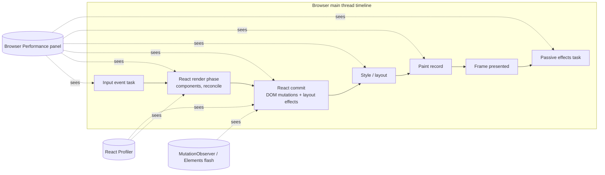
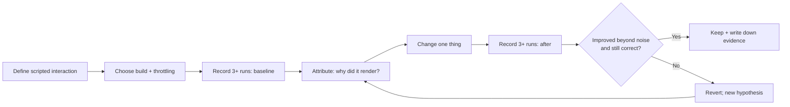

# 02 / 30 — DevTools Profiler

## 1. Lesson metadata

| | |
|---|---|
| **Level** | Advanced |
| **Study time** | 4–5 hours (reading 1.5 h, hands-on 2 h, exercises 1.5 h) |
| **Prerequisites** | [01/18 — React DevTools (basics)](../01-react-fundamentals/18-react-devtools.md), [02 — Render, reconcile, commit, paint](./02-render-reconcile-commit-paint.md), [11 — Render phase vs commit phase](./11-render-phase-and-commit-phase.md), [28 — Strict Mode behavior](./28-strict-mode-behavior.md), [29 — Reasoning about unnecessary renders](./29-reasoning-about-unnecessary-renders.md) |
| **Next** | [31 — Reading React's source code](./31-reading-react-source.md) |
| **Related** | [32](./32-scenario-a-parent-rerender.md), [33](./33-scenario-b-text-update.md), [34](./34-scenario-c-list-reorder.md) (each uses the Profiler as its verification method); [07/02 — Profiler workflows](../07-performance/02-profiler-workflows.md); [00/01 — How the browser works](../00-web-and-javascript-foundations/01-how-the-browser-works.md) |

**Learning objectives.** After this lesson you can:
1. Record and read a React Profiler session: commits, flamegraph, ranked chart, and per-component timings.
2. Explain what **actual duration** and **base duration** measure, and why neither equals "how long the user waited".
3. Turn on and interpret **"Why did this render?"** and **"Highlight updates when components render"**.
4. Distinguish what the React Profiler can see (React render and commit work) from what only the browser Performance panel can see (style, layout, paint, non-React JS, network).
5. Use the `<Profiler>` component for programmatic measurement and know its production caveats.
6. Design a repeatable measure → change → re-measure workflow, including CPU throttling and production-like builds.
7. Avoid the standard measurement errors: profiling dev builds, Strict Mode doubling, one-sample conclusions, and profiler overhead.

**Concepts covered:** React DevTools extension and standalone app, Components vs Profiler tabs, recording, commits, flamegraph, ranked chart, "Why did this render?", render highlighting, `<Profiler>` API, `actualDuration`/`baseDuration`, profiling builds, CPU throttling, Chrome Performance panel complement, DOM mutation observation as ground truth.

> ⚠ **Version-sensitive.** DevTools is a browser extension released separately from React; its labels, settings names, and views change between releases. This lesson describes the stable concepts and the UI as commonly seen at the time of writing. When a label differs on your machine, search the panel's settings for the same idea. Check the [React DevTools docs](https://react.dev/learn/react-developer-tools) and the extension's changelog. (The curriculum baseline is React 19.x; the `onRender` signature, profiling-build aliasing and React Performance tracks below were re-checked against react.dev on 2026-10-22. Browser-extension UI details were **not** executable in this review and are unresolved/UI-version-dependent.)

---

## 2. Deep conceptual explanation

### 2.1 What problem is this lesson solving?

[Lesson 29](./29-reasoning-about-unnecessary-renders.md) said "measure first." This lesson teaches *how*, and just as important, *what the measurements mean*. A profiler is an instrument with a specific field of view; misreading it is the most common cause of wasted optimization work. Examples of the errors this lesson prevents:

- Concluding "this component takes 12 ms" from a dev build with Strict Mode on a fast laptop, then optimizing something that takes 0.4 ms in production on a mid-range phone.
- Seeing a wide bar in the flamegraph and assuming it is the *cause* of jank, when the real cost was the browser's layout after the commit (invisible to the React Profiler).
- Fixing the bar the profiler highlights, rather than the *reason* it re-rendered.

### 2.2 What the Profiler records

The React Profiler (in React DevTools) records **commits**. During a recording session, each time React commits a render to the DOM, the profiler stores, for that commit:

- Which fibers (components) **rendered** in this commit, and which did not.
- For each rendered component: **self time** and **total time** of its render work (its function plus hooks, excluding/including descendants).
- Which **props, state, hooks, or context** changed, if "Record why each component rendered" is enabled.
- The **commit's timestamp and duration** (the time React took to commit).
- Scheduling/priority information in newer views (varies by DevTools version; unverified here).

This is built on a documented React facility: the `<Profiler>` component's `onRender` callback fires after each commit in which the Profiler or something in its subtree rendered. Executed on react 19.3.1: `onRender` also fires when the `<Profiler>` element itself is re-rendered by its parent, even if every descendant bails out (`updateProfiler` in `ReactFiberBeginWork.js` sets the `Update` flag unconditionally; the call reported `actualDuration` of about 0.01 ms for a `memo` child that did not run). DevTools uses an internal, richer mechanism that is only available in development and profiling builds of React ([Profiler reference](https://react.dev/reference/react/Profiler) for the public component API).

**What it cannot see:** anything outside React's own work. Not style recalculation, layout, paint, compositing, image decoding, network, GC pauses outside the commit, or non-React JavaScript (analytics, third-party scripts), except insofar as they extend the time between marks. For these, use the browser's Performance panel ([00/01 §2.5](../00-web-and-javascript-foundations/01-how-the-browser-works.md), [21](./21-browser-paint-and-react-updates.md)).

### 2.3 The two durations

React tracks two numbers per fiber (they back the `<Profiler>` callback's `actualDuration` and `baseDuration`):

| Duration | Meaning | Answers the question |
|---|---|---|
| **Actual duration** | Time spent rendering this subtree **in this commit** (only components that actually rendered contribute; memoized/bailed-out components contribute ~0). | "How expensive was *this update*?" |
| **Base duration** | Estimated time to render the **entire subtree with no memoization**, using the most recent *render time of each component*. | "How expensive *would* a full re-render of this subtree be (worst case)?" |

Reading them together: if `actualDuration` ≪ `baseDuration`, memoization/bailouts are saving a lot of work in this commit. If they are close, almost everything rendered. If `baseDuration` is itself small, it does not matter.

These are wall-clock measurements of JavaScript execution using high-resolution timers; they include profiler overhead in profiling builds and are far larger in development builds (extra checks, warnings, Strict Mode double invocation). *Compare numbers relative to each other under the same conditions; do not quote them as absolutes.*

### 2.4 The views

| View | Shows | Use it to |
|---|---|---|
| **Commit selector** (bar chart across the top) | One bar per commit; height/color by commit duration. Navigate commits with arrows. | Find the expensive commit among many; see whether an interaction caused 1 commit or 5 |
| **Flamegraph** | The component tree for the selected commit. Width ∝ time (total of component + descendants); color encodes relative render cost; **grey** = did not render in this commit | See *which parts of the tree rendered* and where the time was spent; identify skipped (memoized/bailed) subtrees |
| **Ranked** | Same commit, flat list of rendered components sorted by self duration | Find the single most expensive component quickly |
| **Component details** (right pane when a component is selected) | Render duration, "Rendered at" times across commits, and, if enabled, *why* it rendered | Attribute the cause of each render |
| **Timeline** (in newer versions) | React work (scheduling, render, commit, effects, suspense) laid out on a timeline with priorities | Understand scheduling/prioritization and gaps; availability depends on your DevTools version (not verified here) |

Colors: in the flamegraph, a *grey* bar means "this component did not render during this commit" — the single most useful visual for confirming that a bailout/`memo` worked. Colored bars (cool to warm) indicate relative cost of components that did render.

### 2.5 "Why did this render?"

In the Profiler tab's settings (the gear icon), there is an option along the lines of **"Record why each component rendered while profiling."** When enabled *before recording*, the details pane for a rendered component lists a reason, typically one or more of:

| Reported reason | Meaning | Typical next step |
|---|---|---|
| **This is the first time the component rendered** | Mount | Expected |
| **Props changed: …** (with a list of prop names) | At least one prop is not `Object.is`-equal to previous | Check identity: inline object/function? |
| **State changed** / **Hooks changed** (with hook indexes/names) | Own state or hook changed | Is state placed correctly? |
| **Context changed** | A consumed context value changed | Stabilize provider value or split context |
| **The parent component rendered** | The parent rendered and this component is not memoized (or its props changed identity) | Colocate, children-as-props, or memo |

Notes:
- The feature adds overhead and only reports for recordings made with it enabled.
- "The parent component rendered" is the default reason you will see most often; it is not a defect by itself ([29 §2.3](./29-reasoning-about-unnecessary-renders.md)).
- Reasons are derived from comparing previous and next fiber data; they describe *what React saw*, not what you intended.

### 2.6 "Highlight updates when components render"

In the **Components** tab settings (the gear icon), enabling **Highlight updates when components render** draws colored outlines around the DOM nodes of components as they render. It is a fast, qualitative probe ("what lights up when I type in this field?") with caveats:

- It highlights the *host DOM nodes* corresponding to rendered components, not DOM mutations. A component that renders but changes nothing still flashes.
- Rapid updates change the color toward warmer (more frequent) hues; the exact color scheme is a UI detail.
- It does not tell you cost or cause. Use it to *find suspects*, then record in the Profiler.

Compare it with the browser's own **Elements panel**, which briefly highlights DOM nodes whose subtree changed — that is the *ground truth for L3 mutations* ([29 §2.2](./29-reasoning-about-unnecessary-renders.md)). The two flashing systems answer different questions:

| Tool | Flash means |
|---|---|
| React DevTools "Highlight updates" | React **rendered** this component (L1) |
| Elements panel node flash | The browser's DOM **was mutated** here (L3) |

Seeing the first flash without the second is the visual proof of an L1-without-L3 render ([Scenario A](./32-scenario-a-parent-rerender.md)).

### 2.7 The `<Profiler>` component (programmatic)

```tsx
<Profiler id="Grid" onRender={(id, phase, actualDuration, baseDuration, startTime, commitTime) => {…}}>
  <Grid />
</Profiler>
```

- `phase` is `"mount"`, `"update"`, or `"nested-update"` (the last for updates scheduled from commit-phase work such as layout effects); the three values are listed in the [`Profiler` reference](https://react.dev/reference/react/Profiler) (checked 2026-10-22).
- It is **disabled in production builds by default** (it adds overhead) unless you use a profiling build ([§3.3](#33-profiling-builds)).
- It is for measurement and telemetry experiments, not for application logic: the callback runs during commit, so heavy work or `setState` inside it hurts and can loop.

### 2.8 Misconceptions

| Misconception | Reality |
|---|---|
| "The Profiler measures how long the user waits." | It measures React's render/commit work. Layout, paint, non-React scripts and input delay are outside its view. |
| "Wide bar = bug." | Wide bar = costly *when it ran*. It matters if it runs often or at a bad time. |
| "Dev-mode numbers are what users get." | Dev builds are significantly slower and run extra checks; Strict Mode doubles renders. |
| "A component that doesn't appear in the flamegraph doesn't exist." | Components that did not render are shown grey, not hidden (unless filtered). |
| "Profiler and Performance panel are alternatives." | They are complementary: React's view vs the browser's whole-pipeline view. |
| "One recording is enough." | Timings vary run to run (JIT warmup, GC). Record several, compare medians. |

---

## 3. Internal mechanics

### 3.1 Public guarantee vs teaching model vs implementation detail

| Aspect | Status |
|---|---|
| `<Profiler id onRender>` API and callback parameters | **Public, documented** ([reference](https://react.dev/reference/react/Profiler)) |
| Profiling disabled in production by default; profiling builds exist | **Documented** behavior; exact build/flag wiring depends on bundler/framework |
| DevTools extension reads data via a backend injected into the page and a global hook | **Teaching model**: the mechanism is that React renderers register with a global DevTools hook and expose fiber data; names and protocol are implementation detail |
| Reasons for rendering are computed by diffing fiber props/state/context | **Teaching model**; exact categories differ by version |
| How durations are measured (start/stop timers around `beginWork`/`completeWork` per fiber when profiling is on) | **Implementation detail**; see [31](./31-reading-react-source.md) |

### 3.2 How timing is captured (conceptual)

When profiling is enabled, React renders with timing bookkeeping on fibers: before processing a fiber's render work it records a start time; after completing, it accumulates the elapsed time into the fiber (a "self" figure and a rolled-up "total" figure). When a commit finishes, the accumulated per-fiber data forms the commit's snapshot. If a render is *interrupted and restarted* ([15](./15-interruptible-restartable-abandoned-rendering.md)), time spent on discarded work is not part of a commit's recorded tree because no commit includes it — but it still consumed main-thread time, which is why the browser Performance panel can show more JavaScript than the Profiler accounts for.

### 3.3 Profiling builds

Production builds strip profiling instrumentation. To profile production-like behavior, you need a **profiling build** of `react-dom` (a production-minified build with profiling hooks left in). How you obtain it depends on your tooling:

- Bundlers: per the [React Performance tracks page](https://react.dev/reference/dev-tools/react-performance-tracks) ("Using profiling builds"), import `react-dom/profiling` instead of `react-dom/client`, ideally by aliasing `react-dom/client` to `react-dom/profiling` in the bundler (`react-dom/profiling` exists in react-dom 19.3.1's `exports`). The old `scheduler/tracing` alias belonged to React 16/17 setups and is not needed on 19 (`scheduler` 19 exports no tracing entry). Also check your framework's documented "profile production" flag.
- Frameworks (Next.js, Remix/React Router, Vite plugins): often expose a flag or config; check the framework's docs.
- Verify the result: DevTools shows a **Profiler tab** only if the page's React supports profiling. An ordinary production build shows no (or a disabled) Profiler tab.

### 3.4 The cost of observing

Profiling adds overhead (timer calls per fiber; "why did this render" snapshots). Numbers inflate by a modest factor; relative comparisons remain valid when you profile *both* before and after under the same settings.

---

## 4. Step-by-step execution walkthrough: a reproducible profiling session

We profile this deliberately flawed screen:

```tsx
// ProductPage.tsx
import { useState } from "react";

type Product = { id: number; name: string; price: number };

const PRODUCTS: Product[] = Array.from({ length: 400 }, (_, i) => ({
  id: i,
  name: `Product ${i}`,
  price: 10 + (i % 17),
}));

function busyWork(ms: number): void {
  const end = performance.now() + ms;
  while (performance.now() < end) {
    /* simulate heavy render */
  }
}

function ProductCard({ product }: { product: Product }) {
  busyWork(0.05); // 400 cards × 0.05 ms ≈ 20 ms per full list render
  return (
    <li>
      {product.name}: ${product.price}
    </li>
  );
}

function ProductList({ products }: { products: Product[] }) {
  return (
    <ul>
      {products.map((p) => (
        <ProductCard key={p.id} product={p} />
      ))}
    </ul>
  );
}

export function ProductPage() {
  const [query, setQuery] = useState("");
  return (
    <main>
      <input value={query} onChange={(e) => setQuery(e.target.value)} placeholder="Search" />
      <ProductList products={PRODUCTS} />
    </main>
  );
}
```

(The query is not even used for filtering, so every keystroke is pure waste: a clean specimen.)

**Step 1 — Prepare conditions.** Use a production-like build if you can; otherwise a dev build but *remove Strict Mode* from the entry point for the measurement (or account for it). Close other tabs. In Chrome DevTools → Performance (gear/settings) enable CPU throttling (e.g. 4× slowdown) to approximate a mid-range device. Decide the script: *"type 'abc' into the input, one character at a time."*

**Step 2 — Configure the Profiler.** Open React DevTools → **Profiler**. Click the gear icon, enable *Record why each component rendered while profiling*. (Optionally set a threshold to hide very fast commits.)

**Step 3 — Record.** Click the record (blue circle), perform the script (3 keystrokes), click stop.

**Step 4 — Read the commit selector.** Expect **3 commits** (one per keystroke). If you see 6 in dev, Strict Mode is *not* the cause (it doubles renders within a commit, not commits). Six would imply two commits per keystroke — investigate effects calling `setState`.

**Step 5 — Flamegraph for commit 1.** `ProductPage` is colored (rendered: state). `ProductList` is colored (rendered: parent rendered). 400 `ProductCard` bars are colored. The input host element appears as part of `ProductPage`'s output (host nodes are not shown as components).

**Step 6 — Ranked chart.** Top entries are `ProductCard` instances at ~0.05 ms self each (higher in dev). Sum ≈ 20 ms.

**Step 7 — "Why did this render?"** Select any `ProductCard`: **"The parent component rendered."** Select `ProductList`: **"The parent component rendered."** Select `ProductPage`: **"Hooks changed (1)"** or "State changed".

**Step 8 — Form a hypothesis.** `query` is irrelevant to the list. `ProductList` receives a stable `products` constant, yet re-renders because it is not memoized.

**Step 9 — Fix the cheapest structural way**: wrap `ProductList` in `memo` *or* move the input state into a leaf component. Do the second:

```tsx
function SearchBox() {
  const [query, setQuery] = useState("");
  return <input value={query} onChange={(e) => setQuery(e.target.value)} placeholder="Search" />;
}

export function ProductPage() {
  return (
    <main>
      <SearchBox />
      <ProductList products={PRODUCTS} />
    </main>
  );
}
```

**Step 10 — Re-record with the identical script.** Expect: 3 commits still (the input still updates), but the flamegraph shows `SearchBox` colored and `ProductList`/`ProductCard` **grey** (not rendered). Commit duration drops from ≈ 20 ms plus overhead to well under 1–2 ms. Total actual duration confirms it. The *number of commits* did not change; the *work per commit* did.

**Step 11 — Confirm with the ground truth.** In the browser's Elements panel, the only element that flashes on typing is the `<input>` (its `value` property changes; note that `value` is a DOM property, not always an attribute, so the Elements panel may or may not flash). The cross-check method in [Scenario A](./32-scenario-a-parent-rerender.md) uses a `MutationObserver`.

**Step 12 — Record the result** in the PR (before/after screenshots or numbers, throttling used, build type).

---

## 5. Code examples

### 5.1 Minimal: `<Profiler>` logging

```tsx
import { Profiler, type ProfilerOnRenderCallback } from "react";

const log: ProfilerOnRenderCallback = (id, phase, actual, base, start, commit) => {
  console.table([{ id, phase, actual: +actual.toFixed(2), base: +base.toFixed(2), start: +start.toFixed(1), commit: +commit.toFixed(1) }]);
};

export function App() {
  return (
    <Profiler id="ProductPage" onRender={log}>
      <ProductPage />
    </Profiler>
  );
}
```

**Predict:** typing one character in the *original* (flawed) page logs how many rows? **One row per commit** (the callback fires once per commit that touched the subtree, not once per component). `phase` is `"update"`, `actual` ≈ 20 ms+, `base` ≈ the same (almost all rendered). After the fix `actual` ≈ small while `base` may remain ≈ the full-tree figure for the `ProductPage` subtree *as last measured*. Because `base` is an estimate built from last-known render times, it will be stale for components that have not rendered recently.

### 5.2 Practical: aggregate Profiler data for a regression test or dashboard

```tsx
import { Profiler, useMemo, type ProfilerOnRenderCallback, type ReactNode } from "react";

export type RenderStats = {
  commits: number;
  totalActual: number;
  maxActual: number;
};

export function createRenderStats(): RenderStats {
  return { commits: 0, totalActual: 0, maxActual: 0 };
}

export function StatsProfiler({
  id,
  stats,
  children,
}: {
  id: string;
  stats: RenderStats;
  children: ReactNode;
}) {
  const onRender = useMemo<ProfilerOnRenderCallback>(
    () => (_id, _phase, actual) => {
      stats.commits += 1;
      stats.totalActual += actual;
      stats.maxActual = Math.max(stats.maxActual, actual);
    },
    [stats],
  );
  return (
    <Profiler id={id} onRender={onRender}>
      {children}
    </Profiler>
  );
}
```

Line notes: `stats` is a plain mutable object created *outside* React so recording does not itself trigger renders. Mutating it inside `onRender` is acceptable: the callback runs after commit, not during render ([12](./12-why-rendering-must-be-pure.md)). In tests, assert `stats.commits` rather than log counts; the profiler's behavior in production builds is disabled by default, so this is a *test and dev* tool.

### 5.3 Using it in a test (Vitest + Testing Library)

```tsx
import { render, screen } from "@testing-library/react";
import userEvent from "@testing-library/user-event";
import { expect, it } from "vitest";
import { StatsProfiler, createRenderStats } from "./StatsProfiler";
import { ProductPage } from "./ProductPage";

it("typing in the search box does not re-render the list", async () => {
  const listStats = createRenderStats();
  // ProductPage is assumed to expose the list via an injected wrapper in tests,
  // or wrap ProductList's own export in <StatsProfiler> inside the test harness.
  render(
    <StatsProfiler id="page" stats={listStats}>
      <ProductPage />
    </StatsProfiler>,
  );

  const before = listStats.commits;
  await userEvent.type(screen.getByPlaceholderText("Search"), "abc");
  // The page subtree commits once per keystroke; the assertion that matters for the list is
  // done with a render counter on ProductCard (see below) rather than on the whole page.
  expect(listStats.commits - before).toBe(3);
});
```

**Honest limit:** a Profiler wrapped around the *whole page* counts commits that touched *anything* in it, so this asserts keystroke count, not "list did not render". To assert the list was skipped, wrap **only the list** in its own `StatsProfiler` and assert `commits` did not change (Profiler `onRender` fires when a descendant in its subtree rendered *or when the Profiler itself is re-rendered by its parent*, so to make this assertion meaningful the profiled list must sit behind a boundary the keystroke does not re-render, for example a `memo` wrapper that contains the `<Profiler>`; with the Profiler directly in the re-rendering parent, `commits` still increments with `actualDuration` near 0). That makes the test a regression guard for the structural fix. Testing render counts is brittle if overused ([Phase 8 — avoiding brittle tests](../08-testing-and-quality/16-avoiding-brittle-tests.md)); keep such tests to a few performance-critical boundaries.

### 5.4 Incorrect: measuring in the wrong place

```tsx
// ❌ Misleading: measures only JS duration of the setState call, not React render or commit
button.onclick = () => {
  const t0 = performance.now();
  setCount((c) => c + 1);
  console.log("took", performance.now() - t0, "ms"); // prints ~0.01 ms
};
```

`setState` merely enqueues work; rendering occurs afterward (at the end of the event or in a scheduled task). The measured time is the enqueue cost. **Correct:** use `<Profiler>`, DevTools, or the Performance panel with `performance.mark`/`measure` around an interaction, or the Event Timing/INP APIs for the user-perceived latency ([00/01](../00-web-and-javascript-foundations/01-how-the-browser-works.md)).

### 5.5 Corrected: marks that include React's work

```tsx
import { useEffect, useState } from "react";

export function MeasuredCounter() {
  const [n, setN] = useState(0);

  useEffect(() => {
    if (n === 0) return;
    // Runs after the commit (and typically after paint). Mark the end of "click → committed".
    performance.mark(`commit-${n}`);
    performance.measure(`click→commit ${n}`, `click-${n}`, `commit-${n}`);
  }, [n]);

  return (
    <button
      onClick={() => {
        performance.mark(`click-${n + 1}`);
        setN((x) => x + 1);
      }}
    >
      {n}
    </button>
  );
}
```

Line notes: the passive effect runs after the DOM commit, so the measure spans handler + render + commit (+ possibly paint, depending on [flush timing](./19-layout-vs-passive-effects.md)). The entries appear in the Performance panel's **Timings** track. This pairs with the Profiler: the profiler explains *React's* share; the measure frames the *whole* click-to-commit time.

### 5.6 Advanced: a development-only render-reason logger driven by the Profiler API

```tsx
import { Profiler, type ProfilerOnRenderCallback, type ReactNode } from "react";

const slowThresholdMs = 8;

const onRender: ProfilerOnRenderCallback = (id, phase, actual, base) => {
  if (actual > slowThresholdMs) {
    // eslint-disable-next-line no-console
    console.warn(`[slow commit] ${id} (${phase}) actual=${actual.toFixed(1)}ms base=${base.toFixed(1)}ms`);
  }
};

export function DevProfile({ id, children }: { id: string; children: ReactNode }) {
  if (process.env.NODE_ENV === "production") return <>{children}</>;
  return (
    <Profiler id={id} onRender={onRender}>
      {children}
    </Profiler>
  );
}
```

Trade-off: a warning for each slow commit turns profiling into an always-on smoke detector during development, at the cost of console noise and a nested wrapper in the tree. Keep the threshold above the dev-build noise floor.

### 5.7 Ground-truth DOM observation to cross-check the Profiler

```ts
export function logMutations(root: Element): () => void {
  const mo = new MutationObserver((records) => {
    const summary = records.map((r) =>
      r.type === "childList"
        ? `childList(+${r.addedNodes.length}/-${r.removedNodes.length}) on <${(r.target as Element).tagName.toLowerCase()}>`
        : r.type === "attributes"
          ? `attr ${r.attributeName} on <${(r.target as Element).tagName.toLowerCase()}>`
          : `characterData on text node`,
    );
    console.log("[dom]", summary.join(" | "));
  });
  mo.observe(root, { subtree: true, childList: true, attributes: true, characterData: true });
  return () => mo.disconnect();
}
```

Use it in a one-off dev harness (`useEffect(() => logMutations(rootEl), [])`). Where the Profiler says "rendered", this says "DOM changed" — the two together separate L1 from L3. Scenario lessons ([32](./32-scenario-a-parent-rerender.md)–[34](./34-scenario-c-list-reorder.md)) use this helper extensively.

---

## 6. Visual explanations

### 6.1 What each tool sees



### 6.2 Flamegraph reading guide

```text
Commit #2 (typing "b")                 Legend: ■ rendered   □ grey = skipped

ProductPage ■──────────────────────────────  (why: state)
├── SearchBox ■                              (why: parent)       ← small
└── ProductList □ (skipped)  ← after fix; before fix: ■ wide
      ├── ProductCard □
      ├── ProductCard □
      └── …
```

### 6.3 Measurement loop



---

## 7. Alternative approaches and trade-offs

| Tool | Sees | Strength | Weakness | Use when |
|---|---|---|---|---|
| **React DevTools Profiler** | React render/commit per component, reasons | Component-level attribution | Blind to browser pipeline; dev numbers inflated | "Which components render and why?" |
| **`<Profiler>` component** | Per-subtree commit durations | Programmatic, testable, can feed telemetry in profiling builds | Coarse (subtree-level); off in production by default | Regression tests, targeted telemetry |
| **Browser Performance panel** | Entire main-thread timeline, layout, paint, long tasks, network | Whole-pipeline truth | Component names obscured in minified builds; noisy | "Why is the interaction slow, in total?" |
| **`performance.mark/measure`** | Custom spans | Cheap, ships to production RUM | Manual instrumentation | Custom user-journey timing |
| **Web Vitals / INP RUM** | Real-user latency | Real devices, real networks | Aggregated; no component detail | Prioritizing which interaction to profile ([07/21](../07-performance/21-web-vitals-and-budgets.md)) |
| **Console render counters** | Function invocations | Instant | Includes Strict Mode noise; pollutes code | Quick exploration only |
| **Highlight updates** | Which components rendered | Instant, visual | No timing/cause | Finding suspects |
| **React Performance tracks in Chrome's Performance panel** | React-level lanes/phases inside the browser profile | Combines both worlds | New in React 19.2; development and profiling builds only | See the [React Performance tracks](https://react.dev/reference/dev-tools/react-performance-tracks) page |

**Where the DevTools Profiler is NOT the best choice.** When the symptom is "scrolling stutters" or "animation janks" and React isn't re-rendering at all (CSS layout thrashing, huge images), the Profiler shows nothing wrong; the Performance panel shows long layout or paint tasks. Likewise for startup/hydration cost, where the network waterfall and bundle size dominate ([Phase 7](../07-performance/17-network-waterfalls.md)).

---

## 8. Best practices and anti-patterns

### 8.1 Practices

1. **Script the interaction.** "Click add-to-cart, wait for the toast" — same script before and after.
2. **Record the build and conditions** (dev/prod-profiling, throttling, browser, device).
3. **Change one variable per iteration.**
4. **Prefer ratios and shapes over absolute numbers**: grey vs colored, commit counts, relative durations.
5. **Use "Why did this render?" before changing code.** The reason dictates the fix.
6. **Confirm correctness after optimizing**: the optimized path must still update when it should.
7. **Cross-check with DOM observation or the Elements panel** when the claim is "no DOM changes".

### 8.2 Beginner mistakes

- Profiling with Strict Mode and concluding every component renders twice.
- Reading a single recording as truth.
- Optimizing the widest bar in a *mount* commit when the user complaint is about *update* latency.
- Forgetting to enable "why did this render" *before* recording.

### 8.3 Experienced-developer mistakes

- Trusting dev-build durations to decide on memoization.
- Ignoring commits that happen *between* interactions (background polling that re-renders large trees every second).
- Treating the Profiler's absence of long bars as proof the interaction is fast when the cost is in layout/paint after commit.
- Leaving `<Profiler>` wrappers or `why-did-you-render` libraries enabled in production builds.

### 8.4 Smells

| Smell | Meaning |
|---|---|
| Many tiny commits per interaction | Sequential `setState` calls across ticks, effect cascades, or store notifications |
| Commit duration ≫ sum of component durations | Commit-phase work (DOM mutations, layout effects) or profiler overhead |
| `baseDuration` ≫ `actualDuration` always | Memoization works (good) — or the tree is big and you're skipping most of it; check if the skipped part is even costly |
| Profiler shows nothing slow but the interaction feels slow | The cost is outside React's view; switch to the Performance panel |

### 8.5 Justified exceptions

- In a CI performance test, use the `<Profiler>` API in a test environment with fixed data and assert *relative* thresholds (commit count, "list did not re-render"), not absolute milliseconds, which flake.
- In a production incident, a profiling build behind a feature flag for a small cohort of users can provide real-device data; weigh the overhead and privacy implications.

---

## 9. Real-world application

| Domain | Question | Method | Constraint |
|---|---|---|---|
| **E-commerce search** | Why does typing stall with 500 results? | Record 10 keystrokes at 4× throttling; look for repeated wide `ProductCard` renders and the reason string | INP target; mid-tier Android |
| **Dashboard** | Which widget re-renders on each socket tick? | Highlight updates + Profiler timeline during a 30-second window | Updates arrive at 5–10 Hz; budget < 3 ms per tick |
| **Finance grid** | Is cell edit O(1) or O(rows)? | Ranked chart: count components rendered per edit; verify `memo` row stability | Correct totals; accessibility of focus |
| **Forms** | Does a keystroke in field A re-render field B? | "Why did this render?" on field B | 60+ fields |
| **Auth/session** | Does a token refresh re-render the whole app? | Profile around a forced refresh; look at the Context changed reason | Many consumers; avoid flicker |
| **Real-time chat** | Does a message arrival re-render the visible list? | Profiler + `MutationObserver` to verify only one `<li>` is added | Scroll anchoring |
| **Multi-team portal** | Which team's widget degrades the page? | Wrap each team's mount point in `<Profiler id=team>` in a profiling build; send aggregated stats | Cross-team accountability; telemetry overhead |

---

## 10. Debugging and troubleshooting

### 10.1 "The Profiler tab is missing or says profiling is not supported"
- You are on a production build. Use a development build or a profiling build ([§3.3](#33-profiling-builds)).
- DevTools did not detect React: check that only one React copy is loaded and the extension has access to the page (`file://` URLs and some embedded frames need explicit permissions; browser-dependent).

### 10.2 "Why did this render?" shows nothing
- The option must be enabled *before* recording. Re-record.
- For a component that did not render in the selected commit (grey), there is no reason; select a commit where it rendered.

### 10.3 "Numbers differ wildly between runs"
- JIT warm-up and GC. Do a warm-up interaction first; take the median of several recordings; avoid other CPU load; use consistent throttling.

### 10.4 "I fixed the render but the UI is still janky"
- Switch to the Performance panel: look for long tasks after the commit (style/layout/paint), forced reflows from layout effects ([19](./19-layout-vs-passive-effects.md)), image decode, or third-party scripts. React was not the bottleneck.

### 10.5 "Commits happen with no user interaction"
- Polling hooks, timers, subscriptions, animation libraries calling `setState`. Record with no interaction for 10 seconds; each commit's "Why did this render" points at the source.

### 10.6 Validating a fix
Same script, same build, same throttling; compare (1) commit count, (2) which components are grey, (3) total actual duration, (4) INP or click-to-paint time in the Performance panel, (5) tests prove behavior.

---

## 11. Exercises

### Level A — Knowledge
A1. What does a grey bar in the flamegraph mean?
A2. Define `actualDuration` and `baseDuration`. When is `actualDuration ≪ baseDuration` good news?
A3. Name three things the React Profiler cannot see.
A4. What must be done *before* recording to see why components rendered?
A5. Why is a profiling build needed to profile production behavior?

### Level B — Code comprehension
B1. A `<Profiler>` wraps `<A/>` and `<B/>` siblings. A click causes only `B` to render. Does `onRender` fire once or twice? Does `phase` read `"mount"`?
B2. In §5.5, between which two points does `click→commit` span? Could paint occur before the `useEffect` runs?
B3. Explain why `console.log(performance.now() - t0)` after `setCount` in §5.4 is meaningless for render cost.
B4. The Profiler shows 6 commits for 3 keystrokes. List two possible causes and the DevTools clue that distinguishes them.

### Level C — Implementation
C1. Write a `useCommitCounter(id: string)` hook *without* mutating refs during render; it should log "commit N for id" after each commit in which the calling component rendered.
C2. Create a `<ProfileGate>` that renders `<Profiler>` only if `window.location.search` contains `?profile=1` in non-production builds, and posts durations to `console.table` batched every 2 seconds.
C3. Write a small `MutationObserver` summarizer that returns counts `{ childListAdds, childListRemoves, attributes, characterData }` per `observe`-window, to assert in a test that "typing in the search box mutated only the input".

### Level D — Debugging
D1. You record while typing, and the flamegraph shows only `SearchBox` colored, but the interaction still feels laggy at 4× throttle. What do you check next, and with what tool?
D2. "Why did this render?" says "Props changed: `columns`" for a memoized `Grid` on every keystroke. Where do you look, and what two fixes do you consider?
D3. After switching to a production build, the Profiler tab disappears. Walk through how to restore profiling without shipping it to users.

### Level E — Architecture and engineering decisions
E1. Decide whether to include a "profile mode" in your design system's Storybook. Weigh developer experience, bundle weight, and risk of leaking to production.
E2. Your company wants "render budgets" in CI. Propose what to assert (commit counts? durations?) and what to avoid, with flakiness analysis.

### Level F — Expert challenge
F1. Explain why the sum of component durations in a commit can be *less* than the commit's JS time shown in the Performance panel. List at least four sources of the difference.
F2. Argue for or against using `baseDuration` as an optimization target. What does it measure, what's its blind spot, and when is it still useful?

---

## 12. Detailed answers and explanations

> Attempt the exercises first.

**A1.** The component did not render during the selected commit (bailed out, memoized, or not in the updated path). It is *not* a measure of "fast"; it means zero work this commit.

**A2.** Actual: time rendering the subtree in this commit (only components that rendered). Base: estimated time to re-render the whole subtree without any skipping, based on the last-known render durations. `actual ≪ base` shows bailouts/memoization are saving substantial work for this commit. Caveat: base uses stale per-component data and may be misleading in trees that rarely render.

**A3.** Style recalculation, layout, paint/compositing, non-React JS (third-party scripts), network, input delay before the event task starts, discarded concurrent work not included in any commit, GC outside measured spans.

**A4.** Enable "Record why each component rendered while profiling" in the Profiler settings, then record.

**A5.** Production builds strip the instrumentation that measures per-fiber timing and exposes data to DevTools; the profiling build keeps minified production behavior with the instrumentation retained.

**B1.** Once. `onRender` fires once per commit in which the Profiler's subtree (or the Profiler itself) rendered; it is not per-component. `phase` is `"update"`, not `"mount"`. If only `A` rendered, it would also fire once.

**B2.** From the click handler's `performance.mark("click-N")` to the passive effect's `performance.mark("commit-N")`. Yes, paint can occur before a passive effect runs for non-discrete updates; for effects resulting from discrete events (clicks) React may flush passive effects synchronously at the end of the commit ([11](./11-render-phase-and-commit-phase.md)); behavior differs by update type/version (see [21](./21-browser-paint-and-react-updates.md): for a discrete click the passive effect is flushed synchronously at the end of the commit, executed on 19.3.1), so the measure is "approximately through commit."

**B3.** `setCount` only enqueues an update; React renders later (after the handler finishes or in a scheduled task). The delta measures a function call and an array push.

**B4.** (1) Effect that sets state after the first commit — the second commit's "Why did this render?" shows "State changed" on the component with the effect, and the effect's component rendered in both commits. (2) Two separate updates from different sources (e.g., key event and a store subscription or `useSyncExternalStore`) — the second commit's reason shows "Hooks changed"/"Context changed" on a different component. Strict Mode is *not* the cause: it duplicates renders within a commit, not commits.

**C1.**
```tsx
import { useEffect, useRef } from "react";

export function useCommitCounter(id: string): void {
  const n = useRef(0);
  useEffect(() => {
    n.current += 1;
    console.log(`commit ${n.current} for ${id}`);
  }); // no deps: after every commit where this component rendered
}
```
The mutation is in an effect (not in render), so it is pure with respect to rendering. In Strict Mode dev the initial mount logs twice (effects re-run on mount) — expected ([28](./28-strict-mode-behavior.md)).

**C2.** Evaluation criteria: gating by build env and query param; stable wrapper that doesn't change the tree shape when disabled *unless* intended (return children directly); collects entries into a module-level array; flush by `setInterval` created once and cleaned up; `console.table` of aggregated stats; no `setState` in `onRender`. Example outline:
```tsx
import { Profiler, useEffect, type ReactNode } from "react";

const buffer: Array<{ id: string; phase: string; actual: number }> = [];

export function ProfileGate({ children }: { children: ReactNode }) {
  const enabled =
    process.env.NODE_ENV !== "production" &&
    new URLSearchParams(window.location.search).get("profile") === "1";

  useEffect(() => {
    if (!enabled) return;
    const t = window.setInterval(() => {
      if (buffer.length) console.table(buffer.splice(0));
    }, 2000);
    return () => window.clearInterval(t);
  }, [enabled]);

  if (!enabled) return <>{children}</>;
  return (
    <Profiler id="app" onRender={(id, phase, actual) => buffer.push({ id, phase, actual })}>
      {children}
    </Profiler>
  );
}
```
Edge: toggling `enabled` at runtime changes the tree shape and remounts children (different element types at the same position); here it is derived once from the URL so it is stable for a session.

**C3.**
```ts
export type MutationSummary = { childListAdds: number; childListRemoves: number; attributes: number; characterData: number };

export function summarizeMutations(root: Element) {
  const total: MutationSummary = { childListAdds: 0, childListRemoves: 0, attributes: 0, characterData: 0 };
  const mo = new MutationObserver((records) => {
    for (const r of records) {
      if (r.type === "childList") {
        total.childListAdds += r.addedNodes.length;
        total.childListRemoves += r.removedNodes.length;
      } else if (r.type === "attributes") total.attributes += 1;
      else total.characterData += 1;
    }
  });
  mo.observe(root, { subtree: true, childList: true, attributes: true, characterData: true });
  return {
    read: (): MutationSummary => {
      for (const r of mo.takeRecords()) {
        if (r.type === "childList") { total.childListAdds += r.addedNodes.length; total.childListRemoves += r.removedNodes.length; }
        else if (r.type === "attributes") total.attributes += 1;
        else total.characterData += 1;
      }
      return { ...total };
    },
    stop: () => mo.disconnect(),
  };
}
```
`takeRecords()` flushes records queued but not yet delivered (delivery is a microtask), so tests can read synchronously after an `await`-free interaction. Note that typing changes the input's `value` *property*; attribute mutation records are not produced for property changes, so "mutated only the input" is asserted as "zero childList/characterData/attribute records in the list subtree" — observe the **list** root, not the input.

**D1.** The cost is not React render. Record in the Performance panel: look for long layout/style recalculation after commit, a forced reflow from a layout effect, expensive paint (large box-shadows/filters), a third-party script on the keystroke, or controlled-input work in a global `keydown` listener. Verify with the flame chart's call tree in the main thread track.

**D2.** Look at where `columns` is created (inline array/object in the parent, or `.map` producing a new array each render, or a prop-drilled value derived without `useMemo`). Fixes: hoist to a module constant if static; `useMemo` with true dependencies if it depends on props/state; or restructure so the parent that owns the keystroke state does not re-create it (colocation). A custom comparator ignoring `columns` risks stale columns.

**D3.** Build a separate profiling variant (alias to the profiling `react-dom` build, or the framework's profile flag) deployed to a staging environment or served locally from the production bundle; never to the public production bundle. Confirm the Profiler tab appears. Remove the alias in the normal build config path, and add a CI check that the production bundle does not contain the profiling flag/alias.

**E1.** Evaluation criteria: DX gain (instant "why did this render" for component authors), cost (extra wrapper, dev-only code paths), safety (stripped in production via env checks, verified by a bundle test), alternatives (DevTools only, no in-tool support), and recommendation. Example answer: provide a Storybook decorator that wraps stories in `<Profiler>` only in dev with a visible commit counter, exclude from library entry points, add a CI check that the published package has no import of the decorator.

**E2.** Assert **relative/structural** properties: "commit count for interaction X ≤ N", "list Profiler subtree not committed on search typing", "number of rows rendered when toggling ≤ 1", with deterministic data and fake timers. Avoid absolute millisecond thresholds on shared CI (CPU variance → flakes) unless using a benchmark with multiple runs and statistical comparison against the main branch. Keep a small set (3–10 critical interactions); review failures as design signals, not noise.

**F1.** Sources: (1) time in the browser's event dispatch before React starts and after it ends; (2) React's reconcile bookkeeping not attributed to any component; (3) commit-phase work (DOM mutations, layout effects, ref callbacks) which is not part of component render durations; (4) discarded/restarted concurrent renders not belonging to the displayed commit; (5) GC pauses; (6) non-React JS in the same task; (7) profiler overhead itself; (8) style/layout forced synchronously by layout effects. So `Σ component durations ≤ JS time`.

**F2.** `baseDuration` = estimated cost of a no-skip render of the subtree from last-known component times. It is useful as a **capacity/worst-case indicator**: "if a context change forced a full re-render, how long would it take?" — valuable for risk assessment of *any* broad invalidation (theme switch, locale change). Blind spots: stale component times; ignores commit cost; doesn't reflect how often renders happen; can be large for rarely rendering subtrees that don't matter. As an optimization *target* it is poor; use `actualDuration` for the interactions users actually perform and `baseDuration` for "blast radius" decisions.

---

## 13. Senior engineer interview questions

**Q1. "A page is slow. Walk me through how you decide whether React is the problem."**
*Strong answer.* Reproduce with a scripted interaction, record in the Performance panel first: if the main-thread long task is dominated by React render/commit functions, switch to the React Profiler to attribute by component and reason; if it's layout/paint, network, or third-party scripts, React is not the bottleneck. I check that the build and throttling approximate users' devices, and I look at RUM (INP) to prioritize the interaction.

**Q2. "What's the difference between `actualDuration` and `baseDuration` and which do you act on?"**
*Strong answer.* Actual = work performed for this commit; base = estimated full re-render cost from last-known times. I act on actual for specific interactions, and use base to understand worst-case blast radius of broad invalidations.

**Q3. "Why can't you trust render timings from `npm run dev`?"**
*Strong answer.* Dev builds include extra validation and warnings, Strict Mode double-invokes renders, the bundle is unminified, and the machine is typically faster than users'. Use a production-like build with profiling support and CPU throttling, and compare relative changes.

**Q4. "How would you add automated protection against render regressions?"**
*Strong answer.* A few targeted `<Profiler>`-based tests asserting that specific subtrees do not commit for specific interactions, plus commit counts for critical flows, using deterministic data. Avoid absolute timings in CI; use trend dashboards or benchmark-style comparisons for time.

**Q5. "The Profiler shows `ProductList` re-rendering due to 'The parent component rendered' but the parent is just a layout. What do you do?"**
*Strong answer.* Find which ancestor owns the changing state, ask whether it belongs there; move the state down or pass the list as `children` so its element identity is stable; if state must stay, memoize `ProductList` with stable props. Re-profile to confirm the list is grey.

**Q6. "What would make you distrust a clean Profiler result?"**
*Strong answer.* A mismatch with user perception: it may be paint/layout, input delay from other work, or discarded concurrent renders not shown as commits. I'd cross-check with the Performance panel and Event Timing/INP data.

---

## 14. Further learning resources

| Resource | URL | Covers / why | Level | Section to study |
|---|---|---|---|---|
| React docs — React Developer Tools | <https://react.dev/learn/react-developer-tools> | Installing and using the extension | Beginner | Whole page |
| React docs — `Profiler` | <https://react.dev/reference/react/Profiler> | `onRender` callback, parameters, caveats | Intermediate | Reference + Usage |
| React repository | <https://github.com/facebook/react> | DevTools source lives under `packages/react-devtools*` (several `react-devtools-*` packages exist on `main`, 2026-10-22) | Advanced | See [31](./31-reading-react-source.md) |
| Chrome DevTools — Performance panel docs | <https://developer.chrome.com/docs/devtools/performance> | Whole-pipeline profiling, throttling, long tasks | Intermediate | Overview + "Analyze runtime performance" |
| MDN — `PerformanceObserver` / User Timing (`performance.mark`) | <https://developer.mozilla.org/en-US/docs/Web/API/Performance_API> | Marks, measures, observers | Intermediate | User Timing |
| MDN — `MutationObserver` | <https://developer.mozilla.org/en-US/docs/Web/API/MutationObserver> | Ground-truth DOM mutation observation | Intermediate | Whole page |
| web.dev — Interaction to Next Paint | <https://web.dev/articles/inp> | User-perceived latency metric | Intermediate | Whole article |

---

## 15. Knowledge checkpoint

**You should now understand:** what the React Profiler measures and what lies outside its field of view; the meaning of actual vs base duration; the semantics of grey bars and "Why did this render?".

**You should be able to explain:** why dev numbers mislead, why render counts are not screen updates, and how React-level and browser-level tools complement each other.

**You should be able to implement:** a `<Profiler>`-based stats collector, a `MutationObserver` summarizer, and a scripted before/after profiling session.

**You should be able to debug:** a keystroke-lag problem from symptom to attributed cause to validated fix.

**Prerequisite for next lessons:** [31 — Reading React's source code](./31-reading-react-source.md) lets you check *how* these measurements and bailouts are implemented; scenarios [32](./32-scenario-a-parent-rerender.md), [33](./33-scenario-b-text-update.md), and [34](./34-scenario-c-list-reorder.md) use the Profiler + DOM-observation method developed here.
