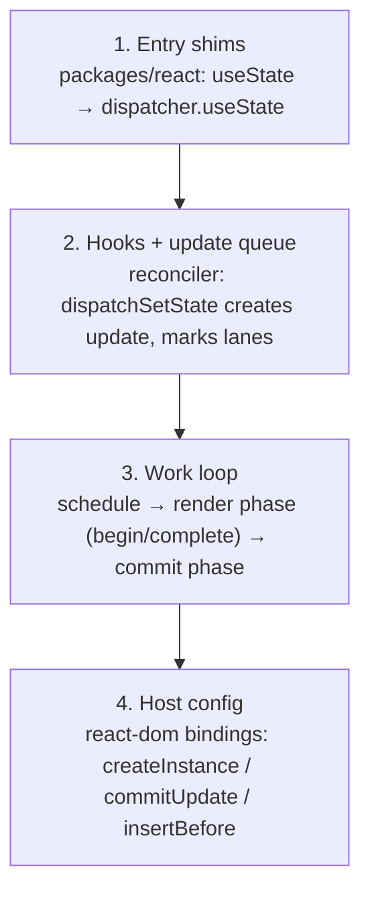
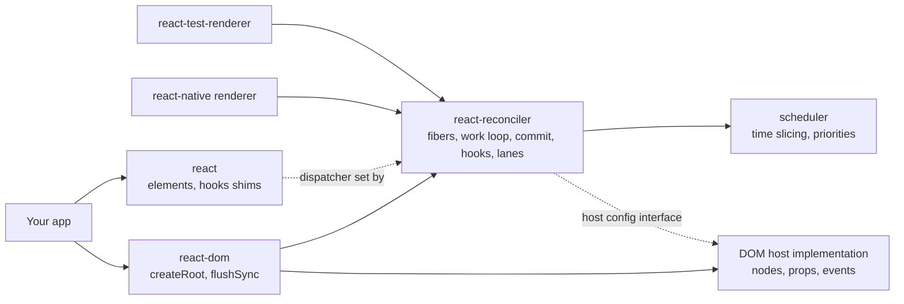
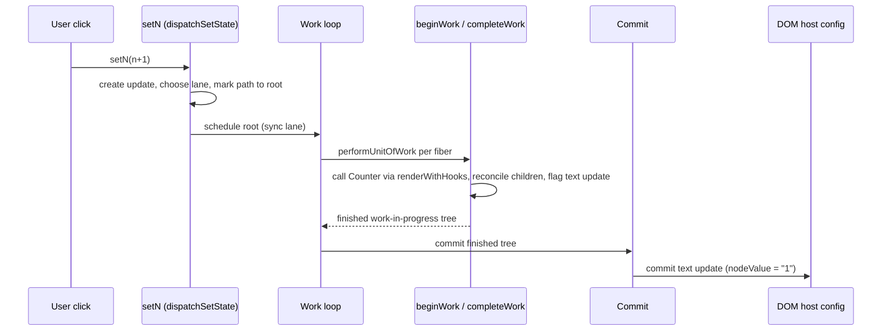

# 02 / 31 — Reading React's Source Code

## 1. Lesson metadata

| | |
|---|---|
| **Level** | Professional |
| **Study time** | 5–6 hours (reading 1.5 h, guided source tours 2.5 h, exercises 1.5 h) |
| **Prerequisites** | [08 — Why Fiber exists](./08-why-fiber.md), [09 — Fiber nodes and units of work](./09-fiber-nodes-and-units-of-work.md), [10 — Current and work-in-progress trees](./10-current-and-work-in-progress-trees.md), [11 — Render phase vs commit phase](./11-render-phase-and-commit-phase.md), [13 — Scheduler and priorities](./13-scheduler-and-priorities.md), [14 — Lanes](./14-lanes.md), [17 — How hooks attach to Fiber](./17-hooks-and-fiber-state.md), [20 — Commit and DOM mutation](./20-commit-and-dom-mutation.md), [30 — DevTools Profiler](./30-react-devtools-profiler.md) |
| **Next** | [32 — Scenario A](./32-scenario-a-parent-rerender.md) |
| **Related** | [11/21 — Reading framework source](../11-senior-and-architect-mastery/21-reading-framework-source.md) |

**Learning objectives.** After this lesson you can:
1. Describe the layout of the `facebook/react` repository and which packages own which concepts (elements, reconciler, DOM host, scheduler).
2. Follow one `setState` call from the setter to a DOM mutation by *reading code*, using a repeatable method rather than memorization.
3. Read the **built development bundles in `node_modules`** as a version-exact alternative to browsing the repo.
4. Use the debugger, `grep`, and a small verification script to confirm that a function or file mentioned in a blog post, a lesson, or an LLM answer actually exists in your installed version.
5. Distinguish public API, internal-but-stable concepts, and churning implementation details, and decide which are safe to rely on.
6. Recognize the *reading patterns* that recur in the code base: feature flags, DEV-only branches, lanes bitmasks, fiber `flags`, and the double-buffer swap.

**Concepts covered:** monorepo layout, `react`, `react-dom`, `react-reconciler`, `scheduler`, host config, feature flags, DEV vs PROD code paths, build outputs, source maps, breakpoint-driven reading, verification script, how internals change across versions.

> ⚠ **How to use this lesson safely.** React's internals are **not a public API**. File names, function names, and even the division of responsibilities move between releases (refactors, renamed modules, flag removals). Everything in §3 and §4 is a **reading guide to verify**, not a reference. Names below were checked on 2026-10-22 against the `facebook/react` `main` tree (file list via the GitHub API, function definitions grepped) and against the installed `react-dom@19.3.1` development bundle; each section says where a name differs between those two. Still confirm in your own installed version. Where the author is not confident, the lesson says "conceptually" and gives you a *search strategy* instead of a name. The verification script in §5.2 exists precisely so you do not have to trust this lesson.

---

## 2. Deep conceptual explanation

### 2.1 What problem is this lesson solving?

You have spent twenty-nine lessons building a mental model: render phase, commit phase, fibers, lanes, bailouts. Those lessons used **teaching models**. At some point a senior engineer must be able to answer "is that actually what React does?" without waiting for a conference talk or trusting a half-remembered blog post. Reading the source is how you:

- **Settle disputes** ("does `setState` with the same value skip rendering?") with evidence.
- **Debug the undocumented** (an obscure warning, a hydration mismatch message, an edge case in Suspense).
- **Evaluate claims** about version differences before an upgrade.
- **Calibrate trust** in explanations, including this curriculum's.

But source reading has a high cost and a high risk of *false confidence* — you read one branch, misunderstand a feature flag, and conclude something false. This lesson gives a disciplined method.

### 2.2 The repository at a glance

The React repository is a monorepo at <https://github.com/facebook/react>. The top-level `packages/` directory contains the published and internal packages. The ones you need (all of these directories exist on `main`, checked 2026-10-22; list the directory in your checkout to confirm):

| Package | Role | Why you read it |
|---|---|---|
| `packages/react` | The public `react` package: `createElement`/`jsx`, hooks entry points (the thin functions that delegate to a dispatcher), `memo`, `lazy`, `Suspense` symbol, `use`, `cache` | See how hooks are *thin shims* that call the current dispatcher; see element shape |
| `packages/react-reconciler` | The renderer-agnostic reconciler: fibers, work loop, begin/complete work, commit, lanes, hooks implementation, Suspense machinery | **The heart.** Almost every question in Phase 2 is answered here |
| `packages/react-dom` | The public `react-dom` and `react-dom/client` entry points, `createRoot`, `flushSync`, etc. | Entry points, event system integration |
| `packages/react-dom-bindings` | DOM-specific host implementation: creating nodes, setting properties, event delegation, text updates (these pieces lived inside `react-dom` in earlier versions; `react-dom-bindings` exists on `main`) | See where DOM operations are actually performed |
| `packages/scheduler` | The cooperative scheduler used by the DOM renderer: priority queue, time slicing (`shouldYield`), `setImmediate`/`MessageChannel`-based task loop | Time slicing and yielding |
| `packages/shared` | Constants and utilities shared across packages: symbols for element types, feature flags used across packages, `Object.is` shim | Element `$$typeof` symbols, flags |
| `packages/react-devtools*` | DevTools frontend/backend | Where "why did this render" comes from |
| `packages/react-server`, `react-server-dom-*` | Server rendering and RSC | Beyond this lesson ([27](./27-react-server-components-intro.md)) |
| `packages/react-art`, `react-native-renderer`, `react-test-renderer` | Other host renderers using the same reconciler | Evidence that the reconciler is renderer-agnostic ([04](./04-virtual-dom-what-it-means.md)) |

**Why this layout proves a design point.** The reconciler lives in its own package and talks to hosts through a *host config* (a set of functions the renderer supplies: create instance, append child, commit update, etc.). The fact that the same reconciler serves DOM, Native, and test renderers is the concrete refutation of "React = DOM diffing". The reconciler never imports DOM APIs.

### 2.3 Module vocabulary you will see

Inside `packages/react-reconciler/src/` the file names follow a `ReactFiber*` pattern. Every file below exists on `main` (checked 2026-10-22 via the GitHub tree API); also present and worth knowing: `ReactFiberRootScheduler.js` (root scheduling: `ensureRootIsScheduled`, the microtask flush), `ReactFiberCommitHostEffects.js` and `ReactFiberCommitEffects.js` (split out of `ReactFiberCommitWork.js`), `ReactFiberConcurrentUpdates.js`, `ReactFiberHydrationContext.js`, `ReactFiberSuspenseContext.js`, `ReactFiberOffscreenComponent.js`, `ReactFiberActivityComponent.js`, `ReactFiberTransition.js`, `ReactFiberAsyncAction.js`.

| File (approximate name) | Concept | Maps to lesson |
|---|---|---|
| `ReactFiber.js` | The `FiberNode` constructor; creating fibers from elements; `createWorkInProgress` (cloning a current fiber into its alternate) | [09](./09-fiber-nodes-and-units-of-work.md), [10](./10-current-and-work-in-progress-trees.md) |
| `ReactFiberWorkLoop.js` | The scheduler of renders and commits: entering a render, the loop over units of work, yielding checks, completing and committing a root, `scheduleUpdateOnFiber` | [11](./11-render-phase-and-commit-phase.md), [15](./15-interruptible-restartable-abandoned-rendering.md) |
| `ReactFiberBeginWork.js` | The "begin" half of a unit of work: dispatch by fiber tag, call function components (via hooks renderer), decide bailout vs reconcile children | [06](./06-reconciliation-fundamentals.md), [29](./29-reasoning-about-unnecessary-renders.md) |
| `ReactFiberCompleteWork.js` | The "complete" half: for host components create DOM nodes (detached) and compute update flags; bubble flags up | [11](./11-render-phase-and-commit-phase.md) |
| `ReactChildFiber.js` | Child reconciliation: single child, arrays, keys, deletions, placement marking | [06](./06-reconciliation-fundamentals.md), [07](./07-identity-keys-and-reconciliation.md), [34](./34-scenario-c-list-reorder.md) |
| `ReactFiberHooks.js` | Hook implementations: mount vs update dispatchers, hook linked list on a fiber, update queues, effects lists | [17](./17-hooks-and-fiber-state.md) |
| `ReactFiberCommitWork.js` | The commit phase: mutation, layout, passive effect passes; deletions; ref attach/detach | [20](./20-commit-and-dom-mutation.md) |
| `ReactFiberLane.js` | Lane bit constants and operations: mark, pick next lanes, merge, entangle | [14](./14-lanes.md) |
| `ReactFiberFlags.js` | The `flags` bitmask constants (placement, update, child deletion, passive, layout, ref, …) | [20](./20-commit-and-dom-mutation.md) |
| `ReactFiberRoot.js` | The `FiberRoot` object (root container info, pending lanes, current tree pointer) | [10](./10-current-and-work-in-progress-trees.md) |
| `ReactFiberReconciler.js` | The reconciler's public-to-renderers API: create container, update container | host/renderer boundary |
| `ReactFiberThrow.js` / `ReactFiberUnwindWork.js` | Thrown values (errors, thenables), unwinding to boundaries | [24](./24-suspense-conceptual-internals.md) |
| `ReactFiberSuspenseComponent.js` and related | Suspense boundary state | [24](./24-suspense-conceptual-internals.md) |
| `ReactFiberClassComponent.js` | Legacy class component lifecycle | historical |

Function names, with where each was found on 2026-10-22 (`main` = GitHub source; `19.3.1` = the installed `react-dom-client.development.js`). Names can be renamed or split between releases, so grep:

- **`scheduleUpdateOnFiber`** (`ReactFiberWorkLoop.js`; found in both) — registers that a fiber has an update at some lane and ensures the root is scheduled.
- **`ensureRootIsScheduled`** (now in `ReactFiberRootScheduler.js`; found in both) — decides whether and how to schedule rendering for a root.
- **`performWorkOnRoot`** (`ReactFiberWorkLoop.js`) and **`performSyncWorkOnRoot`** (`ReactFiberRootScheduler.js`): in React 19 `performConcurrentWorkOnRoot` no longer exists (it was folded into `performWorkOnRoot`, which decides between a time-sliced and a synchronous render); the older name is what 18-era blog posts use.
- **`renderRootSync` / `renderRootConcurrent`** — run the work loop.
- **`workLoopSync` / `workLoopConcurrent` / `workLoopConcurrentByScheduler`** — loops calling `performUnitOfWork`; the concurrent variants check a yield predicate between units. The installed 19.3.1 bundle contains `workLoopSync` and `workLoopConcurrentByScheduler` but **no** `workLoopConcurrent`, while `main` has all three, so a "MISSING" there is a real version difference.
- **`performUnitOfWork`** — runs `beginWork` for one fiber; if no child, runs `completeUnitOfWork`.
- **`beginWork`** — in `ReactFiberBeginWork`; switches on fiber type; for updates checks props/context/lanes to decide bailout.
- **`completeWork`** — in `ReactFiberCompleteWork`.
- **`commitRoot`** — begins the commit; invokes the mutation/layout passes and schedules passive effects. In recent versions the commit is broken into several named functions: on `main`, `commitRoot` is followed by `flushMutationEffects` and `flushLayoutEffects` in `ReactFiberWorkLoop.js`, and `commitBeforeMutationEffects`, `commitMutationEffects`, `commitMutationEffectsOnFiber`, `commitLayoutEffects` live in `ReactFiberCommitWork.js`; `flushPassiveEffects` is in the work loop. In the 19.3.1 bundle `commitMutationEffects` and `commitLayoutEffects` are not separate function declarations, but `commitMutationEffectsOnFiber`, `flushMutationEffects` and `flushLayoutEffects` are.
- **`createWorkInProgress`** — create/reuse the alternate fiber with new pending props.
- **`reconcileChildFibers`** (in 19.x defined as `createChildReconciler(true)`, so a grep for `function reconcileChildFibers(` finds nothing; the work happens in `reconcileChildFibersImpl`) / **`reconcileChildrenArray`** (`ReactChildFiber.js`) — child diffing (arrays implement the keyed algorithm used in [Scenario C](./34-scenario-c-list-reorder.md)).
- **`renderWithHooks`** — sets the hooks dispatcher, calls the component function, resets the dispatcher.
- **`dispatchSetState`** (for `useState`) — the function bound as your setter; creates the update object and calls `scheduleUpdateOnFiber`.
- **`mountState` / `updateState`** (`ReactFiberHooks.js`; in the 19.3.1 bundle `updateState` is not a separate declaration, but `updateReducer` is) (and their reducer siblings) — mount-time and update-time implementations of `useState`.
- **`bailoutOnAlreadyFinishedWork`** — the early-exit path: if no work for this subtree, clone/reuse children and skip.
- In `scheduler`: **`unstable_scheduleCallback`**, **`unstable_shouldYield`**, **`unstable_cancelCallback`** (the `unstable_` prefix is historical naming; they are the scheduler's real exports; confirmed in `scheduler@0.28.0`'s `exports.unstable_scheduleCallback`, `unstable_cancelCallback`, `unstable_now`, etc.). `shouldYield` appears in the reconciler as an imported scheduler function (`unstable_shouldYield`), not a local declaration.

**This list is a vocabulary for searching, not a promise.** The right habit: grep for the *concept* (e.g. "bailout", "didReceiveUpdate", "placeChild", "markRef"), find what the code actually calls it, and read from there.

### 2.4 Misconceptions about reading source

| Misconception | Reality |
|---|---|
| "The source is the documentation." | It is the implementation. Behavior documented on react.dev is the contract; source can contain bugs, experimental paths, and flag-gated code that does not ship. |
| "If I see it in the repo, it ships." | `main` contains experimental and flag-gated features. Check the **version tag** and the **feature flags** (`enable…`) before concluding. |
| "Function X must exist because a blog says so." | Posts age quickly. Verify against your installed version. |
| "I can read one file in isolation." | Reconciler files cooperate; a branch in `beginWork` depends on flags set in `ReactChildFiber`. Follow call paths. |
| "Internal names are stable enough to build on." | They are not. Building on internals (e.g. fiber properties, private `__SECRET_INTERNALS…` exports) is unsupported and breaks across versions. |
| "Reading source replaces measuring." | Source says what *can* happen; the Profiler and DOM observation say what *did*. Use both ([30](./30-react-devtools-profiler.md)). |

---

## 3. Internal mechanics

### 3.1 Public guarantee vs teaching model vs implementation detail (for this lesson)

| Aspect | Status |
|---|---|
| Repository location and existence of `react`, `react-dom`, `react-reconciler`, `scheduler` packages | Stable and public (react-reconciler is published but explicitly for custom-renderer authors, with an unstable API) |
| Existence of a render loop → commit sequence | Documented conceptually ([Render and commit](https://react.dev/learn/render-and-commit)) |
| `ReactFiber*` file names, function names listed above | **Implementation detail**; checked 2026-10-22 as noted in §2.3 |
| Bit layouts of lanes and flags | **Implementation detail**; they change |
| Feature flags (`enable…`) | **Implementation detail** and a frequent source of "this doesn't match behavior" confusion |
| Hook linked list layout, `memoizedState` shape | **Implementation detail**; `memoizedState` is a field name a lot of tutorials mention; treat as illustrative |

### 3.2 The reading model: four layers

When you follow a state update through the code you cross four layers:



Layer 1 is almost trivially small and shows the *dispatcher* pattern: the `useState` you import from `react` is a function that gets the **current dispatcher** (set by the reconciler during `renderWithHooks`) and calls its method. That is why "Invalid hook call" arises when `useState` is invoked outside a render: the dispatcher is the "does-nothing-but-warn" one ([17](./17-hooks-and-fiber-state.md)).

### 3.3 Flags, lanes, and why code looks like bit math

You will see expressions like `(flags & Placement) !== NoFlags` and `includesSomeLane(...)`. These are *bitmask checks*: each fiber has a `flags` field (what commit-time work this fiber needs: placement, update, deletion, ref, passive effect, …) and a `subtreeFlags` field (the OR of descendants' flags, so the commit can skip subtrees with nothing to do). Lanes are another bitmask system (what priorities of work are pending). Reading bit math is easier when you remember the *question being asked*: "does this fiber/subtree contain any commit work / any work of this priority?" ([14](./14-lanes.md), [20](./20-commit-and-dom-mutation.md)).

### 3.4 DEV branches, feature flags, and build variants

- `if (__DEV__) { … }` blocks run only in development builds: warnings, Strict Mode double-invocation helpers, extra checks. They disappear in production builds.
- Feature flags: a central set of boolean constants gating features and behavior changes; each build (stable, experimental, www/Meta internal) sets them differently. *If code you are reading is under a flag, look up whether it is on in the release channel you use.* A frequent trap is reading flag-gated code and concluding "React does this".
- The **same logical file** exists in several built forms: development (`*.development.js`), production (`*.production.js`), and profiling. Dev builds are readable; production builds are minified.

### 3.5 Where DOM operations actually happen

At the end of the chain, the reconciler calls host config functions provided by the DOM renderer: conceptually "create instance", "create text instance", "append child", "insert before", "remove child", "commit update", "commit text update", "reset text content". In the repository, search for those *verbs* in the DOM bindings (look in `packages/react-dom-bindings/src/client/` for the file `ReactFiberConfigDOM.js` (confirmed on `main`, with `commitTextUpdate` doing `textInstance.nodeValue = newText`); in older versions the file lived in `react-dom/src/client/ReactDOMHostConfig.js`). For text updates, notice the tiny helper that updates `nodeValue` of an existing text node when it is the only child; this is the code that [Scenario B](./33-scenario-b-text-update.md) relies on.

---

## 4. Step-by-step execution walkthrough: tracing `setN(n + 1)` through the source

Method: **Start at the user-visible effect, search backward; then trace forward with the debugger.** We follow the click → DOM text update of [Scenario B](./33-scenario-b-text-update.md).

### 4.1 Prepare a probe app

```tsx
// main.tsx — NO StrictMode for the tracing session
import { createRoot } from "react-dom/client";
import { useState } from "react";

function Counter() {
  const [n, setN] = useState(0);
  return <p>Count: {n} <button onClick={() => setN(n + 1)}>+</button></p>;
}

createRoot(document.getElementById("root")!).render(<Counter />);
```

### 4.2 Find the code to read: use the installed dev bundle

In a Vite/webpack project in development mode the browser loads **the development build** of `react-dom`. The file in your project is (confirmed for react-dom 19.3.1):

```
node_modules/react-dom/cjs/react-dom-client.development.js
```

In React 19 the DOM client build is a *single large file* that contains the reconciler, DOM host config, and event system, concatenated by the build. You can search it with your editor and set breakpoints in it from the browser's Sources panel (it is served unminified in dev). This is the **most version-exact way to read React**: it is precisely what your app runs. Its drawbacks: no module boundaries (everything in one scope) and build-time inlining; function names are preserved in dev builds, which is what we need.

### 4.3 The trace

**Step 1. Click handler → setter.** In the Sources panel, set a breakpoint in your `onClick`. Step into `setN`. You land in the function bound as the setter. In recent versions this is a function named like `dispatchSetState` (confirmed present in 19.3.1). Observe: it receives the fiber (bound), the queue (bound), and the action `n + 1`. It creates an *update object* carrying the action and a lane, enqueues it on the hook's queue, and calls a schedule function (`scheduleUpdateOnFiber` or equivalent).

*What to look for.* How the **lane** is chosen: in React 18/19 the lane derives from the current update priority, which depends on the *event type* being dispatched (discrete events like click → synchronous-class priority) — search for the function that requests an update lane. This is where "setState in a click is urgent, in a timeout is default" lives ([13](./13-scheduler-and-priorities.md), [14](./14-lanes.md)).

**Step 2. Marking the path to the root.** `scheduleUpdateOnFiber` (or what it calls) marks the root as having pending lanes and walks from the updated fiber to the root, adding to each ancestor's "child lanes". This is the data structure that lets a render skip every subtree without work ([29 §3.2](./29-reasoning-about-unnecessary-renders.md)). Breakpoint here and inspect `fiber.return` chain.

**Step 3. Scheduling.** Follow into the root scheduling function (`ensureRootIsScheduled` or its 19.x equivalent). Observe that sync-priority work is *not* scheduled via the Scheduler task queue in the same way: it is flushed at the end of the event (via a microtask or when the event handler finishes) — executed on 19.3.1: a `click()` returned before React had rendered, and the render ran in the microtask that React queues when the update is scheduled (see [21 §3.3](./21-browser-paint-and-react-updates.md)); this part changed between 18 and 19. Concurrent-priority work goes through `scheduleCallback` into the `scheduler` package.

**Step 4. The render entry.** Break in the function that renders a root synchronously (`renderRootSync` or equivalent). It: (a) prepares a fresh work-in-progress tree root by `createWorkInProgress` on the current root fiber; (b) runs `workLoopSync`.

**Step 5. The loop.** In `workLoopSync` (or concurrent variant) you see: `while (workInProgress !== null) performUnitOfWork(workInProgress)`. In the concurrent variant, an additional `shouldYield()` check ([15](./15-interruptible-restartable-abandoned-rendering.md)). Step into `performUnitOfWork`.

**Step 6. `beginWork` on the path.** First fibers: root, then (no work) → bailout. For `Counter`'s fiber: `beginWork` sees `current !== null` (an update) and compares `oldProps !== newProps` / checks lanes. Because the fiber has an update in the render lanes, it does not bail out: it calls the component through the hooks renderer (`renderWithHooks`). **Breakpoint inside your component function** and look at the call stack: you will see `renderWithHooks → beginWork → performUnitOfWork → workLoop → renderRoot…`. This is the physical form of "React calls your component during the render phase".

**Step 7. Hooks during render.** Inside `renderWithHooks`, step into `useState`. You will see the *update-time* implementation (`updateState` → `updateReducer`) process the hook's pending queue, computing the new state (`n + 1`) by applying queued updates. Check where it reads the hook list from the *current* fiber to find the hook ([17](./17-hooks-and-fiber-state.md)).

**Step 8. Reconciling children.** After your function returns elements, `beginWork` calls a child reconciler (`reconcileChildren` → `reconcileChildFibers`). For a `<p>` with children `["Count: ", n, <button/>]` (an array), the array path (`reconcileChildrenArray`) runs: it matches by position (no keys), reuses existing fibers via `useFiber` (creating alternates with new props), and creates text fibers for text. For the unchanged text child `"Count: "` and the changed `n` text, observe that **text children are their own fibers** (tag for host text) — the reason there are separate DOM text nodes ([Scenario B](./33-scenario-b-text-update.md)).

**Step 9. Complete work.** When a leaf finishes, `completeUnitOfWork` calls `completeWork`. For a host text fiber with an existing DOM node, compare old and new text; if different, mark the fiber with the *update* flag (rather than touching the DOM). For the host `<p>` and `<button>` elements, React 19 compares only the props *object identity* here (new object, so they are flagged `Update`; the per-property diff runs later in `commitUpdate` and finds nothing to write; see [32 §3.3](./32-scenario-a-parent-rerender.md)). Flags bubble up into `subtreeFlags`.

**Step 10. Commit.** After the root finishes (`finishedWork` set), the commit entry (`commitRoot` or equivalent) runs: *before-mutation*, *mutation*, swap `root.current = finishedWork`, *layout*, then schedules passive effects ([11](./11-render-phase-and-commit-phase.md)). Set a breakpoint on the text-update host function (search for something like `commitTextUpdate`, or for the string `nodeValue` assignment in the dev bundle). It fires **once**, with `oldText = "0"`, `newText = "1"`: *that is the single DOM operation of this interaction.*

**Step 11. The DOM write.** The host function sets `textInstance.nodeValue = newText`. In the browser, this triggers a `characterData` mutation record that a `MutationObserver` will deliver ([30 §5.7](./30-react-devtools-profiler.md)).

**What you proved by reading.** (1) The component function runs inside `beginWork`; (2) updates mark lanes up the path; (3) the diff happens in render/complete and only *sets flags*; (4) the DOM is touched in commit by flag-driven host calls. All four match the teaching model; you saw it rather than believed it.

### 4.4 A second trace: the bailout

Add a sibling `<Static />` (non-memoized) to `Counter`'s parent, and a `memo(Static2)`. Click, and break at the start of your `Static` function (it runs), then set a breakpoint inside `Static2` (it will *not* hit). Now, in the dev bundle, search for the bailout helper (`bailoutOnAlreadyFinishedWork` or the closest name) and the memo update function (`updateMemoComponent` / `updateSimpleMemoComponent`, both present in 19.3.1). Put breakpoints at the **branch that compares props**; observe `shallowEqual` being called for `Static2`. You have now seen the precise code path behind [Lesson 29's](./29-reasoning-about-unnecessary-renders.md) bailout claims.

---

## 5. Code examples

### 5.1 Minimal: see how a hook is a dispatcher shim

Open `node_modules/react/cjs/react.development.js` and search for `useState` (in 19.3.1 it is `exports.useState = function (initialState) {...}`). The exported function is tiny: it resolves the current dispatcher and delegates:

```js
// conceptual shape
function useState(initialState) {
  const dispatcher = resolveDispatcher();
  return dispatcher.useState(initialState);
}
```

The point to take away is the *indirection*, not the exact text. It explains: why hooks cannot run outside render; why multiple copies of React in one bundle break hooks ("Invalid hook call" — the `react` your component imported is not the `react` the renderer set a dispatcher on); and why React can swap hook implementations between mount and update ([17](./17-hooks-and-fiber-state.md)).

### 5.2 Practical: a verification script (TypeScript, runs in Node)

Do not trust any internal name from any source, including this lesson. This script reports, for your installed version, whether each name appears in the development build, and where.

```ts
// verify-react-internals.ts — run with: npx tsx verify-react-internals.ts
import { readFileSync, existsSync } from "node:fs";
import { createRequire } from "node:module";
import { join, dirname } from "node:path";

const require = createRequire(import.meta.url);

function findReactDomDev(): string | null {
  const pkgPath = require.resolve("react-dom/package.json");
  const dir = dirname(pkgPath);
  const candidates = [
    join(dir, "cjs/react-dom-client.development.js"), // React 19 client build (present in 19.3.1)
    join(dir, "cjs/react-dom.development.js"),        // React 18-style build
  ];
  return candidates.find(existsSync) ?? null;
}

const names = [
  "scheduleUpdateOnFiber",
  "ensureRootIsScheduled",
  "performUnitOfWork",
  "beginWork",
  "completeWork",
  "commitRoot",
  "createWorkInProgress",
  "reconcileChildrenArray",
  "renderWithHooks",
  "dispatchSetState",
  "bailoutOnAlreadyFinishedWork",
  "commitTextUpdate",
  "workLoopConcurrent",
  "shouldYield",
];

const file = findReactDomDev();
if (!file) {
  console.error("Could not find a react-dom development build. Is react-dom installed?");
  process.exit(1);
}
const text = readFileSync(file, "utf8");
const lines = text.split("\n");
console.log(`Scanning ${file} (${lines.length} lines)`);

for (const name of names) {
  const defRe = new RegExp(`function\\s+${name}\\s*\\(`);
  const defLine = lines.findIndex((l) => defRe.test(l));
  const uses = (text.match(new RegExp(`\\b${name}\\b`, "g")) ?? []).length;
  console.log(
    defLine >= 0
      ? `FOUND   ${name.padEnd(32)} def at line ${defLine + 1}, ${uses} references`
      : uses > 0
        ? `PRESENT ${name.padEnd(32)} referenced ${uses}x, no 'function ${name}(' definition (renamed/inlined?)`
        : `MISSING ${name.padEnd(32)}`,
  );
}
```

Line notes:
- `require.resolve("react-dom/package.json")` finds the installed package without assuming a path; `createRequire(import.meta.url)` is the ESM-compatible way to get `require`.
- The script classifies *definition found*, *name appears without a function declaration* (the code may use a different declaration form or the symbol was renamed), and *missing*. A "MISSING" is data: the name in your notes is wrong for your version.
- It reads the **development** bundle because production bundles are minified and names are mangled.

**Predict:** on a recent React 19.x install, will every name be `FOUND`? **No guarantee.** Result when this script was run unchanged against `react-dom@19.3.1` (2026-10-22): 12 of the 14 names were `FOUND`; `workLoopConcurrent` was `MISSING` (the bundle has `workLoopConcurrentByScheduler`) and `shouldYield` was `PRESENT` (imported from the scheduler, no local `function shouldYield(`). Expect such differences after refactors. The *report is the lesson*: treat any internal name as unverified until the script (or your editor's search) confirms it.

### 5.3 Practical: count bailouts empirically (no source reading required)

Reading is slow; observation is fast. This harness counts renders per component to pair with source reading:

```tsx
import { memo, useState, type ReactNode } from "react";

const counts = new Map<string, number>();
export function track(name: string): void {
  counts.set(name, (counts.get(name) ?? 0) + 1);
}
export function report(): Record<string, number> {
  return Object.fromEntries(counts);
}

function Plain() { track("Plain"); return <i>plain</i>; }
const Memoized = memo(function Memoized() { track("Memoized"); return <i>memo</i>; });

function Slot({ children }: { children: ReactNode }) { track("Slot"); return <b>{children}</b>; }

export function Probe() {
  const [n, setN] = useState(0);
  track("Probe");
  return (
    <>
      <button onClick={() => setN(n + 1)}>{n}</button>
      <Plain />
      <Memoized />
      <Slot><Plain /></Slot>
    </>
  );
}
```

Note: `track` mutates a module-level map during render — impure; fine for this probe only. Run without Strict Mode, call `report()` after mount, click once, call `report()` again and subtract. **Predict the difference:** `Probe: 1, Plain: 2, Memoized: 0, Slot: 1` (the second `Plain` is rendered inside `Slot` whose child element was created by `Probe`, which re-ran, so a *new* element → renders). Compare with the same code where `Probe`'s state is in a child component: the children-as-props case. Then find in source *why*, by locating the props comparison in `beginWork`.

### 5.4 Incorrect: building on internals

```tsx
// ❌ Reading fiber internals from application code
import { useRef } from "react";
function Dangerous({ children }: { children: React.ReactNode }) {
  const ref = useRef<HTMLDivElement>(null);
  const logFiber = () => {
    const el = ref.current as unknown as Record<string, unknown>;
    const key = Object.keys(el).find((k) => k.startsWith("__reactFiber$"));
    console.log(key ? el[key] : null);
  };
  return <div ref={ref} onClick={logFiber}>{children}</div>;
}
```

**Why this is a bad idea in application code:** the property key prefix, the fiber's fields, and their meanings are internal and change without notice. It is acceptable in a *throwaway debugging session* (the browser console) to look at a fiber, and DevTools does so through its own supported channel; shipping code that depends on it is not. For public alternatives, use refs, `Profiler`, DevTools, or the documented `react-reconciler` package only if you are *authoring a renderer* and accept an unstable API.

### 5.5 Corrected: use supported instrumentation

Use `<Profiler>`, DevTools "Why did this render?", `MutationObserver`, and `performance.mark` as in [30](./30-react-devtools-profiler.md). These survive upgrades; source reading informs *your understanding*, not your *dependencies*.

### 5.6 Advanced: checking a behavioral claim end-to-end (source + experiment)

Claim to test: *"calling `setState` with the same value skips rendering the component's children."*

1. **Docs:** react.dev `useState` caveats say React bails out for `Object.is`-equal values and may still call the component once.
2. **Experiment:** component with `console.log`, button calling `setN(0)` when `n` is `0`. Observe: 0 extra logs on first click or exactly 1 extra log, none thereafter; children never log. Check with Profiler: no commit happens.
3. **Source:** in the dev bundle, find the setter function (`dispatchSetState`); look for the branch that computes the next state eagerly and compares with the current using `Object.is` (look for `objectIs`). Note the conditions (fiber has no pending lanes, etc.). Then find the update-time path where a state hook finds the *final state equal to the previous* and marks "no update received" so `beginWork` bails out.
4. **Conclude** with: behavior (documented), mechanism (two checks: eager and late), caveat (conditions are implementation detail).

This **triangulation** — documentation, experiment, source — is the workflow you should apply to every internals claim.

---

## 6. Visual explanations

### 6.1 Package relationships



### 6.2 Call chain for one update (conceptual)



### 6.3 A reading plan

```text
1. packages/react           → how hooks delegate (dispatcher)       (30 min)
2. ReactFiberHooks           → mount vs update implementations       (60 min)
3. ReactFiberWorkLoop        → scheduling, render loop, commit entry (90 min)
4. ReactFiberBeginWork       → bailout decision, reconcile call      (60 min)
5. ReactChildFiber           → keyed array reconciliation            (60 min)  ← Scenario C
6. ReactFiberCompleteWork    → host node creation, update flags      (45 min)
7. ReactFiberCommitWork      → mutation / layout / passive           (60 min)
8. DOM host config           → insertBefore, text updates            (30 min)
```

---

## 7. Alternative approaches and trade-offs

| Approach to answering "what does React do?" | Effort | Version-exactness | Reliability | When best |
|---|---|---|---|---|
| **Read react.dev docs** | Low | Current docs | High for documented behavior | Always first; behavior contracts |
| **Experiment + Profiler + DOM observer** | Low–Medium | Exact (your build) | High for observed behavior | Verify claims, regressions |
| **Debug in the dev bundle (`node_modules`)** | Medium | Exact | High, but needs interpretation | Tracing a path in your actual version |
| **Read repo at a version tag** | Medium–High | Exact for that tag | High; includes flags/context | Deep dives, comparing versions via diffs |
| **Read repo `main`** | Medium–High | Future/experimental | Medium (flags, in-flight refactors) | Evaluating upcoming behavior |
| **Read blog posts/talks** | Low | Unknown | Low–Medium (ages quickly) | Orientation only; verify |
| **Ask a colleague/LLM** | Low | Unknown | Variable | Hypothesis generation; verify |
| **Read release notes/changelog** | Low | Per release | High for notable changes | Upgrades |

**Where reading source is NOT the best approach.** When your question is "will this pattern be fast/correct in my app?", an experiment on your real tree with the Profiler beats any amount of source reading: the source shows what can happen, not what happens on *your* data. And when the question concerns an upcoming feature (Compiler, new hooks), docs and RFCs/release notes are the right contract; the source is in flux ([09/08 — React Compiler](../09-advanced-rendering-and-ecosystem/08-react-compiler.md)).

---

## 8. Best practices and anti-patterns

### 8.1 Practices

1. **Pin the version.** Before reading, note `react`/`react-dom` versions; check out the corresponding git tag or read the installed bundle.
2. **Start from observable behavior** (a breakpoint in your component, a log in your effect) and move *outward* through the call stack; the stack trace is your table of contents.
3. **Search by concept, then by name.** Grep for words from the error message or behavior ("bailout", "placement", "deletion").
4. **Use the debugger over reading when control flow is complex.** Step through a real update.
5. **Triangulate**: docs + experiment + source.
6. **Take notes with version tags** (name, file, line, version).
7. **Read DEV branches for the "why"**: warnings in `__DEV__` blocks often state intent in plain language.
8. **Read tests** (`__tests__` folders next to source) to see intended behavior and edge cases; tests are executable documentation of guarantees the team cares about.

### 8.2 Beginner mistakes

- Starting at the top of `ReactFiberWorkLoop` and reading linearly.
- Memorizing internals and forgetting they change.
- Concluding from one code path ("it checks `oldProps !== newProps`") without noticing an earlier path ("context changed").

### 8.3 Experienced-developer mistakes

- Quoting internal function names in design docs as if they were APIs.
- Ignoring feature flags and channel differences.
- Using internals in production code (fiber access, private exports).
- Treating `main` behavior as what their pinned version does.

### 8.4 Smells

| Smell | Meaning |
|---|---|
| A design doc justifies a decision by "React internally does X" without version | Unverifiable; link to docs or an experiment |
| Code that reads `__reactFiber$…`/`_owner`/`__SECRET_INTERNALS…` | Reliance on unsupported API |
| An LLM/blog-provided function name you can't find | Likely renamed or hallucinated; run the verification script |

### 8.5 Justified exceptions

- A dev-only tool (like DevTools, test utilities, custom profilers) may legitimately use internal hooks, accepting maintenance cost.
- Writing a custom renderer with `react-reconciler` *requires* the host-config interface; that package is intended for renderer authors and still carries an unstable-API caveat. Pin versions strictly.

---

## 9. Real-world application

| Situation | How source reading helps | Constraint |
|---|---|---|
| **Upgrade review (18 → 19)** | Diff behavior areas you rely on (batching, effects timing, ref cleanup) by reading release notes first, then targeted source diff between tags | Time-box; prefer tests + canary rollout |
| **Production-only bug (hydration, Suspense)** | Search the exact warning text in source to see the condition that triggers it | Production strips messages; use dev reproduction |
| **Performance mystery (component re-renders unexpectedly)** | Breakpoint in the bailout path to see which comparison failed | Needs dev build |
| **Library authoring (state library, router)** | Understand `useSyncExternalStore` guarantees and tearing prevention | Rely on documented API only |
| **Custom renderer (canvas/PDF/terminal)** | Study host-config contract in `react-reconciler` and an existing renderer | API instability; pin versions |
| **Team education** | Run a "trace one update" workshop with the dev bundle | Keep it version-pinned and hands-on |
| **Incident postmortem** | Show root cause in source *and* in a reproduction, then link docs | Avoid blaming React without a minimal repro |

---

## 10. Debugging and troubleshooting

### 10.1 "I can't find function X in the repo"
Search with `git log -S "X"` to see when it was added/removed; look at the file where the concept lives; run the verification script on your installed version; remember the code might be split or renamed (e.g. a function replaced by several).

### 10.2 "Breakpoints in react-dom don't hit"
You are running a production/minified build or a different copy of React. Check the network panel for the loaded `react-dom` file name (`.development.js`); in bundlers, ensure `NODE_ENV` is `development`; check for duplicate React installs (`npm ls react react-dom`).

### 10.3 "The source says X but the behavior says Y"
Suspects, in order: (1) you read `main`, not your version; (2) a feature flag off in your release channel; (3) a different code path (e.g. sync vs concurrent, mount vs update, host vs function component); (4) your app is not what you think (the wrong component rendered); (5) a misread condition. Resolve with a breakpoint on the exact branch and inspect the values.

### 10.4 "Source maps show weird file names"
Dev builds from npm are single-file bundles; source maps for the original module split may not be shipped. Use the dev bundle directly or clone the repo and build a specific package with the repo's own scripts (instructions are in the repo's contributing docs).

### 10.5 Validating a conclusion from source
State the claim with the version, show the branch and the condition, show the experiment output that matches, and list assumptions. If any element is missing, label the claim "probable".

---

## 11. Exercises

### Level A — Knowledge
A1. Name four packages in the React monorepo and the responsibility of each.
A2. Why is `react-reconciler` separate from `react-dom`? Name two other renderers that prove the point.
A3. What does `__DEV__` gate and why does it matter when reading?
A4. Why can reading `main` mislead you about React 19.0 behavior?
A5. What is the "dispatcher" pattern behind hooks?

### Level B — Code comprehension
B1. Given the verification script's three outcomes (FOUND/PRESENT/MISSING), what does each imply about a name in a blog post?
B2. In §5.3, why does the second `Plain` (inside `Slot`) render while `Memoized` does not?
B3. A bitmask check `(fiber.flags & Placement) !== NoFlags` appears in the commit. In plain words, what is being asked? Why is `subtreeFlags` useful?
B4. Explain why a `useState` call in a module that imports a *different copy* of `react` fails.

### Level C — Implementation
C1. Extend the verification script to take names from `process.argv` and print the five lines around each definition.
C2. Write a Vitest test that asserts a documented behavior ("same-state `setState` does not re-render children") using a render counter, as the *behavioral* counterpart to source reading.
C3. Write a `logUpdates` helper that wraps `MutationObserver` and prints `characterData` events with old/new values for use during source tracing sessions.

### Level D — Debugging
D1. You set breakpoints on the name `commitTextUpdate` and nothing hits during a text change. List four hypotheses and how to test each.
D2. Your trace shows your component function called twice per click in dev with no breakpoint on Strict Mode code. Explain, and show how to make the trace single-call.
D3. A teammate cites "`ReactFiberBeginWork.js` line 4123 checks X" in a design doc. What is wrong with this citation and how would you fix it?

### Level E — Architecture and engineering decisions
E1. Your platform team wants to build an internal tool that reads fiber trees in production to attribute render cost to teams. Evaluate: reading internals vs `<Profiler>` vs a custom wrapper, with criteria: upgrade risk, accuracy, overhead, privacy.
E2. Propose an internal "React internals reading group" format that produces durable, *version-tagged* artifacts and avoids spreading folklore.

### Level F — Expert challenge
F1. Design and describe a repeatable experiment (code + steps) to determine, for your installed React version, whether a synchronous discrete-event update's passive effects are flushed before the browser paints. Include what you would observe and how you would cross-check in source.
F2. Without relying on any internal name, explain how you would find, in an unfamiliar React version, the code that decides whether a function component is re-called, using only the debugger and a console log in your own component.

---

## 12. Detailed answers and explanations

> Attempt the exercises first.

**A1.** `react`: public API shims (elements, hooks entry points, `memo`, `lazy`). `react-reconciler`: renderer-agnostic fiber reconciler (work loop, hooks, lanes, commit). `react-dom`: DOM entry points (`createRoot`, `flushSync`) and DOM integration. `scheduler`: priority queue and cooperative yielding. (Also acceptable: `shared`, DevTools packages, `react-server`.)

**A2.** So that one reconciliation engine can drive multiple hosts via a host-config interface; the DOM is just one host. Proof: React Native's renderer and `react-test-renderer` (also `react-art`).

**A3.** Development-only code: warnings, extra checks, Strict Mode helpers. Reading a `__DEV__` branch tells you *intent and constraints* but not production behavior; production builds omit it.

**A4.** `main` has newer code, experimental flags, and in-flight refactors absent from the 19.0 tag; behavior and names differ. Always check the tag matching your version.

**A5.** Hooks exported from `react` delegate to a "current dispatcher" object set by the reconciler during a component render; different dispatcher objects are used for mount, update, and "invalid" contexts. That is how the same `useState` import behaves differently across mount and update and warns when called outside render.

**B1.** FOUND: the name exists as a function in your version (still verify it does what the post claims). PRESENT: name referenced but not declared via `function name(` — renamed, inlined, or defined by assignment; read the references. MISSING: the name does not exist in this build — the source is outdated, wrong, or the code was refactored; do not use it as evidence.

**B2.** The second `Plain` is created as `<Plain />` inside `Probe`'s render (as `Slot`'s `children`); `Probe` re-ran, producing a *new element* → new props → not skipped, and `Slot` re-renders anyway. `Memoized` has no props; shallow-equal passes; it bails out. (The first `Plain`, a direct child of `Probe`, also renders.) Expected counts after one click (not counting mount): `Probe 1`, `Plain 2` (two instances), `Memoized 0`, `Slot 1`.

**B3.** It asks whether *this fiber* needs a placement (insert/move) in the commit. `subtreeFlags` is the union of descendants' flags, so the commit can skip entire subtrees with `NoFlags` instead of visiting every fiber.

**B4.** The dispatcher is set on the copy of React that the *renderer* uses. A different copy of `react` has its own, unset dispatcher; its `useState` finds `null`/invalid and throws "Invalid hook call". Fix with a single resolved version (dedupe).

**C1.**
```ts
import { readFileSync } from "node:fs";
const [file, ...names] = process.argv.slice(2);
if (!file || names.length === 0) { console.error("usage: tsx show.ts <file> <name...>"); process.exit(1); }
const lines = readFileSync(file, "utf8").split("\n");
for (const name of names) {
  const re = new RegExp(`function\\s+${name}\\s*\\(`);
  const i = lines.findIndex((l) => re.test(l));
  if (i < 0) { console.log(`--- ${name}: no definition found`); continue; }
  console.log(`--- ${name} (line ${i + 1})`);
  console.log(lines.slice(Math.max(0, i - 2), i + 3).map((l, k) => `${i - 1 + k}: ${l}`).join("\n"));
}
```
Edge: function expressions (`const name = function`) and arrow functions need different regexes; large files make the regex scan slow but acceptable.

**C2.** Evaluation criteria: no `StrictMode` wrapper in the test (or accounts for doubles), counters incremented in render for the child, click with `userEvent`, assert child count unchanged after setting same value (allowing the documented possibility of one extra *parent* call). Example:
```tsx
import { render, screen } from "@testing-library/react";
import userEvent from "@testing-library/user-event";
import { useState } from "react";
import { expect, it, vi } from "vitest";

const childRender = vi.fn();
function Child() { childRender(); return null; }
function Parent() {
  const [n, setN] = useState(0);
  return (<><button onClick={() => setN(0)}>same {n}</button><Child /></>);
}

it("setting identical state does not re-render children", async () => {
  render(<Parent />);
  const baseline = childRender.mock.calls.length;
  await userEvent.click(screen.getByRole("button"));
  await userEvent.click(screen.getByRole("button"));
  expect(childRender.mock.calls.length).toBe(baseline);
});
```
Why `Child` does not re-render: even if `Parent` is called once more before bailing out, React does not continue into children. If your version behaves differently, that is the finding; investigate before changing the assertion.

**C3.**
```ts
export function logUpdates(root: Element): () => void {
  const mo = new MutationObserver((records) => {
    for (const r of records) {
      if (r.type === "characterData") console.log("text", JSON.stringify(r.oldValue), "→", JSON.stringify(r.target.nodeValue));
    }
  });
  mo.observe(root, { subtree: true, characterData: true, characterDataOldValue: true });
  return () => mo.disconnect();
}
```

**D1.** (a) You are not loading the dev bundle (check the loaded script name). (b) The function is named differently or the logic is inlined (search for assignments to `nodeValue`/`textContent`). (c) The update takes a different path: e.g. the text is the *sole child* of an element and is set as that element's text content rather than through a text fiber (see [Scenario B](./33-scenario-b-text-update.md)). (d) No text change happened (same value → no update). Test: breakpoint on `nodeValue =` writes, use a DOM breakpoint ("break on → subtree/character data modifications" in Elements) to catch the exact call stack.

**D2.** Strict Mode double-invokes component bodies in dev; the second call runs in the same render. Remove `<StrictMode>` for the trace (or compare behavior with and without) — the trace becomes single-call. Do not conclude production calls twice.

**D3.** Line numbers are version-specific and meaningless without a tag/commit hash; the citation should include repo, tag or commit SHA, file path, function name, and ideally a permalink; better, cite the docs for behavior and keep source references as supporting evidence with version.

**E1.** Evaluation criteria: upgrade risk (internals: high; Profiler: low), accuracy (internals: high detail; Profiler: subtree-level but supported), overhead (fiber walking in production may be costly; Profiler is off in production builds unless using profiling build), privacy (component names/props could leak PII if props are inspected), maintainability. Recommended: use `<Profiler>` wrappers at team boundaries in a profiling build for sampled cohorts; avoid reading fibers in production; if absolutely needed, isolate behind an adapter with version guards and fail-closed behavior.

**E2.** Example answer: Choose a question per session; pin version; prepare a probe app; trace with the debugger; produce a one-page note with *claim, version, evidence (screenshot of stack, code excerpt with permalink), experiment, confidence*; store notes in a repo with a "re-verify on upgrade" checklist; mark folklore as "unverified". Criteria: reproducibility, version tags, linking to docs for contract vs source for mechanism.

**F1.** Experiment: In a click handler, call `setN`, with a component having a `useEffect` that writes `performance.mark("passive")` and a `useLayoutEffect` writing `performance.mark("layout")`; also schedule `requestAnimationFrame(() => performance.mark("raf"))` in the handler. Record in the Performance panel (Timings track) and inspect the ordering of marks relative to the frame's paint. For a discrete click you would typically observe layout → passive before the next frame's paint, whereas for `setTimeout`-initiated updates passive effects typically run after paint (in jsdom, which has no real frames, the passive effect ran before the emulated rAF in both cases). This is version-dependent; report your observed order. Cross-check in source: find where passive effects are scheduled at the end of commit and the condition that flushes them synchronously for sync-lane commits (search for the passive-effect flush function and what calls it at the end of the commit).

**F2.** Put `console.trace()` (or a breakpoint) in your component; the call stack shows the chain from the work loop to your function; walk up frame by frame to the function that invoked the component (the hooks renderer), then to its caller (the begin-work function). In that function, look for the conditions evaluated *before* it called down (those are the bailout checks): inspect variables like old vs new props, pending lanes, context-change flags. Then change one input (make the prop identical via `memo`, or remove the state change) and see which condition flips. This discovers the logic empirically without trusting any name.

---

## 13. Senior engineer interview questions

**Q1. "How do you know a claim about React internals is true?"**
*Strong answer.* Triangulate: documentation for the contract, an experiment (Profiler/DOM observer/test) for observed behavior, and source at the matching version tag for mechanism. I note the version and flags, and treat internals as non-contractual.

**Q2. "Walk through what happens between `setState` and a DOM update, at a code-structure level."**
*Strong answer.* The setter creates an update with a lane and enqueues it on the hook's queue, marks the fiber path to the root, and schedules the root. The work loop renders: begin work calls components via the hooks renderer and reconciles children, complete work creates/diffs host nodes and sets flags. Commit applies flags through host config calls, swaps the current tree, runs layout effects, and schedules passive effects.

**Q3. "Why is `react-reconciler` a separate package?"**
*Strong answer.* So the same engine can drive any host; hosts provide a configuration of create/append/update/remove operations. React DOM, React Native, and test renderers share it. It shows that reconciliation is not DOM diffing.

**Q4. "A colleague says React 'does X internally' to justify an architecture. What do you ask?"**
*Strong answer.* Which version, is it documented, is there a test or experiment? If it's an implementation detail, we shouldn't depend on it; we should depend on documented guarantees and verify with the Profiler.

**Q5. "How would you onboard a team to debugging React internals responsibly?"**
*Strong answer.* Pin versions, use the dev bundle with the debugger, start from user-visible behavior, keep notes tagged with versions, and always confirm with experiments. Emphasize that internal names are search aids, not APIs.

**Q6. "What's a risk of reading flag-gated code?"**
*Strong answer.* Concluding that React ships behavior that's off in your release channel. Check the flags and the channel's flag file, and verify by experiment.

---

## 14. Further learning resources

| Resource | URL | Covers / why | Level | Section to study |
|---|---|---|---|---|
| React repository | <https://github.com/facebook/react> | The source: `packages/react`, `react-reconciler`, `react-dom`, `scheduler` | Advanced | Browse `packages/`; use tags matching your version |
| React repo — contributing docs | <https://github.com/facebook/react/blob/main/CONTRIBUTING.md> | Building and testing the repo | Advanced | Build/test instructions |
| React docs — Render and Commit | <https://react.dev/learn/render-and-commit> | The public contract to compare source with | Beginner–Int. | Whole page |
| React docs — React Developer Tools | <https://react.dev/learn/react-developer-tools> | Observing React without internals | Beginner | Whole page |
| React docs — Versioning policy | <https://react.dev/community/versioning-policy> | What counts as stable API vs internal | Intermediate | Whole page |
| React blog — React 19 | <https://react.dev/blog/2024/12/05/react-19> | What changed for 19 | Intermediate | Behavior changes |
| `react-reconciler` on npm | <https://www.npmjs.com/package/react-reconciler> | Package for custom renderers; README notes about instability | Advanced | README |
| MDN — MutationObserver | <https://developer.mozilla.org/en-US/docs/Web/API/MutationObserver> | Observing host-level effects of commits | Intermediate | Whole page |

---

## 15. Knowledge checkpoint

**You should now understand:** the repository layout and responsibilities of the main packages; that internals are non-public and version-sensitive; the four-layer path from `setState` to DOM mutation.

**You should be able to explain:** why the reconciler is renderer-agnostic, what the dispatcher pattern is, why flags/lanes appear as bit math, and why triangulation beats memorization.

**You should be able to implement:** a verification script for internal names; a behavior test that mirrors a documented guarantee; a DOM-mutation tracer.

**You should be able to debug:** by starting from a breakpoint in your own component and walking up the stack to the begin-work decision, in the exact build you run.

**Prerequisite for next lessons:** the scenario lessons ([32](./32-scenario-a-parent-rerender.md), [33](./33-scenario-b-text-update.md), [34](./34-scenario-c-list-reorder.md)) pair a *timeline* (this lesson's model) with an *experiment* (Lesson 30's tools) and invite you to confirm key steps in source.
