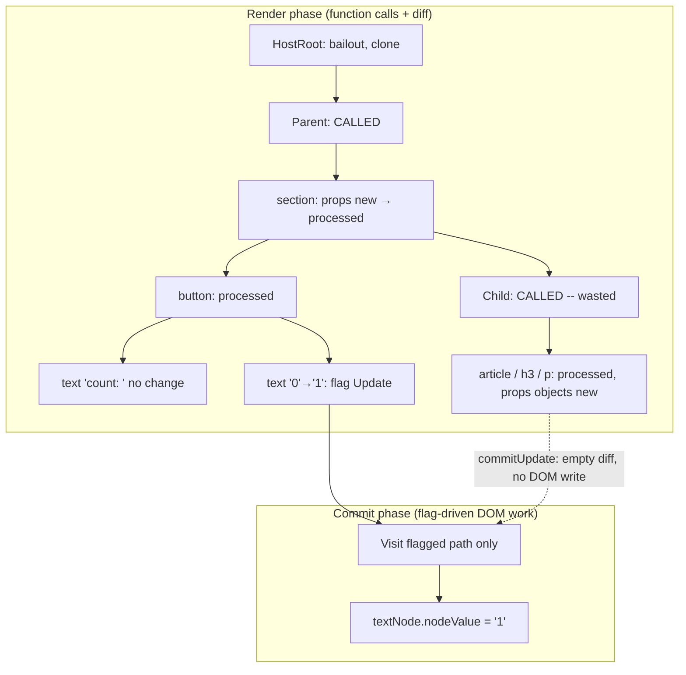
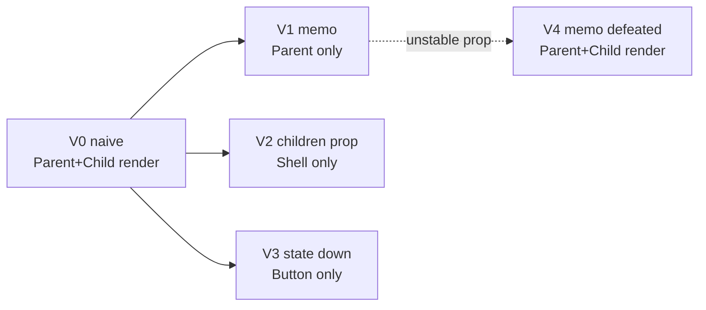

# 02 / 32 — Scenario A: Parent Rerenders, Child Props Unchanged

## 1. Lesson metadata

| | |
|---|---|
| **Level** | Advanced |
| **Study time** | 5–6 hours (reading 2 h, experiments 1.5 h, exercises 1.5 h) |
| **Prerequisites** | [01 — What triggers a render](./01-what-triggers-a-render.md), [02 — Render, reconcile, commit, paint](./02-render-reconcile-commit-paint.md), [06 — Reconciliation fundamentals](./06-reconciliation-fundamentals.md), [10 — Current and WIP trees](./10-current-and-work-in-progress-trees.md), [11 — Render phase vs commit phase](./11-render-phase-and-commit-phase.md), [28 — Strict Mode behavior](./28-strict-mode-behavior.md), [29 — Reasoning about unnecessary renders](./29-reasoning-about-unnecessary-renders.md), [30 — DevTools Profiler](./30-react-devtools-profiler.md) |
| **Next** | [33 — Scenario B: update only text in one element](./33-scenario-b-text-update.md) |
| **Related** | [31 — Reading React's source](./31-reading-react-source.md), [03/12 — `React.memo`](../03-react-state-and-hooks/12-react-memo.md), [03/18 — State colocation](../03-react-state-and-hooks/18-state-colocation-and-lifting.md), [07/03 — Why components rerender](../07-performance/03-why-components-rerender.md) |

**The scenario.** A parent component holds state. The user clicks, the state changes, and the parent re-renders. One of its children receives props whose *values* did not change. Question: **what exactly does React render, reconcile, commit, and discard — and which DOM operations occur?**

**Learning objectives.** After this lesson you can:
1. Produce a chronological, fiber-level timeline for a state update where a child's props are value-equal but not reference-equal.
2. State precisely, for each of the render phase, reconcile step, commit phase, and DOM, what happens to the unchanged child (function called: yes; DOM touched: no).
3. Predict the console output and DOM mutation records for five variants: naive, `memo`, children-as-props, state moved down, and `memo` defeated by an unstable prop.
4. Explain what happens to *work that React did but did not commit* (the discarded cases), including under a concurrent interruption.
5. Verify every claim in the timeline with three independent instruments: console/test counters, the React Profiler, and a `MutationObserver`.
6. Decide, with measured criteria, whether a case like this deserves any code change.

**Concepts covered:** default child re-render, new element identity, props object identity, begin/complete work for a bailout and for a non-bailout, "no flags" fibers, event-handler props and commit updates, subtree flags, commit with minimal mutations, Strict Mode doubling, interrupted/discarded work, `memo` shallow comparison, element-identity bailout.

> **Version-sensitive.** The *observable* results here (which functions are called, which DOM mutations occur) are what React documents or what the experiments in §5 and §10 verify; the §5 variants and the §5.8 test were executed on react/react-dom 19.3.1 + jsdom on 2026-10-22 and produced exactly the logs shown. The *fiber-level narration* (which internal step sets which flag) is a teaching model reflecting React 18/19; one detail was corrected on that date: in React 19 the "complete" step does **not** diff host props, it only compares props-object identity, so host fibers under a re-rendered component are flagged `Update` and `commitUpdate` diffs (and finds nothing to write) at commit time (see §3.3, T13, T16). Verify any narration using [Lesson 31's](./31-reading-react-source.md) method.

---

## 2. Deep conceptual explanation

### 2.1 What problem is this scenario solving?

This is the most common "React is re-rendering for no reason" situation. Three questions routinely get tangled:

1. *Will the child's function run?* (L1 in [Lesson 29](./29-reasoning-about-unnecessary-renders.md))
2. *Will the child's DOM change?* (L3)
3. *Is there a cost I should care about?*

The answers for the **default, naive** variant are: yes, no, and almost never. This lesson makes you able to prove each answer, so that you neither panic nor dismiss it.

### 2.2 The component tree

```tsx
// Scenario A — baseline (Variant 0)
import { useState } from "react";

export function Child({ title }: { title: string }) {
  console.log("render Child", title);
  return (
    <article className="card" style={{ padding: 8 }} data-testid="child">
      <h3>{title}</h3>
      <p>This body never changes.</p>
    </article>
  );
}

export function Parent() {
  const [n, setN] = useState(0);
  console.log("render Parent", n);
  return (
    <section>
      <button onClick={() => setN((x) => x + 1)}>count: {n}</button>
      <Child title="Static" />
    </section>
  );
}
```

The initial DOM after mount (inspect in the Elements panel):

```html
<section>
  <button>count: 0</button>          <!-- two text nodes: "count: " and "0" -->
  <article class="card" style="padding: 8px;" data-testid="child">
    <h3>Static</h3>                   <!-- one text node: "Static" -->
    <p>This body never changes.</p>
  </article>
</section>
```

Note `count: {n}` produces **two** adjacent text nodes (`"count: "` and `"0"`), because JSX gives `button` an array of two children ([33](./33-scenario-b-text-update.md) develops this). That detail determines exactly which DOM node will change.

### 2.3 The model in one paragraph

When `setN` runs, React marks `Parent` as having pending work. In the render phase React calls `Parent`, which returns a **brand-new element tree**: new `section`, `button`, and `Child` element objects. React walks that tree against the current fibers. The `Child` element is a new object with a new `props` object (`{ title: "Static" }`), so the cheap identity check ("same props object and no pending work?") fails, and — `Child` not being memoized — React calls `Child`. `Child` returns another new element tree, which reconciles against its existing fibers with new props objects. In current React the host fibers (`article`, `h3`, `p`) are flagged for update merely because their props *objects* changed; the commit then calls `commitUpdate`, which diffs old vs new props, finds nothing different, and writes nothing to the DOM (executed: their stored-props records were replaced, no mutation record appeared). In the commit phase the visible DOM work is the button's text node (the button fiber is also flagged for its changed handler, which only refreshes stored props). `Child`'s DOM nodes are *visited cheaply but never written*.

### 2.4 Which parts are "wasted"?

| Work | Executed? | Necessary? | Cost driver |
|---|---|---|---|
| `Parent` function call | Yes | Yes (own state) | Your code |
| Creating `section`/`button`/`Child` elements | Yes | Yes (output of Parent) | Allocation |
| `Child` function call | **Yes** | **No** (output identical) | `Child`'s own work |
| Elements created by `Child` (`article`, `h3`, `p`, style object) | Yes | No | Allocation |
| Reconciling `Child`'s subtree against its fibers | Yes | No | Proportional to subtree size |
| Setting props/attributes on `Child`'s DOM | **No** | — | Eliminated by the diff |
| Touching any `Child` DOM node | **No** | — | — |
| Browser style/layout/paint for `Child` | Only if the button's size change moves it | — | Browser |

The "waste" is L1 + L2 for `Child`'s subtree; **L3 is zero**.

### 2.5 Misconceptions this scenario kills

| Misconception | Reality shown by this scenario |
|---|---|
| "If the child's props didn't change, React won't call it." | React compares **identity** of the props object; `<Child title="Static" />` creates a new object each parent render. Without `memo`, the call happens. |
| "The child's DOM is re-created." | Nothing in `Child`'s DOM is created, removed, or modified. Node identity is preserved. |
| "A re-render replaces the DOM subtree." | Reconciliation diffs and applies the minimum; here that is one text node. |
| "The `style={{ padding: 8 }}` object means the DOM style is re-set each time." | React diffs style *properties*, not object identity; equal values produce no DOM write. |
| "The profiler flashing the child means the DOM changed." | The React DevTools flash means *rendered* (L1); only the Elements panel/`MutationObserver` shows DOM changes (L3). |
| "`memo` is how you prevent DOM updates." | The DOM was already not updated. `memo` prevents the **function call and diff**. |

---

## 3. Internal mechanics

### 3.1 Public guarantee vs teaching model vs implementation detail

| Aspect | Status |
|---|---|
| Children re-render when the parent re-renders unless memoized/stable | **Public guarantee** (documented default) |
| Re-render without a difference does not change the DOM | **Public guarantee** ([Render and commit](https://react.dev/learn/render-and-commit)) |
| `memo` skips when props are shallow-equal | **Public guarantee** ([`memo`](https://react.dev/reference/react/memo)) |
| Fibers of `Child` are reused (not re-created), so DOM nodes persist | **Public behavior** (identity/state preservation, [01/16](../01-react-fundamentals/16-state-preservation-and-reset.md)); fiber mechanics are teaching model |
| Props-object identity check as the first bailout gate | **Teaching model** (matches observed behavior; trace it with [31](./31-reading-react-source.md)) |
| Event-handler prop changes may mark the host fiber for an update with no DOM-visible effect | **Implementation detail**, varies by version; the observable fact is "no DOM mutation record" |
| Flags and `subtreeFlags` let commit skip unflagged subtrees | **Teaching model / implementation detail** ([20](./20-commit-and-dom-mutation.md)) |

### 3.2 The bailout decision, applied

For each fiber on the walk, "begin work" asks (conceptually, in this order of cheapness):

1. Is `oldProps !== newProps`? (identity)
2. Is there a pending update on this fiber in the lanes being rendered?
3. Did a context this fiber reads change?
4. Is the type/key different (then replace instead of update)?

If *any* answer indicates change, React renders the fiber. For `Child` in Variant 0, answer 1 is yes (new props object), so it renders. With `memo` (Variant 1), the check is *replaced* by a shallow comparison of prop values: `title === title` → equal → no render, and since `Child` has no pending work and no pending descendants, React reuses its subtree wholesale.

### 3.3 How a render with no difference ends up with no DOM operation

`Child` re-renders and returns `<article>…</article>`. React reconciles that against the existing `article` fiber:

- Same type (`article`), same key (none) → reuse the fiber, assign new pending props.
- Begin work on `article`: props object is new → render children: `h3` (reuse), `p` (reuse).
- `h3`'s only child is a string; for host elements whose sole child is a string/number React treats it as a *text-content prop* rather than creating a separate text fiber (an optimization; implementation detail, the observable result is the same). The old `children` prop `"Static"` equals the new → no change.
- `p` likewise.
- During "complete" for each host fiber with an existing DOM node, React 19 only checks whether the props *object* is the same as last time (`oldProps === newProps` in `updateHostComponent`, `ReactFiberCompleteWork.js` on `main`, 2026-10-22). It is not (the parent re-rendered), so the fiber is flagged `Update`. (Older React versions computed an update payload here.)
- At commit, `commitUpdate(domElement, type, oldProps, newProps)` runs `updateProperties`, which compares per property: `padding: 8` vs `padding: 8` → no change, `className` equal, text equal → **no DOM write**; it then stores the new props on the node for event dispatch. We confirmed on 19.3.1 that the `article` and `h3` nodes' internal props records were replaced after the click (with a `memo` child they were not), and that a `MutationObserver` on the child saw zero records.

Result: `Child`'s subtree is flagged but produces **no DOM operations**; the cost is the cheap `updateProperties` comparisons. (With `memo` or the `children` pattern, none of this happens.)

---

## 4. Step-by-step execution walkthrough (chronological timeline)

We trace one click on the "count" button of Variant 0, **without Strict Mode**, in a development or production build. Time moves down; each row says *which phase*, *what React does*, and *the DOM effect*.

### 4.1 Timeline

| # | Phase | Event / step | Renders? | Reconciles? | Commits? | DOM effect |
|---|---|---|---|---|---|---|
| T0 | Browser | User clicks. Browser dispatches a `click` event; React's root listener (delegation at the root container) receives it and finds the target fiber's `onClick` handler. | — | — | — | None |
| T1 | Event handler | React runs `onClick` inside its discrete-event handling. `setN(x => x + 1)` creates an update object (action = updater function) on `Parent`'s hook queue and marks `Parent`'s fiber and ancestors with a pending lane (sync-class for a discrete event). | — | — | — | None |
| T2 | Scheduling | The handler returns. React schedules a render for the root at the pending lane (flushed in a microtask queued by the setter for a discrete event; executed on 19.3.1). Two updates in the same event would be batched into one render ([22](./22-automatic-batching.md)). | — | — | — | None |
| T3 | Render: root | A work-in-progress (WIP) root is created from the current root. `beginWork(HostRoot)`: the root itself has no changes, but its child lanes indicate work below → clone children, continue to `Parent`. | No component fn called | — | — | None |
| T4 | Render: `Parent` | `beginWork(Parent)`: pending state update in the render lanes → bail-out is impossible. `renderWithHooks` calls `Parent()`; `useState` processes the queue and returns `n = 1`. **Console: `render Parent 1`.** Returns a new element tree. | **Yes** | Starts | — | None |
| T5 | Reconcile: `section` | `reconcileChildren` for `Parent`: single child element, type `"section"`, same as current → reuse fiber; new pending props. | — | **Yes** | — | None |
| T6 | Begin: `section` | Props object is new → not bailed out → reconcile its children array `[button, Child]` by position (no keys, same types) → reuse both fibers. | — | Yes | — | None |
| T7 | Begin: `button` | New props (`onClick` is a new arrow function each render; `children` is a new array `["count: ", 1]`). Reconcile children: two host text fibers reused with new text props `"count: "` and `1`. | — | Yes | — | None |
| T8 | Complete: text `"count: "` | Old text `"count: "` equals new → **no flag**. | — | — | — | None |
| T9 | Complete: text `"0"→"1"` | Old text `"0"` ≠ new `"1"` → mark fiber with **Update** flag. (The DOM text node is *not* touched yet.) | — | — | — | None |
| T10 | Complete: `button` | Host element with existing DOM node: React diffs props. Visible attributes unchanged. The `onClick` prop identity changed; React treats handler props specially (events are delegated at the root, not attached per element) — in React 19 the button is flagged `Update` (its props object changed) and its commit work only stores the new props on the node's internal record. **No DOM attribute/listener operation results.** | — | — | — | None yet |
| T11 | Begin: `Child` | `Child` element is a new object → new props object `{ title: "Static" }` → `oldProps !== newProps`; `Child` is not memoized → **render it.** `Child()` runs. **Console: `render Child Static`.** Returns new elements. | **Yes** (wasted) | Yes | — | None |
| T12 | Reconcile: `article`, `h3`, `p` | Same types, positions; fibers reused with new pending props. New `style` object created (`{ padding: 8 }`). | — | Yes (wasted) | — | None |
| T13 | Complete: `h3`, `p`, `article` | Props objects are new, so each host fiber is flagged `Update` (React 19 compares identity here, not values). The per-property comparison (`children` strings equal; `className` equal; `style.padding` equal; `data-testid` equal) happens later, in `commitUpdate`, and finds nothing to write. | — | — | — | None |
| T14 | Complete: `section`, `Parent`, root | Flags bubble: `subtreeFlags` on `Parent` now include the text Update, the button's Update, and `Child`'s host `Update` flags. The WIP tree is now `finishedWork`. | — | — | — | None |
| T15 | Commit: before mutation | Nothing to snapshot (no class `getSnapshotBeforeUpdate`). Passive effects (none here) would be scheduled. | — | — | **Starts** | None |
| T16 | Commit: mutation | React traverses only fibers whose subtree has flags. Reaches the button's second text fiber: sets `textNode.nodeValue = "1"`. (If the button fiber had an Update flag, its handler is recorded; no DOM write.) **`Child`'s host fibers are visited** (each gets `commitUpdate`, which diffs props and writes nothing). | — | — | Yes | **One text node: `"0"` → `"1"`** |
| T17 | Commit: swap | `root.current = finishedWork` — the WIP tree becomes the current tree; the old tree becomes the alternate pool for the next render ([10](./10-current-and-work-in-progress-trees.md)). | — | — | Yes | None |
| T18 | Commit: layout | No layout effects or ref changes. | — | — | Yes | None |
| T19 | Profiler | If wrapped in `<Profiler>`, `onRender` fires once for this commit with phase `"update"`. | — | — | — | None |
| T20 | Microtask | A `MutationObserver` callback is delivered with **one** `characterData` record. | — | — | — | None |
| T21 | Browser | Next rendering opportunity: style recalculation (the button's text width may change, which can alter layout of siblings), layout if needed, paint of the button region. | — | — | — | Pixels change |
| T22 | After paint | Passive effects flush (none here). | — | — | — | None |

### 4.2 What was discarded?

In this specific timeline, **nothing is thrown away**: the WIP tree built at T3–T14 is the one committed. But note which parts of that WIP tree were *pure overhead retained into the commit*: the `Child` fibers were cloned into the WIP tree (new pending props) and become the new `current`. The old `Child` fibers become the alternates; no memory is freed immediately (they are reused for the next update, [10](./10-current-and-work-in-progress-trees.md)). The "wasted" parts are CPU time spent calling `Child` and diffing, not allocated DOM.

What *is* discarded in this timeline are the **short-lived JavaScript objects**: the old element objects from the previous render, the old `style` object, the old `onClick` closure. They are garbage-collected eventually.

### 4.3 What if the render is interrupted? (Concurrent variant)

Make the update low priority:

```tsx
import { startTransition } from "react";
<button onClick={() => startTransition(() => setN((x) => x + 1))}>…</button>
```

Now the update gets a transition lane ([23](./23-transitions-and-deferred-rendering.md)). The render phase (T3–T14) may be **time-sliced**: React renders a few fibers, checks whether it should yield to the browser, and continues later. Suppose the user types in an unrelated urgent input while React is between T11 and T13:

| Step | What happens | Child function calls | DOM |
|---|---|---|---|
| U1 | Urgent update arrives (higher-priority lane). React stops the in-progress transition render. | `render Child` already logged once | None |
| U2 | React **abandons the WIP tree** (render-phase results discarded, flags never committed) and starts rendering the urgent update first from the *current* tree. | Child may or may not be re-called depending on whether it is in the urgent path | Urgent DOM updates commit |
| U3 | After the urgent commit, React **restarts** the transition render from the root. `Parent` and `Child` are called *again*. | `render Child` logged again (second time for the same click) | None until the transition commits |
| U4 | Transition commits: one text node update, as before. | — | One `characterData` mutation |

**Consequence for your reasoning:** the number of `render Child` log lines per click is **not** a stable measure; it can exceed 1 per user click with concurrent features even in production, because render-phase work can be repeated or abandoned. That is why [Lesson 12](./12-why-rendering-must-be-pure.md) insists render be pure, and why you count **commits** (Profiler) and **DOM mutations** (observer) for user-visible effects.

### 4.4 Same timeline with Strict Mode (development only)

Strict Mode ([28](./28-strict-mode-behavior.md)) calls component bodies twice in the same render pass, so T4 and T11 each log twice (`render Parent 1` ×2, `render Child Static` ×2). Effects, commits, and DOM mutations are unchanged: still **one** commit, **one** text mutation. React DevTools may display the second invocation's logs dimmed, depending on settings.

---

## 5. Code examples

Shared helper used by all examples. It is *test/diagnostic code*, not application code.

```tsx
// scenarioKit.tsx
import { useEffect, useRef, type ReactNode } from "react";

export const counters: Record<string, number> = {};
export function mark(name: string): void {
  counters[name] = (counters[name] ?? 0) + 1;
  // eslint-disable-next-line no-console
  console.log(`render ${name} (#${counters[name]})`);
}

function nodeName(n: Node): string {
  return n.nodeType === Node.TEXT_NODE ? `#text(${JSON.stringify(n.nodeValue)})` : (n as Element).tagName.toLowerCase();
}

export function DomLog({ children }: { children: ReactNode }) {
  const ref = useRef<HTMLDivElement>(null);
  useEffect(() => {
    const root = ref.current;
    if (!root) return;
    const mo = new MutationObserver((records) => {
      for (const r of records) {
        if (r.type === "characterData") {
          console.log(`[dom] characterData ${JSON.stringify(r.oldValue)} -> ${JSON.stringify(r.target.nodeValue)}`);
        } else if (r.type === "attributes") {
          console.log(`[dom] attribute ${r.attributeName} on <${(r.target as Element).tagName.toLowerCase()}> was ${JSON.stringify(r.oldValue)}`);
        } else {
          console.log(
            `[dom] childList on <${(r.target as Element).tagName.toLowerCase()}> +[${[...r.addedNodes].map(nodeName)}] -[${[...r.removedNodes].map(nodeName)}]`,
          );
        }
      }
    });
    mo.observe(root, {
      subtree: true, childList: true, attributes: true, attributeOldValue: true,
      characterData: true, characterDataOldValue: true,
    });
    return () => mo.disconnect();
  }, []);
  return <div ref={ref}>{children}</div>;
}
```

Line notes:
- `mark` mutates a module-level counter during render. It is deliberately impure (diagnostics only; see [12](./12-why-rendering-must-be-pure.md) and [29 §5.7](./29-reasoning-about-unnecessary-renders.md)) and will double-count in Strict Mode.
- `DomLog` observes its subtree's DOM. `MutationObserver` records are delivered in a microtask after the commit completes, so your logs appear *after* the `render …` logs for the same click.
- The cleanup `mo.disconnect()` keeps Strict Mode's mount/cleanup/mount from leaving a stale observer.

### 5.1 Variant 0 — naive (baseline)

```tsx
import { useState } from "react";
import { DomLog, mark } from "./scenarioKit";

function Child({ title }: { title: string }) {
  mark("Child");
  return (
    <article className="card" style={{ padding: 8 }} data-testid="child">
      <h3>{title}</h3>
      <p>This body never changes.</p>
    </article>
  );
}

export function ParentV0() {
  const [n, setN] = useState(0);
  mark("Parent");
  return (
    <DomLog>
      <section>
        <button onClick={() => setN((x) => x + 1)}>count: {n}</button>
        <Child title="Static" />
      </section>
    </DomLog>
  );
}
```

**Predict** (no Strict Mode; click once after mount): console lines?

**Result:**
```
render Parent (#2)
render Child (#2)
[dom] characterData "0" -> "1"
```
(`#1` were the mounts.) Two function calls, one DOM mutation. Notice that `DomLog` does not re-render at all in this variant? It does: `ParentV0` renders `<DomLog>…</DomLog>`, a new element → `DomLog` re-renders, but we did not instrument it. This is itself a lesson: *every* un-memoized component between the state owner and the leaves re-runs. Instrument everything you reason about.

### 5.2 Variant 1 — `memo`

```tsx
import { memo, useState } from "react";
import { DomLog, mark } from "./scenarioKit";

const Child = memo(function Child({ title }: { title: string }) {
  mark("Child");
  return (
    <article className="card" style={{ padding: 8 }} data-testid="child">
      <h3>{title}</h3>
      <p>This body never changes.</p>
    </article>
  );
});

export function ParentV1() {
  const [n, setN] = useState(0);
  mark("Parent");
  return (
    <DomLog>
      <section>
        <button onClick={() => setN((x) => x + 1)}>count: {n}</button>
        <Child title="Static" />
      </section>
    </DomLog>
  );
}
```

**Result per click:**
```
render Parent (#k)
[dom] characterData "k-1" -> "k"
```
`Child` is absent. The timeline differs from §4.1 only at T11: `beginWork(Child)` performs the shallow comparison `{title:"Static"}` vs `{title:"Static"}` → equal; the fiber has no pending work and no pending descendants → bailout: the previous children fibers are reused and the **entire `article` subtree is skipped** (T12–T13 never happen for it). Commit is identical (one text mutation).

**Trade-off:** each parent render now pays one prop comparison for `Child`. For one string prop this is negligible; the saved work is `Child`'s whole render and reconcile.

### 5.3 Variant 2 — content passed as `children` (no memo)

```tsx
import { useState, type ReactNode } from "react";
import { mark } from "./scenarioKit";

function Child({ title }: { title: string }) {
  mark("Child");
  return (
    <article className="card" data-testid="child">
      <h3>{title}</h3>
    </article>
  );
}

function CounterShell({ children }: { children: ReactNode }) {
  const [n, setN] = useState(0);
  mark("CounterShell");
  return (
    <section>
      <button onClick={() => setN((x) => x + 1)}>count: {n}</button>
      {children}
    </section>
  );
}

export function App() {
  mark("App");
  return (
    <CounterShell>
      <Child title="Static" />
    </CounterShell>
  );
}
```

**Predict:** click: which of `App`, `CounterShell`, `Child` log?

**Result:** only `render CounterShell`. `App` has no state and does not re-run; the `<Child title="Static" />` element object was created during `App`'s *last* run and stored in `CounterShell`'s `children` prop. When `CounterShell` re-renders, it re-uses the **same** element reference. `beginWork(Child)` sees `oldProps === newProps` (the element's props object is literally the same object) and no pending work → bailout without any comparison function. This is the *same-element* bailout ([29 §2.6](./29-reasoning-about-unnecessary-renders.md)). It is a consequence of how elements and props work and is widely relied on; treat it as dependable but not a named API.

### 5.4 Variant 3 — state moved down

```tsx
import { useState } from "react";
import { mark } from "./scenarioKit";

function CounterButton() {
  const [n, setN] = useState(0);
  mark("CounterButton");
  return <button onClick={() => setN((x) => x + 1)}>count: {n}</button>;
}

function Child({ title }: { title: string }) {
  mark("Child");
  return <h3>{title}</h3>;
}

export function ParentV3() {
  mark("Parent");
  return (
    <section>
      <CounterButton />
      <Child title="Static" />
    </section>
  );
}
```

**Result:** click → only `render CounterButton`. The state owner is the button; nothing above or beside it re-runs. This is the cheapest and most robust fix: no comparisons, no dependency arrays ([03/18](../03-react-state-and-hooks/18-state-colocation-and-lifting.md)). Its limit: if `Child` genuinely needs `n`, the state cannot move down.

### 5.5 Incorrect — `memo` defeated by an unstable prop

```tsx
const Child = memo(function Child({ style }: { style: { padding: number } }) {
  mark("Child");
  return <article style={style}><h3>Static</h3></article>;
});

export function ParentBad() {
  const [n, setN] = useState(0);
  return (
    <section>
      <button onClick={() => setN((x) => x + 1)}>count: {n}</button>
      <Child style={{ padding: 8 }} />   {/* ❌ new object every Parent render */}
    </section>
  );
}
```

**Predict:** does `Child` log on click? **Yes, every time.** `style` is a new object: `Object.is(prev.style, next.style)` is false, so `memo` falls through to rendering. The DOM result is still *nothing changed* in `Child`. This is the worst of both worlds: you pay a comparison *and* the render.

### 5.6 Corrected options

```tsx
// Option A: hoist a constant (static value)
const cardStyle = { padding: 8 } as const;
<Child style={cardStyle} />

// Option B: pass primitives, build the object inside Child
<Child padding={8} />

// Option C: derived from props/state — memoize with real dependencies
const style = useMemo(() => ({ padding }), [padding]);
<Child style={style} />
```

Prefer A or B. C is correct but adds dependency-array maintenance for a trivial value; use it when computation or identity truly matters.

### 5.7 Advanced — children memoized while the parent passes JSX children

```tsx
const Panel = memo(function Panel({ children }: { children: ReactNode }) {
  mark("Panel");
  return <aside>{children}</aside>;
});

function ParentC() {
  const [n, setN] = useState(0);
  return (
    <>
      <button onClick={() => setN((x) => x + 1)}>{n}</button>
      <Panel><span>hello</span></Panel>   {/* ❌ children is a new element each render */}
    </>
  );
}
```

**Result:** `Panel` re-renders every click despite `memo`: `children` is a freshly created `<span>` element. Fix by hoisting the element (`const hello = <span>hello</span>` outside the component) or using Variant 2's structure. It is a common surprise because there is no visible "prop" in the JSX.

### 5.8 Automated verification (Vitest + Testing Library)

```tsx
import { render, screen } from "@testing-library/react";
import userEvent from "@testing-library/user-event";
import { describe, expect, it, vi } from "vitest";
import { useState } from "react";

const childRender = vi.fn();

function Child({ title }: { title: string }) {
  childRender();
  return (
    <article data-testid="child">
      <h3>{title}</h3>
    </article>
  );
}

function Parent() {
  const [n, setN] = useState(0);
  return (
    <section>
      <button onClick={() => setN((x) => x + 1)}>count: {n}</button>
      <Child title="Static" />
    </section>
  );
}

describe("Scenario A: parent re-render, unchanged child props", () => {
  it("calls Child again but leaves its DOM untouched", async () => {
    render(<Parent />);
    const childNode = screen.getByTestId("child");
    const records: MutationRecord[] = [];
    const mo = new MutationObserver((r) => records.push(...r));
    mo.observe(childNode, { subtree: true, childList: true, attributes: true, characterData: true });

    childRender.mockClear();
    await userEvent.click(screen.getByRole("button"));
    records.push(...mo.takeRecords());
    mo.disconnect();

    expect(childRender).toHaveBeenCalledTimes(1); // L1 happened
    expect(records).toHaveLength(0);              // L3 did not
    expect(screen.getByTestId("child")).toBe(childNode); // same DOM node object
    expect(screen.getByRole("button").textContent).toBe("count: 1");
  });
});
```

Notes: Testing Library does not enable Strict Mode by default (it can be configured), so one call is expected. The observer is attached to the *child's* node only, so the button's text mutation is intentionally out of scope. The assertion `toBe(childNode)` proves the node was not replaced. Asserting call counts is brittle in general ([Phase 8](../08-testing-and-quality/16-avoiding-brittle-tests.md)); use it to *teach and to guard a documented performance contract*, not for every component.

---

## 6. Visual explanations

### 6.1 Which fibers are touched in each phase



### 6.2 Variant comparison



### 6.3 DOM nodes over time (identity)

```text
              before click                      after click
section  ───────────────────────────────  same node
 ├─ button ─ text"count: " ─ text"0"        same button, same first text, SECOND text node data = "1"
 └─ article.card ─ h3 ─ text"Static"        SAME nodes, untouched (no mutation records)
              └ p ─ text"This body…"
```

---

## 7. Alternative approaches and trade-offs

| Approach | Child function called? | DOM touched? | Code cost | Risk | Best when |
|---|---|---|---|---|---|
| **V0 do nothing** | Yes | No | None | None | Child is cheap (typical); update is infrequent |
| **V1 `memo`** | No (if props stable) | No | One wrapper + prop discipline | Defeated by unstable props; stale-UI if custom comparator wrong | A heavy child receives primitive or stable props; parent updates often |
| **V2 `children`/slot** | No | No | Restructure composition | API shape constraints | Layout/shell components owning state |
| **V3 move state down** | No | No | Refactor | None | State is only needed by a small subtree |
| **`useMemo` the element** (`const el = useMemo(() => <Child …/>, [deps])`) | No (same element) | No | Dependency array | Easy to get deps wrong; reads oddly | Rare; when you cannot restructure or memo |
| **Context/store with selectors** | Only subscribed consumers | No | Architecture cost | Over-engineering | State is genuinely shared widely |
| **React Compiler** | Often no (auto-memoized) | No | Build tooling | Rule-abiding code required | Whole code base adoption; see react.dev/learn/react-compiler |
| **Virtualize** | Only visible items | No | Library | A11y/scroll complexity | Count of children is the problem |

**Where the recommended approach (move state down / children) is NOT best.** If `Child` is rendered inside a design-system `DataGrid` you do not control and the parent state must live above (shared with the toolbar), then wrapping the heavy cell component in `memo` with a documented immutable-props contract is the only practical option. Likewise, when `Child` depends on `n` *and* other things, colocating is impossible and `memo` with derived primitives is the tool.

---

## 8. Best practices and anti-patterns

### 8.1 Practices
1. **Instrument before judging**: log, Profile, observe DOM. A suspected waste that costs 0.05 ms is not a bug.
2. **Try structure first** (colocate state, pass children), memo second, hooks third.
3. **Keep props primitive or immutable-stable** at memoized boundaries.
4. **Treat render logs as non-semantic** (Strict Mode, concurrency).
5. **Leave stable comments** at intentional memo boundaries explaining the contract ("rows are immutable; keep `onToggle` stable").

### 8.2 Beginner mistakes
- Expecting a child with unchanged props not to be called.
- Concluding the DOM was rebuilt because the DevTools highlighted the component.
- Wrapping `Child` in `memo` and then passing `{...}` literals.

### 8.3 Experienced-developer mistakes
- Memoizing the child but not stabilizing a callback prop.
- Adding `memo` to dozens of components "to be safe" and thereby hiding real design problems (state too high).
- Moving state *up* to avoid prop drilling, thereby widening the re-render blast radius, without measuring.
- Forgetting that context changes bypass `memo` on intermediate components.

### 8.4 Smells
| Smell | Interpretation |
|---|---|
| Parent has many unrelated `useState`s and a huge JSX tree | State is doing too many jobs; split into components |
| Every child is `memo` and every handler `useCallback` | Cargo cult; remove and measure |
| `key={Math.random()}` "to force update" | Destroys identity; see [34](./34-scenario-c-list-reorder.md) |
| A `memo` custom comparator that ignores props | Stale UI waiting to happen |

### 8.5 Justified exceptions
- A heavy chart that re-renders on every tick of a clock in its parent: `memo` with stable props is justified even if the structural fix is possible, when moving the clock down would distort the component API.
- A deliberately inline `onClick` on a leaf button that is not memoized: fine, the "unstable" function is harmless where nothing compares it.

---

## 9. Real-world application

| Domain | Scenario A in the wild | Constraint | Resolution |
|---|---|---|---|
| **E-commerce** | Quantity stepper in a product page re-renders a 3D viewer and review list | Viewer is expensive; keep 60 fps on mid-tier phones | Move stepper state down; or memo the viewer with stable props |
| **Dashboard** | A "last refreshed" clock in the header re-renders every widget each second | Hundreds of nodes; battery use | `children`/slot layout: clock component isolated; widgets are elements created above |
| **Finance** | Row selection state in the table container re-renders all rows | Large tables, keyboard navigation | `memo` rows with immutable row objects; selection as `Set` consulted via selector or per-row boolean prop |
| **Forms** | Form-level `isDirty` state re-renders all fields | Many fields; typing latency | Field-level state; compute `isDirty` lazily or via subscription |
| **Auth** | Session countdown banner re-renders the whole shell | Wide trees | Isolate countdown component |
| **Realtime** | Presence indicator updates every few seconds and re-renders the chat transcript | Scroll/focus must not jump | Separate presence into its own component; transcript is stable elements |
| **Multi-team** | Team A's page owns state; Team B's widget (heavy) is mounted as a child | You cannot edit B | Wrap B's widget in a local `memo` adapter with a stable prop contract |

---

## 10. Debugging and troubleshooting

### 10.1 Symptom: "Child re-renders when parent state changes"
**Reproduce:** Variant 0.
**Investigate:**
1. Is it Strict Mode? Compare commit count and DevTools logs.
2. React DevTools → Profiler, enable *Record why each component rendered while profiling* ([30](./30-react-devtools-profiler.md)); record one click. Select `Child`: expect **"The parent component rendered"**.
3. Is `Child` memoized? If yes and the reason is "Props changed: x", inspect `x`'s identity.

**Root cause:** default child re-render, or unstable props defeating `memo`.
**Validate fix:** re-record; `Child` is grey in the flamegraph; test in §5.8 expects 0 calls after the change.

### 10.2 Symptom: "I think the DOM is being replaced"
Check **node identity**: in the console, `const n = document.querySelector('[data-testid=child]'); window.__n = n;` click, then `document.querySelector('[data-testid=child]') === window.__n`. `true` means the same node (not replaced). In Chrome, the Elements panel highlights changed nodes briefly; if `Child`'s subtree does not flash, it was not modified. For rigorous proof use `MutationObserver` (§5 `DomLog`).

### 10.3 Symptom: "`memo` doesn't work"
Checklist: (1) which prop changed (Profiler reason); (2) any JSX `children`; (3) inline objects/arrays/functions; (4) context consumption inside the component (memo can't help); (5) is the component **re-created** each render (defined inside the parent function → new type → full remount, not just re-render!). Item 5 is severe:

```tsx
function Parent() {
  const Child = memo(() => <div />); // ❌ new component type every render → unmount/mount each time
  return <Child />;
}
```
Different type at the same position means React destroys the old subtree and mounts a new one: state lost and L3 churn ([06](./06-reconciliation-fundamentals.md), [07](./07-identity-keys-and-reconciliation.md)).

### 10.4 Symptom: "Child's `useEffect` runs on every parent render"
Not Scenario A: effects run when their dependencies change, not whenever the component renders. A missing or unstable dependency (new object each render) re-runs the effect ([03/05](../03-react-state-and-hooks/05-effect-dependencies-and-stale-closures.md)). Rendering without an effect re-run causes no side effects.

### 10.5 How to confirm "no DOM operations" end-to-end
1. Profiler: `Child` colored in V0 (L1), grey in V1.
2. Elements panel: only the button text flashes.
3. `MutationObserver`/test: zero records within `Child`'s subtree.
4. (Optional, advanced) Performance panel: the "Recalculate style"/"Layout" entries relate only to the button area. A changed button width can shift siblings; layout may include `Child`'s box position without any DOM change *to `Child`* — layout reflow is a browser pipeline effect, not a React DOM operation.

---

## 11. Exercises

### Level A — Knowledge
A1. For Variant 0, list which functions run on a click and which DOM operations occur.
A2. Why does `count: {n}` produce two text nodes?
A3. State the difference between "the component re-rendered" and "the DOM updated."
A4. Why does Variant 2 skip `Child` without `memo`?
A5. What does the Profiler's *"The parent component rendered"* reason imply about the child's props?

### Level B — Code comprehension
B1. In Variant 1, `ParentV1` passes `title={"Static" + ""}`. Does `Child` render? What if it passes `title={new String("Static") as unknown as string}`?
B2. Predict logs after one click for:
```tsx
const Leaf = memo(function Leaf() { mark("Leaf"); return <i />; });
function Mid({ children }: { children: ReactNode }) { mark("Mid"); return <div>{children}</div>; }
function Top() {
  const [n, setN] = useState(0);
  mark("Top");
  return <><button onClick={() => setN(n + 1)}>{n}</button><Mid><Leaf /></Mid></>;
}
```
B3. In which timeline step (T-number) does the DOM first change? Why is it not at T9?
B4. What changes in the timeline if `Child` contains a `useEffect(() => {...})` with no dependency array?

### Level C — Implementation
C1. Refactor Variant 0 so that `Child` does not render on click, using each of the three structural patterns (memo, children, state-down). Write the code.
C2. Write a `useRenderTrace(name)` hook based on `useEffect` (no deps) that logs commits, and use it to show that in V1 `Child` has no commit-visible activity.
C3. Extend the §5.8 test to add a second test for Variant 1 asserting `childRender` was called 0 times after the click.

### Level D — Debugging
D1. A team's `memo(Row)` still re-renders. Rows get `columns={cols.filter(c => c.visible)}`. Diagnose and fix.
D2. After you wrapped `Child` in `memo`, the UI stopped updating when `title` changed. What did the author do wrong?
D3. A developer claims "memo made the DOM update less often." Evaluate the claim using the timeline.

### Level E — Architecture and engineering decisions
E1. A dashboard shell has `useState` for `theme`, `sidebarOpen`, `selectedWidgetId`, and `timeRange`. Twenty widgets read none of them except `timeRange`. Propose a state placement and memo strategy; justify each decision with the Scenario A model.
E2. Argue for or against enabling the React Compiler (react-compiler 1.0.0 is on npm as of 2026-10-22; check current docs) instead of manual `memo` in a code base where Scenario A comes up daily. Include your verification plan.

### Level F — Expert challenge
F1. Construct a case where a parent re-render with value-equal props causes a **DOM mutation** in the child. (Hint: think about what the child renders.)
F2. Explain how Scenario A's timeline changes when `Child` suspends on the re-render. Which work is discarded, and what DOM is visible?
F3. Design a measurement showing that for a given app the "waste" in V0 is below the noise floor, and state the criteria for when you would instead refactor.

---

## 12. Detailed answers and explanations

> Attempt the exercises first.

**A1.** Functions: `Parent` and `Child` (and any un-memoized intermediate components). DOM operations: exactly one text node update (`"0"`→`"1"`), no operations on `Child`'s nodes; possibly an internal props record update for the button's handler (no DOM mutation).

**A2.** JSX `count: {n}` compiles to `children: ["count: ", n]`. A host element with an array of children gets one text fiber (and one DOM text node) per text child. Only a *single* string/number child is applied as text content. Therefore the DOM has `"count: "` and `"0"` as separate nodes, and only the second changes.

**A3.** Re-render = React called the function and diffed the result (L1/L2). DOM update = the commit applied a difference (L3). The first does not imply the second.

**A4.** The `<Child />` element object is created by `App`, which does not re-run; `CounterShell` forwards the same element reference as `children`. Same element → same props object → no change and no pending work → bailout.

**A5.** It means the only cause DevTools found was that the parent rendered: the child's own state, hooks, and context did not change. For a non-memoized child that says nothing about prop values; they may well be value-equal (this scenario). For a memoized child, a changed prop would instead be reported as "Props changed" with the prop names, so seeing "The parent component rendered" there would be unexpected and worth investigating.

**B1.** `"Static" + ""` is the primitive string `"Static"` → equal → `Child` skipped (renders 0). `new String("Static")` creates a *new object* each time; `Object.is(obj1, obj2)` is false → `Child` re-renders every time (and `title` is not a string primitive any more; TypeScript would require a cast, a sign of misuse).

**B2.** Click → `Top` (state), `Mid` (new `children` prop? `Mid` is rendered as a new element with new props → `Mid` renders). `Leaf` is memoized with no props: `<Leaf />` creates a new element, but the shallow comparison of `{}` vs `{}` passes → skipped. Logs: `render Top`, `render Mid`. No `Leaf`.

**B3.** At **T16** (commit mutation). T9 only *marks* the text fiber with an Update flag during the render phase; render never touches the live DOM — that is what makes render abandonable ([11](./11-render-phase-and-commit-phase.md)).

**B4.** An effect with no dependency array re-runs after every commit in which `Child` rendered. In V0, `Child` renders, so its effect cleanup and setup run in the passive phase after T18 (after commit; possibly after paint). This makes the "wasted" render *observable* (effect re-run), and, if the effect has side effects (fetch/log), harmful. This is why effects need correct dependency arrays: render frequency must not control side-effect frequency.

**C1.**
```tsx
// memo
const Child = memo(ChildImpl);
// children
function Shell({ children }: { children: ReactNode }) { const [n, setN] = useState(0); return <section><button onClick={() => setN(x => x + 1)}>count: {n}</button>{children}</section>; }
const App = () => <Shell><ChildImpl title="Static" /></Shell>;
// state-down
function CounterButton() { const [n, setN] = useState(0); return <button onClick={() => setN(x => x + 1)}>count: {n}</button>; }
const ParentV3 = () => <section><CounterButton /><ChildImpl title="Static" /></section>;
```
Each skips `ChildImpl` for a different reason: shallow comparison; element identity; no re-render of the parent at all. State-down is robust against future prop additions; `memo` can be silently defeated.

**C2.**
```tsx
function useRenderTrace(name: string) {
  const commits = useRef(0);
  useEffect(() => { commits.current += 1; console.log(`[commit] ${name} #${commits.current}`); });
}
```
In V1, after a click only `Parent` (and `DomLog`) log commits; `Child` does not, because it did not render so its no-deps effect did not re-run.

**C3.**
```tsx
it("memoized Child is not called", async () => {
  const Child = memo(function Child({ title }: { title: string }) { childRender(); return <h3 data-testid="child">{title}</h3>; });
  function P() { const [n, setN] = useState(0); return <section><button onClick={() => setN(x => x + 1)}>{n}</button><Child title="Static" /></section>; }
  render(<P />);
  childRender.mockClear();
  await userEvent.click(screen.getByRole("button"));
  expect(childRender).not.toHaveBeenCalled();
});
```

**D1.** `cols.filter(...)` creates a new array each render → `columns` prop never `Object.is`-equal. Fixes: compute the filtered array once with `useMemo(() => cols.filter(...), [cols])` in the parent, or pass `cols` and let the row filter internally (then rows depend on a stable prop), or pass a stable ids list. Avoid a custom comparator that ignores `columns`.

**D2.** Likely a custom `arePropsEqual` that omitted `title`, or `title` is being *mutated* (same object identity with changed content, e.g., a mutated array/object prop), so shallow equality says "unchanged". Fix: treat props immutably (new reference on change) and remove the faulty comparator.

**D3.** Wrong. The DOM was already not updated in V0. `memo` reduced function calls and reconciliation work (L1/L2), not DOM writes. The timeline shows T16 is identical in V0 and V1.

**E1.** Evaluation criteria: state is colocated with consumers; widgets receive `timeRange` as a primitive/stable object; `theme` in context consumed only where needed (CSS variables avoid re-rendering at all); `sidebarOpen` local to `Sidebar`/`Layout` that owns it; `selectedWidgetId` kept in the component tree level that includes selection consumers only. Widgets: heavy ones `memo`'d with primitive props; layout shell passes widgets as `children`. Verify with Profiler: toggling the sidebar should show widgets grey.

**E2.** Evaluation criteria: Compiler can automatically memoize components/values in rule-abiding code, reducing manual `memo`; risks: build integration, rule violations leaving components uncompiled, debuggability, version volatility; verification plan: enable in a branch, run the Profiler on key flows to confirm skipped renders (DevTools may mark compiled components), run the test suite, compare INP and commit durations, and keep structural fixes (state-down) since they are compiler-independent.

**F1.** Child renders something that depends on a value that is not part of its props: e.g. `new Date().toLocaleTimeString()`, `Math.random()`, `window.innerWidth`, a mutable module variable, a ref read during render. Value-equal props, but the *output* differs, so the diff finds a change and commits a DOM update. That is an impure render ([12](./12-why-rendering-must-be-pure.md)) and an example of why React cannot assume skipping is safe by default.

**F2.** With `Child` suspending during the re-render (e.g., it calls `use(promise)` with an unresolved promise, [24](./24-suspense-conceptual-internals.md)): React unwinds the render to the nearest `Suspense` boundary. For a non-transition update, the boundary shows its fallback — the already-visible content is hidden (not unmounted; its DOM and state are preserved, hidden) and the fallback appears; render-phase work for the suspended subtree is discarded. If the update was a *transition*, React keeps the current UI and does not show the fallback, committing nothing until ready. The earlier text-node update from `Parent` is part of the same render, so it also doesn't appear until the commit. Executed in lesson [36](./36-scenario-e-suspend.md)'s checks and in [24](./24-suspense-conceptual-internals.md) on react 19.3.1; the content is hidden with `display: none !important` and, for a non-transition update, the text update commits together with the fallback.

**F3.** Example: record 10 clicks under 4× CPU throttling in a profiling build; compute the median `actualDuration` of `Child` per commit and the median commit duration; if `Child`'s render ≈ 0.05 ms and INP is far below the target (e.g., < 200 ms), the waste is below noise. Refactor when (a) `Child` is > ~1–2 ms or its subtree is large, (b) the interaction repeats at high frequency (>10 Hz), (c) INP exceeds budget with `Child` on the critical path, or (d) renders cause side effects. Also document the decision in the PR with before/after recordings.

---

## 13. Senior engineer interview questions

**Q1. A parent updates state; a child with unchanged props shows a render in the Profiler. Explain.**
*Strong answer.* Default behavior: the parent's render creates a new element for the child; props identity changes; the child isn't memoized, so React calls it. The reconciler then finds no differences, so commit performs no DOM work for the child. I'd measure whether the render matters before changing anything; if it does, move state down or memoize with stable props.

**Q2. Does `memo` prevent DOM updates?**
*Strong answer.* No; DOM updates are already limited to differences. `memo` skips calling the component and diffing its subtree. It doesn't help if the child's output would actually change.

**Q3. Why does passing `children` avoid re-rendering the child?**
*Strong answer.* The element is created by an ancestor that did not re-render, so the prop reference is identical; React sees the same props object and no pending work and reuses the subtree.

**Q4. A teammate says "React re-creates the DOM for the child." How do you show otherwise?**
*Strong answer.* Compare node identity before/after, observe with `MutationObserver` or the Elements panel flash, and show the React Profiler vs mutation records: the component rendered, but no mutation occurred.

**Q5. What can make render logs per click exceed 1 in production?**
*Strong answer.* Concurrent rendering restarts/abandons (transitions interrupted by urgent updates), Suspense retries, multiple state updates producing multiple commits, parent chain re-rendering several times. So count commits and mutations, not logs.

**Q6. When would you *not* fix this?**
*Strong answer.* When the child is cheap and the update infrequent: the cost is below the noise floor, and added memoization hurts readability and risks stale UI.

---

## 14. Further learning resources

| Resource | URL | Covers / why | Level | Section to study |
|---|---|---|---|---|
| React docs — Render and Commit | <https://react.dev/learn/render-and-commit> | Rendering vs committing; DOM changes only for differences | Beginner–Int. | "Step 3: React commits changes to the DOM" |
| React docs — `memo` | <https://react.dev/reference/react/memo> | Skipping re-renders; prop comparison; caveats | Intermediate | "Skipping re-rendering when props are unchanged" |
| React docs — State: a component's memory | <https://react.dev/learn/state-a-components-memory> | State and re-render trigger | Beginner | Whole page |
| React docs — Preserving and resetting state | <https://react.dev/learn/preserving-and-resetting-state> | Why fibers and DOM nodes persist across renders | Intermediate | "State is tied to a position in the render tree" |
| React docs — `Profiler` | <https://react.dev/reference/react/Profiler> | Programmatic commit measurement | Intermediate | Reference |
| React docs — React Developer Tools | <https://react.dev/learn/react-developer-tools> | Highlight updates, Profiler | Beginner | Whole page |
| MDN — MutationObserver | <https://developer.mozilla.org/en-US/docs/Web/API/MutationObserver> | Observing DOM changes | Intermediate | Whole page |
| React repository | <https://github.com/facebook/react> | Source for bailout logic | Advanced | See [31](./31-reading-react-source.md) |

---

## 15. Knowledge checkpoint

**You should now understand:** that a parent's re-render calls its non-memoized children, that the diff then finds nothing to change, and that commit therefore performs only the one necessary DOM operation.

**You should be able to explain:** each timeline step (T0–T22), including where the child's work is "wasted" and where nothing is discarded; why concurrent rendering can repeat or discard such work; and why identity (not value) drives the bailout gate.

**You should be able to implement:** the four structural fixes and the three-instrument verification (counter/test, Profiler, `MutationObserver`).

**You should be able to debug:** "memo doesn't work" cases by finding the unstable prop, re-created component type, context consumption, or hidden `children` identity.

**Prerequisite for next lesson:** [33 — Scenario B: update only text in one element](./33-scenario-b-text-update.md) zooms into the *commit* side: exactly which DOM operation React uses for a text change and what it leaves untouched.
