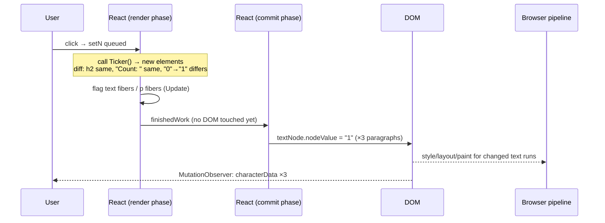
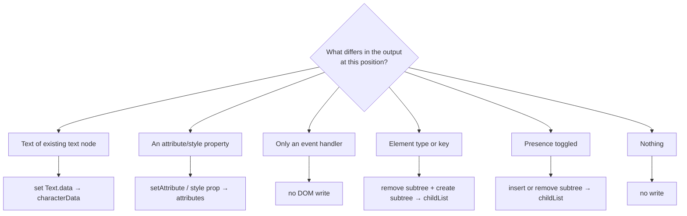

# 02 / 33 — Scenario B: Update Only Text in One Element

## 1. Lesson metadata

| | |
|---|---|
| **Level** | Advanced |
| **Study time** | 4–5 hours (reading 1.75 h, experiments 1.25 h, exercises 1.5 h) |
| **Prerequisites** | [02 — Render, reconcile, commit, paint](./02-render-reconcile-commit-paint.md), [03 — Initial mount and updates](./03-initial-mount-and-updates.md), [05 — React elements vs DOM nodes](./05-elements-vs-dom-nodes.md), [06 — Reconciliation fundamentals](./06-reconciliation-fundamentals.md), [11 — Render phase vs commit phase](./11-render-phase-and-commit-phase.md), [20 — Commit work and DOM mutations](./20-commit-and-dom-mutation.md), [22 — Automatic batching](./22-automatic-batching.md), [30 — DevTools Profiler](./30-react-devtools-profiler.md), [32 — Scenario A](./32-scenario-a-parent-rerender.md) |
| **Next** | [34 — Scenario C: list reorder with/without stable keys](./34-scenario-c-list-reorder.md) |
| **Related** | [21 — Browser paint and React updates](./21-browser-paint-and-react-updates.md), [31 — Reading React's source](./31-reading-react-source.md), [00/03 — Browser rendering pipeline](../00-web-and-javascript-foundations/03-browser-rendering-pipeline.md) |

**The scenario.** A component's state changes in a way that alters exactly one piece of text in one element: `Count: 0` becomes `Count: 1`. Everything else the component returns is identical. Question: **which DOM operation does React perform, what does it leave untouched, and what is computed and thrown away along the way?**

**Learning objectives.** After this lesson you can:
1. Produce a chronological timeline from `setState` to the single DOM write, identifying what is rendered, reconciled, flagged, committed, and discarded.
2. Explain why `<p>Count: {n}</p>` and `<p>{`Count: ${n}`}</p>` produce **different DOM structures** (two text nodes versus one) and why both result in a text-node data update rather than node replacement.
3. Predict the `MutationObserver` record type for text updates in five situations, including the case where the update is an insertion or a removal instead of a data change.
4. Build the decision table "what changed in the output → which DOM operation" for text, attributes, styles, event handlers, element type, and presence.
5. Show that batching and interrupted renders mean intermediate text values may be computed but never reach the DOM.
6. Verify the claims with three instruments: `MutationObserver`, the Elements panel, and the React Profiler, and tie one step to the source using [Lesson 31's](./31-reading-react-source.md) method.

**Concepts covered:** HostText fibers, text content optimization for a sole string/number child, `nodeValue` vs `textContent`, `characterData` vs `childList` mutation records, prop diffing for host elements, minimal mutation, batching and discarded intermediate renders, selection/IME/accessibility consequences of node preservation, DOM breakpoints.

> **Version-sensitive.** The *observable* DOM behavior (the same text node is updated in place; no sibling is touched) is stable across the React versions in the curriculum baseline and was **executed on react/react-dom 19.3.1 + jsdom on 2026-10-22** (`MutationObserver` on `Count: {n}`, `{`Count: ${n}`}`, `{n}`; equal re-render; empty-string transitions; style/class/title changes; batched `setN(1);setN(2);setN(3)`): all observer outputs in this lesson matched. The *internal route* (which fiber type represents the text, which function writes it, how the update payload is computed) has been reorganized between React 17, 18, and 19; in React 19 the diff of host props happens at commit time in `commitUpdate`, not in `completeWork` (see §3.3). Use [Lesson 31](./31-reading-react-source.md) to trace the route in your version.

---

## 2. Deep conceptual explanation

### 2.1 What problem is this scenario solving?

Scenario A showed that a render without a difference produces no DOM work. Scenario B is the complementary question: *when there is a difference, how small is the DOM work?* The claims people make without evidence include:

- "React re-renders the whole component, so the whole component's DOM is rewritten." (False: only the differing text node changes.)
- "React replaces the paragraph." (False: the same `<p>` and the same text node persist.)
- "Changing text re-parses HTML." (False: React never uses `innerHTML` for ordinary text; it writes text node data.)
- "Every re-render sets all attributes again." (False: unchanged attributes are not written.)

The minimality of React's DOM writes is a **public behavior** documented as "React only changes DOM nodes if there is a difference between renders" ([Render and commit](https://react.dev/learn/render-and-commit)). This lesson shows exactly how small "minimal" is, and what shape the DOM must have for it to be that small.

### 2.2 The component

```tsx
import { useState } from "react";

export function Ticker() {
  const [n, setN] = useState(0);
  return (
    <div className="card" data-id="ticker" style={{ color: "tomato" }}>
      <h2>Title</h2>
      <p id="split">Count: {n}</p>
      <p id="single">{`Count: ${n}`}</p>
      <p id="bare">{n}</p>
      <button onClick={() => setN((x) => x + 1)}>+</button>
    </div>
  );
}
```

Three paragraphs display "the same" information using three different JSX shapes. They produce different DOM trees after mount:

```html
<div class="card" data-id="ticker" style="color: tomato;">
  <h2>Title</h2>                       <!-- ONE text node: "Title" -->
  <p id="split">Count: 0</p>           <!-- TWO text nodes: "Count: " and "0" -->
  <p id="single">Count: 0</p>          <!-- ONE text node: "Count: 0" -->
  <p id="bare">0</p>                   <!-- ONE text node: "0" -->
  <button>+</button>                   <!-- ONE text node: "+" -->
</div>
```

The Elements panel displays `Count: 0` identically for `#split` and `#single`; the difference is only visible when you expand to nodes (in the console: `$0.childNodes.length`). This is why you must not infer DOM structure from the rendered text.

### 2.3 Why the shapes differ

JSX compiles to element creation with a `children` prop ([01/05](../01-react-fundamentals/05-jsx-explained.md)):

| JSX | `children` prop value |
|---|---|
| `<p>Count: {n}</p>` | `["Count: ", n]` (array of two) |
| `<p>{`Count: ${n}`}</p>` | `"Count: 0"` (single string) |
| `<p>{n}</p>` | `0` (single number) |

React's reconciler handles a **sole string or number child** of a host element as "text content" of that element: it does not create a child fiber for it, and the DOM host writes it as the element's text. An **array of children** goes through child reconciliation, and each string or number child becomes its own **text fiber** (conceptually a `HostText` fiber) backed by its own DOM `Text` node. The terms HostText and "text content optimization" describe how the reconciler is organized in the React 17–19 sources the author is familiar with; verify names in [31](./31-reading-react-source.md). The *observable* difference is the DOM node count, which you can check in any version.

### 2.4 The DOM facts that make a text update cheap

A DOM `Text` node has a `data` / `nodeValue` property. Assigning a new string replaces the text *in place*. Observers see a `characterData` mutation (`MutationRecord.type === "characterData"`), the node keeps its identity, and its parent and siblings are unchanged. The browser then needs to recalculate layout for the text run (and anything whose position depends on its width) and repaint the affected region. No element creation, parsing, or tree edits occur.

Compare costs (conceptual):

| Operation | Tree edit? | Parsing? | Node identity kept? | Observer record |
|---|---|---|---|---|
| `textNode.nodeValue = "1"` | No | No | Yes | `characterData` |
| `p.textContent = "Count: 1"` (p has one text child) | Replaces children *by spec* | No | **No** by spec (new Text node), unless the implementation shortcuts | `childList` (remove + add) |
| `p.innerHTML = "Count: 1"` | Yes | Yes (HTML parser) | No | `childList` |
| `p.replaceWith(newP)` | Yes | No | No (new element) | `childList` |

`textContent = ...` is specified to *replace all children with a single new text node*. React's DOM host avoids that when it can: for a sole text child that already exists as the element's only text node, it updates that node's data rather than assigning `textContent` (implementation detail; the observable result was verified with the `MutationObserver` experiment in §5.1 on 19.3.1: `characterData`, same node).

### 2.5 Misconceptions this scenario kills

| Misconception | Reality |
|---|---|
| "The component's whole DOM is rewritten." | Only the changed text node's data is written. |
| "React uses `innerHTML` for text." | React writes text via text nodes/`textContent`-style host operations; this is also why plain text children are XSS-safe by default ([10/06](../10-production-engineering/06-security-xss-csrf-csp.md)). |
| "JSX `Count: {n}` is one string." | It is two children and two DOM nodes. |
| "`key` or re-render replaces the `p`." | The `<p>` persists; same fiber, same DOM node. |
| "State update = full reconcile + full DOM diff of the whole page." | Reconciliation walks the changed path and bails out of the rest ([29](./29-reasoning-about-unnecessary-renders.md)); DOM diff happens per host fiber as flags. |
| "If the old and new text are equal, React still writes." | React compares and skips when equal. |

---

## 3. Internal mechanics

### 3.1 Public guarantee vs teaching model vs implementation detail

| Aspect | Status |
|---|---|
| React changes only the DOM nodes that differ between renders | **Public guarantee** (documented) |
| State updates in one event/tick are batched into one render | **Public guarantee** (React 18+, [22](./22-automatic-batching.md)) |
| Render phase never mutates the live DOM; commit does | **Public guarantee/model** ([11](./11-render-phase-and-commit-phase.md)) |
| Text children of an array are separate DOM text nodes | **Observable behavior** (stable for years; confirmed on 19.3.1: `childNodes.length` 2/1/1 for the three shapes) |
| A sole string/number child is written as the element's text content | **Teaching model** of the reconciler's text optimization; observable via DOM shape |
| The write to an existing sole text node is `firstChild.nodeValue = text` | **Implementation detail**; confirmed in `commitTextUpdate` in `ReactFiberConfigDOM.js` (`textInstance.nodeValue = newText`) and executed ([31 §3.5](./31-reading-react-source.md)) |
| Event-handler props live on a node's internal props record, not as DOM attributes/listeners | **Implementation detail** (React uses a delegated listener per root); observable as "no attribute/listener mutation" |
| The prop-diff algorithm shape (payload array vs direct commit-time diff) | **Implementation detail**, changed between versions (React 19: diffed in `commitUpdate`) |

### 3.2 The decision table: what changed → which DOM operation

For a **host element that already exists** (same type, same key, same position), React compares its previous and next props and children. Observable behavior:

| What changed in the output | DOM operation (conceptual) | Observer record | Untouched |
|---|---|---|---|
| Text of a text node (array child) | Set text node data | `characterData` | Parent, siblings, attributes |
| Sole string/number child, previous also text | Set the existing text node's data | `characterData` | Same |
| Sole text child, previous was empty/absent, or new is empty | Set text content (create or clear text node) | `childList` | Siblings |
| `className` | Set `class` attribute | `attributes` (`class`) | Children |
| One style property (e.g. `color`) | Set only that property on `element.style` | `attributes` (`style`) | Other style properties are not rewritten by React (the browser serializes the style attribute) |
| Style property removed | Clear that property | `attributes` (`style`) | Others |
| `data-*`/`aria-*` value | Set attribute | `attributes` | Children |
| Prop removed (`title` → undefined) | Remove attribute | `attributes` | Others |
| Event handler function identity | **No DOM write**; React updates its own record of the handler | None | Everything |
| Controlled input `value` | Set the `value` **property** (and sync attribute per React DOM rules) | Property writes produce no record; attribute sync may | Others |
| Element **type** at the same position (`<p>`→`<span>`) | Unmount old subtree, create new element subtree | `childList` (remove + add) | Siblings |
| Element presence toggled (`{cond && <p/>}`) | Insert or remove one subtree | `childList` | Siblings |
| Key changed | Remount (delete + create) | `childList` | Siblings |

Rows 1–2 are Scenario B.

### 3.3 Where the diff happens (teaching model)

In the **render phase**, "complete work" marks a host *text* fiber with an **Update** flag only if the text differs, and marks a host *element* fiber with an **Update** flag whenever its props **object** is not the same object as last time (which is true whenever its parent component re-rendered). No DOM write occurs yet. In the **commit phase**, the mutation pass visits flagged fibers; for elements, `commitUpdate` then compares old and new props **per property** and writes only real differences (often nothing). Consequences:

- The *decision to flag text* is made during render (cheap, pure); the *per-property prop diff and all writes* happen during commit (side effects, atomic).
- An abandoned render (concurrent restart/discard) throws away the diff results without any DOM effect ([15](./15-interruptible-restartable-abandoned-rendering.md)).
- A fiber with no flag costs nothing in commit; flags bubble up into `subtreeFlags` so the commit can skip unflagged subtrees ([20](./20-commit-and-dom-mutation.md)).

### 3.4 Batching and the "never reaches the DOM" values

```tsx
function handleClick() {
  setN(1);
  setN(2);
  setN(3);
}
```

All three updates are queued on the same hook within one event; React processes the queue in **one render**, producing `n = 3`. The DOM sees exactly one write (`"0"` → `"3"`). The values `1` and `2` were *never rendered*, so they exist only as queued actions. With updater functions, the queue is *processed* (each updater runs, in order, in the render phase — so updaters must be pure and may run twice in Strict Mode), but still only the final state is rendered ([01/15](../01-react-fundamentals/15-update-queues-and-batching.md)).

---

## 4. Step-by-step execution walkthrough (chronological timeline)

Component: `Ticker` (§2.2). Action: click "+" once, **no Strict Mode**. Initially `n = 0`. We trace all three paragraphs because they differ.

### 4.1 Timeline

| # | Phase | Step | Renders? | Reconciles? | Commits? | DOM effect |
|---|---|---|---|---|---|---|
| T0 | Browser | Click dispatched to the root; React's delegated listener finds the button fiber's `onClick`. | — | — | — | None |
| T1 | Handler | `setN(x => x + 1)` queues an update on `Ticker`'s state hook; marks `Ticker` and ancestors with pending work (discrete-event lane). Handler returns. | — | — | — | None |
| T2 | Schedule | React schedules a sync-priority render of the root (flushed in a microtask queued by the setter; executed on 19.3.1). | — | — | — | None |
| T3 | Render | `beginWork(HostRoot)` → clones down to `Ticker` (root has no own changes). | — | — | — | None |
| T4 | Render | `beginWork(Ticker)`: pending update → call `Ticker()`. `useState` applies the updater: `0 → 1`. Returns a new element tree; JSX evaluates `Count: ${n}` → `"Count: 1"`. | **Yes** | — | — | None |
| T5 | Reconcile | `div`: same type → reuse fiber; new props object (`className`, `data-id`, new `style` object, new `children` array). | — | Yes | — | None |
| T6 | Begin `div` | Reconcile children by position: `h2`, `p#split`, `p#single`, `p#bare`, `button` → all same types → five fibers reused with new pending props. | — | Yes | — | None |
| T7 | `h2` | Props object is new. Child is a sole string `"Title"` → equal to the previous `"Title"`, so no text write. In React 19 the `h2` fiber is still flagged `Update` (props identity), and `commitUpdate` later finds nothing to write. | — | Yes | — | None |
| T8 | `p#split` begin | `children = ["Count: ", 1]` → reconcile array: two text fibers reused: `"Count: "` (unchanged) and `1` (was `0`). | — | Yes | — | None |
| T9 | Complete text `"Count: "` | Text equal → no flag. | — | — | — | None |
| T10 | Complete text `0→1` | Text differs → **Update flag** on this text fiber. | — | — | — | None |
| T11 | Complete `p#split` | Props object is new (so React 19 flags the `p` for a no-op `commitUpdate`; `id` unchanged, `children` is an array — no text-content prop); the text fiber's flag bubbles into `subtreeFlags`. | — | — | — | None |
| T12 | `p#single` | `children` is a sole string: previous `"Count: 0"`, next `"Count: 1"` → differs → **Update flag on the `p` fiber** (the text is its content). | — | Yes | — | None |
| T13 | `p#bare` | `children` sole number: previous `0`, next `1` → differs → **Update flag on the `p`**. | — | Yes | — | None |
| T14 | `button` | Props: `onClick` is a new function; children sole string `"+"` equal. React treats handlers specially; in React 19 the button gets an Update flag whose commit work only updates React's internal handler record. | — | Yes | — | None |
| T15 | Complete `div` | Props object is new → flagged; at commit `className`, `data-id` are unchanged and the new `style` object has `color: "tomato"` equal to the previous → no write. Flags bubble: `div.subtreeFlags` ≠ none. | — | — | — | None |
| T16 | Commit: before mutation | Nothing (no snapshots; no effects registered here). | — | — | **Start** | None |
| T17 | Commit: mutation | Only flagged paths are visited: (a) text fiber in `p#split` → `textNode.nodeValue = "1"`; (b) `p#single` → update text content: existing sole text node's data set to `"Count: 1"` (observed as a `characterData` record on 19.3.1); (c) `p#bare` → same, `"1"`; (d) button: record new handler (no DOM write). `h2`, the `div`'s attributes, and the `"Count: "` text node are **not touched**. | — | — | Yes | **Three text-data writes** |
| T18 | Commit: swap | `root.current = finishedWork`. | — | — | Yes | None |
| T19 | Commit: layout | No layout effects. | — | — | Yes | None |
| T20 | Microtask | `MutationObserver` delivers three `characterData` records (old values `"0"`, `"Count: 0"`, `"0"`). | — | — | — | None |
| T21 | Browser | Style/layout/paint for the changed text runs (layout may move following inline content if widths change). | — | — | — | Pixels change |
| T22 | Post-paint | Passive effects flush (none). | — | — | — | None |

Total DOM work: **three property assignments on existing Text nodes**. Zero element creations, zero insertions, zero removals, zero attribute writes.

### 4.2 What was computed but not applied (discarded)

| Computed in render | Fate |
|---|---|
| New element objects for the whole `Ticker` output (div, h2, 3 p, button) | Garbage after commit (old tree's elements likewise) |
| The new `style` object `{ color: "tomato" }` | Compared property-by-property; no difference → no write; garbage |
| The new `onClick` closure | Recorded as the node's current handler; the previous closure becomes garbage |
| The text diff for `h2` and `"Count: "` | Produced "no change" → no text write |
| The intermediate text values in the batched case (§3.4) | Never rendered |

Nothing in the DOM is created and then discarded; discarding is a *render-phase* concept (objects and fiber work), not a DOM one. The DOM only ever sees committed work.

### 4.3 The mount for contrast

On the initial mount (`createRoot(...).render(<Ticker />)`) React creates **every** DOM node: `div`, `h2` + its text, three `p`s with their texts (two for `#split`), `button` + text; sets attributes; and inserts the whole detached subtree into the container in **one** insertion at the commit ([03](./03-initial-mount-and-updates.md)). The update path in this scenario is a tiny fraction of that work, which is the practical meaning of "React is fast enough because the diff keeps DOM work minimal".

### 4.4 Batching variant timeline

Handler: `setN(1); setN(2); setN(3);` with `n` initially `0`.

| Step | Event |
|---|---|
| T1' | Three update objects queued on the hook. Render scheduled once. |
| T4' | `Ticker()` called **once**; `useState` processes the queue, computing `3`. |
| T17' | One mutation per paragraph: `"0"→"3"`. |

The DOM never displays 1 or 2. If you need intermediate values visible you would need separate event ticks or `flushSync` ([22](./22-automatic-batching.md)) — rarely a good idea.

### 4.5 Interrupted variant (concurrent)

```tsx
import { startTransition } from "react";
<button onClick={() => startTransition(() => setN((x) => x + 1))}>+</button>
```

The update runs at transition priority; the render at T4–T15 may be sliced and may be **abandoned** if a higher-priority update (e.g. typing in an unrelated input) interrupts. Then:

- Work done at T4–T11 (including the diff flags on the WIP tree) is thrown away.
- The DOM is *unchanged* during the abandoned attempt; observers see nothing.
- After the urgent update commits, React restarts the transition render from the current tree.
- Finally, one commit writes the text. Total DOM mutations for the click: still **one per paragraph**, just later.

The user-visible consequence: the screen never shows a half-updated state, e.g. `#split` updated but `#single` stale. Commit is atomic ([11](./11-render-phase-and-commit-phase.md)).

---

## 5. Code examples

Reuse `DomLog` and `mark` from [Scenario A §5](./32-scenario-a-parent-rerender.md) (a `MutationObserver` logger and a render counter).

### 5.1 Minimal: observe the three text shapes

```tsx
import { useState } from "react";
import { DomLog } from "./scenarioKit";

export function TextShapes() {
  const [n, setN] = useState(0);
  return (
    <DomLog>
      <p id="split">Count: {n}</p>
      <p id="single">{`Count: ${n}`}</p>
      <p id="bare">{n}</p>
      <button onClick={() => setN((x) => x + 1)}>+</button>
    </DomLog>
  );
}
```

**Predict:** click once. List the observer lines and the `childNodes.length` of each paragraph.

**Result** (executed on react 19.3.1 + jsdom, 2026-10-22):
```
[dom] characterData "0" -> "1"                 // #split second text node
[dom] characterData "Count: 0" -> "Count: 1"   // #single
[dom] characterData "0" -> "1"                 // #bare
```
`childNodes.length`: `#split` = 2, `#single` = 1, `#bare` = 1. If your React version emits `childList` records for `#single`/`#bare` instead of `characterData`, the node *identity* may differ — compare `$0.firstChild` before/after to find out, and note the version (this is exactly the implementation detail flagged above).

### 5.2 Practical: a live price cell (finance/e-commerce)

```tsx
import { memo, useEffect, useState } from "react";

type Quote = { symbol: string; price: number };

const fmt = new Intl.NumberFormat("en-US", { style: "currency", currency: "USD" });

export const PriceCell = memo(function PriceCell({ quote }: { quote: Quote }) {
  return (
    <tr>
      <th scope="row">{quote.symbol}</th>
      <td className="price">{fmt.format(quote.price)}</td>
    </tr>
  );
});

export function Ticker({ initial }: { initial: Quote[] }) {
  const [quotes, setQuotes] = useState(initial);

  useEffect(() => {
    const id = window.setInterval(() => {
      // Randomness is chosen OUTSIDE the updater so the updater stays pure (it may run twice in Strict Mode).
      const pick = Math.random();
      const delta = Math.random() - 0.5;
      setQuotes((qs) => {
        const i = Math.floor(pick * qs.length);
        return qs.map((q, idx) =>
          idx === i ? { ...q, price: Math.round((q.price + delta) * 100) / 100 } : q,
        );
      });
    }, 500);
    return () => window.clearInterval(id);
  }, []);

  return (
    <table>
      <tbody>
        {quotes.map((q) => (
          <PriceCell key={q.symbol} quote={q} />
        ))}
      </tbody>
    </table>
  );
}
```

Line notes:
- The `.price` cell has a sole string child (`fmt.format(...)`), so an update changes that text node's data and nothing else.
- Immutable updates (`{ ...q, price }`, others untouched) keep unchanged rows' `quote` identity, so `memo(PriceCell)` skips them (Scenario A's V1).
- `key={q.symbol}`: stable identity, so rows never remount ([34](./34-scenario-c-list-reorder.md)).
- `setQuotes(qs => ...)` is a functional update, correct under batching. The random choices are made *outside* the updater: updaters must be pure because Strict Mode runs them twice in development.

**Predict:** per tick, how many commits, renders of `PriceCell`, and DOM mutations? **One commit; one `PriceCell` render (the changed row) plus `Ticker`; one `characterData` mutation** (the changed price). The other rows are skipped by `memo` and would not have produced DOM writes anyway.

### 5.3 Incorrect: forcing remounts to "refresh" text

```tsx
function Counter({ n }: { n: number }) {
  // ❌ new key each render → unmount + mount: the whole <p> is replaced
  return <p key={Math.random()}>Count: {n}</p>;
}
```

Every render deletes the old `<p>` (and its text nodes) and creates a new element. Observer: `childList` with removed `p` and added `p`. Consequences: lost text selection, lost IME composition inside editable descendants, screen-reader re-announcement differences in live regions, extra layout work, and lost state of any stateful descendants. React already updates the text correctly without help.

### 5.4 Corrected: let the diff do its job; use `key` only to reset identity on purpose

```tsx
function Counter({ n }: { n: number }) {
  return <p>Count: {n}</p>;
}
// Intentional reset: key by entity identity, not by "refresh" noise
<UserForm key={user.id} user={user} />
```

### 5.5 Advanced: the empty ↔ non-empty edge (a different DOM operation)

```tsx
function Message({ text }: { text: string }) {
  return <p id="msg">{text}</p>;
}
```

| Transition of `text` | What the DOM does (expected) | Observer record |
|---|---|---|
| `"Hello"` → `"Hello!"` | Sole text node's data updated | `characterData` |
| `""` → `"Hello"` | React sets the element's text content; the element had no text node (an empty string produces none), so one is created | `childList` (added text node) |
| `"Hello"` → `""` | Text content cleared; the text node is removed | `childList` (removed text node) |

**Why it matters.** An element that flips between empty and non-empty text is *not* a pure `characterData` update, and anything depending on the text node's identity (a `Range` selection, a cached `firstChild` reference in an imperative library) can break. Executed on 19.3.1: `{n}` going from `0` to `''` removed the text node (`childList`), and going back inserted a new one; confirm with the experiment: observe `#msg` while toggling `text`.

### 5.6 Advanced: attributes and styles in the same update

```tsx
function Badge({ n }: { n: number }) {
  return (
    <span
      className={n > 9 ? "badge badge--wide" : "badge"}
      style={{ color: n > 99 ? "crimson" : "inherit" }}
      title={`${n} unread`}
    >
      {n}
    </span>
  );
}
```

Transitions: `n: 8 → 9`: `title` attribute and text change; `className`/`style` unchanged → records: `attributes(title)`, `characterData`. `9 → 10`: also `className` → `attributes(class)`. `99 → 100`: `style` changes → `attributes(style)` (only `color` is written). Unchanged props never appear in the observer log. Useful as a mental drill: **list the props whose values differ; those and only those are written**.

### 5.7 Automated verification

```tsx
import { render, screen } from "@testing-library/react";
import userEvent from "@testing-library/user-event";
import { expect, it } from "vitest";
import { TextShapes } from "./TextShapes";

function collect(root: Element): { stop(): MutationRecord[] } {
  const records: MutationRecord[] = [];
  const mo = new MutationObserver((r) => records.push(...r));
  mo.observe(root, { subtree: true, childList: true, attributes: true, characterData: true });
  return { stop: () => { records.push(...mo.takeRecords()); mo.disconnect(); return records; } };
}

it("text updates mutate text node data in place and nothing else", async () => {
  const { container } = render(<TextShapes />);
  const split = container.querySelector("#split")!;
  const firstText = split.firstChild!;
  const secondText = split.lastChild!;
  expect(split.childNodes.length).toBe(2);

  const watcher = collect(container);
  await userEvent.click(screen.getByRole("button"));
  const records = watcher.stop();

  // Same nodes, updated in place
  expect(split.firstChild).toBe(firstText);
  expect(split.lastChild).toBe(secondText);
  expect(secondText.nodeValue).toBe("1");
  expect(firstText.nodeValue).toBe("Count: ");

  // No structural or attribute churn
  expect(records.filter((r) => r.type === "childList")).toHaveLength(0);
  expect(records.filter((r) => r.type === "attributes")).toHaveLength(0);
  expect(records.filter((r) => r.type === "characterData")).toHaveLength(3);
});
```

The final count (3) encodes the expected behavior for this React version; a different count is a finding to investigate (implementation-route differences; on react 19.3.1 the equivalent run produced exactly 3 `characterData` records and nothing else), not a reason to delete the test blindly. Such DOM-structure assertions are brittle if applied broadly ([Phase 8](../08-testing-and-quality/16-avoiding-brittle-tests.md)); keep them in teaching/experiment suites.

### 5.8 Using a DOM breakpoint to find React's write (ties to Lesson 31)

1. Open DevTools → Elements; right-click the `<p id="single">` → **Break on** → **subtree modifications** (and, separately, **attribute modifications**); the exact menu labels and whether character-data changes trigger "subtree modifications" can vary by browser; if it does not pause, set a breakpoint inside the dev bundle instead.
2. Click "+". Execution pauses at the DOM write. The call stack shows the React commit frames that perform the mutation (names depend on version) — walk up to find the commit entry and the flag-driven loop.
3. Compare with [Lesson 31 §4](./31-reading-react-source.md): you have just located the commit-phase host operation from the DOM side.

---

## 6. Visual explanations

### 6.1 From state to text node



### 6.2 DOM shapes for three JSX forms

```text
<p>Count: {n}</p>            <p>{`Count: ${n}`}</p>        <p>{n}</p>
 p                            p                              p
 ├─ "Count: "  (Text, kept)   └─ "Count: 1" (Text, data set)  └─ "1" (Text, data set)
 └─ "1"        (Text, data set)
 writes: 1 (only second)       writes: 1                      writes: 1
```

### 6.3 Which DOM operation for which change



---

## 7. Alternative approaches and trade-offs

| Approach to updating displayed text | DOM work | Identity preserved | Complexity | Notes |
|---|---|---|---|---|
| **React state + JSX text (this lesson)** | One text-data write | Yes | Low | Default; correct and fast |
| **`useRef` + imperative `textContent`/`nodeValue`** | One write; skips React render | Depends (`textContent` replaces node) | Medium; escapes React's model | Used for high-frequency counters/animations (e.g. 60 Hz readouts); desyncs from React state |
| **CSS counters / `attr()` content** | None from JS (attribute write only) | Yes | Low–Medium | Pure presentation, not accessible text |
| **`useSyncExternalStore` + selector** | One write, render only subscribers | Yes | Medium | Shared external state ([03/20](../03-react-state-and-hooks/20-usesyncexternalstore-and-external-stores.md)) |
| **`key` change to force refresh** | Remove + create elements | No | Low, but harmful | Anti-pattern for text refresh |
| **`dangerouslySetInnerHTML`** | Parse + replace children | No | Low, risky | Only for sanitized HTML ([10/06](../10-production-engineering/06-security-xss-csrf-csp.md)) |
| **Canvas/WebGL text** | None on DOM | n/a | High | For extreme update rates; loses accessibility/selection |
| **Web component / signal-based fine-grained renderer** | Direct node writes without component re-render | Yes | Library-dependent | Not React's model; trade-off: no component-level re-render at all |

**Where the recommended approach (state + JSX) is NOT best.** A numeric readout updating at 60 Hz from a `requestAnimationFrame` loop (e.g. an FPS meter or a drag coordinate display): re-rendering a React component each frame costs L1 + L2 per frame for a single text node. A ref-based imperative write (`textRef.current.nodeValue = ...`) avoids the render entirely. The cost: the value is no longer part of React state (not testable the usual way, not visible to `useEffect` dependencies, easy to forget under Strict Mode). Use it only for isolated, measured hot spots.

---

## 8. Best practices and anti-patterns

### 8.1 Practices
1. **Trust the diff.** Do not "help" React refresh text with keys or manual DOM writes.
2. **Know your DOM shape** when other code depends on node structure (selection libraries, imperative widgets): `Count: {n}` vs template string matters.
3. **Format in render, derive don't store**: `fmt.format(price)` in JSX instead of storing formatted strings in state.
4. **Keep identity stable** for elements containing user selection, IME composition, live regions, or focus.
5. **Batch** related updates; avoid unnecessary `flushSync`.
6. **Use `aria-live` deliberately** for dynamic text that must be announced ([Phase 4/10 accessibility](../10-production-engineering/08-accessibility-as-architecture.md)); text updates in place are announced consistently by most screen readers when the container is a live region, while replacing the container may re-announce everything (behavior varies by assistive technology).

### 8.2 Beginner mistakes
- Believing each re-render rewrites the DOM.
- Using `innerText`/`textContent` in effects to "update" React-rendered text, which fights React and breaks on the next render.
- Reading text from the DOM to derive state.

### 8.3 Experienced-developer mistakes
- Using `key={Date.now()}` or `Math.random()` to force an animation restart: sometimes justified (§8.5) but frequently the cause of focus/selection loss elsewhere.
- Mixing React-managed text with imperative DOM edits to the same node (the next React update overwrites or errors, e.g. "Failed to execute 'removeChild'" when React expects a node that was moved).
- Storing derived display strings in state, creating one extra render and potential desync.
- Browser-extension interference: translators and extensions that wrap text nodes in `<font>` elements break React's assumptions about text nodes, producing `removeChild`/`insertBefore` errors; wrapping dynamic text in its own `<span>` is a known community mitigation (not a React guarantee).

### 8.4 Smells
| Smell | Interpretation |
|---|---|
| `useEffect(() => { el.textContent = ... })` for React-rendered text | Fighting the renderer |
| `key` driven by changing data on a leaf | Forced remount |
| Many `characterData` records per second on large regions | Update frequency/granularity problem; consider coarser throttling or imperative hot-spot isolation |

### 8.5 Justified exceptions
- `key` change to **restart a CSS animation** on a badge when a count changes (the node *must* be replaced for the animation to replay). Isolate the keyed element to the smallest possible wrapper.
- Imperative text writes for a measured 60 Hz readout.
- Wrapping translated-text spans to survive browser auto-translation.

---

## 9. Real-world application

| Domain | Scenario B in practice | Engineering constraint | Resolution |
|---|---|---|---|
| **E-commerce** | Cart badge count, price after coupon | Must not re-render the product grid on each add | State near header; `CartBadge` subscribes only to count; one text write |
| **Dashboard** | KPI value ticking from a socket | 5–10 Hz; avoid layout shifts | Fixed-width/tabular numerals (`font-variant-numeric: tabular-nums`) so width does not change; one text write per tick; batch ticks |
| **Finance** | Price cell flashes green/red | Visual cue must restart | Separate `data-direction` attribute change (attribute write) and CSS animation keyed by tick id on a tiny span (justified remount) |
| **Forms** | Character counter under a textarea | Typing latency | Local state in `CharCounter`; text-only update; avoid re-rendering the form |
| **Auth** | Session countdown "Expires in 04:59" | Accessibility | Update text in place; announce at coarse intervals only, not each second (`aria-live="off"` for the ticking text, a separate polite announcement near expiry) |
| **Realtime chat** | "3 typing…" indicator | Layout stability | Reserve space; text-only update |
| **Multi-team** | Shared header widget updates text; consumer app wraps in a design-system `Text` | Identity of text nodes affects e2e tests that hold `ElementHandle`s | Tests should re-query by role/text, not hold node handles across renders |

---

## 10. Debugging and troubleshooting

### 10.1 Symptom: "My text selection disappears when the number updates"
**Investigate:** `MutationObserver` on the container: do you see `childList` records (element replaced) or only `characterData`? Selection inside a text node whose data is replaced is adjusted per DOM range rules (collapsed toward the node start), while a replaced *element* loses the selection entirely. Check whether a `key` or element-type change (conditional wrapper) is replacing the container. **Fix:** stabilize identity; keep the selectable text in a stable element; do not wrap/unwrap based on state.

### 10.2 Symptom: "`removeChild`/`insertBefore` errors, only for some users"
**Likely cause:** browser translation or an extension modified React-managed text nodes. **Investigate:** reproduce with page translation enabled; inspect DOM for injected `<font>` nodes. **Mitigations** (community guidance, not a React guarantee): wrap dynamic text in elements (`<span>{value}</span>`), avoid conditionally rendering bare text nodes next to other text, and mark non-translatable regions with `translate="no"`.

### 10.3 Symptom: "UI updates but the Elements panel shows no flash"
The panel highlights changes *as it observes them*; very small changes can be easy to miss, and some builds of the panel only flash when the element is expanded. Use `MutationObserver` as ground truth (§5).

### 10.4 Symptom: "I see two commits for one click"
Probably an effect that sets state after the first commit ([18](./18-effects-and-their-timing.md)); the Profiler shows two commits and the second's reason is "State changed". Each commit performs its own text writes; the observer logs two `characterData` bursts.

### 10.5 Symptom: "Text flickers between values"
Two sources writing the same node (React and imperative code), or two state updates in separate ticks (loading → loaded) producing visible intermediate text. Check commit timeline: if two commits occur before paint, only the second is visible; if a paint falls between them (async boundary), the flicker is real. Merge state or derive.

### 10.6 Validating the minimality claim end-to-end
1. Profiler: only the component owning `n` rendered; siblings grey (if isolated).
2. `MutationObserver`: records limited to `characterData` on the expected nodes.
3. Node identity: `p`, text nodes, and `div` are the same objects before/after.
4. Performance panel: style recalculation limited; layout only where text width changes shifted content.

---

## 11. Exercises

### Level A — Knowledge
A1. How many DOM text nodes does `<p>Hello {name}, you have {count} items</p>` produce, and which change when only `count` changes?
A2. What does `MutationRecord.type === "characterData"` indicate?
A3. Name three kinds of output change that produce **no** DOM write at all.
A4. Why does render never write to the live DOM?
A5. What is the difference between `Text.data`/`nodeValue` assignment and `element.textContent = x` in terms of node identity?

### Level B — Code comprehension
B1. Given `<span className={on ? "a" : "b"}>{label}</span>`, `on` flips from `false` to `true` and `label` stays `"x"`. List the DOM operations.
B2. Predict observer records for `setN(1); setN(2); setN(3);` when `n` starts at 0 and the display is `<p>{n}</p>`.
B3. `function Row({ v }: { v: number }) { return <td>{v}</td>; }` rendered 1000 times; one `v` changes. How many `Row` renders, commits, and DOM writes occur if rows are not memoized and share a parent state? What if memoized?
B4. What changes in the DOM when `{show && <p>hi</p>}` goes from `true` to `false`? Is it `characterData`?

### Level C — Implementation
C1. Write `<LiveCounter>` that displays a number updating every second, ensuring the DOM text node is never replaced; write a test asserting node identity.
C2. Implement `useMutationLog(ref)` that returns a function to retrieve counts by record type since last call, for use in tests.
C3. Implement an imperative `<FastReadout>` that updates a text node via a ref from a `requestAnimationFrame` loop, handles Strict Mode double effects correctly, and accepts the initial text from props. Discuss what it gives up.

### Level D — Debugging
D1. A `Range` selection a user made inside a message disappears whenever the message's timestamp ("2 min ago") ticks. The component is `<p>{text} <time>{ago}</time></p>`. Hypothesize and test.
D2. Production errors: `NotFoundError: Failed to execute 'removeChild' on 'Node'` from users with page translation. Explain the mechanism and propose a mitigation.
D3. The Profiler shows only `Counter` rendering, but the observer logs **childList** removals and additions for the paragraph on every click. Find the likely cause.

### Level E — Architecture and engineering decisions
E1. Your trading UI must display 200 changing prices at up to 20 Hz. Compare React state per cell, `useSyncExternalStore` with per-cell selectors, and imperative DOM writes. Choose and justify with criteria: main-thread budget, correctness, testability, accessibility.
E2. Decide how to expose "unread count" updates to assistive technology without announcing every change. Propose DOM structure and update policy.

### Level F — Expert challenge
F1. Explain, at the commit-phase level, why React can guarantee that `#split`, `#single`, and `#bare` are never observed in a mixed state by an event handler or `MutationObserver` callback.
F2. Show a case where React's text update produces a `childList` record *without* any element being added or removed, and explain precisely which nodes were affected.
F3. Design an experiment to determine, for the React version in your project, whether the sole-text-child path updates the existing text node or replaces it. Specify measurements, expected evidence in each case, and how you would confirm in the source.

---

## 12. Detailed answers and explanations

> Attempt the exercises first.

**A1.** `<p>Hello {name}, you have {count} items</p>` → children `["Hello ", name, ", you have ", count, " items"]` → **five** text nodes: `"Hello "`, name, `", you have "`, count, `" items"`. Only the `count` node changes. (If `name` is an empty string, no DOM text node is created for it: executed on 19.3.1, `<p>Hello {''}, you have {0} items</p>` had four text nodes, `"Hello "`, `", you have "`, `"0"`, `" items"`; `<p>{''}</p>` had zero child nodes. When `name` later becomes non-empty a node is inserted, which is a `childList` change, not `characterData`.)

**A2.** A text/comment node's data changed (`nodeValue`/`data` modified). The record's `target` is that node and `oldValue` holds the previous data if `characterDataOldValue` was requested.

**A3.** (1) Same text/attribute values (no diff). (2) Event handler identity change only. (3) A render whose result is bailed out (same state, memo skip). Also acceptable: changes to refs, or state not reflected in output.

**A4.** To be abandonable and restartable: render must be pure and discardable; writing to the live DOM would make half-applied/abandoned work visible, break atomicity, and make Strict Mode double-invocation unsafe ([11](./11-render-phase-and-commit-phase.md), [12](./12-why-rendering-must-be-pure.md)).

**A5.** Setting `nodeValue`/`data` modifies the existing Text node (identity kept; `characterData` record). Setting `element.textContent = x` per the DOM spec removes all children and inserts a *new* Text node (identity lost; `childList` record). React DOM uses the former when the sole child already is a text node (executed on 19.3.1: `characterData` record, same node).

**B1.** `class` attribute set from `"b"` to `"a"` (`attributes` record); no text write (`label` unchanged); no structural change.

**B2.** One render, one commit, one `characterData` record `"0" → "3"` (or whatever the final state is). 1 and 2 never reach the DOM.

**B3.** Not memoized, shared parent state: the parent renders; each of 1000 `Row`s renders (1000+1 calls); one commit; one DOM write (only the changed `<td>`'s text); the other 999 rows produce no flags. Memoized with stable props: 1 `Row` render (the changed one) plus the parent; one commit; one DOM write.

**B4.** The `<p>` element and its text are removed: `childList` record on the parent with a removed `p` node; no `characterData`. The fiber for `p` is deleted (deletion flag), its DOM node removed in the mutation pass, and effects/refs in that subtree are cleaned up.

**C1.**
```tsx
import { useEffect, useState } from "react";

export function LiveCounter() {
  const [s, setS] = useState(0);
  useEffect(() => {
    const id = window.setInterval(() => setS((x) => x + 1), 1000);
    return () => window.clearInterval(id);
  }, []);
  return <p data-testid="live">Elapsed: {s}s</p>;
}
```
Test (fake timers):
```tsx
import { act, render, screen } from "@testing-library/react";
import { expect, it, vi } from "vitest";
it("keeps text node identity", () => {
  vi.useFakeTimers();
  render(<LiveCounter />);
  const p = screen.getByTestId("live");
  const textNodes = [...p.childNodes];
  act(() => { vi.advanceTimersByTime(3000); });
  p.childNodes.forEach((n, i) => expect(n).toBe(textNodes[i]));
  expect(p.textContent).toBe("Elapsed: 3s");
  vi.useRealTimers();
});
```
Key point: `{s}s` makes `"s"` a separate text node after the number; all three nodes (`"Elapsed: "`, `"3"`, `"s"`) persist; only the middle one's data changes. Use `toBe` for identity: `toEqual` compares DOM nodes structurally and can pass for different node objects, which would defeat the test.

**C2.**
```tsx
import { useCallback, useEffect, useRef } from "react";

export type Counts = { childList: number; attributes: number; characterData: number };

export function useMutationLog(ref: React.RefObject<Element | null>) {
  const counts = useRef<Counts>({ childList: 0, attributes: 0, characterData: 0 });
  const mo = useRef<MutationObserver | null>(null);
  useEffect(() => {
    const el = ref.current;
    if (!el) return;
    const observer = new MutationObserver((rs) => { for (const r of rs) counts.current[r.type] += 1; });
    observer.observe(el, { subtree: true, childList: true, attributes: true, characterData: true });
    mo.current = observer;
    return () => { observer.disconnect(); mo.current = null; };
  }, [ref]);
  return useCallback((): Counts => {
    for (const r of mo.current?.takeRecords() ?? []) counts.current[r.type] += 1;
    const snapshot = { ...counts.current };
    counts.current = { childList: 0, attributes: 0, characterData: 0 };
    return snapshot;
  }, []);
}
```
Edge: `takeRecords()` flushes undelivered records so synchronous reads are accurate; the cleanup disconnects, so Strict Mode's extra mount creates and tears down one observer cleanly.

**C3.**
```tsx
import { useEffect, useRef } from "react";

export function FastReadout({ initial, compute }: { initial: string; compute: (t: number) => string }) {
  const ref = useRef<HTMLSpanElement>(null);
  useEffect(() => {
    let raf = 0;
    const tick = (t: number) => {
      const node = ref.current?.firstChild;
      if (node) node.nodeValue = compute(t);
      raf = requestAnimationFrame(tick);
    };
    raf = requestAnimationFrame(tick);
    return () => cancelAnimationFrame(raf);
  }, [compute]);
  return <span ref={ref}>{initial}</span>;
}
```
Notes: React renders `initial` once, creating a single text node; later React renders (if `initial` changes) will overwrite the imperatively written text — a known desync; keep `initial` constant or key the component. Cleanup cancels the loop so Strict Mode's double effect doesn't leave two loops. Gives up: text isn't derived from state, so tests/SSR/hydration (the server renders `initial`; the client replaces it after mount) differ; screen readers may be flooded if inside a live region; `compute` identity must be stable.

**D1.** Hypothesis: the `<p>` or its text is replaced instead of updated: e.g. `ago` string rendered by a component whose wrapper `key` changes, or a component defined inside the render function (new type each time → remount). Test: observer — `childList` records (replacement) vs `characterData` (update in place). If `characterData` only on the `<time>` text node and the selection anchors in the *message text* node, the selection should survive; if the selection spans into the `<time>` text node, its data update can collapse a range endpoint inside it — selection spanning dynamic text can't be preserved fully; keep dynamic text outside selectable content or use `user-select: none` for it.

**D2.** Browser translation tools replace text nodes with `<font>` wrappers. When React later tries to remove/update a text node it expects as a child of the parent, the node has been moved under a `<font>` element, so `parent.removeChild(textNode)` throws `NotFoundError`. Mitigation (community guidance, not a React guarantee): wrap dynamic text in its own `<span>` so translators replace inner text but not React's direct child; avoid conditional bare-text siblings; add `translate="no"` where translation is unwanted; monitor error rates by `navigator.language`/Chrome translate class on `<html>`.

**D3.** A remount of the paragraph: a changing `key`, an element type that flips (`<p>` vs `<span>` by condition), or a wrapper component type created inside render. The Profiler only shows the component that rendered; the observer's `childList` shows structural replacement. Check keys and component definitions inside components ([32 §10.3](./32-scenario-a-parent-rerender.md)).

**E1.** Evaluation criteria and example answer: At 200 × 20 Hz = 4,000 updates/second, per-cell React state would cause up to 4,000 renders/s unless batched; batching into one commit per frame (accumulate ticks in a buffer and apply in `requestAnimationFrame`) reduces this to ≤ 60 commits/s each touching only changed cells with memoized `PriceCell`s (one text write per changed cell). `useSyncExternalStore` per cell with a selector avoids parent renders: each subscribed cell re-renders only when its value changes, tearing-safe. Imperative writes minimize main-thread cost but forfeit testability/SSR/accessibility consistency. Recommendation: external store + per-cell subscription + frame-batched notifications; imperative only if profiling shows React overhead dominates. Verify with Profiler and the Performance panel under 4× throttle; a11y: no live-region announcements per tick.

**E2.** Structure: `<span aria-live="polite" aria-atomic="true">` containing a *debounced* text (e.g. update announcement at most every N seconds or on threshold changes) separate from the visible, frequently updated badge (`aria-hidden` for the ticking visual if duplicated). The visible count updates in place (text-node write) for sighted users; the live region updates by policy. Criteria: no flood, no missed critical change, stable DOM node identity (so announcements are reliable). Assistive-technology behavior varies; test with at least one screen reader per platform.

**F1.** Commit applies all mutations synchronously in a single JavaScript task; JavaScript is single-threaded, and `MutationObserver` callbacks are microtasks delivered after that task's synchronous code finishes, so no other script (including React event handlers) runs between the three writes. Observers receive the batch of records afterward; an event handler cannot interleave. Layout effects run after all mutations. Hence any observer/handler sees either the pre-commit or post-commit DOM, never a partial one. (The *browser's paint* also cannot occur mid-task.)

**F2.** The empty↔non-empty case (§5.5): setting an element's text content from empty to "Hello" adds a Text node (a `childList` record on the `<p>`, where the added node is a Text node, not an element). Also: `{n}` where the child switches between a string and an element type (`"loading"` ↔ `<Spinner/>`), or between text and `null`; only Text nodes are affected for text↔null.

**F3.** Experiment: render `<p id="t">{value}</p>`; capture `const t = document.getElementById("t")!.firstChild` before updating; update value `"a"` → `"b"`; check `document.getElementById("t")!.firstChild === t` (identity) and observer record types. In-place update: identity preserved and a `characterData` record; replacement: identity differs and `childList` records. Run on each React version in the matrix. Source confirmation: find the DOM host's text-setting helper (search for `nodeValue` assignments and `textContent` in the dev bundle's host code, [31](./31-reading-react-source.md)) and read its first-child check; set a breakpoint to see which path executes. Report the version and result.

---

## 13. Senior engineer interview questions

**Q1. "A re-render updates one number. Which DOM operations happen?"**
*Strong answer.* A single text-node data write on the node that displays the number; React diffed old and new output in the render phase, flagged only that text, and applied it in commit. Siblings, attributes, and parents are untouched; node identity persists. I'd confirm with a `MutationObserver`.

**Q2. "What's the DOM difference between `Count: {n}` and a template string?"**
*Strong answer.* Array children yield two text nodes; the template string yields one. Both update in place, but the structure affects imperative code, selection, and tests that grab `firstChild`.

**Q3. "Why can't an event handler observe a half-updated DOM after a state update?"**
*Strong answer.* Commit is a synchronous, non-interruptible single-task operation, and updates are batched into one render; handlers and microtask observers run only after it.

**Q4. "When is forcing a remount with `key` legitimate for text?"**
*Strong answer.* To restart a CSS animation or reset local state of a leaf, scoped to the smallest possible element. It's illegitimate as a general "refresh" because it destroys identity: selection, IME, focus, live-region behavior, and extra layout/paint.

**Q5. "A number ticks at 60 Hz. React or not?"**
*Strong answer.* Measure first. A tiny isolated component rerendering at 60 Hz is often fine; if the profiler shows render overhead dominating, isolate an imperative text write behind a component boundary, keep the React state for non-hot data, and handle SSR/Strict Mode/cleanup correctly.

**Q6. "What breaks text updates in the wild that you can't reproduce locally?"**
*Strong answer.* Browser translation/extensions mutating text nodes, which breaks React's assumptions and throws `removeChild`/`insertBefore` errors; mitigated by wrapping dynamic text in elements and marking `translate="no"`. I'd correlate errors with language/translation signals.

---

## 14. Further learning resources

| Resource | URL | Covers / why | Level | Section to study |
|---|---|---|---|---|
| React docs — Render and Commit | <https://react.dev/learn/render-and-commit> | "React only changes the DOM nodes if there's a difference between renders" | Beginner–Int. | "Step 3" and the follow-up note |
| React docs — Queueing a Series of State Updates | <https://react.dev/learn/queueing-a-series-of-state-updates> | Batching and update queues (the §3.4 case) | Intermediate | Whole page |
| React docs — State as a Snapshot | <https://react.dev/learn/state-as-a-snapshot> | Why renders see fixed values | Beginner–Int. | Whole page |
| MDN — MutationObserver | <https://developer.mozilla.org/en-US/docs/Web/API/MutationObserver> | Record types and options | Intermediate | Whole page |
| MDN — `Node.nodeValue` | <https://developer.mozilla.org/en-US/docs/Web/API/Node/nodeValue> | Text node data | Intermediate | Whole page |
| MDN — `Node.textContent` | <https://developer.mozilla.org/en-US/docs/Web/API/Node/textContent> | Replace-children semantics | Intermediate | Whole page |
| DOM Standard | <https://dom.spec.whatwg.org/> | Range adjustment, `replace data`, `textContent` setter | Advanced | "Mutation algorithms", "Interface CharacterData" |
| React repository | <https://github.com/facebook/react> | DOM host text update code | Advanced | See [31 §3.5](./31-reading-react-source.md) |

---

## 15. Knowledge checkpoint

**You should now understand:** that a text change results in an in-place write to one Text node (for the shapes in this lesson), that unchanged siblings/attributes are not touched, and that intermediate or abandoned renders never reach the DOM.

**You should be able to explain:** the T0–T22 timeline, the DOM shape consequences of JSX children forms, and why commit atomicity prevents mixed observations.

**You should be able to implement:** a `MutationObserver` verification harness, an in-place live counter with identity tests, and a justified imperative hot-path readout.

**You should be able to debug:** selection loss, translation-related `removeChild` errors, and unexpected `childList` churn by locating the identity-changing cause.

**Prerequisite for next lesson:** [34 — Scenario C: list reorder with/without stable keys](./34-scenario-c-list-reorder.md) extends the question from "which node's data changes" to "which nodes are moved, created, or destroyed" when children are collections.
