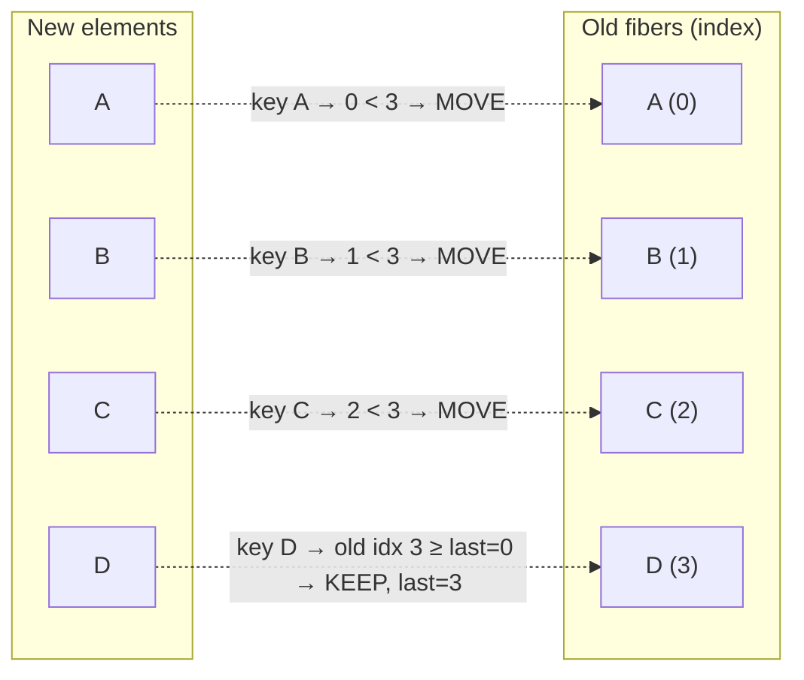
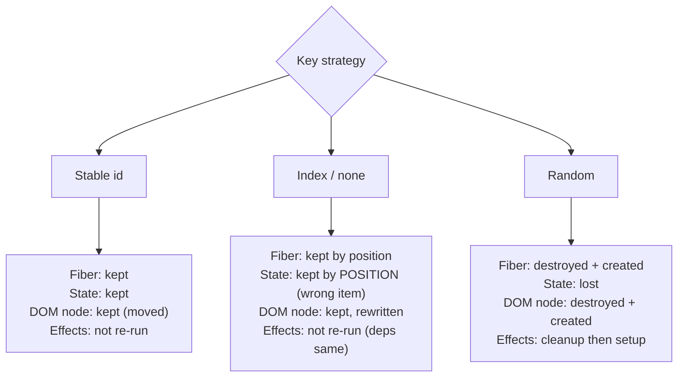
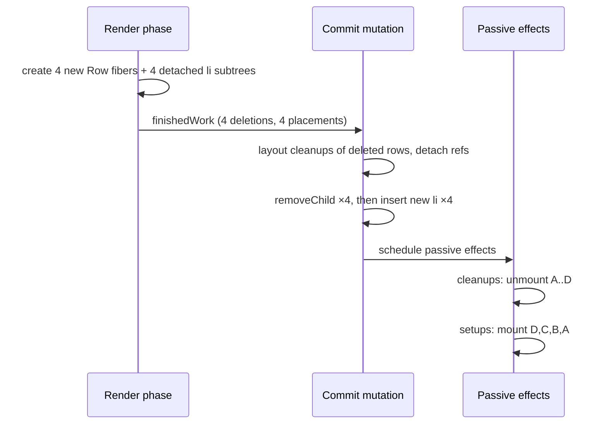

# 02 / 34 — Scenario C: List Reorder With and Without Stable Keys

## 1. Lesson metadata

| | |
|---|---|
| **Level** | Advanced |
| **Study time** | 6–7 hours (reading 2.5 h, experiments 2 h, exercises 2 h) |
| **Prerequisites** | [06 — Reconciliation fundamentals](./06-reconciliation-fundamentals.md), [07 — Component identity and keys, revisited](./07-identity-keys-and-reconciliation.md), [10 — Current and WIP trees](./10-current-and-work-in-progress-trees.md), [11 — Render phase vs commit phase](./11-render-phase-and-commit-phase.md), [18 — Effects and their timing](./18-effects-and-their-timing.md), [20 — Commit work and DOM mutations](./20-commit-and-dom-mutation.md), [30 — DevTools Profiler](./30-react-devtools-profiler.md), [32 — Scenario A](./32-scenario-a-parent-rerender.md), [33 — Scenario B](./33-scenario-b-text-update.md), [01/09 — Lists, keys, and identity](../01-react-fundamentals/09-lists-keys-and-identity.md) |
| **Next** | [35 — Scenario D: transition vs urgent interaction](./35-scenario-d-transition-vs-urgent.md) |
| **Related** | [01/16 — State preservation and reset](../01-react-fundamentals/16-state-preservation-and-reset.md), [31 — Reading React's source](./31-reading-react-source.md), [07/08 — Rendering large collections](../07-performance/08-rendering-large-collections.md), [07/09 — Windowing and virtualization](../07-performance/09-windowing-and-virtualization.md) |

**The scenario.** A list of four rows `A B C D` is reordered (reversed, shuffled, or modified by insertion/deletion). Each row owns local state (an uncontrolled text input and a mount-time snapshot). We compare four key strategies: **stable id keys**, **index keys**, **no keys**, and **random keys**. Question: **for each strategy, what does React render, reconcile, commit, and discard, what happens to component state and effects, and which DOM operations occur?**

**Learning objectives.** After this lesson you can:
1. State React's documented rules for keys (identity among siblings, uniqueness, stability) and derive the consequences for state preservation.
2. Execute, by hand, the keyed child-reconciliation algorithm (match by key → decide move/keep/insert/delete) on any old/new key sequences and predict the number of DOM moves; verify your prediction with a runnable simulator.
3. Produce a chronological timeline for reverse-with-id-keys and reverse-with-index-keys, including renders, flags, commit passes, effects, and DOM mutation records.
4. Explain precisely why index keys cause **wrong state association** (state stays at a position while data moves) and extra DOM writes, and why random keys cause **total remount**.
5. Predict `MutationObserver` records and effect logs for insert-at-head, delete-from-middle, reverse, and shuffle under all four strategies.
6. Choose a key strategy for real data models (server ids, client-created items, composite keys, duplicates) and justify exceptions where index keys are acceptable.
7. Diagnose key-related bugs (lost input text, replayed animations, duplicated effects, `key` warnings, duplicate keys) with the Profiler, observer, and component tree.

**Concepts covered:** keys, sibling identity, `reconcileChildrenArray` (conceptual), last-placed-index move heuristic, placement/deletion flags, DOM `insertBefore`/`appendChild` moves, remount vs update, state/effect lifetime, index-as-key hazards, random-key anti-pattern, duplicate keys, key scope, `memo` interaction, focus loss on DOM move, key as intentional reset.

> **Version-sensitive.** The *documented contract* (keys identify siblings; same key + same type = same instance; changed key = new instance) is stable. The *move-minimization heuristic* described in §3 matches `reconcileChildrenArray` in `ReactChildFiber.js` (the `lastPlacedIndex` rule) and the simulator in §5.2 reproduces it. All eight reorder cases below (reverse, first-to-end, last-to-front, swap B/D, insert head, delete B, swap adjacent, five-item last-to-front) were executed against real react-dom 19.3.1 + jsdom `MutationObserver` on 2026-10-22 and moved/inserted/removed exactly the nodes the simulator predicts; the full Row/List experiment (§2.2 code, all four key modes, reverse / insert-at-head / delete-B) also reproduced the timelines, with one correction in §4.2 (observer record counts). The algorithm is still an implementation detail: a future version may produce a different (even smaller) set of moves without any API change. Verify with the experiment in §5.4 and by reading the array-reconciliation code via [Lesson 31's](./31-reading-react-source.md) method.

---

## 2. Deep conceptual explanation

### 2.1 What problem are keys solving?

React gets a *new description of the UI* every render and must decide, for each position, whether it is **the same thing as before, updated** (preserve fiber, state, DOM node) or **a different thing** (destroy and create). For a single child, position and type answer that. For a **list**, position is not trustworthy: items get inserted, removed, and reordered. A `key` is the developer-supplied identity that says "this element is the same logical item as the one that had this key last render."

The public contract ([Rendering Lists](https://react.dev/learn/rendering-lists), [Preserving and Resetting State](https://react.dev/learn/preserving-and-resetting-state)):

1. Keys must be **unique among siblings** (not globally).
2. Keys must be **stable**: an item keeps its key across renders; do not generate keys during render.
3. Same key + same element type at the same parent → React **preserves** the instance (state, DOM node) and updates it.
4. A key that appears in the new list but not the old → **mount**. A key in the old list but not the new → **unmount**.
5. React does not pass `key` to your component as a prop.

Everything in this lesson is a consequence of those rules plus how the reconciler implements rule 3.

### 2.2 The experiment component

```tsx
// ScenarioC.tsx
import { memo, useEffect, useState } from "react";

export type Item = { id: string; label: string };

export type KeyMode = "id" | "index" | "random" | "none";

const Row = memo(function Row({ item }: { item: Item }) {
  // State captured at MOUNT. It never changes for the life of this component instance.
  const [mountedAs] = useState(item.label);

  useEffect(() => {
    console.log(`mount   instance#${mountedAs}`);
    return () => console.log(`unmount instance#${mountedAs}`);
  }, [mountedAs]);

  console.log(`render  Row for item ${item.label} (instance#${mountedAs})`);
  return (
    <li data-id={item.id}>
      <span className="label">{item.label}</span>{" "}
      <small>(instance mounted as {mountedAs})</small>{" "}
      <input defaultValue="" aria-label={`note for ${item.label}`} />
    </li>
  );
});

export function List({ initial, mode }: { initial: Item[]; mode: KeyMode }) {
  const [items, setItems] = useState(initial);
  return (
    <>
      <button onClick={() => setItems((xs) => [...xs].reverse())}>Reverse</button>
      <button onClick={() => setItems((xs) => [{ id: "N", label: "N" }, ...xs])}>Insert at head</button>
      <button onClick={() => setItems((xs) => xs.filter((x) => x.id !== "B"))}>Delete B</button>
      <ul>
        {items.map((item, i) => {
          switch (mode) {
            case "id":
              return <Row key={item.id} item={item} />;
            case "index":
              return <Row key={i} item={item} />;
            case "random":
              return <Row key={Math.random()} item={item} />; // ❌ anti-pattern, shown for study
            case "none":
              return <Row item={item} />;                       // ❌ warns; behaves like index keys
          }
        })}
      </ul>
    </>
  );
}
```

Initial data: `[{id:"A",label:"A"},{id:"B",label:"B"},{id:"C",label:"C"},{id:"D",label:"D"}]`.

The **instance state** (`mountedAs`) is the tracer: it tells you whether a given on-screen row is the same component *instance* as before the reorder, or a different instance now showing the item's data. The uncontrolled `<input>` is the second tracer: text the user types lives in the **DOM node**, so it reveals which DOM node ended up where.

Setup for the experiments: type `a`, `b`, `c`, `d` into the input of rows A, B, C, D respectively (each row's own letter), then perform the action.

### 2.3 The one-sentence summary per strategy

| Strategy | Identity React sees | Reverse results in | State/DOM association after reverse |
|---|---|---|---|
| **Stable id** | Items | Move DOM nodes; rows keep their state and their typed text | Correct: row A (state "A", input "a") now displayed last |
| **Index** | Positions | Update every row in place | **Wrong**: the instance at position 0 (mounted as A, input "a") now shows item D |
| **None** | Positions (implicit index) | Same as index, plus a warning | Same as index |
| **Random** | Nothing (new each render) | Destroy all rows, create all rows | State lost: every row remounts, inputs empty |

### 2.4 Misconceptions this scenario kills

| Misconception | Reality |
|---|---|
| "Keys are only to silence a console warning." | Keys define **instance identity**: they control state preservation, effect lifetimes, and DOM node reuse. |
| "Index keys are fine if the list isn't huge." | Size is irrelevant; the hazard is *reordering, insertion, or deletion* combined with *state* or *uncontrolled DOM state*. |
| "With keys React reorders the DOM minimally." | It uses a heuristic that is not always minimal (last-to-front moves *n−1* nodes; §3). |
| "A re-sorted list always remounts rows." | With stable keys, rows are preserved and only DOM nodes move. |
| "Random keys guarantee fresh data." | They guarantee fresh *instances* and destroyed state; the data was already fresh via props. |
| "Moving a DOM node is as cheap as updating text." | Moves can lose focus, restart iframes/animations/videos, and cost layout; text writes do not. |
| "`key` is a prop I can read in the child." | It is not passed as a prop; pass an `id` prop if the child needs it. |
| "Keys must be globally unique." | Unique only among siblings in the same array/parent. |

---

## 3. Internal mechanics

### 3.1 Public guarantee vs teaching model vs implementation detail

| Aspect | Status |
|---|---|
| Keys identify items among siblings; same key+type preserves state and DOM node | **Public guarantee** |
| Changed key remounts (state reset) | **Public guarantee** (documented as the "reset state with a key" technique) |
| Missing keys in dynamic lists warn in development and fall back to index-based identity | **Documented behavior** (warning text and exact fallback are dev/impl details) |
| Duplicate keys: unspecified behavior; React warns and may duplicate/omit children on update | **Documented as unsupported** |
| The algorithm: first pass over the common prefix, then a key map, then "last placed index" to decide moves | **Teaching model** matching React 17–19 sources; behavior executed on 19.3.1 |
| Which nodes are moved (e.g. last-to-front moves n−1 nodes) | **Implementation detail** derived from the heuristic; the simulator below encodes it |
| Moves are performed with `insertBefore` / `appendChild` of the existing node | **Implementation detail**; observable via `MutationObserver` |
| Deleted rows' DOM nodes are removed in the commit mutation pass; their effect cleanups run | **Public behavior** for cleanups; mechanism is teaching model |

### 3.2 The keyed child reconciliation algorithm (teaching model)

Given the **old** children (a linked list of fibers, each with an `index` position from the last commit and a `key`) and the **new** children (an array of elements with keys), conceptually:

1. **Prefix pass.** Walk old and new simultaneously from the start while keys match. Each match reuses the fiber (updates props). Stop at the first key mismatch.
2. If the new list is exhausted → delete remaining old fibers. If the old list is exhausted → create fibers for remaining new elements (insertions).
3. **Map pass.** Otherwise put the remaining old fibers in a **map from key to fiber**.
4. **Place pass.** Initialize `lastPlacedIndex` to the index of the last fiber matched in the prefix (0 if none). For each remaining new element, in order:
   - Look up its key in the map.
   - **Found** (an existing fiber with that key and compatible type): reuse it with new props; let `oldIndex = existing.index`.
     - If `oldIndex < lastPlacedIndex`: the item was *behind* an item that is already placed after it → mark the fiber **Placement** (it must be **moved** forward).
     - Else: it can stay where it is; `lastPlacedIndex = oldIndex`.
   - **Not found**: create a new fiber; mark **Placement** (insertion).
5. Anything left in the map (old keys not present in the new list) is marked for **deletion**.

The intuition: items keep their relative order *if their old indices are increasing*; React keeps the longest "already increasing" run it encounters greedily and moves the rest. It is a **linear-time, single-pass heuristic** — not an optimal edit-script algorithm — chosen because it is cheap and predictable.

### 3.3 Consequences of the heuristic

| Reorder | Old → New | Moved nodes | Why |
|---|---|---|---|
| Reverse | A B C D → D C B A | 3 (C, B, A) | D stays (old idx 3 sets `lastPlaced=3`); everything else has smaller old indices → moved |
| First to end | A B C D → B C D A | 1 (A) | B, C, D have increasing old indices (1,2,3); A (0) is behind → move |
| **Last to front** | A B C D → D A B C | **3** (A, B, C) | D first (3) sets `lastPlaced=3`; A, B, C all behind → moved, even though moving D alone would suffice |
| Swap B and D | A B C D → A D C B | 2 (C, B) | A (0) kept, D (3) kept, C (2<3) moved, B (1<3) moved |
| Swap adjacent | A B C D → A C B D | 1 (B) | A(0), C(2), B(1<2) moved, D(3) kept |
| Insert at head | A B C → N A B C | 0 moves, 1 insertion | N new; A(0), B(1), C(2) increasing → kept |
| Delete B | A B C D → A C D | 0 moves, 1 deletion | increasing → kept; B left in map → deleted |

Practical rule of thumb: **moving an item toward the front is expensive; moving toward the back is cheap**, under this heuristic. This matters for large lists with a "move to top" interaction (e.g. "pin item"), where a small number of explicit DOM moves could be 999 moves. Whether this matters depends on measurement: DOM moves for a few hundred nodes are usually acceptable; thousands are not (use virtualization).

### 3.4 What a "move" is in the DOM

In the commit mutation pass, a fiber flagged with Placement whose DOM node already exists is **re-inserted**: React finds the next sibling in the *new* order that does not itself need placement and calls `insertBefore(node, thatSibling)`, or `appendChild(node)` if there is none. Per the DOM standard, inserting a node that already has a parent first **removes** it from the old position. Observers therefore typically see, for each moved node, a `childList` record with the node in `removedNodes` and a `childList` record with it in `addedNodes`, both on the same parent. How many records and in what grouping is up to the DOM implementation; the *experiment* reports what your browser does (jsdom 19.3.1 run: for reverse with id keys, 3 removals and 3 additions, 6 records).

Side effects of moving a node (browser behavior, not React's):
- **Focus is typically lost** if the moved node (or a descendant) was focused, because removing a focused element from the document blurs it.
- **`<iframe>` elements reload** when moved; `<video>` playback may reset; CSS animations/transitions on the node can restart.
- Scroll position inside a moved scroller resets.
- Text selection endpoints inside moved nodes may be lost.

These behaviors vary across browsers and versions; test the ones that matter to your product (not executable in jsdom). React's `moveBefore` support (state-preserving moves) exists behind a feature flag that is **off** in the React source's default flags (`enableMoveBefore = false` in `ReactFeatureFlags.js`, checked 2026-10-22), so do not assume moves preserve iframe/video state.

### 3.5 Where state and effects live

State, refs, and effects belong to **fibers**, and fibers are matched by **key (then type)**. A fiber that is moved or updated **keeps its state**; its effects re-run only if their dependencies changed. A fiber that is deleted **runs cleanups** (layout cleanups during commit mutation; passive cleanups after) and loses state. A created fiber **runs its setups** after commit. DOM-owned state (an uncontrolled input's current text) lives in the **DOM node**; the node is preserved as long as the fiber is.

---

## 4. Step-by-step execution walkthrough (chronological timelines)

All timelines: `memo(Row)`, initial list A B C D with typed notes a b c d, no Strict Mode, `Reverse` clicked once, and items are reordered *without* being recreated (same item object references).

### 4.1 Timeline 1 — Reverse with stable `id` keys

| # | Phase | Step | Renders? | Reconciles? | Commits? | DOM effect |
|---|---|---|---|---|---|---|
| T0 | Browser | Click on "Reverse"; React's delegated handler runs `onClick`. | — | — | — | None |
| T1 | Handler | `setItems(xs => [...xs].reverse())` queued on `List`'s hook. | — | — | — | None |
| T2 | Schedule | Sync-lane render scheduled for the end of the event. | — | — | — | None |
| T3 | Render | Root: no own changes; descend to `List`. | — | — | — | None |
| T4 | Render | `List()` runs; the updater runs (pure: copies and reverses) → items `D C B A`. Returns buttons + `<ul>` with four **new** `Row` elements with keys `D, C, B, A` and **same `item` object references** as before. | **Yes** (`List`) | Starts | — | None |
| T5 | Reconcile `ul` | `ul` fiber reused; its `children` is an array of 4 elements. Child reconciliation (array): prefix pass: old first child key `A` vs new first key `D` → mismatch → stop immediately. | — | Yes | — | None |
| T6 | Map | Remaining old fibers → map `{A:0, B:1, C:2, D:3}` (by key). `lastPlacedIndex = 0`. | — | Yes | — | None |
| T7 | Place D | Found; `oldIndex 3 ≥ 0` → stays; `lastPlacedIndex = 3`. WIP fiber created with new props. | — | Yes | — | None |
| T8 | Place C | Found; `oldIndex 2 < 3` → **Placement flag** (move). | — | Yes | — | None |
| T9 | Place B | Found; `1 < 3` → **Placement flag**. | — | Yes | — | None |
| T10 | Place A | Found; `0 < 3` → **Placement flag**. Map is now empty → no deletions. | — | Yes | — | None |
| T11 | Begin `Row`×4 | `Row` is `memo`: shallow comparison of `{item}`: same object reference → **equal**; no pending work → bailout. **`Row` function is not called** (no `render Row…` logs). The Placement flags set at T8–T10 remain on those fibers. | **No** | — | — | None |
| T12 | Complete | Flags bubble into `ul`'s `subtreeFlags`. | — | — | — | None |
| T13 | Commit: before mutation | Nothing. | — | — | **Start** | None |
| T14 | Commit: mutation | Visit `ul`'s flagged children in order D, C, B, A. D: no placement → skipped. C: find host sibling — next siblings B, A are both being placed → none stable → `ul.appendChild(liC)`. B: same → `appendChild(liB)`. A: `appendChild(liA)`. Resulting DOM order: D C B A. | — | — | Yes | **3 node moves** (`removedNodes` + `addedNodes` records for each of C, B, A) |
| T15 | Commit: swap + layout | `root.current` swapped. No layout effects/refs. | — | — | Yes | None |
| T16 | Passive effects | None scheduled: no `Row` rendered, so no effects re-evaluated; **no mount/unmount logs**. | — | — | — | None |
| T17 | Browser | Style/layout/paint: list order changed on screen. **Focus**: if an input was focused it may be blurred (moved nodes). | — | — | — | Pixels change |

**State outcome:** each `li` is the same DOM node as before (identity preserved, including the typed text `a b c d`), each `Row` instance keeps `mountedAs`. Displayed order D C B A with notes `d c b a` — correctly associated.

**Without `memo(Row)`:** T11 changes to *call `Row`* four times (props object new) — four `render Row…` logs; the returned `li` trees reconcile against the existing fibers with equal values (in React 19 their host fibers still get an `Update` flag because the props objects are new, but `commitUpdate` finds nothing to write). Commit is unchanged: 3 moves, no text writes.

### 4.2 Timeline 2 — Reverse with **index** keys

| # | Phase | Step | Renders? | DOM effect |
|---|---|---|---|---|
| T0–T4 | as above | `List()` returns four `Row` elements with keys `0,1,2,3`, items `D,C,B,A`. | `List` | None |
| T5 | Reconcile `ul` | Prefix pass: old key 0 vs new key 0 → match → reuse; key 1, 2, 3 all match. The **new list and the old list are exhausted together** → no map, no placement, no deletion. | — | None |
| T6 | Begin `Row`×4 | Each `Row` fiber (key 0..3) gets new props: `item` is a *different* object than before (position 0 formerly A, now D) → memo's shallow comparison **fails** → `Row` called. Logs: `render Row for item D (instance#A)`, `… C (instance#B)`, `… B (instance#C)`, `… A (instance#D)`. | **Yes ×4** | None |
| T7 | Reconcile inside each `Row` | Same element types; props differ: `data-id` (`"A"`→`"D"`), `span` text (`"A"`→`"D"`), `input aria-label`. The `small` text contains `mountedAs` (state, unchanged). | — | None |
| T8 | Complete | Update flags: per row — `li` (attribute), `span`'s text, `input` (attribute). | — | None |
| T9 | Commit mutation | Attribute and text writes on the **existing nodes**, no inserts/removes/moves. | — | Per row: `data-id` set, label text data set, `aria-label` set, and React's `<input>` update path clears and restores the `name` attribute (two more `attributes` records) → executed on 19.3.1: **20 records** total (per row: 1 `characterData` + `aria-label` + 2× `name` + `data-id`). Only 12 of them are real value changes (`data-id`, label text, `aria-label` ×4). |
| T10 | Passive effects | Effects' dependency `mountedAs` unchanged → **no cleanup/setup**; no mount/unmount logs. | — | None |

**State outcome (the bug):** the DOM node at position 0 still has the text `a` typed in its input and its `Row` instance still says "mounted as A", but it now displays item **D**. The note "a" (written about A) is shown beside D. The data moved; the **state stayed at its position**. With id keys the same action moved nodes and kept association.

**Cost comparison for reverse:** id keys + memo → 0 `Row` calls, 3 moves. Index keys + memo → 4 `Row` calls, 12 real attribute/text writes (20 observer records, because React's input update also toggles `name`), 0 moves. For *this* data and this action neither is expensive; the difference that matters is **correctness**, not speed.

### 4.3 Timeline 3 — Reverse with **random** keys

| # | Phase | Step | DOM effect |
|---|---|---|---|
| T4 | `List()` creates four `Row` elements with four **new random keys**. | None |
| T5 | Prefix pass: an old random key vs a new random key never match → map of old fibers by key `{old random keys}`. | None |
| T6 | Place pass: none of the four new keys is in the map → four **new fibers** created, each marked Placement. Old fibers remain in the map → **marked for deletion** (4 `ChildDeletion` entries on `ul`'s fiber). | None |
| T7 | Render the four new `Row`s: function called (mount): `render Row…` ×4; `useState` initializes `mountedAs`; complete work **creates detached DOM nodes** (`li`, `span`, `small`, `input`, text nodes) for each — this is real allocation and attribute-setting work even though nothing is attached yet. | None (nodes are detached) |
| T8 | Commit mutation: deletions first: for each old row, layout-effect cleanups run, refs detach, `ul.removeChild(oldLi)`. Then placements: new `li`s inserted. | 4 `removedNodes`, 4 `addedNodes` |
| T9 | Passive: cleanup for the four deleted instances (`unmount instance#A…D`), then setups for the four new (`mount instance#D, C, B, A`). | None |

**State outcome:** all `mountedAs` snapshots reflect the *new* order (D, C, B, A), all typed text is gone, all inputs are new nodes, focus is lost. Every reorder (or **every unrelated re-render** of `List`, since `Math.random()` runs each render!) rebuilds the whole list. This is the worst case: maximum render work, maximum DOM work, maximum state loss.

**What is "discarded" in the interrupted case.** If the update runs as a transition and is abandoned after T7, the **detached DOM nodes created in T7 are simply dropped** (never attached; garbage-collected) and the old rows remain in the document untouched. This is the render-phase "creates detached DOM nodes" statement of [Lesson 11](./11-render-phase-and-commit-phase.md) made concrete; it also shows why unstable keys make abandoned renders expensive.

### 4.4 Timeline 4 — Insert at head, id keys vs index keys

Old: `A B C`. New: `N A B C`.

| Step | **id keys** | **index keys** |
|---|---|---|
| Prefix pass | key `A` vs `N` mismatch immediately | keys 0,1,2 match positions |
| Map/place | `N` not found → create + Placement. `A`(0) ≥ 0 keep, `B`(1) keep, `C`(2) keep. | Fibers 0,1,2 reused with **shifted items** (N, A, B); then key 3 has no old fiber → create + Placement (item C). |
| Rows called (memo) | 1 (`N`, mount) | 4: three updates (shifted items) + one mount |
| DOM | **1 insertion** (`insertBefore(liN, liA)`) | 3 × (attribute + text + attribute) writes, **1 append** of a new `li` at the end |
| Effects | `mount instance#N` | `mount instance#C` (the *new instance is labelled C* because it mounted with item C) |
| State | A, B, C keep their notes; N is empty | Notes stay by position: note typed for A now appears beside N; B's beside A; C's beside B; the newest row is empty and shows C |

Hence "insert at head" with index keys shows *all rows shifting* and every typed note attached to the wrong item.

### 4.5 Timeline 5 — Delete B (middle), id vs index

| Step | **id keys** | **index keys** |
|---|---|---|
| Reconcile | Prefix: A matches. Then new `C` vs old `B` mismatch → map `{B,C,D}`; C(2) keep, D(3) keep; `B` left → **deleted**. | Keys 0,1,2 match positions (items A, C, D); old key 3 has no new element → **deleted** (the *last* instance). |
| Rows called | 0 (memo) | 2 (positions 1 and 2 get new items) |
| DOM | `removeChild(liB)` | 2×(attr, text, attr) writes + `removeChild` of the **last** `li` (the DOM node formerly D's position) |
| Effects | `unmount instance#B` | `unmount instance#D` — the **wrong instance** is destroyed relative to the data |
| State | B's note disappears with B | B's note stays at position 1, now beside C; D's note (position 3) is destroyed |

---

## 5. Code examples

### 5.1 Minimal: the failing and passing version of the same list

```tsx
type Todo = { id: string; text: string };

// ❌ index keys + local state/uncontrolled DOM state in rows
function BadList({ todos }: { todos: Todo[] }) {
  return (
    <ul>
      {todos.map((t, i) => (
        <li key={i}>
          {t.text} <input defaultValue="" />
        </li>
      ))}
    </ul>
  );
}

// ✅ stable identity
function GoodList({ todos }: { todos: Todo[] }) {
  return (
    <ul>
      {todos.map((t) => (
        <li key={t.id}>
          {t.text} <input defaultValue="" />
        </li>
      ))}
    </ul>
  );
}
```

**Predict:** user types a note into the first row's input, then the first todo is deleted. What does each version show?

**Result:** `BadList`: the first `li` (key 0) stays and now shows the former second todo's text with the deleted todo's note still in its input; the *last* `li` is removed. `GoodList`: the first todo's `li` (key = its id) is removed with its note; remaining rows keep their own notes.

### 5.2 The reconciliation simulator (runnable TypeScript)

This reproduces §3.2 and lets you test any old/new sequence. It models the *decision rule*, not React's implementation; it is a learning tool.

```ts
// planKeyedUpdate.ts — run with: npx tsx planKeyedUpdate.ts
export type Plan = { kept: string[]; moved: string[]; inserted: string[]; deleted: string[] };

export function planKeyedUpdate(oldKeys: string[], newKeys: string[]): Plan {
  const oldIndex = new Map<string, number>();
  oldKeys.forEach((k, i) => oldIndex.set(k, i));
  const newSet = new Set(newKeys);

  const plan: Plan = { kept: [], moved: [], inserted: [], deleted: [] };
  let lastPlacedIndex = 0;

  for (const key of newKeys) {
    const prev = oldIndex.get(key);
    if (prev === undefined) {
      plan.inserted.push(key);            // new key → create + insert
    } else if (prev < lastPlacedIndex) {
      plan.moved.push(key);               // behind an already-placed item → move
    } else {
      lastPlacedIndex = prev;             // can stay; advance the high-water mark
      plan.kept.push(key);
    }
  }
  for (const key of oldKeys) if (!newSet.has(key)) plan.deleted.push(key);
  return plan;
}

const cases: Array<[string, string[], string[]]> = [
  ["reverse",       ["A", "B", "C", "D"], ["D", "C", "B", "A"]],
  ["first to end",  ["A", "B", "C", "D"], ["B", "C", "D", "A"]],
  ["last to front", ["A", "B", "C", "D"], ["D", "A", "B", "C"]],
  ["swap B,D",      ["A", "B", "C", "D"], ["A", "D", "C", "B"]],
  ["insert head",   ["A", "B", "C"],      ["N", "A", "B", "C"]],
  ["delete B",      ["A", "B", "C", "D"], ["A", "C", "D"]],
  ["swap adjacent", ["A", "B", "C", "D"], ["A", "C", "B", "D"]],
];
for (const [name, o, n] of cases) console.log(name.padEnd(14), JSON.stringify(planKeyedUpdate(o, n)));
```

Line notes:
- The prefix pass in React's description (§3.2 step 1) is omitted: matching prefix items have increasing old indices, so the "last placed index" rule keeps them anyway; the results are identical.
- `lastPlacedIndex` only advances for kept items. A moved item does **not** advance it.
- Insertions don't touch `lastPlacedIndex`.
- Duplicate keys break the model (a `Map` collapses them) — one reason React documents duplicates as unsupported.

**Output (verified by running it):**
```
reverse        {"kept":["D"],"moved":["C","B","A"],"inserted":[],"deleted":[]}
first to end   {"kept":["B","C","D"],"moved":["A"],"inserted":[],"deleted":[]}
last to front  {"kept":["D"],"moved":["A","B","C"],"inserted":[],"deleted":[]}
swap B,D       {"kept":["A","D"],"moved":["C","B"],"inserted":[],"deleted":[]}
insert head    {"kept":["A","B","C"],"moved":[],"inserted":["N"],"deleted":[]}
delete B       {"kept":["A","C","D"],"moved":[],"inserted":[],"deleted":["B"]}
swap adjacent  {"kept":["A","C","D"],"moved":["B"],"inserted":[],"deleted":[]}
```

**Predict before running:** for `["A","B","C","D","E"] → ["E","A","B","C","D"]`, how many moves? **Four** (A, B, C, D): E sets `lastPlaced = 4`, everything else is behind it. A one-node move in the "obvious" sense costs four DOM moves under this heuristic.

### 5.3 Practical: choosing keys from a data model

```tsx
import { useState } from "react";

type ServerTask = { id: string; title: string };           // server-assigned id: use directly
type DraftTask = { clientId: string; title: string };       // client-created: id assigned at creation

function newDraft(title: string): DraftTask {
  return { clientId: crypto.randomUUID(), title };          // assign ONCE, in the handler (not in render)
}

export function Tasks({ initial }: { initial: ServerTask[] }) {
  const [drafts, setDrafts] = useState<DraftTask[]>([]);
  return (
    <>
      <button onClick={() => setDrafts((ds) => [newDraft("New task"), ...ds])}>Add</button>
      <ul>
        {drafts.map((d) => (
          <li key={d.clientId}>{d.title} (unsaved)</li>
        ))}
        {initial.map((t) => (
          <li key={t.id}>{t.title}</li>
        ))}
      </ul>
    </>
  );
}
```

Line notes:
- `crypto.randomUUID()` in the **event handler** creates identity once per item; the same call inside `.map` during render would be the random-key bug. (Available in secure contexts (HTTPS/localhost) in current browsers; check your support matrix, otherwise use a counter in a ref or a library id.)
- Two arrays rendered as siblings in the same `ul` are separate child arrays (React treats each array as a Fragment-like child), so key uniqueness is scoped per array. Mixed identity spaces (drafts vs server) are safe because they are not siblings in the *same array*. If you flatten into one array, ensure the keys cannot collide (`draft:${id}` vs `task:${id}`).
- When a draft is saved and receives a server id, switching its key from `clientId` to `id` **remounts** the row. If that is undesirable (focus loss), keep using `clientId` as the stable key and store the server id as data.

### 5.4 Experiment harness: observe moves, identity, and instance state

```tsx
// observe.ts
export function snapshotNodes(ul: HTMLElement): Map<string, Element> {
  return new Map([...ul.children].map((li) => [li.getAttribute("data-id") ?? "?", li]));
}

export function reportMoves(before: Map<string, Element>, ul: HTMLElement): void {
  const after = [...ul.children];
  after.forEach((li, i) => {
    const id = li.getAttribute("data-id") ?? "?";
    const sameNodeAsBefore = [...before.values()].includes(li);
    const sameNodeForThisId = before.get(id) === li;
    console.log(
      `pos ${i}: data-id=${id}  node reused=${sameNodeAsBefore}  node belongs to this id=${sameNodeForThisId}  note="${(li.querySelector("input") as HTMLInputElement).value}"`,
    );
  });
}
```

Use: `const b = snapshotNodes(ul); /* click Reverse */ queueMicrotask(() => reportMoves(b, ul));` — or run it in a test. **Interpretation:**

| Observation | Meaning |
|---|---|
| `reused=true`, `belongs to this id=true` for all | Identity-preserving reorder (id keys): nodes moved |
| `reused=true`, `belongs to this id=false` | Index keys: nodes reused but now represent *different* items |
| `reused=false` | Remount (random keys, or a changing key/type) |

Pair with a `MutationObserver` (see [33 §5.7](./33-scenario-b-text-update.md)): id keys → `childList` records only; index keys → `attributes` + `characterData` only; random keys → `childList` removals and additions of **new** nodes.

### 5.5 Incorrect: random and derived-from-content keys

```tsx
// ❌ Random
{items.map((x) => <Row key={Math.random()} item={x} />)}

// ❌ Content-as-key when content can duplicate or change
{items.map((x) => <Row key={x.label} item={x} />)}   // duplicate labels → duplicate keys; edit label → remount
```

- `Math.random()`: total remount on every render (§4.3), effect cleanup/setup churn, lost focus and input.
- Content keys: duplicates cause React warnings and unpredictable duplication/omission on updates; editing the label changes the key and remounts the row mid-typing (the input loses focus after every keystroke — a classic bug when a text field's value is its own row key).

### 5.6 Corrected: stable id; composite keys for derived collections

```tsx
type Line = { orderId: string; sku: string; qty: number };

// Composite key when no single id exists but a natural compound identity does
{lines.map((l) => (
  <LineRow key={`${l.orderId}:${l.sku}`} line={l} />
))}
```

Requirements: the composite is **unique** among siblings and **stable** for the item's life. If the same SKU can appear twice in an order, the compound is not unique — add a line number assigned at creation.

### 5.7 Advanced: using a key deliberately to reset state

```tsx
function ProfilePage({ userId }: { userId: string }) {
  // Changing userId remounts the form: its local state (drafts, validation) resets,
  // with no effect needed to "sync" state to props.
  return <ProfileForm key={userId} userId={userId} />;
}
```

This is the legitimate use of "key change = new instance" ([01/16](../01-react-fundamentals/16-state-preservation-and-reset.md)). The scenario's lesson is the converse: **do not accidentally trigger this in lists**.

### 5.8 Advanced: when moves are the problem — virtualize or stabilize

```tsx
// "Pin to top" in a 2,000-row list: under the move heuristic a last→front move relocates ~n nodes.
// Mitigations (choose by measurement):
// 1) Virtualize so only ~30 rows exist in the DOM (Phase 7 lesson 09).
// 2) Render pinned items in a separate list above, so unpinned rows keep their relative order.
function PinnedAndRest({ pinned, rest }: { pinned: Item[]; rest: Item[] }) {
  return (
    <>
      <ul>{pinned.map((i) => <Row key={i.id} item={i} />)}</ul>
      <ul>{rest.map((i) => <Row key={i.id} item={i} />)}</ul>
    </>
  );
}
```

Trade-off: moving an item between the two lists is an unmount + mount (state loss) because the parents differ; keep row state in the data model (or lifted state) if it must survive pinning.

### 5.9 Automated verification (Vitest + Testing Library)

```tsx
import { render, screen } from "@testing-library/react";
import userEvent from "@testing-library/user-event";
import { describe, expect, it } from "vitest";
import { List, type Item } from "./ScenarioC";

const initial: Item[] = ["A", "B", "C", "D"].map((x) => ({ id: x, label: x }));

async function typeNotes(user: ReturnType<typeof userEvent.setup>) {
  for (const l of ["A", "B", "C", "D"]) {
    await user.type(screen.getByLabelText(`note for ${l}`), l.toLowerCase());
  }
}

describe("Scenario C: reverse", () => {
  it("id keys: nodes are reused and stay attached to their items", async () => {
    const user = userEvent.setup();
    const { container } = render(<List initial={initial} mode="id" />);
    await typeNotes(user);
    const before = [...container.querySelectorAll("li")];

    await user.click(screen.getByRole("button", { name: "Reverse" }));

    const after = [...container.querySelectorAll("li")];
    expect(after.map((li) => li.getAttribute("data-id"))).toEqual(["D", "C", "B", "A"]);
    expect(after[0]).toBe(before[3]);            // same DOM node, moved
    expect((after[0].querySelector("input") as HTMLInputElement).value).toBe("d");
  });

  it("index keys: nodes stay put and the typed notes end up on the wrong items", async () => {
    const user = userEvent.setup();
    const { container } = render(<List initial={initial} mode="index" />);
    await typeNotes(user);
    const before = [...container.querySelectorAll("li")];

    await user.click(screen.getByRole("button", { name: "Reverse" }));

    const after = [...container.querySelectorAll("li")];
    expect(after.map((li) => li.getAttribute("data-id"))).toEqual(["D", "C", "B", "A"]);
    expect(after[0]).toBe(before[0]);            // same node, now showing item D
    expect((after[0].querySelector("input") as HTMLInputElement).value).toBe("a"); // note for A, beside D
  });
});
```

The second test documents a **bug** as a characterization test; in a real code base you would fix the keys, not assert the bug. These tests double as an executable form of Timelines 1 and 2. (They assume the `List` component prints `data-id` and labels as in §2.2, and that the test is not in Strict Mode.)

---

## 6. Visual explanations

### 6.1 Keyed matching



### 6.2 Index keys: positions, not items

```text
position:        0      1      2      3
old element:   key0=A key1=B key2=C key3=D      instances: I0(A) I1(B) I2(C) I3(D)   notes: a b c d
new element:   key0=D key1=C key2=B key3=A      instances: I0     I1     I2     I3   (same instances)
result:        I0 shows D, I1 shows C, I2 shows B, I3 shows A   notes still: a b c d  ← mismatched
DOM ops:       12 attribute/text writes (+8 `name` churn records on the inputs), 0 moves
```

### 6.3 What survives each strategy



### 6.4 Commit-side sequence for random keys



---

## 7. Alternative approaches and trade-offs

| Strategy | Correctness with reorder/insert/delete | Render work | DOM work | Effects/state | Use when |
|---|---|---|---|---|---|
| **Stable unique id from data** | Correct | Minimal (with `memo`) | Moves/insert/delete only | Preserved | Default for dynamic lists |
| **Client-generated id at creation** | Correct | Minimal | Same | Preserved | Items created in the UI before the server assigns ids |
| **Composite natural key** | Correct if unique+stable | Minimal | Same | Preserved | No single id, but a compound identity exists |
| **Index** | **Wrong** if list reorders/inserts/deletes *and* rows have state/uncontrolled DOM state; correct for append-only/static lists with stateless rows | Rows re-render when data shifts | Text/attr writes; no moves | State stays at positions | Static or append-only lists of stateless rows; tiny menus |
| **No key** | Same as index + warning | Same | Same | Same | Never intentionally (static children not from `.map` need no keys) |
| **Content as key** | Fails with duplicates; remounts on edit | Varies | Varies | Lost on edit | Only for immutable unique tokens (e.g. emoji set) |
| **Random/`Date.now()`** | Destroys identity each render | Maximum | Maximum | Lost every render | Almost never; deliberate remount via key tied to a *meaningful* change |
| **Virtualized list with stable keys** | Correct | Only visible rows | Few rows | Preserved for visible rows only | Large lists |
| **Separate lists for pinned/unpinned** | Correct | Small | Avoids large moves | State lost when item changes lists | "Move to top" interactions |

**Where the recommended approach (stable ids) is NOT best.** For an **append-only log** of purely presentational rows (no state, no inputs, no animation, never reordered), index keys are *correct* and marginally cheaper: there is no identity to preserve because items never move, and generating ids adds noise. For a **static navigation menu** built from a constant array, keys by index (or by constant label) are fine. For a list where reordering is rare but **state per row is critical** (editable table rows), stable ids are not optional.

---

## 8. Best practices and anti-patterns

### 8.1 Practices
1. **Use the identity the data already has** (database id, stable slug). If the item doesn't have one, create it *when the item is created*.
2. **Keep keys at the outermost element returned by `map`** (the element in the array), not inside the child component.
3. **Keys are for siblings only**; do not worry about cross-list uniqueness.
4. **Keep row-local state in the row (keyed) or in the data model (by id)** — never in an array indexed by position.
5. **Memoize rows for large lists** with immutable item objects so reorders cost moves, not renders.
6. **Remember DOM moves are visible**: preserve focus manually (restore focus after reorder in drag-and-drop or "move up/down" buttons).
7. **Use keys deliberately to reset** component state at a boundary (`key={userId}`), and document why.

### 8.2 Beginner mistakes
- `key={index}` copied from tutorials, then adding delete/sort/filter.
- Omitting keys and ignoring the warning.
- Putting the `key` on the inner element instead of the element returned from `map`.
- Using `key` and expecting `props.key`.

### 8.3 Experienced-developer mistakes
- Replacing server ids with client ids upon save and thereby remounting the row mid-interaction.
- `key={item.name}` where names can duplicate.
- Generating keys with `useId()` inside `.map` (hooks can't be called in loops; and `useId` is for DOM id uniqueness, not for list identity).
- Mixing item types in one list with colliding keys across types (`id` 1 for user and product).
- Believing a keyed reorder is always minimal and shipping "move to top" on 5,000 rows.
- Filtering a list *before* assigning index-based keys, so filtering changes the keys of every item.

### 8.4 Smells
| Smell | Interpretation |
|---|---|
| `.map((x, i) => <X key={i} …/>)` where X has state, inputs, animations, or effects | Latent wrong-association bug |
| `key={Math.random()}` / `key={Date.now()}` / `key={uuid()}` in render | Total remount per render |
| Console warnings about keys ignored in CI | Process smell |
| Effects in rows that fetch on mount, list reorders, network storms | Remounts due to unstable keys |
| Input loses focus after each keystroke | Key (or component type) changes on every render |

### 8.5 Justified exceptions
- Index keys for immutable, append-only, stateless lists.
- Deliberate key change to restart an animation or reset a widget.
- Keys derived from content for *closed sets* of unique strings (e.g., tabs by unique `name`) where the content **is** the identity and cannot change.

---

## 9. Real-world application

| Domain | Scenario C in practice | Constraint | Resolution |
|---|---|---|---|
| **E-commerce cart** | Remove/reorder line items with quantity inputs | Quantity edits must stay with the right item | Key by line id (cart line uuid), not SKU if the same SKU can be added twice with options; controlled quantities from state |
| **Dashboard** | Reorder widgets by drag-and-drop | Each widget holds chart state and subscriptions | Stable widget id keys; moves preserve state; avoid remount re-subscribing; restore focus after drop; consider layout libraries that animate via transforms |
| **Finance** | Sort a transactions table by amount/date | Thousands of rows; selection and inline edits | Row id keys + `memo` rows + virtualization; sorting becomes moves only for visible window |
| **Forms** | Repeating field groups (add/remove addresses) | Validation state per group; focus | Client-generated ids for each group; never index keys; remove button deletes by id |
| **Auth/admin** | Role list with toggles | Toggle states must not shift on sort | id keys; toggles controlled by data |
| **Realtime chat** | New messages inserted at the top (or bottom), reactions toggling | Scroll anchoring; avoid remounting images/videos | Message id keys; inserts are single DOM insertions; moved nodes would reload media, so avoid reordering existing messages |
| **Multi-team** | A shared `List` component accepts `getKey` prop | Consumers may pass index by default | Make `getKey` **required** in the API (no default); doc-comment the rule; lint in the design system |

---

## 10. Debugging and troubleshooting

### 10.1 Symptom: "Text I typed in a row moves to the wrong row after sorting/deleting"
**Reproduce:** §2.2 with `mode="index"`.
**Investigate:** (1) React DevTools Components tab: the row's key is displayed next to the component name (e.g. `key="0"`). Index-like keys reveal the bug. (2) `MutationObserver`: no `childList` moves, only attribute/text writes → rows were updated in place instead of moved. (3) Instance snapshot (`mountedAs`) is stale relative to the item.
**Root cause:** positional identity.
**Fix:** key by stable id; keep row data in the model. **Validate:** the §5.9 test passes with `mode="id"`; the observer shows `childList` moves only.

### 10.2 Symptom: "Inputs lose focus on every keystroke"
**Cause:** the key (or element type) of the row or an ancestor changes on every render (random/content key where the content is being edited; component defined inside another component).
**Investigate:** Profiler "Why did this render?" won't explain remounts; instead observe `childList` records for the row's `li`, and log mount/unmount in an effect; check `key` expressions.
**Fix:** a key from identity not from the edited value; hoist component definitions.

### 10.3 Symptom: "Duplicate rows or missing rows after updates"
**Cause:** duplicate keys among siblings. React warns in development ("encountered two children with the same key"). Behavior after the warning is unspecified.
**Investigate:** search the console for the warning; dump `new Set(keys).size !== keys.length`.
**Fix:** guarantee uniqueness (composite with a stable counter) and add a dev-time assertion.

### 10.4 Symptom: "Rows re-fetch data whenever the list sorts"
**Cause:** unstable keys → remount → mount effects run again. **Investigate:** mount/unmount logs on sort; Network panel shows burst. **Fix:** stable keys; move fetching to a cache keyed by id (Phase 6).

### 10.5 Symptom: "Sorting a big list janks even though rows don't re-render"
**Cause:** DOM moves (n−1 for last-to-front) plus layout. **Investigate:** Performance panel: scripting short, large layout/"Recalculate style"; observer shows hundreds of `childList` records. **Fix:** virtualize; reduce rows; for "move to top" patterns, split lists (§5.8); consider CSS-only reordering (`order`/grid placement) for purely visual reorders where DOM order and accessibility order may differ; consider a11y: visual order must match DOM/reading order for keyboard and screen-reader users.

### 10.6 Symptom: "Animation restarts for all rows on any change"
**Cause:** keys unstable or elements moved. Moved nodes can restart CSS animations. **Fix:** stable keys; use animation libraries that handle reordering (FLIP technique) or transforms rather than relying on DOM identity alone.

### 10.7 Validating a key fix
(1) Observer shows only expected record types (moves for reorders; one insert/removal for add/delete). (2) Mount/unmount logs only for added/removed items. (3) Typed text and focus persist (restore focus manually if moves are unavoidable). (4) Profiler: rows grey in non-affected commits.

---

## 11. Exercises

### Level A — Knowledge
A1. List the four requirements/properties of good keys (scope, uniqueness, stability, derivation).
A2. What does React do when it sees a key in the new list that does not exist in the old list? Conversely?
A3. Why is `key` not available as `props.key`?
A4. In the timeline, why does `Row` not appear in the logs for id keys + `memo`?
A5. State why a state-less, append-only list can safely use index keys.

### Level B — Code comprehension
B1. Apply the algorithm: old `[A,B,C,D,E]` → new `[B,A,C,E,D]`. List kept/moved/inserted/deleted.
B2. Old `[A,B,C]` → new `[C,A,B]` vs `[B,C,A]`: which costs fewer DOM moves and why?
B3. For `mode="index"`, 4 items, "Delete B" is clicked. Which `unmount` log appears, and which DOM node is removed?
B4. What do the `MutationObserver` records look like (types only) for reverse under `id`, `index`, `random`?
B5. A row has `key={item.id}` on an inner `<div>` rather than on the `<Row>` element returned from `map`. What happens?

### Level C — Implementation
C1. Extend the simulator to also return the **minimum possible** number of moves (via longest increasing subsequence of old indices) and compare with React's heuristic on the cases in §3.3.
C2. Write a `useStableKeys<T>(items: T[], getId?: (t: T) => string)` hook that assigns a client id to items lacking one, once, via a `WeakMap`, without regenerating on re-render.
C3. Implement "move to top" for a keyed list that preserves focus on the moved item's button after the move.
C4. Write a Vitest test proving that with `mode="random"` every `Row` is remounted on an *unrelated* re-render of `List`.

### Level D — Debugging
D1. A to-do app's checkboxes (uncontrolled `defaultChecked`) become mismatched after you sort by title. Diagnose and fix.
D2. After saving a new row, the row flickers and its input loses focus. IDs switch from `tmp-123` to server id `42`. Explain and propose two fixes.
D3. The console shows "Encountered two children with the same key" only on some data sets. Find the likely root cause in a code base that keys by `user.name`.
D4. Reverse works, but "Pin to top" on 3,000 rows freezes the UI for 400 ms while the Profiler shows rows are not re-rendering. Explain.

### Level E — Architecture and engineering decisions
E1. Design the key policy for a design-system `Table` component accepting `rows`. Should `getRowId` be required? Weigh DX, safety, and migration.
E2. A dashboard allows dragging widgets between two columns. Choose key strategy, state ownership, and what to do about state loss when a widget changes columns.
E3. Decide between "rebuild keys on sort" vs "keep ids on data" for a table with client-side sorting, inline editing, and server sync.

### Level F — Expert challenge
F1. Prove or disprove: "With stable keys React always performs the minimal number of DOM moves." Provide a counterexample and describe what minimal means.
F2. Explain how an interrupted (abandoned) transition render of a reorder affects (a) fibers, (b) DOM nodes created during render, (c) effects, (d) the observable DOM. Contrast id keys with random keys.
F3. Design a verification suite (unit + browser) that guards against index-key regressions across a code base, including a static-analysis rule and a runtime dev-check.

---

## 12. Detailed answers and explanations

> Attempt the exercises first.

**A1.** Scope: unique among siblings in the same parent array. Uniqueness: no two siblings share a key. Stability: same item → same key every render. Derivation: from the item's identity (data), not from position/random/render count.

**A2.** New key not in old → create a new fiber/instance (mount; DOM nodes created and inserted; effects set up). Old key absent from new → delete (cleanup effects, detach refs, remove DOM nodes, state lost).

**A3.** `key` (and `ref` historically) are special: React uses `key` for reconciliation and strips it from props to avoid it being used as data; if the child needs the value, pass another prop such as `id`. React 19 changed `ref` to be a regular prop for function components (react.dev, React 19 post); `key` remains special.

**A4.** `memo` shallow-compares `{item}`; with stable keys the same `item` objects are passed, so props are equal and the function isn't called; only the Placement flags from reconciliation cause commit work (moves).

**A5.** Without reordering/insertion/deletion at non-tail positions and without row state/uncontrolled DOM state, position **is** identity. Nothing is ever associated with a position that later gets different data, so the failure mode never arises.

**B1.** Old indices: A0 B1 C2 D3 E4. New order B,A,C,E,D: B(1): ≥0 → keep, last=1. A(0): <1 → **move**. C(2): ≥1 → keep, last=2. E(4): ≥2 → keep, last=4. D(3): <4 → **move**. Kept: B, C, E. Moved: A, D. Inserted/deleted: none. (Minimum is also 2? The longest increasing subsequence of old indices [1,0,2,4,3] is [1,2,4] or [0,2,3]/[0,2,4] length 3 → 2 moves; same.)

**B2.** `[C,A,B]` (last to front): C(2) keep, last=2; A(0) move; B(1) move → **2 moves**. `[B,C,A]` (first to end): B(1) keep, C(2) keep, A(0) move → **1 move**. The heuristic favors moving items later in the list.

**B3.** Index keys: after deleting B, the new list has 3 items (A, C, D) with keys 0,1,2. Old key 3 has no new element → **the last instance** (`instance#D`) is deleted: log `unmount instance#D` and the **fourth `li`** is removed. Rows at positions 1 and 2 update their text/attributes to C and D.

**B4.** `id`: only `childList` records (3 nodes each removed+added). `index`: `attributes` (`data-id`, `aria-label`, plus `name` toggling on each `<input>`) and `characterData` records, no `childList` (executed on 19.3.1). `random`: `childList` records removing 4 old `li` and adding 4 new `li`. (Exact record grouping can vary.)

**B5.** The `key` must be on the element in the array returned by `map` (here `<Row>`), because the *array's children* are what React compares. A key on an inner element does nothing for the array; React sees four keyless `Row` elements (warning) and falls back to index identity. The inner key then only affects reconciliation of that single child within `Row` (key change within a single-child position remounts that child).

**C1.**
```ts
function lisLength(a: number[]): number {
  const tails: number[] = [];
  for (const x of a) {
    let lo = 0, hi = tails.length;
    while (lo < hi) { const mid = (lo + hi) >> 1; if (tails[mid] < x) lo = mid + 1; else hi = mid; }
    tails[lo] = x;
  }
  return tails.length;
}

export function minimumMoves(oldKeys: string[], newKeys: string[]): number {
  const idx = new Map(oldKeys.map((k, i) => [k, i] as const));
  const olds = newKeys.map((k) => idx.get(k)).filter((v): v is number => v !== undefined);
  return olds.length - lisLength(olds);
}
```
Compare: reverse of 4 → LIS length 1 → min moves 3 (equal to React's 3). Last-to-front `[D,A,B,C]` → old indices `[3,0,1,2]` → LIS `[0,1,2]` length 3 → min moves **1**, React's heuristic does **3**. Insertions don't count as moves. Edge: duplicates are excluded by assumption.

**C2.**
```tsx
import { useMemo } from "react";

const ids = new WeakMap<object, string>();
let counter = 0;

export function useStableKeys<T extends object>(items: T[], getId?: (t: T) => string | undefined): Array<{ key: string; item: T }> {
  return useMemo(
    () =>
      items.map((item) => {
        const given = getId?.(item);
        if (given) return { key: given, item };
        let k = ids.get(item);
        if (!k) { k = `local-${++counter}`; ids.set(item, k); }  // assigned once per object identity
        return { key: k, item };
      }),
    [items, getId],
  );
}
```
Caveats: identity is tied to object identity — if the app replaces item objects on each update (immutable updates producing new objects for changed items), the "local" id changes and the row remounts. So prefer assigning ids when items are *created* (in the data model). The module-level counter in render-time `useMemo` is impure under Strict Mode (it increments twice) — acceptable only because uniqueness, not density, matters; it is a smell, which is the point: this hook is a fallback, not a design.

**C3.**
```tsx
import { useLayoutEffect, useRef, useState } from "react";

type Item = { id: string; label: string };
export function Pinnable({ initial }: { initial: Item[] }) {
  const [items, setItems] = useState(initial);
  const [focusId, setFocusId] = useState<string | null>(null);
  const buttons = useRef(new Map<string, HTMLButtonElement>());

  useLayoutEffect(() => {
    if (focusId) {
      buttons.current.get(focusId)?.focus();   // after DOM moves, before paint
      setFocusId(null);
    }
  }, [focusId, items]);

  return (
    <ul>
      {items.map((it) => (
        <li key={it.id}>
          {it.label}
          <button
            ref={(el) => {
              if (el) buttons.current.set(it.id, el);
              else buttons.current.delete(it.id);
            }}
            onClick={() => {
              setItems((xs) => [xs.find((x) => x.id === it.id)!, ...xs.filter((x) => x.id !== it.id)]);
              setFocusId(it.id);
            }}
          >
            Pin
          </button>
        </li>
      ))}
    </ul>
  );
}
```
Why layout effect: it runs after the DOM moves of this commit and before paint, so focus is restored without a visible blur frame. (Ref callbacks use the React 19 style where a returned cleanup is optional; the explicit `else delete` branch works in React 18/19 alike.) Edge: `setFocusId(null)` inside a layout effect causes a synchronous second render; acceptable here and cheap. Alternative: `flushSync` in the handler followed by `.focus()`.

**C4.**
```tsx
it("random keys remount every row on an unrelated re-render", async () => {
  const mounts: string[] = [];
  function Probe() { useEffect(() => { mounts.push("mount"); return () => { mounts.push("unmount"); }; }, []); return <li />; }
  function L() {
    const [n, setN] = useState(0);
    return (<><button onClick={() => setN(n + 1)}>x</button><ul>{[1, 2, 3].map((i) => <Probe key={Math.random() + i} />)}</ul></>);
  }
  render(<L />);
  mounts.length = 0;
  await userEvent.click(screen.getByRole("button"));
  expect(mounts.filter((m) => m === "unmount")).toHaveLength(3);
  expect(mounts.filter((m) => m === "mount")).toHaveLength(3);
});
```
(Not in Strict Mode.) The unrelated state `n` re-renders `L`, new random keys → three unmounts and three mounts.

**D1.** Uncontrolled checkboxes keep their checked state in the DOM node; keyed by index, sorting rewrites labels but leaves the nodes and their checked state in place → state sticks to the position. Fix: key by todo id (and ideally make the checkbox controlled from the data model: `checked={todo.done}` with `onChange`), then the state moves with the data.

**D2.** Switching key from `tmp-123` to `42` is a **key change** → React unmounts the old row and mounts a new one (new DOM, lost focus and typed text). Fix A: keep the client id as the key permanently and store `serverId` as data. Fix B: keep temporary id for the key through the save and update only data; or maintain a `Map<serverId, clientId>`. Do not switch keys during an interaction.

**D3.** `user.name` isn't unique: two users named "Alex" create duplicate keys, observed only on data sets with duplicates. Fix: key by `user.id`. Add a dev assertion for unique keys.

**D4.** No row renders, but DOM moves are the cost: last/first position changes under the heuristic can relocate ~n nodes (a move-to-front relocates all items that were before it); each `insertBefore`/`appendChild` is cheap but thousands cause large style recalculation and layout. Confirm: observer shows ~3,000 `childList` records; Performance panel shows layout. Fix: virtualization or separate pinned list.

**E1.** Evaluation criteria and example: Make `getRowId` **required** (or accept `rowKey: keyof Row | ((row) => string)` with no default): the design system cannot choose identity for consumers; an index default produces silent state bugs; required argument adds friction but prevents a class of issues; provide a codemod for migration and a dev-only warning for duplicates/missing ids; document that ids must be stable. If rows are provably stateless and static, offer an explicit opt-out `rowKey="index"` named to signal risk.

**E2.** Keys: widget ids. State: widget state owned in a store keyed by widget id (not in the component) so moving columns (different parent → remount) doesn't lose it; or render all widgets in a single flat list and position them with CSS grid so a "column change" is a style change, not a reparent. Trade-offs: single flat list keeps instances and subscriptions alive (best for stateful widgets) but requires CSS layout logic and care for DOM/reading order; per-column lists are simple but remount on move. Choose per widget cost and a11y needs.

**E3.** Keep ids on the data (server ids; client temp ids stable through save) — never derive keys from sort order or position. Sorting then changes only array order, producing moves; inline editing state keyed by id persists through sorts; server sync maps responses to ids. "Rebuild keys on sort" resets identity every sort (lost edits and focus). Verify with the §5.9-style test.

**F1.** Disproved: `[A,B,C,D] → [D,A,B,C]`. Minimal moves = 1 (move D to the front); React's heuristic yields 3 (§3.3, `minimumMoves` shows 1 vs 3). "Minimal" = fewest `insertBefore`/`appendChild` operations transforming the old sequence into the new one, equal to n minus the length of the longest increasing subsequence of old indices. The heuristic is greedy left-to-right, so it can choose a worse "anchor" (D), which is why it's described as linear-time, not optimal.

**F2.** (a) Fibers: the work-in-progress fibers (new/cloned) are discarded when the render is abandoned; current fibers are untouched; id keys: matched WIP fibers from `createWorkInProgress` are dropped (alternates reused later). (b) DOM nodes created during render exist only for **new** fibers: id keys created none (all matched; maybe zero new nodes) → nothing to discard; random keys created 4 `li` subtrees (detached) that are garbage-collected. (c) Effects: none ran (effects run only after a commit), so there's no cleanup to undo. (d) Observable DOM: unchanged; no records; no focus change. After restart and commit, id keys produce 3 moves; random keys produce 4 removals + 4 insertions. Conclusion: unstable keys make abandoned renders waste the most work, and make successful ones destructive.

**F3.** Suite: (1) ESLint rule `react/no-array-index-key` (from `eslint-plugin-react`) set to error, plus `react/jsx-key` for missing keys; allow-list with comment for justified cases. (2) A custom dev wrapper for list components asserting key uniqueness and warning when keys look like indices for items with ids. (3) Characterization tests (like §5.9) for stateful lists: reorder/insert/delete with typed input, asserting node identity and notes. (4) A Playwright test that types into rows, performs reorder, and asserts association plus focus restoration. (5) A runtime counter of mounts for rows during sort in a perf test, asserting zero. Document justified exceptions in code comments. Both rule names exist in the plugin (checked 2026-10-22).

---

## 13. Senior engineer interview questions

**Q1. "What exactly does a React key do?"**
*Strong answer.* It's the identity of an element among its siblings. During reconciliation React matches new elements to existing fibers by key (then type); a match preserves the fiber, its state, and its DOM node, a non-match mounts or unmounts. It's not a prop, not globally unique, and must be stable and unique among siblings.

**Q2. "Why is `key={index}` dangerous? When is it fine?"**
*Strong answer.* Index ties identity to position. If items are inserted, deleted, or reordered, instances stay at positions while the data moves: local state, uncontrolled input values, focus, and effects end up attached to the wrong items, and extra rows re-render and update DOM. It's fine for static or append-only lists of stateless rows, where position is identity.

**Q3. "Walk me through what happens to the DOM when a keyed list is reversed."**
*Strong answer.* Render: new elements with the same keys in new order. Reconcile: match by key; compute placements with the last-placed-index heuristic; D stays, the others get Placement flags. Rows with the same props can be skipped by `memo`. Commit: moved nodes are re-inserted (`insertBefore`/`appendChild`), each producing remove/add records; nodes keep identity and state; effects don't re-run. Side effects: focus may be lost on moved focused elements.

**Q4. "Is React's list move algorithm optimal?"**
*Strong answer.* No. It's a linear greedy heuristic: moving the last item to the front relocates the other n−1 items. For large lists with frequent move-to-front, virtualize or restructure; verify with the Performance panel.

**Q5. "How would you debug 'inputs lose focus while typing in a list'?"**
*Strong answer.* Suspect key or component-type instability. Log mount/unmount, observe `childList` records for the row, inspect keys in the Components tab, and look for keys derived from the edited value, keys generated in render, or components defined inside components. Fix by deriving keys from stable ids and hoisting definitions.

**Q6. "A reviewer asks you to justify an index key in your PR."**
*Strong answer.* I'd state that the list is append-only (or static), rows are stateless/presentational with no uncontrolled inputs or animations, and ids don't exist; add a comment, and note that if the list becomes reorderable I'll switch to ids.

---

## 14. Further learning resources

| Resource | URL | Covers / why | Level | Section to study |
|---|---|---|---|---|
| React docs — Rendering Lists | <https://react.dev/learn/rendering-lists> | Keys: where to get them, rules, why | Beginner | "Keeping list items in order with `key`" |
| React docs — Preserving and Resetting State | <https://react.dev/learn/preserving-and-resetting-state> | State tied to position/identity; resetting with keys | Intermediate | "Resetting state at the same position", "Resetting a form with a key" |
| React docs — `memo` | <https://react.dev/reference/react/memo> | Skipping re-renders of rows | Intermediate | Usage |
| React docs — Understanding your UI as a tree | <https://react.dev/learn/understanding-your-ui-as-a-tree> | Mental model for positions in the render tree | Beginner–Int. | Render tree |
| React repository | <https://github.com/facebook/react> | Array child reconciliation code | Advanced | See [31](./31-reading-react-source.md): `ReactChildFiber` |
| MDN — `Node.insertBefore` | <https://developer.mozilla.org/en-US/docs/Web/API/Node/insertBefore> | Moving behavior when node already has a parent | Intermediate | Description |
| MDN — MutationObserver | <https://developer.mozilla.org/en-US/docs/Web/API/MutationObserver> | Observing moves/inserts/removals | Intermediate | Whole page |
| `eslint-plugin-react` | <https://github.com/jsx-eslint/eslint-plugin-react> | `no-array-index-key`, `jsx-key` rules (both rule names exist in eslint-plugin-react) | Intermediate | Rules list |
| React Developer Tools docs | <https://react.dev/learn/react-developer-tools> | Showing keys, Profiler | Beginner | Whole page |

---

## 15. Knowledge checkpoint

**You should now understand:** that keys determine instance identity and therefore state, effects, and DOM reuse; how the reconciler matches old and new children by key and chooses moves; and exactly how id, index, none, and random keys differ in renders, commits, and DOM operations.

**You should be able to explain:** the T-by-T timelines for reverse (id/index/random), insert-at-head, and delete-from-middle; why last-to-front costs n−1 moves; why index keys misassociate state; what is discarded when a keyed render is abandoned.

**You should be able to implement:** the simulator, node-identity tests, stable client ids, intentional key resets, and focus restoration after moves.

**You should be able to debug:** lost input/focus, duplicate keys, remount storms, and performance stalls from DOM moves, using Components-tab keys, Profiler, `MutationObserver`, and mount/unmount logs.

**Prerequisite for next lessons:** [35 — Scenario D: transition vs urgent interaction](./35-scenario-d-transition-vs-urgent.md) builds on the "interrupted, restarted, abandoned render" outcomes sketched here, adding priorities and `useTransition`. Continue to [36](./36-scenario-e-suspend.md), [37](./37-scenario-f-hydration-mismatch.md), and the phase assessment ([38](./38-phase-assessment.md)).
