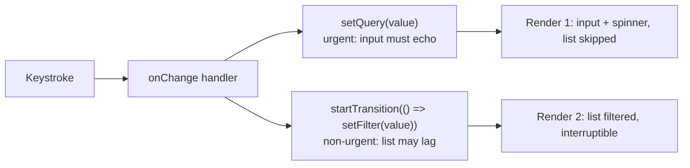
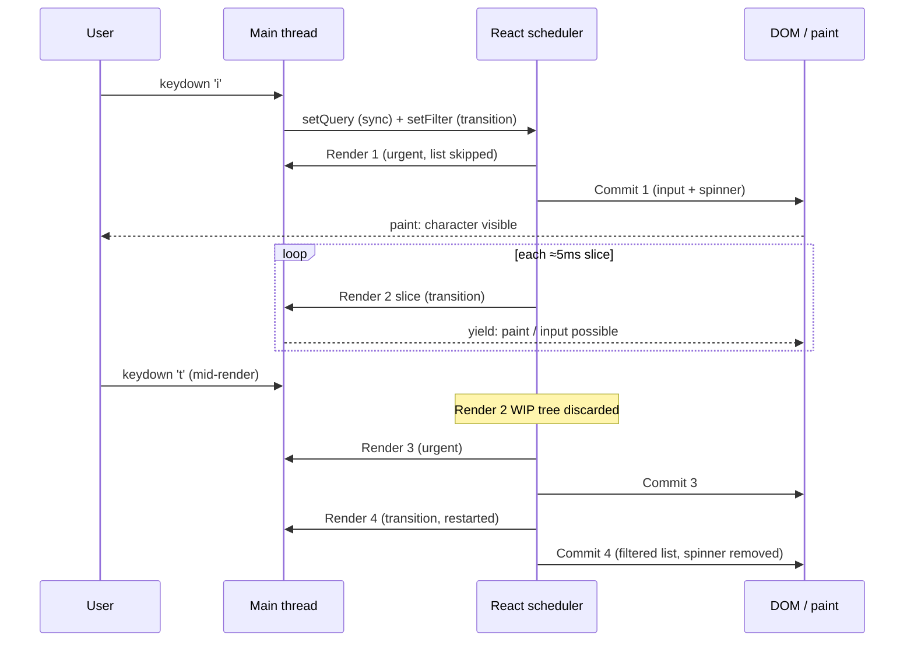
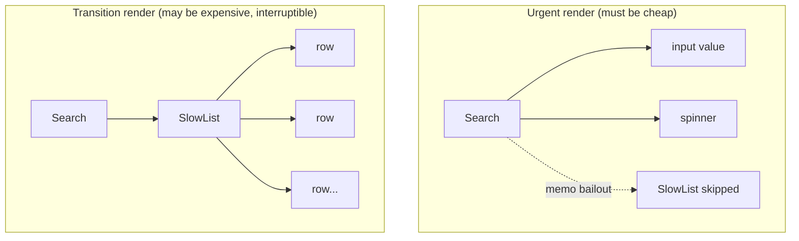

# 02 / 35 — Scenario D: Transition vs Urgent Interaction

## 1. Lesson metadata

| | |
|---|---|
| **Level** | Professional |
| **Study time** | 5–6 hours (reading 2 h, instrumented experiments 2 h, exercises 1.5–2 h) |
| **Prerequisites** | [11 — Render phase vs commit phase](./11-render-phase-and-commit-phase.md), [13 — Scheduling and update priorities](./13-scheduler-and-priorities.md), [14 — Lanes](./14-lanes.md), [15 — Interruptible, restartable, abandoned renders](./15-interruptible-restartable-abandoned-rendering.md), [16 — Concurrent React misconceptions](./16-concurrent-react-misconceptions.md), [22 — Automatic batching](./22-automatic-batching.md), [23 — Transitions and deferred rendering](./23-transitions-and-deferred-rendering.md), [30 — DevTools Profiler](./30-react-devtools-profiler.md) |
| **Previous** | [34 — Scenario C: list reorder](./34-scenario-c-list-reorder.md) |
| **Next** | [36 — Scenario E: a component suspends](./36-scenario-e-suspend.md) |

**Learning objectives.** After this lesson you can:
1. Produce a millisecond-by-millisecond timeline of a keystroke that triggers one urgent and one transition update, stating for every step what is rendered, reconciled, committed, discarded, and what the DOM looks like.
2. Predict the exact render log (including renders that are never committed) for uninterrupted and interrupted transitions.
3. Explain why a transition only helps if the expensive subtree is *skipped* in the urgent render (memoization or equivalent), and show the counter-example.
4. Explain update rebasing: why an urgent update and a transition update to the same state can be computed twice with different intermediate values and still converge.
5. Verify all of the above with a render log, `<Profiler>`, the React DevTools Profiler, and the Chrome Performance panel — without trusting a mental model alone.
6. State which parts are public guarantees, which are the teaching model, and which are version-sensitive (React 18 vs 19). The §4.1/§4.2 logs, commit counts and the §5.7 test were executed on react/react-dom 19.3.1 (jsdom, real 500 ms of busy-wait work, native `input` events outside `act`, second keystroke 150 ms later) and reproduced as written (six `render` lines incl. the abandoned `Search q=i f=i`, three commits).

**Concepts covered:** urgent (discrete-event) updates, transition updates, `useTransition`/`startTransition`, `isPending`, time-sliced rendering, interruption and restart, discarded work vs committed work, rebasing, entanglement of transitions, why `memo` (or equivalent) is part of the pattern, controlled-input rule, React 19 async transitions.

---

## 2. Deep conceptual explanation

### 2.1 The scenario

A search page has a text input and a long list. Typing must feel instant; the list may lag slightly behind. This is the canonical use of a transition and the cleanest way to *observe* what lanes (lesson [14](./14-lanes.md)) mean in practice.



Two states exist on purpose:

- `query` is what the input shows. Owned by the keystroke; must update in the very next frame.
- `filter` is what the expensive list uses. It *follows* `query` but may be late.

### 2.2 What problem is this solving?

Without a transition both updates share one priority. React renders the whole result — input *and* 500 slow rows — in one uninterrupted pass, commits, and only then can the browser paint the new character. With a 300 ms list render, each keystroke has ≈ 300 ms input delay. Typing five characters quickly queues five long tasks. This is the behavior called *jank* in [Foundations 01](../00-web-and-javascript-foundations/01-how-the-browser-works.md): the main thread is the only thread, so the cheap urgent update is stuck behind expensive work that did not need to be urgent.

A transition changes the *schedule*, not the *amount of work*. The list is still rendered in full if you stop typing. What changes is that:

1. the urgent work happens first and commits alone;
2. the transition work is split into slices between which the browser can paint and handle input;
3. if new urgent input arrives, the in-progress transition work is abandoned and restarted from the newest state, so React never spends time committing a list for a query the user has already replaced.

### 2.3 Misconceptions this scenario kills

| Misconception | Reality |
|---|---|
| "`startTransition` runs the update in a background thread." | There is one main thread. Transition rendering runs on it, in slices. Nothing runs in parallel. |
| "`startTransition` delays the function you pass." | The callback runs **synchronously, immediately**. Only the *updates scheduled inside it* get a lower priority. |
| "A transition makes the list render faster." | Total render CPU time is the same or higher (discarded work counts). *Responsiveness* improves. |
| "Wrapping `setFilter` is enough." | If `SlowList` re-renders in the urgent render anyway (parent re-rendered, child not memoized), the urgent render is slow and the input gains nothing. See §5.3. |
| "Interrupted renders are logged nowhere." | Component functions that already ran *did* run. Your `console.log` fires. They simply never commit. |
| "A transition can wrap the input's own `setState`." | It must not. A controlled input whose state is in a transition falls behind, can drop characters, and visibly reverts. |

### 2.4 First principles

Rendering is a pure function from (props, state, context) to a tree description ([12 — Why rendering must be pure](./12-why-rendering-must-be-pure.md)). Because it is pure and writes nothing to the DOM until commit ([11](./11-render-phase-and-commit-phase.md)), React is *free* to start it, pause it, throw it away, and start over. A transition is exactly "work that React has permission to throw away". The commit phase is synchronous and uninterruptible, so it is the one place where a decision becomes visible and irreversible.

---

## 3. Internal mechanics

> Legend. **[G]** public guarantee (documented API behavior). **[M]** teaching model (accurate and predictive, not literally how the source reads). **[I]** implementation detail (can change between versions; check source or docs).

### 3.1 What the API promises **[G]**

- `startTransition(fn)` / the `startTransition` returned by `useTransition()` call `fn` synchronously. State updates scheduled *during that synchronous call* are marked as transition updates.
- Transition updates are interruptible: urgent updates (such as input events) are handled first.
- `isPending` from `useTransition` is `true` while a transition started with that hook's function is pending.
- A transition will not show an *already revealed* Suspense boundary's fallback again (lesson [36](./36-scenario-e-suspend.md)).
- Transitions cannot be used to control text inputs (react.dev, `useTransition` caveats).
- Only updates that run synchronously inside the callback are transitions. In React 19, `startTransition` also accepts an async function (an *Action*); updates after the first `await` are **not** automatically part of the transition and must be wrapped in another `startTransition` (the current `useTransition` reference says: "currently require wrapping any set functions after the await in an additional startTransition"; re-read 2026-10-22).

### 3.2 The model: lanes **[M]**

Each update is tagged with a *lane* (a priority bit). Roughly:

| Source | Lane class (teaching model) |
|---|---|
| Discrete event handler (click, keydown, input) | Sync / highest |
| Continuous event (mousemove, scroll) | Slightly lower |
| Default (timers, network callbacks) | Default |
| `startTransition` | Transition lanes (low) |
| Offscreen/hidden work | Lowest |

When React picks the next render, it asks "what is the highest-priority lane with pending work?" and renders *only the updates in that lane (and any lanes it chooses to include)*. Updates in other lanes are skipped during that render but kept in the hook's update queue.

### 3.3 `isPending` is two updates **[M]**

`useTransition` effectively performs:

1. an **urgent** update `isPending = true` (so you can show feedback immediately);
2. the transition updates you scheduled;
3. a transition-lane update `isPending = false`, committed in the *same render* as your transition updates.

That is why the spinner and the filtered list appear and disappear together. It also explains why the urgent render already has `isPending === true` even though the list has not changed.

### 3.4 Time slicing **[I]**

During a transition-lane render React checks, between units of work (fibers; see [09](./09-fiber-nodes-and-units-of-work.md)), whether it should yield to the browser. In current implementations the target slice is on the order of a few milliseconds (commonly quoted as ≈ 5 ms) and it is checked using the Scheduler's `shouldYield` (`frameYieldMs` is 5 in the scheduler source). Slice length and the policy that decides when to yield are implementation details; do not hardcode them. Two consequences are **guaranteed by construction**, however:

- React can only yield *between* fibers. A single component function that takes 400 ms cannot be interrupted partway.
- The commit phase never yields.

### 3.5 Interruption and restart **[M with I details]**

When an urgent update arrives while a transition render is in progress:

1. React finishes (or abandons) the current unit of work at the next yield point.
2. The in-progress work-in-progress tree (lesson [10](./10-current-and-work-in-progress-trees.md)) is **discarded**; the `current` tree is untouched. Nothing was written to the DOM, so discarding is free of visible effects.
3. React renders the urgent lane starting from `current` and commits it.
4. React then starts the transition render **from scratch** against the newly committed tree, using the newest transition updates.

Whether React reuses *any* partial work after an interruption is an implementation detail; treat the restart as total.

### 3.6 Starvation **[I]**

If urgent work keeps arriving, low-priority lanes could wait forever. Implementations mark lanes as *expired* after a timeout and then render them without yielding (`computeExpirationTime` in `ReactFiberLane.js` gives transition lanes 5000 ms on `main`, 2026-10-22). The exact timeouts are internal; the guarantee you can rely on is only that transitions are not postponed indefinitely.

### 3.7 Rebasing **[M]**

Each hook has an ordered update queue. When an urgent render skips a transition update, it remembers a *base state* from before the skipped update, and later replays all updates after it, in original order, in the transition render. Updater functions (`c => c * 2`) therefore can run more than once with different inputs. This matters only when urgent and transition updates target the **same** state with non-commutative updaters; see §5.5.

### 3.8 Entanglement of transitions **[M / I]**

Multiple transitions started while an earlier one is pending tend to be batched into one render, so a newer transition does not commit before an older one. The user-visible effect: the list is never *older* than a previous commit. Executed on 19.3.1 (§4.2 scenario): both transition updates were replayed in the restarted render, so the final render saw `filter='it'`, and no commit for `'i'` happened. Exact lane assignment rules are internal.

---

## 4. Step-by-step execution walkthrough

Component under test (full code in §5.1). Facts: StrictMode **off** for logs (it doubles renders in dev; see [28](./28-strict-mode-behavior.md)); `SlowList` is `memo`ized; 500 rows × ≈ 1 ms each ≈ 500 ms to render; the user types `i`, then `t` 150 ms later.

State before typing: `query=''`, `filter=''`, `isPending=false`, list visible with 500 rows.

### 4.1 Timeline: one keystroke, no interruption

| t (ms) | Event | Phase | What happens | DOM |
|---|---|---|---|---|
| 0 | User presses `i`. `keydown`, then `beforeinput`/`input` fires. | Event | React's root listener dispatches `onChange` as a **discrete** event. | unchanged |
| 0.1 | `setQuery('i')` | Schedule | Update enqueued in **sync** lane. | unchanged |
| 0.1 | `startTransition(...)` begins; calls `setFilter('i')`. React also enqueues the urgent `isPending=true` and a transition-lane `isPending=false`. | Schedule | `setFilter` update enqueued in a **transition** lane. Callback returns immediately. | unchanged |
| 0.2 | Handler returns. React flushes sync-lane work at the end of the discrete event. (For a *controlled input* this flush is synchronous inside the event dispatch, because React's event finisher calls `flushSyncWork()` before restoring controlled state, `ReactDOMUpdateBatching.js`; executed on 19.3.1: Render 1 and its commit were logged before `dispatchEvent` returned. For other discrete events such as a button click the flush is a microtask right after the handler.) | — | — | unchanged |
| 0.3–2 | **Render 1** (urgent): `Search` runs with `query='i'`, `filter=''`, `isPending=true`. Log: `render Search q=i f= pending=true`. Element tree contains `<SlowList items filter="">`. | **Render phase** | **Reconcile**: `input` fiber gets new `value` prop; spinner element is new; `SlowList` fiber's props are shallow-equal to previous → **bailout** (`memo`). Its 500 row fibers are never visited. | unchanged (WIP only) |
| 2 | Commit 1 | **Commit** | Mutation: set `input.value` (already `'i'` because the browser typed it; React reconciles the controlled value), insert spinner node. Layout effects. Browser can now paint. | Input shows `i`; spinner visible; list shows all 500 old rows |
| ≈ 16 | Next frame paints. | Browser | User **sees** their character within a frame. | painted |
| 2–5 | **Render 2** (transition lane) begins. `Search` runs: `query='i'`, `filter='i'`, `isPending=false`. Log: `render Search q=i f=i pending=false`. | Render | Reconcile: spinner removed (deletion flagged), `SlowList` props changed → renders. Log: `render List f=i`. 500 rows each re-render (`SlowRow` is not memoized here, deliberately). | unchanged (WIP only) |
| 5–505 | React renders rows in slices (≈ 5 ms each), yielding between slices. The browser paints and handles input at those gaps. | Render | Work-in-progress tree grows; `current` is untouched. | unchanged |
| ≈ 505 | Render 2 completes. | — | — | unchanged |
| 505 | Commit 2 | **Commit** | Mutation phase: deletions/insertions for rows that appeared/disappeared, text updates; spinner node removed. Layout effects, then (after paint) passive effects. | Spinner gone, list filtered |

**Log for this timeline:**

```text
render Search q=i f= pending=true
render Search q=i f=i pending=false
render List f=i
```

Notice `render List f=` for the *old* filter does **not** appear: the memo bailout skipped it in Render 1.

### 4.2 Timeline: the second keystroke interrupts a pending transition

`t` is pressed at T+150 ms, while Render 2 is mid-list (≈ 30% done).

| t (ms) | Event | What happens | Committed? |
|---|---|---|---|
| 0 | `i` pressed | Same as 4.1 up to Commit 1 (log lines 1). | Commit 1 |
| 2–150 | Render 2 in slices. Log: `render Search q=i f=i pending=false`, `render List f=i`. About 148 ms of rows are rendered (~30%). Paint opportunities occur between slices. | Nothing committed from Render 2. | — |
| 150 | `t` pressed. Browser queues the input event task. It runs at the next yield point (≤ ≈ 5 ms later). | — | — |
| ≈ 152 | `onChange` runs: `setQuery('it')` (sync), `setFilter('it')` (transition), `setIsPending(true)` (urgent, no change since already true). | — | — |
| ≈ 152 | **Render 2 is abandoned.** WIP tree for filter `'i'` is discarded. | Discarded: 30% of a list render. | — |
| ≈ 153 | **Render 3** (urgent): `query='it'`, `filter=''` (the transition updates are skipped), `isPending=true`. Log: `render Search q=it f= pending=true`. `SlowList` props unchanged vs `current` → memo bailout. | — | — |
| ≈ 155 | Commit 3: input value `it`. Spinner stays (still pending). List still shows the **original** rows. | Commit 3 | ✔ |
| 155–660 | **Render 4** (transition): *both* transition updates (`'i'` then `'it'`) are replayed; resulting `filter='it'`. Log: `render Search q=it f=it pending=false`, `render List f=it`. | — | — |
| ≈ 660 | Commit 4: list filtered by `it`; spinner removed. | Commit 4 | ✔ |

**Full log:**

```text
render Search q=i f= pending=true
render Search q=i f=i pending=false     <- Render 2: runs, abandoned
render List f=i                          <- Render 2: ran for the List component, then rows yielded and discarded
render Search q=it f= pending=true      <- Render 3 (urgent)
render Search q=it f=it pending=false   <- Render 4 (transition, restarted)
render List f=it
```

Key reading rules:

- **Three** Search-with-`pending=false` lines would be wrong. The first `pending=false` render was abandoned; its lines remain in the log but its result was never committed.
- The list rows for `filter='i'` were **never** committed. The DOM went directly from "all rows" to "rows matching `it`". No intermediate state was shown.
- Commit count (what `<Profiler>` reports) is **3**, not 5, because only commits count.

### 4.3 Timeline: without the transition (control experiment)

Replace `startTransition(() => setFilter(v))` with `setFilter(v)`. Keystroke `i`:

| t | Step |
|---|---|
| 0 | Both updates sync lane, batched into one render. |
| 0–500 | **One uninterrupted render** of `Search` + `SlowList` + 500 rows. Main thread blocked; browser cannot paint the typed character. |
| 500 | One commit: input value, filtered list. |

Log: `render Search q=i f=i pending=false`, `render List f=i`. The input shows the character 500 ms late. Pressing `t` during that time is queued as an input task and runs after the commit. Two keystrokes → ≈ 1 s total. No work is discarded, which is why this version has *better throughput* but worse *latency*.

---

## 5. Code examples

### 5.1 Minimal example — fully instrumented (runs with Vite + React 19)

```tsx
// SearchDemo.tsx
import {
  memo, Profiler, useState, useTransition,
  type ChangeEvent, type ProfilerOnRenderCallback,
} from 'react';

const t0 = performance.now();
const log = (msg: string): void =>
  console.log(`[${(performance.now() - t0).toFixed(0).padStart(5)}ms] ${msg}`);

function busyWait(ms: number): void {
  const end = performance.now() + ms;
  while (performance.now() < end) { /* artificial CPU cost */ }
}

const ITEMS: readonly string[] = Array.from({ length: 500 }, (_, i) => `item-${i}`);

function SlowRow({ text }: { text: string }) {
  busyWait(1);               // ≈ 1 ms per row, simulating expensive markup
  return <li>{text}</li>;
}

const SlowList = memo(function SlowList(
  { items, filter }: { items: readonly string[]; filter: string },
) {
  log(`render List f=${filter}`);
  const visible = items.filter((s) => s.includes(filter));
  return (
    <ul>
      {visible.map((s) => <SlowRow key={s} text={s} />)}
    </ul>
  );
});

const onRender: ProfilerOnRenderCallback = (id, phase, actual) => {
  // Fires once per COMMIT of the subtree. Abandoned renders never reach it.
  log(`COMMIT [${id}] phase=${phase} actual=${actual.toFixed(1)}ms`);
};

export function SearchDemo() {
  const [query, setQuery] = useState('');
  const [filter, setFilter] = useState('');
  const [isPending, startTransition] = useTransition();
  log(`render Search q=${query} f=${filter} pending=${isPending}`);

  function onChange(e: ChangeEvent<HTMLInputElement>) {
    const next = e.target.value;
    setQuery(next);                          // urgent: input echo
    startTransition(() => setFilter(next));  // non-urgent: list
  }

  return (
    <Profiler id="search" onRender={onRender}>
      <label>
        Filter <input value={query} onChange={onChange} />
      </label>
      {isPending && <span role="status">Updating…</span>}
      <SlowList items={ITEMS} filter={filter} />
    </Profiler>
  );
}
```

The module-level `startTransition` (no `isPending`) is shown in §5.4.

**Line notes.**
- `log` prefixes elapsed time so you can see slices and gaps.
- `busyWait` makes cost deterministic without needing a slow machine.
- `SlowRow` is deliberately not `memo`ized: when `SlowList` re-renders, every row re-renders, so the cost is predictable.
- `Profiler.onRender` is invoked on commit, so it separates "ran" from "committed". `<Profiler>` is disabled in standard production builds (react.dev: "disabled in the production build by default"); it works in dev and profiling builds.
- `role="status"` makes the pending indicator announced politely by assistive tech without stealing focus.

**Predict before reading on.** Type a single character `i` and wait. How many `render Search` lines and how many `COMMIT` lines appear? *(Answer: two Search renders, two commits — one for the urgent render, one for the transition. The Profiler wraps the whole subtree so each commit that touches it is reported. Actual wording of the `phase` value is `update` for both.)*

### 5.2 Practical example — product search with accessible pending state

```tsx
import { memo, useDeferredValue, useMemo, useState, useTransition } from 'react';

interface Product { id: string; name: string; category: string }

const ProductGrid = memo(function ProductGrid(
  { products, query }: { products: readonly Product[]; query: string },
) {
  const q = query.trim().toLowerCase();
  const matches = useMemo(
    () => products.filter((p) => p.name.toLowerCase().includes(q)),
    [products, q],
  );
  return (
    <ul>
      {matches.map((p) => <li key={p.id}>{p.name}</li>)}
    </ul>
  );
});

export function ProductSearch({ products }: { products: readonly Product[] }) {
  const [text, setText] = useState('');
  const [applied, setApplied] = useState('');
  const [isPending, startTransition] = useTransition();

  return (
    <section aria-busy={isPending}>
      <input
        type="search"
        aria-label="Search products"
        value={text}
        onChange={(e) => {
          const v = e.target.value;
          setText(v);
          startTransition(() => setApplied(v));
        }}
      />
      <div style={{ opacity: isPending ? 0.6 : 1, transition: 'opacity .15s' }}>
        <ProductGrid products={products} query={applied} />
      </div>
    </section>
  );
}
```

Design notes: stale content is dimmed instead of replaced by a spinner (avoids layout shift), `aria-busy` reflects the pending state. The `useMemo` is secondary; the structural win is that `ProductGrid` is skipped in the urgent render.

### 5.3 Incorrect example — transition without skipping the expensive subtree

```tsx
// ❌ SlowList is NOT memoized
function SlowList({ items, filter }: { items: readonly string[]; filter: string }) {
  log(`render List f=${filter}`);
  /* ...500 SlowRows... */
}
```

Everything else identical to §5.1. **Predict the log for one keystroke `i`.**

*Answer:*

```text
render Search q=i f= pending=true
render List f=                      <- urgent render re-renders the list with the OLD filter
render Search q=i f=i pending=false
render List f=i
```

Why: in the urgent render `Search` re-executes because its state changed. It returns a new `<SlowList>` element. With no `memo`, React re-renders a child whenever the parent re-rendered (lesson [01](./01-what-triggers-a-render.md), [06](./06-reconciliation-fundamentals.md)). All 500 rows run with the old filter. The urgent render therefore costs ≈ 500 ms — exactly what the transition was supposed to avoid. The user sees the input echo ≈ 500 ms late, then does the work *again* in the transition. Total CPU doubles; latency does not improve.

This is the single most common failure of the pattern. A transition is **permission to defer**; it is not a way to make React skip children. Skipping is done by `memo`, by React Compiler-generated memoization (react-compiler 1.0.0 on npm; see Phase 9), or by structure (the expensive subtree does not read the urgent state and the parent does not re-render — e.g. state moved down into a sibling component).

### 5.4 Corrected implementation (and the standalone `startTransition`)

Fix 1: `memo` as in §5.1. Fix 2: structural — keep `query` state inside a small `SearchInput` component and lift only the applied filter:

```tsx
import { memo, startTransition, useState } from 'react';

function SearchBox({ onApply }: { onApply: (v: string) => void }) {
  const [text, setText] = useState('');
  return (
    <input
      value={text}
      onChange={(e) => {
        const v = e.target.value;
        setText(v);                                   // urgent, local to SearchBox
        startTransition(() => onApply(v));            // standalone API, no isPending
      }}
    />
  );
}

export function Page({ items }: { items: readonly string[] }) {
  const [filter, setFilter] = useState('');
  return (
    <>
      <SearchBox onApply={setFilter} />
      <SlowList items={items} filter={filter} />
    </>
  );
}
```

Here the urgent update re-renders only `SearchBox`; `Page` does not re-render at all. The standalone `startTransition` from `react` has no `isPending`; use `useTransition` when you need it. Trade-off: the pending flag is then unavailable unless you pass it down.

### 5.5 Advanced — rebasing, observed

```tsx
import { startTransition, useState } from 'react';

export function Rebase() {
  const [c, setC] = useState(1);
  console.log('render c =', c);
  return (
    <button
      onClick={() => {
        startTransition(() => setC((x) => x * 2)); // transition update (first in queue)
        setC((x) => x + 1);                        // urgent update (second in queue)
      }}
    >
      {c}
    </button>
  );
}
```

**Predict:** logs and final `c` after one click from `c = 1`.

*Answer:* `render c = 2` (urgent render applies only `+1` onto base `1`), then `render c = 3` (transition render replays in queue order: `1 → ×2 = 2 → +1 = 3`). Final is **3**, and the user briefly sees `2`. If the two calls were swapped in the handler (urgent `+1` first, transition `×2` second), the urgent render shows `2`, the transition render replays `+1` then `×2` and gives `4`. Order in the queue is the order of calls, not priority. This is why updater functions must be pure ([12](./12-why-rendering-must-be-pure.md)): they can run more than once, and the intermediate value shown to users is not always a prefix of the final computation.

### 5.6 Advanced — React 19 async transition

```tsx
import { useState, useTransition } from 'react';

export function SaveButton({ save }: { save: () => Promise<void> }) {
  const [isPending, startTransition] = useTransition();
  const [saved, setSaved] = useState(false);

  return (
    <button
      disabled={isPending}
      onClick={() =>
        startTransition(async () => {
          await save();
          // After an await, this update is NOT automatically a transition.
          startTransition(() => setSaved(true));
        })
      }
    >
      {isPending ? 'Saving…' : saved ? 'Saved' : 'Save'}
    </button>
  );
}
```

`isPending` is `true` for the *whole* duration of the async function in React 19. In React 18 the callback had to be synchronous; passing an async function did not keep `isPending` true across the `await`. Executed on 19.3.1: with `startTransition(async () => { await ...; startTransition(() => set(5)); })` the renders were `pending=true`, `pending=true`, then `v=5, pending=false`. The surrounding "Actions" model is covered in Phase 3 lesson 22.

### 5.7 Verification harness — assert "discarded vs committed" in a test

```tsx
// search.test.tsx (Vitest + @testing-library/react, jsdom)
import { act, render, screen } from '@testing-library/react';
import userEvent from '@testing-library/user-event';
import { expect, test, vi } from 'vitest';
import { SearchDemo } from './SearchDemo';

test('every commit is observable and ends on the final filter', async () => {
  const spy = vi.spyOn(console, 'log').mockImplementation(() => {});
  render(<SearchDemo />);
  spy.mockClear();

  await userEvent.type(screen.getByRole('textbox'), 'it');
  await act(async () => {}); // flush remaining transition work

  const lines = spy.mock.calls.map((c) => String(c[0]));
  expect(lines.some((l) => l.includes('render List f=it'))).toBe(true);
  expect(screen.getAllByRole('listitem').every((li) => li.textContent!.includes('it'))).toBe(true);
});
```

Note what this test does **not** prove: under test utilities and `act`, timing is not representative, so you cannot assert the number of discarded renders here. Use the real browser for interruption (§10).

---

## 6. Visual explanations

### 6.1 Two lanes, one main thread



### 6.2 Which render lines become commits

```text
Render 1 (urgent)      ───────▶ COMMIT 1
Render 2 (transition)  ──╳     (abandoned; its logs remain, its DOM work never existed)
Render 3 (urgent)      ───────▶ COMMIT 3
Render 4 (transition)  ───────────────────────▶ COMMIT 4
```

### 6.3 Where the cost lands



---

## 7. Alternative approaches and trade-offs

| Approach | Input latency | Stale UI shown | Wasted work on fast typing | Needs `memo`/structure | `isPending` signal | Best for |
|---|---|---|---|---|---|---|
| No transition | Bad when render is slow | None | None | No | n/a | Cheap renders (< ~16 ms) |
| `useTransition` (§5.1) | Good | Old list until commit | Some (abandoned slices) | Yes | Yes, built in | You own the state-setting code |
| `useDeferredValue(query)` | Good | Old list until commit | Some | Yes (`memo` on consumer) | Derive `query !== deferred` | You receive the value as a prop/hook and cannot wrap the setter |
| Debounce (`setTimeout`) | Good | Old list for the debounce delay *plus* render time | None (cancelled timers) | No | You build it | Network calls, any work that must not start at all on every key |
| Throttle | Moderate | Bounded staleness | Reduced | No | You build it | Continuous events (scroll, resize) |
| Web Worker for filtering | Good | Old list until result | None on main thread | No | You build it | Pure computation heavy enough to be off the main thread; rendering rows still on main thread |
| Virtualization | Good | None | None | No | n/a | The real problem is *too many DOM nodes*; best fix, since it reduces cost |

**Where the recommended approach (transition) is NOT best.**
1. The list is 100k rows. Time slicing helps responsiveness but each commit still mutates thousands of nodes synchronously (commit is not interruptible); virtualization removes the problem.
2. The expensive work is a network request. A transition schedules *rendering*; it neither cancels nor throttles fetches. Debounce or cancel in the data layer (Phase 6).
3. A *single component's* render is expensive (a 400 ms function). Time slicing cannot cut inside a function; memoize/move the computation, or use a worker.
4. A state that is read by an input's `value`. Never in a transition.

---

## 8. Best practices and anti-patterns

**Best practices**
- Put urgent feedback (echoing text, toggling a control) in plain updates; wrap only the update that causes the expensive subtree to change.
- Ensure the expensive subtree is skipped in the urgent render (`memo`, structure, or compiler).
- Prefer showing stale content with a subtle pending style over unmounting it for a spinner.
- Keep updater functions and render functions pure.
- Measure first ([Phase 7](../07-performance/01-measure-before-optimizing.md)): if the render is 5 ms, a transition adds complexity for nothing.

**Beginner mistakes**
- Wrapping the input's own `setState` in `startTransition`.
- Believing `startTransition(async …)` delays code.
- Forgetting `memo` (§5.3).
- Expecting `isPending` to be true for state updates made *after* an `await` in React 18.

**Experienced-dev mistakes**
- Using a transition to hide a render that is slow because of unnecessary work (fix the work).
- Reading a mutable external store inside the transition render and getting tearing. Use `useSyncExternalStore` for external stores ([Phase 3 lesson 20](../03-react-state-and-hooks/20-usesyncexternalstore-and-external-stores.md)).
- Benchmarking in StrictMode dev (2× render cost) and drawing conclusions about production.
- Assuming every keystroke produces its own list render. Because of abandonment, fast typists commit far fewer list renders than keystrokes.

**Smells**
- `isPending` spinner flashes on every keystroke → consider a minimum delay or dimming instead.
- Transition used on every `setState` "just in case".

**Justified exception.** For a slow but *essential* update that must be visible together with the input (e.g. a mask that reformats a credit-card number), do not defer: consistency beats responsiveness.

---

## 9. Real-world application

| Domain | Urgent | Transition | Constraint |
|---|---|---|---|
| E-commerce search/filter | Input text, facet checkbox state | Result grid, count | Grid items include images; commit cost can dominate — virtualize |
| Analytics dashboard | Date-range picker open/close | Re-rendering 12 charts | Charts that use canvas draw in effects; transitions do not interrupt effects |
| Finance table | Cell selection highlight | Column sort / grouping | Sorting 50k rows: do it in `useMemo`/worker; transition covers rendering only |
| Forms with live preview | Fields | Preview pane | Accessibility: announce preview updates politely, not on every keystroke |
| Tabs/navigation | Active tab indicator | Heavy tab content | Combine with Suspense (lesson [36](./36-scenario-e-suspend.md)) so the old tab stays until the new one is ready |
| Realtime feeds | Scroll position, typing | Incoming message batches | External store + `useSyncExternalStore`; its updates are always sync, not transitions |

---

## 10. Debugging and troubleshooting

### 10.1 Verification method: three independent observations

1. **Render log vs commit log.** The instrumented example in §5.1 prints `render …` from component bodies and `COMMIT …` from `<Profiler>`. If the number of renders exceeds commits for the same component, the extra renders were either abandoned or StrictMode doubles.
2. **React DevTools Profiler (lesson [30](./30-react-devtools-profiler.md)).** Enable *Record why each component rendered*. Record while typing quickly. Each bar in the commit chart is one **commit**; abandoned renders do not appear. Select a commit: `Search` rendered "Hooks changed" (state), `SlowList` is greyed out (did not render) in the urgent commit and colored in the transition commit.
3. **Chrome Performance panel with CPU throttling (4× or 6×).** Record, type several characters. In the main-thread flame chart you should see: a short task per keystroke (event + urgent render + commit), then a *train of short tasks* (transition slices) rather than one 500 ms task. Look for "Long task" markers: with a correct transition there are none from the list. React 19.2+ can add *Performance Tracks* (a "Scheduler" and "Components" track) to Chrome's Performance panel in profiling/dev builds; availability depends on React version (a 19.x minor) and build, so verify against current React release notes.

### 10.2 Symptom → cause table

| Symptom | Likely cause | Check | Fix |
|---|---|---|---|
| Input still lags | List renders in urgent render | Profiler: is `SlowList` colored in the *first* commit after a keystroke? | `memo` or restructure |
| Input drops/reverts characters | Input state inside `startTransition` | Search for `setQuery` inside transition callback | Move to urgent |
| Spinner never disappears | Transition render keeps suspending or throwing | Console errors; Suspense boundary above | See lesson 36 |
| `isPending` false right away | Update made after `await` (React 18) or outside callback | Log inside callback | Wrap the update itself (19 supports async functions) |
| One long task anyway | One component's render is slow, or commit is huge | Flame chart: single function dominating | Memoize computation, virtualize |
| Logs show renders that never appear in the Profiler | Abandoned renders (expected) | Compare log vs Profiler commits | None |
| Double renders in dev | StrictMode | Remove temporarily | Expected ([28](./28-strict-mode-behavior.md)) |

### 10.3 Validating the fix

After adding `memo`, record again: the first commit after each keystroke must show `SlowList` as *did not render*. Compare total blocking time of the interaction (INP) before/after in the Performance panel's interaction track.

---

## 11. Exercises

### Level A — Knowledge
A1. When does the function passed to `startTransition` run: immediately, or later in a lower-priority task?
A2. What does `isPending` represent, and which two renders does it participate in?
A3. Why can React discard transition render work safely but not commit work?
A4. Name two situations in which a transition cannot make the UI responsive.
A5. Why must an input's `value` state not be updated inside `startTransition`?

### Level B — Code comprehension
B1. In §5.1, user types `i` and waits. How many commits does `<Profiler>` report? How many log lines starting with `render`?
B2. Same code, but `SlowList` loses `memo`. Write the log for one uninterrupted keystroke `i`.
B3. §5.5 with the order of the two `setC` calls swapped. Logs and final value?
B4. A user types `a`, then `b` 40 ms later, then `c` 40 ms later; each list render needs 500 ms. How many *list commits* occur if they then stop typing? (Assume interruption at each keystroke.)
B5. What would `isPending` read in the urgent render for the second keystroke of §4.2?

### Level C — Implementation
C1. Convert a slow `TabPanel` switch to use a transition so the tab header highlights immediately while old panel content stays visible and dimmed until the new one commits.
C2. Implement the same search using `useDeferredValue` and show a stale indicator without `useTransition`.
C3. Write a test helper `expectNoRenderDuringUrgent(Component)` or an equivalent technique using `<Profiler>` to verify a memoized child is skipped in the urgent commit.

### Level D — Debugging
D1. The team added `startTransition` around both `setText` and `setApplied`. Typing "feels worse". Explain with timeline, fix.
D2. A search page shows a spinner that flashes briefly on every single character even for tiny lists. Propose two remedies and a trade-off for each.
D3. A transition update runs a `useEffect` that reads layout and sets state. After typing quickly the Profiler shows many more renders than commits. Is that a bug?

### Level E — Architecture and engineering decisions
E1. A grid of 10k rows with 12 columns, each cell a component, sorted/filtered by user input. Compare transition + memo, virtualization, server-side filtering, and worker-based filtering. Pick one primary strategy and justify with criteria (latency, complexity, accessibility, SEO).
E2. Your design system exposes `<SearchField onChange>`. Should it wrap the consumer's callback in `startTransition` internally? Discuss API implications.

### Level F — Expert challenge
F1. Construct a minimal example where a transition causes *more* total render CPU and *worse* final-result latency than no transition, yet is still the right production choice. Explain.
F2. Explain why `useSyncExternalStore` updates cannot be transitions and what that implies for an external store feeding the slow list.

---

## 12. Detailed answers and explanations

> Attempt the exercises first.

**A1.** Immediately and synchronously, in the same call stack as the event handler. Only the updates scheduled during it get transition priority. *Wrong answer "later":* confuses the API with `setTimeout`/`requestIdleCallback`; the callback must run synchronously so React can mark updates while they are created.

**A2.** `isPending` is `true` while the transition's updates are not yet committed. It participates in the urgent render (`true`, committed first) and in the transition render (`false`, committed together with the new content). *Wrong:* "a boolean toggled by React after a timer".

**A3.** Render is pure and writes only to the WIP tree; discarding it has no external effect. Commit mutates DOM, runs layout effects, and attaches refs; those cannot be undone, so commit is synchronous and uninterruptible and only happens for work that is final.

**A4.** (a) A single component function that is slow (cannot yield inside). (b) The commit is huge (thousands of DOM mutations). Also: updates from `useSyncExternalStore`, which are synchronous; network latency.

**A5.** The browser has already put the typed character into the DOM input. If the React state lags (transition), the next render sets `value` back to the old state, which reverts characters or moves the caret. Text inputs need a synchronous state echo.

**B1.** Two commits (urgent, transition). Three `render` lines: `render Search … pending=true`, `render Search … pending=false`, `render List f=i`. `SlowRow` has no log.

**B2.** As in §5.3: `render Search q=i f= pending=true`, `render List f=`, `render Search q=i f=i pending=false`, `render List f=i`.

**B3.** Swapped order: `setC(x => x + 1)` first (urgent), then `startTransition(() => setC(x => x*2))`. Urgent render: base 1 + 1 = **2** → `render c = 2`. Transition render replays queue in order: `1+1 = 2`, then `×2 = 4` → `render c = 4`. Final 4. Wrong answer "3" assumes the transition update is applied to the already-committed 2 only (it is replayed from the base state).

**B4.** One. Each new keystroke abandons the in-progress list render (each needs 500 ms, keystrokes come every 40 ms), so the only list render that survives is the one started after `c` and not interrupted. Three urgent commits for the input plus one list commit. If the render of `a` had ≥ 500 ms of uninterrupted time it would be committed; it does not.

**B5.** `true`. The first keystroke's urgent render committed `isPending=true`; the transition has not yet committed, so it remains `true`.

**C1.** Sample:

```tsx
import { memo, useState, useTransition } from 'react';

type Tab = 'overview' | 'reports' | 'billing';
const Panel = memo(function Panel({ tab }: { tab: Tab }) {
  return <section>{/* expensive content for {tab} */}</section>;
});

export function Tabs() {
  const [active, setActive] = useState<Tab>('overview');
  const [shown, setShown] = useState<Tab>('overview');
  const [isPending, startTransition] = useTransition();
  const select = (t: Tab) => {
    setActive(t);                               // header highlight: urgent
    startTransition(() => setShown(t));         // panel: transition
  };
  return (
    <>
      <nav>
        {(['overview', 'reports', 'billing'] as const).map((t) => (
          <button key={t} aria-current={active === t} onClick={() => select(t)}>{t}</button>
        ))}
      </nav>
      <div style={{ opacity: isPending ? 0.5 : 1 }}><Panel tab={shown} /></div>
    </>
  );
}
```

Evaluation: header and panel state split; panel memoized; stale panel visible; pending style. *Edge case:* if `Panel` suspends, the transition also keeps the old panel (lesson 36).

**C2.** `const deferred = useDeferredValue(query); const isStale = deferred !== query;` pass `deferred` to a `memo` list and dim when stale. Evaluation: single state, `memo` still required, no `isPending` hook. Trade-off: you cannot tell *why* it is pending beyond equality; if the value is an object, equality is by reference.

**C3.** Technique: wrap the list in `<Profiler id="list" onRender={fn}>`; drive an input event with `act`; record `fn` calls; expect that the *first* `onRender` after the event is not logged for `list` (Profiler only reports when something within rendered; with a bailout it may not fire for that commit). Evaluation criteria: uses commit-based observation, not render-count guesses; does not rely on timing; notes that `act` flushes transitions so interruption is not tested.

**D1.** With `setText` in the transition the input echo is no longer urgent. Timeline: keystroke → input DOM has the char, React state still old, transition render (500 ms) in slices; any urgent re-render (focus change, other state) resets `value` to the old text, so characters appear to revert; typing "feels worse" because the echo waits for the transition commit. Fix: urgent `setText`, transition only `setApplied`.

**D2.** (a) Delay showing the indicator (CSS `transition-delay` / animation delay of 150–200 ms) so quick commits never show it; trade-off: longer true-but-invisible pending. (b) Dim stale content (opacity) instead of a spinner; trade-off: less explicit for screen readers, so keep `aria-busy`. Also (c) skip the transition when the list is small; trade-off: branching logic.

**D3.** Not a bug. Abandoned renders log and count as renders in dev instrumentation; effects only run for committed renders. If an *effect* is firing too often, that is a separate issue. Check that effects are keyed off committed values, not on render count.

**E1.** Evaluation criteria: states constraints (a11y, row count, SEO if public); identifies the DOM-node count as the dominant cost; recommends **virtualization** as the primary fix (fewest nodes, bounded commit), keeps the input urgent, uses a transition for filter changes, moves heavy sorting to `useMemo`/worker, uses server-side filtering only when the dataset cannot be shipped. Example reasoning: "10k × 12 = 120k cells; even sliced, commit mutates thousands of nodes synchronously; transition alone cannot fix commit-bound cost." Note a11y cost of virtualization (`aria-rowcount`, keyboard nav).

**E2.** No for text-input echo: the field's own state must stay urgent. A design-system component should not decide consumer scheduling; expose `onChange` synchronously and document that consumers may wrap their own expensive state update in a transition. Alternative: offer `onValueDeferred`/`useDeferredValue` hook. Trade-off: library-imposed transitions make `isPending` inaccessible to the consumer.

**F1.** Example: a 120 ms unmemoized-parent list. With a transition, a user who types one character and stops pays for an extra urgent render (the list is not skipped in a poorly structured tree) plus the transition render, and a pending spinner state: more total CPU and a slightly later final list than the no-transition version. It remains the right production choice because it bounds the *worst-case input latency* (one frame instead of the list render time) when users type continuously, and perceived quality and INP track worst/high-percentile interactions, not the average. Evaluation: distinguishes throughput from latency, cites INP/percentiles, and notes that adding `memo` removes the extra cost.

**F2.** `useSyncExternalStore` must avoid tearing (different components reading different snapshots in one render), and concurrent rendering could otherwise yield mid-render while the store mutates. React therefore forces store-triggered updates to be synchronous (non-interruptible). Implication: if the external store drives the slow list, every store change renders the list synchronously; to keep transitions, copy the store value into React state at a boundary, or derive a deferred value (`useDeferredValue(storeValue)`), accepting the staleness. Verify exact semantics in the `useSyncExternalStore` reference.

---

## 13. Senior engineer interview questions

**Q1. "Explain what `startTransition` does under the hood."**
It tags state updates created during its synchronous callback with a low-priority (transition) lane. When rendering, React works on the highest-priority lane first; transition-lane work is time-sliced and abandonable. Work done is only observable if committed. Mention: callback runs synchronously, `isPending` is a pair of updates, and the commit is atomic.

**Q2. "Your team wrapped everything in transitions and INP got worse. Why?"**
Transitions add extra renders (urgent + transition) and discarded work. If the subtree isn't skipped in the urgent render, or transitions wrap urgent updates like inputs, latency worsens. Remedy: measure per interaction, use transitions only where urgent feedback is cheap and the deferred subtree is expensive and skippable.

**Q3. "Can a transition ever show a loading spinner for Suspense?"**
For an already revealed boundary: no, it keeps old content. For a boundary being *newly mounted* in the transition: yes, the new boundary's fallback can show. (Lesson [36](./36-scenario-e-suspend.md).)

**Q4. "Why do updater functions in `setState` have to be pure?"**
Because React may call them more than once (StrictMode, rebasing across lanes, discarded renders). The intermediate value shown for the urgent lane is derived from a different subset of updates than the final value.

**Q5. "How would you prove to a skeptical reviewer that your transition works?"**
Instrument render vs commit, Profiler to show `SlowList` skipped in the first commit, Chrome Performance with throttling to show no long task attributed to keystroke handling, and a before/after INP in production RUM.

**Q6. "React 18 vs 19 for this pattern?"** Same core semantics. 19 adds async functions to `startTransition` (Actions) and keeps `isPending` through `await`; 19.2 adds the React Performance tracks. Don't claim lane-level changes without checking the changelog.

---

## 14. Further learning resources

| Resource | URL | Covers / why | Level | Study |
|---|---|---|---|---|
| React — `useTransition` | <https://react.dev/reference/react/useTransition> | API, caveats (inputs, sync callback, async functions) | Intermediate | Whole page, Caveats |
| React — `startTransition` | <https://react.dev/reference/react/startTransition> | Standalone API differences | Intermediate | Caveats |
| React — `useDeferredValue` | <https://react.dev/reference/react/useDeferredValue> | Alternative for received values | Intermediate | Usage, stale content |
| React — `memo` | <https://react.dev/reference/react/memo> | Bailout used by the pattern | Intermediate | Usage |
| React — `Profiler` component | <https://react.dev/reference/react/Profiler> | Commit-based instrumentation | Intermediate | `onRender` |
| React — `useSyncExternalStore` | <https://react.dev/reference/react/useSyncExternalStore> | Why store updates are synchronous | Advanced | Caveats |
| React 19 release post | <https://react.dev/blog/2024/12/05/react-19> | Actions, async transitions, Suspense changes | Intermediate | "Actions" |
| React DevTools | <https://react.dev/learn/react-developer-tools> | Install/use Profiler | Beginner | Profiler basics |
| web.dev — Interaction to Next Paint | <https://web.dev/articles/inp> | Metric that transitions improve | Intermediate | Whole article |
| React source | <https://github.com/facebook/react> | Verify lanes/scheduler (lesson [31](./31-reading-react-source.md)) | Advanced | `react-reconciler`, `scheduler` |

---

## 15. Knowledge checkpoint

**You should now understand**
- That a transition is a priority/permission mechanism, not parallelism, and that the callback runs synchronously.
- How the urgent render and the transition render differ, which commits occur, and what is discarded.
- Why `memo` or structure is an essential partner and why inputs must stay urgent.
- Rebasing and why updaters must be pure.

**You should be able to explain without notes**
- The log of one keystroke with and without interruption.
- Why Profiler shows fewer commits than your `console.log` shows renders.

**You should be able to implement**
- Search/tabs with `useTransition` and `useDeferredValue`; instrumentation that separates render from commit.

**You should be able to debug**
- A laggy input by finding which subtree renders in the urgent commit; a reverted-text bug caused by a transitioned input state.

**Before moving on:** read [36 — Scenario E: a component suspends](./36-scenario-e-suspend.md), which applies the same discard/commit reasoning to Suspense.
