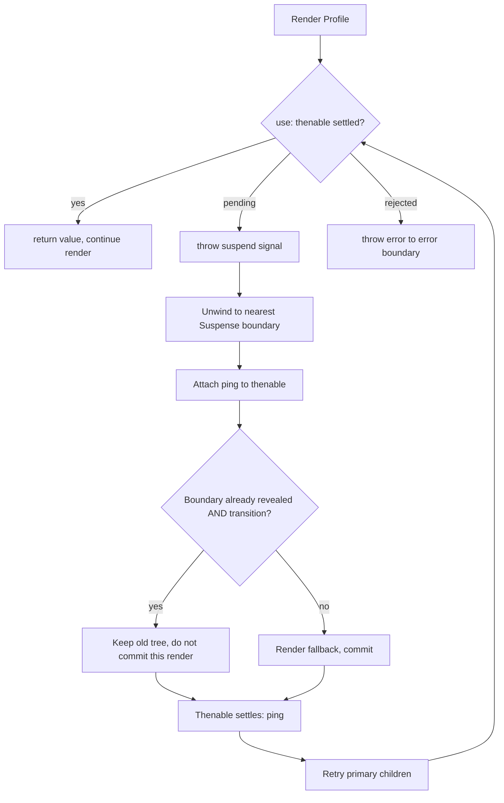

# 02 / 36 — Scenario E: A Component Suspends

## 1. Lesson metadata

| | |
|---|---|
| **Level** | Professional |
| **Study time** | 5–6 hours (reading 2 h, instrumented experiments 2 h, exercises 1.5–2 h) |
| **Prerequisites** | [10 — Current and work-in-progress trees](./10-current-and-work-in-progress-trees.md), [11 — Render vs commit phase](./11-render-phase-and-commit-phase.md), [15 — Interruptible, restartable, abandoned renders](./15-interruptible-restartable-abandoned-rendering.md), [19 — Layout vs passive effects](./19-layout-vs-passive-effects.md), [20 — Commit and DOM mutation](./20-commit-and-dom-mutation.md), [23 — Transitions and deferred rendering](./23-transitions-and-deferred-rendering.md), [24 — Suspense and thrown thenables](./24-suspense-conceptual-internals.md), [35 — Scenario D](./35-scenario-d-transition-vs-urgent.md) |
| **Previous** | [35 — Scenario D: transition vs urgent](./35-scenario-d-transition-vs-urgent.md) |
| **Next** | [37 — Scenario F: hydration mismatch](./37-scenario-f-hydration-mismatch.md) |

**Learning objectives.** After this lesson you can:
1. Write a precise timeline for three situations: (a) a component suspends on **initial mount**, (b) a component in an already-visible boundary suspends on an **ordinary update**, (c) the same update inside a **transition**.
2. State for each step what is rendered, what is discarded, what is committed, and what the DOM contains — including the fact that already-visible DOM is *hidden*, not removed, in case (b).
3. Explain why a component that suspends on mount has no state, no effects, and no DOM, and why the component function may run more than once.
4. Identify the classic bugs: promises created during render, request waterfalls, boundaries too high or too low, and missing error boundaries.
5. Verify the behavior with logs, a `MutationObserver`, React DevTools "Suspend the selected component", the Elements panel, the Profiler, and the Network panel.
6. Mark the React 18 vs 19 differences (sibling pre-warming and immediate fallback commit) as version-sensitive; both were re-checked against the React 19 upgrade guide and executed on react 19.3.1 (see §4 notes).

**Concepts covered:** Suspense boundary, fallback, `use(promise)`, thenable status, unwind to boundary, retry/ping, hidden primary tree, stale content in transitions, promise identity/caching, waterfalls, error boundary interaction, fallback throttling, sibling pre-warming.

---

## 2. Deep conceptual explanation

### 2.1 The scenario

```tsx
<Suspense fallback={<Fallback />}>
  <Profile id={id} />   {/* calls use(getUser(id)) */}
  <Sidebar />
</Suspense>
```

`Profile` needs data that is not ready. A function component cannot "wait" — it must return JSX synchronously or not at all. Suspense gives it a third option: *"I cannot produce output yet; ask me again later."* React responds by finding the nearest Suspense boundary above and rendering that boundary's `fallback` in place of the not-yet-renderable subtree. When the thenable settles, React retries the boundary's children.

### 2.2 What problem does this solve?

Before Suspense, each component managed its own "loading / error / data" state with effects; the UI assembled itself in whatever order the network answered, causing layout shifts and "spinner soup". Suspense lets rendering express a *dependency* ("this subtree needs X") and lets a *boundary higher in the tree decide the loading UI*. It is a rendering-level coordination mechanism: the same scheduling machinery as transitions ([35](./35-scenario-d-transition-vs-urgent.md)), applied to "not ready".

### 2.3 Misconceptions

| Misconception | Reality |
|---|---|
| "Suspense fetches data." | Suspense does nothing but coordinate rendering. Fetching is done by your cache/library/framework or `use` on a promise you supply. |
| "A suspended component renders partially and its state is kept." | On initial mount the component never committed: no state, no refs, no effects, no DOM. |
| "The fallback replaces the content in the DOM." | When content is *already visible*, React **hides** the existing host nodes (style `display: none`) and inserts the fallback; it does not delete them (state preserved). When content never existed, there is nothing to hide. |
| "A transition shows the fallback." | A transition keeps old, already revealed content and does not show that boundary's fallback again. A *new* boundary entering the tree can still show its fallback. |
| "`use(fetch(url))` is fine." | Creating a new promise on each render in a Client Component yields a new, never-settled promise each retry — an endless suspend loop; React warns. |
| "Suspense catches errors." | Rejected promises throw at `use` and propagate to the nearest **error boundary**; Suspense does not handle them. |
| "Data fetched in `useEffect` triggers Suspense." | No. Suspense only reacts to suspending *during render* (`use`, `lazy`, Suspense-enabled libraries, server components). |

### 2.4 First principles

- A render is pure and discardable ([12](./12-why-rendering-must-be-pure.md)). "Suspending" is therefore just *abandoning this render attempt of one subtree*, then arranging to be re-run when the dependency resolves.
- React needs a place to render *something* in the meantime. The nearest Suspense boundary is that place. If no boundary exists, then in a React 19 concurrent root (the only kind) the render simply suspends without committing: the previous UI (or an empty root on first render) stays until the thenable settles (`ReactFiberThrow.js` on `main`; executed on react 19.3.1 for both `root.render` and a `flushSync` update). The old "A component suspended while responding to synchronous input" error is legacy-root only. In practice always provide an intentional boundary.
- Commit is atomic. Either the committed tree shows primary content, or it shows the fallback; there is no commit in which half of the primary tree is visible.

---

## 3. Internal mechanics

> Legend. **[G]** public guarantee · **[M]** teaching model · **[I]** implementation detail (checked 2026-10-22; may change).

### 3.1 Public guarantees **[G]**

- `use(promise)` suspends the component until the promise resolves; it returns the value, or throws the rejection to the nearest error boundary. The promise must have a *stable identity* across retries. react.dev warns that promises created during render in Client Components are not supported unless produced by a Suspense-compatible library/framework.
- A Suspense boundary shows `fallback` while any component in its primary children is suspended.
- Transitions do not re-hide already revealed content ([35](./35-scenario-d-transition-vs-urgent.md)).
- Suspense does not detect fetches done in effects or event handlers.
- Reveal of content: `lazy` components and `use` participate; error → error boundary.

### 3.2 Teaching model **[M]**

1. **Throw to unwind.** When `use` meets an unresolved thenable it stops the component function by throwing a special control-flow signal (conceptually "a thrown thenable", lesson [24](./24-suspense-conceptual-internals.md)). Do not `try/catch` around `use`.
2. **Unwind to boundary.** React walks up from the suspended fiber to the nearest boundary that can handle it, abandoning the unfinished work for that subtree.
3. **Attach a listener.** React subscribes to the thenable (`then`) with a "ping" that schedules a retry of that boundary when it settles.
4. **Render fallback** for that boundary in this render attempt.
5. **Commit** (or, in a transition on an already revealed boundary, *do not* commit).
6. **Retry** when pinged: re-render the boundary's primary children; `use` now returns the value synchronously because the thenable carries its settled status/value.

### 3.3 Implementation details **[I]**

- `use` records `status`/`value` on the thenable object it sees (React reads these fields if already set, e.g. by your cache, which lets already-resolved promises be consumed synchronously). The exact field names and the internal exception type are implementation details.
- React may *replay* a component function immediately if the thenable settles very quickly, so the function body can execute more than once per retry. Never count on the number of invocations.
- **Fallback throttling.** React avoids flashing a fallback → content → fallback sequence by delaying the reveal of content for a short period (react.dev: "at most once every 300ms, measured from the last reveal"; `FALLBACK_THROTTLE_MS = 300` in `ReactFiberWorkLoop.js`) after a fallback commits. Exact constants have changed in the past. In the executed runs below the 800 ms loads were not delayed (more than 300 ms had passed since the fallback commit).
- Hiding implementation: when a boundary that has been revealed suspends again, React marks the primary subtree as hidden (Offscreen-like handling, conceptually) and applies `display: none !important` to its top-level host nodes. Inspect it in the Elements panel; do not depend on the exact style string.
- **Layout effects** inside a re-hidden subtree are cleaned up and re-fired when the content is revealed again; passive effects are not torn down by hiding (executed on 19.3.1: with `[]` dependencies only the layout cleanup ran on hide; the `Suspense` reference documents only the layout-effect part). `<Activity mode="hidden">` is different: it cleans up passive effects too.

### 3.4 React 18 vs 19 (from the React 19 upgrade guide; reproduced on 19.3.1)

| Aspect | React 18 | React 19 |
|---|---|---|
| Render work after a component suspends | The documented 19 change is described relative to 18: siblings of the suspended component were allowed to finish rendering **before** the fallback was committed. | React **immediately commits the nearest boundary's fallback** without waiting for the rest of the sibling tree, then schedules a follow-up render of the suspended siblings to **pre-warm** lazy loads/data (the "pre-warming" behavior). |
| Effect on timing | Fallback commit could be delayed by sibling render cost. | Fallback is shown sooner. Sibling work still happens (afterwards), so lazy chunks and cached fetches in siblings can start loading. |
| Practical consequence | Sibling components' logs appear *before* the fallback commit. | Sibling logs appear *after* the fallback commit (in a pre-warm render) and may be absent in some situations. |
| `use` | Experimental/canary in 18.x; official API in 19. | Stable. |

Because this is exactly the sort of detail that moves between releases, **do not write tests or production logic that depend on whether sibling components render before or after the fallback**. The scenario below marks the lines that differ.

---

## 4. Step-by-step execution walkthrough

Code for all three cases is in §5.1. `getUser(id)` returns a cached promise (`Map<string, Promise<User>>`) that resolves after 800 ms. StrictMode is **off** (it would double invoke render functions in dev; [28](./28-strict-mode-behavior.md)).

Component log lines: `App render id=1`, `Profile start id=1`, `Profile resolved Ada`, `Sidebar render`, `Fallback render`.

### 4.1 Case (a): initial mount suspends

| t | Phase | What happens | Rendered / committed / discarded | DOM |
|---|---|---|---|---|
| 0 | Trigger | `root.render(<App />)` (inside `createRoot`) | — | `#root` empty |
| 0.2 | **Render** | `App` runs (`App render id=1`). Reconcile creates fibers for `Suspense`, tries primary children. | `Suspense` fiber created | — |
| 0.3 | Render | `Profile` runs: `Profile start id=1`; calls `getUser('1')` → starts a (cached) fetch; `use(promise)` sees pending thenable → **suspends**. | `Profile` work **abandoned**. Its fiber never completes; `useState` etc. initial values (if any) are thrown away. | — |
| 0.4 | Render | React unwinds to the `Suspense` boundary, attaches a ping to the promise, renders `fallback`: `Fallback render`. | Fallback subtree rendered | — |
| 0.5 | **Commit** | **Mutation**: insert fallback host nodes. Layout effects of fallback (if any). Refs attached. | Commit 1 | `<p>Loading…</p>` |
| 1 | Paint | Browser paints the fallback. | — | painted fallback |
| 1–2 | Render (React 19) | *Pre-warm render*: React renders the primary children again to start loads for suspended siblings: `Profile start id=1` (suspends again on the same promise), `Sidebar render` (executed on 19.3.1: both lines logged, at ~10 ms after the fallback commit; in React 18 siblings render before the fallback commit). Nothing committed. | Discarded | unchanged |
| 800 | Promise resolves | Ping: React schedules a retry lane for the boundary. | — | unchanged |
| 800.5 | **Render (retry)** | `Profile start id=1`, `Profile resolved Ada`, `Sidebar render`. Reconcile creates `h1`, `aside`. | Primary subtree built in WIP | — |
| 801 | **Commit 2** | **Mutation**: insert `h1`/`aside`, **delete** fallback nodes. Layout effects of `Profile`/`Sidebar` run (mount). Refs attached. After paint: passive effects run. | Commit 2 | `<h1>Ada</h1><aside>nav</aside>` |

Expected log (React 19; executed on 19.3.1, all lines appeared in this order):

```text
App render id=1
Profile start id=1          <- suspends here; "Profile resolved" is NOT printed
Fallback render
(commit 1: fallback in DOM)
Profile start id=1          <- pre-warm render, 19 only
Sidebar render              <- pre-warm render, 19 only (exact set is version-dependent)
... 800 ms ...
Profile start id=1
Profile resolved Ada
Sidebar render
(commit 2: content in DOM, fallback removed)
```

Guaranteed regardless of version: `Profile resolved Ada` appears exactly after the promise settles; the first commit contains the fallback and *not* `Profile`'s content; the DOM never contains `<h1>` before data exists; exactly one commit swaps fallback for content.

### 4.2 Case (b): update suspends in an already-visible boundary (no transition)

Starting state: content visible (`Profile id=1` committed, cache contains user 1 resolved, user 2 not fetched). A click does `setId('2')` (plain update).

| t | Phase | What happens | Rendered / committed / discarded | DOM |
|---|---|---|---|---|
| 0 | Trigger | Click handler: `setId('2')` (discrete → sync lane). | — | content for user 1 |
| 0.3 | **Render** | `App render id=2`. Reconcile: `Suspense` props unchanged; primary child `Profile` gets new prop. | — | — |
| 0.4 | Render | `Profile start id=2` → `getUser('2')` creates new promise → `use` suspends. | Profile update work abandoned. **The existing committed fiber (id=1, with its state/refs) is untouched in `current`.** | — |
| 0.5 | Render | Unwind to boundary; schedule ping; render `fallback`: `Fallback render`. | Fallback WIP built | — |
| 0.6 | **Commit 1** | Mutation: **hide** existing primary host nodes (`h1`, `aside` get `display: none !important`), **insert** fallback node. Layout effects in the *hidden* subtree are cleaned up (executed: `Profile layout cleanup Ada` logged right after `Fallback render`). | Commit 1 | `<h1 style="display:none!important">Ada</h1><aside hidden-style>…</aside><p>Loading…</p>` |
| 800 | Promise resolves | Ping → retry. | — | unchanged |
| 800.5 | Render | `Profile start id=2`, `Profile resolved Grace`, reconcile `h1` text update (`Ada` → `Grace`; the existing `h1` DOM node is reused). | WIP | — |
| 801 | **Commit 2** | Mutation: text update, **un-hide** primary nodes (remove the hidden style), **remove** fallback node. Layout effects re-run (executed: `Profile layout mount Grace`; the passive effect in the lesson's demo has no dependency array, so it also re-ran). | Commit 2 | `<h1>Grace</h1><aside>nav</aside>` |

Observations:
- `Sidebar`'s state (e.g. an `useState` counter, an uncontrolled input's text) **survives** the loading period; it was hidden, not unmounted. Compare case (a), where nothing existed to preserve.
- The user **loses** the already-visible content, replaced by the spinner. That is exactly the UX problem transitions fix.
- React 19: after Commit 1 a pre-warm render runs for the suspended subtree (executed on 19.3.1: `Profile start id=2` and `Sidebar render` were logged right after the hide commit). Sidebar's counter (clicked twice) still read `clicks: 2` after reveal.

### 4.3 Case (c): the same update inside a transition

Handler: `startTransition(() => setId('2'))` from `const [isPending, startTransition] = useTransition();`.

| t | Phase | What happens | Rendered / committed / discarded | DOM |
|---|---|---|---|---|
| 0 | Trigger | `setId('2')` queued in a transition lane; urgent `isPending = true` queued. | — | content for user 1 |
| 0.3 | Render 1 (urgent) | `App render id=1` with `isPending=true` (the transition update is skipped). `Profile` receives same props; `getUser('1')` returns the cached resolved promise; `use` returns synchronously (`Profile start id=1`, `Profile resolved Ada`). | — | — |
| 0.5 | **Commit 1** | Only the `isPending` consumer changes (e.g. dimming style). | Commit 1 | old content, dimmed |
| 1 | Render 2 (transition) | `App render id=2` `isPending=false`; `Profile start id=2` → new promise → **suspends**. React sees: the boundary is already revealed and this is a transition → **do not commit a fallback**. The WIP tree is **held back** (not committed). | Entire transition render **not committed** (it is parked until the thenable settles). | unchanged: old content (dimmed) |
| 800 | Promise resolves | Ping → retry transition lane. | — | unchanged |
| 800.5 | Render (retry) | `App render id=2` (log may repeat), `Profile start id=2`, `Profile resolved Grace`, `Sidebar render` | WIP complete | — |
| 801 | **Commit 2** | Mutation: `h1` text → `Grace`; dimming removed (`isPending=false` in the same commit). | Commit 2 | new content, normal |

Never at any point does the DOM contain a fallback node or a hidden node. That is the guarantee transitions give for a revealed boundary. Executed on 19.3.1: the DOM showed old content with `opacity: 0.5` for the whole 800 ms. Note the logs in the transition render: after `Profile start id=3` (suspends) React still logged `Sidebar render` and even `Fallback render` in that same *uncommitted* render, so a `Fallback render` log line does not prove a fallback reached the DOM. Also, because the lesson's effects have no dependency array they re-ran on the urgent `isPending` commit (`Profile layout cleanup/mount`, `passive effect`). If the transition mounted a *new* `Suspense` boundary (say a lazily rendered comment section), **that** boundary would still show its own fallback inside the otherwise-committed tree.

### 4.4 Special timeline: error

If `getUser('2')` rejects at t = 800: the retry render calls `use(promise)`, which **throws the rejection reason**; React unwinds to the nearest *error boundary* (not Suspense). Case (b): the error boundary renders its fallback in place of the whole subtree below it and commits; the hidden/Suspense fallback state is discarded. In case (c): the transition render fails; the error boundary shows its UI. Cover this in architecture lesson Phase 4 / 19 (error boundaries); here note that Suspense alone never shows an error UI.

---

## 5. Code examples

### 5.1 Minimal example — fully instrumented

```tsx
// suspense-demo.tsx — React 19, Vite
import {
  Suspense, use, useEffect, useLayoutEffect, useState, useTransition,
} from 'react';
import { createRoot } from 'react-dom/client';

interface User { id: string; name: string }

const t0 = performance.now();
const log = (m: string) =>
  console.log(`[${(performance.now() - t0).toFixed(0).padStart(5)}ms] ${m}`);

// A tiny promise cache keyed by id (stable identity across renders and retries).
const cache = new Map<string, Promise<User>>();
const NAMES: Record<string, string> = { '1': 'Ada', '2': 'Grace', '3': 'Edsger' };

function getUser(id: string): Promise<User> {
  let p = cache.get(id);
  if (!p) {
    log(`fetch start id=${id}`);
    p = new Promise<User>((resolve) =>
      setTimeout(() => resolve({ id, name: NAMES[id] ?? 'Unknown' }), 800),
    );
    cache.set(id, p);
  }
  return p;
}

function Profile({ id }: { id: string }) {
  log(`Profile start id=${id}`);
  const user = use(getUser(id));            // may suspend
  log(`Profile resolved ${user.name}`);
  useLayoutEffect(() => {
    log(`Profile layout mount ${user.name}`);
    return () => log(`Profile layout cleanup ${user.name}`);
  });
  useEffect(() => { log(`Profile passive effect ${user.name}`); });
  return <h1>{user.name}</h1>;
}

function Sidebar() {
  log('Sidebar render');
  const [count, setCount] = useState(0);
  return <aside><button onClick={() => setCount((c) => c + 1)}>clicks: {count}</button></aside>;
}

function Fallback() {
  log('Fallback render');
  return <p role="status">Loading…</p>;
}

export function App() {
  const [id, setId] = useState('1');
  const [isPending, startTransition] = useTransition();
  log(`App render id=${id} pending=${isPending}`);
  return (
    <>
      <button onClick={() => setId(String(Number(id) % 3 + 1))}>next (urgent)</button>
      <button onClick={() => startTransition(() => setId(String(Number(id) % 3 + 1)))}>
        next (transition)
      </button>
      <div style={{ opacity: isPending ? 0.5 : 1 }}>
        <Suspense fallback={<Fallback />}>
          <Profile id={id} />
          <Sidebar />
        </Suspense>
      </div>
    </>
  );
}

createRoot(document.getElementById('root')!).render(<App />);
```

**Line notes.**
- The `getUser` cache provides *stable promise identity*. Without it each render creates a new promise (§5.3).
- Hooks after `use(...)` in `Profile` are allowed: `use` may be called conditionally and after an early branch, unlike other hooks, but hooks like `useLayoutEffect` must still be called unconditionally *relative to each other*. Here the call to `use` precedes them; if it suspends, they are never reached on that attempt, which is fine.
- `Sidebar` keeps a click counter so you can observe "hidden, not unmounted" in case (b): click it, press "next (urgent)", wait, and the count survives.
- Open the console and compare with the timelines in §4.

**Predict (case a) before running:** after reload, which of these log lines are guaranteed to appear *before* `Profile resolved Ada`? *(Answer: `App render`, `Profile start`, `fetch start`, `Fallback render`. `Sidebar render` and a second `Profile start` are version-dependent (pre-warm; both appeared on 19.3.1, before the 800 ms resolution). `Profile layout mount` and `Profile passive effect` appear only after resolution.)*

### 5.2 Practical example — independent boundaries and parallel fetches

```tsx
import { Suspense, use } from 'react';

interface Order { id: string; total: number }
interface Recommendation { sku: string }

// Start BOTH requests before React renders either consumer.
function loadDashboard(userId: string) {
  return {
    orders: fetchJson<Order[]>(`/api/users/${userId}/orders`),
    recs: fetchJson<Recommendation[]>(`/api/users/${userId}/recs`),
  };
}

function fetchJson<T>(url: string): Promise<T> {
  return fetch(url).then((r) => {
    if (!r.ok) throw new Error(`${r.status} ${url}`);
    return r.json() as Promise<T>;
  });
}

function Orders({ promise }: { promise: Promise<Order[]> }) {
  const orders = use(promise);
  return <ul>{orders.map((o) => <li key={o.id}>{o.total}</li>)}</ul>;
}

function Recs({ promise }: { promise: Promise<Recommendation[]> }) {
  const recs = use(promise);
  return <ul>{recs.map((r) => <li key={r.sku}>{r.sku}</li>)}</ul>;
}

export function Dashboard({ data }: { data: ReturnType<typeof loadDashboard> }) {
  return (
    <>
      <Suspense fallback={<p>Loading orders…</p>}>
        <Orders promise={data.orders} />
      </Suspense>
      <Suspense fallback={<p>Loading recommendations…</p>}>
        <Recs promise={data.recs} />
      </Suspense>
    </>
  );
}
```

`loadDashboard` must be called **outside render** (route loader, event handler, framework data API, or a cache keyed by `userId`), then passed down. Two boundaries let the faster section reveal independently; one boundary would reveal both together. Trade-off: independent reveal causes layout shift unless skeletons reserve space.

### 5.3 Incorrect examples

**(1) Promise created during render**

```tsx
function Profile({ id }: { id: string }) {
  const user = use(fetch(`/api/users/${id}`).then((r) => r.json())); // ❌ new promise every render
  return <h1>{user.name}</h1>;
}
```

**Predict:** what happens? *Answer:* every attempt creates a fresh pending promise, `use` suspends on it, it resolves, the retry re-runs the function, creating *another* new promise... The boundary shows its fallback forever and the network is hammered. React logs a warning along the lines of "A component was suspended by an uncached promise. Creating promises inside a Client Component or hook is not yet supported, except via a Suspense-compatible library or framework." (wording may differ by version).

**(2) Waterfall**

```tsx
function Profile({ id }: { id: string }) {
  const user = use(getUser(id));            // 800 ms
  return <><h1>{user.name}</h1><Posts userId={user.id} /></>;
}
function Posts({ userId }: { userId: string }) {
  const posts = use(getPosts(userId));      // 600 ms, starts only after Profile resolves
  return <ul>{posts.map((p) => <li key={p}>{p}</li>)}</ul>;
}
```

Timeline: `Profile` suspends at 0 → resolves at 800 → renders → `Posts` mounts and suspends → resolves at 1400. Total 1.4 s even though the requests are independent. React 19's sibling pre-warming helps *siblings*; it **cannot** render `Posts` (a child) before `Profile` finished, because the child element does not exist until the parent returns.

**(3) No boundary where the user needs one.** `use` in a component under no `Suspense` at all makes the *root* wait: in React 19 a concurrent root just does not commit until the thenable settles, so the page stays blank (first render) or stale (update). Executed on 19.3.1. Always place boundaries intentionally.

### 5.4 Corrected implementations

```tsx
// Waterfall fix: start both fetches first.
function ProfilePage({ id }: { id: string }) {
  const userPromise = getUser(id);          // cached
  const postsPromise = getPosts(id);        // cached, keyed by user id; starts now
  return (
    <Suspense fallback={<Skeleton />}>
      <Profile userPromise={userPromise} postsPromise={postsPromise} />
    </Suspense>
  );
}
```

Note that `getUser`/`getPosts` run in render here, which is acceptable **only because they are cached and idempotent** (calling them repeatedly returns the same promise). A render-time side effect of "start a fetch if missing" is the documented pattern for Suspense-compatible caches; it is *not* the same as an uncached `fetch` in render. Verify what your framework/library recommends (TanStack Query's `useSuspenseQuery`, Relay, framework loaders).

For the transition case (case c), wrap the *navigation* update in `startTransition` so existing content stays.

### 5.5 Advanced — observe DOM mutations, hidden vs removed

```ts
// watch-dom.ts — run in the console or import before render
export function watchDom(root: Element): () => void {
  const describe = (n: Node): string =>
    n instanceof Element ? `<${n.tagName.toLowerCase()}>${n.textContent?.slice(0, 20) ?? ''}` : '#text';
  const mo = new MutationObserver((records) => {
    for (const r of records) {
      r.addedNodes.forEach((n) => console.log('  DOM +', describe(n)));
      r.removedNodes.forEach((n) => console.log('  DOM -', describe(n)));
      if (r.type === 'attributes' && r.target instanceof HTMLElement) {
        console.log('  DOM ~', describe(r.target), `style="${r.target.getAttribute('style') ?? ''}"`);
      }
      if (r.type === 'characterData') console.log('  DOM text ~', r.target.textContent);
    }
  });
  mo.observe(root, {
    childList: true, subtree: true,
    attributes: true, attributeFilter: ['style'], characterData: true,
  });
  return () => mo.disconnect();
}
```

Run `watchDom(document.getElementById('root')!)` before triggering. Expected pattern:

| Case | DOM log |
|---|---|
| (a) mount | `+ <p>Loading…` then (800 ms) `+ <h1>Ada`, `+ <aside>…`, `- <p>Loading…` |
| (b) urgent update | `~ <h1> style="display: none !important;"`, `~ <aside> style=…`, `+ <p>Loading…` then `text ~ Grace`, `~ <h1> style=""` (style cleared), `- <p>Loading…` |
| (c) transition | (only at resolution) `text ~ Grace` |

Exact attribute strings/ordering are implementation details; the *shape* (hidden, not removed) is what you verify.

### 5.6 Test with a controllable promise

```tsx
// profile.test.tsx (Vitest, @testing-library/react ≥ 16, React 19)
import { Suspense, use } from 'react';
import { act, render, screen } from '@testing-library/react';
import { expect, test } from 'vitest';

interface User { name: string }

function deferred<T>() {
  let resolve!: (v: T) => void;
  const promise = new Promise<T>((r) => { resolve = r; });
  return { promise, resolve };
}

function Profile({ promise }: { promise: Promise<User> }) {
  const user = use(promise);
  return <h1>{user.name}</h1>;
}

test('shows fallback, then content, without ever showing content early', async () => {
  const d = deferred<User>();
  await act(async () => {
    render(
      <Suspense fallback={<p>loading</p>}>
        <Profile promise={d.promise} />
      </Suspense>,
    );
  });
  expect(screen.getByText('loading')).toBeInTheDocument();
  expect(screen.queryByRole('heading')).toBeNull();

  await act(async () => { d.resolve({ name: 'Ada' }); });
  expect(screen.getByRole('heading')).toHaveTextContent('Ada');
  expect(screen.queryByText('loading')).toBeNull();
});
```

The promise is created **outside** the component and passed in, giving stable identity. `act` flushes the retry. Requires `toBeInTheDocument` from `@testing-library/jest-dom` setup.

### 5.7 Advanced — error boundary + Suspense composition

```tsx
import { Component, Suspense, type ReactNode } from 'react';

interface EBState { error: Error | null }
class ErrorBoundary extends Component<{ fallback: (e: Error) => ReactNode; children: ReactNode }, EBState> {
  state: EBState = { error: null };
  static getDerivedStateFromError(error: Error): EBState { return { error }; }
  render() { return this.state.error ? this.props.fallback(this.state.error) : this.props.children; }
}

export const Section = ({ children }: { children: ReactNode }) => (
  <ErrorBoundary fallback={(e) => <p role="alert">Failed: {e.message}</p>}>
    <Suspense fallback={<p>Loading…</p>}>{children}</Suspense>
  </ErrorBoundary>
);
```

Order matters: the error boundary *outside* Suspense, so a rejection that unwinds above the Suspense boundary reaches it. Error boundaries are still class components in React 19 (there is no hook equivalent); libraries such as `react-error-boundary` wrap them. Class components are otherwise legacy; this is the one common remaining use.

---

## 6. Visual explanations

### 6.1 Control flow of a suspension



### 6.2 The three DOM outcomes

```text
(a) mount          : [ ]               -> [fallback]                    -> [content]
(b) urgent update  : [content]         -> [content(hidden) + fallback]  -> [content']
(c) transition     : [content]         -> [content (dimmed, old)]       -> [content']
```

### 6.3 What survives (state/refs/DOM)

| | State of suspended component | State of siblings in the boundary | DOM of primary content during loading |
|---|---|---|---|
| (a) mount | none (never committed) | none | none |
| (b) update, urgent | preserved (fiber in `current` kept) | preserved | present, hidden |
| (c) update, transition | preserved | preserved | present, visible (old) |

---

## 7. Alternative approaches and trade-offs

| Approach | Loading UI placement | Stale content | Waterfall risk | Errors | Complexity | Best for |
|---|---|---|---|---|---|---|
| Suspense + `use` / Suspense libs | Declarative, at boundary | Via transitions | Moderate (fix with preloading) | Error boundary | Medium | Coordinated loading across components |
| `useEffect` + `isLoading` state | Inline per component | Manual | High | Manual state | Low per component, high in aggregate | Simple isolated widgets, legacy code |
| Query library (`isLoading` flags, no Suspense) | Inline | Built-in (`keepPreviousData`/ `placeholderData`) | Controlled by query keys | `isError` | Medium | When you want explicit states |
| Route-level loader (framework) | Router/transition | Router keeps old page | Parallel loaders | Route error boundary | Framework | Page-level data |
| Server Components streaming | Server-chosen Suspense boundaries | n/a | Server controls | Error boundaries | Framework | Initial HTML with early shell |
| Skeleton-by-default (no real fallback) | Component draws placeholder | None | Depends | Manual | Low | Static layouts with known sizes |

**Where Suspense is NOT best.** (1) A small form where each field's async validation needs inline pending states: an `isPending` flag keeps layout stable. (2) When the data is already local (cache hit) most of the time: Suspense's coordination overhead is unused, and an occasional fallback flash would be worse than a `placeholderData` approach. (3) Code paths without a framework or cache layer: hand-written promise caching is easy to get wrong (identity, invalidation, memory).

---

## 8. Best practices and anti-patterns

**Best practices**
- Place boundaries around *UI regions that should reveal together*, not around every component.
- Start fetches **before** render (loader, event handler, cache keyed by params) to avoid waterfalls.
- Use a transition for navigations and updates inside revealed boundaries.
- Give fallbacks the same dimensions as content to avoid layout shift.
- Pair each boundary with an error boundary strategy.
- Keep the thenable identity stable and its status inspectable.

**Beginner mistakes**
- Creating promises in render (§5.3.1).
- Putting a single boundary at the root and wondering why the whole page flashes a spinner on every navigation.
- Expecting effects to run in suspended components.

**Experienced-dev mistakes**
- Forgetting that Suspense hides, not unmounts, already-revealed content: layout effects tear down and rerun; subscriptions in layout effects may flicker.
- Depending on sibling render order across React versions.
- Unbounded caches: a never-evicted promise map is a memory leak and serves stale data.
- Mixing `try/catch` around `use` which swallows the suspend signal.

**Smells**
- A spinner for 100 ms on every interaction (fallback flash) → transitions or `placeholderData`.
- `Suspense` boundaries nested 10 deep with identical fallbacks.

**Justified exception.** For a first-load shell you *want* many small boundaries streamed progressively (server rendering); for in-app navigation you usually want fewer, so reveals are coordinated.

---

## 9. Real-world application

| Domain | Boundary design | Constraint |
|---|---|---|
| E-commerce product page | Boundary per independent region (price, reviews, recommendations) | Price must not reveal later than the buy button; group them together |
| Dashboard | One boundary per widget row; transition for date-range changes | Keep old charts visible while new data loads |
| Auth | Boundary around user menu; prefetch session before render | Avoid flash of "logged out" state |
| Search | Transition + Suspense; old results dimmed | Cancel stale requests in the data layer (Phase 6) |
| Multi-team app | Each team owns a boundary + error boundary at their route/feature | Standardize fallback components and timeouts |
| Realtime | Do not Suspend on every message; subscribe via store | Suspense is for *initial/identity-changing* loads, not streams |

---

## 10. Debugging and troubleshooting

### 10.1 Verification method

1. **Logs (§5.1).** Confirm `Profile resolved` appears only after resolution, and that `Fallback render` precedes the first commit.
2. **React DevTools Components tab.** Select a component under a boundary and use "Suspend the selected component" (the clock/hourglass icon in the inspector toolbar; naming may differ by DevTools version). The boundary immediately shows its fallback; toggling it off shows content again. This reproduces (b) without a network.
3. **Elements panel.** In (b), observe `display: none !important` on the hidden host nodes and the fallback sibling.
4. **MutationObserver (§5.5)** for an exact DOM trace.
5. **Network panel with throttling.** Verify the request count: one request per distinct id (cache) — repeated identical requests mean unstable promise identity.
6. **Profiler.** Commit list: (a) shows two commits (fallback, content); (b) shows two commits; (c) shows commit(s) only for `isPending` and the final content. Abandoned/parked renders are not commits.
7. **Performance panel.** Look at the main thread around resolution: retry render + commit.

### 10.2 Symptom → cause

| Symptom | Cause | Check | Fix |
|---|---|---|---|
| Fallback never goes away; requests repeat | New promise each render | Network panel; console warning | Cache by key / pass from parent/loader |
| Whole page flashes a spinner on navigation | Boundary too high, no transition | Which `Suspense` shows? | Navigate in `startTransition`; push boundary lower |
| Content vanishes and returns, scroll jumps | Case (b) hide/reveal | Elements panel | Transition; fixed-size fallback |
| Total load time is the sum of requests | Waterfall | Network waterfall; component tree nesting | Preload in parent; parallel promises |
| State lost after loading | Component suspended on **mount** (case a) | Was it ever committed? | Lift state above the boundary |
| Layout effect re-runs unexpectedly | Hidden/revealed cycle | Log layout effect cleanup | Don't treat layout effect as "once" |
| Error screen instead of fallback | Rejected promise | Console, error boundary | Add boundary, retry strategy |
| Test passes locally but flakes on CI | Timing-dependent assertions about sibling renders | Check test | Assert outcomes, not order (§3.4) |

### 10.3 Validating the fix

After preloading, record network: the two requests start within ≈ 1 ms of each other; the visible content appears at max(800, 600) = 800 ms rather than 1400 ms. After wrapping in a transition, the Elements panel shows no `display: none` on existing nodes and no fallback node.

---

## 11. Exercises

### Level A — Knowledge
A1. What does a component return when it "suspends"?
A2. What is the difference, for the existing DOM, between a boundary showing its fallback on initial mount and on an update?
A3. Why must the promise passed to `use` have stable identity across renders?
A4. Which React API handles a rejected promise, Suspense or an error boundary?
A5. What guarantee does a transition give about an already revealed boundary?

### Level B — Code comprehension
B1. In case (a) (§4.1), list log lines that must appear in the first commit's lifetime and those that must not appear before 800 ms.
B2. A component calls `useState(0)` and then `use(promise)`. It suspends on mount. After the retry, is the `useState` initial value computed again? Does the user observe any state change they made earlier?
B3. In case (b), a user types into an uncontrolled `<input>` inside `Sidebar` before clicking "next (urgent)". What happens to the typed text when content is hidden and revealed again?
B4. Case (c) but the `Suspense` boundary has just been mounted by the same transition. Which fallback behavior applies?
B5. Predict the DOM log for case (b) at the moment of Commit 1 (count of added/removed/hidden nodes).

### Level C — Implementation
C1. Implement a typed `createResource<T>(loader: () => Promise<T>)` that returns `{ read(): T }` for older (non-`use`) Suspense patterns, throwing the promise while pending and the error on rejection. Then show the `use` equivalent.
C2. Convert the waterfall in §5.3.2 into a parallel version without changing component boundaries more than necessary.
C3. Write a test with a controllable promise that asserts case (c): old content remains visible during the transition (use `useTransition` and `isPending`).

### Level D — Debugging
D1. A page shows "Loading…" forever and the Network tab shows 200 identical requests/minute. The code is `const data = use(fetchData(query))`. Diagnose and fix.
D2. After navigating between tabs, a chart component re-subscribes to a WebSocket in a `useLayoutEffect` each time content is revealed; users see duplicate messages. Diagnose.
D3. Product page: price text appears 400 ms after "Buy" button; the business requires them simultaneously. How do you restructure boundaries?

### Level E — Architecture and engineering decisions
E1. You have a three-level layout (app shell, section, widget). Where do you put Suspense and error boundaries? Justify with reveal order, layout shift, error blast radius, and team ownership.
E2. A team wants to migrate all `isLoading` flags to Suspense. List pre-conditions (cache, error handling, SSR) and a staged plan.

### Level F — Expert challenge
F1. Explain, using the render/commit model, why a suspended initial render loses `useState` and `useRef` values but a suspended *update* in a visible boundary does not. What mechanism makes the second case safe?
F2. Describe an experiment that proves React 19 commits the fallback before rendering siblings, and explain why the result must not be encoded in an automated test.

---

## 12. Detailed answers and explanations

> Attempt the exercises first.

**A1.** Nothing: the component function does not return; it throws (conceptually) via `use`/lazy, interrupted by a control-flow signal. React treats it as "not ready" and renders the boundary's fallback. *Wrong answer:* "returns null" — null is a normal committed output.

**A2.** On mount there is no existing DOM to preserve; the fallback is inserted and later replaced. On update the existing primary DOM nodes are hidden (`display: none`) and the fallback is inserted next to them; later the fallback is removed and the primary nodes shown. State persists in the update case.

**A3.** Each retry re-runs the component. If the promise changes identity, `use` sees a new pending thenable every time and suspends forever; React also cannot attach/remember the settled status. Stable identity = same promise → status is read synchronously.

**A4.** The error boundary. `use` throws the rejection reason during render.

**A5.** It will not hide that boundary's already-visible content or show its fallback; the old UI stays until the new tree is ready (or an error occurs).

**B1.** Must appear in order up to commit 1: `App render`, `Profile start`, `Fallback render` (commit 1). Must not appear before 800 ms: `Profile resolved`, `Profile layout mount`, `Profile passive effect`. Version-dependent: second `Profile start`, `Sidebar render` (pre-warm).

**B2.** The hook state is thrown away with the abandoned work; on retry, `useState(0)` initializes again. Nothing the user did could have mutated it because it never committed, so no observable change. *Edge:* in dev, StrictMode additionally double-invokes initializers.

**B3.** The typed text is preserved: the `<input>` DOM node is hidden (`display: none`) and then shown again; it is not unmounted. A caveat: focus may be lost while hidden (a display:none element cannot hold focus) and is not automatically restored (browser behavior; not executed in jsdom).

**B4.** The new boundary has never been revealed, so the transition does not "protect" it; React can commit the tree with the new boundary showing its fallback (the rest of the transition's work commits). Transitions only avoid re-hiding content that was already revealed.

**B5.** Two hidden nodes (`h1`, `aside`; style mutation), one added node (`p` fallback), no removals. Exact count depends on how many host elements are top-level children of the boundary.

**C1.**

```ts
type Status<T> =
  | { kind: 'pending'; promise: Promise<void> }
  | { kind: 'ok'; value: T }
  | { kind: 'error'; error: unknown };

export function createResource<T>(loader: () => Promise<T>): { read(): T } {
  let state: Status<T> | null = null;
  return {
    read(): T {
      if (state === null) {
        const promise = loader().then(
          (value) => { state = { kind: 'ok', value }; },
          (error: unknown) => { state = { kind: 'error', error }; },
        );
        state = { kind: 'pending', promise };
      }
      if (state.kind === 'pending') throw state.promise; // legacy thrown-thenable pattern
      if (state.kind === 'error') throw state.error;
      return state.value;
    },
  };
}
```

`use` equivalent: keep the resource as a cached `Promise<T>` and call `use(promise)`; React reads status for you. Evaluation criteria: correct three states; stable identity of the promise (created once); error thrown; no throw-in-render of new promises; notes that throwing a promise manually is a legacy/library-author pattern and `use` is the documented consumer API. Edge case: caching per key and eviction.

**C2.** Start both promises in the parent (or in a cached loader), pass them down as props, and have `Posts` call `use(postsPromise)`. See §5.4. Total latency becomes max(800, 600). If `Posts` depends on `user.id` only for the URL, derive the request from the route param instead of the fetched user.

**C3.** Sketch: render `<App>` with a resolved cache for user 1, click the transition button inside `act`, assert that `screen.getByRole('heading')` still has "Ada" and `queryByText('loading')` is null while `d` is pending, then resolve `d` in `act` and assert "Grace". Evaluation criteria: promise created outside render; asserts old content stays; asserts no fallback; resolves in `act`.

**D1.** `fetchData(query)` is called in render and returns a new promise each time (no cache). Fix: memoization in a keyed cache (`Map<string, Promise>`), or lift promise creation into a loader/parent/event handler, or use a Suspense-enabled library. Validate: Network shows one request per distinct `query`. Anti-fix: `useMemo(() => fetchData(query), [query])` — React does not guarantee `useMemo` retention across suspended mounts (state of a never-committed component is discarded), so it can still loop on initial mount.

**D2.** Hiding/revealing a boundary tears down and re-fires layout effects (documented on the Suspense page), so each reveal re-subscribes; the old subscription was cleaned up so duplicates indicate a cleanup bug or a subscription done in `useLayoutEffect` without cleanup. Fix: proper cleanup; move the subscription to `useEffect` (not torn down by a Suspense hide, verified on 19.3.1) or to an external store via `useSyncExternalStore`; avoid layout effects for subscriptions.

**D3.** Put price and buy button in the **same** boundary (one reveal), with a fallback that reserves both areas; optionally nest independent regions in separate boundaries below. Criteria: understands reveal grouping; avoids layout shift.

**E1.** Example answer: the shell (nav) has no suspending content, so no boundary. Each *section route* gets a boundary + error boundary so navigation shows a section skeleton while the shell remains; widgets with independent data get boundaries only if their independent reveal is acceptable (layout shift budget), otherwise group per row; transitions on navigation keep the old section visible. Error blast radius: error boundary per section so a widget failure doesn't blank the app; team ownership: each team owns the boundary pair for its section and a shared fallback/skeleton library. Evaluate on: reveal order, shift, blast radius, ownership, SSR streaming implications.

**E2.** Pre-conditions: a cache with stable promises and eviction; error boundaries for every region; fallback components of stable size; a loader-start strategy (waterfalls); transitions for navigation; SSR/hydration plan (boundaries are also hydration units, lesson [25](./25-hydration-and-selective-hydration.md)); tests that control promises. Plan: pilot a read-only feature, measure waterfalls and CLS, then migrate by route; keep `isLoading` where inline pending UX is required.

**F1.** On initial mount the fiber for the suspended component was created in the WIP tree only; when the attempt is abandoned the WIP fiber (hooks, refs) is discarded and nothing in `current` refers to it, so state is gone. In an update, `current` already holds the committed fiber with its state; the abandoned WIP is dropped and `current` is kept (or hidden), so state persists. Mechanism: double buffering and atomic commit ([10](./10-current-and-work-in-progress-trees.md)).

**F2.** Experiment: add logs in `Fallback` and in a heavy `Sidebar` sibling (busyWait 300 ms) after a suspending `Profile`; use a MutationObserver to timestamp the fallback node insertion. React 19: fallback is inserted before the 300 ms of Sidebar's render in the first pass (Sidebar runs in pre-warm after); React 18: fallback insertion waits for the sibling work (React 19 behavior reproduced; React 18 not run here). Do not encode in a test because scheduler timing and the pre-warm policy are implementation details that can change in minor releases.

---

## 13. Senior engineer interview questions

**Q1. "What happens, step by step, when a component calls `use` on a pending promise?"**
It stops rendering by throwing a control-flow signal; React unwinds to the nearest Suspense boundary, subscribes to the thenable, renders the fallback, commits (unless it is a transition on a revealed boundary), and retries when the thenable settles. State of a never-committed component is discarded.

**Q2. "Why can't you create the promise inside the component?"**
Identity: each render yields a fresh promise → infinite suspension. Promises must come from a cache/loader/framework; React exposes the warning for uncached promises in Client Components.

**Q3. "How do you prevent the spinner flash when navigating?"**
Wrap the navigation update in `startTransition`; React keeps old UI and shows `isPending`. Position boundaries to match reveal expectations; ensure fallbacks match content size.

**Q4. "Is Suspense a data-fetching solution?"**
No. It's a rendering coordination primitive. Data layer (cache, invalidation, cancellation) is separate (Phase 6).

**Q5. "What changed for Suspense in React 19?"**
Documented in the 19 upgrade notes: fallback commits immediately and siblings are pre-warmed afterward; `use` is stable. Do not rely on sibling behavior.

**Q6. "How does hidden content affect effects?"**
Layout effects are cleaned up/re-fired on hide/reveal (documented). So don't assume layout effects mount once per lifetime.

**Q7. "How would you test a component that suspends?"**
Control the promise externally (deferred), render inside async `act`, assert fallback, resolve in `act`, assert content; do not assert sibling render order.

---

## 14. Further learning resources

| Resource | URL | Covers / why | Level | Study |
|---|---|---|---|---|
| React — `<Suspense>` | <https://react.dev/reference/react/Suspense> | Boundaries, fallbacks, transitions, revealing content, caveats | Intermediate | Whole page, "Troubleshooting" |
| React — `use` | <https://react.dev/reference/react/use> | Promise consumption, caveats about promise identity | Intermediate | "Caveats", "Troubleshooting" |
| React — `lazy` | <https://react.dev/reference/react/lazy> | Code splitting with Suspense | Beginner | Usage |
| React — `useTransition` | <https://react.dev/reference/react/useTransition> | Keeping old content | Intermediate | Suspense interaction |
| React 19 release post | <https://react.dev/blog/2024/12/05/react-19> | `use`, Suspense improvements (sibling pre-warming) | Intermediate | "Improvements to Suspense", "use" |
| React 19 upgrade guide | <https://react.dev/blog/2024/04/25/react-19-upgrade-guide> | Behavior changes from 18 | Intermediate | Suspense notes |
| React Working Group — Suspense for data fetching | <https://github.com/reactwg/react-18/discussions> | 18 design discussions (searchable) | Advanced | Search "Suspense" |
| React source | <https://github.com/facebook/react> | Reconciler Suspense handling (lesson [31](./31-reading-react-source.md)) | Advanced | `react-reconciler` |
| MDN — MutationObserver | <https://developer.mozilla.org/en-US/docs/Web/API/MutationObserver> | Observing DOM changes | Intermediate | Constructor/observe options |

---

## 15. Knowledge checkpoint

**You should now understand**
- Suspension is abandoning a render attempt of a subtree and retrying later; commit is atomic.
- The three timelines (mount, urgent update, transition) and their different DOM effects and state-retention rules.
- Why promise identity, preloading, boundary placement, and error boundaries matter.
- Which parts are version-sensitive (sibling pre-warming, fallback commit timing, effect semantics on hide).

**You should be able to explain without notes**
- Why the fallback may appear without content ever having been committed, and why state disappears in that case.
- Why a transition prevents the hide.

**You should be able to implement**
- A cached promise loader, parallel fetching, boundary + error boundary composition, a controllable-promise test.

**You should be able to debug**
- Infinite suspend loops, waterfalls, flashing spinners, lost state.

**Before moving on:** read [37 — Scenario F: hydration mismatch](./37-scenario-f-hydration-mismatch.md), where Suspense boundaries also become hydration units.
