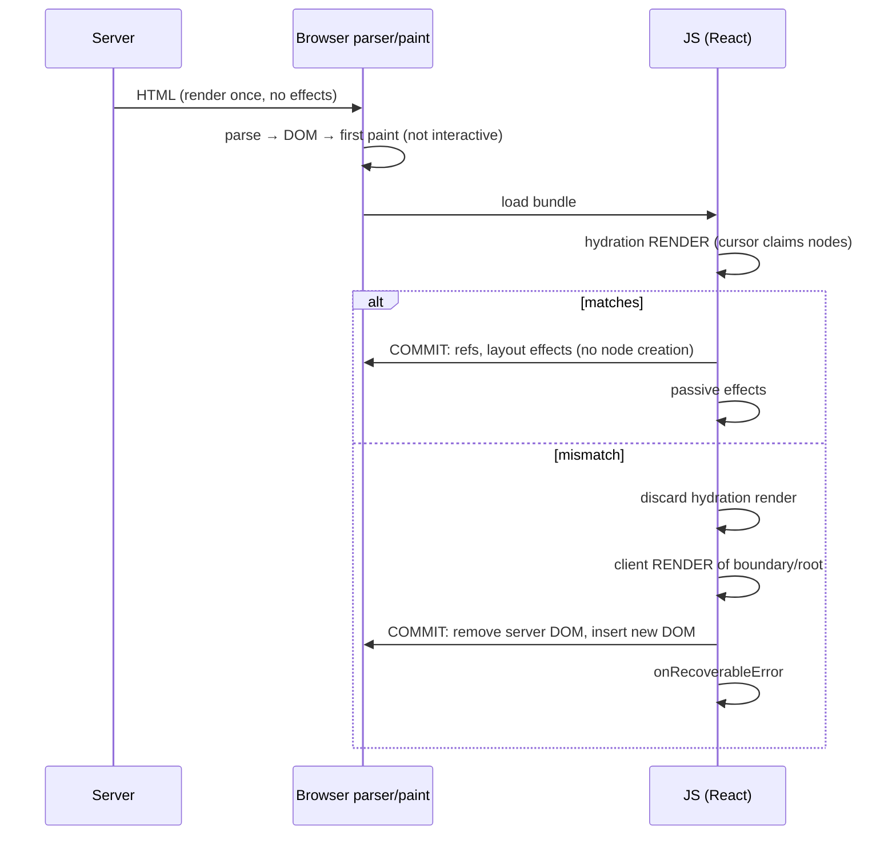
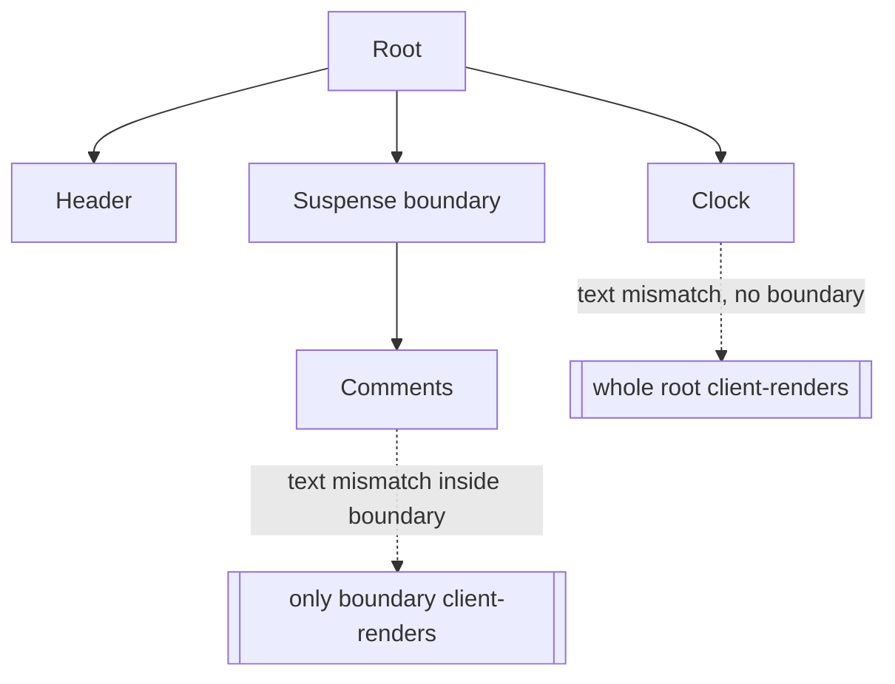

# 02 / 37 — Scenario F: Hydration Mismatch

## 1. Lesson metadata

| | |
|---|---|
| **Level** | Professional |
| **Study time** | 5–6 hours (reading 2 h, building the SSR repro 1.5 h, exercises 1.5–2 h) |
| **Prerequisites** | [11 — Render vs commit phase](./11-render-phase-and-commit-phase.md), [12 — Why rendering must be pure](./12-why-rendering-must-be-pure.md), [18 — Effects and their timing](./18-effects-and-their-timing.md), [20 — Commit and DOM mutation](./20-commit-and-dom-mutation.md), [24 — Suspense and thrown thenables](./24-suspense-conceptual-internals.md), [25 — Hydration and selective hydration](./25-hydration-and-selective-hydration.md), [26 — SSR vs client rendering](./26-ssr-and-client-rendering.md), [36 — Scenario E](./36-scenario-e-suspend.md) |
| **Previous** | [36 — Scenario E: a component suspends](./36-scenario-e-suspend.md) |
| **Next** | [38 — Phase 2 assessment](./38-phase-assessment.md) |

**Learning objectives.** After this lesson you can:
1. Write a chronological timeline of server render → HTML paint → JS load → hydration render → commit, for both a clean hydration and a mismatching one, stating what is rendered, reconciled, discarded, committed, and what the DOM contains at each step.
2. Predict, for a given server/client output pair, whether React reports an error, only warns, or silently leaves inconsistent DOM.
3. Explain what "falls back to client rendering" means, how far the damage spreads (root vs Suspense boundary), and what it costs the user.
4. Name the common causes (time, randomness, locale, `typeof window`, invalid nesting, extensions, stale HTML, data skew) and apply the correct fix for each: serialize, `useId`, `useSyncExternalStore` with `getServerSnapshot`, two-pass render, `suppressHydrationWarning` as a narrow escape hatch.
5. Reproduce and verify mismatches with a minimal SSR server, `onRecoverableError`, view-source vs Elements, and a jsdom test.
6. Flag React 18 vs 19 differences (error reporting, head/body tolerance, root error callbacks) as version-sensitive (checked against the React 19 post and `hydrateRoot` reference, 2026-10-22).

**Concepts covered:** hydration as a render-phase DOM adoption, hydration cursor, text vs attribute vs structure mismatch, recoverable errors, client-render fallback (root vs Suspense boundary), `onRecoverableError`, `suppressHydrationWarning`, `getServerSnapshot`, two-pass rendering, HTML parser normalization, deployment skew.

---

## 2. Deep conceptual explanation

### 2.1 The scenario

The server renders a clock:

```tsx
function Clock() {
  const stamp = new Date().toISOString();   // ❌ different on server and client
  return <p>{stamp}</p>;
}
```

Server HTML: `<p>2026-10-21T09:00:00.123Z</p>`. Client's first render in the browser produces `2026-10-21T09:00:01.457Z`. React's contract for hydration is that the **first client render must produce the same output as the server render**. This scenario is what happens when that contract is broken.

### 2.2 What problem does hydration solve, and what does a mismatch cost?

Hydration lets the user see meaningful HTML before JavaScript arrives (server render → paint), and then attaches React to that existing DOM without rebuilding it. The saving is real only if React can *adopt* the existing nodes. On mismatch React has two bad choices: patch an unknown amount of DOM (unsafe: it cannot know which differences are intended) or discard server HTML and render from scratch on the client. Modern React chooses the latter for most structural/text mismatches and calls the error **recoverable**: the app works, but you paid for server rendering and then threw it away, with a visible flash.

### 2.3 Misconceptions

| Misconception | Reality |
|---|---|
| "Hydration re-renders and replaces the DOM." | Successful hydration **reuses** the server DOM nodes; it renders (calls components) but does not create DOM nodes for matched elements. |
| "React diffs server DOM against client output and fixes differences." | It *compares while adopting*. For many differences it gives up on that subtree; for attributes it only warns in development and does not patch. |
| "A hydration error crashes the app." | In React 18+ mismatch errors are *recoverable*: React client-renders the affected root/boundary and reports through `onRecoverableError`. |
| "`useEffect` runs on the server, so I can set state there." | Effects never run on the server. They run only on the client after a commit. |
| "`suppressHydrationWarning` fixes mismatches." | It silences the warning one level deep. It does not make the structure consistent and does not patch attributes. |
| "Mismatches only happen with random values." | Invalid HTML nesting, browser extensions, CDN-cached stale HTML, and server/client data differences are equally common. |
| "Hydration cost is paid once at startup only." | Each client-render fallback adds a full re-render of its scope; frequent fallbacks defeat SSR. |

### 2.4 First principles

- The server's output is a **string of HTML**. The browser parser turns it into DOM before any JS runs, and the parser *normalizes* it (auto-closing `<p>`, inserting `<tbody>`, ignoring extra whitespace rules). React's expected tree is built from elements, not from HTML text; if the parser's normalization diverges, the trees differ before React is involved.
- Hydration uses the same render phase as any other render ([11](./11-render-phase-and-commit-phase.md)), but with a **hydration cursor** walking the existing DOM in step with the fibers being created. Matching host fibers claim DOM nodes instead of creating them. Because render must be pure, hydration must be deterministic: same inputs, same output.
- Event handlers are attached through root-level delegation; interactivity of a not-yet-hydrated region is queued and replayed (lesson [25](./25-hydration-and-selective-hydration.md)).

---

## 3. Internal mechanics

> Legend. **[G]** public guarantee · **[M]** teaching model · **[I]** implementation detail (checked 2026-10-22; may change). Every outcome in §3.3, §4.2-§4.4, §5.1, §5.3 and §5.6 was reproduced on react/react-dom 19.3.1 with `renderToString` into jsdom + `hydrateRoot`, in development and production builds.

### 3.1 Public guarantees **[G]** (react.dev `hydrateRoot` reference)

- `hydrateRoot(container, element, options)` expects the rendered output to be identical to the server output. Differences are bugs.
- React *can* recover from text content mismatches, but **you should fix** them. Attribute differences are **not guaranteed to be patched**.
- `suppressHydrationWarning` suppresses warnings for the text content/attributes of **one element, one level deep**; use as escape hatch; React does not attempt to patch attributes.
- `onRecoverableError` receives errors React recovered from (including hydration mismatches that fell back to client rendering).
- For server/client differences you cannot avoid (browser APIs, time), the documented approaches are a two-pass render with state set in an effect, or `useSyncExternalStore` with `getServerSnapshot`.
- `useId` produces ids consistent between server and client.

### 3.2 Teaching model of hydration **[M]**

1. React starts a render of the root with a hydration flag and a pointer ("cursor") at the first child of the container.
2. For each host fiber, React looks at the DOM node under the cursor: right tag? If yes, claim it (reuse as the fiber's `stateNode`), advance cursor to its first child; for text fibers, compare text.
3. After the whole render completes, the commit phase **does not create** DOM nodes for claimed elements. It attaches refs, runs layout effects, and finishes with passive effects after paint, exactly like a mount ([20](./20-commit-and-dom-mutation.md)). Event listeners already exist at the root.
4. **Mismatch**: when a host fiber meets a DOM node of the wrong type, missing/extra nodes, or text that differs, React throws a special recoverable error inside the render. The error is handled by the nearest *Suspense boundary that is hydrating* (client-render that boundary) or, with none, the root (client-render everything).
5. Client-render fallback: discard the server DOM for that scope, render fresh as a normal mount, and commit insertions. Components in that scope therefore run **again** on the client.

### 3.3 What differences are errors? **[M; executed on 19.3.1]**

| Difference | React 18/19 behavior (typical) |
|---|---|
| Text content differs | Recoverable error → client-render of nearest boundary/root (React 17 patched text with a warning; 18+ treats it as an error; executed on 19.3.1 in dev and production: one recoverable error, client output wins, no server nodes reused; production message is minified error #418) |
| Missing or extra element, wrong tag | Recoverable error → client-render |
| Attribute value differs (`class`, `id`, `href`) | Dev warning only (diff shown); DOM keeps the **server** value; *not patched* |
| Style differs | Warning; not patched |
| `dangerouslySetInnerHTML` differs | Warning; not patched |
| Extra nodes added by extensions in `<head>`/`<body>` | React 19 skips unexpected nodes in `head`/`body` so extensions don't cause mismatches (React 19 release post; not reproduced here); 18 could fail hydration |
| Element inside element that the HTML parser restructures (`<div>` in `<p>`) | Becomes a structural mismatch |

### 3.4 Version differences (React 19 release post and `hydrateRoot` reference, re-read 2026-10-22)

| Aspect | React 18 | React 19 |
|---|---|---|
| Error output for one mismatch | Several separate console errors (e.g. text content mismatch, "Hydration failed because the initial UI does not match…", "There was an error while hydrating…") | A single, consolidated error message with a diff of server vs client markup (as announced in the React 19 notes) |
| `onRecoverableError` | Available | Available; `hydrateRoot` additionally accepts `onCaughtError`/`onUncaughtError` for error-boundary-caught vs uncaught errors |
| Third-party scripts/extensions injecting into `<head>`/`<body>` | Frequent source of mismatches | React skips unexpected tags in those two elements during hydration (documented as a 19 improvement) |
| `useId` output format | `:r0:` style | Changed in minors: `:r:` (19.0.0), `«r»` (19.1.0), `_r_` (19.2; per the 19.2 post, to be valid in `view-transition-name` and XML names); 19.3.1's dev build printed `_R_0_`-style ids during hydration. Treat as opaque |
| Suspense boundary client-render isolation | Present since 18 | Present |

Exact message text, number of messages and `useId` format can change in a minor release (the `useId` prefix demonstrably did, see the table). Never parse error messages in production logic.

### 3.5 Implementation details **[I]**

- The exact internal error classes, how the retry is scheduled (React may retry hydration once synchronously, then render client-side) and which lane is used are internal.
- React may re-attempt hydration of the same boundary after the Suspense data arrives; treat the function-invocation count as unspecified. What *is* stable: components in the failed scope run at least twice on the client (hydration attempt + client render).

---

## 4. Step-by-step execution walkthrough

Common setup: a page with a header, `<Clock>`, and a `<Comments>` section wrapped in `<Suspense>`. Network: HTML arrives at 100 ms; bundle at 600 ms. StrictMode off for logs ([28](./28-strict-mode-behavior.md)).

### 4.1 Baseline: clean hydration

| t | Where | Phase | What happens | DOM |
|---|---|---|---|---|
| 0 | Server | Render (server renderer) | Components called once; log `SERVER render Clock`. No effects, no state updates after render. | — |
| 20 | Server | Serialize | HTML string produced: `<header>…</header><p>stamp</p><!--$--><section>…</section><!--/$-->` (boundary markers are comments; format is internal) | — |
| 100 | Browser | Parse + paint | Parser builds DOM from HTML; first paint shows the page (FCP). **No JS yet; nothing is interactive.** | Server DOM, painted |
| 600 | Browser | Script load | `hydrateRoot(container, <App/>)` called. | unchanged |
| 601 | Browser | **Render (hydrating)** | Components run: `CLIENT render Clock`. For every host/text fiber, cursor claims the matching server node. Output identical → no mismatch. | unchanged (nodes claimed) |
| 640 | Browser | **Commit** | No node creation for matched elements. Refs attached; layout effects run; paint may occur; passive effects run later. | Same nodes, now managed by React |
| 650 | Browser | Interactive | Clicks reach React handlers. | — |

Log: `SERVER render Clock` (in server console), `CLIENT render Clock` (browser). Zero console errors.

### 4.2 Mismatch outside any Suspense boundary (text differs)

Server `<p>…00.123Z</p>`, client first render `…01.457Z`.

| t | Phase | What happens | Rendered / discarded / committed | DOM |
|---|---|---|---|---|
| 0–100 | As 4.1 | Server HTML shown | — | Server DOM painted |
| 600 | Render (hydrating) | `CLIENT render Clock`. The text fiber claims the `p`'s text node and finds different content → throws recoverable mismatch error. | Hydration render **discarded**; nothing committed. | unchanged |
| 601 | Error handling | No hydrating Suspense boundary above → the **root** switches to client rendering. Error recorded for `onRecoverableError`; in dev the error message is the long "Hydration failed because the server rendered text didn't match the client..." text (confirmed on 19.3.1). | — | unchanged |
| 602–640 | **Render (client)** | Whole tree rendered again from scratch: `CLIENT render Clock` (second time), all other components run again. | Entire tree WIP, fresh fibers | unchanged |
| 640 | **Commit** | Server DOM under the container is **removed**, new DOM **inserted**. All refs, layout effects, then passive effects of every component fire as for a mount. | Commit | New nodes: user sees a possible flash, lost scroll anchoring/focus, reset uncontrolled inputs |
| 641 | Reporting | `onRecoverableError(error, { componentStack })` invoked. | — | — |

Cost: server HTML for the whole page discarded; every component ran twice on the client; the commit rebuilt all DOM.

Log: `CLIENT render Clock` appears **twice** (plus the same for every other component), even without StrictMode.

### 4.3 Mismatch inside a Suspense boundary (isolation)

The mismatch is inside `<Comments>` which is inside `<Suspense>`:

| t | What happens |
|---|---|
| 600 | Hydration render; header and `Clock` match; inside `Comments` text mismatch → error thrown within the boundary. |
| 601 | The nearest *hydrating Suspense boundary* catches it: the boundary is marked to client-render. Work outside the boundary is **kept**. |
| 602 | React renders `Comments` normally on the client. |
| 640 | Commit: header and clock nodes are the original server nodes (hydrated); comment section's server DOM is replaced by new DOM. |

Blast radius: the boundary. Practical lesson: Suspense boundaries are also hydration containment units ([25](./25-hydration-and-selective-hydration.md)).

### 4.4 Attribute mismatch (no client-render)

Server `<div class="light">`, client `className={theme}` with `theme='dark'` on first render.

| t | What happens | DOM |
|---|---|---|
| 600 | Hydration render; element matches by tag; attribute differs | — |
| 601 | Dev: console warning with a diff. Prod: silent. **No fallback.** | `class="light"` remains |
| 640 | Commit: refs/effects. DOM unchanged. | **Server class persists** — UI and React's model are inconsistent until a later re-render *changes* that prop (React updates only when its own previous prop differs) |

This is the most dangerous case because nothing visibly breaks while production quietly shows the wrong theme.

### 4.5 Fix timeline A — two-pass rendering

```tsx
function Clock({ initial }: { initial: string }) {
  const [stamp, setStamp] = useState(initial);       // identical on both sides
  useEffect(() => { setStamp(new Date().toISOString()); }, []);
  return <p>{stamp}</p>;
}
```

| t | Step |
|---|---|
| Server | Renders with `initial` (serialized from server, e.g. the request's `Date`). |
| 600 | Hydration render with `initial` → **match**; commit; passive effect runs after paint. |
| 650 | Effect calls `setStamp(...)` → normal update render → commit changes the text node. One extra render, no error. |

Visible effect: a short-lived stale timestamp. Appropriate for non-critical values.

### 4.6 Fix timeline B — `useSyncExternalStore` with `getServerSnapshot`

```tsx
import { useSyncExternalStore } from 'react';

const subscribe = (cb: () => void) => {
  const mq = window.matchMedia('(prefers-reduced-motion: reduce)');
  mq.addEventListener('change', cb);
  return () => mq.removeEventListener('change', cb);
};
const getSnapshot = () => window.matchMedia('(prefers-reduced-motion: reduce)').matches;
const getServerSnapshot = () => false;

export function useReducedMotion(): boolean {
  return useSyncExternalStore(subscribe, getSnapshot, getServerSnapshot);
}
```

During server render *and hydration* React uses `getServerSnapshot()`, so output matches. After hydration, React compares with `getSnapshot()`; if different (user prefers reduced motion) it triggers an immediate re-render with the real value. No mismatch error. Documented in the `useSyncExternalStore` reference.

---

## 5. Code examples

### 5.1 Minimal runnable reproduction (Node + React 19)

Files:

```text
ssr-repro/
  package.json         (react, react-dom, tsx, esbuild, typescript, @types/*)
  tsconfig.json        ("jsx": "react-jsx", "module": "ESNext", "moduleResolution": "Bundler")
  src/App.tsx
  src/client.tsx
  src/server.tsx
  public/              (generated client.js)
```

```tsx
// src/App.tsx
import { useState } from 'react';

const side = (): 'SERVER' | 'CLIENT' => (typeof window === 'undefined' ? 'SERVER' : 'CLIENT');

function Clock() {
  console.log(`${side()} render Clock`);
  const stamp = new Date().toISOString();            // ❌ intentional mismatch
  return <p id="stamp">{stamp}</p>;
}

function Counter() {
  console.log(`${side()} render Counter`);
  const [n, setN] = useState(0);
  return <button onClick={() => setN((x) => x + 1)}>clicks: {n}</button>;
}

export function App() {
  return (
    <main>
      <h1>Hydration lab</h1>
      <Clock />
      <Counter />
    </main>
  );
}
```

```tsx
// src/client.tsx
import { hydrateRoot } from 'react-dom/client';
import { App } from './App';

hydrateRoot(document.getElementById('root')!, <App />, {
  onRecoverableError(error, info) {
    console.warn('[recoverable]', error, info.componentStack);
  },
});
```

```tsx
// src/server.tsx
import http from 'node:http';
import { readFile } from 'node:fs/promises';
import { renderToString } from 'react-dom/server';
import { App } from './App';

http.createServer(async (req, res) => {
  if (req.url === '/client.js') {
    res.setHeader('content-type', 'text/javascript');
    res.end(await readFile('./public/client.js'));
    return;
  }
  const html = renderToString(<App />);
  res.setHeader('content-type', 'text/html; charset=utf-8');
  res.end(
    `<!doctype html><html><body><div id="root">${html}</div><script src="/client.js"></script></body></html>`,
  );
}).listen(3000, () => console.log('http://localhost:3000'));
```

Run:

```bash
npx esbuild src/client.tsx --bundle --outfile=public/client.js --jsx=automatic --define:process.env.NODE_ENV=\"development\"
npx tsx src/server.tsx
```

(Use a Vite SSR template if you prefer; the mechanics are identical. Exact flags may vary by tool version.)

**Line notes.** `side()` makes logs unambiguous. `typeof window === 'undefined'` appears *only in logging* here: using it to change **output** is itself a mismatch source (§5.3). The `<script>` is at the end of body so the HTML paints before the JS arrives.

**Predict.** Open the page with Network throttling "Slow 4G" and the Console open. Which statements are true?
1. The page shows a timestamp before JS loads.
2. After JS loads, the timestamp **visibly changes**.
3. Console logs `CLIENT render Clock` once.
4. The button works.

*Answer:* 1 true (server HTML painted). 2 true: after client render the new timestamp appears (the whole root was client-rendered). 3 **false**: at least twice (hydration attempt + client render; executed on 19.3.1: `Clock` rendered 2 times on the client with one recoverable error). 4 true after hydration/client render completes. In React 19 you get one consolidated hydration error (React 19 post: with a diff); in React 18 several messages.

### 5.2 Practical examples — the common causes and the right fix

```tsx
import { useEffect, useId, useState, useSyncExternalStore, type ReactNode } from 'react';

// 1) Time: serialize from the server; then update after mount
export function RelativeTime({ iso, serverNow }: { iso: string; serverNow: number }) {
  const [now, setNow] = useState(serverNow);             // same on both sides
  useEffect(() => {
    setNow(Date.now());
    const id = setInterval(() => setNow(Date.now()), 30_000);
    return () => clearInterval(id);
  }, []);
  const minutes = Math.max(0, Math.round((now - Date.parse(iso)) / 60_000));
  return <time dateTime={iso}>{minutes} min ago</time>;
}

// 2) Locale/timezone: fix both explicitly (never rely on the environment default)
export function Price({ amount }: { amount: number }) {
  return <span>{new Intl.NumberFormat('en-GB', { style: 'currency', currency: 'EUR' }).format(amount)}</span>;
}

// 3) Ids: useId
export function Field({ label }: { label: string }) {
  const id = useId();
  return (<><label htmlFor={id}>{label}</label><input id={id} /></>);
}

// 4) Client-only information: useSyncExternalStore with a server snapshot
const online = {
  subscribe(cb: () => void) {
    window.addEventListener('online', cb); window.addEventListener('offline', cb);
    return () => { window.removeEventListener('online', cb); window.removeEventListener('offline', cb); };
  },
  get: () => navigator.onLine,
  getServer: () => true,
};
export function OnlineBadge() {
  const isOnline = useSyncExternalStore(online.subscribe, online.get, online.getServer);
  return <span>{isOnline ? 'Online' : 'Offline'}</span>;
}

// 5) Truly client-only subtree: render after mount
export function ClientOnly({ children, fallback = null }: { children: ReactNode; fallback?: ReactNode }) {
  const [mounted, setMounted] = useState(false);
  useEffect(() => setMounted(true), []);
  return <>{mounted ? children : fallback}</>;
}
```

Notes: (1) Pass `serverNow` from the server request, not `Date.now()` at render. (2) `Intl` defaults differ between Node and browsers (locale, ICU data, timezone): specify `locale` and `timeZone`. (3) `useId` is the documented way to link labels. (4) Prefer the store pattern over `typeof window` branches. (5) `ClientOnly` guarantees a match (renders `fallback` in both places during hydration) at the cost of no SSR for that subtree and a second render; give the fallback the same size as the content to avoid layout shift.

### 5.3 Incorrect examples (each is a mismatch source)

```tsx
// ❌ A: environment branch in output
function Greeting() {
  return <p>{typeof window === 'undefined' ? 'Hello, guest' : `Hello, ${localStorage.getItem('name')}`}</p>;
}

// ❌ B: random/unique value in output
const badId = `field-${Math.random().toString(36).slice(2)}`;

// ❌ C: invalid nesting
function Card() { return <p><div>Hi</div></p>; }

// ❌ D: client-only data in the first render
function Banner() { const w = window.innerWidth; return w < 600 ? <MobileNav /> : <DesktopNav />; }
```

**Predict the outcome of each:**

- **A** server renders "Hello, guest", client renders "Hello, Ada": **text mismatch** → recoverable error, nearest boundary/root client-renders; final DOM shows "Hello, Ada".
- **B** ids differ → attribute mismatch (`id`, `htmlFor`): warning only; DOM keeps the *server* id while React believes the client id; labels may still work if both attributes were updated consistently from server, but any later logic using the id on the client sees a different value. Subtle bug.
- **C** Server HTML `<p><div>Hi</div></p>` is parsed by the browser as `<p></p><div>Hi</div><p></p>` (the `p` is auto-closed by `div`). React's expected tree has one `p` child `div`; structure differs → mismatch error. In dev React also warns about invalid DOM nesting independent of hydration.
- **D** server cannot know window width → one branch; client may pick the other → structural mismatch error. Fix with CSS (responsive) or `useSyncExternalStore(subscribe, getWidthBucket, () => 'desktop')`.

### 5.4 Corrected implementations and `suppressHydrationWarning`

```tsx
// Narrow, justified use: a timestamp that is *expected* to differ and is cosmetic
function BuildStamp() {
  return <time suppressHydrationWarning dateTime={new Date().toISOString()}>
    {new Date().toLocaleTimeString('en-GB', { timeZone: 'UTC' })}
  </time>;
}
```

`suppressHydrationWarning` applies to this element only (one level deep). Per the [`hydrateRoot` reference](https://react.dev/reference/react-dom/client/hydrateRoot), "React will not attempt to patch mismatched text content", and attribute differences are not guaranteed to be patched either; executed on 19.3.1: the server's text stayed in the DOM and no error was reported. (So the user keeps seeing the *server's* timestamp until something re-renders that text.) Do not put it on a container to silence a whole subtree: it does not cascade and it hides real bugs.

### 5.5 Advanced — capture, classify, and report recoverable errors

```tsx
import { hydrateRoot } from 'react-dom/client';
import type { ErrorInfo } from 'react';

function report(kind: string, error: unknown, info?: ErrorInfo) {
  navigator.sendBeacon?.('/__rum', JSON.stringify({
    kind,
    message: error instanceof Error ? error.message : String(error),
    stack: info?.componentStack?.split('\n').slice(0, 5),
    url: location.pathname,
    release: (window as { __RELEASE__?: string }).__RELEASE__,
  }));
}

hydrateRoot(document.getElementById('root')!, <App />, {
  onRecoverableError: (error, info) => report('recoverable', error, info),
  // 19+: `onCaughtError` / `onUncaughtError` are documented hydrateRoot options (reference re-read 2026-10-22)
  onCaughtError: (error, info) => report('caught', error, info),
  onUncaughtError: (error, info) => report('uncaught', error, info),
});
```

Include the release id: hydration mismatches that spike after a deploy usually mean **HTML/JS skew** (cached HTML from build N, JS from build N+1). Sampling and rate-limiting the beacon is a production concern (Phase 10).

### 5.6 Automated verification with jsdom (Vitest)

```tsx
// @vitest-environment jsdom
import { act } from 'react';
import { hydrateRoot } from 'react-dom/client';
import { renderToString } from 'react-dom/server';
import { useSyncExternalStore, type ReactElement } from 'react';
import { afterEach, expect, test, vi } from 'vitest';

(globalThis as { IS_REACT_ACT_ENVIRONMENT?: boolean }).IS_REACT_ACT_ENVIRONMENT = true;
afterEach(() => { document.body.innerHTML = ''; vi.restoreAllMocks(); });

function Stamp({ value }: { value: string }) { return <p>{value}</p>; }

function Env() {
  const v = useSyncExternalStore(() => () => {}, () => 'client', () => 'server');
  return <p>{v}</p>;
}

async function hydrateWith(serverEl: ReactElement, clientEl: ReactElement) {
  const container = document.createElement('div');
  container.innerHTML = renderToString(serverEl);
  document.body.append(container);
  const errors: unknown[] = [];
  vi.spyOn(console, 'error').mockImplementation(() => {});
  await act(async () => {
    hydrateRoot(container, clientEl, { onRecoverableError: (e) => errors.push(e) });
  });
  return { container, errors };
}

test('text mismatch is reported as recoverable and the client output wins', async () => {
  const { container, errors } = await hydrateWith(<Stamp value="server" />, <Stamp value="client" />);
  expect(errors.length).toBeGreaterThan(0);
  expect(container.textContent).toBe('client');
});

test('getServerSnapshot avoids the error and converges to the client snapshot', async () => {
  const { container, errors } = await hydrateWith(<Env />, <Env />);
  expect(errors).toHaveLength(0);
  expect(container.textContent).toBe('client');
});
```

What the test proves: the error is recoverable (the app converges), and the documented fix produces zero errors. What it does not prove: timing, flash, and cost; check those in a real browser (§10).

---

## 6. Visual explanations

### 6.1 Hydration pipeline



### 6.2 Blast radius of a mismatch



### 6.3 Parser normalization

```text
JSX:         <p><div>Hi</div></p>
Server HTML: <p><div>Hi</div></p>           (string; React printed what it was told)
Browser DOM: <p></p><div>Hi</div><p></p>    (HTML parser auto-closes <p> at <div>)
React tree:  p > div > "Hi"                 ≠ DOM  → mismatch
```

---

## 7. Alternative approaches and trade-offs

| Strategy | Matches on hydration? | Extra render | SEO/first paint of that content | Flash/layout shift | Best for |
|---|---|---|---|---|---|
| Serialize server value and reuse (`initial` prop/ props from loader) | Yes | No | Full | None | Data that is the same on both sides (fetched data, request time) |
| Two-pass (`useEffect` then set state) | Yes | One | Server value shown first | Possible value flicker | Non-critical client-only values |
| `useSyncExternalStore` + `getServerSnapshot` | Yes | One only if snapshot differs | Server snapshot shown | Possible | Browser APIs (media queries, online status, storage) |
| `ClientOnly` wrapper | Yes (fallback) | One | No content in HTML for subtree | Needs sized fallback | Widgets that cannot be server rendered (maps, charts) |
| `suppressHydrationWarning` | Warning silenced only | No (text patched) | Server value shown | Text may flash | Timestamps, cosmetic one-level text |
| CSS-driven responsive layout | Yes | No | Full | None | Layout differences (not data) |
| Disable SSR for the page (CSR) | n/a | n/a | Empty shell | App-level | Auth-gated apps with no SEO need |
| Streaming SSR with Suspense | Yes if deterministic | No | Progressive | Controlled | Large pages with slow regions |

**Where the recommended approach is NOT best.** If a region is genuinely client-only (WebGL canvas, third-party widget), forcing it through a two-pass dance is more complex than `ClientOnly` or a lazy client component. If a whole app is behind login with no SEO and heavy client state, pure CSR may beat SSR + hydration in total complexity and cost.

---

## 8. Best practices and anti-patterns

**Best practices**
- Treat render as a pure function of serializable inputs; anything environmental (time, locale, viewport, storage) must be an explicit input or deferred until after mount.
- Serialize server data and use it as initial client state/cache.
- Use `useId` for ids, `useSyncExternalStore` for external readable state.
- Set an `onRecoverableError` reporter and alert on spikes by release.
- Put Suspense boundaries around independently loadable regions to contain mismatch damage and enable selective hydration.
- Validate HTML nesting in development and CI (lint rule/dev warnings).

**Beginner mistakes**
- Branching on `typeof window` in render output.
- `Math.random()` or `Date.now()` in render for ids/keys/labels.
- Reading `localStorage` in `useState` initializer for SSR'd components.

**Experienced-dev mistakes**
- `suppressHydrationWarning` on large containers.
- Fixing mismatch with `useEffect` for *everything*, turning SSR into an empty shell with extra renders.
- Not testing with real HTML parsing (JSX that violates nesting).
- Ignoring skew between CDN-cached HTML and newer JS.
- Locale/timezone assumptions: CI machine (UTC) passes, users fail.

**Smells**
- Component starts with `const [mounted, setMounted] = useState(false)` in dozens of places.
- Warnings in dev console accepted as "normal".
- Hydration errors only visible with extensions installed.

**Justified exception.** For a clock-like element that changes every second and is not content, `suppressHydrationWarning` on that single element is appropriate and cheaper than two-pass.

---

## 9. Real-world application

| Domain | Typical mismatch | Fix and constraint |
|---|---|---|
| E-commerce | Price/currency formatting by locale; "x people viewing" random; personalized banners | Explicit locale on server and client; personalize after mount or via edge-rendered variants; avoid caching HTML that varies by cookie |
| Dashboard/finance | Timestamps in user timezone; live numbers | Render UTC/server timestamp; update after mount; never show conflicting numbers in the first paint for regulated displays |
| Auth | Logged-in vs logged-out header | Decide on the server from cookies and render the same state on client; avoid reading tokens from `localStorage` for first render |
| Forms | Random ids; autofilled values | `useId`; uncontrolled/controlled input behavior during hydration (keep typed text: avoid client-render fallback) |
| CMS content | Sanitized HTML differs between server/client | Same sanitizer version and config both sides, or render once on server and pass HTML as string |
| Multi-team | A widget reads `window` at import time | Isolate with `ClientOnly`; lint `window` usage in shared packages |

Constraint: accessibility. A client-render fallback replaces DOM nodes: focus is lost and screen readers may re-announce regions. Measure with CLS and INP in RUM.

---

## 10. Debugging and troubleshooting

### 10.1 Verification method

1. **View source vs Elements.** "View page source" (or Network → Doc response) is the *server HTML*; Elements shows the *live DOM*. Compare the suspected node. A difference that appears *only* in Elements after JS may be a client-render fallback result.
2. **Console messages.** In dev, read the message(s): React 19 prints one message with a diff (`+` client, `-` server) and component stack; React 18 prints several. Use the diff to locate the element.
3. **`onRecoverableError` hook (§5.1/5.5).** Confirms that React considered the mismatch recoverable and captured the component stack.
4. **Count component renders.** Add the `side()` logs: if `CLIENT render X` appears twice per load, you are client-rendering X's scope.
5. **Performance panel + Network throttling.** After JS executes you should *not* see a large "Recalculate Style/Layout + many DOM insertions" burst; if you do, hydration fell back. Use "Layout Shift" markers for flash.
6. **Disable extensions / use a clean profile** to isolate extension-caused mismatches (React 18 more sensitive; 19 tolerates head/body injections).
7. **Check release skew:** compare the HTML's asset hashes with the loaded bundle; check CDN cache headers.
8. **Bisect the tree**: render with `<ClientOnly>` around halves of the page; the mismatching half stops erroring.

### 10.2 Symptom → cause

| Symptom | Likely cause | Check | Fix |
|---|---|---|---|
| Content flashes/changes right after JS loads | Root client-render fallback | Two `CLIENT render` logs; recoverable error | Remove nondeterminism |
| Only some users see errors | Locale/timezone/extension/A-B cookie | Group errors by UA/locale | Explicit locale; cache by variant |
| Wrong theme/class in prod, no error | Attribute mismatch, not patched | Compare view-source and Elements | Serialize theme; set from cookie on server |
| Errors only after a deploy | HTML/JS skew | Release id on error beacons | Atomic deploys; versioned HTML; short HTML cache |
| `Warning: validateDOMNesting` / structure error | Invalid nesting | Dev console | Fix markup (`div` not in `p`, `table` structure) |
| Input text typed before hydration vanishes | Client-render fallback replaced DOM | Reproduce with throttling | Remove mismatch; consider progressive enhancement (Phase 9) |
| Works in dev, fails in prod | Minifier/whitespace, different ICU data, different env | Compare HTML | Same build for both, pin locale |

### 10.3 Validating the fix

After fixing: console has no hydration messages; `onRecoverableError` count is zero in RUM for a week; `CLIENT render X` appears once per load; Performance panel shows no bulk DOM insertion after script execution; CLS from hydration is zero.

---

## 11. Exercises

### Level A — Knowledge
A1. What does hydration reuse from the server render, and what does it recompute?
A2. Which phase detects a mismatch: render or commit? Why does that matter for effects?
A3. Which types of differences are errors, and which are warning-only?
A4. What does "recoverable error" mean here and how can your code observe it?
A5. What does `suppressHydrationWarning` do, and what are its limits?

### Level B — Code comprehension
B1. Server: `<span>{String(typeof window)}</span>` rendered as `undefined`; client first render shows `object`. Is it a mismatch? What happens?
B2. `<p><ul><li>a</li></ul></p>` is rendered on the server. What is the browser DOM and what does React report?
B3. A component uses `useId()` for `<input id>` and `<label htmlFor>`. Does hydration report a mismatch? Why?
B4. `<div className={isDark ? 'dark' : 'light'}>` where server has `isDark=false` and client `isDark=true` on first render. What does the DOM show after hydration, and what will React do on the next re-render with `isDark=true` unchanged?
B5. How many times does `CLIENT render Clock` log (no StrictMode) in §5.1 on page load?

### Level C — Implementation
C1. Implement `useHydratedValue<T>(serverValue: T, readClient: () => T): T` that returns `serverValue` during hydration and the client value afterwards, without causing a mismatch.
C2. Implement a `LocalTime` component that takes `iso: string` and renders in the user's timezone after mount but in UTC on the server, with the `<time dateTime>` attribute stable.
C3. Write a jsdom test proving that an invalid nesting (`div` in `p`) produces a hydration error (hint: server HTML via `renderToString`, then hydrate).

### Level D — Debugging
D1. After a deploy, 3% of users report a flash and the error beacon shows "text content did not match" for the footer copyright year. Investigate.
D2. A product page shows prices correct in Elements but crawlers show the wrong currency. What is going on?
D3. An analytics script injects a `<div>` at the start of `<body>`; users see hydration errors. Explain the React 18 vs 19 expectations and a mitigation.

### Level E — Architecture and engineering decisions
E1. Design the SSR strategy for a logged-in dashboard with a public marketing landing page (two routes). Decide SSR/CSR per route, boundary placement, and the strategy for personalized content.
E2. Your company ships 12 micro-frontends rendered in one SSR page. Propose rules and tooling to prevent hydration mismatches across teams.

### Level F — Expert challenge
F1. Explain why a text mismatch inside a Suspense boundary can leave the *rest of the page* hydrated and interactive, in terms of render/commit and the hydration cursor.
F2. A component's output depends on `Date.now()` rounded to the hour. Server and client clocks differ by 40 ms. Explain why the bug is intermittent, how you'd reproduce it deterministically, and how to fix it.

---

## 12. Detailed answers and explanations

> Attempt the exercises first.

**A1.** Reused: the DOM nodes (claimed by host fibers) and the event delegation setup; recomputed: all component function calls (the render phase runs on the client), hooks state, and effect scheduling. Server-computed values are not "carried over" unless you serialize them yourself. *Wrong:* "hydration copies state from the server": no state is transferred.

**A2.** The **render phase** (when the host fiber meets the DOM under the cursor). Because the hydration render is discarded on mismatch, **no layout/passive effects** of that attempt run; they run only after the successful client commit. Effects therefore run once for the final committed tree, but component bodies ran more than once.

**A3.** Errors (client-render fallback): text content differences, wrong/missing/extra elements. Warning-only (dev) and not patched: attribute differences (executed on 19.3.1: server `class` kept, no recoverable error, silent in production), style, `dangerouslySetInnerHTML`. Behavior can differ per version; React 19 also tolerates unexpected `head`/`body` nodes.

**A4.** React catches the mismatch, client-renders the affected scope, and the app continues. You observe it via `onRecoverableError` (and console in dev). Not observable via error boundaries (those catch non-recoverable render errors).

**A5.** It suppresses mismatch warnings for the text/attributes of that one element, one level deep. It does not patch attributes, does not apply to children's children, and does not fix structural mismatches. It is an escape hatch.

**B1.** Yes: text mismatch (`undefined` vs `object`). Recoverable error; client-render of nearest boundary/root; final text `object`. Note: output depending on `typeof window` is exactly the anti-pattern in §5.3 A.

**B2.** Browser DOM: `<p></p><ul><li>a</li></ul><p></p>` (the `p` closes before `ul`; the stray `</p>` creates an empty `p`). React expects `p > ul`. Structural mismatch → recoverable error; dev also logs invalid nesting. Fix: use `div` wrapper or restructure.

**B3.** No: `useId` is deterministic per tree position and consistent between server and client renders (as long as the component tree is the same and the same React version/identifier prefix configuration is used). Wrong answer "ids always mismatch because of randomness": `useId` is not random.

**B4.** DOM keeps `class="light"` (attribute not patched); React's fiber holds `dark`. On the next re-render where `isDark` stays `true`, React compares previous props `dark` → `dark`, sees no change, and does **not** touch the DOM; the stale class persists until the prop actually changes. A wrong answer is "React fixes it on the next render".

**B5.** At least twice: once in the failed hydration attempt, once in the client render. Exact count is implementation-defined (executed on 19.3.1: `Clock` rendered 2 times); do not assert exact counts in tests.

**C1.**

```tsx
import { useSyncExternalStore } from 'react';

export function useHydratedValue<T>(serverValue: T, readClient: () => T): T {
  return useSyncExternalStore(
    () => () => {},                // nothing to subscribe to; value is static per read
    readClient,                    // client snapshot
    () => serverValue,             // used on server and during hydration
  );
}
```

Caveats to state in the answer: `getSnapshot` must return a *cached/stable* value for unchanged data, otherwise React warns about infinite loops (e.g. return primitives, not new objects). For live values add a real `subscribe`. Alternative: `useState(serverValue)` + `useEffect` two-pass (extra render in all cases).

**C2.**

```tsx
import { useEffect, useState } from 'react';

export function LocalTime({ iso }: { iso: string }) {
  const [tz, setTz] = useState<string | null>(null);   // null on server and during hydration
  useEffect(() => setTz(Intl.DateTimeFormat().resolvedOptions().timeZone), []);
  const text = new Intl.DateTimeFormat('en-GB', {
    dateStyle: 'medium', timeStyle: 'short', timeZone: tz ?? 'UTC',
  }).format(new Date(iso));
  return <time dateTime={iso}>{text}{tz === null ? ' UTC' : ''}</time>;
}
```

Criteria: explicit locale; UTC first; effect only after mount; stable `dateTime`; no `Date.now()` in render; mention `suppressHydrationWarning` as an alternative for cosmetic cases.

**C3.**

```tsx
test('invalid nesting causes a recoverable hydration error', async () => {
  const bad = () => <p><div>Hi</div></p>;     // dev warning also expected
  const container = document.createElement('div');
  container.innerHTML = renderToString(bad());   // string: <p><div>Hi</div></p>
  document.body.append(container);
  const errors: unknown[] = [];
  vi.spyOn(console, 'error').mockImplementation(() => {});
  await act(async () => {
    hydrateRoot(container, bad(), { onRecoverableError: (e) => errors.push(e) });
  });
  expect(errors.length).toBeGreaterThan(0);
});
```

Note: setting `container.innerHTML` parses with the HTML parser (which normalizes), reproducing the real situation. Executed on 19.3.1: the parsed DOM was `<p></p><div>Hi</div><p></p>`, one recoverable error was reported and React also logged "In HTML, <div> cannot be a descendant of <p>"; if another version treats nesting differently the assertion can differ, so treat it as a lab, not a regression test.

**D1.** Hypotheses: (1) copyright year computed with `new Date().getFullYear()` and server and client straddle New Year (rare) or different timezone; (2) CDN-cached HTML from last year with new JS; (3) different Node/browser timezone. Investigation: error beacons by release and date; compare view-source vs bundle; check cache headers; reproduce by setting system date. Fix: pass year from server as prop or compute at build time, or `suppressHydrationWarning` on that one text element; ensure HTML cache TTL < deploy cadence or version HTML with JS. Criteria: uses release data, reproduces deterministically, picks the narrowest fix.

**D2.** The *server HTML* has one currency (default locale of the server) and the client replaces it after hydration (client-render fallback or attribute/text patch), so users see the corrected value but crawlers that read raw HTML (or JS-limited crawlers) see the server's. Fix: determine currency from request (cookie/header/route) on the server and pass to both sides; use explicit `Intl` options. Verify with view-source.

**D3.** React 18: unexpected extra nodes in `<body>` can break hydration (the cursor sees an unexpected element) → error and client-render. React 19: documented as skipping unexpected tags in `<head>`/`<body>` so this specific case should hydrate. Mitigation: load analytics via a script placement that injects at the end/outside of React-managed containers (e.g. mount React into `#root`, not `body`), and upgrade; check the React 19 notes. Criteria: gives version-aware answer and a mitigation independent of upgrade.

**E1.** Example answer: Landing page SSR (or static generation) for SEO and first paint; no personalization in the HTML; personalized strip rendered after mount or at the edge via variants. Dashboard: login required, no SEO → CSR or SSR of the *shell* only; data-heavy widgets inside Suspense; do not SSR user-specific data unless cookies are available at render and HTML is `private, no-store`. Hydration: boundary per widget for isolation; explicit locale/timezone from user profile cookie; report recoverable errors per release; budget for hydration JS. Evaluate on SEO need, caching constraints, mismatch risk, complexity, TTFB vs complexity trade-off.

**E2.** Rules: no `window`/`document`/`Date.now()`/`Math.random()` in render of shared packages (lint rules + code review); shared `ClientOnly`, `useHydratedValue`, formatting helpers with explicit locale; contract tests running each micro-frontend through `renderToString` + `hydrateRoot` in jsdom and failing on any recoverable error; per-team Suspense boundary; centralized `onRecoverableError` reporter with team tag; deployment of HTML and JS atomically. Trade-off discussion: centralization vs team autonomy.

**F1.** During the hydration render, React keeps a per-boundary notion of "dehydrated" content. The mismatch is thrown within the boundary's subtree; React's error handling looks for the nearest boundary able to client-render (Suspense), marks only that boundary as needing client rendering, and continues the rest of the root's render and commit normally. The cursor for the outer tree is advanced past the boundary's server markers (the comment delimiters give React a way to skip over the boundary's DOM), so outer nodes are still claimed. Commit then attaches outer host nodes and replaces just the boundary's DOM. The marker format is internal.

**F2.** Mismatch occurs only when the 40 ms skew straddles the hour boundary (probability ≈ 40 ms / 3,600,000 ms per request) so it shows up rarely and in clusters at exact hour changes. Reproduce deterministically by mocking `Date.now` to `HH:59:59.980` on the server and `HH+1:00:00.010` on the client in a test. Fix: pass the server's computed hour as a prop (single source of truth) and update after mount if needed; never recompute on both sides.

---

## 13. Senior engineer interview questions

**Q1. "What exactly is hydration, step by step?"**
Server renders once to HTML; browser paints it; the client bundle runs `hydrateRoot`; React performs a render with a cursor over the existing DOM claiming nodes; commit attaches refs and effects (no node creation for matches); passive effects run. Requires deterministic output. Mismatch → throw a recoverable error → client-render nearest boundary/root.

**Q2. "Why can't React just patch the differences?"**
It cannot know which differences are intended; patching attributes selectively risks leaving inconsistent state, and diffing the whole tree against arbitrary HTML is as expensive as rendering. React keeps the contract simple: identical output or fall back; attributes are warned only.

**Q3. "A page flashes after load. How do you tell whether hydration failed?"**
Look for `onRecoverableError`/console messages, duplicate `CLIENT render` logs, DOM insertions burst in the Performance panel, and a difference between view-source and live DOM. Bisect with `ClientOnly`.

**Q4. "How would you handle user-specific content in SSR?"**
Avoid personalizing the cached shell; if personalization is required in HTML, vary the cache and render consistently with the same inputs on the client; otherwise update after mount with stable-sized placeholders.

**Q5. "What changed in React 19 for hydration?"**
Checked against the React 19 post and `hydrateRoot` reference: consolidated, diffed error message; improved tolerance for third-party elements in `head`/`body`; new root error callbacks. Core contract unchanged.

**Q6. "Why does Suspense help hydration?"**
Boundaries are independent hydration units: they can be hydrated selectively, prioritized on interaction, and a mismatch is contained to the boundary rather than the entire root (lesson [25](./25-hydration-and-selective-hydration.md)).

**Q7. "`suppressHydrationWarning` on `<html>`: good idea?"**
Common for theme attributes set by a pre-hydration script, and then only because the attribute difference is intentional and one element deep. Not a general fix; it hides unrelated problems on that element.

---

## 14. Further learning resources

| Resource | URL | Covers / why | Level | Study |
|---|---|---|---|---|
| React — `hydrateRoot` | <https://react.dev/reference/react-dom/client/hydrateRoot> | Contract, `onRecoverableError`, mismatch caveats, `suppressHydrationWarning` | Intermediate | Whole page; "Troubleshooting" |
| React — `useSyncExternalStore` | <https://react.dev/reference/react/useSyncExternalStore> | `getServerSnapshot`, hydration usage | Advanced | "Adding support for server rendering" |
| React — `useId` | <https://react.dev/reference/react/useId> | SSR-safe ids | Intermediate | Whole page |
| React — `renderToString` | <https://react.dev/reference/react-dom/server/renderToString> | Server rendering limits, effects not run | Intermediate | Caveats |
| React — `renderToPipeableStream` | <https://react.dev/reference/react-dom/server/renderToPipeableStream> | Streaming SSR | Advanced | Usage |
| React 19 release post | <https://react.dev/blog/2024/12/05/react-19> | Hydration error reporting, head/body tolerance | Intermediate | "Improvements" sections |
| React 18 upgrade guide | <https://react.dev/blog/2022/03/08/react-18-upgrade-guide> | `hydrateRoot`, SSR changes in 18 | Intermediate | "Updates to Client/Server Rendering APIs" |
| React 18 Working Group — New Suspense SSR architecture | <https://github.com/reactwg/react-18/discussions/37> | Design of selective hydration | Advanced | Whole thread |
| MDN — HTML parsing and `<p>` end tag rules | <https://developer.mozilla.org/en-US/docs/Web/HTML/Element/p> | Which elements implicitly close `p` | Beginner | "Technical summary" |
| HTML Standard — tree construction | <https://html.spec.whatwg.org/multipage/parsing.html#tree-construction> | Normative parser behavior | Advanced | Insertion modes |
| MDN — Intl.DateTimeFormat | <https://developer.mozilla.org/en-US/docs/Web/JavaScript/Reference/Global_Objects/Intl/DateTimeFormat> | Locale/timezone options | Intermediate | `timeZone`, `locales` |

---

## 15. Knowledge checkpoint

**You should now understand**
- Hydration is a render that adopts existing DOM; mismatches throw during render, are recoverable, and trigger client rendering of the nearest boundary or the root.
- Differences in text/structure are errors; attribute differences are not patched.
- Costs: discarded HTML, extra renders, flash, lost focus, hurt INP/CLS.
- The fixes and their trade-offs; Suspense boundaries as blast-radius limits.

**You should be able to explain without notes**
- The timeline of §4.2 and §4.3, including double component renders and DOM replacement.
- Why `useEffect` and `getServerSnapshot` fixes cannot cause mismatches.

**You should be able to implement**
- A deterministic reproduction, jsdom tests, and `useSyncExternalStore`/two-pass fixes; an error reporter with release tagging.

**You should be able to debug**
- Flash-after-load, attribute drift, post-deploy skew, extension-caused errors.

**Before moving on:** complete [38 — Phase 2 assessment](./38-phase-assessment.md), which tests lessons 01–37, including scenarios D, E, and F.
