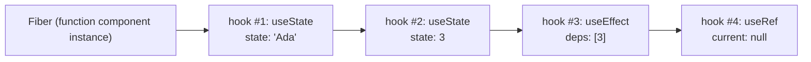
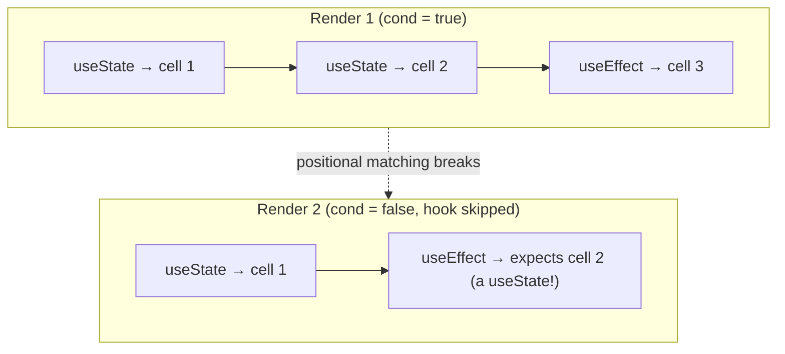

# 03 / 01 — `useState` Internals and Update Semantics

## 1. Lesson metadata

| | |
|---|---|
| **Level** | Intermediate |
| **Study time** | 4–5 hours (reading 2 h, experiments 1 h, exercises 1.5 h) |
| **Prerequisites** | [Phase 1 / 14 — State as a snapshot](../01-react-fundamentals/14-state-as-a-snapshot.md) (required), [Phase 1 / 15 — Update queues and batching](../01-react-fundamentals/15-update-queues-and-batching.md) (required), [Phase 1 / 12 — Component purity](../01-react-fundamentals/12-component-purity.md), [Phase 1 / 16 — State preservation and reset](../01-react-fundamentals/16-state-preservation-and-reset.md), [Foundations 06 — Closures](../00-web-and-javascript-foundations/06-lexical-scope-and-closures.md), [Foundations 08 — Objects, references, immutability](../00-web-and-javascript-foundations/08-objects-references-immutability.md) |
| **Next** | [02 — Functional state updates](./02-functional-state-updates.md) |
| **Related later** | [Phase 2 / 01 — What triggers a render](../02-react-rendering-and-internals/01-what-triggers-a-render.md), [Phase 2 / 17 — How hooks attach to Fiber](../02-react-rendering-and-internals/17-hooks-and-fiber-state.md), [Phase 2 / 22 — Automatic batching](../02-react-rendering-and-internals/22-automatic-batching.md), [Phase 2 / 28 — Strict Mode behavior](../02-react-rendering-and-internals/28-strict-mode-behavior.md) |

**Learning objectives.** After this lesson you can:
1. Explain why function components need a state primitive at all, and what `useState` stores that a local variable or a module variable cannot.
2. Describe, as a *teaching model*, where hook state lives (per component instance, per hook call position) and why that forces the Rules of Hooks.
3. State exactly what `useState` returns, what the setter does, and which guarantees (stable setter identity, `Object.is` bail-out, ignored initial value on re-render) are documented.
4. Use lazy initialization correctly, store functions and objects in state without surprises, and choose a state *shape* deliberately.
5. Explain what happens when you call a setter during render, in an effect, after unmount, and with an identical value.
6. Predict the number of renders and the final value for non-trivial setter sequences, including under Strict Mode.
7. Diagnose "state did not update" and "state reset unexpectedly" bugs from first principles.

**Concepts covered:** state as per-instance memory, hook call order, `[value, setter]` tuple, setter identity, replacement vs updater argument (preview), lazy initializer, `Object.is` bail-out, mutation vs replacement, state shape (single object vs several slots), setting state during render, setter after unmount, initial-value-only-on-mount, `key`-based reset, TypeScript typing of `useState`.

> Scope. Phase 1 lessons 14 and 15 taught the *usage-level* model (snapshots, queues, batching). This lesson explains **why the primitive exists, what its semantics are at the edges, and where it stops being the right tool**. Updater functions get their own deep dive in [lesson 02](./02-functional-state-updates.md).

---

## 2. Deep conceptual explanation

### 2.1 What problem is this lesson solving?

A React component is a function that React calls repeatedly. Between two calls, every local variable is gone. That is *the point* of the model (rendering must be a pure calculation, see [Phase 1 / 12](../01-react-fundamentals/12-component-purity.md)), but it creates a problem: a UI needs **memory**. A text field remembers what was typed; an accordion remembers it is open; a form remembers it was submitted.

Three obvious places to put memory all fail:

| Candidate | Why it fails |
|---|---|
| A local `let count = 0` in the component | Recreated on every call. Mutating it also tells React nothing, so no re-render is scheduled. |
| A module-level variable | Shared by **every instance** of the component (two `<Counter />` would share one count), survives unmount, shared across tests and, on the server, across requests (a data-leak class of bug). And again mutation triggers no render. |
| A mutable object you keep yourself (`useRef`) | Persists per instance, but writing to it intentionally does **not** cause a render. That is the right tool for non-visual values ([lesson 10](./10-useref-and-mutable-references.md)), the wrong one for things the screen displays. |

`useState` solves both halves at once:

1. **Persistence per instance.** React stores the value *outside* your function, attached to the component instance's position in the tree (conceptually, on its Fiber, see [Phase 2 / 17](../02-react-rendering-and-internals/17-hooks-and-fiber-state.md)).
2. **A change channel.** The setter is the only sanctioned way to say "this memory changed, so the output may differ". It both records the request and schedules a render ([Phase 2 / 01](../02-react-rendering-and-internals/01-what-triggers-a-render.md)).

State is therefore best understood as **a cell owned by React, read during render and written only through a request API**.

### 2.2 Why a hook and not a class field or a store?

Class components solved the same problem with `this.state` and `this.setState`. Hooks (introduced in React 16.8) replaced that for new code because:

- Logic using state could not be extracted and reused without wrapper components (HOCs, render props). A hook is just a function that calls other hooks, so stateful logic composes like ordinary code ([lesson 15](./15-custom-hooks.md)).
- Related logic was split across lifecycle methods (a subscription's setup in `componentDidMount`, teardown in `componentWillUnmount`).
- `this` binding and class machinery confused people and tools.

Class components remain supported but are *legacy for new code*; this curriculum uses them only to explain history.

The cost of the hook design is its central constraint: **React identifies a state cell by the order in which hooks are called, not by a name.** Everything strange about hooks (the Rules of Hooks, why you cannot call them in `if`) follows from this. We make that precise in §3.

### 2.3 The API surface

```ts
const [state, setState] = useState<S>(initialState: S | (() => S));
```

Documented behavior (see the `useState` reference on react.dev):

- Returns an array of exactly two elements: the **current state** for this render and a **setter function**.
- On the first render, `state` equals the initial state you passed (or what your initializer function returned).
- On later renders, `state` is whatever React computed after processing queued updates; the `initialState` argument is **ignored**.
- The setter accepts either a **next value** or an **updater function** `(prev: S) => S`.
- The setter has **no return value**.
- React compares the next state with the current one using [`Object.is`](https://developer.mozilla.org/en-US/docs/Web/JavaScript/Reference/Global_Objects/Object/is); if equal, React skips re-rendering the component's children and does not fire effects for that update.
- The setter's identity is **stable** across renders (so it may be omitted from dependency arrays; the linter knows `useState` setters are stable).

### 2.4 The mental model in one paragraph

Each component *instance* owns a list of hook cells. Rendering calls your function; each `useState` call reads the next cell in the list. The setter closes over *which* cell it belongs to. Calling it appends an update to that cell's queue and marks the component as needing work. Next render, React drains the queue to compute the new value, hands it back as `state`, and your function runs again against the new snapshot.

### 2.5 State is not a variable; it is a snapshot read

Because the value is *returned* to each render, every render has its own constant. Handlers created during that render close over that constant ([Phase 1 / 14](../01-react-fundamentals/14-state-as-a-snapshot.md)). This is not a React quirk; it is plain JavaScript closure semantics ([Foundations 06](../00-web-and-javascript-foundations/06-lexical-scope-and-closures.md)) applied to a function that runs many times.

### 2.6 Common misconceptions

| Misconception | Reality |
|---|---|
| "`setState` is asynchronous." | It is not a promise and nothing is "awaited". The *render* it requests happens later; the variable in your current closure never changes. Accurate phrase: *state updates are queued and processed in a later render*. |
| "`setState` merges objects like the class `this.setState`." | Hook setters **replace**. `setUser({ name: 'A' })` discards `age`. Merge manually with spread, or split state. |
| "Calling the setter always re-renders." | Not if the next value is `Object.is`-equal to the current one (with a caveat in §3.4). |
| "The initial value is re-applied when props change." | It is read once per mount. Later changes to the argument are ignored (§5.4). |
| "I can store anything, mutate it, and call `setState` to refresh." | If you pass the **same reference**, `Object.is` says "nothing changed" and React bails out. Mutation also breaks snapshot semantics and memoization. |
| "State persists for the lifetime of the component *function*." | It persists for the lifetime of the component *instance at a position in the tree*. Move it, or change its `key`/type, and it is destroyed ([Phase 1 / 16](../01-react-fundamentals/16-state-preservation-and-reset.md)). |
| "State is private to the component, so no one else can see it." | Props pass values down; DevTools can inspect hook state. "Private" means *only this component can request changes*. |

---

## 3. Internal mechanics

> **Labels used below.** **[Public guarantee]** is documented and safe to rely on. **[Teaching model]** is an accurate simplification. **[Implementation detail]** may change between releases; do not build on it. Verify names in the React source (`github.com/facebook/react`, the `react-reconciler` package) rather than trusting any memory of function names, including ours.

### 3.1 Where does hook state live? [Teaching model]

Each component instance corresponds to a Fiber ([Phase 2 / 09](../02-react-rendering-and-internals/09-fiber-nodes-and-units-of-work.md)). Conceptually, the Fiber for a function component holds a **singly linked list of hook records**, one per hook call, in call order. A `useState` record holds roughly:

- the current memoized state,
- a queue of pending updates,
- the dispatch function (the setter) bound to that queue.



During render, React keeps a "cursor" into this list. The first `useState` in your function takes record #1, the second takes #2, and so on. On the very first render the records do not exist yet, so React *creates* them; on later renders React *reads* them.

**Consequence (Rules of Hooks):** if one render calls `useState` twice and the next calls it once (because it was inside an `if`), the cursor misaligns: the second `useState` call would get the wrong cell. React cannot detect which call is "which" because calls carry no name. In development React warns when the hook *count or order* changes between renders. See [lesson 16](./16-rules-of-hooks-and-composition.md) for the full rule set.

### 3.2 Mount vs update [Implementation detail, conceptual]

React uses different hook implementations for the first render of an instance and for later renders (conceptually "mount" vs "update" dispatchers). On mount, `useState` creates the record and runs the initializer. On update, it processes the queue and ignores the argument. This is *why* the initial value is "ignored" later: the update code path never looks at it. Calling hooks outside a component render is an error because there is no active dispatcher to route to ("Invalid hook call" is the symptom).

### 3.3 The setter and the queue [Teaching model]

Calling `setState(x)`:

1. Creates an update object `{ action: x, ... }` (plus priority information, see [Phase 2 / 14](../02-react-rendering-and-internals/14-lanes.md)).
2. Appends it to the record's queue.
3. Asks the scheduler to render the owning root ([Phase 2 / 13](../02-react-rendering-and-internals/13-scheduler-and-priorities.md)).

At the next render of that component, React reduces the queue starting from the stored base state: a plain value replaces the accumulator; a function is called with the accumulator. The result becomes `state`.

**[Public guarantee]** about the queue: updates are applied *in the order they were requested*, and updater functions receive the most recent result of earlier updates in the same queue ([lesson 02](./02-functional-state-updates.md)).

**[Implementation detail]:** in concurrent rendering, updates carry priorities. A render at one priority may *skip* a lower-priority update, and a later render re-applies ("rebases") it on top. This is why updater functions can be called more than once for the same logical update, and why they must be pure.

### 3.4 The bail-out and the "eager state" optimization

**[Public guarantee]** (react.dev): if the new state equals the current state per `Object.is`, React *skips re-rendering the component and its children* and does not run effects. The docs add a caveat: *React may still need to call your component once more before bailing out*, but it will not go deeper into the tree and the result is not committed.

**[Implementation detail]:** React has historically tried an *eager* comparison: when the queue is empty and the component has no pending work, it can compute the next state inside the setter call and compare immediately, avoiding scheduling any render at all. When the queue is not empty or the fiber has pending work, the comparison happens during render. You observe this as: "sometimes the component function logs once more even though state did not change". It is allowed; do not write code that depends on either outcome (never use "did my component run?" as a signal).

### 3.5 Lazy initialization [Public guarantee]

If you pass a *function* as the initial state, React calls it **only during the first render of the instance** (and, in development Strict Mode, twice to detect impurity, discarding one result; see [Phase 2 / 28](../02-react-rendering-and-internals/28-strict-mode-behavior.md)). It receives no arguments. The function must be pure.

```ts
const [rows, setRows] = useState(() => parseHugeJson(raw)); // runs once per mount
const [rows2, setRows2] = useState(parseHugeJson(raw));      // CALLS parseHugeJson EVERY render; result ignored after first
```

The second form is a common performance bug: the *argument expression* is evaluated by JavaScript on every render before React sees it. React only ignores the *result*.

### 3.6 Setting state during render [Public guarantee, with limits]

You may call the setter of the **same component's own state** during render, guarded by a condition, to adjust state in response to a prop change. React then discards the in-progress output, re-runs the component immediately with the updated state, and does *not* render children with the stale result. If the condition never becomes false you get "Too many re-renders". Calling *another* component's setter during render is an error (a warning in development: you cannot update a component while rendering a different component). This pattern's modern role is covered in [lesson 17 — Derived state](./17-derived-state.md); here, know it exists and why it's legal: it is still "pure" because it only asks React to recompute this component's own render result.

### 3.7 Setter after unmount [Public guarantee, version-sensitive]

Older React versions (≤17) warned: "Can't perform a React state update on an unmounted component". React 18 removed that warning because it produced many false alarms and did not reliably indicate a real leak. Calling a setter of an unmounted instance is a **no-op**. The real problem in those cases is usually a *resource* that outlived the component (an uncancelled subscription), not the set call. See [lesson 06](./06-effect-cleanup.md).

### 3.8 What happens to state when the component is removed? [Teaching model]

The hook records live on the Fiber. When the instance unmounts, the Fiber is discarded and the state is garbage-collectable (references from your own code, such as an outstanding closure, still keep objects alive; see [Foundations 16](../00-web-and-javascript-foundations/16-memory-management-and-gc.md)). When the same component type appears at the same position later, it is a **new instance with new initial state**.

---

## 4. Step-by-step execution walkthrough

Component:

```tsx
function Profile({ userId }: { userId: string }) {
  const [draft, setDraft] = useState('');          // hook 1
  const [saves, setSaves] = useState(0);           // hook 2
  console.log('render', { userId, draft, saves });
  return (
    <form onSubmit={(e) => { e.preventDefault(); setSaves(saves + 1); setDraft(''); }}>
      <input value={draft} onChange={(e) => setDraft(e.target.value)} />
      <button>Save ({saves})</button>
    </form>
  );
}
```

**Predict:** the user types `a`, `b`, then submits. How many `render` logs appear after mount, and what are the last values? (Assume production mode, no Strict Mode.)

Timeline:

1. **Mount render.** No hook records exist. `useState('')` creates record 1 (`''`); `useState(0)` creates record 2 (`0`). Log: `{draft:'', saves:0}`. Commit puts `<input>` and `<button>` in the DOM.
2. **Keystroke `a`.** The browser fires `input`; React dispatches `onChange` in a discrete-event context. The handler calls `setDraft('a')`: update appended to record 1's queue; render scheduled (high priority because it is a discrete input).
3. **Handler returns.** Batch ends. **Render 2:** cursor reads record 1, drains queue → `'a'`; record 2 unchanged → `0`. Log `{draft:'a', saves:0}`. Reconcile: input's `value` prop changed → commit updates the DOM property. A *controlled input* works because React re-writes `value` each commit ([Phase 1 / 11](../01-react-fundamentals/11-controlled-and-uncontrolled-inputs.md)).
4. **Keystroke `b`.** Same path. **Render 3:** `{draft:'ab', saves:0}`.
5. **Submit.** Handler (from render 3, so `saves === 0`, closed over) calls `setSaves(0 + 1)` and `setDraft('')`. Two updates, two queues, one batch. **Render 4:** `{draft:'', saves:1}`. One render, not two ([Phase 2 / 22](../02-react-rendering-and-internals/22-automatic-batching.md)).

Answer: **three** logs after mount (renders 2, 3, 4); last values `{draft:'', saves:1}`.

Now trace the *bail-out*: pressing Submit again with an empty draft calls `setDraft('')`, same as current → `Object.is('', '')` is true. Combined with `setSaves(1 + 1)`, which does change, the component still renders (one update was real). If the handler had only called `setDraft('')`, React would skip re-rendering (modulo the "one extra call" caveat).

---

## 5. Code examples

### 5.1 Minimal example

```tsx
import { useState } from 'react';

export function Counter() {
  const [count, setCount] = useState(0);
  return <button onClick={() => setCount(count + 1)}>Clicked {count}</button>;
}
```

- `useState(0)`: `0` seeds the first render only. TypeScript infers `number`.
- `setCount(count + 1)`: `count + 1` is computed **now**, from this render's snapshot. [Lesson 02](./02-functional-state-updates.md) explains when that is not what you want.

### 5.2 Practical example: a filter panel with a stable state shape

```tsx
import { useState } from 'react';

type SortKey = 'price' | 'rating' | 'newest';

interface Filters {
  query: string;
  inStockOnly: boolean;
  sort: SortKey;
}

const DEFAULT_FILTERS: Filters = { query: '', inStockOnly: false, sort: 'newest' };

export function ProductFilters({ onChange }: { onChange: (f: Filters) => void }) {
  const [filters, setFilters] = useState<Filters>(DEFAULT_FILTERS);

  function update<K extends keyof Filters>(key: K, value: Filters[K]) {
    const next = { ...filters, [key]: value };   // replace, never mutate
    setFilters(next);
    onChange(next);                              // notify with the value we just computed
  }

  return (
    <fieldset>
      <input
        value={filters.query}
        onChange={(e) => update('query', e.target.value)}
        placeholder="Search"
      />
      <label>
        <input
          type="checkbox"
          checked={filters.inStockOnly}
          onChange={(e) => update('inStockOnly', e.target.checked)}
        />
        In stock
      </label>
      <select value={filters.sort} onChange={(e) => update('sort', e.target.value as SortKey)}>
        <option value="newest">Newest</option>
        <option value="price">Price</option>
        <option value="rating">Rating</option>
      </select>
      <button onClick={() => { setFilters(DEFAULT_FILTERS); onChange(DEFAULT_FILTERS); }}>
        Reset
      </button>
    </fieldset>
  );
}
```

Notes:

- The three fields change together (they describe one query), so one object is reasonable: reset and "send everything to the parent" are single operations. Trade-off: each change allocates a new object, and consumers comparing `filters` by reference see a change for any field. If fields are independent, separate `useState` calls are simpler (§7).
- `update` calls `onChange(next)` from the handler, with the freshly computed value, instead of reading `filters` after `setFilters`. Reading `filters` right after the call would give the *old* snapshot.
- `DEFAULT_FILTERS` is module-level and never mutated, so sharing it is safe; the reset call stores that same reference, which is fine because we never mutate state.

### 5.3 Incorrect example: mutation and the `Object.is` bail-out

```tsx
function Cart() {
  const [items, setItems] = useState<string[]>(['apple']);
  return (
    <>
      <button onClick={() => { items.push('pear'); setItems(items); }}>Add</button>
      <ul>{items.map((i) => <li key={i}>{i}</li>)}</ul>
    </>
  );
}
```

**Predict:** after clicking Add, does the list show `pear`?

**Answer:** Not reliably, and typically not at all on the first click. `push` mutates the array in place; `setItems(items)` passes the *same reference*. `Object.is(items, items)` is `true`, so React treats it as no change and bails out without rendering. The array in memory *does* now contain `pear`, so any *unrelated* later render would suddenly display it. That "appears later, unrelated to the click" symptom is characteristic of mutation bugs. Mutation also breaks anything that compares references: `React.memo`, `useMemo` and `useEffect` dependencies ([Foundations 08](../00-web-and-javascript-foundations/08-objects-references-immutability.md)).

### 5.4 Corrected implementation

```tsx
function Cart() {
  const [items, setItems] = useState<readonly string[]>(['apple']);
  return (
    <>
      <button onClick={() => setItems([...items, 'pear'])}>Add</button>
      <ul>{items.map((i) => <li key={i}>{i}</li>)}</ul>
    </>
  );
}
```

`[...items, 'pear']` is a new array, so `Object.is` is false and a render is scheduled. Typing the state as `readonly string[]` makes `items.push` a *compile-time* error, turning a runtime mystery into an editor squiggle. (In a real list the key should be a stable ID, not the text; [Phase 1 / 09](../01-react-fundamentals/09-lists-keys-and-identity.md).)

### 5.5 Incorrect example: initial value from props that "should" keep updating

```tsx
function PriceTag({ price }: { price: number }) {
  const [shown, setShown] = useState(price); // read once, at mount
  return <span>{shown}</span>;
}
```

If the parent re-renders with a new `price`, `<span>` still shows the first one. `useState(price)` consumed `price` only on mount; afterwards the argument is ignored. There is nothing to "sync" because **there should be no state here**: the displayed value is a function of props, so compute it directly (`<span>{price}</span>`). The legitimate use of copying a prop into state is when you want the prop to be the *initial seed* of something the user then edits, and the convention is to name it so: `initialPrice`. If the parent must be able to reset the draft, change the `key` ([Phase 1 / 16](../01-react-fundamentals/16-state-preservation-and-reset.md)) or see [lesson 17](./17-derived-state.md).

### 5.6 Advanced example: lazy init, functions in state, and `readonly` modelling

```tsx
import { useState } from 'react';

type Comparator<T> = (a: T, b: T) => number;

function readDraft(key: string): string {
  try {
    return window.localStorage.getItem(key) ?? '';
  } catch {
    return ''; // storage can throw (blocked, private mode, quota)
  }
}

export function Editor({ draftKey }: { draftKey: string }) {
  // Lazy initializer: reads storage once per mount, not on every keystroke.
  const [text, setText] = useState<string>(() => readDraft(draftKey));

  // Storing a FUNCTION in state requires wrapping both ways.
  const [cmp, setCmp] = useState<Comparator<number>>(() => (a, b) => a - b);

  const flip = () => setCmp(() => (a, b) => b - a); // setter given an updater that RETURNS the function

  return (
    <>
      <textarea value={text} onChange={(e) => setText(e.target.value)} />
      <button onClick={flip}>Reverse sort ({[3, 1, 2].sort(cmp).join(',')})</button>
    </>
  );
}
```

Line notes:

- `useState(() => readDraft(draftKey))`: runs once per mount. Reading `localStorage` is synchronous and potentially slow; inlining `readDraft(draftKey)` would pay that every render. Also note we do *not* write to storage in the initializer (it must be pure); persisting belongs in an event handler or an effect ([lesson 04](./04-useeffect-synchronization.md)).
- `useState<Comparator<number>>(() => (a, b) => a - b)`: if you wrote `useState((a, b) => a - b)`, React would *call* it as an initializer (with no arguments, producing `NaN`). The outer arrow is the initializer; its return value, the comparator, becomes the state.
- `setCmp(() => (a, b) => b - a)`: if you wrote `setCmp((a, b) => b - a)` React would call it as an updater with the previous state. Same wrapping rule. Whether to store functions in state at all is questionable (a `'asc' | 'desc'` string is simpler, serialisable, and debuggable); this is shown so you recognize the trap.
- `[3, 1, 2].sort(cmp)` mutates the temporary array literal, which is fine here because the literal is created fresh. `.sort` on a *state* array would mutate state (use `toSorted` or copy first).
- `draftKey` changing later does **not** reload the draft (the initializer already ran). To load a different draft for a different key, render `<Editor key={draftKey} .../>`.

### 5.7 Advanced example: adjusting state during render (sketch)

```tsx
function List({ items }: { items: readonly string[] }) {
  const [selected, setSelected] = useState<string | null>(null);
  const [prevItems, setPrevItems] = useState(items);

  if (items !== prevItems) {      // guard: must eventually be false
    setPrevItems(items);
    setSelected(null);            // reset selection when the list changes
  }
  // ...
}
```

React discards the first output, re-renders with the updated state immediately, and no child ever sees the stale `selected`. Compare with the effect-based alternative (a visible stale frame, then a correction) in [lesson 07](./07-you-might-not-need-an-effect.md) and [lesson 17](./17-derived-state.md). Even better is often to avoid the state: store the selected **id** and derive whether it still exists.

---

## 6. Visual explanations

### The lifecycle of one state cell

```mermaid
sequenceDiagram
  participant H as Event handler
  participant Q as Cell queue (in React)
  participant R as React (render)
  participant C as Your component
  participant D as DOM
  Note over C: Render N reads state = A (snapshot)
  H->>Q: setState(B)   (request appended)
  H->>Q: setState(prev => f(prev))
  Note over H: handler returns; batch ends
  R->>Q: drain queue from base state A
  Q-->>R: result C'
  alt Object.is(A, C')
    R-->>R: bail out (no child work, no effects)
  else changed
    R->>C: call component with state = C'
    C-->>R: new element tree
    R->>D: commit minimal DOM changes
  end
```

### Hook call order is the identity



### Where state "lives" relative to the tree

| Situation | Same instance? | State |
|---|---|---|
| Parent re-renders, same component type at same position | Yes | Preserved |
| Component moves to a different position (e.g. wrapped in a `div` conditionally) | No | Reset |
| Component type at position changes (`<A/>` → `<B/>`) | No | Reset |
| `key` changes | No | Reset |
| Component unmounted and mounted again later | No | Reset |

---

## 7. Alternative approaches and trade-offs

### 7.1 One object vs several `useState` calls

| Criterion | Single object state | Several slots |
|---|---|---|
| Updating one field | Needs spread (`{...s, f: v}`); easy to forget fields | One setter call |
| Fields that must change atomically | Natural (one update) | Several setters; batching makes them render together, but a *bug* can update only one |
| Reset to defaults | One call | N calls (or a `key` change) |
| Unnecessary renders | Any change creates a new object → every consumer relying on `state` identity sees a change | Independent identity per field |
| Extracting logic to a reusable hook | Natural unit | Return a tuple or object of tuples |
| Type safety | One interface | Many small types |
| Best when | Fields describe one concept (a query, a form draft, a coordinate pair) | Fields change independently (open flag, hover, selected tab) |

Rule of thumb that holds up: **group state that always changes together; split state that doesn't.** If you find many `setX` calls always appearing together, or complex transitions between fields, move to a reducer ([lesson 03](./03-usereducer-and-reducer-architecture.md)).

### 7.2 `useState` vs other places to put data

| Option | Good for | Wrong when |
|---|---|---|
| `useState` | Local, UI-visible, changes → render | The value derives from other state/props (compute it); non-visual (use a ref) |
| `useReducer` | Many related fields; transitions with rules ([03](./03-usereducer-and-reducer-architecture.md)) | A single boolean |
| `useRef` | Mutable non-visual values (timer ids, previous values, DOM nodes) | Anything shown on screen |
| Derived at render | Anything computable from props/state | The computation is expensive and inputs rarely change (then `useMemo`, [11](./11-usememo-and-usecallback.md)) |
| URL (search params) | Shareable/bookmarkable view state ([19](./19-ui-server-url-and-shared-state.md)) | Ephemeral hover state |
| Context / external store | State shared across distant components ([13](./13-usecontext-and-propagation.md), [20](./20-usesyncexternalstore-and-external-stores.md)) | State only one component cares about |
| Uncontrolled DOM state (`defaultValue`, `FormData`) | Simple forms where you read once on submit ([Phase 1 / 11](../01-react-fundamentals/11-controlled-and-uncontrolled-inputs.md)) | You need per-keystroke validation or derived UI |

### 7.3 A scenario where `useState` is *not* the best tool

A drag handle that updates an element's `transform` on every `pointermove` (60+ events per second). Storing the coordinates in `useState` re-renders the component each event; for a lone draggable that may be acceptable, but with a heavy subtree it is wasteful. A `ref` to the DOM node with a direct `style.transform` write (inside `requestAnimationFrame`) skips React entirely for the high-frequency part and commits to state only on drop. The trade-off: you step outside the declarative model for that element and must keep the ref'd value and React's idea of the element consistent. Measure before choosing it; React is usually fast enough for ordinary drags.

---

## 8. Best practices and anti-patterns

**Do**
- Store the *minimal* state and derive the rest in render.
- Treat state as immutable; always pass a new reference for objects and arrays.
- Initialize expensive values lazily (`useState(() => ...)`).
- Name setters `setX` and keep updates in handlers/effects, close to the cause.
- Type state explicitly when the initial value does not capture the full type (`useState<User | null>(null)`).

**Beginner mistakes**
- Reading state right after calling the setter and expecting the new value.
- Mutating arrays/objects then calling the setter.
- Duplicating props into state "to be safe".
- Calling the setter during render *unconditionally* (infinite loop) or from `onClick={setX(1)}` instead of `onClick={() => setX(1)}`. The first calls the setter during render.

**Experienced-developer mistakes**
- Over-grouping everything into a single "god object", making every update re-render every consumer.
- Storing derived data (filtered list, total) in state and syncing it with effects, creating a frame of inconsistency.
- Storing non-serialisable or identity-sensitive values (class instances, DOM nodes, promises) in state without thinking about equality and Strict Mode double invocation.
- Relying on "the component ran" as proof that state changed (§3.4).
- Initializer with side effects (subscribing, writing storage); Strict Mode will call it twice.

**Smells**
- `useEffect(() => setX(f(y)), [y])`: derived state ([lesson 07](./07-you-might-not-need-an-effect.md)).
- Two state variables that must always be updated together and sometimes aren't.
- A boolean explosion (`isLoading`, `isError`, `isSuccess`) where impossible combinations exist; use a status union or reducer ([03](./03-usereducer-and-reducer-architecture.md)).

**Justified exceptions.** Copying a prop to state is legitimate for "initial value of an editable draft"; a single large object is legitimate for a form whose fields are always submitted together; `readonly` typing can be skipped in a small prototype. These are choices with costs, not universal rules.

---

## 9. Real-world application

*E-commerce checkout form.* Shipping address fields (street, city, postcode, country) change together and are validated together: one `Address` object state. Meanwhile "billing same as shipping" is an independent boolean. The country select changes which postcode format is valid, so the postcode error is **derived** in render from `(country, postcode)`, not stored. Engineering constraints: the address must survive a flaky network and a back/forward navigation, so the *source of truth* may be a server draft or URL, with `useState` only holding the in-progress edit ([19](./19-ui-server-url-and-shared-state.md), [21](./21-forms-and-complex-state.md)).

*Trading dashboard row.* Each row has local UI state (expanded, hover) in `useState`, because it is irrelevant to other rows and cheap. The live price comes from an external store ([20](./20-usesyncexternalstore-and-external-stores.md)), because 500 rows each calling `setPrice` inside an effect-driven subscription would create tearing and redundant renders.

*Auth session.* The "current user" is not local state: many components need it. It lives in context or a data-fetching cache. `useState` there would force prop-drilling or duplication.

*Multi-team constraint.* A shared component library should avoid hidden state that the consumer cannot control (an `Accordion` with only internal `open` state). The usual solution is the controlled/uncontrolled pair: `open` + `onOpenChange` props with an internal fallback ([Phase 5 / 11](../05-design-patterns/11-controlled-component-pattern.md)).

---

## 10. Debugging and troubleshooting

**Symptom 1: "I clicked, state changed in the console, but the UI didn't."**
1. Check for mutation: is the setter passed the same reference? Add `console.log(next === prev)` before the call.
2. Check that you replaced, not merged, a nested object.
3. In React DevTools → Components, select the component and watch the *hooks* panel. If the hook value is wrong the bug is in the write path; if it is right but the UI is stale, the bug is in the read path (a `memo`'d child with a stale prop, or a derived copy).

**Symptom 2: "`console.log(state)` right after `setState` shows the old value."**
Expected. The log runs in the old snapshot. Log in the render body or in an effect with the value as a dependency.

**Symptom 3: "State resets at random."**
Look for: component defined *inside* another component (new type each render → remount, [Phase 1 / 16](../01-react-fundamentals/16-state-preservation-and-reset.md)); a changing `key` (e.g. `key={Math.random()}`); a conditional wrapper changing the position; an error boundary re-mount. DevTools highlight updates and the Profiler's "why did this render" help; a *mount* where you expected an *update* is the tell.

**Symptom 4: "Too many re-renders."**
Search for a setter called in the render body without a guard, or `onClick={setX(1)}`. The error is React's loop guard, not a browser limit.

**Symptom 5: "Initializer runs twice."**
Strict Mode development behavior (Phase 2 / 28). Verify by building for production or removing `<StrictMode>`: it should run once. If the double run breaks your app, the initializer was impure; fix the impurity rather than removing Strict Mode.

**Symptom 6: "`useState` updates the UI one keystroke late."**
Usually a handler reading `state` after the setter or an effect that copies state into another state. Find the *second* piece of state and delete it, deriving instead.

**Validation:** After fixing, reproduce the original steps with the Profiler recording; confirm the expected number of commits and that the component is no longer highlighted for unrelated interactions.

---

## 11. Exercises

### Level A — Knowledge
A1. Why can't a module-level variable replace `useState` for a counter component used twice on the same page?
A2. What are the two documented return values of `useState`, and which of them has a stable identity across renders?
A3. What does React do if you call `setX(sameValue)` where `Object.is(sameValue, x)`? Give the caveat.
A4. When exactly does a lazy initializer run, and with how many arguments?
A5. Name three situations that destroy a component's state.

### Level B — Code comprehension
B1. What does this log on mount and after one click (production)? Which render count results?
```tsx
function C() {
  const [n, setN] = useState(0);
  console.log('render', n);
  return <button onClick={() => { setN(1); setN(1); setN(1); }}>go</button>;
}
```
B2. Is the following a bug? Explain which hook cells exist in each render.
```tsx
function F({ show }: { show: boolean }) {
  if (show) {
    const [a] = useState(1);
  }
  const [b] = useState(2);
  return null;
}
```
B3. What is `cmp` after the second line runs?
```tsx
const [cmp, setCmp] = useState(() => (a: number, b: number) => a - b);
setCmp((a: number, b: number) => b - a);
```
B4. After clicking once, what does the list show? What does it show after a later unrelated click?
```tsx
const [xs, setXs] = useState<number[]>([1]);
<button onClick={() => { xs.push(xs.length + 1); setXs(xs); }}>add</button>
```

### Level C — Implementation
C1. Implement `useToggle(initial = false)` returning `[value, toggle, set]` with a **stable** `toggle` identity. (Think about what you may close over; [lesson 02](./02-functional-state-updates.md) is allowed as a hint.)
C2. Implement `usePrevious<T>(value: T): T | undefined` using only `useState` and the render-phase adjustment pattern (no ref, no effect). State the invariants that make it legal.
C3. A `SearchBox` receives `initialQuery` from the URL. Implement it so that typing is local, but navigating to a *different* URL query resets the box, without any effect.

### Level D — Debugging
D1. A teammate's counter increments only the first time. Find the bug.
```tsx
function Counter() {
  let [count] = useState(0);
  return <button onClick={() => { count++; }}>{count}</button>;
}
```
D2. `<input value={state.name} onChange={(e) => { state.name = e.target.value; setState(state); }} />` appears to ignore typing. Explain precisely why, and fix.
D3. A component logs "fetching…" twice on mount in development but once in production. Is that a bug in the app? What would you check?

### Level E — Architecture and engineering decisions
E1. A settings page has 14 fields, a Save button, and a Cancel that restores the last saved values. Compare (a) 14 `useState` calls, (b) one object, (c) `useReducer`, (d) uncontrolled inputs with `FormData`. Recommend one with criteria.
E2. Your team debates storing "selected row" as the row object versus the row id. Which and why?

### Level F — Expert challenge
F1. Design a test (RTL + Vitest, or a console experiment) that demonstrates that (i) an initializer runs twice in Strict Mode development, (ii) an unchanged-state setter may re-invoke the component but does not re-run an effect with `[state]` deps. State what you can and cannot assert about the number of component invocations, and why.

---

## 12. Detailed answers and explanations

> Attempt the exercises first.

**A1.** A module variable has one copy for the whole module. Two `<Counter />` instances would read/write the same number, the value would survive unmount, tests would leak into each other, and (server rendering) different requests would share it. Also mutation does not schedule a render. `useState` stores one cell *per instance* and couples writes to scheduling. Wrong answer: "because JS can't mutate variables" (it can; the issue is sharing and notification).

**A2.** `[state, setState]`. The **setter** is stable across renders; `state` is a new snapshot each render (and only stable if unchanged). Stability of the setter is why the lint rule does not require it in dependency arrays (provided it comes directly from `useState`/`useReducer`).

**A3.** React compares with `Object.is`; equal means it skips re-rendering children and does not fire effects for that update. Caveat from the docs: React may call your component function once more before bailing out; do not rely on either outcome. Note that `NaN` equals `NaN` under `Object.is`, and `+0` differs from `-0`.

**A4.** On the first render of the instance only (plus an extra discarded call in Strict Mode development), with **zero** arguments. Re-run only if the instance is destroyed and recreated.

**A5.** Unmounting (conditional removal, route change); changing the component's `key`; changing the component type at that position; moving it to a different position in the tree (e.g. wrapping it in a different parent element conditionally); defining the component inside another component (new type each render). Any three.

**B1.** Mount: `render 0`. Click: three requests, all "set to 1". Processing yields `1`. One render logs `render 1`. Total: two logs, two renders. A second click calls `setN(1)` three times with the state already `1`; React bails out (possibly after calling the component once more; a stray extra `render 1` log is permissible but not guaranteed). Wrong answer "three renders": batching merges them, and even without batching the last two would be equal values.

**B2.** Yes, a Rules-of-Hooks violation. When `show` is true: cell 1 = `a`, cell 2 = `b`. When it flips to false the component calls `useState` only once; that call receives cell 1 (the `a` cell, value 1) and assigns it to `b`; React detects fewer hooks than the previous render and throws ("Rendered fewer hooks than expected") or warns in development. Fix: call hooks unconditionally; put the condition around *use*, not *call*.

**B3.** The first line sets `cmp` to the comparator `(a,b) => a - b` (the arrow-returning-arrow is the initializer). In the second line, `setCmp(fn)`'s argument is a *function*, so React treats it as an updater: it calls `fn(prevCmp)`, i.e. `(a: number, b: number) => b - a` is invoked with `a = prevCmp` (a function) and `b = undefined`. The result is `undefined - prevCmp`... that evaluates to `NaN` (`undefined - function` → `NaN`). So `cmp` becomes `NaN`, and a later `.sort(NaN)` throws a TypeError. TypeScript will often catch this (the updater type is `(prev: Comparator) => Comparator`, not a number), which is a good reason to type state precisely. Correct: `setCmp(() => (a, b) => b - a)`.

**B4.** `push` mutates the array in place and `setXs(xs)` passes the same reference, so `Object.is` is true and React bails out. The list is unchanged after the first click. The array in memory is now `[1, 2]`; after an unrelated render (some other state change, a parent re-render) the list shows `1, 2`; every further click mutates silently, so the UI lags one or more clicks behind. Fix: `setXs([...xs, xs.length + 1])`.

**C1.**
```ts
import { useCallback, useState } from 'react';

export function useToggle(initial = false) {
  const [value, setValue] = useState(initial);
  const toggle = useCallback(() => setValue((v) => !v), []); // functional update: no dependency on `value`
  return [value, toggle, setValue] as const;
}
```
`toggle` is stable *because* it uses an updater and therefore does not close over `value` ([lesson 02](./02-functional-state-updates.md), [11](./11-usememo-and-usecallback.md)). `setValue` is already stable. `as const` makes the return a readonly tuple. Evaluation criteria: stable identity; no stale `value`; the setter is exposed typed as `Dispatch<SetStateAction<boolean>>`. Edge: if `toggle` were `() => setValue(!value)` it would be stale in rapid double calls within one batch (both compute the same value) and would need `value` in dependencies, changing identity.

**C2.**
```ts
function usePrevious<T>(value: T): T | undefined {
  const [current, setCurrent] = useState<T>(value);
  const [previous, setPrevious] = useState<T | undefined>(undefined);
  if (!Object.is(value, current)) {
    setPrevious(current);
    setCurrent(value);
  }
  return previous;
}
```
Invariants for legality: only the component's own state is set; the guard becomes false after the update (`current === value`), so no infinite loop; no external side effects. Behavior: it returns the previous *distinct* value, not "the value of the previous render", which is the classic ref-in-effect version's semantics. Note the classic ref approach reads `ref.current` during render and writes it in an effect, which React's purity guidance discourages; the state-based version is purely declarative but changes semantics slightly (re-renders with the same output are not counted). Open-ended: grade on explaining the semantic difference.

**C3.** Use `key`:
```tsx
function SearchPage({ initialQuery }: { initialQuery: string }) {
  return <SearchBox key={initialQuery} initialQuery={initialQuery} />;
}
function SearchBox({ initialQuery }: { initialQuery: string }) {
  const [text, setText] = useState(initialQuery);
  return <input value={text} onChange={(e) => setText(e.target.value)} />;
}
```
Changing `key` creates a new instance whose initializer sees the new `initialQuery`. Trade-off: all of `SearchBox`'s state resets, including focus and any other fields; if that is too aggressive, use the render-phase adjustment from §5.7 on just that field. Wrong approach: `useEffect(() => setText(initialQuery), [initialQuery])` shows one frame with the stale text.

**D1.** `count` is a plain `let` copy of the snapshot (the setter is not even destructured). `count++` mutates a local variable of the current render; nothing tells React to re-render, and the next render re-reads state `0`. The text "increments the first time" can appear only if something else re-renders; in reality it usually never updates. Fix: `const [count, setCount] = useState(0); onClick={() => setCount(count + 1)}` (or an updater). Lesson: state is a read-only snapshot; writes go through the setter.

**D2.** Same reference: `state.name = …` mutates the object React already holds, and `setState(state)` passes the identical reference, so `Object.is` equal → bail-out; no render → the controlled input's `value` is re-asserted by the browser/React to the old prop. (Actually, React restores controlled input values after the event, so typing appears ignored.) Fix: `setState({ ...state, name: e.target.value })`.

**D3.** Not a bug in itself: Strict Mode (development) intentionally double-invokes render functions/initializers and runs an extra setup→cleanup→setup cycle for effects on mount, to surface impurity and missing cleanup. Check: is the log in an effect (extra setup, expected) or in render/initializer (double invocation, expected)? Verify with a production build. If the double effect causes a duplicate *side effect* (two requests), the effect needs cleanup (abort/ignore) — see [lesson 06](./06-effect-cleanup.md) — or the work belongs in an event handler or a data layer.

**E1.** Criteria: number of fields and interdependence, reset/cancel semantics, validation timing, testability, render cost, form library availability. (a) 14 slots: verbose, easy to forget one in "Cancel"; fine for ≤4 independent fields. (b) One object: Cancel = `setDraft(saved)`, atomic "dirty" check by comparing to `saved`; each keystroke re-renders the whole form, acceptable for 14 inputs. (c) Reducer: justified if there are cross-field rules or multi-step transitions (e.g. changing country resets state/region). (d) Uncontrolled/`FormData`: simplest, fewest renders, but weaker for live validation or dependent fields. A defensible answer: (b), with `saved` kept separately and `isDirty` derived; upgrade to (c) when cross-field rules appear. Not recommended: (a) for Cancel logic. A well-reasoned alternative (d) is acceptable if validation is on submit only. Grading: names criteria, notes where the recommendation fails (huge forms, 100s of fields → library, [21](./21-forms-and-complex-state.md)).

**E2.** Store the **id** (or key). A stored row object is a *copy* that goes stale when the list refetches or the row is edited (state holds the old object, the list holds the new one), creating two sources of truth. With the id, derive the row: `rows.find(r => r.id === selectedId)`, and handle `undefined` (row deleted) explicitly. Exception: when the selection must preserve a historical snapshot (e.g. "compare with the version at click time") storing the object is right, deliberately.

**F1.** Experiment: render `<StrictMode><C /></StrictMode>` where `C` has `useState(() => { initCalls++; return 0; })`. In development you expect `initCalls` ≥ 2 after mount (React calls it twice); assert `toBeGreaterThanOrEqual(2)` rather than an exact number, because the exact count is a development-only implementation behavior. For (ii), an effect `useEffect(() => { effectRuns++ }, [n])`, and a button calling `setN(0)` when `n` is already `0`. Assert `effectRuns` unchanged after the click (documented: no effect fires on bail-out); do **not** assert how many times the component function ran, because React may invoke it once more before bailing out. Evaluation: distinguishes documented from implementation behavior; asserts only the former.

---

## 13. Senior engineer interview questions

**Q1. "Why does `useState` need to be called in the same order every render?"**
*Strong answer:* React stores hook state as an ordered list per component instance and has no names to match calls to cells, so the Nth call must be the Nth cell. Conditional calls shift the mapping, so React throws or silently corrupts state. The design trades flexibility for composability (no registration, no keys, plain function calls) and is enforced by lint (Rules of Hooks), not by the type system.

**Q2. "Why is `setState(obj)` with a mutated `obj` a bug even if you see the UI update sometimes?"**
*Strong answer:* Change detection is reference-based (`Object.is`). Same reference means "no change", so the render is skipped; any update you see is a coincidental render from something else. Mutation also corrupts earlier snapshots held by closures and breaks memoization (`memo`, `useMemo`, effect deps), and in concurrent rendering a discarded render could have already mutated shared state.

**Q3. "What does the lazy initializer buy you, and what's its trap?"**
*Strong answer:* It avoids running expensive computation on every render; JavaScript evaluates an argument expression each call even though React ignores it after mount. The trap is purity: Strict Mode runs it twice in dev, and it must not subscribe, mutate, or write; and it does not re-run when inputs change.

**Q4. "Is `setState` synchronous or asynchronous?"**
*Strong answer:* Neither word fits well. The call itself is synchronous and returns immediately after enqueuing a request; the new state is visible only in the next render because each render's variable is a constant snapshot. Updates are batched, and with concurrent features processing may be deferred. `flushSync` can force a synchronous render, with a performance cost, but the closure variable still doesn't change.

**Q5. "A prop changes and a child with `useState(prop)` doesn't update. What are your options, in order of preference?"**
*Strong answer:* 1) Remove the state: derive from the prop. 2) If it's an editable draft that must reset on identity change: `key`. 3) Adjust state during render with a guard. 4) Avoid the effect-sync because it flashes stale output and causes extra commits. Explain what would make each wrong (e.g. key resets *all* child state).

**Q6. "How would you decide between one object and many states?"**
*Strong answer:* Group by *cohesion of change*: atomic reset, shared validity, always submitted together → object; independent → separate; many interdependent transitions → reducer. Mention re-render and identity consequences and testability.

---

## 14. Further learning resources

| Resource | URL | Covers / why | Level | Study |
|---|---|---|---|---|
| React docs: `useState` reference | <https://react.dev/reference/react/useState> | Authoritative API, caveats (Strict Mode, bail-out, updater), troubleshooting | Intermediate | Whole page, "Caveats" and "Troubleshooting" |
| React docs: State: a component's memory | <https://react.dev/learn/state-a-components-memory> | Why local variables fail; hook cell intuition | Beginner | Whole page |
| React docs: Queueing a series of state updates | <https://react.dev/learn/queueing-a-series-of-state-updates> | Batching, updater queue | Intermediate | Whole page |
| React docs: Updating objects / arrays in state | <https://react.dev/learn/updating-objects-in-state>, <https://react.dev/learn/updating-arrays-in-state> | Immutable update patterns | Beginner | Both |
| React docs: Choosing the state structure | <https://react.dev/learn/choosing-the-state-structure> | Grouping, avoiding redundancy/duplication | Intermediate | Whole page |
| React docs: You might not need an effect (adjusting state on prop change) | <https://react.dev/learn/you-might-not-need-an-effect> | Alternatives to prop→state sync | Intermediate | "Adjusting some state when a prop changes" |
| React docs: Rules of Hooks | <https://react.dev/reference/rules/rules-of-hooks> | Formal rules | Intermediate | Whole page |
| MDN: `Object.is` | <https://developer.mozilla.org/en-US/docs/Web/JavaScript/Reference/Global_Objects/Object/is> | Exact equality semantics React uses | Beginner | Whole page |
| React source | <https://github.com/facebook/react> | `packages/react-reconciler` (hooks implementation); read to confirm implementation details | Advanced | Search for the hooks module (names change) |

---

## 15. Knowledge checkpoint

**You should now understand**
- Why state lives in React (per instance, positionally keyed) and not in a variable.
- The `[state, setter]` contract: replace semantics, `Object.is` bail-out, ignored initial value, stable setter.
- Why mutation fails silently and how `readonly` types help.
- What lazy initialization is and why it is not a "recompute on prop change" mechanism.

**You should be able to explain without notes**
- Why hooks cannot be conditional.
- What happens in each phase when a setter is called during an event, during render, and after unmount.
- Why copying props into state usually produces stale UI, and three alternatives.

**You should be able to implement**
- Immutable updates for nested state; a stable `useToggle`; a `key`-reset field.

**You should be able to debug**
- "UI didn't update", "state reset", "too many re-renders", "initializer ran twice".

**Prerequisite for next lesson:** you must be able to predict the final value of mixed replacement/updater sequences; [lesson 02](./02-functional-state-updates.md) formalises that, including rebasing and the situations where an updater is still not enough.
