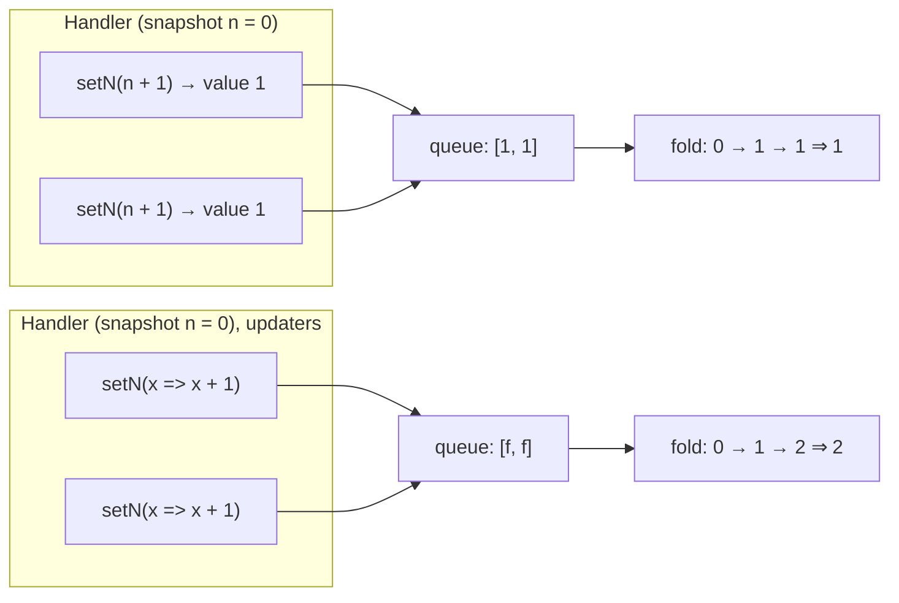
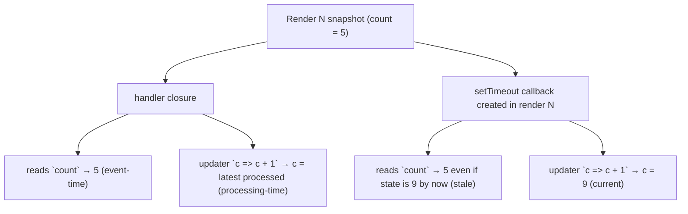
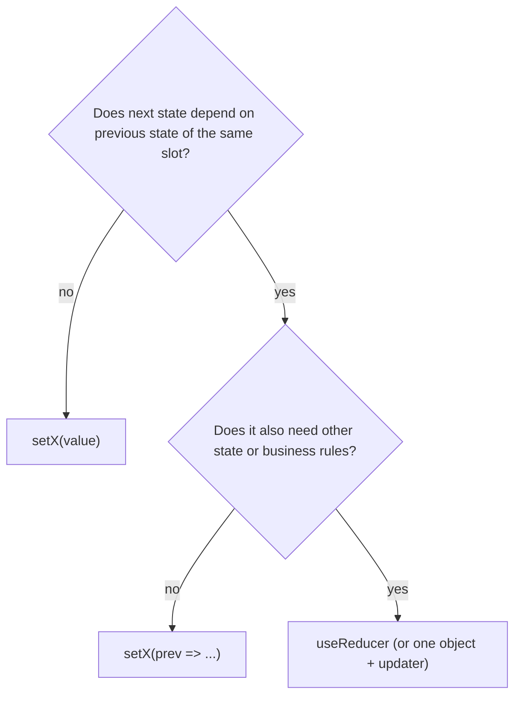

# 03 / 02 — Functional State Updates

## 1. Lesson metadata

| | |
|---|---|
| **Level** | Intermediate |
| **Study time** | 3.5–4.5 hours (reading 1.5 h, experiments 1 h, exercises 1–1.5 h) |
| **Prerequisites** | [03 / 01 — `useState` internals and update semantics](./01-usestate-internals-and-update-semantics.md) (required), [Phase 1 / 15 — Update queues and batching](../01-react-fundamentals/15-update-queues-and-batching.md) (required), [Phase 1 / 14 — State as a snapshot](../01-react-fundamentals/14-state-as-a-snapshot.md), [Foundations 06 — Closures](../00-web-and-javascript-foundations/06-lexical-scope-and-closures.md), [Foundations 07 — Referential identity](../00-web-and-javascript-foundations/07-functions-and-referential-identity.md), [Foundations 08 — Immutable updates](../00-web-and-javascript-foundations/08-objects-references-immutability.md) |
| **Next** | [03 — `useReducer` and reducer architecture](./03-usereducer-and-reducer-architecture.md) |
| **Related later** | [Phase 2 / 12 — Why rendering must be pure](../02-react-rendering-and-internals/12-why-rendering-must-be-pure.md), [Phase 2 / 15 — Interruptible, restartable, abandoned rendering](../02-react-rendering-and-internals/15-interruptible-restartable-abandoned-rendering.md), [Phase 2 / 28 — Strict Mode behavior](../02-react-rendering-and-internals/28-strict-mode-behavior.md), [05 — Effect dependencies and stale closures](./05-effect-dependencies-and-stale-closures.md) |

**Learning objectives.** After this lesson you can:
1. Explain the *problem* updater functions solve: closures freeze a snapshot, while some updates must be computed from the value **at processing time**, not at the time the closure was created.
2. State the exact reduction semantics of a queue of values and updaters, and trace any sequence.
3. Explain why updaters must be pure, why React may call them more than once, and how rebasing under concurrent rendering makes that necessary.
4. Use updaters to write handlers, timers and subscriptions that never go stale and keep stable identity.
5. Recognize the cases where an updater is **not** the answer (reading state for a side effect, cross-state consistency, validation against current value) and choose a reducer, a ref, or a different structure.
6. Type updaters in TypeScript and avoid the "function stored in state" trap.

**Concepts covered:** snapshot vs processing-time value, updater function `(prev) => next`, queue reduction, `SetStateAction<S>`, purity and double invocation, rebasing, stable callbacks via updaters, batching of mixed updates, intervals and async callbacks, limits of updaters (no side effects, no access to other state), updater vs reducer.

---

## 2. Deep conceptual explanation

### 2.1 What problem is this lesson solving?

[Lesson 01](./01-usestate-internals-and-update-semantics.md) established that every render has a constant `state`. A handler created in that render closes over it. That is correct and desirable for *reading*. It becomes a problem for **writing**, whenever the new value depends on the old value and the "old value" the closure has is no longer the current one:

```tsx
const [count, setCount] = useState(0);

function addThree() {
  setCount(count + 1);
  setCount(count + 1);
  setCount(count + 1);
}
// result: count becomes 1, not 3
```

Each line computes `count + 1` **at call time from the snapshot (`0`)**, producing three queued requests that all say "set to 1". The writes are correct JavaScript; the *intent* ("increment, three times") was lost, because the code recorded a *result* instead of an *operation*.

The updater function form records the operation:

```tsx
function addThree() {
  setCount((c) => c + 1);
  setCount((c) => c + 1);
  setCount((c) => c + 1);
}
// result: 3
```

Now the queue contains three functions. React applies them in order during processing, feeding each the result of the previous one. **The value an updater sees is the processing-time value, not the closure's.**

### 2.2 The distinction in one sentence

> A **value** update says *"the state is now X"*. An **updater** update says *"transform whatever the state currently is by f"*.

Choose by asking: *where does the next state come from?*

| Next state derives from… | Use |
|---|---|
| Something unrelated to previous state (the text in the input, the server response, a constant) | Value: `setName(e.target.value)` |
| The previous state of the **same** slot (increment, toggle, append, remove, merge) | Updater: `setCount(c => c + 1)` |
| The previous state of **another** slot | Neither alone: consider combining the slots in one object or a reducer ([03](./03-usereducer-and-reducer-architecture.md)) |

### 2.3 Why this is not a React-only idea

Updaters are the same idea as `Array.prototype.reduce`: a sequence of "actions" folded over an accumulator. Database engineers know it as the difference between `UPDATE t SET n = 5` (absolute write, lost-update prone) and `UPDATE t SET n = n + 1` (relative write, composes under concurrency). Distributed systems call such relative operations *commutative-friendly*; they survive interleaving because they never carry a stale read. The React version of "concurrent writers" is: several event handlers, timers, and async callbacks that all hold *different* snapshots, all writing to one slot.

### 2.4 What changes in the closure story

Because an updater receives `prev` as an **argument**, it does not read `count` from the enclosing scope. So the handler no longer depends on that variable. Three consequences follow, each used heavily in practice:

1. **Correctness under batching**: several updates in one handler compose.
2. **Correctness in long-lived closures**: timers, listeners and promise callbacks created in render N can still apply a correct update in render N+10 ([§5.5](#55-advanced-example-an-interval-that-never-goes-stale)).
3. **Stable identity**: a function that does not reference `count` need not list it as a dependency, so a `useCallback`/effect can keep identity across renders ([§5.6](#56-advanced-example-stable-callbacks-without-dependency-churn)).

### 2.5 Common misconceptions

| Misconception | Reality |
|---|---|
| "Updaters are only for when you click fast / call setters multiple times." | They matter whenever the closure may be *older* than the state: effects, timers, async callbacks, memoized callbacks, children invoking callbacks multiple times. |
| "`prev` is the value that was displayed when the click happened." | `prev` is the result of all earlier queued updates, in order. It may include updates made milliseconds earlier that have not rendered yet. |
| "An updater runs immediately inside the setter call." | Not as a rule. React may run it later, during the next render's queue processing. (React may sometimes compute it eagerly as an optimization; you cannot rely on either; [01 §3.4](./01-usestate-internals-and-update-semantics.md).) |
| "An updater runs exactly once." | It may run more than once (Strict Mode in development; rebasing under concurrent rendering). Hence purity. |
| "I can call another setter / `fetch` / `console.log` inside it." | Updaters are part of rendering. They must be pure calculations. Side effects there run an unpredictable number of times. |
| "`setX(prev => prev)` is a harmless no-op." | It returns the same reference, so it is a bail-out (fine), but it still enqueues; and if it *mutates* `prev` before returning it, that is a mutation bug. |
| "Updaters make stale closures impossible." | They make *the write* correct. Reads elsewhere in the closure (conditions, logging, derived values) remain snapshot-based. |

---

## 3. Internal mechanics

> Labels: **[Public guarantee]**, **[Teaching model]**, **[Implementation detail]** as in lesson 01.

### 3.1 The type: `SetStateAction<S>` [Public guarantee]

In `@types/react`, the setter is `Dispatch<SetStateAction<S>>`, where `SetStateAction<S> = S | ((prevState: S) => S)`. The runtime discriminates with `typeof action === 'function'`. This is why:

- If `S` itself is a function type, a plain function argument is **ambiguous at runtime**, and React treats it as an updater. Wrap: `setFn(() => fn)`.
- An updater must **return** the next state. Forgetting `return` in a block-bodied arrow function sets the state to `undefined` (§8).

### 3.2 Queue reduction [Public guarantee, documented example]

Processing is a left fold from the cell's base state over its queue:

```
acc = baseState
for each update in queue (in request order):
  acc = typeof update === 'function' ? update(acc) : update
state = acc
```

Worked example from this curriculum's earlier lesson, now with the fold made explicit. Start `n = 0`:

```tsx
setN(n + 5);        // value 5
setN((x) => x + 1); // updater
setN(42);           // value 42
```

| Step | Update | `acc` before | `acc` after |
|---|---|---|---|
| 0 | (base) | — | 0 |
| 1 | `5` | 0 | 5 |
| 2 | `x => x + 1` | 5 | 6 |
| 3 | `42` | 6 | **42** |

A value update *discards* everything before it (it ignores `acc`). An updater *builds on* it. Reorder to `setN(42); setN(x => x + 1)` and you get **43**.

### 3.3 Where the updater runs [Teaching model]

The update object stored in the queue holds the function (or value). When React processes the cell during the component's render, it calls the function. Documented consequences (react.dev, `useState` caveats):

- **[Public guarantee]** React *may* call your updater function twice in development under Strict Mode to help you find impurities; one result is discarded. It will not change the outcome if the updater is pure.
- **[Public guarantee]** Updater functions "run during rendering", so they must be pure.

### 3.4 Rebasing: why more than twice is possible [Implementation detail, conceptual]

With concurrent rendering ([Phase 2 / 13](../02-react-rendering-and-internals/13-scheduler-and-priorities.md), [14](../02-react-rendering-and-internals/14-lanes.md)) React can render an urgent update (typing) while a lower-priority update (a transition) is pending. Consider cell `q` with queue:

1. `T`: `q => q + 10` — enqueued from a transition (low priority).
2. `U`: `q => q * 2` — enqueued from a click (urgent), *after* `T`.

An urgent render must show the effect of `U` promptly but may skip `T`. The *final* answer, once everything is processed, must still equal applying `T` then `U` in request order (so the result is consistent regardless of how React sliced the work). React achieves this conceptually by remembering the base state from before the first skipped update and, on a later render, re-applying the skipped update **and every later update again** on top of that base.

```mermaid
sequenceDiagram
  participant S as Cell (base = 1)
  Note over S: Queue: T (low) , U (high)
  S->>S: Render A (high priority only): skip T, apply U to base 1 → shows 2
  Note over S: base stays 1; U is kept because it follows a skipped update
  S->>S: Render B (all priorities): 1 → T → 11 → U → 22
  Note over S: U ran twice in total (pure, so harmless)
```

So the displayed value may briefly be `2` and then `22`: the first render is an intermediate, urgent-only view; the final value respects request order. This is *the reason* updaters (and reducers) must be pure and why "my updater ran twice" is normal, not a bug. The exact bookkeeping (base state, base queue, lanes) is an implementation detail; read the reconciler source (`react-reconciler`) to see the current form, and do not code against it.

### 3.5 Batching and updaters [Public guarantee]

Multiple setter calls within one batch (an event handler, effect, or timer callback in React 18+; [Phase 2 / 22](../02-react-rendering-and-internals/22-automatic-batching.md)) produce **one** render after processing the whole queue. Updaters in the queue see each other's results. This is what makes `addThree()` above render once and show `3`.

### 3.6 What an updater can and cannot see [Teaching model]

An updater's parameters: only `prev`. Anything else it reads comes from its **lexical scope**, which is the render in which the updater was *created*. Therefore:

```tsx
setTotal((t) => t + price);   // `prev` is current; `price` is the snapshot from creation time
```

Mixing is usually fine (`price` is an input of the user's action), but be explicit about which values are "at event time" (closure) and which are "at processing time" (`prev`). A common bug is an updater that reads *another* state variable from the closure while assuming it's current:

```tsx
setSelected((s) => (items.includes(s) ? s : null)); // `items` is the snapshot from creation; may be older than state
```

When two slots must be consistent with each other at processing time, they belong in one slot or one reducer.

### 3.7 The setter and the return value [Public guarantee]

Setters return `undefined`. You cannot get "the new value" from them. If you need the next value *and* to act on it, compute it from the snapshot in the handler (when the handler's snapshot is authoritative) and pass both to `setX(next)` and the follow-up, or restructure so the follow-up is an effect/derived value ([§7](#7-alternative-approaches-and-trade-offs)).

---

## 4. Step-by-step execution walkthrough

Component:

```tsx
function Votes() {
  const [votes, setVotes] = useState(0);
  const [log, setLog] = useState<string[]>([]);

  function handle() {
    setVotes((v) => v + 1);
    setVotes((v) => v * 10);
    setLog((l) => [...l, `clicked at snapshot ${votes}`]);
  }
  // ...
}
```

**Predict:** `votes` starts at 3. One click. What are `votes` and `log` after the batch, and how many renders occur?

Timeline:

1. **Click.** The handler is the closure from render 1 (`votes = 3`, `log = []`).
2. `setVotes(v => v + 1)` enqueues update #1 on cell `votes`; schedules a render.
3. `setVotes(v => v * 10)` enqueues update #2 on the same cell.
4. `setLog(l => [...])` enqueues #1 on cell `log`. Note the string template reads `votes` from the *closure* (3).
5. Handler returns; batch closes.
6. **Render 2.** React processes `votes`: `3 → 4 → 40`. Processes `log`: `[] → ['clicked at snapshot 3']`. Component runs once with `votes = 40`.
7. **Commit.** DOM reflects 40 and the log entry.

Answer: `votes = 40`, `log = ['clicked at snapshot 3']`, **one** render (production). In Strict Mode development, each updater and the component body additionally run a second time with identical results (discarded), so you'd see doubled *calls* but identical state.

Note what the log entry demonstrates: reading `votes` from the closure gives the snapshot (3) even though the state's final value is 40. Mixed reads are a legitimate design choice but must be intentional.

---

## 5. Code examples

### 5.1 Minimal example

```tsx
import { useState } from 'react';

export function Stepper() {
  const [n, setN] = useState(0);
  return (
    <>
      <button onClick={() => setN((x) => x - 1)}>-</button>
      <output>{n}</output>
      <button onClick={() => setN((x) => x + 1)}>+</button>
      <button onClick={() => { setN((x) => x + 1); setN((x) => x + 1); }}>+2</button>
    </>
  );
}
```

`+2` adds exactly 2 thanks to updaters; with `setN(n + 1)` twice it would add 1.

### 5.2 Practical example: a quantity control with bounds and a cart map

```tsx
import { useState } from 'react';

type Cart = Readonly<Record<string, number>>; // sku -> quantity

export function useCart() {
  const [cart, setCart] = useState<Cart>({});

  const add = (sku: string, by = 1) =>
    setCart((c) => ({ ...c, [sku]: (c[sku] ?? 0) + by }));

  const remove = (sku: string) =>
    setCart((c) => {
      const { [sku]: _removed, ...rest } = c; // omit key immutably
      return rest;
    });

  const decrement = (sku: string) =>
    setCart((c) => {
      const next = (c[sku] ?? 0) - 1;
      if (next <= 0) {
        const { [sku]: _gone, ...rest } = c;
        return rest;
      }
      return { ...c, [sku]: next };
    });

  return { cart, add, remove, decrement } as const;
}
```

Line notes:

- Each function is correct even if called many times in the same event (a "bundle" button that calls `add` for three SKUs: three updaters, each building on the previous result).
- `decrement` reads and writes `c[sku]` through `prev` only: no snapshot dependency. If it were `setCart({ ...cart, [sku]: cart[sku] - 1 })`, two quick clicks in one frame could lose one.
- Returning a **new object** only when something changed matters: if `next` and `c` are the same reference React can bail out. Here we always create a new object for simplicity; returning `c` unchanged where nothing changes (e.g. removing an absent sku) is a nice refinement.
- TypeScript: `Readonly<Record<…>>` prevents `c[sku] = …` (mutation) at compile time.

### 5.3 Incorrect example: updater with a side effect

```tsx
function Checkout() {
  const [items, setItems] = useState<string[]>([]);

  function addItem(name: string) {
    setItems((prev) => {
      analytics.track('item_added', { name }); // side effect in updater
      return [...prev, name];
    });
  }
  // ...
}
```

**Predict:** how many `item_added` events per click?

**Answer:** In development with Strict Mode, **two** (updater double-invoked). In production, usually one, but the language of the contract is "may be called more than once": rebasing (§3.4) can call it again after a skipped lower-priority update, and a render that is thrown away (interrupted or errored) may have already run it. The symptom is analytics counts that differ between dev and prod, or inflate under load: exactly the type of bug that survives code review because "it works".

### 5.4 Corrected implementation

```tsx
function addItem(name: string) {
  analytics.track('item_added', { name }); // once, in the event handler
  setItems((prev) => [...prev, name]);     // pure
}
```

Rule: **events cause side effects; renders and updaters only compute.** If the side effect must follow the *committed* state rather than the click (rare), use an effect keyed on that state ([04](./04-useeffect-synchronization.md)) and ask whether the tracking is really about the state or about the user's action (almost always the action).

### 5.5 Advanced example: an interval that never goes stale

```tsx
import { useEffect, useState } from 'react';

export function Elapsed({ running }: { running: boolean }) {
  const [seconds, setSeconds] = useState(0);

  useEffect(() => {
    if (!running) return;
    const id = setInterval(() => {
      setSeconds((s) => s + 1); // reads prev, not the closure
    }, 1000);
    return () => clearInterval(id);
  }, [running]); // `seconds` is not a dependency because it is not read

  return <output>{seconds}s</output>;
}
```

**Predict:** if the callback were `setSeconds(seconds + 1)` with deps `[running]`, what would you see?

**Answer:** `seconds` in the effect closure would be `0` forever (the effect ran once for the render where `seconds === 0`), so the timer would set the state to `1` each second: the display sticks at 1. The linter would flag the missing dependency. The two honest fixes are (a) add `seconds` to deps, which tears down and recreates the interval every second (drifting timing, wasted work), or (b) the updater, which removes the need for the dependency. Option (b) is preferred and is *the* canonical updater use case. The deeper treatment of why (the closure captured at effect creation) is in [05](./05-effect-dependencies-and-stale-closures.md). Cleanup of the interval is [06](./06-effect-cleanup.md).

(Accuracy note: `setInterval` timing is also subject to timer clamping and throttling in background tabs, and is not a precise clock; for a stopwatch store `Date.now()` anchors and derive the display, rather than counting ticks.)

### 5.6 Advanced example: stable callbacks without dependency churn

```tsx
import { memo, useCallback, useState } from 'react';

const Row = memo(function Row({ id, onToggle }: { id: number; onToggle: (id: number) => void }) {
  return <li><button onClick={() => onToggle(id)}>{id}</button></li>;
});

export function List({ ids }: { ids: readonly number[] }) {
  const [selected, setSelected] = useState<ReadonlySet<number>>(new Set());

  const onToggle = useCallback((id: number) => {
    setSelected((prev) => {
      const next = new Set(prev); // copy: never mutate prev
      if (next.has(id)) next.delete(id);
      else next.add(id);
      return next;
    });
  }, []); // stable for the lifetime of the component

  return <ul>{ids.map((id) => <Row key={id} id={id} onToggle={onToggle} />)}</ul>;
}
```

- `onToggle` references no render-scoped value, so `[]` is correct (setters are stable and known to the lint rule).
- `Row` is `memo`'d, so it skips re-rendering when its props are shallow-equal; a stable `onToggle` is what makes that possible ([12](./12-react-memo.md)). Whether it *pays off* depends on measured cost; do not add `memo`/`useCallback` reflexively ([11](./11-usememo-and-usecallback.md)).
- Mutating `prev` (`prev.add(id)`) then returning it would make the reference identical (bail-out) and mutate a value React and your other closures treat as immutable.
- `useState(new Set())` evaluates `new Set()` every render; use `useState(() => new Set<number>())` if you care (it is cheap here).

### 5.7 Advanced example: when an updater is not enough (needs the *next* value elsewhere)

```tsx
function Search({ onSearch }: { onSearch: (q: string) => void }) {
  const [query, setQuery] = useState('');

  function handleChange(e: React.ChangeEvent<HTMLInputElement>) {
    const next = e.target.value;      // event value: authoritative, not derived from prev
    setQuery(next);
    onSearch(next);                   // notify with the value we have
  }
  // ...
}
```

Here a *value* update is right (the next state comes from the event). The anti-pattern would be `setQuery((q) => { onSearch(q + ch); return q + ch; })`: a side effect inside an updater. Contrast with a counter whose next value matters to a parent:

```tsx
function Counter({ onChange }: { onChange: (n: number) => void }) {
  const [n, setN] = useState(0);
  function inc() {
    const next = n + 1;  // derive from the snapshot (event-time truth)
    setN(next);
    onChange(next);
  }
}
```

Trade-off: `inc` is now a snapshot write, so two calls in one batch still produce `n + 1` once. If rapid repeated calls must accumulate *and* notify, the state is probably owned by the wrong component (lift it: [18](./18-state-colocation-and-lifting.md)) or you need a reducer plus an effect that reports committed state. Choose deliberately: "notify about each user action" vs "notify about committed state".

---

## 6. Visual explanations

### Value vs updater inside one batch



### Which value does each expression see?



### Decision flow



---

## 7. Alternative approaches and trade-offs

| Approach | When it's right | Costs / limits |
|---|---|---|
| `setX(value)` from snapshot | Event-driven writes where the closure *is* the authority (the value comes from the event or is a constant) | Loses accumulation in batches; stale in long-lived closures |
| `setX(prev => …)` | Increments, toggles, appends, removes, any "relative" write; timers; stable callbacks | Must be pure; cannot see other state; may run more than once |
| Add `x` to dependency array | Effect genuinely needs to re-run when `x` changes (reconnect on id change) | Tear-down/set-up churn for relative writes (timers); not a fix for batching |
| `useRef` mirror of latest state | You need the latest value in a long-lived callback to *read* (not to compute the next state), e.g. analytics on unmount | Manual sync; reads happen outside render semantics; easy to mis-order |
| `useReducer` | Next state depends on several fields or rules; many action kinds; testability | More ceremony ([03](./03-usereducer-and-reducer-architecture.md)) |
| `useEffectEvent` | Effect needs the latest props/state without re-subscribing (reads only) | Stable since React 19.2; callable only from Effects (`useEffect`/`useLayoutEffect`/`useInsertionEffect`) or other Effect Events; identity is not stable ([05](./05-effect-dependencies-and-stale-closures.md), [22](./22-modern-hooks-and-apis.md)) |
| External store (`useSyncExternalStore`) | State shared across the tree or updated from outside React | Different mental model ([20](./20-usesyncexternalstore-and-external-stores.md)) |

**A scenario where the recommended approach (updater) is *not* best.** *Optimistic concurrency with a server version number.* A document editor stores `{ text, version }` and each local edit must be sent with the version it was *based on*. If you compute `next` inside an updater and then (incorrectly) want to send `next.version` to the server, you have no access to it outside the updater. In such cases the "who owns the truth" question matters more than the update form: model edits as *actions* in a reducer, derive "pending operations" in state, and send them from an effect or handler with the data they carry (the action), not from the updater. Alternatively, for a plain text field `setText(e.target.value)` (value form) is simply correct because the next state comes from the event, not from the previous state.

---

## 8. Best practices and anti-patterns

**Do**
- Default to the updater form whenever the next state is a function of the previous state of the same slot. It is never wrong for relative writes and removes a whole bug class.
- Keep updaters tiny, pure and total (handle `undefined` map entries, empty arrays).
- Return a **new** reference only when something changed; return `prev` itself to bail out.
- Combine fields that must be updated together into one slot (object or reducer).
- Type updaters through the state type: `setItems((prev: readonly Item[]) => …)` is usually inferred; avoid `any`.

**Beginner mistakes**
- `setCount(count + 1)` repeated, or inside `setTimeout`/`setInterval`/`await` continuations.
- Block-bodied updater without `return`: `setItems((p) => { p.concat(x); })` sets state to `undefined`. (`p.concat` does not mutate and returns a new array which was thrown away.)
- Mutating `prev` (`prev.push(x); return prev;`).
- Using the updater form for values that come from the event: unnecessary complexity (`setName(() => e.target.value)` works but misleads, and `e.target` can be read inside an updater later only if the value was copied out first).

**Experienced-developer mistakes**
- Side effects in updaters (analytics, dispatching to other stores, `setOther` calls). Calling another component's or slot's setter inside an updater *runs during render* of this component and is flagged in development or yields unpredictable behavior.
- Assuming the updater runs synchronously inside the setter (e.g. relying on a local variable assigned inside it). Do not do `let next; setX(p => (next = f(p))); use(next);`: `next` may be `undefined` at that line.
- Reading other state variables inside an updater and treating them as current (§3.6).
- Over-using functional updates for *everything*, including values from events; clarity suffers.
- Wrapping every callback in `useCallback` "because updaters make it possible" without measuring.

**Smells**
- A setter call with a long expression referencing the same state twice (`setState({ ...state, a: state.a + 1, b: state.b + state.a })`): push into a reducer.
- Effects whose dependency arrays include a state only to read it for the next write (timers).
- `eslint-disable react-hooks/exhaustive-deps` next to a setter that "just needs the current value": an updater almost certainly removes the need.

**Justified exceptions.** Snapshot semantics are *desired* for some writes: "reset to the value at the time of click" or "undo to the snapshot captured when the dialog opened". Also, a single write in a handler where the value comes from the event does not need an updater.

---

## 9. Real-world application

*Dashboards with live tiles.* A tile receives WebSocket messages and accumulates a rolling window: `setPoints(p => [...p.slice(-299), msg])`. Messages arrive between renders, sometimes several per frame; updaters guarantee none are lost even though only the latest render's closure exists. Engineering constraints: bounded memory (slice), allocation churn (consider a ring buffer in a ref + a version counter state for big streams), and batching (React 18+ batches socket callbacks too; [Phase 2 / 22](../02-react-rendering-and-internals/22-automatic-batching.md)).

*Forms with repeating groups.* "Add another passenger" appends to an array with updaters; each row's inputs update their own entry with `setRows(rs => rs.map(r => r.id === id ? { ...r, [field]: value } : r))`. Constraint: stable IDs (not indexes), because positions change under reorder and deletion ([Phase 1 / 09](../01-react-fundamentals/09-lists-keys-and-identity.md)).

*Finance: running totals and rounding.* A cart total updated via updaters should store **integer minor units** (cents) to avoid floating-point drift; `t + price` accumulated as floats loses cents. Pure updater plus integer arithmetic is the safe pairing; formatting happens at render with `Intl.NumberFormat`.

*Realtime collaboration.* Updaters compose local changes but they cannot resolve conflicts with remote edits; that needs a sync algorithm (operational transform/CRDT) upstream of React state. Know the layer boundary: updaters guarantee *local* consistency only.

*Multi-team libraries.* A shared hook such as `useToggle`/`useCounter` exposes stable, updater-based callbacks, so consumers can pass them to memoized children or effect deps without surprises.

---

## 10. Debugging and troubleshooting

**Symptom 1: "Clicking quickly only increments by one."**
Repro: handler with `setX(x + 1)` called twice or fired twice before a render. Investigation: log inside render and inside the handler (`console.log('handler sees', x)`); you will see the same snapshot twice. DevTools won't show the queue; the clue is *identical computed values*. Root cause: value-form write from a stale/old snapshot. Fix: updater. Validate: repeat the interaction; the Profiler should show one commit per batch with the correct final value.

**Symptom 2: "A counter in a timer is stuck."**
Check the effect's closure: which `state` does the callback reference? Run the lint rule; look for `exhaustive-deps` warnings or disabled rules. Fix with updater, or restructure ([05](./05-effect-dependencies-and-stale-closures.md)). Validate with Strict Mode on to ensure cleanup is correct too.

**Symptom 3: "Event logged twice in dev, once in prod."**
Search for side effects inside updaters or render. Move to handler/effect. Validate by building in production *and* by reasoning, because the contract allows >1 invocation.

**Symptom 4: "State became `undefined` after an update."**
Updater missing `return` (block body) or returning from an `if` branch only. Add `return` on all branches; TypeScript will often flag it when `S` doesn't include `undefined`; enable `noImplicitReturns`.

**Symptom 5: "Updater result 'doesn't show up' / shows later."**
Mutation of `prev` and returning the same reference (bail-out). Compare `prev === next` in a temporary log.

**Symptom 6: "Weird jump between values during typing + transition."**
Rebasing of urgent/transition updates; intermediate renders are valid by design. If the intermediate state is *incorrect* (not merely transient), the updaters are impure or the two updates conflict semantically: restructure so that urgent and deferred updates touch different slots ([Phase 2 / 23](../02-react-rendering-and-internals/23-transitions-and-deferred-rendering.md)).

---

## 11. Exercises

### Level A — Knowledge
A1. In one sentence each: what does a *value* update record, and what does an *updater* record?
A2. Why may React call an updater more than once? Give two documented/accepted reasons.
A3. What does a setter return?
A4. What is the problem with `useState<() => void>(() => {})` followed by `setHandler(() => doIt())`? What is stored?
A5. Why is `setCount(count + 1)` inside `setInterval` (created in an effect with `[]` deps) a bug?

### Level B — Code comprehension
B1. `n` starts at `2`. Final value after the handler runs?
```tsx
setN((x) => x * 3);
setN(10);
setN((x) => x + 1);
```
B2. `n` starts at `0`. What is `n` after one click, and how many renders (production)?
```tsx
setN(n + 1);
setN((x) => x + 1);
setN(n + 5);
```
B3. What does this component display after the button is clicked once?
```tsx
const [items, setItems] = useState<string[]>([]);
<button onClick={() => setItems((p) => { p.concat('x'); })}>add</button>
<p>{items === undefined ? 'undefined' : items.length}</p>
```
B4. Which of these updaters is impure, and why?
```tsx
(a) setList((l) => [...l, crypto.randomUUID()]);
(b) setList((l) => l.filter((x) => x.id !== id));
(c) setList((l) => { sessionStorage.setItem('n', String(l.length)); return l; });
```

### Level C — Implementation
C1. Implement `useCounter({ min, max, step })` returning `{ count, inc, dec, reset }` where `inc`/`dec` clamp to the bounds and have stable identity.
C2. Implement `useList<T extends { id: string }>()` with `add`, `update(id, patch)`, `remove(id)` using updaters, immutable, with a bail-out (same reference) when `remove`/`update` find no matching id.
C3. Write a `useStopwatch()` that counts seconds while running, correct under Strict Mode, with `start/stop/reset`, using an updater-based interval.

### Level D — Debugging
D1. The "Add 3" button adds only 1. Fix without changing the three lines' *meaning*.
```tsx
function add3() {
  for (let i = 0; i < 3; i++) setTotal(total + 1);
}
```
D2. Analytics shows 2× the number of `purchase` events in development and occasionally 2× in production under heavy use. Locate the bug:
```tsx
setOrders((prev) => {
  track('purchase', order);
  return [...prev, order];
});
```
D3. After `removeItem('a')` the whole list becomes `undefined`. Fix:
```tsx
setItems((prev) => { if (prev.includes('a')) return prev.filter((x) => x !== 'a'); });
```

### Level E — Architecture and engineering decisions
E1. A chat app receives messages on a WebSocket. Compare (a) `setMessages(prev => [...prev, m])` per message, (b) buffering in a ref and flushing per animation frame, (c) an external store. Recommend, naming conditions under which each wins.
E2. A teammate proposes a lint rule banning the value form entirely (`setX(expr)` must always be `setX(prev => …)`). Critique.

### Level F — Expert challenge
F1. Two updates are enqueued on one cell: `T = (q) => q + 10` inside `startTransition`, then `U = (q) => q * 2` from a click. Starting at `1`, describe every value the cell can *display*, and the final value, and explain what property of `T`/`U` makes any observed sequence acceptable. Then show how making `U` impure (it increments an external counter) breaks an invariant.

---

## 12. Detailed answers and explanations

> Attempt the exercises first.

**A1.** A value update records the *result*: "state is now X", computed at call time. An updater records the *operation*: "apply f to whatever the state is at processing time". The difference matters wherever the call-time snapshot is not the processing-time truth.

**A2.** (1) Strict Mode in development double-invokes updaters (and the component body, initializers) to expose impurity; one result is discarded. (2) Under concurrent rendering a render can be interrupted, restarted, or abandoned (a render may start, apply updaters, and be thrown away), and low-priority updates are re-applied (rebased) on top of a base state when a later render includes them. In both cases correctness requires purity. Do not state "React calls it twice in production": it *can*, not *always*.

**A3.** `undefined`. There is no way to obtain the new value from the setter.

**A4.** The updater/initializer ambiguity: because the state *is* a function, `setHandler(() => doIt())` is interpreted as an updater: React calls it with the previous handler, and **its return value** (`doIt()`'s result, probably `undefined`) becomes the new state. The stored handler is not the arrow function. Fix: `setHandler(() => () => doIt())` or avoid storing functions in state (store an id/enum, or use a ref).

**A5.** The effect runs once, so the interval callback closes over the `count` of the render in which the effect was created (say `0`). Every tick computes `0 + 1 = 1` and sets the state to `1`. The updater form reads the current value at processing time and fixes it. Also note the exhaustive-deps lint rule would flag the missing dependency; silencing it hides the bug.

**B1.** Fold: `2 → 6 (x*3) → 10 (value) → 11`. Answer **11**. The value `10` discarded the earlier result; the later updater built on it.

**B2.** Snapshot `n = 0`. Queue: value `1`, updater, value `5`. Fold: `0 → 1 → 2 → 5`. Final **5**, one render. The last write is a value computed from the snapshot (`0 + 5`), so it overrides the updater's accumulated progress. Wrong answer "7" assumes the third call adds to the accumulated 2.

**B3.** `p.concat('x')` returns a new array but the arrow function has a block body with no `return`, so the updater returns `undefined`. State becomes `undefined`, and `items === undefined` is true: displays `undefined`. (In real code, `items.length` / `.map` would then throw.) Note TypeScript would flag the missing return: `() => void` is not assignable to `(prev: string[]) => string[]`.

**B4.** (a) Impure: generates a random UUID inside the updater; each call (double-invocation, rebase) produces a *different* result, so the committed value may not be the one React validated, and Strict Mode discards one. Generate the id in the handler and use it inside. (b) Pure. (c) Impure: writes storage (a side effect) inside the updater. Persist in an effect or handler. (c)'s `return l` also bails out, which is fine, but the write is the issue.

**C1.**
```ts
import { useCallback, useState } from 'react';

interface Options { min?: number; max?: number; step?: number; initial?: number }

export function useCounter({ min = -Infinity, max = Infinity, step = 1, initial = 0 }: Options = {}) {
  const clamp = useCallback((n: number) => Math.min(max, Math.max(min, n)), [min, max]);
  const [count, setCount] = useState(() => Math.min(max, Math.max(min, initial)));

  const inc = useCallback(() => setCount((c) => clamp(c + step)), [clamp, step]);
  const dec = useCallback(() => setCount((c) => clamp(c - step)), [clamp, step]);
  const reset = useCallback(() => setCount(Math.min(max, Math.max(min, initial))), [min, max, initial]);

  return { count, inc, dec, reset } as const;
}
```
Notes: `inc`/`dec` use updaters, so they don't depend on `count`; they depend on the *options*, so identity changes only when options do. `reset` is a **value** write (an absolute target), correctly. Edge: if `min > max` behavior is undefined; validate in development. Clamping returns the same number when already at the bound, so repeated `inc` at `max` bails out. Grading: stable identity under unchanged options, no `count` dependency, bound enforcement under rapid double-clicks (two `inc` in one batch).

**C2.**
```ts
import { useCallback, useState } from 'react';

export function useList<T extends { id: string }>(initial: readonly T[] = []) {
  const [items, setItems] = useState<readonly T[]>(initial);

  const add = useCallback((item: T) => setItems((p) => [...p, item]), []);
  const update = useCallback(
    (id: string, patch: Partial<Omit<T, 'id'>>) =>
      setItems((p) => {
        const i = p.findIndex((x) => x.id === id);
        if (i === -1) return p;                       // bail-out: same reference
        const next = p.slice();
        next[i] = { ...p[i], ...patch };
        return next;
      }),
    [],
  );
  const remove = useCallback(
    (id: string) =>
      setItems((p) => (p.some((x) => x.id === id) ? p.filter((x) => x.id !== id) : p)),
    [],
  );
  return { items, add, update, remove } as const;
}
```
Notes: `initial` is read only on mount (documented limitation). The updaters never read outer state. `Partial<Omit<T,'id'>>` stops callers changing the id. TS may need a cast for the spread of generic `T`; acceptable. Alternative: `map` with an early bail-out check.

**C3.**
```ts
import { useCallback, useEffect, useState } from 'react';

export function useStopwatch() {
  const [running, setRunning] = useState(false);
  const [seconds, setSeconds] = useState(0);

  useEffect(() => {
    if (!running) return;
    const id = setInterval(() => setSeconds((s) => s + 1), 1000);
    return () => clearInterval(id);
  }, [running]);

  const start = useCallback(() => setRunning(true), []);
  const stop = useCallback(() => setRunning(false), []);
  const reset = useCallback(() => { setRunning(false); setSeconds(0); }, []);
  return { seconds, running, start, stop, reset } as const;
}
```
Strict Mode: effect runs, cleans up (clears), runs again: one active interval at the end. Without cleanup you would get two intervals and double speed in development, which is the point of the dev check. Limitation: tick counting drifts (throttled background tabs). Better for accuracy: store a `startedAt` timestamp and compute elapsed from `Date.now()` on a tick that only triggers re-rendering.

**D1.** Use updaters: `setTotal((t) => t + 1)` inside the loop. The loop was producing three identical requests "set to total+1". If the intent is "add 3", `setTotal((t) => t + 3)` is cleaner. Edge: if `total` is a derived display of a larger structure, apply the same logic to that slot.

**D2.** Side effect (`track`) inside the updater. Dev: Strict Mode double-invokes. Production: rebasing or a render that is retried re-runs the updater. Move `track('purchase', order)` into the handler before/after `setOrders`. If tracking must happen "when the order is committed", derive it from an effect keyed on the order id (with dedupe by id), but usually the handler is right.

**D3.** The updater has no `return` in the not-includes branch, so it returns `undefined` when `'a'` is absent (and state becomes `undefined`). In this case the code path `removeItem('a')` presumably ran when the list lacked `'a'`. Fix: `setItems((prev) => prev.includes('a') ? prev.filter(x => x !== 'a') : prev)`. Enable `noImplicitReturns` and type the state so `undefined` isn't assignable.

**E1.** Criteria: message rate, render cost, loss tolerance, ordering, memory, who else needs the data. (a) Simple and correct; per-message updater composes; React batches messages in the same task/tick. Best when rates are low (≤ tens/s) and render is cheap. (b) Ref buffer + `requestAnimationFrame` flush: decouples message rate from render rate; best when hundreds of messages/s; cost: manual flush and cleanup, consistency with unmount. (c) External store: best when many distant components consume the stream or non-React code needs it; adds `useSyncExternalStore` ([20](./20-usesyncexternalstore-and-external-stores.md)). Recommendation: start with (a), measure with the Profiler; move to (b) if commits exceed frame budget; (c) if sharing. Counterexample: strict ordering and no drops requirement favors (a)/(c) over lossy sampling; (b) must still flush *all* buffered items, not just the latest.

**E2.** Criticism: (1) Not always correct to use `prev` when the value is derived from the event; verbosity and loss of clarity; `setX(() => value)` is cargo-cult. (2) It can *mask* a design problem: if everything needs `prev`, the state should maybe be a reducer. (3) Doesn't fix cross-slot staleness. (4) Positive: a *narrower* rule (flag `setX(x + …)` where `x` is the same state slot being read in the same handler) catches the real bug class with fewer false positives. Evaluation: acknowledges both sides and proposes a targeted lint/convention.

**F1.** Request order: `T` (low priority), then `U` (urgent). Start `q = 1`. The definitive result, after all updates are processed in request order, is `T` then `U`: `1 → 11 → 22`. Displayed sequence possibilities: (i) if React renders the urgent lane first while skipping `T`, it applies `U` to the base state: `1 → 2` (display 2); later, with both included, it rebases: `1 → 11 → 22` (display 22). (ii) If both are rendered together, display goes `1 → 22`. Any observed sequence ends at 22 and each intermediate value is the result of some prefix/subset allowed by priorities. Acceptable *because* `T` and `U` are pure functions of `q`: re-application yields the same results regardless of how many times they run. If `U` increments an external counter, the counter would be incremented once for the urgent-only render and again for the final render (and twice more in Strict Mode), so the number of increments is not equal to the number of user clicks; the external state diverges from the logical event count. This is the invariant break. Grading: explicit fold, mention of base state/rebasing as a teaching model, and the purity argument.

---

## 13. Senior engineer interview questions

**Q1. "When must you use the functional form of `setState`, and when is it unnecessary?"**
*Strong answer:* When the new value derives from the previous value of the same slot **and** the closure's snapshot may not be current: multiple calls in one batch, timers, listeners, async continuations, stable memoized callbacks. Unnecessary when the next value comes from the event or from elsewhere (typing into an input), where the value form is clearer. Mention that the updater doesn't fix reads elsewhere in the closure.

**Q2. "Why do updaters have to be pure? What would break?"**
*Strong answer:* They are part of render's state computation, which React may run more than once (Strict Mode, rebasing across priorities) or discard (interruptions). An impure updater multiplies or loses side effects and can produce different results on re-run, so the final state could differ from what a clean sequential run would give. React's contract only holds for deterministic functions of `prev` and captured values.

**Q3. "Explain how React can show an intermediate state and still end up consistent with all updates applied in order."**
*Strong answer:* Updates are logically a request-ordered queue; priorities let a render include only a subset; React keeps a base state and re-applies skipped updates and everything after them on a later render. Because updaters are pure, re-application yields the same results; so any intermediate render is a valid "projection" and the final render equals the sequential fold. Caveat: this is the teaching model; the details are implementation-specific.

**Q4. "A colleague silences `exhaustive-deps` to stop an interval effect from restarting. What do you do?"**
*Strong answer:* Ask what the callback reads. If it only needs the previous value to compute the next, switch to an updater and the dependency disappears legitimately. If it needs to *read* latest values for a side effect (not compute next state), use the effect-event pattern/`useEffectEvent` (stable in React 19.2+) or restructure; never suppress the rule to create a stale closure intentionally.

**Q5. "What's wrong with `let next; setX(p => (next = compute(p))); doSomething(next);`?"**
*Strong answer:* The updater may run later (during render), so `next` is `undefined` at `doSomething`. Even when eagerly invoked, it can be called again or discarded. If you need the next value outside, derive it from the snapshot in the handler or move the dependent work into an effect/derived render.

**Q6. "How do updaters relate to reducers?"**
*Strong answer:* `useState`'s setter is effectively a reducer whose action is either a value or a function. `useReducer` generalizes with named actions and one transition function, giving a testable, centralized, auditable state machine; updater functions are the "inline anonymous action" case. Use updaters for local, single-slot relative writes; reducers when rules span slots.

---

## 14. Further learning resources

| Resource | URL | Covers / why | Level | Study |
|---|---|---|---|---|
| React docs: Queueing a series of state updates | <https://react.dev/learn/queueing-a-series-of-state-updates> | Canonical `+5`, `n => n + 1`, `42` walkthrough, naming conventions for updaters | Intermediate | Whole page |
| React docs: `useState` reference (updater caveats, Strict Mode) | <https://react.dev/reference/react/useState> | Updater purity, double invocation, "I've updated the state but logging gives me the old value" | Intermediate | "Caveats", "Troubleshooting" |
| React docs: Keeping components pure | <https://react.dev/learn/keeping-components-pure> | Why render-time computation must be pure | Beginner | Whole page |
| React docs: Strict Mode | <https://react.dev/reference/react/StrictMode> | What's double-invoked in development | Intermediate | "Fixing bugs found by double rendering" |
| React docs: Removing effect dependencies | <https://react.dev/learn/removing-effect-dependencies> | "Do you want to read a value to calculate the next state?" updater fix | Intermediate | The updater-in-effect section |
| MDN: `Array.prototype.reduce` | <https://developer.mozilla.org/en-US/docs/Web/JavaScript/Reference/Global_Objects/Array/reduce> | The fold model behind the queue | Beginner | Whole page |
| React source (reconciler) | <https://github.com/facebook/react> | How the update queue and base state are stored today (verify, do not memorize) | Advanced | Search "update queue" in `react-reconciler` hooks code |

---

## 15. Knowledge checkpoint

**You should now understand**
- Value updates record results; updaters record operations; the queue is a fold.
- Why updaters must be pure and why they may run more than once.
- That updaters make the *write* correct but do not repair stale reads elsewhere.
- That updaters can't see other state and shouldn't perform side effects.

**You should be able to explain without notes**
- The result of any mix of values and updaters in one batch.
- Why a `setInterval` created in an effect goes stale and the two ways to fix it.
- A conceptual picture of rebasing.

**You should be able to implement**
- Stable, updater-based callbacks for counters, lists, sets, and maps.
- A correct stopwatch hook under Strict Mode.

**You should be able to debug**
- "Only incremented once", "became undefined", "double analytics", "UI lags a click behind".

**Prerequisite for next lesson:** if you have a state transition that involves several fields or business rules, you've seen the limits of single-slot updaters. [Lesson 03](./03-usereducer-and-reducer-architecture.md) introduces `useReducer`: the same fold, with named actions and one place for the rules.
