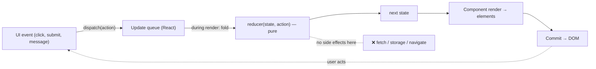
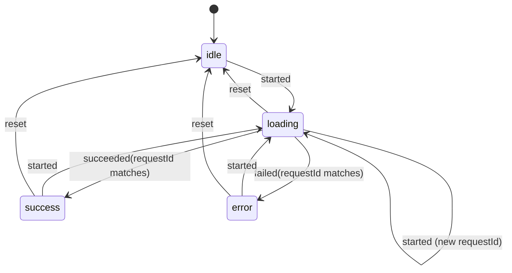

# 03 / 03 — `useReducer` and Reducer Architecture

## 1. Lesson metadata

| | |
|---|---|
| **Level** | Intermediate |
| **Study time** | 4–5 hours (reading 2 h, experiments 1 h, exercises 1.5 h) |
| **Prerequisites** | [03 / 01 — `useState` internals](./01-usestate-internals-and-update-semantics.md) (required), [03 / 02 — Functional state updates](./02-functional-state-updates.md) (required), [Foundations 19 — Generics, utility types, discriminated unions](../00-web-and-javascript-foundations/19-typescript-generics-and-utility-types.md), [Foundations 08 — Immutable updates](../00-web-and-javascript-foundations/08-objects-references-immutability.md), [Phase 1 / 12 — Component purity](../01-react-fundamentals/12-component-purity.md) |
| **Next** | [04 — `useEffect` and synchronization](./04-useeffect-synchronization.md) |
| **Related later** | [13 — `useContext` and propagation](./13-usecontext-and-propagation.md), [21 — Forms and complex state](./21-forms-and-complex-state.md), [Phase 5 / 12 — Reducer pattern](../05-design-patterns/12-reducer-pattern.md), [Phase 5 / 13 — State machine pattern](../05-design-patterns/13-state-machine-pattern.md), [Phase 6 / 12 — State machines and XState](../06-data-fetching-and-state-ecosystems/12-state-machines-and-xstate.md) |

**Learning objectives.** After this lesson you can:
1. Explain why `useReducer` exists, what it centralizes, and what it costs relative to `useState`.
2. Write a pure, exhaustively typed reducer using discriminated unions, with a compile-time exhaustiveness check.
3. Design actions as **events that happened** rather than **setters in disguise**, and explain why that distinction determines long-term maintainability.
4. Model state so impossible states are unrepresentable (status unions instead of boolean flags).
5. Use lazy initialization, stable `dispatch`, and the "reducer + context" composition correctly, and know its performance limits.
6. Explain the semantics of reducer purity, bail-out, double invocation, and the relationship between reducers and the updater queue from [lesson 02](./02-functional-state-updates.md).
7. Decide, with criteria, between `useState`, `useReducer`, an external store, and a finite-state-machine library.

**Concepts covered:** reducer function `(state, action) => state`, `dispatch`, action design (events vs commands/setters), discriminated unions, exhaustiveness checking with `never`, lazy init (`init` argument), `dispatch` stability, bail-out by reference equality, reducer testing, Immer-style drafts (mention), reducer + context, state-machine thinking, limits.

---

## 2. Deep conceptual explanation

### 2.1 What problem is this lesson solving?

`useState` is ideal while each state slot has simple, independent transitions. As a component grows, two things happen:

1. **Transitions span several slots.** "Submit succeeded" must set `status`, clear `error`, clear `draft`, increment `submitCount`. Written as four setter calls scattered across three handlers, any handler that forgets one leaves the UI inconsistent.
2. **The rules for change live in many places.** The rule "quantity cannot go below 1; at 0 remove the line" is duplicated in the `+`/`-` buttons, a keyboard shortcut, and a bulk action. Each copy can drift.

`useReducer` answers both by separating *what happened* from *how state changes in response*:

- Components **describe events**: `dispatch({ type: 'quantity_decremented', sku })`.
- A single pure function, the **reducer**, owns the transition rules: `(state, action) => nextState`.

The component becomes a thin translator from UI events to actions; the reducer becomes a unit you can test without React, read top-to-bottom as a spec, and reuse across components (or move to a store later).

### 2.2 The idea predates React

The pattern is Elm's *update* function and Redux's reducer, which are descendants of the functional-programming fold: `reduce(actions, initialState, reducerFn)`. Its virtues are old and general:

- **Determinism.** Same state + same action → same result. Replay a list of actions and you reproduce the state (debugging, undo/redo, tests).
- **A narrow waist.** All state changes pass through one function, so logging, validation, and invariants have one home.
- **Separation of concerns.** UI deals with events; domain rules live in the reducer ([Phase 4 / 12 — Domain logic vs UI logic](../04-react-architecture/12-domain-logic-vs-ui-logic.md)).

### 2.3 The API surface

```ts
const [state, dispatch] = useReducer(reducer, initialArg, init?);
```

Documented behavior (react.dev `useReducer` reference):

- `reducer(state, action) => state` must be **pure**: derive the next state only from its two arguments, never mutate `state`, never perform side effects. React may call it more than once per dispatch (Strict Mode development; rebasing).
- `initialArg` is the initial state, or the argument for `init` if given.
- `init(initialArg) => state` (optional) is a **lazy initializer**; it runs once per mount (and twice in Strict Mode development) and must be pure.
- `dispatch(action)` returns nothing. It enqueues the action; the reducer runs during the next render. Like `setState`, the state variable in your closure does not change.
- `dispatch` has **stable identity**; it is safe to omit from dependency arrays.
- If the reducer returns a value that is `Object.is`-equal to the current state, React bails out of re-rendering that component's subtree and effects (the same caveat as `useState`: the component may be called once more before bailing out).
- `action` can be anything; the convention is an object with a `type` string, usually a **discriminated union** in TypeScript.

### 2.4 `useReducer` and `useState` are the same machine

`useState` can be described as a `useReducer` whose reducer is:

```ts
function basicStateReducer<S>(state: S, action: S | ((prev: S) => S)): S {
  return typeof action === 'function' ? (action as (p: S) => S)(state) : action;
}
```

That is exactly the fold from [lesson 02 §3.2](./02-functional-state-updates.md). This identity is a **teaching model** (React's implementation conceptually shares the machinery; check the source for the current shape). The practical conclusion: everything you learned about queueing, batching, snapshots, bail-out, purity and rebasing applies to `useReducer` unchanged. What `useReducer` adds is **a named, shared, centrally defined transition function** instead of anonymous inline updaters.

### 2.5 Common misconceptions

| Misconception | Reality |
|---|---|
| "`useReducer` is Redux inside a component." | Same pattern, different scope and machinery: no store, no middleware, no devtools by default, state is per component instance. |
| "Reducers are for big apps only." | They help whenever transitions have rules or span multiple fields, which can be 3 fields. They also cost boilerplate; a single boolean doesn't need one. |
| "`useReducer` is faster than `useState`." | Not as a general rule. Render cost depends on what re-renders. The one real *identity* benefit: `dispatch` is stable, so callbacks passed down don't change; but `setState` is stable too. |
| "`dispatch` is synchronous / returns the new state." | It returns nothing; the reducer runs later during render. |
| "Actions are commands like `SET_LOADING`." | Actions should describe **what happened**, not prescribe state writes ([§2.7](#27-action-design-events-not-setters)). |
| "A reducer can fetch data / log / navigate." | No. It may be called multiple times and in renders that are discarded. Effects go in handlers/effects. |
| "The reducer must be defined outside the component." | Recommended, not required. An inline reducer closing over props is allowed (React uses the reducer from the current render when processing), but it's easy to make it impure or stale; pass needed data **in the action**. Treat it as teaching-level advice; which render's reducer is used is an implementation detail (observed on React 19.3: the reducer from the render that processes the queue). |

### 2.6 Why "impossible states" matter

Boolean flags multiply: `isLoading`, `isError`, `data` give 2×2×(data|null) combinations, many nonsensical (`isLoading && isError`). A **status union** has exactly the legal states:

```ts
type FetchState<T> =
  | { status: 'idle' }
  | { status: 'loading' }
  | { status: 'success'; data: T }
  | { status: 'error'; error: string };
```

A reducer over a union like this makes illegal states *unrepresentable* (a type error) and turns transitions into a table: from `loading`, only `succeeded` or `failed` are meaningful. This is the doorstep to finite state machines ([Phase 5 / 13](../05-design-patterns/13-state-machine-pattern.md)).

### 2.7 Action design: events, not setters

Two styles:

```ts
// Setter-in-disguise (bad smell)
dispatch({ type: 'SET_ITEMS', items });
dispatch({ type: 'SET_LOADING', value: false });
dispatch({ type: 'SET_ERROR', error: null });

// Event (good)
dispatch({ type: 'items_loaded', items });
```

Why prefer events:

- **One action, one consistent transition.** The reducer decides that `items_loaded` sets items, clears loading and error. The caller cannot forget a field.
- **The log tells a story.** `[cart_opened, item_added, coupon_rejected]` is readable; `[SET_A, SET_B, SET_C]` is not.
- **Rules can change in one place** without touching call sites.
- **Testability.** Tests describe behavior in domain language.

Name actions in the past tense or as events (`submitted`, `item_added`); keep payloads minimal and **serializable** (ids, values, not DOM nodes or functions); include everything the reducer needs rather than having it read external state (impurity).

React's own docs use this style (e.g. `added`, `changed`, `deleted` actions). The `UPPER_SNAKE_CASE` Redux tradition is conventional, not required.

---

## 3. Internal mechanics

### 3.1 How `dispatch` flows [Teaching model]

1. `dispatch(action)` creates an update `{ action }`, appends to the hook's queue, schedules a render ([Phase 2 / 01](../02-react-rendering-and-internals/01-what-triggers-a-render.md)).
2. During the next render of that component, React folds the queue: `acc = reducer(acc, action)` for each pending action in request order.
3. The result is the new `state` for that render; if `Object.is` equal to the old state, React can bail out.

[Public guarantee]: actions are processed in the order dispatched; each reducer call sees the result of the previous one. [Implementation detail]: priorities, skipped and rebased updates mean the reducer can be invoked on the same action more than once ([lesson 02 §3.4](./02-functional-state-updates.md)); purity is the contract that makes this safe.

### 3.2 Which reducer function runs? [Implementation detail]

The reducer identity can change between renders (an inline reducer is a new function each render). React uses the reducer it received during the render in which it processes the queue. Do not design around subtle differences; **keep reducers module-level, closing over nothing**, so the question never arises. The one place the question shows up is in "reducer closes over props": if you need a prop in the transition, put it into the action payload at dispatch time.

### 3.3 Eager computation and bail-out [Implementation detail]

The bail-out rule is the same as for `useState` ([01 §3.4](./01-usestate-internals-and-update-semantics.md)): if the reducer returns a state that is `Object.is`-equal to the current one, React skips re-rendering the children and does not fire effects. Unlike `useState`, `useReducer` has no eager comparison inside `dispatch`: the reducer runs during the next render, so the component function itself is typically called once per such dispatch before React discards the result (we observed 3 component calls for 3 no-op dispatches on React 19.3, with children not re-rendered). The documented consequence: *do not rely on whether the component function or reducer runs*, only on the output being correct.

### 3.4 Strict Mode [Public guarantee, development only]

In development under Strict Mode React calls the reducer (and `init`) twice per processing and discards one result. If the two calls return different results or mutate state, you have an impurity bug that Strict Mode reveals. The classic mutation example: `case 'added': state.items.push(x); return { ...state };` — the double call pushes twice, producing duplicates visible *only in development*. That's a feature.

### 3.5 Dispatch stability and its limits [Public guarantee]

`dispatch` identity is stable across re-renders. Consequences:

- You can pass `dispatch` through props/context without breaking `memo` on children (the *function* never changes).
- You can use it in effects without listing it (the exhaustive-deps lint recognizes `dispatch` from `useReducer`).
- It does **not** make `state` stable. A context that carries both `state` and `dispatch` in one value re-renders all consumers on every state change ([§5.6](#56-advanced-example-reducer--context-with-split-contexts), [14 — Context performance](./14-context-performance.md)).

### 3.6 Reducers and state shape: normalization [Teaching model]

Reducers amplify the benefit of a **normalized** state shape: `{ byId: Record<Id, Todo>; order: Id[] }` makes updates O(1), avoids deep spreads, and keeps a single copy of each entity. Deeply nested arrays of arrays make `case` bodies verbose and error-prone. Libraries (Immer, Redux Toolkit's `createSlice`) hide the copying by letting you "mutate" a draft; that is a *library feature*, not part of React's contract. See [Phase 6 / 04 — API normalization](../06-data-fetching-and-state-ecosystems/04-api-normalization.md).

---

## 4. Step-by-step execution walkthrough

A cart reducer (full code in §5.2). State: `{ lines: [{ sku: 'A', qty: 1 }] }`. The user double-clicks "+" on line `A` within one frame.

1. **Click 1.** Handler runs in render N's closure: `dispatch({ type: 'qty_incremented', sku: 'A' })`. Update #1 queued; render scheduled.
2. **Click 2** (before React processed the batch; both are discrete events, but React flushes discrete events promptly, so this scenario is "same batch" only if both dispatches occur in one handler or if the browser delivered both before the render ran). Update #2 queued: the same action.
   - *If two separate clicks each get their own render*, each reducer call sees the state produced by the earlier render: `qty 1 → 2 → 3`.
   - *If both dispatches land in one batch*, the fold is `1 → 2 → 3` too. **The result is identical either way**, because the reducer, like an updater, always works on the processing-time state. A snapshot-based `setQty(qty + 1)` would give 2 in the same-batch case.
3. **Render.** React folds: `reducer(reducer(S0, a), a)`. The component receives `lines: [{ sku: 'A', qty: 3 }]`.
4. **Reconcile + commit.** Only the `A` row re-renders if rows are memoized and unchanged rows keep their object references (the reducer returned the *same* object for other lines).

Key lesson: the reducer's immutability discipline (reuse untouched references) is what makes downstream `memo` effective.

---

## 5. Code examples

### 5.1 Minimal example

```tsx
import { useReducer } from 'react';

type Action = { type: 'incremented' } | { type: 'decremented' } | { type: 'reset' };

function counterReducer(state: number, action: Action): number {
  switch (action.type) {
    case 'incremented': return state + 1;
    case 'decremented': return state - 1;
    case 'reset':       return 0;
  }
}

export function Counter() {
  const [count, dispatch] = useReducer(counterReducer, 0);
  return (
    <>
      <button onClick={() => dispatch({ type: 'decremented' })}>-</button>
      <output>{count}</output>
      <button onClick={() => dispatch({ type: 'incremented' })}>+</button>
      <button onClick={() => dispatch({ type: 'reset' })}>reset</button>
    </>
  );
}
```

Notes: TypeScript infers `state` and `Action` from the reducer. Because `Action` is a closed union and every case returns, the function's return type is checked (`noImplicitReturns` or the switch's exhaustiveness yields an error if you add an action and forget a case, see §5.3). A single counter doesn't need this; it shows the shape.

### 5.2 Practical example: shopping cart with invariants

```tsx
import { useReducer } from 'react';

interface Line { sku: string; name: string; unitCents: number; qty: number }
interface CartState {
  lines: readonly Line[];
  coupon: { code: string; percentOff: number } | null;
}

type CartAction =
  | { type: 'item_added'; sku: string; name: string; unitCents: number }
  | { type: 'qty_incremented'; sku: string }
  | { type: 'qty_decremented'; sku: string }
  | { type: 'line_removed'; sku: string }
  | { type: 'coupon_applied'; code: string; percentOff: number }
  | { type: 'coupon_removed' }
  | { type: 'cart_cleared' };

const MAX_QTY = 99;

function assertNever(x: never): never {
  throw new Error(`Unhandled action: ${JSON.stringify(x)}`);
}

export const initialCart: CartState = { lines: [], coupon: null };

export function cartReducer(state: CartState, action: CartAction): CartState {
  switch (action.type) {
    case 'item_added': {
      const existing = state.lines.find((l) => l.sku === action.sku);
      if (!existing) {
        return {
          ...state,
          lines: [...state.lines, { sku: action.sku, name: action.name, unitCents: action.unitCents, qty: 1 }],
        };
      }
      if (existing.qty >= MAX_QTY) return state; // invariant; same reference → bail-out
      return {
        ...state,
        lines: state.lines.map((l) => (l.sku === action.sku ? { ...l, qty: l.qty + 1 } : l)),
      };
    }
    case 'qty_incremented':
      return {
        ...state,
        lines: state.lines.map((l) => (l.sku === action.sku && l.qty < MAX_QTY ? { ...l, qty: l.qty + 1 } : l)),
      };
    case 'qty_decremented':
      return {
        ...state,
        lines: state.lines.flatMap((l) => {
          if (l.sku !== action.sku) return [l];
          return l.qty <= 1 ? [] : [{ ...l, qty: l.qty - 1 }]; // rule: reaching 0 removes the line
        }),
      };
    case 'line_removed':
      return { ...state, lines: state.lines.filter((l) => l.sku !== action.sku) };
    case 'coupon_applied':
      if (action.percentOff < 0 || action.percentOff > 100) return state; // reject invalid payload
      return { ...state, coupon: { code: action.code, percentOff: action.percentOff } };
    case 'coupon_removed':
      return { ...state, coupon: null };
    case 'cart_cleared':
      return initialCart;
    default:
      return assertNever(action); // compile error if a case is missing
  }
}

export function totalCents(s: CartState): number {
  const gross = s.lines.reduce((sum, l) => sum + l.unitCents * l.qty, 0);
  return s.coupon ? Math.round(gross * (1 - s.coupon.percentOff / 100)) : gross;
}
```

Why this design:

- **Rules in one place.** "qty 0 removes", "max 99", "coupon percentage must be 0–100" are enforced in the reducer, not by whichever button called.
- **Derived values stay out of state.** `totalCents` is a function of state, computed in render (or `useMemo` if measurably expensive). Storing `total` in state would create a sync problem.
- **Money as integer cents.** Avoids floating-point drift ([lesson 02 §9](./02-functional-state-updates.md)).
- **`assertNever`**: in the `default`, `action` has type `never` only if every union member is handled. Adding `{ type: 'note_added'; … }` to `CartAction` without a case turns the `assertNever(action)` call into a compile-time error. At runtime (from untyped data) it throws, surfacing bugs early.
- **Bail-out by returning `state`**: when the rule rejects the action, returning the same reference avoids a render.
- **`readonly` arrays** ensure `l.qty++` or `lines.push` are type errors.
- The reducer is **exported** so it can be unit-tested without React (§5.7).

Usage:

```tsx
function CartView() {
  const [cart, dispatch] = useReducer(cartReducer, initialCart);
  return (
    <ul>
      {cart.lines.map((l) => (
        <li key={l.sku}>
          {l.name} × {l.qty}
          <button onClick={() => dispatch({ type: 'qty_decremented', sku: l.sku })}>-</button>
          <button onClick={() => dispatch({ type: 'qty_incremented', sku: l.sku })}>+</button>
        </li>
      ))}
    </ul>
  );
}
```

### 5.3 Incorrect example: mutation and side effects in the reducer

```tsx
function badReducer(state: State, action: Action): State {
  switch (action.type) {
    case 'added':
      state.items.push(action.item);                // mutation
      localStorage.setItem('items', JSON.stringify(state.items)); // side effect
      return state;                                 // same reference
    default:
      return state;
  }
}
```

**Predict:** what happens in development with Strict Mode? What happens in production?

**Answer:**
- *Same reference returned* → `Object.is` equal → React bails out; nothing re-renders. The UI doesn't show the new item (or shows it on some unrelated later render).
- *Strict Mode development*: the reducer is called twice for one dispatch: `push` runs twice, so the array contains the item twice; `setItem` runs twice. In production the call count is usually one, so the duplication disappears: "works in prod, duplicates in dev" is a signature symptom of a mutating reducer.
- Persisting inside the reducer is a side effect that can run for discarded renders.

### 5.4 Corrected implementation

```tsx
function reducer(state: State, action: Action): State {
  switch (action.type) {
    case 'added':
      return { ...state, items: [...state.items, action.item] };
    default:
      return state;
  }
}

function Component() {
  const [state, dispatch] = useReducer(reducer, undefined, loadInitialState); // lazy init (§5.5)

  useEffect(() => {
    localStorage.setItem('items', JSON.stringify(state.items));
  }, [state.items]); // persist as synchronization with an external system
  // ...
}
```

Persistence belongs in an effect that **synchronizes** the committed state to storage ([04](./04-useeffect-synchronization.md)). Note the first run also writes (harmless); for a large payload debounce it.

### 5.5 Lazy initialization with `init`

```tsx
interface State { items: readonly string[] }

// Pure: derives the initial state from its argument only.
function init(seed: readonly string[]): State {
  return { items: seed.filter((s) => s.trim() !== '') };
}

type Action =
  | { type: 'added'; item: string }
  | { type: 'reset'; seed: readonly string[] };

function reducer(state: State, action: Action): State {
  switch (action.type) {
    case 'added': return { items: [...state.items, action.item] };
    case 'reset': return init(action.seed); // reuse init: the seed travels in the action
  }
}

export function Notes({ seed }: { seed: readonly string[] }) {
  const [state, dispatch] = useReducer(reducer, seed, init); // 2nd arg is passed to init
  return <button onClick={() => dispatch({ type: 'reset', seed })}>Reset ({state.items.length})</button>;
}
```

`init` is the third argument; React calls `init(seed)` once at mount (twice in development Strict Mode, one result discarded). It exists for two reasons: avoid recomputing an expensive initial state on every render (the same trap as `useState(expensive())`), and let the reducer's `reset` case reuse the same construction logic. Because the reducer must stay pure, the `reset` action carries the `seed` rather than letting the reducer read `localStorage` or props. If initial state must come from storage, read it in `init` **only as a mount-time read** (`useReducer(reducer, key, readFromStorage)`), and never write there; writes belong in an effect ([04](./04-useeffect-synchronization.md)).

### 5.6 Advanced example: reducer + context with split contexts

```tsx
import { createContext, useContext, useReducer, type Dispatch, type ReactNode } from 'react';

const CartStateContext = createContext<CartState | null>(null);
const CartDispatchContext = createContext<Dispatch<CartAction> | null>(null);

export function CartProvider({ children }: { children: ReactNode }) {
  const [cart, dispatch] = useReducer(cartReducer, initialCart);
  return (
    <CartDispatchContext value={dispatch}>
      <CartStateContext value={cart}>{children}</CartStateContext>
    </CartDispatchContext>
  );
}

export function useCart(): CartState {
  const v = useContext(CartStateContext);
  if (!v) throw new Error('useCart must be used inside <CartProvider>');
  return v;
}

export function useCartDispatch(): Dispatch<CartAction> {
  const v = useContext(CartDispatchContext);
  if (!v) throw new Error('useCartDispatch must be used inside <CartProvider>');
  return v;
}
```

Notes:

- **Version note:** rendering `<Context value={…}>` directly (without `.Provider`) is the React 19 form; in React 18 and earlier write `<CartStateContext.Provider value={…}>`. react.dev now describes `.Provider` as the legacy way (pre-19); it still works.
- **Two contexts**: components that only dispatch (an "Add to cart" button) subscribe to the stable `dispatch` context and **do not re-render on cart changes**; components that read state subscribe to the other. A single context holding `{ state, dispatch }` creates a new object each render and re-renders all consumers. Even with the split, *every* consumer of `CartStateContext` re-renders on any change to `cart`; for selective subscription use an external store or selector pattern ([14](./14-context-performance.md), [20](./20-usesyncexternalstore-and-external-stores.md)).
- Throwing in the hooks when the provider is missing turns a silent `null` bug into an immediate, explicit error.

### 5.7 Testing the reducer without React

```ts
import { describe, expect, it } from 'vitest';
import { cartReducer, initialCart } from './cart';

describe('cartReducer', () => {
  it('removes a line when quantity reaches zero', () => {
    const s1 = cartReducer(initialCart, { type: 'item_added', sku: 'A', name: 'Tea', unitCents: 500 });
    const s2 = cartReducer(s1, { type: 'qty_decremented', sku: 'A' });
    expect(s2.lines).toEqual([]);
  });

  it('does not mutate the previous state', () => {
    const s1 = cartReducer(initialCart, { type: 'item_added', sku: 'A', name: 'Tea', unitCents: 500 });
    const frozen = Object.freeze({ ...s1, lines: Object.freeze([...s1.lines]) });
    expect(() => cartReducer(frozen, { type: 'qty_incremented', sku: 'A' })).not.toThrow();
  });

  it('returns the same reference when the action is a no-op', () => {
    expect(cartReducer(initialCart, { type: 'line_removed', sku: 'missing' })).not.toBe(initialCart); // see note
  });
});
```

(The third test intentionally documents a design choice: `line_removed` for a missing sku currently allocates a new object because of `filter`; if bail-out matters, add a guard and flip the assertion. Tests should pin the behavior you want, not the behavior you have.) Reducer tests are fast, deterministic, and need neither a DOM nor a renderer: one of the main payoffs of the pattern ([Phase 8](../08-testing-and-quality/)).

### 5.8 Advanced example: modelling an async request as a state machine

```tsx
type State<T> =
  | { status: 'idle' }
  | { status: 'loading'; requestId: number }
  | { status: 'success'; data: T }
  | { status: 'error'; message: string };

type Action<T> =
  | { type: 'started'; requestId: number }
  | { type: 'succeeded'; requestId: number; data: T }
  | { type: 'failed'; requestId: number; message: string }
  | { type: 'reset' };

function reducer<T>(state: State<T>, action: Action<T>): State<T> {
  switch (action.type) {
    case 'started':
      return { status: 'loading', requestId: action.requestId };
    case 'succeeded':
      // ignore results of superseded requests: a transition guard
      return state.status === 'loading' && state.requestId === action.requestId
        ? { status: 'success', data: action.data }
        : state;
    case 'failed':
      return state.status === 'loading' && state.requestId === action.requestId
        ? { status: 'error', message: action.message }
        : state;
    case 'reset':
      return { status: 'idle' };
  }
}
```

The reducer *encodes transition legality*: `succeeded` is valid only from `loading` with the matching `requestId`. That guard handles out-of-order responses without a mutable "ignore" flag (the flag is still needed to avoid *acting* on stale responses elsewhere; see [05](./05-effect-dependencies-and-stale-closures.md), [06](./06-effect-cleanup.md) and [Phase 6 / 02](../06-data-fetching-and-state-ecosystems/02-cancellation-and-race-conditions.md)). In production data fetching you will usually reach for TanStack Query instead of hand-rolling this ([Phase 6 / 08](../06-data-fetching-and-state-ecosystems/08-tanstack-query.md)). The exercise is about the *shape*: a state machine in reducer form.

---

## 6. Visual explanations

### Data flow



### Finite-state view of the async reducer in §5.8



### Where logic lives

| Concern | In the component | In the reducer | In an effect / handler |
|---|---|---|---|
| Which DOM event occurred | yes (translate to action) | no | no |
| State transition rules, invariants | no | **yes** | no |
| Derived display values | render (or `useMemo`) | no | no |
| Network, storage, timers, navigation | no | **never** | **yes** |
| Generating ids, timestamps, random values | at dispatch time (put in action) | **never** (impure) | handler |

---

## 7. Alternative approaches and trade-offs

| Criterion | `useState` | `useReducer` | Redux Toolkit / Zustand store | XState / explicit FSM |
|---|---|---|---|---|
| Boilerplate | Lowest | Moderate (types, actions, switch) | Moderate–high (RTK reduces it) | Highest up front |
| Cross-field invariants | Scattered | Centralized | Centralized | Centralized + enforced legal transitions |
| Testability without React | Hard (logic in handlers) | Easy (pure function) | Easy | Easy (and model-based tests) |
| Shareability across distant components | Props/context | Context (re-render limits) | Built for it (selectors) | Via actor/context |
| Time-travel / replay / logging | Manual | Easy to add (wrap reducer) | Devtools | Inspector |
| Learning curve | Lowest | Low–moderate | Moderate | Highest |
| Best when | Independent simple state | Local complex state with rules | App-wide, many consumers | Workflows with strict legal sequences (checkout, wizards, auth) |

Libraries: Redux Toolkit 2.x, Zustand 5.x, XState v5 are the versions this curriculum targets ([ROADMAP §0](../ROADMAP.md)); their lessons are in Phase 6.

**A scenario where the recommended approach (`useReducer`) is *not* best.**

1. *A form with 40 independent text fields, validated on blur.* A reducer with 40 `field_changed` cases is ceremony; `field_changed` with `{ name, value }` over a `Record<string,string>` is just `setValues` by another name. A forms library or uncontrolled inputs fit better ([21](./21-forms-and-complex-state.md)).
2. *A single boolean toggled by one button.* `useState` is clearer.
3. *State shared by 200 components with frequent partial updates.* A context-carried reducer re-renders every consumer; an external store with selectors is better ([20](./20-usesyncexternalstore-and-external-stores.md)).
4. *Server-owned data.* Use a server-state cache, not a reducer that mirrors responses ([Phase 6 / 07](../06-data-fetching-and-state-ecosystems/07-server-state-management.md)).

---

## 8. Best practices and anti-patterns

**Do**
- Define reducers at module level, export them, and test them.
- Model actions as a discriminated union; use `assertNever` (or `satisfies never`) for exhaustiveness.
- Name actions as events; keep payloads minimal, serializable, and sufficient.
- Reuse object references for unchanged parts of state.
- Return the **same** state for no-op/rejected actions.
- Pass environment-dependent values (timestamps, ids, random numbers) in the action, created at dispatch time.
- Keep derived values out of state.

**Beginner mistakes**
- Mutating `state` and returning it (silent no-render, dev duplicates).
- Forgetting `default`/exhaustiveness and returning `undefined`, which makes state `undefined`.
- Calling `dispatch` in render without a guard (infinite loop, same as a setter).
- Putting `fetch`/`setTimeout` in the reducer.

**Experienced-developer mistakes**
- Setter-style actions (`SET_FIELD`), which forfeit centralization and make the reducer a verbose `setState`.
- Giant reducers handling unrelated concerns; split by domain (combine reducers manually or use multiple `useReducer`s).
- Reading from a module-level variable or `Date.now()` inside the reducer.
- Putting `state` and `dispatch` in one context value, re-rendering all consumers.
- Reaching for a reducer + context as a global store with frequent updates, then fighting re-render storms.
- Hand-rolled "async reducers" duplicating a data-fetching library's cache.

**Smells**
- Actions whose names begin with `SET_`; reducers where most cases are `{ ...state, [action.field]: action.value }`.
- Booleans like `isSubmitting`, `isDone`, `hasError` coexisting.
- `useReducer(reducer, { ...bigInitial })` where the object literal is rebuilt every render (use `init` or a module constant).
- A reducer taking more than two parameters, or reading `props`.

**Justified exceptions.** A generic `field_changed { name, value }` action is fine in a form reducer when there are truly no cross-field rules (the rules then live in validators). A reducer that closes over a prop can be acceptable for a small, local, well-tested case, if you accept the added purity responsibility. Immer drafts are acceptable when nesting depth makes spreads unreadable.

---

## 9. Real-world application

*Checkout wizard (e-commerce).* Steps: address → shipping → payment → review. The reducer's state is `{ step, address, shippingMethod, paymentIntentId, errors }`. Actions: `address_submitted`, `back_pressed`, `shipping_chosen`, `payment_confirmed`. The reducer enforces legal navigation (cannot reach `review` without a payment intent). Engineering constraints: PCI scope (never store card data in React state; use the provider's hosted fields), double-submit prevention (`submitting` status in the union, not a boolean), and resumability (persist the committed state to the server or `sessionStorage` in an effect). When the flow grows branches (3-D Secure, address validation retries), migrate to an explicit state machine ([Phase 6 / 12](../06-data-fetching-and-state-ecosystems/12-state-machines-and-xstate.md)).

*Trading blotter (finance).* Order-entry panel: `{ symbol, side, qty, limitPrice, orderType, validation }`. Transitions have domain rules (market orders have no limit price; qty must respect lot size by instrument). Putting rules in a reducer (or pure domain module called by it) lets compliance-sensitive logic be unit-tested exhaustively. Constraint: the *prices* stream in separately via an external store; do not funnel ticks through this reducer.

*Dashboard filters.* `filters_changed`, `preset_selected`, `reset`. Because filters should be shareable, the *source of truth* is the URL ([19](./19-ui-server-url-and-shared-state.md)); the reducer may only validate/normalize incoming search-param changes.

*Auth flow.* States: `unknown → authenticating → authenticated | unauthenticated | error`. A reducer with a status union prevents `isAuthenticated && isLoading` nonsense. The token refresh timer lives in an effect, dispatching `token_refreshed`.

*Multi-team constraint.* A shared reducer module becomes an API: action types are a contract. Version and document them; avoid breaking renames.

---

## 10. Debugging and troubleshooting

**Symptom 1: "State doesn't change after dispatch."**
Investigation: add `console.log(state === next)` in the reducer's cases (or use a wrapper that logs `(prev, action, next)`). Reference-equal results mean a mutation or an unhandled action returning `state`. Check the `type` string spelling; with a typed union the compiler catches typos, which is a reason to type actions rigorously.

**Symptom 2: "Duplicates appear only in development."**
A mutating reducer under Strict Mode double invocation. Fix by copying. Validate by observing a single insertion in dev.

**Symptom 3: "Reducer is called but UI is stale."**
Identify whether the stale part is outside the reducer's output: a memoized child receiving the same object reference because you returned the old object for the changed branch. DevTools: React DevTools Components → hooks; inspect `reducer` state value; compare to props received by the stale child.

**Symptom 4: "Everything re-renders when I dispatch from a deep child."**
A single context holding `{ state, dispatch }`, or `state` passed through many props. Use the Profiler ("Why did this render?" requires enabling the setting) and split contexts or move to selectors.

**Symptom 5: "`Too many re-renders`."**
`dispatch` called during render or `onClick={dispatch(...)}`. Wrap in an arrow.

**Symptom 6: "TypeScript says action payload doesn't exist."**
Narrowing failure: ensure `type` literals are `as const`/in a union; avoid `type: string`.

**Add a debug wrapper:**
```ts
function withLogging<S, A>(r: (s: S, a: A) => S) {
  return (s: S, a: A): S => {
    const next = r(s, a);
    if (import.meta.env.DEV) console.log('[reducer]', a, s, '→', next);
    return next;
  };
}
```
This logs inside the reducer, which is a dev-only side effect: it runs more than once under Strict Mode. Accept that for debugging; remove afterwards.

---

## 11. Exercises

### Level A — Knowledge
A1. List three guarantees about `dispatch` and one non-guarantee.
A2. Why can a reducer be invoked more than once for a single `dispatch`?
A3. What does a reducer return for an action it rejects, and why does it matter?
A4. What is the third argument of `useReducer` and when does it run?
A5. Why are setter-style actions (`SET_LOADING`) considered a smell?

### Level B — Code comprehension
B1. What does `s` contain after the reducer runs for `{type:'add'}` in development with Strict Mode? In production?
```ts
const reducer = (s: { items: number[] }, a: { type: 'add' }) => {
  s.items.push(1);
  return { ...s };
};
```
B2. In the state union of §5.8, what does the reducer return for `succeeded` with `requestId: 1` when the state is `{ status: 'loading', requestId: 2 }`? Why?
B3. Will the child re-render? Assume `Child` is wrapped in `memo`.
```tsx
const [state, dispatch] = useReducer(reducer, init);
return <Child dispatch={dispatch} />;
```
B4. TypeScript: what error will you get, and where, if you add `{ type: 'x' }` to the `Action` union but not the switch (with `assertNever` in `default`)?

### Level C — Implementation
C1. Implement a **todo reducer** with actions `added(id, text)`, `toggled(id)`, `edited(id, text)`, `removed(id)`, `cleared_completed`, normalized as `{ byId, order }`.
C2. Implement `useUndoableReducer(reducer, initial)` returning `{ state, dispatch, undo, redo, canUndo, canRedo }` by wrapping the reducer in a history reducer (`past`, `present`, `future`).
C3. Convert the following `useState` trio into one reducer with a status union, preventing double submit:
```tsx
const [isSubmitting, setIsSubmitting] = useState(false);
const [error, setError] = useState<string | null>(null);
const [done, setDone] = useState(false);
```

### Level D — Debugging
D1. The cart total is wrong after double-clicking "+" quickly. The code: `dispatch({ type: 'set_qty', sku, qty: line.qty + 1 })`. Explain and fix.
D2. The reducer below shows a duplicated item in dev only. Find the line, and explain why it passes in production.
```ts
case 'added': { state.list.push(action.item); return { ...state }; }
```
D3. A reducer-in-context makes a header badge re-render on every keystroke in an unrelated search box that dispatches `search_typed`. Diagnose and give two fixes.

### Level E — Architecture and engineering decisions
E1. You have an onboarding flow with six steps, branching, back navigation, and saving a draft to the server. Choose among `useState`, `useReducer`, XState, and a server-driven flow. Defend with criteria.
E2. A teammate wants to mirror all server list data in a reducer "for consistency". Critique and propose an alternative.

### Level F — Expert challenge
F1. Design a `createReducerHook` utility that, given a reducer and initial state, returns `{ Provider, useState, useDispatch, useSelector }` with selector-based subscription (so consumers re-render only when their selection changes) **without** a third-party library. Which React primitive is the correct foundation, what are the equality semantics, and what pitfalls (tearing, selector identity, Strict Mode) must you handle?

---

## 12. Detailed answers and explanations

> Attempt the exercises first.

**A1.** Guarantees: (1) identity stable across renders; (2) actions processed in dispatch order; (3) it returns nothing and does not change the closure's `state`; (4) (bail-out) a result `Object.is`-equal to current state skips child re-rendering. Non-guarantee: that the reducer runs exactly once per dispatch, or synchronously inside `dispatch`, or that the component isn't called once more on bail-out. Any three guarantees plus one non-guarantee is full marks.

**A2.** Strict Mode (development) deliberately double-invokes reducers; and with concurrent rendering, updates can be rebased on top of a base state after lower-priority updates are skipped, so processed actions can be re-applied; renders can also be interrupted or abandoned. Purity makes all of that invisible.

**A3.** The **same `state` reference**. This permits React to bail out and skip rendering, avoiding wasted work and unnecessary effect runs. Returning `{ ...state }` for a no-op creates a new reference and triggers needless renders.

**A4.** `init`, a function receiving `initialArg` and returning the initial state, run once at mount (twice in dev Strict Mode, one result discarded). Use when computing the initial state is expensive or needs the argument, or to reuse for a "reset" transition.

**A5.** They transport *writes* rather than *events*, so the rules about what changes stay in call sites; the reducer becomes a verbose setter; invariants can be violated by any caller (`SET_LOADING false` without clearing error); logs are unreadable; changing the rule requires touching every dispatch. Event actions make the reducer the single owner of the transition.

**B1.** Development (Strict Mode): the reducer is called twice with the *same* `s`; `push` mutates `s.items` twice → `[1, 1]` and the returned state shares that array. Production: typically called once → `[1]`. (The state object is new via spread, so a render occurs, but the array is the same reference as before, a mutation bug that breaks memoization.) The right answer states both and calls out the mutation.

**B2.** The state, unchanged (same reference). The guard `state.requestId === action.requestId` fails (2 ≠ 1): the response belongs to a superseded request. Wrong answer: `{ status: 'success', ... }` would accept an outdated result (classic out-of-order bug). Returning `state` also bails out.

**B3.** The child re-renders only when the *parent* renders **and** its props changed. `dispatch` is stable, so `memo` would skip `Child` whenever the parent re-renders with the same `dispatch`. So: no re-render of `Child` due to state changes in the parent (assuming no other props), but the `Parent` itself re-renders on state change. Note: if `Child` consumes state via context, it re-renders anyway.

**B4.** Error at the `assertNever(action)` call in `default`: `Argument of type '{ type: "x"; }' is not assignable to parameter of type 'never'`. Because the switch doesn't handle `'x'`, `action` is narrowed to that member rather than `never`.

**C1.**
```ts
interface Todo { id: string; text: string; done: boolean }
interface TodoState { byId: Readonly<Record<string, Todo>>; order: readonly string[] }

type TodoAction =
  | { type: 'added'; id: string; text: string }
  | { type: 'toggled'; id: string }
  | { type: 'edited'; id: string; text: string }
  | { type: 'removed'; id: string }
  | { type: 'cleared_completed' };

export const emptyTodos: TodoState = { byId: {}, order: [] };

export function todoReducer(s: TodoState, a: TodoAction): TodoState {
  switch (a.type) {
    case 'added': {
      if (s.byId[a.id]) return s;
      const text = a.text.trim();
      if (!text) return s;
      return { byId: { ...s.byId, [a.id]: { id: a.id, text, done: false } }, order: [...s.order, a.id] };
    }
    case 'toggled': {
      const t = s.byId[a.id];
      return t ? { ...s, byId: { ...s.byId, [a.id]: { ...t, done: !t.done } } } : s;
    }
    case 'edited': {
      const t = s.byId[a.id];
      const text = a.text.trim();
      return t && text && text !== t.text ? { ...s, byId: { ...s.byId, [a.id]: { ...t, text } } } : s;
    }
    case 'removed': {
      if (!s.byId[a.id]) return s;
      const { [a.id]: _gone, ...rest } = s.byId;
      return { byId: rest, order: s.order.filter((id) => id !== a.id) };
    }
    case 'cleared_completed': {
      const keep = s.order.filter((id) => !s.byId[id]?.done);
      if (keep.length === s.order.length) return s;
      return { byId: Object.fromEntries(keep.map((id) => [id, s.byId[id]])), order: keep };
    }
  }
}
```
Criteria: ids passed in the action (impurity avoided, e.g. `crypto.randomUUID()` called in the handler), no-op returns `s`, untouched todos keep their references. Edge: `noUncheckedIndexedAccess` makes `s.byId[id]` possibly undefined (handled). Pitfall: generating `id` in the reducer.

**C2.**
```ts
interface History<S> { past: readonly S[]; present: S; future: readonly S[] }
type HistoryAction<A> = { type: 'undo' } | { type: 'redo' } | { type: 'do'; action: A };

function historyReducer<S, A>(inner: (s: S, a: A) => S) {
  return (h: History<S>, a: HistoryAction<A>): History<S> => {
    switch (a.type) {
      case 'undo': {
        if (h.past.length === 0) return h;
        return { past: h.past.slice(0, -1), present: h.past[h.past.length - 1]!, future: [h.present, ...h.future] };
      }
      case 'redo': {
        if (h.future.length === 0) return h;
        return { past: [...h.past, h.present], present: h.future[0]!, future: h.future.slice(1) };
      }
      case 'do': {
        const next = inner(h.present, a.action);
        if (Object.is(next, h.present)) return h;       // no-op actions don't pollute history
        return { past: [...h.past, h.present], present: next, future: [] };
      }
    }
  };
}

export function useUndoableReducer<S, A>(inner: (s: S, a: A) => S, initial: S) {
  // `inner` must be stable (module-level) so the wrapper is created once.
  const [reducer] = useState(() => historyReducer(inner));
  const [h, dispatch] = useReducer(reducer, { past: [], present: initial, future: [] });
  return {
    state: h.present,
    dispatch: useCallback((action: A) => dispatch({ type: 'do', action }), []),
    undo: useCallback(() => dispatch({ type: 'undo' }), []),
    redo: useCallback(() => dispatch({ type: 'redo' }), []),
    canUndo: h.past.length > 0,
    canRedo: h.future.length > 0,
  };
}
```
(Imports: `useCallback, useReducer, useState`.) Why this works: undo/redo are just more actions of the fold, trivially testable; no side effects. Limits: unbounded `past` (cap it, or store patches); coalescing rapid edits (typing) needs grouping rules; hooks inside an object literal is legal but unusual (calls are still unconditional and in order). This is the "replayable" benefit of reducers in action.

**C3.**
```ts
type Submit =
  | { status: 'idle' }
  | { status: 'submitting' }
  | { status: 'error'; message: string }
  | { status: 'done' };
type SubmitAction = { type: 'submitted' } | { type: 'succeeded' } | { type: 'failed'; message: string } | { type: 'reset' };

function submitReducer(s: Submit, a: SubmitAction): Submit {
  switch (a.type) {
    case 'submitted': return s.status === 'submitting' ? s : { status: 'submitting' }; // double-submit guard
    case 'succeeded': return s.status === 'submitting' ? { status: 'done' } : s;
    case 'failed':    return s.status === 'submitting' ? { status: 'error', message: a.message } : s;
    case 'reset':     return { status: 'idle' };
  }
}
```
The handler should still guard: `if (state.status === 'submitting') return;` to avoid sending two requests; the reducer guard only protects *state*. The state side effect (the network call) must not be started from the reducer.

**D1.** `line.qty + 1` is computed from the snapshot at event time and sent as an absolute `set_qty`; two clicks before re-render both send `qty: 2`. Fix with a relative event (`qty_incremented`) so the reducer computes from processing-time state; absolute setter-style action is the smell. This is [lesson 02](./02-functional-state-updates.md)'s stale-snapshot problem re-expressed in action design.

**D2.** `state.list.push(...)` mutates the shared array; under Strict Mode the reducer runs twice on the same `state`, so two pushes. In production usually one invocation → one push → looks right. Fix: `return { ...state, list: [...state.list, action.item] }`.

**D3.** The badge consumes a context whose value changes on every `search_typed` because the reducer state includes the search text (one big state in one context). Fixes: (1) split state: keep search text local to the search box (`useState`), since only it needs per-keystroke state; (2) split contexts by update frequency (badge reads `cartCount` context), or use an external store with selectors; (3) `memo` won't help since the context change bypasses props. Validate with Profiler: badge no longer renders on keystrokes.

**E1.** Criteria: number of steps and branches, need for guaranteed legal transitions, persistence/resumption, analytics per transition, team familiarity, testability. `useState` per field: error-prone for six branching steps. `useReducer` with a step union: good default; guard transitions in reducer; persist the draft in an effect/handler. XState: justified if branching explodes (more than ~10 states with guards) or non-engineers need to read a diagram; cost is learning and bundle. Server-driven flow: right if the *server* is authoritative about the next step (compliance flows, KYC), then React is a renderer of server state. Defensible pick: `useReducer` first; adopt XState when transition tables stop fitting in a screen; if server decides steps, don't duplicate the logic. Note what would change the answer.

**E2.** Critique: duplicates a cache, so staleness, refetch triggers, deduplication, retries, pagination and invalidation must all be hand-built; two sources of truth. Proposal: a server-state library (TanStack Query) for server data, `useReducer`/`useState` only for UI state; if offline-first is needed, normalized store with sync logic ([Phase 6](../06-data-fetching-and-state-ecosystems/07-server-state-management.md)).

**F1.** Foundation: `useSyncExternalStore` ([20](./20-usesyncexternalstore-and-external-stores.md)). Create the store (not React state) in the provider with `getState`, `dispatch` (runs the reducer synchronously and notifies subscribers), and `subscribe`. `useSelector(sel, isEqual = Object.is)` calls `useSyncExternalStore(subscribe, () => sel(store.getState()))`. Pitfalls: (1) `getSnapshot` must return a **cached/stable** value when the store hasn't changed; a selector returning a fresh object each call causes infinite loops/warnings, so memoize or require primitives/use a shallow-equality wrapper (`useSyncExternalStoreWithSelector` exists in a shim package; verify availability). (2) Tearing is prevented by `useSyncExternalStore` (it forces synchronous consistent renders; trade-off: updates are not interruptible/transition-friendly). (3) Strict Mode: the store must be created once per Provider instance (e.g. `useState(() => createStore())`) and tolerate double-invoked initializers; subscription cleanup must be idempotent. (4) Server rendering needs `getServerSnapshot`. (5) The reducer inside `dispatch` runs once per dispatch (outside React's render), losing React's rebasing; this is the main semantic difference from `useReducer`. Evaluation: names `useSyncExternalStore`, explains stable snapshots, and identifies the semantic trade-off; it is a lesson in why Zustand/Redux exist.

---

## 13. Senior engineer interview questions

**Q1. "When do you move from `useState` to `useReducer`?"**
*Strong answer:* When transitions involve several fields or business rules, when the same rule is invoked from multiple places, when impossible combinations of flags appear, or when you want unit-testable logic. Not by line count or by reflex. Mention the cost (ceremony) and that for forms with many independent fields a form library or uncontrolled inputs may beat both.

**Q2. "Why must reducers be pure, and what does Strict Mode do about it?"**
*Strong answer:* The reducer runs during render, which React may repeat, interrupt, or discard, and may rebase when priorities differ. Strict Mode double-invokes in development so mutation and external effects surface as visible bugs. Purity gives determinism, so replay and testing work.

**Q3. "How would you structure actions for a feature that will outlive its original author?"**
*Strong answer:* Events in domain language, discriminated union with exhaustiveness checking, minimal serializable payloads including ids/timestamps created at dispatch time, transitions guarded by state (illegal transitions are no-ops returning the same state), and the reducer module exported with tests; documented as a contract if other modules dispatch.

**Q4. "Why doesn't `useReducer` + Context scale as a global store?"**
*Strong answer:* Context triggers re-render of all consumers on every value change; there is no built-in selector. Splitting contexts helps by frequency but not by field. At scale use selector-based stores ([20](./20-usesyncexternalstore-and-external-stores.md)) or libraries; keep `useReducer` + Context for low-frequency, tree-scoped state (a form, a wizard, a feature module).

**Q5. "Is `dispatch` being stable useful?"**
*Strong answer:* It lets you pass actions down without defeating `memo` and omit it from effect dependencies; but it doesn't stabilize `state`. The same is true of `setState`; the practical advantage of `useReducer` is the *logic placement*, not identity.

**Q6. "How do you handle async work with a reducer?"**
*Strong answer:* The reducer stays synchronous and pure. Handlers/effects perform async work and dispatch events (`started`, `succeeded`, `failed`) with request ids for stale-response guards; for server data use a data-fetching library instead. Mention cancellation (`AbortController`) in effect cleanup ([06](./06-effect-cleanup.md)).

---

## 14. Further learning resources

| Resource | URL | Covers / why | Level | Study |
|---|---|---|---|---|
| React docs: `useReducer` reference | <https://react.dev/reference/react/useReducer> | API, caveats (purity, Strict Mode, lazy init), troubleshooting | Intermediate | Whole page |
| React docs: Extracting state logic into a reducer | <https://react.dev/learn/extracting-state-logic-into-a-reducer> | Why/when to migrate from `useState`; comparing both; writing good reducers | Beginner–Int. | Whole page |
| React docs: Scaling up with reducer and context | <https://react.dev/learn/scaling-up-with-reducer-and-context> | Provider composition and custom hooks | Intermediate | Whole page |
| React docs: Choosing the state structure | <https://react.dev/learn/choosing-the-state-structure> | Avoiding contradictions/duplication, normalization | Intermediate | Whole page |
| TypeScript Handbook: Narrowing / discriminated unions | <https://www.typescriptlang.org/docs/handbook/2/narrowing.html> | Exhaustiveness checking with `never` | Intermediate | "Discriminated unions", "Exhaustiveness checking" |
| Immer | <https://immerjs.github.io/immer/> | Draft-based immutable updates | Intermediate | Intro |
| Redux Toolkit docs | <https://redux-toolkit.js.org/> | `createSlice` as a reducer-authoring layer | Intermediate | Quick start |
| Elm Architecture | <https://guide.elm-lang.org/architecture/> | Origin of the model–update–view pattern | Intermediate | Overview |

---

## 15. Knowledge checkpoint

**You should now understand**
- That `useReducer` is the same queue-and-fold machine as `useState`, with a named central transition function.
- Why reducers must be pure, how Strict Mode exposes violations, and what bail-out requires.
- How action design (events vs setters) determines maintainability.
- How status unions eliminate impossible states.

**You should be able to explain without notes**
- When a reducer is better, equal, or worse than `useState`.
- Why `dispatch` stability does not solve context re-renders.
- Where side effects go in a reducer-based design.

**You should be able to implement**
- An exhaustively typed reducer with invariants; a lazy initializer; split reducer contexts; reducer unit tests; undo/redo as reducer composition.

**You should be able to debug**
- Dev-only duplicates (mutation), "no re-render" (same reference), "re-render storm" (context), stale async results (request id guard).

**Prerequisite for next lesson:** you now know how state changes. [Lesson 04](./04-useeffect-synchronization.md) covers the other half of the contract: how React *state* is synchronized *outside* React, with `useEffect`: where side effects belong.
