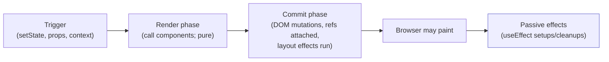
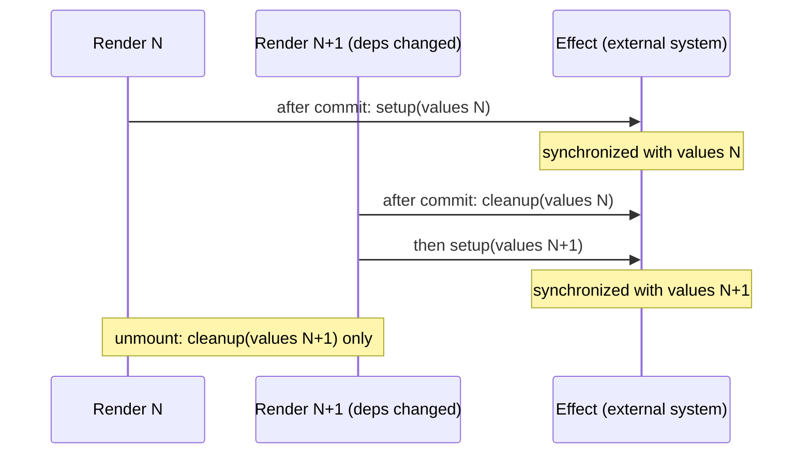
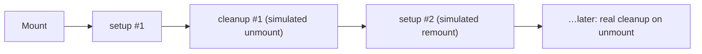
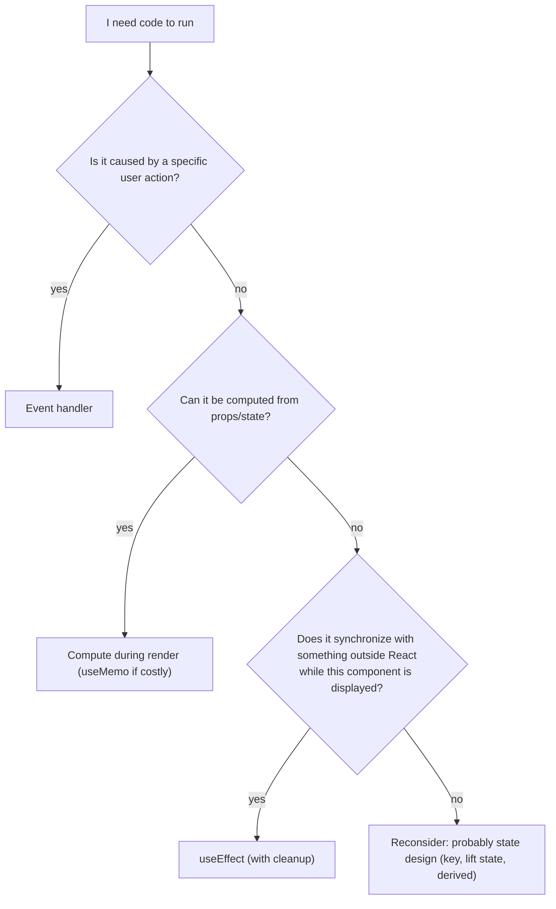

# 03 / 04 — `useEffect` and Synchronization

## 1. Lesson metadata

| | |
|---|---|
| **Level** | Intermediate |
| **Study time** | 4–5 hours (reading 2 h, experiments 1 h, exercises 1.5 h) |
| **Prerequisites** | [03 / 01 — `useState` internals](./01-usestate-internals-and-update-semantics.md) (required), [03 / 02 — Functional state updates](./02-functional-state-updates.md), [Phase 1 / 17 — Lifecycle concepts](../01-react-fundamentals/17-lifecycle-concepts.md) (required), [Phase 1 / 12 — Component purity](../01-react-fundamentals/12-component-purity.md), [Foundations 11 — Event loop](../00-web-and-javascript-foundations/11-event-loop-tasks-microtasks.md), [Foundations 12 — Promises and async/await](../00-web-and-javascript-foundations/12-promises-and-async-await.md) |
| **Next** | [05 — Effect dependencies and stale closures](./05-effect-dependencies-and-stale-closures.md) |
| **Related later** | [06 — Effect cleanup](./06-effect-cleanup.md), [07 — You might not need an effect](./07-you-might-not-need-an-effect.md), [08 — `useLayoutEffect`](./08-uselayouteffect.md), [Phase 2 / 18 — Effects and their timing](../02-react-rendering-and-internals/18-effects-and-their-timing.md), [Phase 2 / 19 — Layout vs passive effects](../02-react-rendering-and-internals/19-layout-vs-passive-effects.md), [Phase 2 / 28 — Strict Mode behavior](../02-react-rendering-and-internals/28-strict-mode-behavior.md) |

**Learning objectives.** After this lesson you can:
1. Explain the problem `useEffect` solves: rendering must be pure, yet components must interact with systems React does not control.
2. Define "synchronization" precisely: an effect describes how to *start* and *stop* keeping an external system consistent with the current render's values.
3. State when an effect's setup runs, when it re-runs, when it does not, and in what order relative to render, commit, and paint, separating guarantees from implementation details.
4. Explain why Strict Mode's extra mount cycle exists and use it as a test of correctness.
5. Identify what belongs in an effect (external synchronization), what belongs in an event handler, and what belongs in render.
6. Write effects with correct typing, async handling, and dependency arrays derived from the code rather than chosen.
7. Contrast the synchronization model with the class-lifecycle model and explain why the second one misleads.

**Concepts covered:** purity boundary, side effects, external systems, effect = setup + cleanup, synchronization model, dependency array as a declaration, reactive values, three array shapes, timing (after commit, passive), discrete-event flush, Strict Mode remount, effects and the server, `EffectCallback` typing, async in effects, effect vs event handler.

---

## 2. Deep conceptual explanation

### 2.1 What problem is this lesson solving?

React's core promise is that your component function is a **pure calculation** from props, state and context to a description of UI ([Phase 1 / 12](../01-react-fundamentals/12-component-purity.md), [Phase 2 / 12](../02-react-rendering-and-internals/12-why-rendering-must-be-pure.md)). That purity is what lets React call your function multiple times, pause, restart, or discard work.

But real UIs must do things that are *not* pure calculations:

- Open a WebSocket when a chat room is shown, close it when it is hidden.
- Set `document.title`.
- Start an animation in a non-React library (a map, a chart, a video player).
- Add a `resize` listener on `window`.
- Call `showModal()` on a `<dialog>`.
- Send an analytics page view.

All of these reach *outside* the render result, into systems React does not own. If you ran them in the render body, they would execute every render, in renders React throws away, and twice in development. Yet they must stay **consistent with what is rendered**: the right room, the right title, the right listener.

`useEffect` exists to answer exactly this: *"After React has put this render on screen, run this code to bring the outside world in line with it, and run this other code when the outside world no longer needs to be in line."* It is React's controlled **escape hatch** from the purity of rendering, and escape hatches should be used sparingly and deliberately ([07](./07-you-might-not-need-an-effect.md)).

### 2.2 The synchronization model

Think of an effect as a **subscription between a render's values and an external system**.

| Part | Role |
|---|---|
| **Setup** (the function you pass) | Start synchronizing: connect, subscribe, start the timer, call the imperative API with this render's values. |
| **Cleanup** (the function you *return*) | Stop synchronizing: disconnect, unsubscribe, clear, reverse the imperative call. |
| **Dependencies** (the array) | The reactive values that setup reads. When any changes, the synchronization it describes is *out of date*, so React runs cleanup (old values) then setup (new values). |

The essential reframing:

> An effect does not say "run on mount" or "run when X changes". It says "while this component is displayed, keep the outside world consistent with these values". React decides when to start and stop it. You decide how.

Phase 1 / 17 warned against translating `componentDidMount`/`componentDidUpdate`/`componentWillUnmount` one-to-one. The reason is now clear: lifecycle methods describe *moments*; an effect describes a *relationship* that holds across moments. A chat component with `roomId` has one relationship ("connected to the room named `roomId`") regardless of whether the room changed because the component just mounted or because a prop changed. The class version needed two methods (and the bug-prone comparison `prevProps.roomId !== this.props.roomId`) to express one idea.

### 2.3 What counts as a side effect, and what doesn't

| Needs an effect? | Example | Where it should live |
|---|---|---|
| **Yes**: synchronizing with an external system as a consequence of *rendering something* | Subscribe while visible; connect to a room; keep `document.title` equal to state; imperative widget API mirrors props | `useEffect` |
| **No**: a consequence of a *user action* | "Add to cart" POST, "Submit" request, analytics for a click | Event handler |
| **No**: computable from props/state | Filtered list, full name, validation error | Render (maybe `useMemo`) |
| **No**: resetting state on identity change | Clear form when `userId` changes | `key` ([Phase 1 / 16](../01-react-fundamentals/16-state-preservation-and-reset.md)) |
| **No (usually)**: sharing logic between handlers | Common function | Plain function |
| **Sometimes**: fetching data on display | Fetch on mount | A data library or framework loader is usually better; an effect is the manual fallback ([Phase 6](../06-data-fetching-and-state-ecosystems/01-fetch-lifecycle.md)) |

The decision test from the React docs, restated: *Why does this code need to run?* If "because the user did X", it is an event handler. If "because this component is now displayed with these values", it is an effect.

### 2.4 The three array shapes

```tsx
useEffect(() => { /* A */ });          // no array: after every render
useEffect(() => { /* B */ }, []);      // empty array: setup after first display; cleanup on removal
useEffect(() => { /* C */ }, [a, b]);  // re-synchronize when a or b changes
```

These are covered at the usage level in [Phase 1 / 17 §5.1](../01-react-fundamentals/17-lifecycle-concepts.md). Two points deserve emphasis here:

- The array is **not an option you choose**. It is a *declaration* of the reactive values read by the effect, and the linter derives it from the code ([05](./05-effect-dependencies-and-stale-closures.md)). If your effect reads `roomId`, `roomId` is a dependency, period.
- `[]` is not "run once". It means "this effect reads no reactive values". It runs once *per mount of the instance*; and in development Strict Mode it runs setup, cleanup, setup on the first mount.

### 2.5 Effects vs the browser and JavaScript

React cannot synchronize with something the browser cannot do. Effects are ordinary JavaScript callbacks run by React at a point in its commit pipeline ([Phase 2 / 18](../02-react-rendering-and-internals/18-effects-and-their-timing.md)). They run on the **main thread** ([Phase 0 / 01](../00-web-and-javascript-foundations/01-how-the-browser-works.md)): a slow effect delays input handling and the next frame exactly as slow render code does. Moving heavy work "into `useEffect`" does not make it asynchronous or off-thread (a common misconception; see exercise D2 in Phase 0 / 01).

### 2.6 Common misconceptions

| Misconception | Reality |
|---|---|
| "`useEffect(fn, [])` is `componentDidMount`." | It describes a relationship with no reactive dependencies; Strict Mode runs it twice in development; and unlike `componentDidMount` it is passive (after paint, typically). |
| "Effects run *before* the DOM updates." | Passive effects run **after** React committed DOM changes ([§3](#3-internal-mechanics)). |
| "Effects are the place to compute derived state." | They add an extra render pass and a frame of inconsistent UI. Derive in render ([07](./07-you-might-not-need-an-effect.md), [17](./17-derived-state.md)). |
| "Effects make code asynchronous / non-blocking." | They run on the main thread; async APIs inside them are what yield. |
| "I'll leave out a dependency to run the effect less often." | You'd be lying to the dependency system and creating stale closures ([05](./05-effect-dependencies-and-stale-closures.md)). Change the code, not the array. |
| "If it runs twice in development, React is broken." | The double run is a deliberate test that your setup/cleanup are symmetric ([§3.7](#37-strict-mode-development-remount)). |
| "The effect function can be `async`." | It cannot: the return value is reserved for the cleanup function; a promise would be an invalid cleanup ([§5.4](#54-incorrect-example-async-effect-function)). |
| "Effects run on the server." | They don't run during server rendering, only after hydration/mount in the browser. |

---

## 3. Internal mechanics

> Labels: **[Public guarantee]**, **[Teaching model]**, **[Implementation detail]**. For the exact scheduling code read the reconciler source rather than relying on any function name here.

### 3.1 Where effects sit in the pipeline [Public guarantee, usage-level]



- **Render** calls your function and *records* your `useEffect(...)` calls (the setup function and dependency array) as part of the render result for that hook. It does **not** run them.
- **Commit** applies DOM changes. Layout effects (`useLayoutEffect`) and ref attachment happen in commit, before the browser paints ([08](./08-uselayouteffect.md), [Phase 2 / 19](../02-react-rendering-and-internals/19-layout-vs-passive-effects.md)).
- **Passive effects** (`useEffect`) run *after* commit. React's documented stance is that they run "after the screen has updated" in the common case.

[Public guarantee] by the docs: effects run after the DOM has been updated for that render; a given effect's cleanup runs before its next setup; all cleanups for a commit run before the new setups (§3.4).

### 3.2 "After paint" is typical, not guaranteed [Implementation detail with a documented exception]

Passive effects are scheduled so that they normally do **not block** the browser from painting. So users usually see the new UI first. But React does not promise a paint happens between commit and effects:

- React must flush pending passive effects **before starting the next render**, so effects from render N always complete before render N+1 begins.
- Since React 18 (documented on the `useEffect` reference page; we also observed it on React 19.3: for a click, render, commit and passive effects all ran back-to-back in one microtask flush, while a `setState` from a timer rendered and ran its effect in a later macrotask), if the render was caused by a **discrete user event** (a click, a keypress), React flushes the resulting passive effects *synchronously at the end of commit* so that code in effects can rely on being run before any follow-up user input is processed. The React 18 upgrade notes call this out (consistent `useEffect` timing). Practically: after a click, an effect may run before paint.
- If an effect must run **before** paint to prevent a visible flicker (measuring a DOM node and repositioning a tooltip), use `useLayoutEffect` ([08](./08-uselayouteffect.md)), do not rely on "effects usually run after paint".

Do not write code whose correctness depends on whether paint happened between commit and effect.

### 3.3 When does setup run? [Public guarantee]

Setup runs:
1. After the component is first committed (mounted), and
2. After a subsequent commit in which **any dependency changed** compared to the previous render, using `Object.is` per element, or after *every* commit if there is no dependency array.

It does **not** run when a render happens but dependencies are all `Object.is`-equal to the previous render's. React retains the previous setup/cleanup pair.

### 3.4 When does cleanup run, and in what order? [Public guarantee / Teaching model]

- Before re-running setup, React calls the **previous render's** cleanup (the closure over the *old* values). Setup then runs with the new values.
- On unmount, cleanup runs.
- Across multiple effects and components in one commit, the practical (documented-in-usage, ordering-in-detail is an implementation detail) behavior is: all cleanups for effects that are changing or unmounting run first; then all new setups run. Within one component, effects run in the order written; across components, child effects' setups run before parent effects' setups (children are completed first). Do not build designs that depend on cross-component ordering; the Phase 1 lifecycle lesson ([§3.3](../01-react-fundamentals/17-lifecycle-concepts.md)) lists which orderings are reliable.

### 3.5 What an effect closes over [Teaching model]

Each render creates a **new** setup function that closes over **that render's** props, state, and local variables. React keeps the setup/cleanup pair from the last render in which dependencies changed. So:

- The effect sees a consistent snapshot of one render ([Phase 1 / 14](../01-react-fundamentals/14-state-as-a-snapshot.md)).
- Long-lived things created in setup (intervals, listeners, promises) keep that snapshot alive. If they *read* values that later change, they read old ones, which is the stale-closure problem ([05](./05-effect-dependencies-and-stale-closures.md)).

### 3.6 The effect callback's type [Public guarantee, TypeScript]

```ts
type EffectCallback = () => void | Destructor;
type Destructor = () => void | { [UNDEFINED_VOID_ONLY]: never }; // from @types/react; shape paraphrased
type DependencyList = readonly unknown[];
function useEffect(effect: EffectCallback, deps?: DependencyList): void;
```

The relevant rule: the callback returns **nothing or a cleanup function**. An `async` function returns a `Promise`, which is neither; React warns, and the cleanup would never run ([§5.4](#54-incorrect-example-async-effect-function)). (Exact `@types/react` declarations change across versions; the semantics above are the stable part.)

### 3.7 Strict Mode development remount [Public guarantee, development only]

In development under Strict Mode (default in many scaffolds), React simulates "mount, unmount, mount again" for each **new component instance**: setup → cleanup → setup, on the first mount. The exact list of what Strict Mode re-runs is in [Phase 2 / 28](../02-react-rendering-and-internals/28-strict-mode-behavior.md); the behavior is dev-only and has been extended across versions (for example, ref callbacks in React 19; we observed the setup, cleanup, setup sequence for a ref callback in dev Strict Mode on 19.3). Also note `<Activity mode="hidden">` (React 19.2+) really does run the same cleanup/setup pair, without Strict Mode, when a subtree is hidden and shown (observed: hide runs layout then passive cleanups; show re-runs setups; state is preserved).

Why: in production, components can be unmounted and remounted for real (Offscreen/Activity-style hiding and revealing, fast refresh, navigation caching, concurrent features). React wants your effects to survive that. If setup/cleanup are symmetric, running them twice is invisible; if not, the bug appears at development time on the first mount, where it is cheapest to fix.

**The mental test:** "If setup ran, cleanup ran, and setup ran again, would the outside world be in the same state as after one setup?" If yes, your effect is a correct synchronization. If no, either cleanup is missing/incomplete or the code is not really an effect (e.g. it performs a one-time user-action side effect such as a purchase).

### 3.8 Effects and the server [Public guarantee]

Server rendering (`renderToString`, streaming SSR) calls components but runs **no effects**. Effects start after the HTML is hydrated or the component is mounted in the browser. Anything that must exist in the initial HTML cannot come from an effect ([Phase 2 / 26](../02-react-rendering-and-internals/26-ssr-and-client-rendering.md)).

---

## 4. Step-by-step execution walkthrough

Component (the canonical "connect to a room" shape, written with a fake connection API):

```tsx
import { useEffect, useState } from 'react';
import { createConnection } from './chat'; // { connect(): void; disconnect(): void }

export function ChatRoom({ roomId }: { roomId: string }) {
  const [draft, setDraft] = useState('');

  useEffect(() => {
    const conn = createConnection(roomId);
    conn.connect();
    console.log('connect', roomId);
    return () => {
      conn.disconnect();
      console.log('disconnect', roomId);
    };
  }, [roomId]);

  return <input value={draft} onChange={(e) => setDraft(e.target.value)} />;
}
```

**Predict:** parent renders `<ChatRoom roomId="general" />`, the user types `h`, `i`, then the parent switches to `roomId="random"`. Production build, no Strict Mode. What is logged, in what order?

Timeline:

1. **Mount render.** `roomId = 'general'`. React records the effect (setup `S1`, deps `['general']`). No setup runs yet.
2. **Commit.** `<input>` inserted into the DOM.
3. **Passive effects phase.** `S1` runs → `connect general`. React stores cleanup `C1` (closes over `conn` for `general`).
4. **Typing `h`.** `setDraft('h')` → render 2: deps `['general']` equals previous (`Object.is('general','general')`), so the effect is **skipped**; the new setup `S2` is created in render but discarded for synchronization purposes (React keeps `C1`). Same for `i`. **No logs.**
5. **Parent passes `roomId="random"`.** Render 4: deps `['random']` ≠ `['general']`. React records the effect as changed.
6. **Commit.** DOM is unchanged for the input (same `value`).
7. **Passive effects phase.** React runs `C1` first (`disconnect general`), then `S4` (`connect random`), storing `C4`.

Log: `connect general`, `disconnect general`, `connect random`.

In **development with Strict Mode** the mount adds one extra cycle: `connect general`, `disconnect general`, `connect general`, then (on switching) `disconnect general`, `connect random`. Seeing the extra pair is expected and shows the effect is symmetric.

On unmount: `C4` runs → `disconnect random`.

Observation worth keeping: **typing never touched the connection** because `draft` is not a dependency of the effect: it isn't read by it. This is the synchronization model at work: the effect depends only on what it reads.

---

## 5. Code examples

### 5.1 Minimal example: keep `document.title` in sync

```tsx
import { useEffect } from 'react';

export function Inbox({ unread }: { unread: number }) {
  useEffect(() => {
    document.title = unread > 0 ? `(${unread}) Inbox` : 'Inbox';
  }, [unread]);

  return <h1>Inbox</h1>;
}
```

`document.title` is browser state outside React: the textbook external system. No cleanup is strictly required here because the next run overwrites the value; if you wanted to restore the previous title on unmount, you'd save it in setup and restore it in cleanup ([06](./06-effect-cleanup.md)).

### 5.2 Practical example: a `<dialog>` controlled by props

```tsx
import { useEffect, useRef, type ReactNode } from 'react';

export function Modal({ open, onClose, children }: {
  open: boolean;
  onClose: () => void;
  children: ReactNode;
}) {
  const ref = useRef<HTMLDialogElement>(null);

  useEffect(() => {
    const dialog = ref.current;
    if (!dialog || !open) return;
    dialog.showModal();                 // imperative browser API
    return () => dialog.close();        // reverse it
  }, [open]);

  return (
    <dialog ref={ref} onClose={onClose}>
      {children}
    </dialog>
  );
}
```

Line notes:

- `open` is a *prop* (a description) and `showModal()` is an *imperative command*. The effect translates one to the other. It lists `open` because it reads it. `ref` is a ref object and not reactive, so it is not listed (refs created by `useRef` are stable, and the linter knows).
- `dialog.close()` as cleanup makes the pair symmetric under Strict Mode: `showModal → close → showModal`. A version that only calls `showModal()` would throw on the second call in some browsers ("already open"), exposing the missing cleanup.
- `onClose` is a prop passed to the element's `close` event; it's used by React's event system, not read in the effect, so it's not a dependency.
- Trade-off: the declarative `<dialog open>` attribute doesn't give you the modal top-layer behavior, hence the imperative call. Libraries (Radix, React Aria) wrap this; build your own only with a reason.

### 5.3 Practical example: subscribe to a browser API with a typed hook

```tsx
import { useEffect, useState } from 'react';

export function useOnlineStatus(): boolean {
  const [online, setOnline] = useState(() => navigator.onLine);

  useEffect(() => {
    const update = () => setOnline(navigator.onLine);
    window.addEventListener('online', update);
    window.addEventListener('offline', update);
    update(); // re-sync in case the status changed between initial render and subscription
    return () => {
      window.removeEventListener('online', update);
      window.removeEventListener('offline', update);
    };
  }, []);

  return online;
}
```

This is acceptable and common, and also exactly the case [20 — `useSyncExternalStore`](./20-usesyncexternalstore-and-external-stores.md) supersedes: `useSyncExternalStore` handles the "changed between render and subscribe" gap, tearing under concurrent rendering, and server snapshots in a single primitive. Note that `useState(() => navigator.onLine)` also runs during server rendering, where `navigator` may be absent or lack `onLine` (server runtimes differ), so it can throw or yield `undefined`. Guard it, or use `useSyncExternalStore` with `getServerSnapshot`.

### 5.4 Incorrect example: `async` effect function

```tsx
useEffect(async () => {          // ❌
  const res = await fetch(`/api/users/${id}`);
  setUser(await res.json());
}, [id]);
```

**Predict:** what happens?

**Answer:** The function returns a `Promise`. React expects `undefined` or a cleanup function; it logs a dev warning (React 19.3: "useEffect must not return anything besides a function, which is used for clean-up. It looks like you wrote useEffect(async () => ...) or returned a Promise."), and the promise is not a valid cleanup. Worse, in React 19.3 development the later unmount/re-run of that effect throws `TypeError: destroy is not a function` (we reproduced this), so it is not merely a silent no-op. TypeScript flags it too (a `Promise<void>` isn't assignable to `void | Destructor`). Beyond the type error, the code has the *real* bug: no handling for `id` changing mid-flight (an older response can overwrite a newer one) and no error handling.

### 5.5 Corrected implementation

```tsx
useEffect(() => {
  const controller = new AbortController();

  async function load() {
    try {
      const res = await fetch(`/api/users/${id}`, { signal: controller.signal });
      if (!res.ok) throw new Error(`HTTP ${res.status}`);
      setUser((await res.json()) as User);
    } catch (err) {
      if (controller.signal.aborted) return; // expected on cleanup/id change
      setError(err instanceof Error ? err.message : 'Unknown error');
    }
  }

  void load();
  return () => controller.abort();
}, [id]);
```

- The effect callback itself is synchronous and returns the cleanup; the async work lives in an inner function.
- `AbortController` ties the request's lifetime to the effect: when `id` changes or the component unmounts, `abort()` rejects the pending `fetch` with an `AbortError`, which we ignore.
- Strict Mode: `load` (request 1) → abort → `load` (request 2): the outside world (one live request, one state update) ends up the same. Dev tools show one cancelled request, which is expected.
- This is the *manual* version. It still lacks caching, deduplication, retries, and loading-state modelling; in production reach for a data library or framework loader ([Phase 6](../06-data-fetching-and-state-ecosystems/08-tanstack-query.md), [06 — cleanup](./06-effect-cleanup.md) for the full discussion of the `ignore` flag alternative).

### 5.6 Incorrect example: effect used for a user action

```tsx
function Checkout({ cart }: { cart: Cart }) {
  const [submitted, setSubmitted] = useState(false);

  useEffect(() => {
    if (submitted) {
      fetch('/api/orders', { method: 'POST', body: JSON.stringify(cart) });
    }
  }, [submitted, cart]);

  return <button onClick={() => setSubmitted(true)}>Pay</button>;
}
```

Problems: (1) It fires again whenever `cart` changes after `submitted` is `true` (a second order). (2) In Strict Mode development it may fire twice. (3) The *cause* (a click) is separated from the *effect* (a POST), obscuring logic. **Fix:** do it in the handler:

```tsx
async function handlePay() {
  setSubmitting(true);
  try { await postOrder(cart); } finally { setSubmitting(false); }
}
```

If you notice yourself writing "flag state + effect that checks the flag", you almost certainly want a handler.

### 5.7 Advanced example: synchronizing a non-React widget with props

```tsx
import { useEffect, useRef } from 'react';
import { createMap, type MapInstance, type LatLng } from './map-lib'; // hypothetical imperative library

export function Map({ center, zoom }: { center: LatLng; zoom: number }) {
  const containerRef = useRef<HTMLDivElement>(null);
  const mapRef = useRef<MapInstance | null>(null);

  // Effect 1: create / destroy the widget. No reactive deps: it doesn't depend on center/zoom *for creation*.
  useEffect(() => {
    const map = createMap(containerRef.current!);
    mapRef.current = map;
    return () => {
      map.destroy();
      mapRef.current = null;
    };
  }, []);

  // Effect 2: push props into the widget. Re-runs when center or zoom change.
  useEffect(() => {
    mapRef.current?.setView(center, zoom);
  }, [center, zoom]);

  return <div ref={containerRef} style={{ height: 400 }} />;
}
```

Design notes:

- **Two effects, two concerns.** Lifetime (create/destroy) and property sync (`setView`) change for different reasons. Combining them in one effect keyed on `[center, zoom]` would destroy and recreate the map on every pan. The advice "split effects by *what they synchronize*, not by when they run" is general.
- The effects run in written order on mount, so `mapRef.current` is set by effect 1 before effect 2 reads it. Within one component this ordering is dependable.
- `center` is an object. If the parent builds `{ lat, lng }` inline, its identity changes every render and effect 2 re-runs every render. Pass primitives (`lat`, `lng`), memoize the object, or compare inside (§[05](./05-effect-dependencies-and-stale-closures.md)).
- Under Strict Mode: create → destroy → create, then `setView` is applied; good.
- `containerRef.current!`: the non-null assertion is justified because effects run after commit when refs are attached; an explicit check is safer in shared code.

---

## 6. Visual explanations

### The life of one effect across renders



### Strict Mode development mount



### Decision tree: effect, handler, or render?



### Effect timing vs layout effect

| Moment | `useLayoutEffect` | `useEffect` |
|---|---|---|
| After DOM mutations committed | yes, synchronously | yes, but scheduled after |
| Before browser paint | **yes** (blocks paint) | typically no (discrete-event exception) |
| Blocks the frame if slow | yes | less likely; still main thread |
| Typical use | Measure, reposition, avoid flicker | Subscriptions, network, logging, most things |

---

## 7. Alternative approaches and trade-offs

| Need | Effect | Alternative | Choose the alternative when… |
|---|---|---|---|
| Fetch on display | `useEffect` + `AbortController` | Data library (TanStack Query), framework loader, `use` + Suspense ([22](./22-modern-hooks-and-apis.md)) | Production code: you want caching, dedup, retries, race safety |
| Subscribe to an external store | `useEffect` + `setState` | `useSyncExternalStore` ([20](./20-usesyncexternalstore-and-external-stores.md)) | Any store you don't own; concurrency-safe reads |
| Respond to a user action | `useEffect` on a flag | Event handler | Always; the effect version is wrong |
| Derived value | `useEffect` + `setState` | Compute in render / `useMemo` | Always |
| Reset state on prop change | `useEffect` + `setState` | `key`, render-phase adjustment ([17](./17-derived-state.md)) | Nearly always |
| Measure/position before paint | `useEffect` | `useLayoutEffect` ([08](./08-uselayouteffect.md)) | A visible flicker occurs |
| Imperative widget lifecycle | `useEffect` | Ref callback (React 19 cleanup-returning refs) | The setup is tied to the *node's* existence, not to reactive values ([10](./10-useref-and-mutable-references.md)) |
| Sync state to URL/storage | `useEffect` | Event handler writes to URL/storage directly | The write is caused by one action; effect only when many paths update the state |
| Analytics page views | `useEffect` | Router-level hook/event | Navigation is framework-owned |

**A scenario where the effect is *not* the best choice though it works.** *Logging a page view when a component mounts.* An effect with `[]` fires on mount (and twice in Strict Mode development), also on every remount. This is mostly benign (analytics tools dedupe) but unreliable as "once per visit". Attaching the log to a route-change event in the router layer, or to a handler, expresses the intent ("a navigation happened") better. Conversely, where the effect *is* best: you need the log to reflect "this component became visible with these props" and you accept remount semantics.

---

## 8. Best practices and anti-patterns

**Do**
- Ask first: *do I need an effect?* ([07](./07-you-might-not-need-an-effect.md)).
- Write setup and cleanup as a symmetric pair; test with Strict Mode on.
- Derive the dependency array from the code (use the lint rule `react-hooks/exhaustive-deps`).
- Split unrelated synchronizations into separate effects.
- Keep effects small; extract named inner functions or a custom hook ([15](./15-custom-hooks.md)).
- Handle errors and races for async work (abort or ignore stale results).

**Beginner mistakes**
- Treating `[]` as "mount only" and omitting needed dependencies.
- `async` effect callbacks.
- Setting state in an effect that depends on that same state (loops).
- Putting event-driven logic (submit, fetch-on-click) in effects.
- Forgetting cleanup (duplicate listeners, intervals, subscriptions).

**Experienced-developer mistakes**
- Using effects to synchronize two pieces of React state with each other (usually one is derived or the state should be lifted).
- "Chains of effects" where one effect sets state that triggers another effect: each hop costs a render and a commit; model the transition in one handler or a reducer ([03](./03-usereducer-and-reducer-architecture.md)).
- Fighting Strict Mode (adding a `didRun` ref) instead of fixing symmetry.
- Using effects as a general-purpose `onChange` for props.
- Over-memoizing effect dependencies instead of simplifying what the effect reads.

**Smells**
- `useEffect(() => { setX(compute(y)); }, [y])`.
- `// eslint-disable-next-line react-hooks/exhaustive-deps`.
- An effect without cleanup that adds a listener, starts a timer, or opens a connection.
- Effects keyed on a boolean "trigger" flag.
- An effect more than about 15–20 lines doing several unrelated things.

**Justified exceptions.** One-off integration with an imperative library may need a ref guard against double-init *if the library's init is not reversible*, but prefer making initialization reversible via the library's `destroy`. A disabled lint rule is justified only with a comment explaining why the value is intentionally not reactive, and ideally replaced by `useEffectEvent` (stable since React 19.2; [05](./05-effect-dependencies-and-stale-closures.md)).

---

## 9. Real-world application

*Real-time trading UI.* A `<Ticker symbol>` component subscribes to a price feed. Setup: `feed.subscribe(symbol, onTick)`; cleanup: `unsubscribe`. Changing `symbol` re-synchronizes. Constraints: a shared socket must **reference-count** subscriptions (ten tickers for the same symbol share one subscription), so the subscription manager belongs in a module/service, with the effect only calling `subscribe`/`unsubscribe`. If many components read ticks, prefer `useSyncExternalStore` against that manager ([20](./20-usesyncexternalstore-and-external-stores.md)).

*Auth and token refresh.* An effect schedules a refresh timer based on the token expiry: `setTimeout(refresh, expiresAt - now - skew)`, cleanup clears it. Re-synchronizes when `expiresAt` changes. Constraint: timers are throttled in background tabs; on `visibilitychange` re-check expiry.

*Dashboards with chart libraries.* Create a chart instance on mount; push data updates in a second effect; `chart.destroy()` in cleanup (see §5.7). Constraints: large datasets and resize handling (`ResizeObserver` effect with cleanup).

*E-commerce.* Sync cart contents to `localStorage` for cross-tab persistence: an effect writing on change, plus a `storage` event listener to read other tabs' updates (and a guard against echo loops). Product detail page views: logged from the router/handler layer, not per render.

*Multi-team context.* In a shared component library, effects that touch globals (`document.body.style.overflow`) need reference counting (two open modals), otherwise the first to close unlocks scroll for the second. The cleanup must restore the **previous** value, not a hard-coded one.

---

## 10. Debugging and troubleshooting

**Symptom 1: "My effect runs twice on load."**
Repro: development, `<StrictMode>`. Investigate: temporarily build for production or remove `<StrictMode>`; if it runs once, the cause is Strict Mode ([Phase 2 / 28](../02-react-rendering-and-internals/28-strict-mode-behavior.md)). Then ask whether cleanup restores the outside world. If double effect creates a visible bug (double request, duplicate subscription), fix the cleanup. If the effect is a one-time side effect for a user action, move it to a handler.

**Symptom 2: "My effect runs on every keystroke / every render."**
Cause: a dependency that changes identity each render (object/array/function created in the component body), or no dependency array. Debug: log each dependency's identity (`console.log(Object.is(prevDep, dep))` via a `useRef` previous-value probe) or use a temporary effect per dependency to find which one changes. Fix per [05](./05-effect-dependencies-and-stale-closures.md).

**Symptom 3: "My effect doesn't run when X changes."**
`X` isn't in the dependency array, or it *is* but its identity doesn't change (mutation). Check the lint warning; check mutation (`Object.is` on the same array). Remember that refs (`ref.current`) are not reactive: changing them does not trigger effects.

**Symptom 4: "Infinite loop / 'Maximum update depth exceeded'."**
An effect sets state that is in its own dependency array (or creates a new object each time). DevTools: Profiler shows a long chain of commits. Fix: compute differently (derive), use an updater and remove the dependency, or restructure.

**Symptom 5: "Flicker: I see the old UI, then the corrected one."**
The effect corrects visible output after paint (typical when you measure then set state). Confirm via Performance panel: a paint between commit and the state update. Options: derive during render, or `useLayoutEffect` if measurement is truly needed ([08](./08-uselayouteffect.md)).

**Symptom 6: "Memory/CPU grows when navigating."**
Listeners/timers/subscriptions without cleanup. Chrome DevTools → Memory → heap snapshot comparison or Performance monitor → listeners count. See [06](./06-effect-cleanup.md) and [Foundations 16](../00-web-and-javascript-foundations/16-memory-management-and-gc.md).

**Validate fixes** by (a) Strict Mode on, (b) toggling the component on/off repeatedly and observing that the outside world returns to baseline (listener count, open connections), (c) Profiler commit counts.

---

## 11. Exercises

### Level A — Knowledge
A1. In one paragraph, what does `useEffect` synchronize *with*, and what is it explicitly *not* for?
A2. List the three dependency-array shapes and when setup runs for each.
A3. When does React run the cleanup of an effect?
A4. Why can't the effect callback be `async`?
A5. Do effects run during server rendering? Why does that matter?

### Level B — Code comprehension
B1. Production, no Strict Mode. Mount with `n = 0`, then one click calling `setN(1)`. What is logged?
```tsx
function C() {
  const [n, setN] = useState(0);
  useEffect(() => {
    console.log('setup', n);
    return () => console.log('cleanup', n);
  }, [n]);
  return <button onClick={() => setN(1)}>go</button>;
}
```
B2. Same component, development with Strict Mode: what is logged on mount alone?
B3. What does this component log on mount and after each parent re-render with unchanged props?
```tsx
function P({ items }: { items: string[] }) {
  useEffect(() => { console.log('effect'); }, [items]);
  return null;
}
// parent: <P items={['a', 'b']} />  (array literal inline)
```
B4. In §5.7, why would merging the two effects into `[center, zoom]` be wrong?

### Level C — Implementation
C1. Implement `useDocumentTitle(title: string)` that restores the previous title on unmount.
C2. Implement `useWindowSize()` returning `{ width, height }` with cleanup and a correct initial value after mount (no SSR crash).
C3. Implement `useInterval(callback, delayMs | null)` where passing `null` pauses it and `callback` may change without resetting the interval. (Hint: [lesson 05](./05-effect-dependencies-and-stale-closures.md) discusses the latest-callback pattern; implement with a ref updated in an effect.)

### Level D — Debugging
D1. "The WebSocket connects twice in development." Review the code and decide whether it's a bug:
```tsx
useEffect(() => {
  const ws = new WebSocket(url);
  ws.onmessage = (e) => setMsgs((m) => [...m, e.data]);
}, [url]);
```
D2. The following component re-fetches on every render. Why? Fix it.
```tsx
function List({ filters }: { filters: { q: string } }) {
  useEffect(() => { load(filters); }, [filters]);
}
// parent: <List filters={{ q: query }} />
```
D3. A bug report: "After saving the form, the order is submitted twice sometimes". The code uses `useEffect(() => { if (saved) submit(); }, [saved, data])`. Explain the root cause and fix.

### Level E — Architecture and engineering decisions
E1. Your team's data fetching is "an effect in every page". List the concrete problems you expect at scale and propose a migration path.
E2. A component must lock page scroll while mounted. Two modals can be open simultaneously. Design the effect (or hook) so it works.

### Level F — Expert challenge
F1. Build a test (any runner) that proves an effect is *Strict-Mode-safe*: it must fail for an effect that opens a connection without closing it, and pass for the correct one. Describe how you count resources and why you assert on "open resources after unmount" rather than "number of setups".

---

## 12. Detailed answers and explanations

> Attempt the exercises first.

**A1.** It synchronizes the component *with systems outside React's control* (DOM APIs outside JSX, timers, network connections, browser APIs, third-party widgets), by starting that synchronization when the render's values appear and stopping it when they change or the component goes away. It is **not** for: computing derived values, responding to user actions (handlers), resetting state on prop changes (`key`), or sharing logic. Wrong answer: "for lifecycle events": the model is relationships, not moments.

**A2.** No array: setup after every commit (cleanup first from the previous run). `[]`: setup after first commit of the instance; cleanup on unmount (plus Strict Mode dev cycle). `[a, b]`: setup after first commit and after any commit where `a` or `b` is not `Object.is`-equal to the previous render's; cleanup before each re-run and on unmount.

**A3.** Before the next setup of the same effect (using the previous render's closure), and when the component unmounts. In Strict Mode development also during the simulated unmount on first mount. Not at render time.

**A4.** React uses the return value as the cleanup function. An `async` function always returns a promise, so there is no cleanup and React warns. Declare an inner `async` function and call it; return the cleanup synchronously.

**A5.** No. They run only in the browser after mount/hydration. Consequence: effect-derived content is missing from server HTML (SEO/first paint), and code that touches `window` is safe inside effects but not in the render body.

**B1.** Mount: `setup 0`. Click: render with `n = 1`; dependency changed. Then `cleanup 0` (the old closure's `n`), then `setup 1`. Order: `setup 0`, `cleanup 0`, `setup 1`. A frequent wrong answer is `cleanup 1` (cleanup runs with the *previous* render's values).

**B2.** `setup 0`, `cleanup 0`, `setup 0` (Strict Mode simulated remount). Production logs only `setup 0`.

**B3.** The array literal is a **new array every parent render**, so `Object.is(prevItems, items)` is false each time: `effect` logs on mount and on **every** parent re-render. Fix: hoist a constant (`const ITEMS = ['a','b']` outside), `useMemo` in the parent, or pass a primitive/stable key (e.g. `items.join(',')`) if values matter, not identity. Do not remove `items` from deps.

**B4.** Merged, the effect would destroy the map and create a new one on every center/zoom change: loses internal widget state (tiles, user pan state), flashes, and wastes work; the creation does not depend on `center`/`zoom`. Splitting by *what is synchronized* (lifetime vs props) matches the dependencies to the reasons for change.

**C1.**
```ts
import { useEffect } from 'react';

export function useDocumentTitle(title: string): void {
  useEffect(() => {
    const previous = document.title;
    document.title = title;
    return () => { document.title = previous; };
  }, [title]);
}
```
Behavior: when `title` changes, cleanup restores the previous title then setup sets the new one, a harmless flicker of the old title in the same task (no paint between, within one commit's effects flush). Nested components with this hook restore in reverse order only if unmounted in reverse; with overlapping lifetimes it can restore a wrong title (a known weakness of "restore previous" for globals; use a stack for strict correctness).

**C2.**
```ts
import { useEffect, useState } from 'react';

interface Size { width: number; height: number }

export function useWindowSize(): Size {
  const [size, setSize] = useState<Size>({ width: 0, height: 0 }); // SSR-safe initial
  useEffect(() => {
    const update = () => setSize({ width: window.innerWidth, height: window.innerHeight });
    update();
    window.addEventListener('resize', update);
    return () => window.removeEventListener('resize', update);
  }, []);
  return size;
}
```
Limits: renders once with `0×0` then corrects (a flash for layout-dependent UI); `resize` fires at high rate (throttle or use `ResizeObserver`/CSS); `useSyncExternalStore` ([20](./20-usesyncexternalstore-and-external-stores.md)) is the more correct primitive. Return a new object each `update` even if unchanged: add a check to avoid needless renders.

**C3.**
```ts
import { useEffect, useRef } from 'react';

export function useInterval(callback: () => void, delayMs: number | null): void {
  const saved = useRef(callback);

  useEffect(() => {
    saved.current = callback;       // always latest, without restarting the timer
  }, [callback]);

  useEffect(() => {
    if (delayMs === null) return;
    const id = setInterval(() => saved.current(), delayMs);
    return () => clearInterval(id);
  }, [delayMs]);
}
```
Reasoning: the timer effect depends only on `delayMs`; the callback is read through a ref at tick time, so the interval is not restarted when the callback's identity changes. (`useEffectEvent`, stable since React 19.2, is the first-party API for this pattern.) Ordering: the first effect runs before the second within a commit, so the ref is current when the interval first fires. Writing `saved.current = callback` directly during render is discouraged (render must be pure; concurrent rendering may discard the render).

**D1.** Two parts. (1) Doubling in development is Strict Mode, expected. (2) But there is a **real bug**: no cleanup, so the first socket stays open (two live sockets) and also in production a `url` change leaks the old socket and its `onmessage` keeps calling `setMsgs`. Fix: `return () => ws.close();`. Also consider errors/reconnect, and message-parsing safety. After the fix, Strict Mode dev shows connect/close/connect with one live socket.

**D2.** `filters={{ q: query }}` creates a new object every parent render, so `[filters]` changes each time and the effect refires. Fix at the source: depend on the primitive: `useEffect(() => { load({ q }); }, [q])` with `const { q } = filters` (change the child to take `q`), or memoize in the parent (`useMemo(() => ({ q: query }), [query])`). Prefer primitive props; memoization is a patch. Wrong fix: removing `filters` from deps (stale closure).

**D3.** Root cause: the effect is acting as an event handler: it submits whenever `saved` is true **and** `data` changes (or on Strict Mode remount), so a re-render with changed `data` after `saved` re-submits. Fix: submit from the save handler (`onSubmit`) and keep `saved` out of effect logic; disable the button while submitting; if idempotency matters, send an idempotency key to the server.

**E1.** Problems: duplicated requests across components, no cache (re-fetch on every mount), waterfalls (children fetch after parents render), race conditions (needs cleanup everywhere), inconsistent loading/error UI, no retry/revalidation/pagination support, harder tests, SSR can't use them. Migration: (1) introduce a data-access layer (functions returning typed data) separate from React; (2) adopt a server-state library or framework loaders for new code; (3) migrate high-traffic pages first by wrapping existing fetchers in query hooks (same function, now cached); (4) add lint rules/code review to prevent new fetch-in-effect; (5) measure request counts before/after. Criteria for trade-offs: team size, framework, bundle, SSR needs.

**E2.** Reference counting in a shared module:
```ts
let locks = 0;
let previousOverflow = '';

export function lockScroll(): () => void {
  if (locks === 0) {
    previousOverflow = document.body.style.overflow;
    document.body.style.overflow = 'hidden';
  }
  locks += 1;
  let released = false;
  return () => {
    if (released) return;            // idempotent for Strict Mode double-cleanup safety
    released = true;
    locks -= 1;
    if (locks === 0) document.body.style.overflow = previousOverflow;
  };
}

export function useScrollLock(active: boolean) {
  useEffect(() => (active ? lockScroll() : undefined), [active]);
}
```
Each modal's effect acquires and releases; the last release restores the original value. Evaluate: handles two modals, restores previous value (not hard-coded), idempotent release, Strict Mode safe. Open issues: scrollbar width layout shift (add padding), iOS Safari quirks, multiple libraries touching `body` (coordinate through one utility).

**F1.** Create a fake resource manager that increments `open` on connect and decrements on disconnect. Render the component inside `<StrictMode>`, then unmount; assert `open === 0` after unmount, and `open === 1` while mounted (after mount, once the dev double cycle completes). The leaky effect yields `open === 2` while mounted and `open === 1` after unmount (fails); the correct one yields 1 and 0. Don't assert on the *number of setups* (that is a development implementation behavior and may change); assert on the *observable state of the outside world*, which is the actual contract: symmetric setup/cleanup. Evaluation criteria: uses Strict Mode in the test, asserts on resource balance, mentions `act` or RTL's `render`/`unmount`.

---

## 13. Senior engineer interview questions

**Q1. "What is `useEffect` for? Not for?"**
*Strong answer:* Synchronizing with external systems while a component is displayed with particular values. Not for derived state, user-action side effects, state resets, or sharing logic. Frame it as an escape hatch from purity and show a decision test ("why does this run?").

**Q2. "Why does React run effects twice in development?"**
*Strong answer:* To verify that setup/cleanup are symmetric, since components can be unmounted and remounted in production (hiding/showing, navigation caches, Fast Refresh, concurrent features). A symmetric effect is unaffected; an asymmetric one shows its bug on the first mount. The fix is cleanup, not a guard.

**Q3. "Describe when passive effects run relative to paint."**
*Strong answer:* After commit; usually after the browser can paint because React schedules them without blocking; not guaranteed. Since React 18, effects caused by discrete events flush synchronously; and effects always flush before the next render. If you need pre-paint, use `useLayoutEffect`.

**Q4. "How do you decide the dependency array?"**
*Strong answer:* You don't choose; the code determines it: every reactive value (props, state, anything derived from them in the component body) the effect reads. If the array causes undesirable re-runs, change the code (move values inside, use primitives, updaters, event-effect patterns), never lie to the linter.

**Q5. "A teammate fetches data in `useEffect` on every page. What do you say?"**
*Strong answer:* It works but forces you to re-implement caching, deduplication, race handling, retries, and loading/error states, and creates waterfalls and SSR gaps. Use a server-state library or framework data loading; keep manual effects for bespoke cases. Quote concrete failure modes.

**Q6. "Explain the difference between an effect and an event handler for the same side effect."**
*Strong answer:* A handler runs because the user did something; it has the event's intent and runs once. An effect runs because the component is displayed with certain values; it may re-run for reasons unrelated to the user (Strict Mode, dependency churn, remount). Putting a one-time user-intent side effect in an effect makes it fire at the wrong times.

---

## 14. Further learning resources

| Resource | URL | Covers / why | Level | Study |
|---|---|---|---|---|
| React docs: Synchronizing with Effects | <https://react.dev/learn/synchronizing-with-effects> | Canonical introduction: render vs effect, dependency array, cleanup, Strict Mode remount, fetching | Intermediate | Whole page |
| React docs: Lifecycle of reactive effects | <https://react.dev/learn/lifecycle-of-reactive-effects> | The "start/stop synchronizing" model, why dependencies aren't a choice | Intermediate | Whole page |
| React docs: You might not need an effect | <https://react.dev/learn/you-might-not-need-an-effect> | When *not* to use effects | Intermediate | Whole page |
| React docs: `useEffect` reference | <https://react.dev/reference/react/useEffect> | API, caveats, troubleshooting (twice-in-dev, loops) | Intermediate | "Caveats", "Troubleshooting" |
| React docs: Strict Mode | <https://react.dev/reference/react/StrictMode> | Exactly what is double-invoked in development | Intermediate | "Fixing bugs found by re-running Effects" |
| React docs: Escape hatches | <https://react.dev/learn/escape-hatches> | Refs, effects, and when to leave React's model | Intermediate | Overview |
| Dan Abramov: A Complete Guide to useEffect | <https://overreacted.io/a-complete-guide-to-useeffect/> *(written for pre-18 React, older examples, but the model is still the best long-form explanation)* | Closures and synchronization thinking | Intermediate | Whole post |
| MDN: AbortController | <https://developer.mozilla.org/en-US/docs/Web/API/AbortController> | Cancelling `fetch` in cleanup | Beginner | Whole page |
| `eslint-plugin-react-hooks` | <https://www.npmjs.com/package/eslint-plugin-react-hooks> | The `exhaustive-deps` rule | Intermediate | README |

---

## 15. Knowledge checkpoint

**You should now understand**
- Why effects exist (the purity boundary) and the synchronization model (setup/cleanup/dependencies).
- When setup and cleanup run, how closures and `Object.is` determine re-runs, and the caveats on timing.
- Why Strict Mode double-runs effects and what that test proves.
- What does *not* belong in an effect.

**You should be able to explain without notes**
- The difference between a lifecycle moment and a synchronization relationship.
- Why `useEffect(fn, [])` isn't "run once".
- The trace for an effect across mount, re-render with unchanged deps, changed deps, and unmount.

**You should be able to implement**
- Subscriptions, imperative-widget bridges, document-level side effects, an abortable fetch, and a ref-based latest-callback interval.

**You should be able to debug**
- Double runs, every-render runs, missed runs, loops, and flicker, using the lint rule, Strict Mode, and DevTools.

**Prerequisite for next lesson:** you must be comfortable with closures capturing a render's values. [Lesson 05](./05-effect-dependencies-and-stale-closures.md) uses that to explain why dependencies must be exhaustive, what goes wrong when they aren't, and the toolbox for legitimately *reducing* an effect's dependencies.
