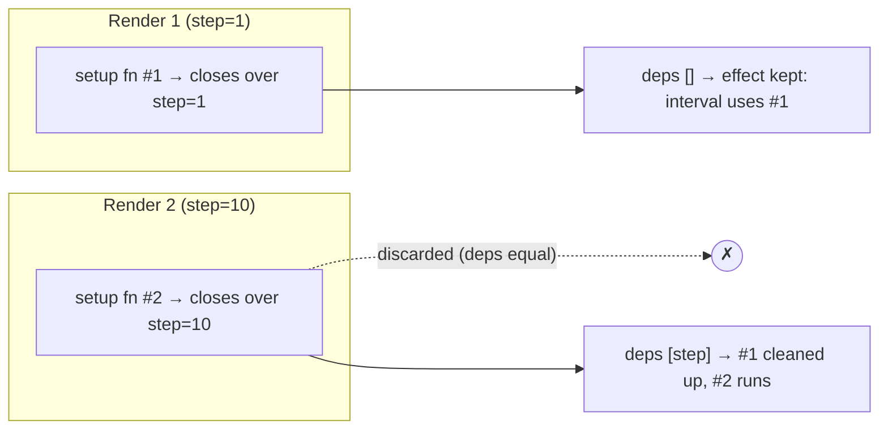
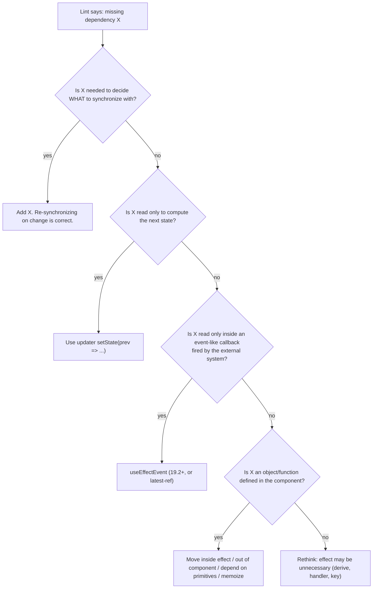

# 03 / 05 — Effect Dependencies and Stale Closures

## 1. Lesson metadata

| | |
|---|---|
| **Level** | Intermediate–Advanced |
| **Study time** | 4–5 hours (reading 2 h, experiments 1.5 h, exercises 1.5 h) |
| **Prerequisites** | [03 / 04 — `useEffect` and synchronization](./04-useeffect-synchronization.md) (required), [03 / 02 — Functional state updates](./02-functional-state-updates.md) (required), [Foundations 06 — Lexical scope and closures](../00-web-and-javascript-foundations/06-lexical-scope-and-closures.md) (required), [Foundations 07 — Functions and referential identity](../00-web-and-javascript-foundations/07-functions-and-referential-identity.md) (required), [Phase 1 / 14 — State as a snapshot](../01-react-fundamentals/14-state-as-a-snapshot.md) |
| **Next** | [06 — Effect cleanup](./06-effect-cleanup.md) |
| **Related later** | [10 — `useRef` and mutable references](./10-useref-and-mutable-references.md), [11 — `useMemo` and `useCallback`](./11-usememo-and-usecallback.md), [22 — Modern hooks and APIs](./22-modern-hooks-and-apis.md) (`useEffectEvent`), [Phase 2 / 18 — Effects and their timing](../02-react-rendering-and-internals/18-effects-and-their-timing.md) |

**Learning objectives.** After this lesson you can:
1. Define a **reactive value** and derive an effect's dependency list from the code, rather than choosing it.
2. Explain a stale closure from first principles (a function created in render N keeps reading render N's variables), and predict what long-lived callbacks observe.
3. Explain why `Object.is` on dependencies makes object, array and function dependencies re-trigger effects, and choose the right remedy from the toolbox.
4. Explain why suppressing `react-hooks/exhaustive-deps` is almost always a defect, and name the legitimate exceptions.
5. Apply the five techniques for *legitimately* shrinking dependencies: move inside, move outside, derive primitives, updater functions, and the latest-value pattern (`useEffectEvent` or a ref).
6. Distinguish *what an effect reads to decide when to re-synchronize* from *what it merely wants to read the latest value of*.
7. Debug infinite loops, missed updates, and every-render effects.

**Concepts covered:** reactive values, dependency declaration, closure capture, stale closure, `Object.is` comparison, referential identity of objects/arrays/functions, exhaustive-deps lint rule, updater to drop a dependency, effect-event / latest-ref pattern, refs are not reactive, setters and `dispatch` stability, race conditions as a dependency problem, React Compiler note.

---

## 2. Deep conceptual explanation

### 2.1 What problem is this lesson solving?

[Lesson 04](./04-useeffect-synchronization.md) described an effect as "keep the outside world consistent with this render's values". Two questions follow immediately:

1. **How does React know *when* the outside world is out of date?** Answer: the dependency array. When a value the effect reads changes, the synchronization it describes is stale and must be torn down and redone.
2. **What happens if the array doesn't match what the effect reads?** Answer: the effect keeps using the values from an *older render*. This is a **stale closure**: the most common source of subtle React bugs, and the one the exhaustive-deps lint rule exists to prevent.

This lesson makes both precise and gives you the complete set of *correct* ways to get an effect with fewer re-runs.

### 2.2 Closures: the one fact everything depends on

Each render is a function call. Everything declared in it (props, state values, derived constants, inline functions) is a fresh binding for that call ([Foundations 06](../00-web-and-javascript-foundations/06-lexical-scope-and-closures.md)). A function created in a render **captures those bindings** and keeps them for as long as the function lives.

```tsx
function Counter() {
  const [count, setCount] = useState(0);          // binding for THIS render

  useEffect(() => {
    const id = setInterval(() => {
      console.log(count);                         // `count` of the render that created this effect
    }, 1000);
    return () => clearInterval(id);
  }, []);                                         // never re-created
  // ...
}
```

The effect's setup function was created in render 1, where `count` is `0`. It created an interval callback that closes over that `count`. Later renders have `count = 1, 2, 3`, but the interval callback is still the *render-1 function*. It logs `0` forever.

That is not a React bug and not a "state is async" problem. It is exactly what JavaScript closures do. React's contribution is that your component function runs many times, so there are many "versions" of every closure alive at once.

### 2.3 Reactive values

A **reactive value** is any value that can change between renders **and** is declared in the component body (or a custom hook body):

| Reactive | Not reactive |
|---|---|
| Props | Module-level constants/variables (outside the component) |
| State variables (the value, `count`) | `useState` setters and `useReducer` `dispatch` (stable identity; the lint rule knows) |
| Context values | Refs' *identity* (`ref` objects from `useRef` are stable) |
| Any variable or function declared in the component body that uses props/state/context (derived values, inline functions, inline objects) | `ref.current` (mutable, not tracked by React, never trigger renders or effects) |
| | Imported values, globals like `window` (they could change but React doesn't track them; see §3.6) |

**The rule:** every reactive value *read by the effect* is a dependency. Not "values I want to trigger the effect", not "values that seem important". Values that are read.

> **The dependency array is a derived artifact of the effect's code, like an import list.** If you add a line that reads `userId`, `userId` joins the list. If you want a different list, change the code.

### 2.4 Why this is the right design (not a nuisance)

Alternative designs React could have chosen, and why they fail:

| Design | Failure |
|---|---|
| Effect always re-runs every render | Always correct, often wasteful (reconnect on every keystroke) |
| Effect reads *latest* values automatically (like `this.props` in classes) | Breaks snapshot consistency: a connection to room A could read the "latest" room B and be inconsistent with the room it opened. Class components did this, with the `componentDidUpdate` comparison bugs this model removes |
| Programmer lists dependencies freely | Fine until the list is wrong; wrong lists produce stale closures and silent bugs |
| **Dependencies derived from reads (React's model)** | Correct by construction; the cost is that you must restructure code when you want fewer re-runs |

React chose the last: **the effect is always consistent with one render**, and you adjust the *code* (not the array) to control when it re-runs. The lint rule (`react-hooks/exhaustive-deps`) mechanically derives the list. With the React Compiler ([Phase 7](../07-performance/)), which reached 1.0 in October 2025, the compiler also assumes the Rules of React hold; code that lies about dependencies is a hazard under it too.

### 2.5 Comparing dependencies: `Object.is`, element-wise

At each commit, React compares the new dependency array to the previous one *element by element* with `Object.is` ([MDN](https://developer.mozilla.org/en-US/docs/Web/JavaScript/Reference/Global_Objects/Object/is)). Consequences:

- Primitives compare by value: `'general' === 'general'`.
- Objects, arrays, functions compare by **reference**: `{a:1}` created in render N is never `Object.is` to `{a:1}` created in render N+1, even though they are structurally equal ([Foundations 07](../00-web-and-javascript-foundations/07-functions-and-referential-identity.md)).
- `NaN` equals `NaN`; `+0` and `-0` differ.
- Mutating an object in place does *not* change its reference, so the effect will not re-run (the opposite problem).

### 2.6 Common misconceptions

| Misconception | Reality |
|---|---|
| "Dependencies are 'when should this run'." | They are "what does this read". "When" is a consequence. |
| "`[]` makes the effect see fresh values because it runs once." | `[]` freezes the effect on **first-render** values. |
| "State is stale because React state is asynchronous." | State isn't "late"; the *closure* is old. |
| "I'll add `eslint-disable` since I know the effect is safe." | Usually you know the effect is safe *today*. The disable also hides every future read added to the effect. |
| "Wrapping with `useCallback` fixes dependency problems." | It stabilizes identity only if *its own* dependencies are stable; it can move the problem up a level. |
| "Refs let me read the latest value, so I can omit them from deps." | True for the ref *object*; but writing a ref and reading it in an effect with a lie about *when* it changes can cause missed synchronization. Use refs for non-synchronization reads. |
| "Functions are safe as dependencies." | A function declared in the component body is a new value every render. It must be stabilized, moved inside the effect, or moved out of the component. |
| "Only state and props count." | Anything derived from them in render counts: `const options = { id }` is a new object each render. |

---

## 3. Internal mechanics

> Labels: **[Public guarantee]**, **[Teaching model]**, **[Implementation detail]**. Volatile details are hedged inline.

### 3.1 What React stores and compares [Teaching model]

For each `useEffect` call, the hook record holds the previous dependency array (and the last setup/cleanup). On each render React evaluates your component, collecting the new `deps` array **by calling your code**: the array literal `[a, b]` is built every render from the current bindings. At commit it compares `prevDeps[i]` to `nextDeps[i]` using `Object.is` for each `i`. If *all* are equal, the new setup function is discarded and the old one remains active. If *any* differ, the effect is scheduled: cleanup (old) then setup (new).

Hence a stale closure is not a state-management bug: it is the *old setup function remaining active* because React decided nothing it reads changed.

### 3.2 Why a changed dependency array length warns [Public guarantee, dev]

React warns if the dependency array changes **length** between renders ("The final argument passed to useEffect changed size between renders"). The array is supposed to be a fixed-shape declaration. Don't build it conditionally.

### 3.3 Timeline of a stale closure [Teaching model]

```mermaid
sequenceDiagram
  participant R1 as Render 1 (count=0)
  participant R2 as Render 2 (count=1)
  participant R3 as Render 3 (count=2)
  participant T as setInterval callback (created in R1)
  R1->>T: effect setup, deps [] → create interval; callback closes over count=0
  Note over R2: user clicks, state 1; deps [] unchanged → effect NOT re-run
  Note over R3: user clicks, state 2; deps [] unchanged → effect NOT re-run
  T->>T: tick → reads count (R1 binding) → 0
  T->>T: tick → still 0
```

### 3.4 What the lint rule does [Public guarantee about intent; details evolve]

`eslint-plugin-react-hooks` analyses the effect callback (and `useMemo`/`useCallback` callbacks), finds referenced identifiers declared in the enclosing component/hook scope, discards known-stable ones (setters from `useState`, `dispatch` from `useReducer`, `useRef` objects, and values declared outside the component), and compares the remaining set with your array, suggesting additions. It cannot know whether a *function* or *object* you pass is stable, so it will report "unnecessary dependency" for module-level values and "missing dependency" for others. It is a conservative static analysis, so rare false positives exist, but they're rare enough that **the default posture is "the rule is right; restructure the code"**. Newer versions of the plugin add Compiler-related rules (opt-in in `eslint-plugin-react-hooks` v6+); check the plugin README for what your installed version enforces.

### 3.5 Values that are stable by documentation [Public guarantee]

- `useState` setter, `useReducer` `dispatch`: stable identity (documented).
- `useRef` return object: stable identity (documented); `.current` is mutable.
- Results of `useMemo`/`useCallback` when their own deps are unchanged: stable *unless* React discards the cache; the docs state `useMemo`/`useCallback` are performance hints and React *may* discard cached values in some situations (e.g. in development, or in future versions). Do **not** use them to guarantee semantic correctness ("this effect must run exactly when X changes"); structure the effect so that spurious re-runs are harmless.
- `useEffectEvent` function: *intentionally unstable*, never put in dependency arrays ([§5.6](#56-advanced-example-useeffectevent-and-the-latest-ref-pattern)).

### 3.6 Non-reactive but changing values [Teaching model]

Globals like `window.innerWidth`, `localStorage`, `navigator.onLine`, module-level mutable variables, `Date.now()` are external, mutable values. React doesn't track them, and reading them during render or in an effect is reading "the world" at that moment. For values that change and must trigger re-renders, subscribe: `useSyncExternalStore` ([20](./20-usesyncexternalstore-and-external-stores.md)) is the correct tool. Putting `window.innerWidth` in a dependency array does nothing useful (it's only re-evaluated when the component re-renders for other reasons).

### 3.7 Concurrent rendering and "latest value" [Implementation detail]

Under concurrent rendering the most recent render is not always the committed one (renders can be discarded). That is why reading "the latest value" by assigning to a ref **during render** is fragile: the assignment can come from a render that never commits. Assign refs in effects (or event-effect helpers) so they reflect committed values. `useEffectEvent` takes care of this for you (it reads the latest *committed* render's values when called).

---

## 4. Step-by-step execution walkthrough

```tsx
function Ticker({ step }: { step: number }) {
  const [total, setTotal] = useState(0);

  useEffect(() => {
    const id = setInterval(() => {
      setTotal((t) => t + step);
    }, 1000);
    return () => clearInterval(id);
  }, []);                              // ← deliberately incomplete

  return <p>{total}</p>;
}
```

The parent renders `<Ticker step={1} />`, then after 2.5 seconds changes to `step={10}`. **Predict:** what is `total` at t = 4 s? (Production, no Strict Mode; assume ticks at exactly 1, 2, 3, 4 s.)

Timeline:

1. **t = 0, render 1.** `step = 1`. The effect's deps `[]`. After commit, setup runs: interval created. Its callback closes over **render 1's `step`**, `1`.
2. **t = 1, 2.** Ticks: `setTotal(t => t + 1)`. `total` → 1, then 2. Each state change re-renders `Ticker` (render 2, 3) with deps `[]` still equal → effect not re-run; the original interval remains.
3. **t = 2.5.** Parent re-renders with `step = 10`. `Ticker` renders again; the new setup function (closing over `step = 10`) is created and **discarded**; deps `[]` unchanged.
4. **t = 3, 4.** The interval callback from render 1 still reads `step = 1`: `total` → 3, then 4.

Answer: **4**, not `2 + 10 + 10 = 22`. The updater fixed `total` staleness but `step` is also read and it is reactive; the effect lies about it.

Correct code: list `step` (`[step]`). The effect then re-synchronizes on change: cleanup clears the old interval, setup starts a new one that sees `10`. One side effect: the timer's phase resets when `step` changes (the first new tick comes 1 s after the change, not at the next integer second). If that matters, the *latest-value* pattern (§5.6) lets the same interval read the newest `step` without restarting.

Notice the diagnostic technique: **ask of every identifier in the callback, "which render's binding is this?"**

---

## 5. Code examples

### 5.1 Minimal example: the stale click-then-wait

```tsx
function Delayed() {
  const [count, setCount] = useState(0);

  function showLater() {
    setTimeout(() => alert(`count was ${count}`), 3000);
  }

  return (
    <>
      <button onClick={() => setCount(count + 1)}>+ ({count})</button>
      <button onClick={showLater}>Alert in 3s</button>
    </>
  );
}
```

Click "+" three times, then "Alert in 3s", then "+" twice more within the 3 seconds. **Predict** the alert text.

**Answer:** `count was 3`. The timeout callback closes over the `count` of the render in which `showLater` was created (the one where `count` was 3). Later clicks make *new* renders with 4, 5; they don't change the old closure. This is the intended snapshot semantics ([Phase 1 / 14](../01-react-fundamentals/14-state-as-a-snapshot.md)) and not stale in the buggy sense: the alert reports what the user saw when they clicked. It becomes a *bug* only when the code *intends* "latest" but gets "snapshot". Always decide which one you want; React gives you the snapshot by default and the latest only through explicit means (updater, ref, effect-event).

### 5.2 Practical example: a dependency derived correctly

```tsx
import { useEffect, useState } from 'react';

type Status = 'idle' | 'loading' | 'ready' | 'error';

export function UserCard({ userId, locale }: { userId: string; locale: string }) {
  const [name, setName] = useState<string | null>(null);
  const [status, setStatus] = useState<Status>('idle');

  useEffect(() => {
    const controller = new AbortController();
    setStatus('loading');

    fetch(`/api/users/${userId}?lang=${encodeURIComponent(locale)}`, { signal: controller.signal })
      .then((r) => (r.ok ? r.json() : Promise.reject(new Error(String(r.status)))))
      .then((u: { name: string }) => {
        setName(u.name);
        setStatus('ready');
      })
      .catch((e: unknown) => {
        if (controller.signal.aborted) return;
        setStatus('error');
      });

    return () => controller.abort();
  }, [userId, locale]);   // exactly the reactive values read

  return <p>{status === 'ready' ? name : status}</p>;
}
```

`userId` and `locale` are read, so they are dependencies. `setName`/`setStatus` are stable and omitted by the lint rule. The `signal`/abort handles the race that dependency changes create: when `userId` changes while a request is in flight, the old closure's response must not overwrite the new one ([06](./06-effect-cleanup.md)). Calling `setStatus('loading')` synchronously at the top of an effect is a known smell: it triggers an extra render; for a more robust shape use a reducer or a data library ([Phase 6](../06-data-fetching-and-state-ecosystems/08-tanstack-query.md)).

### 5.3 Incorrect example: lying to the dependency array

```tsx
function Room({ roomId, theme }: { roomId: string; theme: 'light' | 'dark' }) {
  useEffect(() => {
    const conn = createConnection(roomId);
    conn.on('connected', () => showToast(`Connected (${theme})`)); // reads theme
    conn.connect();
    return () => conn.disconnect();
    // eslint-disable-next-line react-hooks/exhaustive-deps
  }, [roomId]);
}
```

**Predict:** user switches theme from light to dark while connected. Then the connection drops and automatically reconnects. What does the toast say?

**Answer:** `Connected (light)`. The `'connected'` handler is the one registered during setup in a render where `theme` was `'light'`; the effect was not re-run when `theme` changed (because it was omitted from deps). The disable comment hid the exact warning that would have told you this. Wrong fix: add `theme` to deps, which reconnects to the room every time the theme changes, a user-visible side effect for something that has nothing to do with the connection.

The *correct* diagnosis: the effect has two kinds of reads: `roomId` (defines *what to synchronize with*: must be reactive) and `theme` (only needed *inside an event the connection fires*: should read the latest value but must not cause re-synchronization). Those are different roles; plain dependencies can't express the second one. That's what effect events are for (§5.6).

### 5.4 Incorrect example: object and function dependencies

```tsx
function Search({ query, pageSize }: { query: string; pageSize: number }) {
  const options = { query, pageSize };                // new object every render

  async function load() {                            // new function every render
    const res = await fetch(`/api?q=${options.query}&n=${options.pageSize}`);
    setResults(await res.json());
  }

  useEffect(() => {
    load();
  }, [options, load]);                                // changes every render → loop-prone

  // ...
}
```

Because `options` and `load` are recreated each render, `Object.is` fails each time: the effect runs after every render, and `load` sets state (`setResults`), which causes another render, which re-runs the effect: **an infinite request loop**.

### 5.5 Corrected implementations (the toolbox)

**Technique 1: Move the object/function *inside* the effect.** If it is only used there, it is not a dependency of anything; its reads (`query`, `pageSize`) are.

```tsx
useEffect(() => {
  const controller = new AbortController();
  async function load() {
    const res = await fetch(`/api?q=${encodeURIComponent(query)}&n=${pageSize}`, { signal: controller.signal });
    if (!controller.signal.aborted) setResults(await res.json());
  }
  void load();
  return () => controller.abort();
}, [query, pageSize]);  // primitives
```

**Technique 2: Depend on primitives, not containers.** Pass `query` and `pageSize` as separate values; the object `{ query, pageSize }` is irrelevant to the *synchronization*. A common refinement: destructure props at the top and depend on the destructured primitives.

**Technique 3: Move constants out of the component.** If a value doesn't depend on props/state, it isn't reactive and doesn't belong inside:

```tsx
const DEFAULT_OPTIONS = { retries: 3 } as const;   // module scope
```

**Technique 4: Use an updater to avoid *reading* state.** ([Lesson 02](./02-functional-state-updates.md).)

```tsx
useEffect(() => {
  const id = setInterval(() => setCount((c) => c + 1), 1000);
  return () => clearInterval(id);
}, []);  // `count` is no longer read, so `[]` is truthful
```

**Technique 5: Stabilize with `useMemo`/`useCallback` when the function/object must be shared** (used in render *and* in the effect, or passed to memoized children):

```tsx
const load = useCallback(async (signal: AbortSignal) => {
  const res = await fetch(`/api?q=${encodeURIComponent(query)}`, { signal });
  return res.json() as Promise<Result[]>;
}, [query]);                                  // identity changes only when `query` does

useEffect(() => {
  const c = new AbortController();
  load(c.signal).then((r) => { if (!c.signal.aborted) setResults(r); });
  return () => c.abort();
}, [load]);                                    // honest, and `load` changes only with `query`
```

Here `useCallback` *relocates* the dependency (`query`) to a stable function. It's valuable when `load` is also passed down; if it's only used here, Technique 1 is simpler. Remember §3.5: do not rely on memoization for *correctness*.

**Technique 6: Fix the source of the unstable identity.** If the parent creates `filters={{ q }}` every render, consider passing `q` instead ([04 D2](./04-useeffect-synchronization.md)).

**Technique 7: Re-think the effect.** If you are fighting dependencies, the effect may be doing the wrong job. Could this be derived in render? Does it belong in the handler that changes `query`? ([07](./07-you-might-not-need-an-effect.md)).

### 5.6 Advanced example: `useEffectEvent` and the latest-ref pattern

**Problem recap (§5.3).** The effect should re-synchronize on `roomId` but the `connected` handler should read the latest `theme` without causing a reconnect.

**Version note.** `useEffectEvent` was an experimental API for a long time and became stable in React 19.2 (verified against react.dev/reference/react/useEffectEvent and the 19.2 release post; if your React is older, use the ref pattern below). Rules documented in the reference: call it only from inside Effects (`useEffect`, `useLayoutEffect`, `useInsertionEffect`) or other Effect Events, never during render (React 19.3 throws "A function wrapped in useEffectEvent can't be called during rendering"); declare it in the same component or Hook as its Effect; do not pass the returned function to other components or hooks; do not include it in dependency arrays. Its identity is intentionally *not* stable: it changes every render (we observed this). The current `eslint-plugin-react-hooks` understands it.

```tsx
import { useEffect, useEffectEvent } from 'react';

function Room({ roomId, theme }: { roomId: string; theme: 'light' | 'dark' }) {
  const onConnected = useEffectEvent(() => {
    showToast(`Connected (${theme})`);       // always reads the latest theme
  });

  useEffect(() => {
    const conn = createConnection(roomId);
    conn.on('connected', () => onConnected());
    conn.connect();
    return () => conn.disconnect();
  }, [roomId]);                               // honest: theme is read only via the effect event
}
```

An Effect Event is a function that always sees the latest props/state **but is not reactive**: calling it does not make the effect depend on `theme`. Think of it as "event-handler-like code that lives in an effect". Use it only for logic that is *conceptually an event* (a notification, a log line, a callback that fires at a moment). If the code's result should *change when the value changes*, that value is a real dependency.

**The ref pattern for older React (or to understand the idea):**

```tsx
import { useEffect, useRef } from 'react';

function useLatest<T>(value: T) {
  const ref = useRef(value);
  useEffect(() => {
    ref.current = value;          // updated after commit, not during render
  });                              // no deps: after every commit
  return ref;
}

function Room({ roomId, theme }: { roomId: string; theme: 'light' | 'dark' }) {
  const themeRef = useLatest(theme);

  useEffect(() => {
    const conn = createConnection(roomId);
    conn.on('connected', () => showToast(`Connected (${themeRef.current})`));
    conn.connect();
    return () => conn.disconnect();
  }, [roomId, themeRef]);         // `themeRef` is stable; listing it is harmless
}
```

Caveats of the ref version: the assignment happens in an effect, so a tiny window exists between commit and effect where `ref.current` is one render behind; reading a ref inside render for output is unsafe (not reactive; [10](./10-useref-and-mutable-references.md)); and it's *your* convention to keep honest, since the linter can't validate it. Prefer `useEffectEvent` where available.

### 5.7 Advanced example: effect that sets the state it depends on

```tsx
// ❌ loop: items is both read and written
useEffect(() => {
  setItems([...items, newestFromServer]);
}, [items, newestFromServer]);

// ✅ updater removes the read
useEffect(() => {
  setItems((prev) => (prev.includes(newestFromServer) ? prev : [...prev, newestFromServer]));
}, [newestFromServer]);
```

The first version re-runs after each `setItems` (new array each time → new `items` → effect again) and never stops. The second reads `prev` via the updater, so `items` isn't a dependency; and the dedupe guard avoids growth when the same value re-arrives. A more fundamental question: should `items` be state fed by an effect at all, or should `newestFromServer` be appended in the handler/subscription callback that receives it? ([07](./07-you-might-not-need-an-effect.md)).

### 5.8 Advanced example: race conditions as a dependency problem

```tsx
useEffect(() => {
  let ignore = false;
  fetchProfile(userId).then((p) => {
    if (!ignore) setProfile(p);
  });
  return () => { ignore = true; };
}, [userId]);
```

Each effect run has its own `ignore` variable (a *closure per run*). When `userId` changes, cleanup flips the old run's flag, so a late response from the old `userId` is dropped. This is closure-per-effect-run turned into a *feature*: the same property that makes closures stale makes `ignore` correctly scoped per synchronization. Full treatment in [06](./06-effect-cleanup.md).

---

## 6. Visual explanations

### Which value does each function see?



### Choosing the remedy



### Identity cheat-sheet for dependencies

| Value | Identity across renders | In deps? |
|---|---|---|
| `string`, `number`, `boolean`, `null`, `undefined` | By value | Yes if read |
| `{...}`/`[...]` literal in component body | New every render | Avoid; move/memoize/primitive-ify |
| `function f() {}` / arrow in component body | New every render | Avoid; move inside/out or `useCallback` |
| `useState` setter, `dispatch`, `ref` object | Stable | Not required |
| `ref.current` | Mutable, untracked | Don't list; don't read for rendering |
| `useMemo`/`useCallback` result | Stable while deps stable (hint, not guarantee) | Yes if read |
| `useEffectEvent` function | Intentionally unstable | **Never** list |
| Module-level constant | Stable | Not required |
| Prop objects from parent | Whatever the parent does | Yes; fix at the parent if unstable |

---

## 7. Alternative approaches and trade-offs

| Goal | Approach | Pros | Cons |
|---|---|---|---|
| Effect needs `x` but shouldn't re-run on it | Updater (if computing next state) | First-party, no new concepts | Only for next-state computation |
| | `useEffectEvent` | Intent-revealing; lint-aware | Needs React 19.2+; strict usage rules |
| | Latest-ref | Works in any version | Manual; not lint-verified; timing window |
| | Suppress lint | None | Hides bugs; breaks under refactors/Compiler |
| Stable function dependency | Move inside effect | Simplest | Can't share with render/handlers |
| | Move outside component | Cleanest | Only if no reactive reads |
| | `useCallback` | Shareable | Dependency chain; "hint not guarantee" |
| Object dependency | Depend on its primitives | Most robust | Verbose with many fields |
| | `useMemo` | Shareable | Adds memo overhead; same chain problem |
| | Deep compare (custom hook) | Convenient | Hidden cost, surprising semantics, easy to misuse; use sparingly |
| Avoid effect entirely | Derive in render / handler / `key` | Fewest moving parts | Requires redesign |

**A scenario where the "honest dependency" rule is *not* best as-is.** An analytics effect `useEffect(() => track('view', { productId, referrer }), [productId, referrer])` where `referrer` is a prop that flips from `undefined` to a value after hydration: honest dependencies cause a second `view` event. Rather than hiding `referrer`, decide what the *event* is ("a product was viewed"), model it as such (dedupe by `productId` in the tracker, or log from the router layer), and read `referrer` through an effect event or a ref. The rule is not wrong; the "effect" was the wrong tool for a once-per-navigation *event*.

---

## 8. Best practices and anti-patterns

**Do**
- Treat the lint rule as authoritative; fix code, not the array.
- Ask for each identifier in an effect: *reactive? stable? read for what purpose?*
- Prefer primitives in deps.
- Prefer moving code into the effect when it's only used there.
- Use updater functions when only the previous state is needed.
- Use `useEffectEvent` (React 19.2+; or a vetted `useLatest`) for event-like reads.
- Split an effect that mixes concerns so each dependency list is small and honest.

**Beginner mistakes**
- `[]` to "run once" while reading props/state.
- Adding `eslint-disable` after seeing the warning.
- Passing functions/objects created in render into deps and getting loops.
- Expecting `ref.current` changes to trigger effects.

**Experienced-developer mistakes**
- Wrapping everything in `useCallback`/`useMemo` to quiet the linter, producing dependency chains nobody understands.
- Deep-comparison hooks that hide real design issues.
- Writing refs during render as a "latest value" shortcut.
- Depending on `useMemo` for semantic guarantees.
- Over-splitting into effect chains: effect A sets state that effect B reads.

**Smells**
- Any `eslint-disable ... exhaustive-deps` without an explanatory comment and a ticket.
- `useEffect(() => { ... }, [JSON.stringify(obj)])` (works by accident, expensive, and still lies about reads).
- `useRef` mirrors of many props.
- Effects whose deps include values the effect obviously doesn't need *except* to trigger it ("trigger counters").

**Justified exceptions.** Rare: intentionally running an effect on the *initial* props only (document it; consider `useState(() => initial)` instead of an effect); an interop effect with a third-party object whose identity is under external control; both should have a comment explaining the invariant. When the exception pattern recurs, extract a custom hook ([15](./15-custom-hooks.md)) that encapsulates it once.

---

## 9. Real-world application

*Live pricing component (finance).* Subscribes to `symbol`; displays `price` formatted with `currency`. `currency` is only used when *formatting* a received tick (not to choose the subscription). Put `symbol` in deps; read `currency` through an effect event or compute formatting at render from stored raw price (preferred: store the number, format in render, so `currency` isn't read in the effect at all).

*Search-as-you-type (e-commerce).* Query debounce: effect sets a timer for `query`; honest deps `[query]`; cleanup clears the timer. A stale `page` in the effect would fetch results for the old page: include `page`, or reset `page` in the *handler* that changes the query so the effect reads a consistent pair. Constraint: analytics should log "search performed" from the handler, not the effect, so debounce churn doesn't inflate numbers.

*Dashboard auto-refresh.* `refreshMs` configurable by the user. Interval effect depends on `[refreshMs]`; the callback reads latest filters via an effect event (so changing filters does not restart the timer but the next tick uses the new filters), or the callback triggers a refetch in a data library keyed by filters. Constraint: the first tick after changing `refreshMs` should arrive after the *new* period; confirm product expectation.

*Auth.* `useEffect(() => { schedule(refresh, expiresAt) ... }, [expiresAt])`; the refresh function needs the latest `refreshToken` but shouldn't reschedule when it rotates (it rotates *because of* the refresh): effect event/ref, or store tokens outside React state in an auth service ([Phase 4 / 14](../04-react-architecture/14-api-boundaries-and-data-access.md)).

*Multi-team libraries.* A shared `useResizeObserver(ref, onResize)` hook receives a callback from each consumer; most consumers pass inline arrows. Inside, store `onResize` with the latest-ref/effect-event pattern so the observer isn't torn down on every render, and document that consumers need not memoize.

---

## 10. Debugging and troubleshooting

**Symptom 1: "My timer / listener / socket handler sees old state."**
Repro: log inside the callback. Investigation: list the identifiers the callback reads and the effect's deps; any mismatch is the cause. In React DevTools → Components → the hook, check the deps array values. Fix by the toolbox; validate by changing the value and watching the log.

**Symptom 2: "The effect runs on every render."**
Find the unstable dependency. Technique: temporarily replace the array with several single-dependency effects that `console.log('changed: x')`, or write a `useWhyDidYouUpdate`-style probe that stores previous deps in a ref and logs which `Object.is` fails. Typical offenders: inline objects/arrays/functions, `new Date()`, `Math.random()`, props from a parent that recreates them.

**Symptom 3: "Infinite loop / too many requests."**
An effect sets state that it also reads, or sets state to a new object each run. Network tab shows a request storm. Fix: updater, remove the read, compare before setting, or restructure. Validate: Network panel shows one request per intended change.

**Symptom 4: "The effect doesn't re-run when it should."**
Either a dependency is missing (lint), or the dependency was *mutated* (same reference), or the changed value is a ref/global. Check `Object.is(prev, next)` with a probe, and check that you replaced rather than mutated.

**Symptom 5: "Lint says add X but adding it breaks behavior (reconnects/refetches)."**
Not a lint problem: X really is read. Decide which role X plays (§6 flowchart). Typically the effect conflates synchronization and event logic.

**Symptom 6: "Works in dev, stale in prod" or the reverse.**
Check Strict Mode and memoization: if correctness depended on a `useMemo`/`useCallback` result being cached, it may differ. Make the effect idempotent for spurious re-runs.

**Tools:** `eslint-plugin-react-hooks` in CI (`error`, not `warn`); React DevTools Profiler → "why did this render"; Network panel; a small `useTraceUpdate` dev hook.

---

## 11. Exercises

### Level A — Knowledge
A1. Define "reactive value" with three examples and three non-examples.
A2. What operation does React use to compare dependencies, and what does that imply for `{ a: 1 }` vs `{ a: 1 }`?
A3. Name the four documented-stable values the lint rule does not require in dependency arrays.
A4. Why is `useEffect(fn, [])` with a function that reads props not the same as `componentDidMount`?
A5. What are the two rules for `useEffectEvent` regarding where it's called and what's done with the result?

### Level B — Code comprehension
B1. Production. Count starts 0. The user clicks "+" three times (each click is separate), waiting between. What is logged each second after the 3 clicks?
```tsx
const [count, setCount] = useState(0);
useEffect(() => {
  const id = setInterval(() => console.log(count), 1000);
  return () => clearInterval(id);
}, []);
```
B2. Same code but deps `[count]`. How many intervals are created and cleared across mount + 3 clicks (production)? What does the log show?
B3. Will this effect loop? Why/why not?
```tsx
const [data, setData] = useState<number[]>([]);
useEffect(() => { setData([1, 2, 3]); }, [data]);
```
B4. Which of these are valid dependencies to omit, assuming they come from the places stated?
(a) `setCount` from `useState` (b) `dispatch` from `useReducer` (c) `props.onChange` (d) `const API = 'https://x.test'` declared at module top (e) `ref` from `useRef` (f) `ref.current`.

### Level C — Implementation
C1. Rewrite so the effect has honest dependencies *and* does not re-subscribe when `onMessage` changes identity (no `useEffectEvent`):
```tsx
function useSocket(url: string, onMessage: (m: string) => void) {
  useEffect(() => {
    const ws = new WebSocket(url);
    ws.onmessage = (e) => onMessage(e.data);
    return () => ws.close();
    // eslint-disable-next-line react-hooks/exhaustive-deps
  }, [url]);
}
```
C2. Implement `useLatest<T>(value: T): React.RefObject<T>` correctly (committed values only). Then explain when *not* to use it.
C3. Rewrite the §5.4 `Search` component with a debounce (300 ms) and race-safe fetch, with honest dependencies.

### Level D — Debugging
D1. "Clicking Save logs the OLD text." Find the stale closure and fix two ways:
```tsx
function Editor() {
  const [text, setText] = useState('');
  useEffect(() => {
    const onKey = (e: KeyboardEvent) => {
      if (e.ctrlKey && e.key === 's') console.log('saving', text);
    };
    window.addEventListener('keydown', onKey);
    return () => window.removeEventListener('keydown', onKey);
  }, []);
  return <textarea value={text} onChange={(e) => setText(e.target.value)} />;
}
```
D2. A dashboard component refetches every second, hammering the API, though the user changed nothing. Parent snippet: `<Chart config={{ type: 'bar', range }} />`; child: `useEffect(() => { load(config) }, [config])`. A timer in the parent re-renders it every second. Explain and fix.
D3. A colleague "fixed" a stale value by writing `ref.current = value` in the render body and reading it in an effect. In which situation can this misbehave?

### Level E — Architecture and engineering decisions
E1. Your codebase has 140 `eslint-disable react-hooks/exhaustive-deps` comments. Propose a remediation plan: triage, tooling, team conventions, success metrics.
E2. Decide: should the team adopt `useEffectEvent` now, wait, or ban it in favor of a `useLatest` hook? List criteria.

### Level F — Expert challenge
F1. Show that an effect with correct dependencies can still exhibit a *stale-read* bug when it reads a ref written in render under concurrent rendering. Describe a sequence of renders (one discarded) that produces the wrong value, and fix.

---

## 12. Detailed answers and explanations

> Attempt the exercises first.

**A1.** Reactive: props, state, any variable/function/object declared in the component body that derives from them, context values. Non-reactive: module-level values, `useState` setters / `useReducer` dispatch, `useRef` objects (and their mutable `.current`). Key: reactive = *can differ between renders and declared inside the component*.

**A2.** `Object.is`, element-wise. Two distinct objects with equal content are not equal; an inline `{ a: 1 }` in render creates a new reference each time, so an effect depending on it re-runs every render.

**A3.** `useState` setter functions; `useReducer` `dispatch`; `useRef` ref objects; (since the docs state this for them) values declared outside the component (module scope). (Effect events are the other "never list" case.) Any three of the four documented-stable categories is fine; full answer gives the four.

**A4.** `componentDidMount` ran once and read `this.props` live. `useEffect(fn, [])` captures props/state of the first render and keeps them; if `fn` reads reactive values, that is a stale closure (and a lint error). Additionally, passive timing and Strict Mode's extra cycle in development differ.

**A5.** (1) Call it only from inside Effects (or other Effect Events); not during render or in handlers. (2) Don't pass the returned function to other components or hooks, and don't list it in dependency arrays. (Verified against react.dev for React 19.2+.)

**B1.** `0` every second. The interval was created in render 1 where `count` was `0`; deps `[]` never re-run it. The re-renders create new setup functions that React discards.

**B2.** Mount: 1 interval created. Each click (count 1, 2, 3) re-runs: cleanup the old, create new. Total created 4, cleared 3 while mounted (the fourth cleared on unmount). The log shows the current `count` (3) each second after the last click. However each click restarts the interval's timing, so if clicks come every 0.5 s the log may never fire in between (restarting resets the phase): a visible side effect of the "add dependency" fix; the updater/ref approach avoids it when only the *value* is needed (here, reading `count` to log is a pure read: use a ref/effect-event if timing must not reset).

**B3.** Yes. `setData([1,2,3])` creates a new array every time; `data` changes by reference; effect depends on `data`; re-runs; sets again. Each iteration re-renders; React keeps looping: for effect-driven loops React 19.3 only logs a dev `console.error` ("Maximum update depth exceeded. This can happen when a component calls setState inside useEffect...") and does **not** throw (we ran 3000 iterations), so the tab can hang; the hard throw ("Too many re-renders") applies to setState during render. If the effect set a *primitive* to the same value, `Object.is` would bail out. Real fix: don't sync derived/constant data via an effect; initialise state (`useState([1,2,3])`) or compute in render.

**B4.** (a) omit, (b) omit, (c) **cannot omit**: props are reactive (even callbacks; use effect event/latest-ref if it should not re-synchronize), (d) omit, module constant, (e) omit, (f) never *list* it; `ref.current` isn't tracked, and reading it during render for output is unsafe (reading it inside an effect callback is fine when you intend "current at run time").

**C1.**
```tsx
function useSocket(url: string, onMessage: (m: string) => void) {
  const handlerRef = useRef(onMessage);
  useEffect(() => { handlerRef.current = onMessage; });   // update after each commit

  useEffect(() => {
    const ws = new WebSocket(url);
    ws.onmessage = (e: MessageEvent<string>) => handlerRef.current(e.data);
    return () => ws.close();
  }, [url]);                                               // honest: handlerRef is stable
}
```
Ordering: the ref-updating effect is declared first, so within a commit it runs before the socket effect. Edge: a message arriving between commit and passive effect sees the previous handler; acceptable for most handlers; with `useEffectEvent` it would be `const onMsg = useEffectEvent(onMessage)`.

**C2.**
```ts
function useLatest<T>(value: T) {
  const ref = useRef<T>(value);
  useEffect(() => {
    ref.current = value;
  });
  return ref;
}
```
Writing in an effect ensures only committed renders update it. Don't use it when the value must affect *what is synchronized* (it should be a real dependency), or to read in render (not reactive; output can be stale), or to paper over a design where state belongs in a handler. Prefer `useEffectEvent` when available (19.2+). (`React.RefObject<T>` typing differs across `@types/react` versions; `useRef<T>(value)` returns a mutable ref object in current types: verify your version.)

**C3.**
```tsx
function Search({ query, pageSize }: { query: string; pageSize: number }) {
  const [results, setResults] = useState<Result[]>([]);

  useEffect(() => {
    if (query.trim() === '') { setResults([]); return; }
    const controller = new AbortController();
    const timer = setTimeout(async () => {
      try {
        const res = await fetch(`/api?q=${encodeURIComponent(query)}&n=${pageSize}`, { signal: controller.signal });
        if (!res.ok) throw new Error(String(res.status));
        setResults((await res.json()) as Result[]);
      } catch {
        if (controller.signal.aborted) return;
        setResults([]);   // or an error state
      }
    }, 300);
    return () => { clearTimeout(timer); controller.abort(); };
  }, [query, pageSize]);
  // ...
}
```
Honest deps are the two primitives; the timer and request are created inside; cleanup cancels both the pending timer and the in-flight request, covering the race. `setResults([])` in the empty branch is a synchronous state set in an effect (debatable): consider deriving `results` display as empty when `query` is blank instead.

**D1.** `text` is read in `onKey` created in render 1; the effect is `[]`, so it logs `''` always. Fix A (honest deps): `[text]`; the listener is removed and re-added on every keystroke: correct but chatty. Fix B (preferable): keep a latest ref or `useEffectEvent`: `const onSave = useEffectEvent(() => console.log('saving', text));` and the listener calls `onSave()`, deps `[]`. Fix C: handle the key in the `<textarea onKeyDown>` handler: no effect needed if the shortcut only applies when the textarea is focused. State which fix matches product requirements (global shortcut vs focused only).

**D2.** The inline `config` object is new every parent render, and the parent re-renders every second, so `[config]` changes each second and refetches. Fix: depend on primitives (`type`, `range`) in the child (`<Chart type="bar" range={range} />` or destructure `const { type, range } = config`), or memoize `config` in the parent with `useMemo(() => ({ type: 'bar', range }), [range])`. Better to fix the API to take primitives; also confirm that the one-second parent re-render is intentional (move the timer state into a leaf component so the chart isn't re-rendered).

**D3.** Under concurrent rendering a render can run and be discarded (interrupted/never committed); its render-body assignment already changed `ref.current`, so a later effect (from the *committed* render) may read a value from a render that never committed. Also Strict Mode double render writes twice (harmless usually). Symptom: occasionally wrong value, hard to reproduce. Fix: write the ref in an effect (or use `useEffectEvent`).

**E1.** Plan: (1) Make the rule `error` in CI for *new* code and track existing disables via a baseline count. (2) Triage disables by category: (a) timers/listeners reading state → updater/effect event; (b) object/function deps → move/memoize; (c) "run once on mount" → likely needs `key`, initialization in state, or event; (d) true exceptions → comment with justification + owner. (3) Fix by category with codemod-assisted PRs, starting with files with highest churn/bug history. (4) Convention: each disable requires an explanatory comment; ban without it via lint rule (e.g. `eslint-comments/require-description`). (5) Metrics: count of disables, bugs tagged "stale closure", effect re-run counts on key pages (Profiler). (6) Education: pairing, a lesson like this one. Evaluate on triage, tooling, and measurable success.

**E2.** Criteria: React version in all apps (≥ the stable release), lint plugin support, team size/skill, frequency of the pattern, testability, codebase consistency, risk of API change (it was long experimental). A defensible decision: adopt it where React version and lint plugin support it and the docs' usage rules are enforced by lint; provide a shared `useLatest` fallback only for older apps; ban *ad hoc* ref mirrors. Verify the API's status in the current docs when deciding. A "wait" answer is defensible if multiple apps are on older React versions and lint support is missing.

**F1.** Setup: component writes `latestRef.current = props.mode` in render; an effect handler reads `latestRef.current` later. Sequence under a transition: committed render A (mode 'a'); a transition starts render B (mode 'b') which writes `latestRef.current = 'b'` during render, then is interrupted and discarded in favor of an urgent render C with `mode = 'a'` (which writes `'a'` again) — that case self-heals. The broken case: B writes `'b'` and is *abandoned without a following render that rewrites it* (for instance the transition is superseded/suspends and the component is not re-rendered before the effect handler fires): the ref says `'b'` while the committed UI shows `'a'`, so an event arriving then uses `'b'`, a mode the user never saw. Fix: write refs in effects (`useLayoutEffect`/`useEffect`) or via `useEffectEvent`, which captures committed values. Evaluation: describes a discarded render, shows that the committed UI and the ref disagree, and gives the effect-based fix.

---

## 13. Senior engineer interview questions

**Q1. "Explain a stale closure in React without saying 'state is async'."**
*Strong answer:* Every render creates new bindings and new functions. A function that outlives its render (interval, listener, promise callback) keeps reading the bindings of the render that created it. If the effect isn't re-run (deps say nothing changed), that old function stays active and reads old values. Fixes are about *which render's values the function should see*.

**Q2. "Why is disabling `exhaustive-deps` dangerous even when the code works today?"**
*Strong answer:* The array is derived from the code; suppression freezes it. Later reads added to the effect silently use stale values; refactors and Compiler-style optimizations assume honest dependencies. The right response is to restructure: updater, effect event, move inside, depend on primitives.

**Q3. "When would you use `useEffectEvent` vs adding a dependency?"**
*Strong answer:* Add the dependency when the value defines *what* is being synchronized (room, URL, symbol), so a change should re-synchronize. Use an effect event when the value is only read inside an event-like callback fired by the external system and should be latest-at-call-time without re-synchronizing. Mention version availability (19.2+) and the usage restrictions.

**Q4. "An effect reruns every render. How do you find out why?"**
*Strong answer:* Compare each dependency with `Object.is` against its previous value (probe with a ref or per-dependency effects); typical culprits are inline objects/arrays/functions or props recreated by the parent. Fix at the source: primitives, hoisting, memoization at the right layer; don't remove the dependency.

**Q5. "Why is writing a ref in render risky for 'latest value' patterns?"**
*Strong answer:* Render must be pure and can be repeated or discarded; the write is a side effect that can record a value from an uncommitted render. Write in effects so the ref reflects committed state, or use `useEffectEvent`.

**Q6. "Can `useCallback` guarantee an effect only runs when intended?"**
*Strong answer:* No; it's a performance hint (React may discard cache in some situations), and it merely moves dependencies. Design effects so an extra run is harmless (idempotent/symmetric), and use memoization for performance, not semantics.

---

## 14. Further learning resources

| Resource | URL | Covers / why | Level | Study |
|---|---|---|---|---|
| React docs: Lifecycle of reactive effects | <https://react.dev/learn/lifecycle-of-reactive-effects> | Reactive values, why dependencies aren't a choice, what to do when the linter complains | Intermediate | Whole page |
| React docs: Removing effect dependencies | <https://react.dev/learn/removing-effect-dependencies> | The toolbox: move inside, updater, effect events, primitives | Intermediate | Whole page |
| React docs: Separating events from effects | <https://react.dev/learn/separating-events-from-effects> | The event-vs-effect distinction; `useEffectEvent` (check the page for current status) | Intermediate | Whole page |
| React docs: `useEffectEvent` reference | <https://react.dev/reference/react/useEffectEvent> | API, restrictions | Advanced | Whole page |
| React docs: `useEffect` reference, Troubleshooting | <https://react.dev/reference/react/useEffect> | "My effect runs after every re-render", "infinite cycle" | Intermediate | Troubleshooting |
| MDN: Closures | <https://developer.mozilla.org/en-US/docs/Web/JavaScript/Closures> | The language feature underlying the problem | Beginner | Whole page |
| MDN: `Object.is` | <https://developer.mozilla.org/en-US/docs/Web/JavaScript/Reference/Global_Objects/Object/is> | Exact equality semantics | Beginner | Whole page |
| `eslint-plugin-react-hooks` | <https://www.npmjs.com/package/eslint-plugin-react-hooks> | Rule documentation and versions | Intermediate | README |
| Dan Abramov: A Complete Guide to useEffect | <https://overreacted.io/a-complete-guide-to-useeffect/> | Narrative on closures and synchronization (pre-18 examples) | Intermediate | Whole post |

---

## 15. Knowledge checkpoint

**You should now understand**
- A stale closure is an old function still being used; React keeps it when dependencies say nothing changed.
- Dependencies are derived from reads, compared with `Object.is`; identity of objects/functions matters.
- The lint rule is a mechanical derivation; disabling it loses correctness.
- The toolbox (move inside, outside, primitives, updater, effect event/latest ref, memoize) and when each applies.

**You should be able to explain without notes**
- What each identifier in an effect callback "sees" and from which render.
- Why `[]` freezes values.
- The difference between "what to synchronize with" and "event-like reads".

**You should be able to implement**
- Honest effects for timers, listeners, sockets and fetches; `useLatest`; debounced search with races handled.

**You should be able to debug**
- Every-render effects, loops, missed updates, "old value in handler".

**Prerequisite for next lesson:** effects that re-run must undo what they did before. [Lesson 06](./06-effect-cleanup.md) covers cleanup semantics in depth: ordering, what to clean, idempotence, and cancellation patterns.
