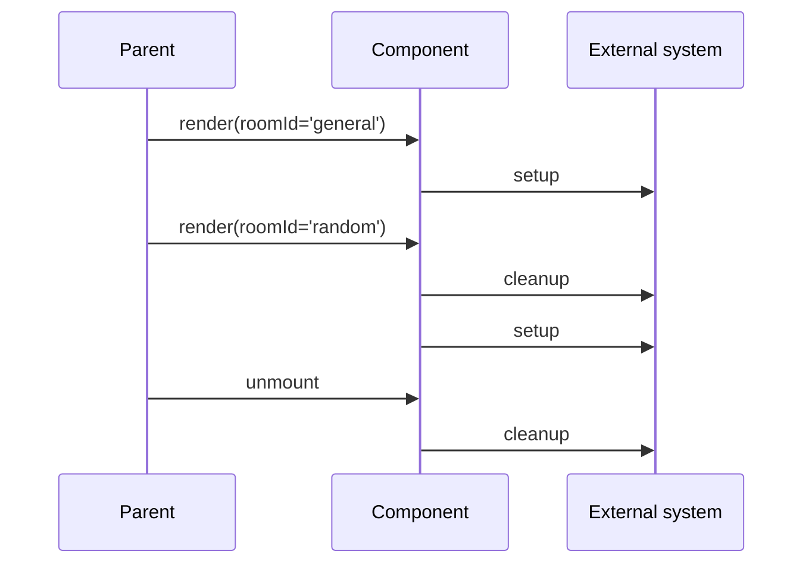
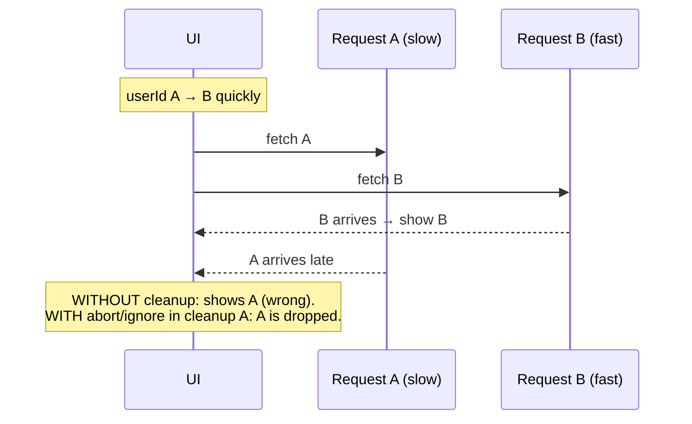

# 03 / 06 — Effect Cleanup

## 1. Lesson metadata

| | |
|---|---|
| **Level** | Intermediate–Advanced |
| **Study time** | 4–5 hours (reading 2 h, experiments 1.5 h, exercises 1–1.5 h) |
| **Prerequisites** | [03 / 04 — `useEffect` and synchronization](./04-useeffect-synchronization.md) (required), [03 / 05 — Effect dependencies and stale closures](./05-effect-dependencies-and-stale-closures.md) (required), [Foundations 14 — Web APIs and network requests (`AbortController`)](../00-web-and-javascript-foundations/14-web-apis-and-network-requests.md), [Foundations 12 — Promises and async/await](../00-web-and-javascript-foundations/12-promises-and-async-await.md), [Foundations 16 — Memory management and GC](../00-web-and-javascript-foundations/16-memory-management-and-gc.md) |
| **Next** | [07 — You might not need an effect](./07-you-might-not-need-an-effect.md) |
| **Related later** | [08 — `useLayoutEffect`](./08-uselayouteffect.md), [10 — `useRef` and mutable references](./10-useref-and-mutable-references.md) (ref callback cleanup), [20 — `useSyncExternalStore`](./20-usesyncexternalstore-and-external-stores.md), [Phase 2 / 28 — Strict Mode behavior](../02-react-rendering-and-internals/28-strict-mode-behavior.md), [Phase 6 / 02 — Cancellation and race conditions](../06-data-fetching-and-state-ecosystems/02-cancellation-and-race-conditions.md) |

**Learning objectives.** After this lesson you can:
1. Explain why cleanup exists: an effect that starts something must be able to stop it, because components are displayed repeatedly with different values and may be removed.
2. State exactly **when** cleanup runs, **which render's values** it sees, and what ordering you can and cannot rely on.
3. Design setup/cleanup as a **symmetric, idempotent pair** and verify it with Strict Mode.
4. Implement cleanup for listeners, timers, subscriptions, observers, imperative widgets, global side effects, and network requests (abort vs ignore flag), and know which tool fits which resource.
5. Recognize what **cannot** be cleaned up by an effect (one-time user-intent side effects, page-unload work) and use the right mechanism instead.
6. Diagnose leaks and duplicate-handler bugs with DevTools and prove a fix.
7. Explain how cleanup closes the race-condition class of bugs introduced by dependency changes.

**Concepts covered:** cleanup function, run timing (before re-run, on unmount), closure over the previous render, symmetry and idempotence, Strict Mode remount, `AbortController` vs `ignore` flag, listener removal pitfalls, `AbortSignal` in `addEventListener`, observers, timers, subscriptions and reference counting, restoring global state, cleanup limitations (page unload, async cleanup, errors), ref-callback cleanup (React 19), memory retention.

---

## 2. Deep conceptual explanation

### 2.1 What problem is this lesson solving?

[Lesson 04](./04-useeffect-synchronization.md) said an effect "starts synchronizing" an external system with a render's values. A system that can be *started* but not *stopped* has two failure modes:

1. **Leaks.** Component A subscribes to a feed, A is removed, the subscription stays: the callback keeps running, keeps `setState` closures (and everything they capture) alive, and keeps doing work for UI that no longer exists.
2. **Accumulation and stale behavior.** `roomId` changes from `general` to `random`; if the connection to `general` is never closed, the app is connected to both rooms. Each render with a new value adds a new listener; the old ones keep reacting with *old* closures.

Cleanup is the second half of the synchronization contract: **for every setup there is a cleanup that returns the outside world to the state before that setup.** React will call it at the right moments (before the next setup, on unmount); you supply the *content*.

### 2.2 The contract, stated precisely

> Running `setup`, then `cleanup`, must leave the external system as if `setup` had never run. Running `cleanup` more than once (or when setup partially failed) must be harmless.

Two properties follow:

- **Symmetry:** whatever setup acquires, cleanup releases (listener added ↔ removed; connection opened ↔ closed; timer started ↔ cleared; class added ↔ removed).
- **Idempotence (defensive):** calling cleanup twice, or on partially initialized state, must not throw or corrupt shared state. React itself calls cleanup once per setup, but libraries, error paths, and your own refactors can violate that; cheap idempotence prevents classes of bugs (§5.8).

Strict Mode's remount in development ([04 §3.7](./04-useeffect-synchronization.md)) is a *test of exactly this contract*: setup → cleanup → setup must be indistinguishable from one setup.

### 2.3 Why cleanup sees the *old* values

A subtle but fundamental point, building on [05](./05-effect-dependencies-and-stale-closures.md): the cleanup function you return is a closure created in the **same render and the same call as its setup**. When `roomId` changes from `'general'` to `'random'`, React calls the cleanup from the render where `roomId` was `'general'`. That is *correct*: it must disconnect from `general`, not from `random`. Writing cleanup that reads the "current" value of something would break this. The closure-per-render model that causes stale-closure bugs in event callbacks is what makes cleanup correct.

```tsx
useEffect(() => {
  const conn = createConnection(roomId);   // roomId = 'general' in this run
  conn.connect();
  return () => conn.disconnect();           // this `conn` is the 'general' connection
}, [roomId]);
```

### 2.4 Cleanup is not "componentWillUnmount"

In the class model, `componentWillUnmount` ran once when the component was removed. Cleanup of an effect runs:

1. **Before the effect's next setup** when dependencies changed (the component is still mounted).
2. **On unmount.**
3. In development Strict Mode: after the first setup, as part of the simulated unmount.

So cleanup is "stop this synchronization", not "the component is dying". Code that assumes cleanup only happens at unmount (e.g. "save the draft on cleanup") will save on every dependency change.

### 2.5 What cleanup can't do

| Situation | Why cleanup fails | Use instead |
|---|---|---|
| Tab/window closed, navigation away, crash | JavaScript may not run at all; React does not guarantee unmount cleanup during page teardown | `pagehide`/`visibilitychange` listeners, `navigator.sendBeacon` / `fetch(..., { keepalive: true })` for last-gasp telemetry |
| One-time user-intent actions (purchase, send email) | Cleanup can't "un-send" a request; running setup twice in Strict Mode doubles it | Event handler; make server operations idempotent with an idempotency key |
| Async teardown that must complete | React doesn't wait for promises returned from cleanup | Fire-and-forget teardown with error handling; or design the system so teardown is synchronous (`close()`) |
| Resources shared across components | Naive cleanup of a global would break other users | Reference counting in a module ([§5.7](#57-advanced-example-reference-counted-global-side-effects)) |

### 2.6 Common misconceptions

| Misconception | Reality |
|---|---|
| "Cleanup only runs when the component unmounts." | It also runs before every re-run caused by dependency changes. |
| "No need for cleanup when there's `[]`." | `[]` still needs cleanup on unmount (and for Strict Mode's remount). |
| "Setting state after unmount is the main danger." | React 18 removed the warning because setting state on an unmounted component is a harmless no-op; the real danger is the resource that kept running ([01 §3.7](./01-usestate-internals-and-update-semantics.md)). |
| "The `ignore` flag cancels the request." | It only discards the *result*. The request still completes and costs bandwidth/server work. `AbortController` actually cancels the network request. Use abort where the API supports it; the flag where it doesn't. |
| "Cleanup should reset state." | It shouldn't set the component's own state (usually pointless; it re-renders or does nothing on unmount). It undoes the external side effect. |
| "If I clean up properly, Strict Mode's double effects don't matter." | They don't matter *because* you cleaned up properly; the doubled run is the test, and a passing test is the goal. |
| "React awaits an async cleanup." | It doesn't; the return value must be a function and its return is ignored. |

---

## 3. Internal mechanics

> Labels: **[Public guarantee]**, **[Teaching model]**, **[Implementation detail]**.

### 3.1 When cleanup runs [Public guarantee]

For an effect that has run before:
- On a commit where its dependencies changed (or no array was given): React calls the **previous** cleanup, then the **new** setup.
- On unmount of the component (or when the subtree containing it is removed): React calls the last cleanup.
- Cleanup does **not** run on a render where dependencies are unchanged.
- In development Strict Mode: once after the first setup of each new mount, as the simulated unmount.

### 3.2 Ordering [Public guarantee vs implementation detail]

Documented/usage-level: within one component, effects run in order of declaration; a given effect's cleanup precedes its re-run. Practical behavior across a whole commit: pending cleanups run before pending setups, so one component's old subscription is gone before another component's new one starts (observed on React 19.3: for a parent with two child components, all cleanups ran first, then all setups, with child setups before the parent's; on unmount the parent's cleanups ran before its children's. Treat exact cross-component ordering as an implementation detail). **Do not write code whose correctness depends on parent-vs-child cleanup order.** If two resources must be released in a particular order, put them in the *same* effect and release them in reverse acquisition order.

```tsx
useEffect(() => {
  const a = acquireA();
  const b = acquireB(a);
  return () => { b.release(); a.release(); };   // reverse order, one effect
}, []);
```

### 3.3 Why passive-effect cleanup is deferred [Teaching model]

Unmount cleanup of passive effects is, like setup, scheduled after the commit rather than blocking the DOM mutation (in older versions (React ≤ 16) unmount cleanups ran synchronously during commit; in 17+ they are deferred). Consequence (observed on 19.3: a passive cleanup saw `node.isConnected === false`, a layout cleanup saw `true`): a component's DOM is gone from the page *before* its passive cleanup runs. Don't write cleanup that assumes the component's DOM nodes are still attached; the node object may still exist, but it is detached. Layout-effect cleanup, in contrast, runs synchronously during commit ([08](./08-uselayouteffect.md)).

### 3.4 Errors in cleanup [Teaching model]

An exception thrown from setup or cleanup is treated as a render-level error for the component and propagates to the nearest error boundary, just like errors during rendering (observed on 19.3: an error thrown in a cleanup was caught by a class error boundary). A throwing cleanup can leave other resources unreleased, so in cleanup prefer `try/finally` around steps that may throw, and make teardown tolerant of already-closed resources.

### 3.5 The `AbortController` model [Public guarantee, web platform]

`controller.abort()` sets `signal.aborted = true`, dispatches an `abort` event to the signal, and makes `fetch` calls using that signal reject with a `DOMException` whose `name` is `'AbortError'` ([MDN](https://developer.mozilla.org/en-US/docs/Web/API/AbortController)). Aborting an already completed request is harmless. A controller is single-use; create a new one per effect run. Event listeners can also be registered with `{ signal }` and are removed when the signal aborts, which is a compact way to clean up many listeners at once (supported in all current evergreen browsers; check compatibility tables if you support old environments).

### 3.6 Closures and retention [Teaching model]

A leaked callback holds references to everything in its closure: the component's props, state values of that render, and possibly large objects (response bodies, DOM nodes). That is why leaks from subscriptions are not just wasted CPU but retained memory ([Foundations 16](../00-web-and-javascript-foundations/16-memory-management-and-gc.md)). Detached DOM nodes retained by a closure are a classic heap-snapshot finding ("Detached HTMLDivElement").

### 3.7 Ref callbacks and cleanup (React 19) [Public guarantee]

In React 19, a **ref callback may return a cleanup function**, called when the element is detached (replacing the old pattern of calling the callback with `null`). This is a lifecycle tied to a *DOM node's existence* rather than to reactive values, and is the better tool for node-scoped setup such as `ResizeObserver.observe(node)` ([10](./10-useref-and-mutable-references.md)). If a ref callback returns a function, React no longer calls it with `null`. TypeScript consequence: returning anything other than a function or `undefined` from a ref callback is a type error in React 19 types (implicit-return arrow functions like `ref={(el) => (inst = el)}` need braces; confirmed with `tsc` against @types/react 19.3). Observed at runtime: a callback that returns nothing still gets `null` on detach; one that returns a function gets that function called instead, and in dev Strict Mode the sequence is set, cleanup, set.

### 3.8 Hidden or suspended UI [Public guarantee]

When UI is hidden with `<Activity mode="hidden">` (stable since React 19.2), React keeps component state but **unmounts effects**: layout and passive cleanups run on hide, and setups run again on show (we observed this on 19.3; the DOM stays, with `display: none !important`; a boundary that mounts as `hidden` renders but runs no effects until visible). `<Suspense>` is subtler: when already-visible content re-suspends and the fallback is shown, the content is hidden in the same way, but only **layout effect** cleanups ran in our test; passive effects stayed mounted. So cleanup must be complete: a subtree can be "unmounted" for effect purposes without being destroyed, and mounted again later with the same state ([Phase 2 / 28](../02-react-rendering-and-internals/28-strict-mode-behavior.md) discusses the idea Strict Mode is simulating).

---

## 4. Step-by-step execution walkthrough

```tsx
function Profile({ userId }: { userId: string }) {
  const [name, setName] = useState<string>('…');

  useEffect(() => {
    const controller = new AbortController();
    console.log('setup', userId);

    fetch(`/api/users/${userId}`, { signal: controller.signal })
      .then((r) => r.json())
      .then((u: { name: string }) => {
        console.log('apply', userId);
        setName(u.name);
      })
      .catch((e: unknown) => {
        if (controller.signal.aborted) console.log('aborted', userId);
      });

    return () => {
      console.log('cleanup', userId);
      controller.abort();
    };
  }, [userId]);

  return <h1>{name}</h1>;
}
```

**Predict:** the component mounts with `userId='1'`. Request 1 is in flight (will take 800 ms). After 200 ms the parent changes to `userId='2'` (request 2 will take 100 ms). Production build. What is logged and what does the screen show at the end?

Timeline:

1. **Render with `'1'`; commit; passive effects.** Log `setup 1`. Request 1 starts. Screen: `…`.
2. **t = 200 ms.** Parent re-renders with `'2'`. Deps `['1']` → `['2']`: changed.
3. **After commit, passive effects.** React runs **cleanup from the `'1'` run**: log `cleanup 1`; `controller1.abort()`. The pending `fetch` for user 1 rejects with `AbortError`; its `.catch` runs a moment later (microtask/next task): `controller1.signal.aborted` is true → log `aborted 1`.
4. **Then setup for `'2'`.** Log `setup 2`. Request 2 starts.
5. **t ≈ 300 ms.** Request 2 succeeds → log `apply 2` → `setName`. Render shows user 2.
6. **t = 800 ms.** Request 1 would have finished; it was aborted, so nothing happens. (Without abort, `apply 1` would log at 800 ms and **overwrite the screen with user 1's name while the page is on user 2**: the classic race.)

Log order (reproduced with a signal-aware fake `fetch` on React 19.3): `setup 1`, `cleanup 1`, `setup 2`, `aborted 1`, `apply 2`. `aborted 1` logs after `setup 2` because the rejection handler runs as a promise job after the synchronous cleanup-then-setup flush. Do not depend on that order; it is a promise-job ordering detail.

Key observation: **cleanup closed the race by invalidating the older run's right to update state.** The per-run `controller` is the token of that right.

---

## 5. Code examples

### 5.1 Minimal example: remove what you add

```tsx
import { useEffect, useState } from 'react';

export function WindowWidth() {
  const [w, setW] = useState(() => window.innerWidth);

  useEffect(() => {
    const onResize = () => setW(window.innerWidth);
    window.addEventListener('resize', onResize);
    return () => window.removeEventListener('resize', onResize); // same function reference
  }, []);

  return <p>{w}px</p>;
}
```

`removeEventListener` only removes a listener when passed the **same function reference** (and same capture flag) used in `addEventListener`. That's why `onResize` is a named variable in the effect. (`window.innerWidth` in the initializer fails during server rendering; guard or use `useSyncExternalStore` ([20](./20-usesyncexternalstore-and-external-stores.md)).)

### 5.2 Practical example: an observer-based hook

```tsx
import { useEffect, useRef, useState } from 'react';

export function useInView<T extends Element>(options?: IntersectionObserverInit) {
  const ref = useRef<T | null>(null);
  const [inView, setInView] = useState(false);

  const { root = null, rootMargin, threshold } = options ?? {};
  const thresholdKey = Array.isArray(threshold) ? threshold.join(',') : threshold; // primitive key

  useEffect(() => {
    const node = ref.current;
    if (!node) return;

    const observer = new IntersectionObserver(
      ([entry]) => setInView(entry.isIntersecting),
      { root, rootMargin, threshold },
    );
    observer.observe(node);

    return () => observer.disconnect();   // stops all observation, releases references
  }, [root, rootMargin, thresholdKey]);   // honest primitives; `threshold` captured via its key (see note)

  return [ref, inView] as const;
}
```

Notes:

- `node` is copied to a local variable at setup. Reading `ref.current` inside cleanup would be wrong (it may be `null`/different by then; the lint rule warns "ref value will likely have changed"). Cleanup uses `observer`, which is closed over.
- `disconnect()` is one call that releases everything; `unobserve(node)` would also work but leaves the observer object alive.
- The options are decomposed to primitives to keep honest dependencies without re-creating the observer on every render ([05](./05-effect-dependencies-and-stale-closures.md)). `threshold` (a number or array) is represented by `thresholdKey` for the dependency list; the linter may still ask for `threshold`; if so, memoize the options at the call site or accept only a primitive threshold. This example demonstrates the trade-off between ergonomic options objects and honest dependencies.
- Under Strict Mode: observe → disconnect → observe; one live observer at the end.

### 5.3 Incorrect example: cleanup that doesn't match setup

```tsx
useEffect(() => {
  window.addEventListener('scroll', () => setY(window.scrollY));      // anonymous
  return () => window.removeEventListener('scroll', () => setY(window.scrollY)); // different function!
}, []);
```

**Predict:** how many scroll listeners exist after mounting, unmounting, and mounting again?

**Answer:** One additional listener per mount, never removed: two arrow functions are two distinct objects, so `removeEventListener` finds nothing to remove. In production: after 3 mount/unmount cycles, 3 listeners; each calls `setY` on an unmounted (old) instance (harmless no-ops) but holds closures and burns CPU on every scroll. In development Strict Mode it starts with 2 on the first mount. Symptom: scroll handlers fire multiple times per event; the "Event Listeners" count in the Performance monitor climbs on each navigation.

### 5.4 Corrected implementation

```tsx
useEffect(() => {
  const onScroll = () => setY(window.scrollY);
  window.addEventListener('scroll', onScroll, { passive: true });
  return () => window.removeEventListener('scroll', onScroll); // capture flag unaffected by `passive`
}, []);
```

Or with `AbortSignal` (one cleanup for many listeners):

```tsx
useEffect(() => {
  const ac = new AbortController();
  const opts = { signal: ac.signal, passive: true } as const;
  window.addEventListener('scroll', () => setY(window.scrollY), opts);
  window.addEventListener('resize', () => setW(window.innerWidth), opts);
  return () => ac.abort();    // removes both
}, []);
```

The `signal` form avoids keeping named references and makes cleanup a single line; it relies on listener-removal-by-signal support in the runtime (all current evergreen browsers; test environments such as older jsdom versions may differ: verify).

### 5.5 Advanced example: two ways to stop stale async work

```tsx
// (A) Abort: cancels the network request
useEffect(() => {
  const controller = new AbortController();
  (async () => {
    try {
      const res = await fetch(url, { signal: controller.signal });
      const data = (await res.json()) as Item[];
      setItems(data);
    } catch (e) {
      if (!(e instanceof DOMException && e.name === 'AbortError')) setError(String(e));
    }
  })();
  return () => controller.abort();
}, [url]);

// (B) Ignore flag: works for ANY promise, even non-abortable
useEffect(() => {
  let ignore = false;
  loadFromIndexedDb(key).then((v) => {
    if (!ignore) setValue(v);
  });
  return () => { ignore = true; };
}, [key]);
```

Choosing:

| | Abort (A) | Ignore flag (B) |
|---|---|---|
| Stops network transfer / server work | Yes (client side; the server may still process the request) | No |
| Works with APIs lacking `signal` support | No | Yes |
| Prevents state update after cleanup | Yes, because the promise rejects (but code after `await` that doesn't throw—e.g. if the response was already fully read—must still be guarded) | Yes |
| Subtle trap | The abort rejection arrives as an error you must filter; `res.json()` can also reject with AbortError mid-body | Easy to forget to check the flag before *every* side effect after an `await` |

**Combining both** is common and fine: abort to save bandwidth, flag to guard code after multiple awaits. Notice for (A) the code after `await res.json()` runs only if nothing threw; but if `abort()` is called *after* the response body resolved and before `setItems`, there is a microtask window where `setItems` still runs. A `if (controller.signal.aborted) return;` guard right before the state update closes it; adding it is cheap insurance.

### 5.6 Advanced example: timers and debounce

```tsx
function useDebounced<T>(value: T, delayMs: number): T {
  const [debounced, setDebounced] = useState(value);

  useEffect(() => {
    const id = setTimeout(() => setDebounced(value), delayMs);
    return () => clearTimeout(id);       // each new value cancels the previous pending update
  }, [value, delayMs]);

  return debounced;
}
```

Debounce falls out of cleanup semantics: each change to `value` runs the previous cleanup (cancelling the pending timer) before scheduling a new one. Trade-offs: this debounces the *state*, so every keystroke still re-renders the component that owns `value`; the debounced consumer renders less often. For very high-frequency sources or to avoid an extra render, debounce in the event handler instead (store the timer in a ref). If the delay is semantically "wait for the user to stop typing", also consider `useDeferredValue` ([22](./22-modern-hooks-and-apis.md)) for UI responsiveness. It solves a different problem (rendering priority) and does not reduce network calls.

### 5.7 Advanced example: reference-counted global side effects

```tsx
// scroll-lock.ts
let locks = 0;
let saved = '';

export function lockScroll(): () => void {
  if (locks++ === 0) {
    saved = document.body.style.overflow;
    document.body.style.overflow = 'hidden';
  }
  let released = false;
  return () => {
    if (released) return;               // idempotent
    released = true;
    if (--locks === 0) document.body.style.overflow = saved; // restore the PREVIOUS value, not ''
  };
}

// Modal.tsx
useEffect(() => (open ? lockScroll() : undefined), [open]);
```

Why this shape:

- The *effect* stays trivial; the **shared resource** is managed by a module that knows about all users (reference counting).
- Cleanup restores the **previous** value, not a hard-coded `''`, so it composes with other code that set `overflow` first.
- The returned release function is **idempotent**: a double call (error paths, Strict Mode oddities, future refactors) cannot drive `locks` negative.
- Returning `undefined` when `open` is false is allowed (`useEffect(() => cond ? fn() : undefined, deps)`).

### 5.8 Incorrect example: trying to "clean up" a non-reversible action

```tsx
useEffect(() => {
  analytics.track('checkout_started', { cartId });
  return () => analytics.track('checkout_abandoned', { cartId }); // misleading
}, [cartId]);
```

**Predict:** what events appear in development, and in production when `cartId` changes?

**Answer:** In development: `checkout_started`, `checkout_abandoned`, `checkout_started` on mount alone (simulated unmount fires the "abandoned" event); in production, `abandoned` also fires on every `cartId` change and on every ordinary unmount (including completing checkout and navigating to the confirmation page), producing incorrect funnels. Cleanup means "stop synchronizing", not "the user left". **Fix:** log business events from the handler or route layer where the intent is known (`onStart`, `onComplete`, router `beforeunload`/`pagehide` for true abandonment, via `sendBeacon`). If a view-start event is truly desired on display, accept that it's "displayed", dedupe by id in the analytics layer, and do **not** attach a paired "end" event to cleanup. This is the one scenario where "symmetric" does not mean "mirror": there is no external *state* to restore, so no cleanup is needed.

### 5.9 Observing ordering with a probe

```tsx
function Probe({ id, dep }: { id: string; dep: number }) {
  useEffect(() => {
    console.log(`setup ${id}`, dep);
    return () => console.log(`cleanup ${id}`, dep);
  }, [dep]);
  return null;
}

// <Probe id="A" dep={x} /> <Probe id="B" dep={x} /> rendered siblings; x changes 0 → 1
```

Expected output pattern (production): `cleanup A 0`, `cleanup B 0`, `setup A 1`, `setup B 1`: all cleanups of the commit, then all setups, siblings in tree order. This matches the documented usage-level behavior; treat the sibling and parent/child order as observed, not promised. Run it in your own project to see the order with your React version; this is a good habit for any "ordering" question: **experiment, then don't depend on it.**

---

## 6. Visual explanations

### Cleanup is paired with the setup that created it



### Race condition without and with cleanup



### What to use for which resource

| Resource | Setup | Cleanup |
|---|---|---|
| DOM/window listener | `addEventListener(type, fn)` | `removeEventListener(type, fn)` or `abort()` of the signal passed |
| Timer | `setTimeout/setInterval` | `clearTimeout/clearInterval` |
| Animation frame | `requestAnimationFrame` | `cancelAnimationFrame` |
| Fetch | `fetch(url, { signal })` | `controller.abort()` |
| Generic promise | `.then(...)` guarded by flag | `ignore = true` |
| WebSocket/EventSource | `new WebSocket()` | `ws.close()` |
| Observers | `new XObserver(cb); observe(node)` | `observer.disconnect()` |
| Third-party widget | `create(...)` | `destroy()` |
| Global DOM state | change `body` class/style | restore previous (ref-counted if shared) |
| External store | `subscribe(cb)` | returned `unsubscribe()` |
| Imperative browser state | `dialog.showModal()`, `video.play()` | `dialog.close()`, `video.pause()` |

---

## 7. Alternative approaches and trade-offs

| Need | Effect + cleanup | Alternative | When the alternative wins |
|---|---|---|---|
| External store subscription | `useEffect` subscribe + `setState` | `useSyncExternalStore` ([20](./20-usesyncexternalstore-and-external-stores.md)) | Always for stores you don't own; handles tearing, the subscribe gap, SSR |
| Async data with races | Abort/flag in effect cleanup | Data library (TanStack Query) or framework loaders | Production: caching, dedup, retry, cancellation handled once |
| Node-scoped setup | Effect with `ref.current` | Ref callback with cleanup (React 19) | Setup tied to the DOM node's attach/detach, not to reactive values |
| Many listeners | Per-listener remove | `AbortController` signal | Cleaner; same semantics |
| Debounce | Timer + cleanup | Debounce in the handler; `useDeferredValue` for rendering priority | Network-call reduction vs render-priority differ; choose based on the goal |
| Resource shared across components | Per-component effect | Module-level manager with ref counting; context-provided singleton | Expensive resources (sockets) |
| Teardown tied to page exit | Effect cleanup | `pagehide`/`visibilitychange` + `sendBeacon` | Anything that must survive navigation |

**A scenario where "just add cleanup" is not best.** *A shared WebSocket used by 40 widgets.* Each widget doing `new WebSocket` in an effect with a correct `close()` is *technically* right but wasteful and flapping on route changes (connect/close churn). The better design is a **connection manager** outside React with `subscribe(topic)` ref counting: effects call `subscribe`/`unsubscribe`, the manager decides when to connect or close (with a grace period to survive quick unmount/remount, e.g. Strict Mode or route transitions). Cleanup is still correct, but at the right layer.

---

## 8. Best practices and anti-patterns

**Do**
- Write setup and cleanup together, as a pair, immediately.
- Test every effect in Strict Mode and by toggling the component off/on.
- Use a single `AbortController` per effect run for cancelable work; share its signal among listeners/fetches started in that run.
- Capture `ref.current` into a local variable in setup if cleanup needs it.
- Make release functions idempotent and tolerant of partially initialized resources.
- Release multiple resources in one effect in reverse order of acquisition.
- Keep shared global resources in ref-counted modules.

**Beginner mistakes**
- Anonymous functions in `add`/`removeEventListener`.
- No cleanup for `setInterval`.
- Forgetting that the fetch rejection after `abort()` is an error to filter.
- Calling `clearInterval` with the wrong id (declared outside the effect).

**Experienced-developer mistakes**
- Adding `didRun` refs to silence Strict Mode instead of fixing cleanup.
- Treating cleanup as "on unmount" and saving data there.
- Cleaning up non-reversible actions (analytics "end" events).
- Using `ignore` for something that should be aborted (wasted server work, saturating the browser's connection limit per host with abandoned requests).
- Forgetting that `abort()` doesn't stop *server* work.
- Hard-coding the restore value for globals instead of saving the previous one.
- Async cleanup expectations.

**Smells**
- `useEffect` bodies that start something and have no `return`.
- A cleanup that sets the component's own state.
- Cleanup that reads `ref.current`.
- Module-level mutable "isMounted" variables.
- `try { ... } catch {}` swallowing errors in teardown without logging.

**Justified exceptions.** No cleanup is needed when setup is **idempotent and overwriting** with no lasting resource: `document.title = x` (the next run overwrites; restore is optional), or one-shot measurements. A deliberate "leave it" on unmount is valid when the state should outlive the component (e.g. persisting a user preference to `localStorage`: write on change, don't delete on cleanup). Document the intent.

---

## 9. Real-world application

*Real-time order book (finance).* The order-book component subscribes to `symbol`'s L2 feed through a connection manager. On symbol change: unsubscribe old, subscribe new; the manager coalesces so that rapid symbol switching doesn't churn sockets. Constraints: no residual callbacks after unmount (they would mutate rendered state on stale rows), bounded memory, and message ordering when switching. The cleanup is `unsubscribe(handle)`, and the handle is idempotent.

*Search suggestions (e-commerce).* Debounced typing with abort of the in-flight request on each new query; cleanup both clears the timer and aborts the fetch (§5.6 + §5.5). Constraint: server cost; aborting at the client reduces wasted work only if the server cancels on disconnect: check infrastructure behavior, don't assume.

*Media player.* An effect attaches `ended`/`timeupdate` listeners to a `<video>` and may call `play()`; cleanup removes listeners and pauses. Constraints: `play()` returns a promise that can reject with `AbortError` if `pause()` interrupts it; handle with a catch.

*Dashboard widgets.* Chart library instances must `destroy()` on unmount to release canvas contexts and ResizeObservers. Leaving 30 hidden charts alive after navigation is a typical cause of memory growth in long-lived SPA sessions.

*Auth session.* Token refresh timers cleared on logout/unmount; `visibilitychange` listener removed; refresh requests aborted so a late response can't resurrect an old session after logout (a security-relevant race).

*Multi-team platform.* A shared `usePolling(fn, ms)` hook must guarantee cleanup of timers and in-flight requests, and document that callers need not memoize `fn` (internally stored via latest-ref/effect-event).

---

## 10. Debugging and troubleshooting

**Symptom 1: "Handlers fire multiple times; it gets worse as I navigate."**
Likely listener leaks. In Chrome DevTools: Performance monitor → **JS event listeners** counter climbs per navigation; in the Console, `getEventListeners(window)` (a DevTools-only helper) lists listeners by type. Inspect the effect for mismatched add/remove references. Fix; validate that the counter returns to baseline after toggling the component repeatedly.

**Symptom 2: "Old data flashes after changing the filter."**
Race. Network panel: two overlapping requests with the *older* finishing last. Check cleanup (abort/flag). Reproduce with DevTools network throttling and slow-down on one request. After the fix, the older response is "(canceled)" in the Network panel (when aborted).

**Symptom 3: "Memory grows with each route visit."**
Memory panel → take a heap snapshot, navigate away and back several times, take another; compare, filter "Detached" DOM nodes and look at retainers: they often show a listener/closure from an effect. Fix cleanup; validate snapshots stay flat. See [Foundations 16](../00-web-and-javascript-foundations/16-memory-management-and-gc.md).

**Symptom 4: "Strict Mode shows two sockets/two requests."**
Cleanup missing or incomplete. Count live resources (browser Network → WS tab). After fixing, you should see one closed and one open (development) or one open (production).

**Symptom 5: "Console warns about `ref.current` in cleanup."**
Copy the ref value into a local variable inside the effect body and use that in cleanup.

**Symptom 6: "`AbortError` shows in logs/Sentry."**
Expected aborts treated as errors. Filter `AbortError` (and `signal.aborted`) in catch handlers; configure error reporters to ignore them.

**Symptom 7: "Works on mount, breaks after hot reload."**
Fast Refresh re-runs effects; asymmetry shows. Same fix.

**General protocol:** reproduce → count the resource (listeners, sockets, timers, requests) before/after repeated mount-unmount → make setup/cleanup symmetric → re-count.

---

## 11. Exercises

### Level A — Knowledge
A1. Name the three moments at which cleanup runs (one of them dev-only).
A2. Which render's values does a cleanup function see, and why?
A3. What is the difference between aborting a request and ignoring its result?
A4. Why can't `removeEventListener('x', () => ...)` remove a previously added anonymous listener?
A5. Give two situations in which cleanup cannot achieve what you want.

### Level B — Code comprehension
B1. Production. Parent changes `n` from `1` to `2` to `3`. What does this log, in order, including mount?
```tsx
useEffect(() => {
  console.log('setup', n);
  return () => console.log('cleanup', n);
}, [n]);
```
B2. How many intervals are alive after mount → unmount → mount in production? In development Strict Mode on the *first* mount?
```tsx
useEffect(() => { setInterval(tick, 1000); }, []);
```
B3. In §5.7, if two modals open and the first one closes, is scrolling still locked? Trace `locks`.
B4. What's wrong here, and when does the bug show?
```tsx
useEffect(() => {
  const el = ref.current!;
  el.addEventListener('click', onClick);
  return () => ref.current!.removeEventListener('click', onClick);
}, []);
```

### Level C — Implementation
C1. Write `useEventListener(target: EventTarget | null, type: string, handler: (e: Event) => void)` with no re-subscription when `handler` changes identity.
C2. Write `usePolling(fn: (signal: AbortSignal) => Promise<void>, intervalMs: number, enabled: boolean)` that never overlaps requests, aborts the in-flight one on cleanup, and stops cleanly when `enabled` becomes false.
C3. Write `useWebSocket(url)` returning `{ status, send }` with correct cleanup, a reconnect with backoff, and Strict Mode safety. Discuss what breaks if reconnect timers are not cleared.

### Level D — Debugging
D1. A modal sometimes leaves the page unscrollable after closing. Code: `useEffect(() => { document.body.style.overflow = 'hidden'; return () => { document.body.style.overflow = ''; }; }, [])` used by two stacked modals. Explain and fix.
D2. "After I leave the dashboard, CPU stays high." Code snippet: `useEffect(() => { const id = setInterval(refresh, 1000); }, [])`. Fix and verify using DevTools.
D3. Sentry reports `AbortError` thousands of times per day after the team added `AbortController` cleanup. What is going on, and what is the right handling?

### Level E — Architecture and engineering decisions
E1. Decide between (a) per-component sockets, (b) a shared connection manager, (c) a library (e.g. a realtime client) for a dashboard with 30 widgets and route-level navigation. Criteria and recommendation.
E2. Your team has many `useEffect` + `fetch` with `ignore` flags. Should you mandate `AbortController` everywhere? Argue both sides and give a rule.

### Level F — Expert challenge
F1. Design a test harness that automatically verifies every custom hook in your library is "cleanup-correct": mounts and unmounts the hook N times inside `<StrictMode>` and asserts that listener counts, timers, and pending requests return to baseline. Describe what you instrument (e.g. spy on `addEventListener`/`removeEventListener`, fake timers, `fetch` mock with abort tracking), the oracle, and the limitations (what it cannot detect).

---

## 12. Detailed answers and explanations

> Attempt the exercises first.

**A1.** (1) Before the same effect's next setup, when dependencies changed (or no array); (2) on unmount; (3) in development Strict Mode, once after the first setup as a simulated unmount. (Hiding a subtree with `<Activity mode="hidden">` is a fourth, newer case.)

**A2.** The values from the render that created that effect run, because the cleanup is a closure created in the same call as the setup. That is what makes `disconnect(oldRoom)` correct rather than `disconnect(newRoom)`.

**A3.** Abort cancels the operation (for `fetch`, closes the request client-side and rejects the promise), saving bandwidth and client work; ignoring only drops the result when it arrives, leaving the request running to completion. Ignore works for any promise; abort needs API support. The server may keep working in both cases unless it detects client disconnect.

**A4.** Listener identity is by function reference (plus capture flag). Two arrow function expressions are two different objects, so the remove call matches nothing. Store the function in a variable (or use `{ signal }`).

**A5.** Any two of: page/tab closed (no guaranteed JS); non-reversible actions (a sent request/purchase); async teardown that must be awaited; resources shared by others (global state) without ref counting; crash/exception paths in the browser.

**B1.** `setup 1` (mount); `n → 2`: `cleanup 1`, `setup 2`; `n → 3`: `cleanup 2`, `setup 3`. Wrong answer: `cleanup 2` after changing to 2 (cleanup uses the *old* render's value).

**B2.** No cleanup is returned and `setInterval` isn't cleared. Production: mount → 1; unmount leaves it running (leak); mount again → 2 alive. Dev Strict Mode on the first mount: setup, (simulated cleanup: nothing), setup → **2 intervals alive** immediately, which doubles tick rate visibly: the symptom the dev check is meant to surface. Fix: `const id = setInterval(...); return () => clearInterval(id);`.

**B3.** Locks: modal1 → `locks = 1` (overflow saved, set hidden); modal2 → `locks = 2`. Modal1 closes → `--locks` → 1 ≠ 0 → no restore: still locked, correct, because modal2 is open. Modal2 closes → `locks = 0` → restore saved value. Naive version in D1 would unlock on the first close.

**B4.** Cleanup reads `ref.current!` — by cleanup time (especially unmount) React may already have set `ref.current = null` (refs detach during commit before passive cleanups run), so `ref.current!.removeEventListener` throws `TypeError`; or it may point to a different node. It shows on unmount and on re-run when the ref target changes. Fix: `const el = ref.current; if (!el) return; ... return () => el.removeEventListener(...)`.

**C1.**
```ts
import { useEffect, useRef } from 'react';

export function useEventListener(
  target: EventTarget | null,
  type: string,
  handler: (e: Event) => void,
): void {
  const handlerRef = useRef(handler);
  useEffect(() => { handlerRef.current = handler; });

  useEffect(() => {
    if (!target) return;
    const listener = (e: Event) => handlerRef.current(e);
    target.addEventListener(type, listener);
    return () => target.removeEventListener(type, listener);
  }, [target, type]);
}
```
Reasoning: subscription depends on `target` and `type` only; the handler is read through a ref updated after each commit (or `useEffectEvent`, React 19.2+). Typing for specific events can be improved with overloads on `WindowEventMap`. Edge: `target` as `window` is a module-level object, stable; passing `ref.current` as `target` evaluates during render and may be `null` on first render (so use an effect-time lookup or pass the ref object).

**C2.**
```ts
import { useEffect, useRef } from 'react';

export function usePolling(
  fn: (signal: AbortSignal) => Promise<void>,
  intervalMs: number,
  enabled: boolean,
): void {
  const fnRef = useRef(fn);
  useEffect(() => { fnRef.current = fn; });

  useEffect(() => {
    if (!enabled) return;
    const controller = new AbortController();
    let timer: ReturnType<typeof setTimeout> | undefined;

    const tick = async () => {
      try {
        await fnRef.current(controller.signal);
      } catch {
        // swallow or report; aborts are expected
      }
      if (!controller.signal.aborted) timer = setTimeout(tick, intervalMs); // schedule next AFTER completion: no overlap
    };

    void tick();
    return () => {
      controller.abort();
      if (timer !== undefined) clearTimeout(timer);
    };
  }, [enabled, intervalMs]);
}
```
Key design: self-scheduling `setTimeout` (not `setInterval`) prevents overlapping requests; abort cancels the in-flight call; clearing the timer prevents a scheduled tick after cleanup; the `signal.aborted` check prevents rescheduling during the cleanup race. Errors: report non-abort errors in a real implementation.

**C3.** (Sketch, evaluate on design.)
```ts
type Status = 'connecting' | 'open' | 'closed';

export function useWebSocket(url: string) {
  const [status, setStatus] = useState<Status>('connecting');
  const wsRef = useRef<WebSocket | null>(null);

  useEffect(() => {
    let disposed = false;
    let attempt = 0;
    let retryTimer: ReturnType<typeof setTimeout> | undefined;

    const connect = () => {
      setStatus('connecting');
      const ws = new WebSocket(url);
      wsRef.current = ws;
      ws.onopen = () => { attempt = 0; if (!disposed) setStatus('open'); };
      ws.onclose = () => {
        if (disposed) return;
        setStatus('closed');
        const delay = Math.min(30_000, 500 * 2 ** attempt++);
        retryTimer = setTimeout(connect, delay);
      };
    };

    connect();
    return () => {
      disposed = true;
      clearTimeout(retryTimer);
      wsRef.current?.close();
      wsRef.current = null;
    };
  }, [url]);

  const send = useCallback((data: string) => {
    if (wsRef.current?.readyState === WebSocket.OPEN) wsRef.current.send(data);
  }, []);

  return { status, send } as const;
}
```
Without clearing `retryTimer`, an unmounted component's pending reconnect would open a *new* socket after cleanup (a zombie connection), possibly several (one per closed event). `disposed` guards both state updates and reconnect scheduling. Strict Mode: connect → dispose/close → connect; the first socket's `onclose` fires *after* `disposed = true` so it does not reconnect. Limitations: message handling API omitted (accept a handler via ref); production code usually needs heartbeat, jitter on backoff, and a shared connection manager (§7).

**D1.** The first modal's cleanup sets `overflow = ''` while the second is still open, unlocking the page prematurely; also the saved previous value is lost. Fix with ref-counted `lockScroll` (§5.7), restoring the previous value only when the last lock releases.

**D2.** No cleanup: interval persists after unmount, calling `refresh` forever (and `setState` into the void). Fix: `const id = setInterval(refresh, 1000); return () => clearInterval(id);`. Verify: Performance monitor CPU/“JS heap”, count timers by setting a `console.count` in `refresh` and observing it stops after navigating away; Chrome's Performance recording shows no timer fires post-unmount.

**D3.** Abort causes `fetch` to reject with `AbortError`; the catch handler (or global `unhandledrejection`) reports it as an error. It's expected control flow. Fix: in catch, check `controller.signal.aborted` or `e.name === 'AbortError'` and return silently; configure the error reporter's ignore list for `AbortError`; avoid `controller.abort()` rejections going unhandled if you call `.then` without catch.

**E1.** Criteria: number of widgets/topics, reconnect behavior, authentication handshake, message volume, server connection limits, team capacity, testability, offline behavior. (a) Per-component sockets: simple, but 30 sockets per user, churn on route changes, server load; reject beyond a few widgets. (b) Connection manager: one socket, ref-counted topics, grace period on unsubscribe, central reconnect/backoff, easy to test outside React; moderate build cost. (c) Library (e.g., a realtime client or a GraphQL subscription client): fastest to adopt if protocol matches; adds dependency and API coupling. Recommended: (b) or (c) depending on the protocol; effects only call `subscribe`/`unsubscribe`. Weakness of (b): you own reliability logic; mitigate with tests and metrics.

**E2.** For mandate: real cancellation, less wasted bandwidth and server load, fewer late-update races, consistent pattern, helps HTTP/1.1 connection-limit pressure. Against: not every async source accepts a signal (IndexedDB, third-party SDKs); error-filtering boilerplate; false sense of safety if code after `await` isn't guarded; a data library already handles it. Rule: for `fetch` and signal-aware APIs, use `AbortController` and also guard post-await updates; for non-abortable sources use an `ignore` flag; for server data prefer a data library so the rule rarely applies. Evaluate answer on acknowledging both and giving an actionable rule.

**F1.** Instrument: wrap `EventTarget.prototype.addEventListener/removeEventListener` to maintain a multiset keyed by (target, type, listener, capture); fake timers (`vi.useFakeTimers`) and assert `vi.getTimerCount() === 0` after unmount; wrap `fetch` with a mock that records outstanding requests and their `signal`s; wrap `WebSocket`/`IntersectionObserver`/`ResizeObserver` constructors in recording stubs with `close`/`disconnect` tracking. Procedure: render a probe component using the hook inside `<StrictMode>`, record baseline counts, mount, unmount, repeat N times (e.g. 5), assert counts equal baseline after each unmount and during mount equal expected steady state (e.g. 1 listener). Oracle: *balance*, not the number of setups. Limitations: cannot detect semantic leaks in third-party code you didn't stub; cannot catch listeners attached through `onxxx` properties unless you stub those; cannot detect retained memory (use heap snapshots in a separate Playwright/DevTools job); fake timers differ from real throttling; jsdom's abort support may differ from browsers.

---

## 13. Senior engineer interview questions

**Q1. "What is the contract between setup and cleanup?"**
*Strong answer:* Setup followed by cleanup must restore the external system to its prior state; cleanup should be idempotent. It runs before re-synchronization and on unmount, using the closure of the run it belongs to. Strict Mode double-invoking is a test of that contract.

**Q2. "How do you prevent an out-of-order fetch response from overwriting newer state?"**
*Strong answer:* Tie each request to its effect run: abort in cleanup (and filter `AbortError`) and/or an `ignore` flag. Mention that abort saves bandwidth but doesn't guarantee server-side cancellation, and that a data library solves this systematically.

**Q3. "A component leaks listeners only when `roomId` changes. Why?"**
*Strong answer:* Cleanup runs on changes, so a mismatch between add and remove (anonymous function, different capture flag, a ref read in cleanup, or a cleanup that closes over the new value) leaks per change rather than only at unmount; inspect add/remove symmetry; verify with listener counts.

**Q4. "What can't cleanup do, and what do you do instead?"**
*Strong answer:* It can't run reliably at page teardown (use `pagehide`/`visibilitychange` + `sendBeacon`/`keepalive`), can't undo non-reversible actions (use handlers and idempotent server operations), isn't awaited if async, and can't manage shared resources by itself (ref counting).

**Q5. "Why did React 18 remove the 'state update on an unmounted component' warning?"**
*Strong answer:* It produced false positives and didn't indicate real leaks; the no-op is harmless. Real leaks come from retained resources (subscriptions, timers, requests); fix them with cleanup rather than silencing a symptom.

**Q6. "How would you debug a memory leak you suspect is from effects?"**
*Strong answer:* Repeat the navigation cycle; use Performance monitor for listener/node counts; heap snapshots before/after, filter detached DOM and inspect retainers, usually a closure from a listener/timer/subscription; fix cleanup; confirm counts remain flat. Mention Strict Mode as an early detector.

---

## 14. Further learning resources

| Resource | URL | Covers / why | Level | Study |
|---|---|---|---|---|
| React docs: Synchronizing with Effects | <https://react.dev/learn/synchronizing-with-effects> | Cleanup, Strict Mode remount, fetching, "How to handle the Effect firing twice in development" | Intermediate | "Step 3: Add cleanup if needed" and later sections |
| React docs: `useEffect` reference | <https://react.dev/reference/react/useEffect> | Setup/cleanup semantics, caveats, troubleshooting | Intermediate | "Caveats", "Troubleshooting" |
| React docs: Lifecycle of reactive effects | <https://react.dev/learn/lifecycle-of-reactive-effects> | "Each Effect represents a separate synchronization process" | Intermediate | Whole page |
| React docs: Strict Mode | <https://react.dev/reference/react/StrictMode> | Re-running effects in development | Intermediate | "Fixing bugs found by re-running Effects" |
| MDN: AbortController | <https://developer.mozilla.org/en-US/docs/Web/API/AbortController> | `abort()`, signals, fetch integration | Beginner | Whole page |
| MDN: `EventTarget.addEventListener` | <https://developer.mozilla.org/en-US/docs/Web/API/EventTarget/addEventListener> | The `signal` option, `passive`, `once`, removal rules | Beginner | Options |
| MDN: IntersectionObserver / ResizeObserver | <https://developer.mozilla.org/en-US/docs/Web/API/IntersectionObserver>, <https://developer.mozilla.org/en-US/docs/Web/API/ResizeObserver> | Observer APIs and `disconnect()` | Intermediate | Instance methods |
| Chrome DevTools: Memory / heap snapshots | <https://developer.chrome.com/docs/devtools/memory-problems> | Finding detached DOM nodes and retainers | Intermediate | Heap snapshots |
| React DOM: Ref callback cleanup (React 19) | <https://react.dev/blog/2024/12/05/react-19> | Ref callbacks returning cleanup functions | Intermediate | "Cleanup functions for refs" |

---

## 15. Knowledge checkpoint

**You should now understand**
- Cleanup is the "stop" half of synchronization, not "on unmount", and uses the closure of the run it belongs to.
- The symmetry and idempotence rules, and how Strict Mode verifies them.
- Abort vs ignore for async work, and how cleanup closes race conditions.
- What cleanup cannot do and which mechanism replaces it.

**You should be able to explain without notes**
- The full timeline of setup/cleanup across a dependency change and unmount.
- Why anonymous listeners leak, and why cleanup shouldn't read `ref.current`.
- When a shared manager beats per-component setup/cleanup.

**You should be able to implement**
- Cleanup for listeners, timers, observers, sockets, fetch, shared global state; polling without overlap; a debounce.

**You should be able to debug**
- Duplicate handlers, races, leaks, double sockets in development, `AbortError` noise.

**Prerequisite for next lesson:** you now know how to use effects *correctly*. [Lesson 07](./07-you-might-not-need-an-effect.md) turns that skill on its head: most code people put in effects doesn't need one, and the lesson shows how to recognize and remove those cases.
