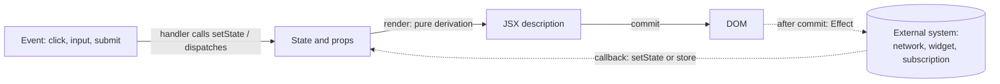
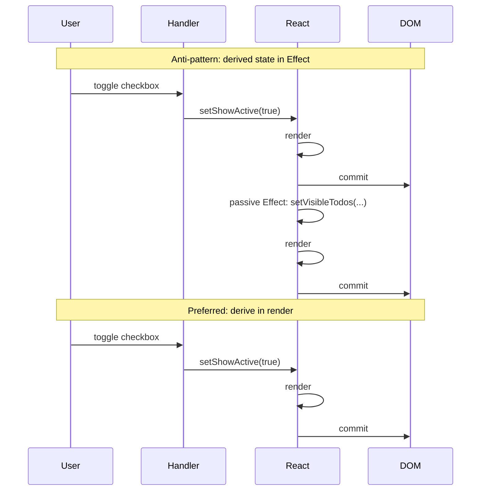
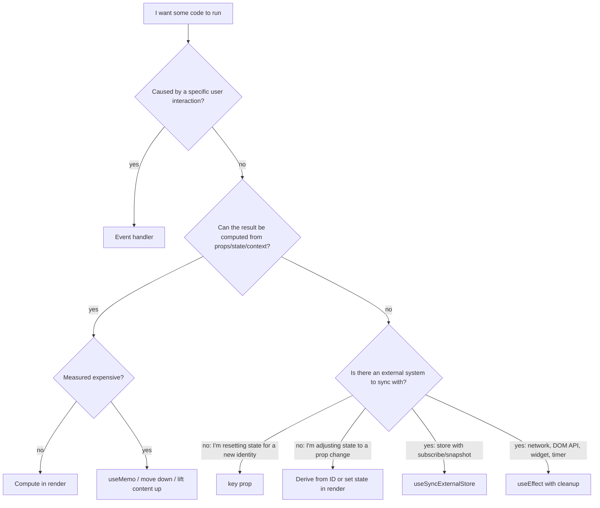

# 03 / 07 — You Might Not Need an Effect

## 1. Lesson metadata

| | |
|---|---|
| **Level** | Intermediate |
| **Study time** | 4–5 hours (reading 1.5 h, experiments 1 h, exercises 2 h) |
| **Prerequisites** | [04 — useEffect and synchronization](./04-useeffect-synchronization.md), [05 — Effect dependencies and stale closures](./05-effect-dependencies-and-stale-closures.md), [06 — Effect cleanup](./06-effect-cleanup.md), [Phase 1 / 14 — State as a snapshot](../01-react-fundamentals/14-state-as-a-snapshot.md), [Phase 1 / 16 — State preservation and reset](../01-react-fundamentals/16-state-preservation-and-reset.md), [Phase 2 / 12 — Why rendering must be pure](../02-react-rendering-and-internals/12-why-rendering-must-be-pure.md) |
| **Next** | [08 — useLayoutEffect](./08-uselayouteffect.md) |
| **Related later** | [17 — Derived state](./17-derived-state.md), [20 — useSyncExternalStore](./20-usesyncexternalstore-and-external-stores.md), [22 — Modern hooks and APIs](./22-modern-hooks-and-apis.md), [23 — Hooks anti-patterns](./23-hooks-anti-patterns.md), [Phase 6 / 02 — Cancellation and race conditions](../06-data-fetching-and-state-ecosystems/02-cancellation-and-race-conditions.md) |

**Learning objectives.** After this lesson you can:
1. State the one legitimate job of an Effect and use it as a decision test.
2. Replace the six most common "Effect smells" (derived state, event logic, reset-on-prop-change, effect chains, parent notification, store subscription) with a render-time or handler-time alternative.
3. Explain *why* an unnecessary Effect is slower, less correct, and harder to reason about than the alternative, using the render/commit model.
4. Use the `key` prop and the "store the ID, derive the object" technique to reset or adjust state without an Effect.
5. Recognize the situations where an Effect *is* correct (external synchronization, "because the component was displayed" logic, fetching with a race guard) and write them safely.
6. Predict what StrictMode's development-only mount → unmount → mount cycle reveals about misplaced Effects.

**Concepts covered:** synchronization with external systems, derived data, render-time computation, event handlers vs Effects, `key`-based reset, setState-during-render adjustment, effect chains, lifting state, `useSyncExternalStore` as the subscription primitive, fetch race guards, one-time initialization, Effect double invocation in development.

---

## 2. Deep conceptual explanation

### 2.1 What problem is this lesson solving?

Effects are the escape hatch that lets a React component step *outside* React: talk to the network, the DOM API, a WebSocket, a timer, a third-party widget, the browser's `localStorage` subscription model. Because an Effect can run arbitrary code after render, it is also the easiest tool to reach for when you do not know how else to make "this thing happen after that thing changed".

That ease is the trap. A large fraction of bugs in production React code come from Effects that were never needed:

- A `useEffect` that copies props into state "to keep them in sync" and causes a render with stale data, then a second render with fresh data (visible flicker, double work).
- A `useEffect` that posts to an API because a button was clicked, but which also fires when the user navigates back to a restored component, or twice in development.
- A chain of Effects, each setting state that triggers the next, that is impossible to step through and renders many times for one user action.
- A fetch Effect without a race guard that shows the response for the *previous* search term.

The central claim of this lesson, taken from the official React guidance and expressed in our own terms:

> **An Effect exists to synchronize a component with something that is not part of React's render output. If there is no external system involved, you likely do not need an Effect.**

"External system" means: the network, browser APIs outside React's control (document title, focus, `IntersectionObserver`, `matchMedia`), a non-React widget (a map library, a video player), a timer, a subscription to a store that lives outside React. Computing one piece of state from another piece of state, responding to a click, resetting a form when you navigate to a different user: none of these involve an external system. They are *data flow inside React*, and React gives you better tools for them.

### 2.2 Two questions that decide almost everything

Before writing `useEffect`, ask:

1. **Why does this code need to run?** There are exactly two answers, and they point to different tools.
   - *Because the user did something* (click, submit, drag, type): it is **event logic**. Put it in an **event handler**. The handler knows precisely which interaction happened and what the user intended.
   - *Because the component is displayed / its inputs changed and the outside world must be brought in line with it*: it is **synchronization**. Put it in an **Effect**.
2. **Is the thing I am computing derivable from props, state, or context I already have?** If yes, compute it **during rendering**. It is not state at all.

Everything in the rest of the lesson is a corollary.

### 2.3 Why Effects are the wrong tool for derived data

Recall from [Phase 2 / 11](../02-react-rendering-and-internals/11-render-phase-and-commit-phase.md) that a render is a pure calculation producing a description of the UI, and an Effect runs *after* that description has been committed to the DOM. Consider:

```tsx
// ❌ Redundant state + Effect
const [firstName, setFirstName] = useState('Taylor');
const [lastName, setLastName] = useState('Swift');
const [fullName, setFullName] = useState('');
useEffect(() => {
  setFullName(firstName + ' ' + lastName);
}, [firstName, lastName]);
```

Trace what happens when the user types a character in the first-name field:

1. `setFirstName` → render #1 with new `firstName`, **old** `fullName`. The output is *inconsistent*: the DOM momentarily shows the new first name beside the old full name.
2. React commits render #1 to the DOM (and the browser may even paint it).
3. The passive Effect runs, calls `setFullName`.
4. Render #2 with consistent values; commit again.

Costs: one extra render of this component and (unless memoized) its whole subtree; a potentially painted inconsistent frame; and a *category* of bug (any code reading `fullName` in render #1 sees stale data). The fix is to not store it:

```tsx
// ✅ Derive during render
const fullName = firstName + ' ' + lastName;
```

One render, always consistent, nothing to keep in sync. **If a value can be calculated from existing props or state, do not put it in state.** The name for the underlying principle is *single source of truth*: state is the minimal representation, everything else is derived.

### 2.4 Why Effects are the wrong tool for event logic

An Effect runs when its *dependencies change*, not when "the user clicked". These are different questions and conflating them produces bugs:

```tsx
// ❌ Notification driven by state change, not by the click
function ProductPage({ product, addToCart }: Props) {
  useEffect(() => {
    if (product.isInCart) {
      showNotification(`Added ${product.name} to the shopping cart!`);
    }
  }, [product]);
  // ...
}
```

This shows the notification whenever the page *loads* with a product that is already in the cart (for example after a refresh, or after navigating back). It is a bug caused by encoding "the user just clicked" as "the state happens to be X". The correct location is the handler:

```tsx
function ProductPage({ product, addToCart }: Props) {
  function handleBuyClick() {
    addToCart(product);
    showNotification(`Added ${product.name} to the shopping cart!`);
  }
  // ...
}
```

A useful test from the React docs: *when this code runs, should the user be able to tell which interaction caused it?* If yes, it is event logic. If it is "the screen shows X, so the world must reflect X" (for example, an analytics page-view when a page is displayed), it is an Effect.

### 2.5 The mental model: one-directional flow, then synchronize outward



Data flows left to right *inside* React: event → state → render → commit. The dotted arrows are the only places an Effect belongs: reaching out to something that React does not own and optionally receiving data back. An Effect that sits in the middle (reading state, computing state, setting state) is a back-edge inside the solid part of the graph. Back-edges make the flow cyclic and harder to reason about, which is exactly what [Phase 1 / 03 — UI as a function of state](../01-react-fundamentals/03-ui-as-a-function-of-state.md) set out to avoid.

### 2.6 Common misconceptions

| Misconception | Reality |
|---|---|
| "Effects are how you react to state changes." | Effects *synchronize with external systems*. Reacting to a state change by computing more state is derivation (render) or event logic (handler). |
| "`useEffect` with a dependency array is the React version of a `watch`." | It looks like one, but unlike a Vue-style watcher it runs *after commit*, may run twice in development, and is retriggered by any changed dependency, including referentially unstable ones. |
| "Moving a computation into an Effect makes rendering faster." | The computation still runs on the main thread, plus an extra render. See [Phase 0 / 01](../00-web-and-javascript-foundations/01-how-the-browser-works.md) §2.4. |
| "State copied from props will update when props change." | `useState(initial)` uses the argument only on the first render of that component instance. Later prop changes are ignored unless the component remounts. |
| "If the Effect has a correct dependency array, it is correct." | The lint rule checks that the array matches what the Effect reads, not that the Effect should exist. |
| "StrictMode running my Effect twice is a bug in React." | It is a deliberate development-only stress test (setup → cleanup → setup) that reveals Effects lacking proper cleanup or that perform non-idempotent work that belongs elsewhere. See [Phase 2 / 28](../02-react-rendering-and-internals/28-strict-mode-behavior.md). |

---

## 3. Internal mechanics

### 3.1 When does an Effect run relative to everything else?

*Teaching model* (see [Phase 2 / 18 — Effects and their timing](../02-react-rendering-and-internals/18-effects-and-their-timing.md) for depth):

1. **Render**: your component function runs; React compares output to the previous tree.
2. **Commit**: React applies DOM mutations; refs are attached; layout effects run (next lesson).
3. **Passive Effects**: `useEffect` callbacks run, *typically* after the browser has had a chance to paint, but React may flush them earlier (see the version note below).
4. If an Effect calls `setState`, it schedules **another render**, and the cycle repeats.

*Public guarantee:* an Effect's setup runs after the render that created it has been committed to the DOM; the previous Effect's cleanup runs before the next setup and on unmount; the dependency array is compared with `Object.is`.

*Implementation detail / version-sensitive:* exactly when passive effects are flushed. In React 18+ React generally defers them until after paint, but if the render was caused by a discrete user event (such as a click) React flushes the resulting effects synchronously before the browser paints (confirmed in the sandbox on React 19.3) so that state-setting effects land in the same visual frame. Do not rely on either behavior; if you need a guaranteed "before paint" step, that is `useLayoutEffect` ([lesson 08](./08-uselayouteffect.md)).

### 3.2 What "setState in an Effect" costs

A `setState` call inside an Effect:

- schedules a new render of that component (and its subtree unless bailed out);
- cannot affect the render that has already been committed, so the frame that already exists in the DOM shows *old* derived data;
- if the new state is `Object.is`-equal to the old, React can bail out, but you only get that saving if you were lucky enough to compute an identical value.

Note that this is not a statement "never call setState in an Effect". Subscribing to a WebSocket and calling `setMessages` in its `onmessage` callback is legitimate: the data came from outside. The smell is *setState whose only input is other React state/props*.

### 3.3 Setting state during rendering (the supported "adjust state" escape hatch)

*Public guarantee (documented):* a component may call its **own** `setState` during rendering, but only conditionally. React discards the JSX the component just returned, and immediately re-renders the same component with the updated state, **before rendering children or committing**. React documents this under "Storing information from previous renders" in the `useState` reference.

```tsx
function List({ items }: { items: Item[] }) {
  const [prevItems, setPrevItems] = useState(items);
  const [selection, setSelection] = useState<Item | null>(null);

  if (items !== prevItems) {
    setPrevItems(items);   // allowed: same component, conditional
    setSelection(null);
  }
  // render continues; React will re-run this function immediately with new state
}
```

Rules that follow: the condition must become false after the update (otherwise an infinite loop; React throws "Too many re-renders"); you may only update the *current* component's state, not a parent's (that is a render-phase side effect on another component and React warns); and it must be pure in the sense of [Phase 2 / 12](../02-react-rendering-and-internals/12-why-rendering-must-be-pure.md): same inputs, same result.

This is *better* than an Effect (no committed inconsistent frame, no child render with stale data) but is **still worse than not having the state in the first place**. Treat it as a last resort, after `key` and derivation. See [lesson 17 — Derived state](./17-derived-state.md).

### 3.4 `key` as a reset mechanism

React's reconciliation identity rule (Phase 2 lesson 07,, and [Phase 1 / 16](../01-react-fundamentals/16-state-preservation-and-reset.md)): a component instance's state is preserved while its type and position (and `key`) match, and destroyed when they do not. Changing the `key` of a component therefore unmounts the old instance (running cleanups) and mounts a fresh one, with all state, including descendants' state, reset to initial values. That is a *declarative* reset, with no ordering problems and no wasted frame.

### 3.5 Subscriptions and tearing

Subscribing to an external mutable store with `useEffect` + `useState` has a correctness problem in concurrent rendering: the store may change between render and subscription, or between two components' reads in the same render ("tearing"). `useSyncExternalStore` exists to make reading and subscribing consistent. Details in [lesson 20](./20-usesyncexternalstore-and-external-stores.md); for now: *hand-rolled store subscriptions via Effect are a smell when `useSyncExternalStore` fits.*

### 3.6 Effects in development: the double invocation

*Public guarantee:* in development, with `<StrictMode>`, React mounts each component, **unmounts it (running Effect cleanups), and mounts it again**, reusing state. This simulates the future where React may preserve state while hiding and re-showing UI (for example with `<Activity>`, stable since React 19.2: when its `mode` is `"hidden"` React hides the children and unmounts their Effects, then re-creates the Effects when it becomes `"visible"` again while preserving state). It does not occur in production builds. Consequence: any Effect whose setup is not safely repeatable-with-cleanup is exposed. "Buy this product" in an Effect *mount* will be sent twice in development; that is a hint that it was never effect logic.

---

## 4. Step-by-step execution walkthrough

We trace the same user action through three designs of a *filtered todo list* to see exactly where the work goes.

**Setup.** State: `todos` (3 items), `showActive` (boolean), and a visible list that is `todos.filter(t => !showActive || !t.completed)`.

### Design 1: Effect-driven (the anti-pattern)

```tsx
const [todos, setTodos] = useState<Todo[]>(initialTodos);
const [showActive, setShowActive] = useState(false);
const [visibleTodos, setVisibleTodos] = useState<Todo[]>([]);

useEffect(() => {
  setVisibleTodos(getFilteredTodos(todos, showActive));
}, [todos, showActive]);
```

**User toggles the "Active only" checkbox.**

| Step | What runs | DOM / screen |
|---|---|---|
| 1 | `onChange` handler calls `setShowActive(true)` | unchanged |
| 2 | **Render #1**: `showActive = true`, `visibleTodos` = *old* array | Checkbox shows checked; list still shows all 3 todos |
| 3 | Commit #1 (DOM updated: checkbox) | Possibly painted: *inconsistent frame* |
| 4 | Passive Effect: `setVisibleTodos(filtered)` | unchanged |
| 5 | **Render #2**: `visibleTodos` new | List shows 2 todos |
| 6 | Commit #2 | consistent |

Two renders, one inconsistent committed frame.

### Design 2: Derived during render

```tsx
const [todos, setTodos] = useState<Todo[]>(initialTodos);
const [showActive, setShowActive] = useState(false);
const visibleTodos = getFilteredTodos(todos, showActive);
```

| Step | What runs | Screen |
|---|---|---|
| 1 | handler → `setShowActive(true)` | unchanged |
| 2 | **Render #1**: `visibleTodos` computed from current state | |
| 3 | Commit #1 | checkbox checked, list shows 2 todos together |

One render, no Effect, no inconsistency.

### Design 3: Derived and memoized (only if measured slow)

```tsx
const visibleTodos = useMemo(
  () => getFilteredTodos(todos, showActive),
  [todos, showActive]
);
```

Behaviorally identical to Design 2; the only change is that React may skip recomputing when `todos` and `showActive` are `Object.is`-equal to the previous render's. See [lesson 11](./11-usememo-and-usecallback.md): this is a performance hint, and the *typing of a different input* (an unrelated `newTodo` text state) is the case it helps with.

**Predict:** if the user types in an unrelated `newTodo` input, how many times does `getFilteredTodos` run in Design 2? In Design 3? (Answers in §5.)

---

## 5. Code examples

All examples are TypeScript, React 19.x.

### 5.1 Minimal example: derived data

```tsx
import { useState } from 'react';

type Todo = { id: number; text: string; completed: boolean };

export function TodoList({ todos }: { todos: Todo[] }) {
  const [showActive, setShowActive] = useState(false);
  const [draft, setDraft] = useState('');

  const visible = showActive ? todos.filter(t => !t.completed) : todos;

  return (
    <>
      <label>
        <input
          type="checkbox"
          checked={showActive}
          onChange={e => setShowActive(e.target.checked)}
        />
        Active only
      </label>
      <input value={draft} onChange={e => setDraft(e.target.value)} />
      <ul>
        {visible.map(t => (
          <li key={t.id}>{t.text}</li>
        ))}
      </ul>
    </>
  );
}
```

*Line notes.* `visible` is a plain `const`: it is recomputed every render, which for a small list costs microseconds. There is no `visibleTodos` state, so there is nothing to forget to update. Typing in `draft` re-renders and re-filters, which is fine until measurement says otherwise.

**Answer to the §4 prediction:** Design 2 runs `getFilteredTodos` on *every* render, including draft keystrokes. Design 3 skips it on those renders (dependencies unchanged). Both are correct; Design 3 is a performance hint that is only worth it if the call is measurably expensive (React's docs suggest the rule of thumb of logging with `console.time` and checking whether the total is around a millisecond or more; measure on realistic hardware, and in a production build).

### 5.2 Practical example: reset state when the "identity" changes (use `key`)

Requirement: a comment box under a profile page. When the user navigates to a different profile, the draft comment must clear.

```tsx
// ❌ Reset via Effect
export function ProfilePage({ userId }: { userId: string }) {
  const [comment, setComment] = useState('');

  useEffect(() => {
    setComment('');
  }, [userId]);

  return <CommentBox value={comment} onChange={setComment} />;
}
```

Problems: after navigating, render #1 has the *new* `userId` but the *old* draft (it can be painted); a second render clears it. Worse, if `CommentBox` or its descendants hold their own state (an "is expanded" flag, a scroll position), each needs its own reset Effect. You will forget one.

```tsx
// ✅ Reset via key: split into an outer shell and an inner stateful component
export function ProfilePage({ userId }: { userId: string }) {
  return <Profile userId={userId} key={userId} />;
}

function Profile({ userId }: { userId: string }) {
  const [comment, setComment] = useState('');
  // all state here, and in every descendant, is fresh whenever userId changes
  return <CommentBox value={comment} onChange={setComment} />;
}
```

*Why it works.* The `key` is part of a component's identity in reconciliation. A different key means "this is not the same component", so React unmounts the old `Profile` (state, DOM nodes and Effect cleanups included) and mounts a new one. The reset covers *all* nested state with no code to maintain.

**Trade-off.** Remounting is not free: DOM nodes are recreated, focus is lost, Effects re-subscribe, and child components that fetch will fetch again. If the subtree is huge or contains an expensive-to-recreate resource (a map, a video), consider the alternatives in §7.

### 5.3 Practical example: adjusting some state on prop change (store IDs, not objects)

Requirement: a list where one item can be selected. When `items` changes (new data), selection should survive if the item is still present, otherwise clear.

```tsx
// ❌ Effect-based adjustment
function List({ items }: { items: Item[] }) {
  const [selection, setSelection] = useState<Item | null>(null);
  useEffect(() => {
    setSelection(null);
  }, [items]);
  // ...
}
```

This clears the selection on *every* new `items` array identity, even if the contents are equivalent, and after a stale-frame render.

```tsx
// ✅ Store the id, derive the object
type Item = { id: string; name: string };

function List({ items }: { items: Item[] }) {
  const [selectedId, setSelectedId] = useState<string | null>(null);
  const selection = items.find(i => i.id === selectedId) ?? null;

  return (
    <ul>
      {items.map(item => (
        <li key={item.id}>
          <button
            aria-pressed={item.id === selectedId}
            onClick={() => setSelectedId(item.id)}
          >
            {item.name}
          </button>
        </li>
      ))}
      {selection && <li>Selected: {selection.name}</li>}
    </ul>
  );
}
```

*Why it works.* State holds the *minimal* information (an ID). If the selected item disappears from `items`, `find` returns `undefined`, `selection` becomes `null`, and the UI is correct without any adjustment code. Edge case: the ID still sits in state; if the item reappears later it will be selected again. If that is undesirable, use the render-time pattern of §3.3.

### 5.4 Incorrect example: event logic hiding in an Effect

```tsx
function Form() {
  const [jsonToSubmit, setJsonToSubmit] = useState<FormData | null>(null);

  useEffect(() => {
    if (jsonToSubmit !== null) {
      post('/api/register', jsonToSubmit);
    }
  }, [jsonToSubmit]);

  function handleSubmit(e: React.FormEvent<HTMLFormElement>) {
    e.preventDefault();
    setJsonToSubmit(new FormData(e.currentTarget));
  }
  // ...
}
```

**Predict:** in development with StrictMode, how many POSTs on the first submit? How many if the user submits twice with identical data?

*Reveal:* The first submit sets state, the Effect runs once for that update: **one** POST (the double-invocation applies at *mount*, when `jsonToSubmit` is `null` and nothing is sent). A second submit with an equal-valued but *new* `FormData` object has a different identity, so the Effect runs again (a second POST, which is expected). The bugs are different: (1) the request is decoupled from the event, so you cannot await it in the handler, show a pending state tied to this submission, or know which click caused it; (2) if the component remounts while `jsonToSubmit` is non-null in some persistent store, it could re-post; (3) error handling is ambiguous; (4) it is an extra render per submission. The flow "user submitted" is not "state is X".

### 5.5 Corrected implementation

```tsx
function Form() {
  const [status, setStatus] = useState<'idle' | 'sending' | 'error'>('idle');

  async function handleSubmit(e: React.FormEvent<HTMLFormElement>) {
    e.preventDefault();
    const data = new FormData(e.currentTarget);
    setStatus('sending');
    try {
      await post('/api/register', data);
      setStatus('idle');
    } catch {
      setStatus('error');
    }
  }

  return (
    <form onSubmit={handleSubmit}>
      {/* fields */}
      <button disabled={status === 'sending'}>Register</button>
      {status === 'error' && <p role="alert">Could not register.</p>}
    </form>
  );
}
```

The handler is the single place that knows "the user submitted this form". (In React 19 you may prefer form Actions with `useActionState`; see [lesson 22](./22-modern-hooks-and-apis.md).)

### 5.6 Advanced example: where an Effect *is* right — a fetch with a race guard

```tsx
type Result = { id: string; title: string };

function useSearchResults(query: string) {
  const [results, setResults] = useState<Result[]>([]);
  const [error, setError] = useState<Error | null>(null);

  useEffect(() => {
    if (query === '') {
      return;
    }
    let ignore = false;
    const controller = new AbortController();

    fetch(`/api/search?q=${encodeURIComponent(query)}`, { signal: controller.signal })
      .then(r => {
        if (!r.ok) throw new Error(`HTTP ${r.status}`);
        return r.json() as Promise<Result[]>;
      })
      .then(json => {
        if (!ignore) {
          setResults(json);
          setError(null);
        }
      })
      .catch(err => {
        if (!ignore && err.name !== 'AbortError') setError(err);
      });

    return () => {
      ignore = true;
      controller.abort();
    };
  }, [query]);

  return { results, error };
}
```

*Why an Effect is justified.* The *network* is an external system, and the component being displayed with a particular `query` is the reason to fetch ("because the component was displayed"). *Why the cleanup matters.* Typing `a`, `ab` issues two requests; if the `a` response arrives *after* `ab`, without cleanup it overwrites the correct results (a race). Cleanup runs before the next Effect and flags the stale response to be ignored, plus aborts the request. In StrictMode the development cycle (setup → cleanup → setup) sends and aborts one request, then sends again; production sends once. That is by design.

*Why this is still not the ideal.* Hand-written fetch Effects omit caching, deduplication, retries, request cancellation on unmount for slow connections, and loading/refetch states. Production code usually uses a framework's data loading or a library such as TanStack Query ([Phase 6 / 08](../06-data-fetching-and-state-ecosystems/08-tanstack-query.md)), or the `use` API with Suspense ([lesson 22](./22-modern-hooks-and-apis.md)). Also `if (query === '') return;` leaves stale `results` from the previous query visible; handle that in the render (`query === '' ? [] : results`) rather than with another Effect.

### 5.7 More replacements (a catalog)

| Smell | Replacement |
|---|---|
| Effect calls `onChange(value)` on the parent when child state changes | Call `onChange` in the same event handler that sets state, or lift the state up ([18 — State colocation and lifting](./18-state-colocation-and-lifting.md)), or make the child controlled. |
| Child fetches data then Effect passes it to the parent | Fetch in the parent (data flows down), or in a shared hook/cache. Effects pushing data *up* indicate inverted flow. |
| Effect chain: `useEffect(() => setB(f(a)), [a]); useEffect(() => setC(g(b)), [b])` | Compute `b` and `c` in render, or compute all next state in one handler (or one reducer; [03 — useReducer](./03-usereducer-and-reducer-architecture.md)). |
| Effect that subscribes to browser store (`online`, `matchMedia`) and mirrors it into state | `useSyncExternalStore(subscribe, getSnapshot, getServerSnapshot)` ([20](./20-usesyncexternalstore-and-external-stores.md)). |
| App-wide init (`checkAuthToken()`, `loadDataFromLocalStorage()`) inside a mount Effect | Module-level code guarded by `typeof window !== 'undefined'`, or a one-time guard variable, or framework initialization. Beware: module-level runs on import, even if the component never renders. |
| `useEffect(() => { ref.current = latestValue })` to capture the latest callback | Legit pattern but only in specialized hooks; see [10 — useRef](./10-useref-and-mutable-references.md) and `useEffectEvent` (stable since React 19.2) in [22](./22-modern-hooks-and-apis.md). |
| Effect that logs analytics "page viewed" | Legit Effect (it is "because displayed"), but it must tolerate double invocation in development and ideally be deduplicated by the analytics layer. |

---

## 6. Visual explanations

### 6.1 Effect-driven derivation vs render-time derivation



### 6.2 Decision tree: "Do I need an Effect?"



### 6.3 Effect chain vs single handler

```text
Effect chain (3 renders per click, each commit visible):
 click ─▶ setGold ─▶ render ─▶ Effect: setRound ─▶ render ─▶ Effect: setIsGameOver ─▶ render

Handler (1 render per click):
 click ─▶ { setGold(g); setRound(r); setIsGameOver(o) }  (batched) ─▶ render
```

---

## 7. Alternative approaches and trade-offs

| Approach | When it fits | Pros | Cons | Verdict |
|---|---|---|---|---|
| **Compute in render** | Derived from props/state; cheap | Always consistent; no state to sync; simplest | Recomputes each render | **Default** |
| **`useMemo`** | Derived and *measured* expensive; stable inputs | Skips recomputation when deps unchanged | Cache is a hint, not a guarantee; deps bookkeeping | After measurement |
| **`key` reset** | State must reset when identity changes | Resets entire subtree, trivial code | Remounts DOM and Effects; loses focus/scroll | Default for resets |
| **Derive from stored ID** | Selection/active item tied to a list | Minimal state; self-healing when data changes | Stale ID lingers | Common |
| **setState during render** | Need to adjust *some* state on prop change and `key`/derive don't fit | No committed stale frame | Easy to loop; confusing to readers; only own state | Last resort |
| **Event handler** | Logic caused by user action | Knows intent; can `await`; no re-run surprises | You must wire every path that triggers it | **Default for actions** |
| **`useSyncExternalStore`** | External mutable store | Tear-free reads in concurrent rendering; SSR snapshot | More API surface than `useState` | Preferred for stores |
| **`useEffect`** | True external sync (network, widget, timers, DOM API) | Right lifecycle and cleanup model | Runs after commit; double-invoked in dev; easy to over-use | Correct when external |
| **Data library / framework loader** | Server data | Cache, dedupe, retries, race-safety | Dependency; learning curve | Preferred for real apps |

**A scenario where the recommended approach is *not* best.** The advice "use `key` to reset" is wrong for a video player embedded in the profile page: remounting would tear down the player and restart playback each time the profile changes, and Effect re-setup could re-initialize an expensive third-party instance. If only a *portion* of state must reset (the comment draft but not the player), keep `ProfilePage` mounted and move the draft into a smaller keyed child (as shown in §5.2) so the key's blast radius is small. Likewise "derive in render" is not best when the derivation is a 400 ms computation on a large dataset: there you need `useMemo`, moving the computation off the critical path (`useDeferredValue`, a worker, server-side precomputation), or a different data shape.

---

## 8. Best practices and anti-patterns

**Best practices**
- Treat every `useEffect` in review as requiring a one-line answer to "which external system does this synchronize with?" If the answer is "none", look for a replacement.
- Store minimal state; derive everything else. IDs over objects. Raw values over formatted strings.
- Put event logic in handlers, and use `await` there when sequencing matters.
- Prefer `key` for "this is now a different thing" resets.
- Keep one source of truth. If two components need the same state, lift it.
- Always return cleanup from Effects that start something; make the Effect safe to run setup → cleanup → setup.
- Enable `eslint-plugin-react-hooks` (`exhaustive-deps`) and do **not** silence it to hide a design problem; it usually means the Effect is doing something it should not.

**Beginner mistakes**
- `useState(props.x)` then expecting it to track `props.x`.
- Using an Effect to "run something after state updates" when a handler or derivation would do.
- An empty dependency array to "run once", then reading props/state inside (stale closures; [05](./05-effect-dependencies-and-stale-closures.md)).

**Experienced-developer mistakes**
- Treating Effects as lifecycle methods (`componentDidMount`/`componentDidUpdate` translations). Class-component habits ([Phase 1 / 17](../01-react-fundamentals/17-lifecycle-concepts.md)) lead to effects that mirror "after update, do X".
- Creating Effect chains to model workflows; use a reducer or a state machine.
- Building generic `useDeepCompareEffect` helpers to quiet dependency changes, instead of removing the unstable dependency or the Effect.
- Putting expensive derivations in Effects "so render stays fast".

**Smells**
- `useEffect(() => { setX(f(y)); }, [y])`
- An Effect whose body is only `setState` calls
- Effects that call `props.onSomething(state)`
- Multiple Effects with each other's outputs in dependency arrays
- `// eslint-disable-next-line react-hooks/exhaustive-deps`

**Justified exceptions.** Document the reason in a comment:
- An Effect that sets state from a *synchronous* external read as a pragmatic migration step (for example reading `localStorage` after mount to avoid a hydration mismatch). Note this causes an extra render by design; a `useSyncExternalStore` with `getServerSnapshot` is often more correct.
- Syncing to the document: `document.title`, class on `<body>`, focus management ([lesson 10](./10-useref-and-mutable-references.md)).
- Analytics page views.

Note: some of these guidelines are community and docs convention, not rules of the language. Teams with a different architecture (for example a Redux-heavy codebase with sagas) may place side effects elsewhere; the principle (external sync is the Effect's job) still applies.

---

## 9. Real-world application

**E-commerce checkout.** *Smell:* "when `cart.items` changes, recompute `totals` in an Effect and store in state." *Constraints:* totals appear in the header, the cart page, and the checkout summary; tax rules may depend on region. *Solution:* `getTotals(items, region)` pure function, called in render (or memoized selector); no `totals` state. Place "send `begin_checkout` analytics" in the *handler* that navigates to checkout, not in an Effect on `step === 'checkout'`, so a page refresh does not log it again.

**Dashboard filters.** *Smell:* three filter controls each set state; an Effect on `[filterA, filterB, filterC]` calls `setRows(applyFilters(...))`. *Fix:* store only the filter values (ideally in the URL, [19](./19-ui-server-url-and-shared-state.md)) and derive rows. For a 50k-row table where filtering is 80 ms, memoize with `useMemo` and consider `useDeferredValue` for the typed filter ([22](./22-modern-hooks-and-apis.md)).

**Finance: idempotent submission.** A "transfer funds" button must never fire twice. Putting `POST /transfer` in an Effect keyed on `pendingTransfer` makes duplicate delivery depend on re-render behavior (double invocation in development, retry after remount). Put it in the handler, disable the button while pending, and send an idempotency key to the server. The double-invocation in development *is the warning*.

**Auth.** *Legit Effect:* subscribe to a token-refresh timer or to `storage` events for cross-tab logout (external systems). *Not an Effect:* "redirect to login if `user` is null": do it in the router's loader/guard or conditionally render `<Navigate>` (derivation), not `useEffect(() => navigate('/login'))`, which flashes the protected page's content first.

**Real-time.** WebSocket connection per room: Effect keyed on `roomId`, cleanup closes the socket. Incoming messages are legit `setState` calls from outside React. Do not mirror `messages` through a second Effect to compute `unreadCount`; derive it.

**Multi-team codebases.** Add a lint rule or review checklist: any `useEffect` that contains only `set*` calls requires justification. This catches the majority of unnecessary Effects mechanically.

---

## 10. Debugging and troubleshooting

| Symptom | Likely root cause | Investigation | Fix |
|---|---|---|---|
| Brief flash of old value after prop/state change | Derived state in Effect | React DevTools Profiler: two commits for one interaction; "Why did this render?" shows a state change from an Effect | Compute in render |
| Component renders 3+ times per click | Effect chain | Add `console.count('render')`; Profiler flame shows consecutive commits | Collapse into handler/reducer |
| Request fires twice in dev, once in prod | StrictMode setup/cleanup/setup | Check `<StrictMode>` in `main.tsx`; network panel shows first request cancelled | Add cleanup; confirm idempotency; move action to handler |
| Notification appears on page load | Event logic in Effect keyed on state | Reproduce by refresh; log the Effect's trigger | Move to handler |
| "Too many re-renders" | setState in render/Effect without terminating condition | Stack trace points at setter; log the previous/next values | Guard the condition; or remove state |
| Search shows results for previous term | No race guard | Throttle network in DevTools; type quickly | `ignore` flag / abort in cleanup |
| Form state doesn't reset when navigating between records | Same component instance reused | Profiler shows no mount; DevTools shows same component | Add `key` |

**Worked investigation: "totals are one change behind".**
1. Repro: add an item; header total shows old value for a frame (screen recording at 60 fps, or throttle CPU 6× in the Performance panel).
2. Open **React DevTools → Profiler**, record the interaction, and see two commits.
3. Click the second commit; the component's "Why did this render?" (enable "Record why each component rendered while profiling" in Profiler settings) reports hooks changed: a state update triggered by an Effect.
4. Find the Effect: `useEffect(() => setTotal(sum(items)), [items])`.
5. Replace with `const total = sum(items)`; re-record: one commit.
6. Validate with a test that asserts the total in the same `render` pass (React Testing Library `render` + `screen`; no `waitFor` needed), which would have failed intermittently before if relying on act timing.

---

## 11. Exercises

### Level A — Knowledge
A1. State in one sentence what an Effect is *for*, and give three examples of external systems.
A2. What are the two questions that decide between handler, render, and Effect?
A3. Why is `useState(props.initial)` not "kept in sync" with `props.initial`?
A4. What does changing a component's `key` do to its state and Effects?
A5. Name two reasons `useSyncExternalStore` is preferred over `useEffect` + `useState` for an external store.

### Level B — Code comprehension
B1. How many times does the component render on one click of the button? Which values does each render see?
```tsx
function Counter() {
  const [count, setCount] = useState(0);
  const [double, setDouble] = useState(0);
  useEffect(() => { setDouble(count * 2); }, [count]);
  return <button onClick={() => setCount(c => c + 1)}>{count} / {double}</button>;
}
```
B2. What happens here, and why?
```tsx
function Bad({ n }: { n: number }) {
  const [prev, setPrev] = useState(n);
  setPrev(n);
  return <p>{prev}</p>;
}
```
B3. In §5.3, `items` is replaced by a new array that no longer contains the selected id. What does the UI show? What if the old item reappears two renders later?

### Level C — Implementation
C1. Refactor to remove the Effect and the `filtered` state:
```tsx
const [query, setQuery] = useState('');
const [filtered, setFiltered] = useState<string[]>(names);
useEffect(() => {
  setFiltered(names.filter(n => n.toLowerCase().includes(query.toLowerCase())));
}, [query, names]);
```
C2. A `<EditUserForm user={user} />` initializes `useState(user.name)`. When the parent switches to another user, the form shows the old name. Fix it with `key`, and then explain how you would fix it if only the *name* field (not the whole form) must reset.
C3. Write a `useOnlineStatus()` hook with `useSyncExternalStore` (events `online`/`offline`, server snapshot `true`).

### Level D — Debugging
D1. The user types "react" quickly and the results list ends up showing results for "rea". The code is the fetch Effect from §5.6 *without* cleanup. Explain the failure sequence and fix it.
D2. A "Save" POST is sent twice in development only. The code is `useEffect(() => { if (shouldSave) save(draft); }, [shouldSave])` where `shouldSave` is set true by the button. Identify the real defect and fix it.

### Level E — Architecture and engineering decisions
E1. A `SearchBox` child holds `value` state and an Effect that calls `props.onSearch(value)`. The parent also needs to clear the search. Propose two designs, compare them on criteria (source of truth, number of renders, testability, reuse), pick one.
E2. Your team wants a lint rule banning `useEffect` outright. Argue for or against and propose a policy.

### Level F — Expert challenge
F1. You inherit a 900-line dashboard component with 14 Effects. Describe a method to classify each Effect (external sync / derivation / event logic / subscription / chain), the order in which you would remove them, how you would guard against regressions, and what metric you would use to show improvement.

---

## 12. Detailed answers and explanations

> Attempt the exercises first.

**A1.** An Effect synchronizes a component with an external system after render: the network, browser/DOM APIs outside React's rendering (document title, focus, observers), non-React widgets, timers, and external stores. If none of those is involved, the data flow can almost always be expressed with render-time derivation or event handlers. *Wrong answer to avoid:* "to run code when state changes": that describes the mechanism, not the purpose, and leads straight to derived-state Effects.

**A2.** (1) *Why does the code need to run?* Because of a specific user action (handler) or because the component is displayed and the outside world must match (Effect). (2) *Can it be computed from existing props/state/context?* Then derive in render. Both together replace "should I use an Effect?" with a decision tree (§6.2).

**A3.** `useState`'s initial argument is only used on the first render of that component instance; subsequent renders ignore it. To track changes, derive instead of copying, key the component, or adjust state in render. Plausible wrong answer: "React re-initializes when the prop changes". It does not; that would discard user edits on every unrelated re-render.

**A4.** A different key means a different identity: React unmounts the old instance (running Effect cleanups, discarding all state in it and descendants, removing DOM nodes) and mounts a new one (initial state, Effects set up anew, DOM created). Edge case: keys must be unique among siblings and stable for identity you *want* preserved; using `key={Math.random()}` remounts every render.

**A5.** (1) Tear-free reads: React can detect that the store changed during a concurrent render and re-render synchronously; hand-rolled Effect subscriptions can show inconsistent values between components in one render. (2) Correct subscribe-before-paint behavior and no missed updates between the render's read and the Effect's subscribe (the store can change in that gap; `useSyncExternalStore` re-checks). (3) A `getServerSnapshot` argument for SSR/hydration. Any two are acceptable. The mechanism details are implementation, the guarantees are documented.

**B1.** **Two renders** per click (three only if you count the initial mount). Click → `setCount(1)`; render #1 sees `count=1, double=0` (inconsistent; the button label says "1 / 0"); commit; Effect runs `setDouble(2)`; render #2 sees `count=1, double=2`. The fix: `const double = count * 2;`. In development with StrictMode, components additionally render twice per render pass (the second is discarded) and the Effect runs setup/cleanup/setup on mount; this does not change the number of *committed* renders per click. Wrong answer "1": forgetting that a state update in an Effect always schedules another render (unless the value is equal).

**B2.** Calling `setPrev(n)` unconditionally during render: React re-runs the component immediately with the new state; because the call happens again on the re-run, React loops until it throws "Too many re-renders" (the guard is a fixed limit, 25 re-renders in React 19.3's source; an implementation detail). Because the call is unconditional, it re-triggers the render even when the value is unchanged (verified: even `setPrev(n)` with an unchanged value loops until the error, so do not count on an equality bailout for render-phase updates). The documented safe form is `if (n !== prev) { setPrev(n); }`. Also the whole thing is pointless: `prev` is just `n`.

**B3.** `selection` becomes `null` (find returns `undefined`), so "Selected:" is not rendered; no code ran to "clear" it. `selectedId` still holds the old ID, so if an item with that ID reappears in `items`, it becomes selected again. If that is unwanted, clear it explicitly in the handler that replaces the data, or use the setState-in-render pattern comparing previous items.

**C1.**
```tsx
const [query, setQuery] = useState('');
const filtered = names.filter(n => n.toLowerCase().includes(query.toLowerCase()));
```
Only if profiling shows it expensive: `useMemo(() => ..., [names, query])`. Edge case: if `names` is a new array each render (inline literal in the parent), `useMemo` would be useless; stabilize it at the source ([11](./11-usememo-and-usecallback.md)). Computing `query.toLowerCase()` once outside the filter is a micro-improvement.

**C2.**
```tsx
<EditUserForm key={user.id} user={user} />
```
with `const [name, setName] = useState(user.name)` inside. Only the name field resets: store the user-typed value as an *override*, keyed to the user id, e.g. `const [edit, setEdit] = useState<{ id: string; name: string } | null>(null); const name = edit?.id === user.id ? edit.name : user.name;`. Alternatively wrap just that input in a keyed subcomponent: `<NameField key={user.id} initial={user.name} />`. Evaluation: the `key` solution is correct because it expresses identity; the Effect solution has a stale frame and is incomplete if other fields have state.

**C3.**
```tsx
import { useSyncExternalStore } from 'react';

function subscribe(onChange: () => void) {
  window.addEventListener('online', onChange);
  window.addEventListener('offline', onChange);
  return () => {
    window.removeEventListener('online', onChange);
    window.removeEventListener('offline', onChange);
  };
}

export function useOnlineStatus(): boolean {
  return useSyncExternalStore(
    subscribe,
    () => navigator.onLine,
    () => true
  );
}
```
`subscribe` is defined at module level so its identity is stable (a new function each render would resubscribe every render). The snapshot function must return the same value for the same store state (a primitive here). Edge: `navigator.onLine === true` does not guarantee reachability; it only reports that the browser believes there is a network interface.

**D1.** Sequence: type "rea" → request A; type "react" → request B. If A's response arrives after B's, `setResults` is called with A's data last, so the UI shows "rea" results while the input shows "react". Cause: nothing marks A as obsolete. Fix: the `ignore` flag (or `AbortController`) set in cleanup, as in §5.6. Validate: Network panel throttled to "Slow 3G", type quickly, confirm only the latest query's results display; add a test with a controlled mock that resolves responses out of order.

**D2.** The defect is modeling a *click* as *state* (`shouldSave`): the Effect's dependency array only re-runs on changes, but setup/cleanup/setup in development runs the body twice at mount, and any later remount with `shouldSave` still true re-sends; plus resetting `shouldSave` requires another state update. Fix: move `save(draft)` into the click handler; disable the button while pending; make the server endpoint idempotent. Plausible wrong fix: adding an `if (sentRef.current) return` guard to suppress the second call. That hides the dev warning but does not fix remount/retry semantics.

**E1.** *Design 1 (controlled):* `SearchBox` receives `value` and `onChange`; parent owns state and can clear it; `onSearch` is the parent's own use of `value` (derive results or fetch in the parent). Single source of truth, one render per keystroke, trivially testable. *Design 2 (uncontrolled with imperative reset):* child owns `value`, calls `onSearch` in `onChange` handler (not in an Effect), exposes a reset via `key` change from parent or `ref` handle. Less coupling but state is hidden; clearing needs a mechanism. Pick Design 1 for most apps (controlled-component pattern, [Phase 5 / 11](../05-design-patterns/11-controlled-component-pattern.md)). A scenario favoring Design 2: a heavily reused widget with internal debouncing where parents rarely need the value. Either way, the Effect calling `onSearch` is removed. Evaluation criteria: identifies the two-sources-of-truth problem; counts renders; mentions testing; justifies.

**E2.** A blanket ban is wrong: Effects are the only supported tool for subscriptions to external systems, DOM integration, and many synchronization tasks (also, libraries' hooks use Effects internally). A policy: (1) ban `useEffect` calls whose body contains only state setters via a lint/code review rule; (2) require comments for `exhaustive-deps` suppression; (3) require cleanup for any Effect that starts something; (4) prefer a data library/framework loader for fetching; (5) encapsulate unavoidable Effects in named custom hooks (`useDocumentTitle`, `useWebSocket`) so call sites do not contain raw Effects. Evaluation: reasoned trade-off, acknowledges legitimate uses, proposes enforceable mechanics.

**F1.** Example answer. *Classify:* annotate each Effect with (a) trigger (mount, dependency), (b) what it reads, (c) what it writes (state, DOM, network), (d) why it must run. Categories: external sync (keep), derivation (remove), event logic (move to handler), chain (collapse into reducer/handler), subscription (move to `useSyncExternalStore`), fetch (move to data layer). *Order:* start with pure derivations (lowest risk, mechanically verifiable), then handlers, then chains (which may require a reducer), then fetches/subscriptions. Remove one at a time; keep the diff reviewable. *Guard regressions:* characterization tests with React Testing Library on observable behavior before refactor; count renders in the Profiler for two or three key interactions; run in StrictMode. *Metrics:* commits per interaction, scripting time per interaction in the Performance panel (CPU throttled), Effect count, lines of code. Evaluation: structured method, risk ordering, measurable outcomes.

---

## 13. Senior engineer interview questions

**Q1. "When is `useEffect` the right tool?"**
When the component must stay synchronized with something that React does not own, and the need arises *because the component is displayed with certain props/state*: subscriptions, network requests where a data library is not available, third-party widget lifecycles, document-level side effects. The reasoning: Effects run after commit and have a setup/cleanup contract that matches "connect while visible, disconnect when not". Internal data flow does not need that contract.

**Q2. "Why is derived state in an Effect a bug and not just inefficiency?"**
Because the Effect runs after the render that used the stale value was committed. For one frame (or more under heavy load) the UI is inconsistent; any code in that render (or in children and other effects) that reads the derived value sees stale data. It is correctness first, performance second. Also two sources of truth can drift if one update path forgets the other.

**Q3. "How do you reset state when a prop changes?"**
Prefer `key` on the stateful component to change its identity. For partial reset, restructure so the state lives in a keyed child, or derive from IDs. As last resort, adjust state during render with a guard comparing previous and current props. Not an Effect, because that commits stale state first. Mention the cost of remounting.

**Q4. "A teammate says double-firing Effects in development is a React bug. Respond."**
It is intentional: StrictMode remounts to ensure Effects tolerate setup → cleanup → setup, as future React features may reuse state across hide/show. If doubling causes harm, the Effect is missing cleanup or contains non-idempotent logic that belongs in a handler. Silencing it with a ref guard hides the signal. Production does not double invoke.

**Q5. "Handler or Effect for 'send analytics when user views checkout'?"**
Depends on the semantic. "Page viewed" is because-displayed, so Effect (and the analytics layer should dedupe). "Clicked proceed to checkout" is a user action, so handler. Distinguish what the metric means; a common bug is firing click metrics on remount.

**Q6. "How do you avoid race conditions when fetching in Effects?"**
Cleanup marks the previous request obsolete (ignore flag) and aborts with `AbortController`; the response handler checks it. Better: delegate to a data layer that handles caching, dedup, cancellation, retries; or use Suspense with `use`. Root cause is that async responses arrive in a different order than requests were issued.

**Q7. "Why prefer `useSyncExternalStore` to Effect+state for an external store?"**
Consistent reads across the tree during concurrent rendering (no tearing), subscription correctness around the render→subscribe gap, and SSR snapshot support. React's scheduler can interrupt renders, so reading a mutable value at different times in one render pass is a real hazard.

**Q8. "setState during render. When is it legitimate?"**
For adjusting the component's *own* state in response to a prop change, guarded by a condition so it converges, when `key`/derivation do not fit. React re-renders immediately, discarding the in-progress output, avoiding a committed stale frame. It is documented but easy to misuse; it must be pure and only touch the same component's state.

---

## 14. Further learning resources

| Resource | URL | Covers / why | Level | Study |
|---|---|---|---|---|
| React docs — You Might Not Need an Effect | <https://react.dev/learn/you-might-not-need-an-effect> | The canonical source for every pattern in this lesson | Intermediate | Entire page, especially the challenges |
| React docs — Synchronizing with Effects | <https://react.dev/learn/synchronizing-with-effects> | Effect lifecycle, dev double invocation | Intermediate | "How to handle the Effect firing twice in development" |
| React docs — Lifecycle of Reactive Effects | <https://react.dev/learn/lifecycle-of-reactive-effects> | Dependencies as synchronization, not lifecycle | Intermediate | Whole page |
| React docs — Separating Events from Effects | <https://react.dev/learn/separating-events-from-effects> | Event vs Effect logic; `useEffectEvent` (stable since React 19.2) | Intermediate–Advanced | Whole page |
| React docs — `useState` reference (storing information from previous renders) | <https://react.dev/reference/react/useState> | Setting state during render | Intermediate | "Storing information from previous renders" |
| React docs — Preserving and Resetting State | <https://react.dev/learn/preserving-and-resetting-state> | `key` as identity | Intermediate | "Resetting state with a key" |
| React docs — `useSyncExternalStore` | <https://react.dev/reference/react/useSyncExternalStore> | Store subscription | Advanced | Whole page |
| React docs — `useEffect` reference | <https://react.dev/reference/react/useEffect> | Exact semantics and caveats | Intermediate | Caveats section |
| eslint-plugin-react-hooks | <https://www.npmjs.com/package/eslint-plugin-react-hooks> | `exhaustive-deps` rule | Intermediate | README |

All react.dev URLs are stable documentation pages, but I did not fetch them in this session; verify if a page has moved.

---

## 15. Knowledge checkpoint

**You should now understand**
- That an Effect's job is synchronization with external systems, not data flow inside React.
- Why derived state in an Effect produces inconsistent committed frames and extra renders.
- The roles of handlers, render-time derivation, `key`, ID-based derivation, `useSyncExternalStore`, and race-guarded Effects.
- Why StrictMode double invocation is a feature.

**You should be able to explain without notes**
- The two diagnostic questions and the decision tree.
- Why `useState(prop)` doesn't track the prop.
- What setting state during render does and when it is allowed.

**You should be able to implement**
- A keyed reset, an ID-derived selection, a race-safe fetch Effect, a `useSyncExternalStore` hook.

**You should be able to debug**
- "One frame behind" values, multi-render interactions, duplicate network calls in development, stale search results.

**Before moving on:** read [08 — useLayoutEffect](./08-uselayouteffect.md) to learn the one scenario where "after commit" is too late, and [11 — useMemo and useCallback](./11-usememo-and-usecallback.md) for the performance-hint tool that replaces Effect-based caching.
