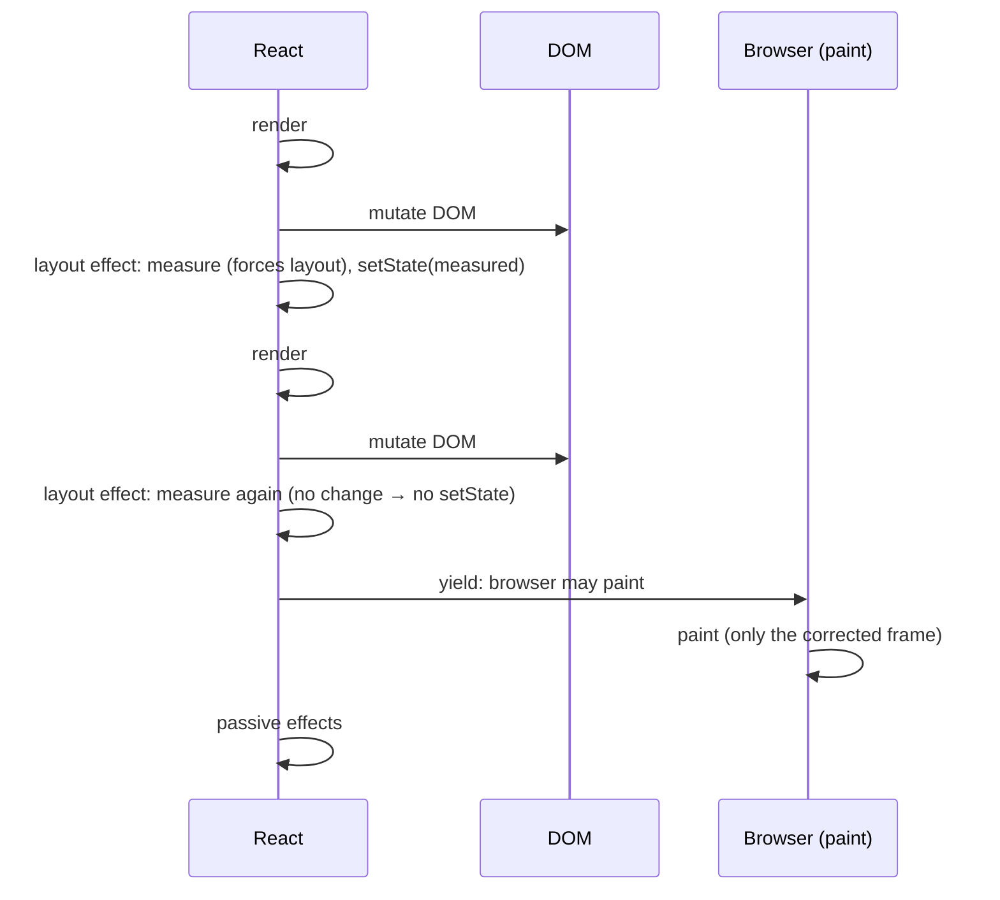
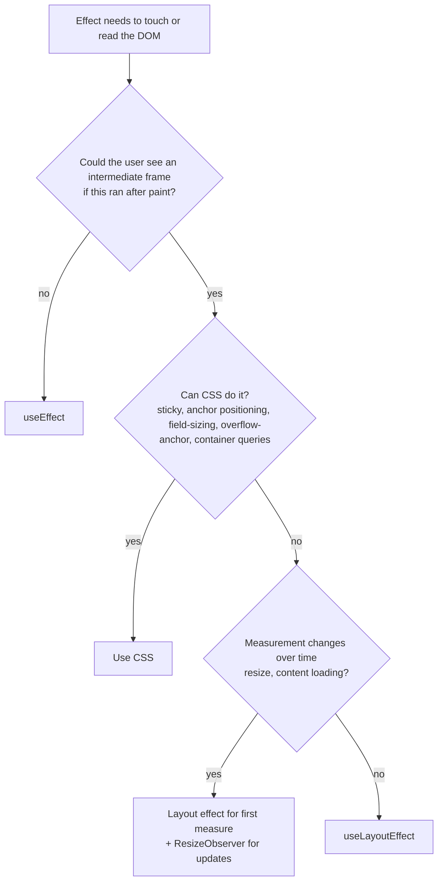

# 03 / 08 — useLayoutEffect: Measuring and Mutating Before Paint

## 1. Lesson metadata

| | |
|---|---|
| **Level** | Intermediate–Advanced |
| **Study time** | 3–4 hours (reading 1.25 h, experiments 1 h, exercises 1.5 h) |
| **Prerequisites** | [04 — useEffect and synchronization](./04-useeffect-synchronization.md), [06 — Effect cleanup](./06-effect-cleanup.md), [07 — You might not need an Effect](./07-you-might-not-need-an-effect.md), [Phase 0 / 03 — Browser rendering pipeline](../00-web-and-javascript-foundations/03-browser-rendering-pipeline.md), [Phase 2 / 11 — Render phase vs commit phase](../02-react-rendering-and-internals/11-render-phase-and-commit-phase.md) |
| **Next** | [09 — useInsertionEffect](./09-useinsertioneffect.md) |
| **Related later** | [Phase 2 / 19 — Layout vs passive effects](../02-react-rendering-and-internals/19-layout-vs-passive-effects.md), [Phase 2 / 21 — Browser paint vs React updates](../02-react-rendering-and-internals/21-browser-paint-and-react-updates.md), [Phase 7 / 20 — Long tasks and main thread](../07-performance/20-long-tasks-and-main-thread.md) |

**Learning objectives.** After this lesson you can:
1. Explain what problem `useLayoutEffect` solves that `useEffect` cannot, in terms of the browser's frame pipeline.
2. Place `useLayoutEffect`, `useEffect`, ref attachment, DOM mutation, and browser paint in the correct order for one update.
3. Implement a measure-then-position component (tooltip, popover, auto-growing textarea, scroll anchoring) without visible flicker.
4. Explain why `setState` inside a layout effect re-renders *synchronously before paint*, and why that makes it expensive.
5. Identify when `useLayoutEffect` is *not* appropriate (most of the time) and choose CSS, `ResizeObserver`, `useSyncExternalStore`, or `useEffect` instead.
6. Describe the server-rendering implications and the hydration-safe patterns.

**Concepts covered:** commit phase sub-steps, synchronous effect flushing, forced synchronous layout (reflow), layout thrashing, paint blocking, visual flicker, ref timing, SSR behavior, `flushSync` relationship, measure-then-render patterns.

---

## 2. Deep conceptual explanation

### 2.1 What problem is this lesson solving?

Some UI decisions depend on information that only exists *after* the DOM has been created and laid out: how tall is this tooltip's content? how wide is this container? how far is the scroll from the bottom? React renders by calling your function, which can only see props and state. It cannot see pixels. To learn pixels you must commit to the DOM, then read with something like `element.getBoundingClientRect()`, `offsetHeight`, or `scrollHeight`.

Now the dilemma. Suppose you read the measurement in a normal `useEffect` and then call `setState` to reposition. The sequence (as documented for `useEffect`: runs after commit; usually, though not guaranteed to be, after the browser paints) can be:

1. Render with a *guess* (tooltip placed above the button, but it does not fit).
2. Commit to the DOM.
3. Browser **paints** the guess. The user sees the tooltip in the wrong place.
4. Passive Effect runs: measure, `setState`.
5. Re-render, commit, paint again. The tooltip jumps.

That jump is a **visual flicker**. `useLayoutEffect` closes the gap: it runs after DOM mutation but **before the browser paints**, and any `setState` you do inside is processed synchronously, so the user never sees the guess.

```text
useEffect:       render → commit → [paint: user sees guess] → effect → setState → render → commit → [paint: corrected]
useLayoutEffect: render → commit → layout effect → setState → render → commit → [paint: corrected only]
```

### 2.2 The cost

The "before paint" guarantee is the whole feature, and it is also the whole cost. While a layout effect runs, the browser **cannot paint**, since React is holding the main thread (see [Phase 0 / 01 §2.4](../00-web-and-javascript-foundations/01-how-the-browser-works.md)). Reading layout (`getBoundingClientRect`) after DOM mutations forces the browser to compute style and layout *synchronously* right there (a *forced reflow*, covered in [Phase 0 / 03](../00-web-and-javascript-foundations/03-browser-rendering-pipeline.md)). A `setState` inside a layout effect then triggers another synchronous render + commit. All of this delays the first pixel of the update.

Hence the guideline from React's documentation (paraphrased): `useLayoutEffect` can hurt performance; prefer `useEffect` when you can.

### 2.3 What "layout effect" means in a one-line definition

> A layout effect is an Effect whose setup runs synchronously after React has mutated the DOM for a commit and before the browser gets a chance to paint that commit.

It has the same *signature* and *dependency semantics* as `useEffect`: `useLayoutEffect(setup, dependencies?)`, setup may return cleanup; dependencies are compared with `Object.is`; omitted array means "after every commit"; an empty array means "after mount, cleanup on unmount". The difference is *when*, not *what*.

### 2.4 Why does React expose this at all? (Why the abstraction exists)

React's job ends at "make the DOM match the render output". But applications interoperate with layout, which lives in the browser. Class components exposed this timing as `componentDidMount`/`componentDidUpdate`, which ran **synchronously after commit, before paint**. When Hooks arrived, a straight port of those lifecycle methods would have forced every effect to block paint. The React team made passive effects (`useEffect`) the default so that most work (subscriptions, logging, fetching) does not delay painting, and kept the old timing available under an explicit name, `useLayoutEffect`, for the minority of cases that need it. The name is an honest hint: "use this when you read or write *layout*".

### 2.5 Common misconceptions

| Misconception | Reality |
|---|---|
| "`useLayoutEffect` runs before the DOM updates." | It runs **after** DOM mutations (so measurements reflect the new DOM), **before paint**. For "before DOM mutations", see [useInsertionEffect](./09-useinsertioneffect.md), which is for CSS-in-JS libraries only. |
| "It's just a faster `useEffect`." | It is a *blocking* effect. It delays painting. It is not faster; it is earlier. |
| "Use it whenever an Effect touches the DOM." | Touching the DOM is fine in `useEffect` (for example focusing an element, setting `document.title`). You need layout timing only if the *user could see an intermediate frame*. |
| "It makes `setState` synchronous everywhere." | Only updates scheduled *inside* a layout effect are flushed synchronously before paint. |
| "Layout effects run on the server." | They do not. Neither do other Effects. Server rendering calls your component function only. |
| "If I never measure anything I can use it for convenience." | You pay the blocking cost without benefit. |
| "It guarantees the browser has already done layout." | Layout is computed lazily when you *read* a layout-dependent property; that read is what forces it. React does not run layout for you. |

---

## 3. Internal mechanics

### 3.1 Commit phase ordering (teaching model)

Following [Phase 2 / 11](../02-react-rendering-and-internals/11-render-phase-and-commit-phase.md): rendering is calculation and can be interrupted; the **commit** applies results synchronously and is not interruptible. Within a commit, conceptually:

1. **Before-mutation** work (reading the DOM for certain features; e.g., class `getSnapshotBeforeUpdate`).
2. **Mutation**: DOM insertions, updates, deletions. Layout-effect **cleanups** from the previous commit run around here (for updated components) and for deletions. *Implementation detail:* the exact interleaving with DOM mutations is not part of the public contract. The guarantee is that a previous layout effect's cleanup runs before the next setup of the same effect.
3. **Layout**: refs are attached (or ref callbacks invoked), class `componentDidMount`/`componentDidUpdate` and **`useLayoutEffect` setups** run, in tree order, children before parents.
4. React finishes the commit. If layout effects scheduled synchronous updates, React processes them *immediately* (still before paint).
5. The browser gets a **rendering opportunity** and paints (when it chooses to).
6. **Passive effects** (`useEffect`) are flushed.

*Public guarantees (documented):* layout effects run before the browser repaints; `useLayoutEffect` setups run after the DOM has been updated; updates scheduled inside them are processed synchronously before paint; the order of setup is children-first (like `componentDidMount`).
*Teaching model:* the six-step list.
*Implementation detail:* names of internal commit passes; flags used on fibers; whether the passes are separate loops.

**Version note:** passive effects *usually* run after paint, but since React 18 they are flushed synchronously (right after the commit, in the same task and before the browser can paint) when the render was the result of a discrete event like a click (verified in the sandbox with React 19.3: after `button.click()` returns, the passive effect runs in the microtask that flushes the sync-lane render), so that updates triggered by those effects are visible together with the click's result. Therefore "`useEffect` always runs after paint" is false and you must not use it to *order* against paint. Layout timing is the only documented way to say "before paint".

### 3.2 Refs and layout effects

Refs to DOM nodes are attached *before* layout effects run (and cleared during unmount), so `ref.current` is non-null inside a `useLayoutEffect` or `useEffect` setup (for elements that rendered). Inside the render function the ref for a *first-mount* element is still `null` ([lesson 10](./10-useref-and-mutable-references.md)). If a ref callback exists (React 19 supports ref callback cleanup functions), ref attach/detach work belongs to the same layout phase.

### 3.3 Synchronous re-render from a layout effect

When a layout effect calls `setState`, React does not defer to a later task. The scheduled update is processed before yielding to the browser: React finishes the current commit, then immediately renders and commits again. Conceptually this is the same priority as a discrete event update (synchronous lane). The user sees only the final frame. Deep note: do not set state in a layout effect unconditionally in a way that re-runs the same layout effect, or you get an infinite synchronous loop; conditions or dependency arrays must terminate.



### 3.4 Forced synchronous layout (reflow) and thrashing

The DOM is not laid out each time you mutate it; the browser marks styles/layout dirty and recomputes at the next rendering opportunity ([Phase 0 / 04](../00-web-and-javascript-foundations/04-dom-structure-and-mutation.md)). *Reading* geometry (`offsetHeight`, `getBoundingClientRect`, `scrollHeight`, `getComputedStyle(...).width`, etc.) forces the browser to flush pending style/layout work immediately so the answer is accurate. That is a forced reflow. A **layout thrash** is alternating write–read–write–read in a loop, forcing a reflow each iteration. In React terms: ten components each measure *and* write in their layout effects in sequence: each measurement can force layout again because the previous component's layout effect mutated the DOM. Batch reads first, then writes, and prefer one measuring component over many.

*Implementation detail:* which properties force layout differs slightly across engines; the MDN/Chromium documentation lists commonly known ones.

### 3.5 Server rendering

Server rendering (`renderToString` / `renderToPipeableStream` or framework SSR) runs components to produce HTML. No effects of any kind run. Therefore:

- The server HTML cannot contain measured values. The first client render during **hydration** must produce the same markup as the server did, so a measured result cannot influence it; apply it in the layout effect (after hydration commit).
- **Version note:** React 18 and earlier logged a warning ("useLayoutEffect does nothing on the server") when `useLayoutEffect` was called during server rendering. React 19 no longer warns (verified: `renderToString` of a component using `useLayoutEffect` on React 19.3 prints no warning, and the string "useLayoutEffect does nothing" is absent from `react-dom-server`). The effect itself is still not executed on the server. (The react.dev `useLayoutEffect` page still has a troubleshooting entry for the old message; it only matters if you run React 18 or older.)
- Common workarounds in libraries: an *isomorphic layout effect* (`const useIsoLayoutEffect = typeof window !== 'undefined' ? useLayoutEffect : useEffect`). With React 19 the server warning is gone, so the workaround is only needed if you support React 18 or older.

### 3.6 `flushSync` relationship

`flushSync(() => setState(...))` forces React to commit the update synchronously, which is occasionally needed to read the DOM *right after* an update inside an event handler (for example scrolling to a just-added list item). It is the *imperative, event-time* cousin of the layout effect: the layout effect says "after any commit that changes X, do Y before paint"; `flushSync` says "commit now, so my next statement sees the DOM". Prefer the layout effect when the reaction belongs to the *state change* rather than a specific event path; use `flushSync` sparingly (it opts out of batching and can hurt performance).

---

## 4. Step-by-step execution walkthrough

**Scenario:** a `<Tooltip>` wrapping a button. The tooltip should appear above the button; if there is not enough room above the viewport top, it should appear below. The tooltip's height is not known until content is laid out.

State: `tooltipHeight` (number, initially `0`) used to compute `top`.

| # | Step | Detail |
|---|---|---|
| 1 | User hovers button | Event handler sets `visible = true`. |
| 2 | **Render #1** | `visible` true; `tooltipHeight = 0`; tooltip rendered at `top = anchorTop - 0` (a guess). |
| 3 | **Commit #1: mutation** | `<div class="tooltip">` is inserted into the DOM. Styles apply but layout is not yet computed (dirty). |
| 4 | Ref attached | `tooltipRef.current` points to the new `div`. |
| 5 | **Layout effect setup** | `tooltipRef.current.getBoundingClientRect()` forces layout, returning `height = 48`. If `height !== tooltipHeight`, `setTooltipHeight(48)`. |
| 6 | React flushes update synchronously | **Render #2**: `top = anchorTop - 48`, or `anchorBottom` if no room. |
| 7 | **Commit #2: mutation** | `style.top` is updated. |
| 8 | Layout effect does not re-run | Its dependencies (`visible`, `content`) did not change in commit #2; the measured height is read inside the effect, not listed as a dependency, which avoids a loop. |
| 9 | Browser paints | The user sees the tooltip in its correct position. First paint of the tooltip is already corrected. |
| 10 | Passive effects run | (e.g., analytics). |

**Predict:** if step 5 used `useEffect` instead, what would the user see on a slow device (CPU 6× throttle)? *Answer:* possibly one painted frame with the tooltip overlapping the button (top guess) before it jumps, because passive effects may run after the first paint. On a fast machine with discrete-event flushing (hover is *not* a discrete event in React's classification; click is), flicker is more likely for hover/scroll-driven updates. The point: do not depend on being lucky.

---

## 5. Code examples

### 5.1 Minimal example: observe the ordering

```tsx
import { useEffect, useLayoutEffect, useRef, useState } from 'react';

export function Order() {
  const [n, setN] = useState(0);
  const ref = useRef<HTMLParagraphElement>(null);

  useLayoutEffect(() => {
    console.log('layout effect, text =', ref.current?.textContent);
  });
  useEffect(() => {
    console.log('passive effect, text =', ref.current?.textContent);
  });

  console.log('render', n);
  return (
    <>
      <button onClick={() => setN(n + 1)}>inc</button>
      <p ref={ref}>count {n}</p>
    </>
  );
}
```

**Predict** the console output after one click (ignore StrictMode). 

*Reveal:* `render 1`, `layout effect, text = count 1`, `passive effect, text = count 1`. Both effects see the *new* DOM, since both run after commit. The distinction is only observable relative to paint. To *see* it, make the layout effect do expensive work (`while (performance.now() < start + 500) {}`) and notice that the text "count 1" does not appear on screen until 500 ms later, whereas with `useEffect` the text paints first (typically) and the busy work happens after. (Try it in the Performance panel: the long task shows before the paint with layout effect and after with passive.)

*Note on StrictMode:* in development, effects run setup → cleanup → setup on mount, and components render twice; you will see doubled logs, which are not a difference between the hooks.

### 5.2 Practical example: tooltip positioning

```tsx
import { useLayoutEffect, useRef, useState, type ReactNode } from 'react';
import { createPortal } from 'react-dom';

type TooltipProps = {
  anchorRect: DOMRect;       // from the trigger, captured on hover
  children: ReactNode;
};

export function Tooltip({ anchorRect, children }: TooltipProps) {
  const ref = useRef<HTMLDivElement>(null);
  const [top, setTop] = useState<number | null>(null);

  useLayoutEffect(() => {
    const el = ref.current;
    if (el === null) return;
    const { height } = el.getBoundingClientRect();
    const above = anchorRect.top - height;
    setTop(above >= 0 ? above : anchorRect.bottom);
  }, [anchorRect, children]);

  return createPortal(
    <div
      ref={ref}
      role="tooltip"
      style={{
        position: 'fixed',
        left: anchorRect.left,
        top: top ?? 0,
        // hide first guess: it is never painted, but be defensive for SSR/timing
        visibility: top === null ? 'hidden' : 'visible',
      }}
    >
      {children}
    </div>,
    document.body
  );
}
```

*Line notes.*
- `anchorRect.top - height` when it fits above; else place below.
- `[anchorRect, children]` ensures remeasure when content changes. `children` is a new element object every parent render, so this effect re-runs whenever the parent renders; that is acceptable because `setTop` with a number equal to the current state bails out, so an unchanged measurement causes no further render and the effect cannot loop.
- `top === null` initial state plus `visibility: hidden` is belt-and-suspenders: the layout effect normally prevents the guess from being painted, but defensive hiding helps if the component is later rendered where layout effects don't flush before paint (for example a future change moves positioning logic to a passive effect).
- Portals: `createPortal` into `document.body`; `ref` still attaches to the portal's DOM node. For accessibility, wire `aria-describedby` on the trigger (tooltip semantics belong to the trigger/pattern; see [Phase 8 / 10](../08-testing-and-quality/10-accessibility-testing.md)).

**Trade-off.** Two renders for every tooltip show. Fine for hover UI; not fine for 5,000 rows each with a layout-effect measurement.

### 5.3 Incorrect example: layout effect used for non-visual work

```tsx
function Analytics({ page }: { page: string }) {
  useLayoutEffect(() => {
    sendPageView(page);          // network call; nothing visual
  }, [page]);
  return null;
}
```

Why wrong: analytics does not depend on layout and nothing visual would flicker. Using `useLayoutEffect` here blocks painting for the duration of `sendPageView` and gains nothing. (`fetch` itself is async, but any synchronous work in the setup, such as serialization, JSON.stringify of a large payload, or `localStorage` writes, delays paint.) Use `useEffect`.

### 5.4 Incorrect example 2: effect reading layout, then painting the wrong frame

```tsx
function GrowingTextarea({ value, onChange }: Props) {
  const ref = useRef<HTMLTextAreaElement>(null);
  useEffect(() => {
    const el = ref.current!;
    el.style.height = 'auto';
    el.style.height = el.scrollHeight + 'px';
  }, [value]);
  return <textarea ref={ref} value={value} onChange={e => onChange(e.target.value)} />;
}
```

Symptom: when the user types a character that causes a new line, there can be one painted frame where the textarea is the old height with a scrollbar flash. With `useEffect` the resize may occur after paint; the user perceives a "jump".

### 5.5 Corrected implementation

```tsx
function GrowingTextarea({ value, onChange }: Props) {
  const ref = useRef<HTMLTextAreaElement>(null);

  useLayoutEffect(() => {
    const el = ref.current;
    if (el === null) return;
    el.style.height = 'auto';              // reset (write)
    el.style.height = `${el.scrollHeight}px`; // read forces layout, then write
  }, [value]);

  return (
    <textarea
      ref={ref}
      value={value}
      onChange={e => onChange(e.target.value)}
      rows={1}
    />
  );
}
```

*Why a layout effect is justified.* It directly mutates the DOM style imperatively based on a layout read; the mutation must land before paint to avoid a jump. *There is no `setState`*, so there is no second render. The cost is one forced reflow per keystroke.

**Alternative.** Modern CSS offers `field-sizing: content` for textareas/inputs in supporting browsers, which removes the JavaScript entirely. MDN lists `field-sizing` as Baseline "newly available" since June 2026 (checked 2026-10-22), so it works in the latest versions of all major engines but not in older browsers; check MDN's table against your support targets.

### 5.6 Advanced example: scroll anchoring in a chat list

Requirement: when new messages are prepended (loading history), keep the viewport on the same message instead of jumping to the top.

```tsx
import { useLayoutEffect, useRef } from 'react';

type Message = { id: string; text: string };

export function ChatLog({ messages }: { messages: Message[] }) {
  const containerRef = useRef<HTMLDivElement>(null);
  const prevScrollHeight = useRef(0);
  const prevFirstId = useRef<string | null>(null);

  // Run after every commit that changes messages.
  useLayoutEffect(() => {
    const el = containerRef.current;
    if (el === null) return;

    const firstId = messages[0]?.id ?? null;
    const prepended =
      prevFirstId.current !== null && firstId !== prevFirstId.current;

    if (prepended) {
      // content grew above the viewport; restore the visual position
      el.scrollTop += el.scrollHeight - prevScrollHeight.current;
    }

    prevScrollHeight.current = el.scrollHeight;
    prevFirstId.current = firstId;
  }, [messages]);

  return (
    <div ref={containerRef} style={{ height: 400, overflowY: 'auto' }}>
      {messages.map(m => (
        <p key={m.id}>{m.text}</p>
      ))}
    </div>
  );
}
```

*Explanation.* Before the commit the container's `scrollHeight` was `H0`. After prepending, the DOM grows to `H1`, and the browser keeps `scrollTop` unchanged, so the visible content shifts by `H1 - H0`. We correct by adding `H1 - H0` *before paint*. With `useEffect`, the user may see the content jump and then snap back. The refs store *measurements across renders* without causing renders ([lesson 10](./10-useref-and-mutable-references.md)); the effect reads and writes the DOM directly and never calls `setState`.

*Caveats.* (1) This heuristic assumes prepends, not insertions in the middle. (2) CSS `overflow-anchor` (scroll anchoring) already does something similar natively in several browsers; check whether the browser's anchoring suffices before writing JS, and note it can interfere with your manual correction if both apply, so test in your target browsers. (3) For long lists use windowing ([Phase 7 / 09](../07-performance/09-windowing-and-virtualization.md)).

### 5.7 Hydration-safe measuring

```tsx
function Measured() {
  const ref = useRef<HTMLDivElement>(null);
  // server and first client render both render `null` width → markup matches
  const [width, setWidth] = useState<number | null>(null);

  useLayoutEffect(() => {
    const el = ref.current;
    if (el !== null) setWidth(el.getBoundingClientRect().width);
  }, []);

  return <div ref={ref}>{width === null ? 'measuring' : `${Math.round(width)}px wide`}</div>;
}
```

The server's HTML says "measuring"; the first client render also says "measuring" (no mismatch); the layout effect updates before paint after hydration. Real apps often prefer `ResizeObserver` (via a passive effect) for responsive widths because widths change after mount ([§7](#7-alternative-approaches-and-trade-offs)).

---

## 6. Visual explanations

### 6.1 One update, two timelines

```mermaid
gantt
  title Same update with useEffect vs useLayoutEffect (conceptual timeline, not to scale)
  dateFormat X
  axisFormat %s
  section useEffect
  Render #1          :a1, 0, 2
  Commit #1 (DOM)    :a2, 2, 1
  Browser paint (guess visible) :crit, a3, 3, 1
  Passive effect measure + setState :a4, 4, 1
  Render #2 + commit :a5, 5, 2
  Browser paint (corrected) :a6, 7, 1
  section useLayoutEffect
  Render #1          :b1, 0, 2
  Commit #1 (DOM)    :b2, 2, 1
  Layout effect measure + setState :b3, 3, 1
  Render #2 + commit :b4, 4, 2
  Browser paint (corrected only) :b5, 6, 1
```



### 6.2 Where each hook fires

```text
        render  ──▶  DOM mutations  ──▶  refs attached  ──▶  useLayoutEffect  ──▶  [paint]  ──▶  useEffect
                           ▲                                                                       ▲
        useInsertionEffect ┘ (before mutations; CSS-in-JS only)                    usually after paint,
                                                                       sometimes flushed sooner (not guaranteed)
```

### 6.3 Decision flow



---

## 7. Alternative approaches and trade-offs

| Approach | Timing | Pros | Cons | Best for |
|---|---|---|---|---|
| **`useLayoutEffect`** | After DOM mutation, before paint | No flicker; synchronous re-render | Blocks paint; forced reflow; not on server | Measure-then-position; scroll restoration; imperative DOM sync |
| **`useEffect`** | After commit, usually after paint | Does not delay paint | Possible intermediate frame | Network, subscriptions, logging, non-visual DOM work |
| **CSS-only** (sticky, `position-anchor`/anchor positioning, `field-sizing`, container queries, scroll-snap, `overflow-anchor`) | Browser-native | No JS, no React re-render, best performance | Support varies by feature and browser age (anchor positioning and `field-sizing` are Baseline 2026 "newly available"); check MDN compat | Positioning/sizing where CSS suffices |
| **`ResizeObserver` in `useEffect`** | Async after layout | Handles ongoing size changes without polling; no forced reflow per React commit | First measurement may paint a guess; callback timing is browser-controlled | Responsive components, charts |
| **Ref callback measuring** | During commit when node attaches | Co-located with element; can return cleanup (React 19) | Only on attach/detach, not on content change | One-time measurement of a mounting node |
| **`useSyncExternalStore`** | Synchronous reads with subscription | Tear-free for external data like `matchMedia` | Not for DOM element measurements | Viewport/media state |
| **`flushSync` in handler** | Immediate | Precise control after specific event | Opts out of batching; not reactive to non-event updates | "Add item then scroll to it" |
| **Render a hidden measuring clone** | Render-time | Avoids imperatively reading live DOM | Double DOM; complexity | Rare virtualization needs |

**A scenario where the recommended approach is *not* best.** If your tooltip is attached to an element that moves (scroll, resize, animation), a single layout-effect measurement is stale after the first frame. You need continuous updates (`ResizeObserver`, scroll listeners, or CSS anchor positioning where supported) and typically a positioning library (Floating UI is a common choice; verify current docs before adopting). The layout effect is then only the first-measure step, and doing every update through React state at 60 fps is the wrong tool; write directly to `style.transform` via a ref to avoid re-rendering.

---

## 8. Best practices and anti-patterns

**Best practices**
- Default to `useEffect`. Reach for `useLayoutEffect` only after you can *name the visible flicker* it prevents (or the correctness issue: reading layout that must match the just-committed DOM).
- Keep layout-effect bodies tiny: read, compute, write. No network calls, no heavy computation.
- Do reads first, then writes, to avoid layout thrash; if several components need to measure, consider one parent measuring and passing down.
- Prefer writing directly to the DOM via a ref (no `setState`) when the adjustment is purely visual and not part of your React output; this avoids the second render. *But* do not manually mutate DOM that React manages in ways React will overwrite on the next render (for example setting `className` that React also sets).
- Make the effect idempotent and add an equality check before `setState` to avoid loops.
- Provide cleanup for anything you register (observers, listeners).
- Test on throttled CPUs, because flicker and blocking only show on slow machines.

**Beginner mistakes**
- Using `useLayoutEffect` "to be safe" everywhere.
- Calling `setState` unconditionally from a layout effect with no dependency array (infinite synchronous loop → React error "Maximum update depth exceeded").
- Measuring in render (`ref.current?.offsetHeight` during render); the ref is stale or `null` and reading layout during render is a side effect-ish read that violates purity ([Phase 2 / 12](../02-react-rendering-and-internals/12-why-rendering-must-be-pure.md)).

**Experienced-developer mistakes**
- A layout effect per list row doing `getBoundingClientRect` (N forced reflows in one commit).
- Using layout effects to synchronize *React state to React state*: that is derived data ([07](./07-you-might-not-need-an-effect.md)); layout timing only hides the symptom (the stale frame) without fixing the render-count cost.
- Copying the "isomorphic layout effect" snippet although you only support React 19, which no longer warns on the server.
- Forgetting that `children`/object props are new each render and appear in dependency arrays.

**Smells**
- Layout effect with `fetch`, `localStorage`, `JSON.parse`, or logging inside.
- Layout effect that only calls `setState` with a value computed from props.
- `useLayoutEffect` in a component rendered thousands of times.

**Justified exceptions.** Third-party imperative libraries that need the DOM node *sized* before initialization (some chart/map libs), focus management where moving focus after paint would flash a focus ring, and library-level hooks (for example resize/size-observers) where intermediate frames are visible to all users of the library.

---

## 9. Real-world application

**Dashboards.** *Chart container:* a chart needs pixel width to compute scales. Pattern: `useLayoutEffect` for the first `getBoundingClientRect().width` (so the first painted frame is correct) plus a `ResizeObserver` (in the same hook's effect) for subsequent changes. Constraint: dashboards often mount 10–40 charts; measure in a *single* shared `ResizeObserver` instance to avoid 40 forced reflows per commit.

**E-commerce.** *Sticky add-to-cart bar offsets*, *image zoom lens*: measuring image natural vs rendered size to place the lens. Use `onLoad` handlers for image-size-dependent logic rather than layout effects, since layout effects fire before the image finishes loading.

**Finance.** *Virtualized tables:* row height measurement for variable-height rows. Layout effect measures new rows before paint to avoid jumpy scrollbars; but measure in batches via an observer. Verify virtualization library behavior rather than reimplementing.

**Forms.** *Auto-growing textareas, inline error placement*, and *focus on error*. Focus on the first invalid field after submit is `useEffect`/handler territory (focus does not change visuals except the ring); however, if a modal's first focus target must be focused before the open animation paints, a layout effect avoids a flash of unfocused state.

**Auth/modals.** Locking body scroll when a modal opens: compute scrollbar width and add padding *before paint* to avoid a horizontal layout shift. Layout effect with cleanup that restores the previous styles. Constraint: nested modals require ref-counted lock management.

**Realtime/chat.** The scroll-anchoring example (§5.6). Constraint: message bursts at 20 Hz mean you must batch updates (React batches within the same tick; consider `useDeferredValue`/transitions only for non-urgent portions).

**Multi-team.** Wrap layout-effect usage into small, named, tested hooks (`useElementSize`, `useScrollAnchor`) so product teams don't write raw layout effects, and so SSR and observer policies are centralized ([15 — Custom hooks](./15-custom-hooks.md)).

---

## 10. Debugging and troubleshooting

| Symptom | Likely cause | Investigation | Fix |
|---|---|---|---|
| Tooltip/popover "jumps" for a frame | Measurement in passive effect | Performance panel recording with CPU 4–6× throttle; screenshots strip shows wrong frame; React Profiler shows two commits | Move measurement + `setState` to layout effect (or CSS) |
| Page feels sluggish on interaction; "Forced reflow" warnings in the Performance panel | Layout effects reading geometry after writes, many times | Performance → Main → Bottom-up → "Recalculate Style" / "Layout" with purple "Forced reflow" annotation; call stack leads to your effect | Batch reads/writes, single observer, remove per-row measuring |
| "Maximum update depth exceeded" | `setState` in layout effect re-triggering itself | Stack trace; log in effect; check dependency array and equality guard | Add equality check; correct dependencies; move derived value into render |
| Server warning about `useLayoutEffect` (older React) or hydration mismatch | Layout effect used for something that affects initial markup | Console warning; compare server HTML vs first client render | Make first render deterministic; apply measured value in effect; use isomorphic variant only if you support React 18 or older |
| Measured value is `0` or `undefined` | Element `display: none`, not yet attached, or image not loaded | Check `ref.current` and computed style in Elements panel | Measure after visibility/load; use `ResizeObserver` or `onLoad` |
| Position correct on mount, wrong after font/image load | One-time measurement | Reload with cache disabled; watch layout shift in Performance → Experience | Observe size changes |
| Effects "run twice" | StrictMode | Verify `<StrictMode>` | Ensure idempotent/cleanup |

**Worked investigation: "popover flickers on low-end Android".**
1. Reproduce: Chrome DevTools → Performance → CPU throttle "6× slowdown", record opening the popover.
2. Use the **Screenshots** option and look at the frames: one frame shows the popover at `top: 0`.
3. In the flame chart, find the "Commit" and see the passive effect running after the frame's paint.
4. Switch measurement to `useLayoutEffect`; re-record: the screenshot strip no longer shows the wrong frame; note the extra "Layout" cost inside the commit.
5. Validate: React Profiler shows two commits; the total scripting time is within the interaction budget (set a team threshold, e.g. 50 ms; choose your own number from INP goals; see [Phase 7 / 21](../07-performance/21-web-vitals-and-budgets.md)).

---

## 11. Exercises

### Level A — Knowledge
A1. When exactly does `useLayoutEffect` setup run relative to DOM mutation and browser paint?
A2. Why does `useLayoutEffect` not run during server rendering? What must your first client render do about measured values?
A3. What is a forced reflow, and which kinds of reads cause it?
A4. List three alternatives to a layout effect for positioning/sizing problems.
A5. True or false: "`useEffect` always runs after the browser paints." Explain.

### Level B — Code comprehension
B1. Given §5.1 without StrictMode, if the page has `useLayoutEffect` doing a 300 ms busy loop, what does the user see during those 300 ms: old count, new count, or something else? Compare with `useEffect`.
B2. What goes wrong?
```tsx
useLayoutEffect(() => {
  setHeight(ref.current!.offsetHeight);
});
```
B3. In §5.2 `Tooltip`, why does calling `setTop` inside the effect not loop forever even though `children` changes identity every parent render?

### Level C — Implementation
C1. Implement `useElementWidth(ref)` returning the element's width, accurate on first paint and updating on resize, using a layout effect for the first read and `ResizeObserver` after. Include cleanup and SSR safety.
C2. Implement a `ScrollToBottomOnNew` behavior for a log list: if the user is already at the bottom, keep them at the bottom after new messages append; if not, do not move them.
C3. Convert the §5.4 textarea to the layout version and add a `maxRows` prop.

### Level D — Debugging
D1. A table renders 300 rows; each row has `useLayoutEffect(() => { setW(ref.current!.getBoundingClientRect().width) }, [])`. Scrolling to mount new rows is janky. Diagnose and propose two fixes.
D2. After changing a popover from `useEffect` to `useLayoutEffect`, the flicker is gone on desktop but Lighthouse/INP regressed for the open interaction. Hypothesize and test.

### Level E — Architecture and engineering decisions
E1. Your design system exports `Popover`. Decide whether to implement positioning with (a) a layout effect + manual math, (b) a positioning library, (c) CSS anchor positioning. Give selection criteria and a recommendation for a product that must support the last two browser versions of Chrome, Safari, Firefox.
E2. Your SSR app logs errors/warnings about layout effects on the server. Propose a policy for isomorphic hooks across teams.

### Level F — Expert challenge
F1. Design a `useSizeObserver` utility used by 40 charts on a dashboard. Requirements: no flicker on first paint, one `ResizeObserver` for all, no forced reflow per chart per commit, SSR-safe, and correct under StrictMode. Describe API, data structure, subscription lifecycle, and test strategy.

---

## 12. Detailed answers and explanations

> Attempt the exercises first.

**A1.** After React has applied the DOM mutations for a commit and attached refs, and before the browser has the chance to paint that commit. Updates scheduled inside are processed synchronously before paint. Wrong answers: "before the DOM updates" (that is `useInsertionEffect`'s territory, and only for style injection) or "after paint" (that is the usual `useEffect` behavior).

**A2.** Server rendering only executes component functions to emit HTML; it never commits to a DOM, so no Effects (including layout effects) run. The first client render during hydration must produce the same markup as the server, so measured values cannot affect it: render a placeholder or a CSS-based default and apply the measured value in the layout effect, which runs after hydration commit but before paint.

**A3.** The browser normally batches style/layout work to the next rendering opportunity. Reading geometry-dependent properties (`offsetWidth/Height`, `getBoundingClientRect`, `clientHeight`, `scrollTop/scrollHeight` in many cases, `getComputedStyle` for layout-dependent values) when styles or layout are dirty forces it to compute them immediately. Cost is proportional to the amount of dirty/affected layout. Exact list varies by engine; consult a maintained reference rather than memorizing.

**A4.** CSS (sticky, anchor positioning, `field-sizing`, container queries, `overflow-anchor`), `ResizeObserver` (inside `useEffect`), a ref callback for attach-time measurement, `useSyncExternalStore` for `matchMedia`-type data, a positioning library. Any three.

**A5.** False. Passive effects are typically scheduled after paint, but React may flush them synchronously, for example for renders caused by discrete events such as clicks, or before the next render begins. The only documented *before-paint* hook is the layout effect. Exact flush timing is an implementation detail.

**B1.** With `useLayoutEffect`, the browser cannot paint the new commit until the effect ends: the user sees the **old count** (and the frozen page) for ≈300 ms, then the new count. With `useEffect` (typically) the browser paints the new count first, then the busy loop runs, so the new count is visible while the page is unresponsive. Caveat: for a click-triggered update React may flush the passive effect before paint, in which case both would look similar; try a hover or timer-triggered update to see the difference reliably.

**B2.** No dependency array → runs after every commit; `setHeight` with a new value causes another render and commit, which runs the effect again. It terminates only because `setHeight(sameNumber)` bails out once the height stops changing; if the layout depends on `height` (for example the element's own height is `height` + something), it can oscillate and React will throw "Maximum update depth exceeded" (the exact threshold is an implementation detail). Fix: add `[]` or relevant dependencies and an equality guard, or avoid state by writing directly to the DOM.

**B3.** `setTop(x)` with an equal number is a no-op bailout (`Object.is`). Each parent render creates a new `children`, so the effect re-measures, computes the same `x`, and `setTop` bails out without scheduling a meaningful re-render. If content actually changes size, `x` changes once, a re-render happens, and the effect runs again only if `anchorRect`/`children` identity changed again; the parent isn't re-rendering from this state change (state lives in `Tooltip`), so `children` identity from the parent stays the same: no loop. (If the effect ran again, it would get the same height and bail out.)

**C1.**
```tsx
import { useLayoutEffect, useState, type RefObject } from 'react';

export function useElementWidth<T extends HTMLElement>(ref: RefObject<T | null>): number | null {
  const [width, setWidth] = useState<number | null>(null);

  useLayoutEffect(() => {
    const el = ref.current;
    if (el === null) return;

    setWidth(el.getBoundingClientRect().width); // accurate before first paint

    const ro = new ResizeObserver(entries => {
      const w = entries[0]?.contentRect.width;
      if (w !== undefined) setWidth(w);
    });
    ro.observe(el);
    return () => ro.disconnect();
  }, [ref]);

  return width;
}
```
Notes: `contentRect.width` excludes padding/border while `getBoundingClientRect().width` includes them, so the two readings disagree; for consistency use `entries[0].borderBoxSize` or read `el.getBoundingClientRect()` in the callback too. SSR: returns `null` initially, and `ResizeObserver` is only constructed inside the effect (never on the server). The `ref` is stable. Under StrictMode, setup runs twice with proper cleanup. Evaluation: accounts for border-box inconsistency, cleanup, SSR, null handling.

**C2.**
```tsx
function Log({ lines }: { lines: string[] }) {
  const ref = useRef<HTMLDivElement>(null);
  const wasAtBottom = useRef(true);

  function onScroll() {
    const el = ref.current!;
    wasAtBottom.current = el.scrollHeight - el.scrollTop - el.clientHeight < 4;
  }

  useLayoutEffect(() => {
    const el = ref.current;
    if (el !== null && wasAtBottom.current) el.scrollTop = el.scrollHeight;
  }, [lines]);

  return (
    <div ref={ref} onScroll={onScroll} style={{ height: 300, overflowY: 'auto' }}>
      {lines.map((l, i) => <div key={i}>{l}</div>)}
    </div>
  );
}
```
Key points: capture "was at bottom" *before* the new content is committed (via the scroll handler, since after commit the metrics already include new lines); 4 px tolerance for fractional pixels; index keys are acceptable only because lines are append-only and never reordered (see [Phase 1 / 09](../01-react-fundamentals/09-lists-keys-and-identity.md)). Layout timing avoids a frame where the log shows old position.

**C3.** Add `maxRows` and a line height: after setting height compute `Math.min(el.scrollHeight, maxRows * lineHeight)` and set `overflowY` accordingly. Line height can be read via `parseFloat(getComputedStyle(el).lineHeight)`; beware `'normal'` returning NaN, in which case fall back to an explicit CSS variable. Evaluation: handles NaN fallback, includes padding, keeps no `setState`.

**D1.** 300 rows × layout read in a commit; each row's effect reads after the previous row's setup may have changed the DOM through `setW` re-renders, causing repeated forced layout, plus 300 extra renders. Fix 1: remove per-row measurement; use CSS (`width: 100%`, grid, container queries) or measure the container once. Fix 2: single `ResizeObserver` for the table, share widths via context or CSS variable. Fix 3: virtualize rows. Verify: Performance panel shows fewer "Forced reflow" events and shorter commit.

**D2.** Hypothesis: the layout effect now blocks paint and forces a synchronous reflow plus a second render, adding to the interaction's "presentation delay" (INP includes time until next paint). Test: record before/after in the Performance panel on throttled CPU, compare time-to-next-paint after click; check whether the popover content is large (expensive layout) or whether the effect triggers extra work (portal, many listeners). Mitigations: reduce layout cost (`contain: layout`, simpler subtree), avoid state round trip by writing `style.top` directly, or use CSS positioning. If INP regression outweighs flicker, you might accept a hidden-first-frame (`visibility: hidden` until measured with a passive effect) as the trade.

**E1.** Criteria: browser support, correctness under scroll/resize, bundle size, accessibility, maintenance cost, SSR. (a) Manual math: smallest bundle but you will re-implement flipping, shifting, scroll parents, virtual elements; brittle. (b) Positioning library (for example Floating UI; verify current API): handles edge cases, ongoing updates, middleware; adds a dependency. (c) CSS anchor positioning: best performance and no JS; MDN lists it as Baseline "newly available" since January 2026 (checked 2026-10-22), i.e. present in the latest releases of all three engines but not in older ones. Recommendation for "last two versions of all three engines": CSS anchor positioning is now a viable primary implementation (verify the exact minimum versions on MDN/caniuse), with a positioning library as a fallback for flip/shift edge cases or older browsers; design the `Popover` API so the implementation can swap. Evaluation: criteria-driven, mentions future migration and a11y (focus management, `aria-*`, Escape).

**E2.** Policy: ban raw `useLayoutEffect` in product code; require named hooks in a shared package with documented SSR behavior; one place chooses the isomorphic strategy per supported React version; lint rule for imports; tests that run `renderToString` on components using them; document that measured values never influence the initial markup. Evaluation: centralization, SSR tests, version awareness.

**F1.** Example design. *API:* `useSize(ref): Size | null` where `Size = { width: number; height: number }`. *Core:* module-level singleton `SizeStore` holding one `ResizeObserver`, a `Map<Element, Set<() => void>>` of listeners and a `Map<Element, Size>` of last sizes (unobserve on last unsubscribe). *First paint:* in a layout effect, read `getBoundingClientRect()` once per newly observed element and store it. Each chart does reads only and no writes in that phase, so after the first forced layout the remaining reads hit clean layout; thrashing needs interleaved writes. *Subscription:* use `useSyncExternalStore(subscribe, getSnapshot, () => null)` so updates are tear-free; `getSnapshot` returns the cached `Size` object (stable identity until size changes). *Cleanup:* last unsubscribe calls `unobserve`; StrictMode double-setup is safe because subscribe/unsubscribe are symmetric. *SSR:* server snapshot `null`. *Tests:* fake `ResizeObserver` to trigger callbacks; assert one observer instance; assert no state updates when size unchanged (referential stability); `renderToString` smoke test; StrictMode test counting `observe`/`unobserve` calls. Evaluation: single observer, stable snapshots, reads-only in layout phase, SSR/StrictMode handled.

---

## 13. Senior engineer interview questions

**Q1. "What is the difference between `useEffect` and `useLayoutEffect`?"**
Timing relative to paint, hence blocking behavior. `useLayoutEffect` runs after DOM mutation before paint and flushes its updates synchronously; `useEffect` runs after commit, normally not blocking paint. Because layout effects hold the main thread before the frame, they should be limited to work that prevents visible flicker. Mention that `useEffect` flush timing is not guaranteed relative to paint.

**Q2. "Give a real example where `useEffect` produces a visible bug and `useLayoutEffect` fixes it."**
Tooltip/popover flip, auto-resizing textarea, scroll position restoration on prepend. In each, the first painted frame (before measurement) is wrong, and moving the measurement-and-correction before paint eliminates the frame. Show awareness of the cost and CSS alternatives.

**Q3. "Why can a layout effect hurt INP?"**
INP measures the delay until the next paint after an interaction. Layout effects run inside the commit before that paint; forced reflow and second render add to input-to-paint latency. Heavy work in them extends the longest task and delays presentation.

**Q4. "How do layout effects interact with SSR and hydration?"**
They do not run on the server. Initial client render must match server markup, so measured values can't be part of the initial render; apply them in the layout effect after hydration. Awareness that React 18 warned on the server (React 19 does not) and of isomorphic hooks.

**Q5. "How would you avoid layout thrash across many components?"**
Centralize measurement (single observer or parent), separate reads and writes, avoid `setState` where a direct style write suffices, virtualize large lists, and prefer CSS solutions. Verify with the Performance panel's forced-reflow annotations.

**Q6. "Is it OK to set state in `useLayoutEffect`?"**
Yes, it is a primary use (measure → set state → corrected frame before paint). Pitfalls: loops without equality guards; two renders every time; don't use it to derive values that could be computed in render.

**Q7. "Where does `flushSync` fit?"**
When an event handler must see the DOM updated immediately after a state change (e.g., to focus/scroll an element just inserted). It forces a synchronous commit; costs batching. If the logic belongs to the state change itself (not a specific event), a layout effect is cleaner.

---

## 14. Further learning resources

| Resource | URL | Covers / why | Level | Study |
|---|---|---|---|---|
| React docs — `useLayoutEffect` | <https://react.dev/reference/react/useLayoutEffect> | Official semantics, caveats, tooltip example, server rendering note | Intermediate | Whole page, Usage → "Measuring layout before the browser repaints" |
| React docs — `useEffect` | <https://react.dev/reference/react/useEffect> | Contrast timing and caveats | Intermediate | Caveats |
| React docs — `flushSync` | <https://react.dev/reference/react-dom/flushSync> | Synchronous updates | Advanced | Whole page |
| React docs — Manipulating the DOM with Refs | <https://react.dev/learn/manipulating-the-dom-with-refs> | Refs and flushSync pattern for scrolling | Intermediate | "Flushing state updates synchronously with flushSync" |
| MDN — `Element.getBoundingClientRect()` | <https://developer.mozilla.org/en-US/docs/Web/API/Element/getBoundingClientRect> | Geometry reads | Beginner | Whole page |
| MDN — `ResizeObserver` | <https://developer.mozilla.org/en-US/docs/Web/API/ResizeObserver> | Observing size changes | Intermediate | Whole page |
| MDN — `overflow-anchor` | <https://developer.mozilla.org/en-US/docs/Web/CSS/overflow-anchor> | Native scroll anchoring | Intermediate | Whole page |
| web.dev — Avoid large, complex layouts and layout thrashing | <https://web.dev/articles/avoid-large-complex-layouts-and-layout-thrashing> | Forced reflow explanation | Intermediate | Whole page |
| Floating UI | <https://floating-ui.com/> | Positioning library | Intermediate | Docs overview (verify current API) |

All URLs above were checked to resolve (HTTP 200) on 2026-10-22; the npm page blocks automated requests.

---

## 15. Knowledge checkpoint

**You should now understand**
- The commit-time order: DOM mutation → refs → layout effects → paint → passive effects (with the caveat that passive effects may be flushed before paint after discrete events).
- Why a layout effect's `setState` avoids flicker and what it costs.
- Forced reflow and layout thrash.
- SSR/hydration consequences.

**You should be able to explain without notes**
- Why `useEffect` can paint a wrong first frame.
- Why layout effects are not a general-purpose "run earlier" tool.

**You should be able to implement**
- Tooltip placement, auto-growing textarea, scroll anchoring, a first-measure-plus-observer hook.

**You should be able to debug**
- Flicker via screenshots + throttled CPU in the Performance panel; forced reflow hot spots; infinite update loops.

**Before moving on:** read [09 — useInsertionEffect](./09-useinsertioneffect.md) for the even earlier hook, and then [10 — useRef](./10-useref-and-mutable-references.md), which supplies the storage for cross-render measurements used above.
