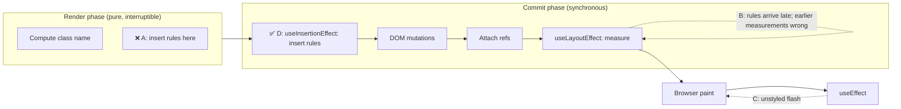
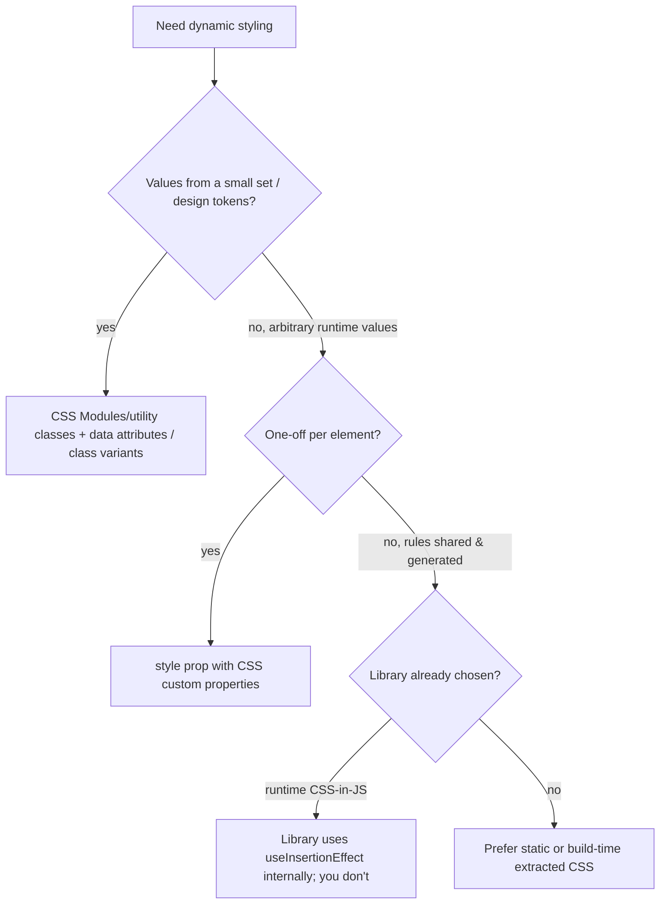

# 03 / 09 — useInsertionEffect: Injecting Styles Before Layout Reads

## 1. Lesson metadata

| | |
|---|---|
| **Level** | Advanced |
| **Study time** | 2.5–3.5 hours (reading 1 h, experiments 0.75 h, exercises 1.25 h) |
| **Prerequisites** | [08 — useLayoutEffect](./08-uselayouteffect.md), [04 — useEffect and synchronization](./04-useeffect-synchronization.md), [Phase 0 / 02 — HTML parsing, DOM, CSSOM, render tree](../00-web-and-javascript-foundations/02-html-parsing-dom-cssom-render-tree.md), [Phase 0 / 03 — Browser rendering pipeline](../00-web-and-javascript-foundations/03-browser-rendering-pipeline.md), [Phase 2 / 12 — Why rendering must be pure](../02-react-rendering-and-internals/12-why-rendering-must-be-pure.md) |
| **Next** | [10 — useRef and mutable references](./10-useref-and-mutable-references.md) |
| **Related later** | [Phase 4 / 20 — Design systems](../04-react-architecture/20-design-systems.md), [Phase 7 CSS-in-JS runtime cost (see Phase 7 / 04 and 23)](../07-performance/04-memoization-trade-offs.md), [Phase 9 / 01 — SPA, SSR, SSG, streaming](../09-advanced-rendering-and-ecosystem/01-spa-ssr-ssg-streaming.md) |

**Learning objectives.** After this lesson you can:
1. Explain the precise problem CSS-in-JS libraries face with React's render and commit model, and why neither render-time injection nor `useLayoutEffect` injection is satisfactory.
2. State the documented timing and restrictions of `useInsertionEffect`: runs before DOM mutations, cannot read refs or update state, does not run on the server.
3. Place the three effect hooks on one timeline for a single commit.
4. Write a minimal style-injecting hook correctly (deduplicated, cleanup-aware) and recognize its SSR obligations.
5. Decide, as an application developer, that you almost certainly should *not* call this hook directly, and name the alternatives (CSS Modules, static extraction, utility CSS, React 19 stylesheet support).
6. Evaluate a CSS-in-JS dependency's runtime cost and React-version compatibility using this lesson's model.

**Concepts covered:** CSSOM insertion, style recalculation, invalidation scope, render-phase side effects, commit-phase ordering, library vs application code, SSR style collection, concurrent-rendering hazards for style injection, `<style>`/`<link>` precedence support in React 19.

---

## 2. Deep conceptual explanation

### 2.1 What problem is this lesson solving?

Most React developers will never call `useInsertionEffect`. React's own documentation says it is intended for authors of CSS-in-JS libraries, and that you most likely want `useEffect` or `useLayoutEffect` instead. So why spend a lesson?

1. **It completes the model of the commit phase.** Three effect hooks fire at three distinct moments; understanding the earliest one clarifies why the other two behave as they do.
2. **It explains a major real-world performance and compatibility topic.** Runtime CSS-in-JS (styled-components, Emotion, and similar) constrains your bundle size, your rendering throughput, and your ability to adopt React features such as concurrent rendering and Server Components. The *reason* it constrains them is the problem this hook was created to address.
3. **It teaches the discipline of choosing the right phase for a side effect.** "When may I touch the outside world?" is the central question of this entire phase of the curriculum.

### 2.2 The CSS-in-JS dilemma

A runtime CSS-in-JS library lets you write:

```tsx
const Button = styled.button<{ $primary: boolean }>`
  background: ${p => (p.$primary ? 'rebeccapurple' : 'white')};
`;
```

At runtime, the library must (1) generate a class name from the template and props, (2) make sure a `<style>` element in the document contains the corresponding rule (`.css-abc123 { background: rebeccapurple }`), and (3) apply the class name to the element. Step (2) is a **side effect on the document**: it inserts a CSS rule into the CSSOM. When can that happen?

| Option | Where | Problem |
|---|---|---|
| **A. During render** | Inside the component/hook function body | Rendering must be pure ([Phase 2 / 12](../02-react-rendering-and-internals/12-why-rendering-must-be-pure.md)). In concurrent rendering, a render can be started, interrupted, discarded, or repeated (and StrictMode intentionally calls it twice). Rules get inserted for output that never commits (leaked style rules), and a render may be restarted after insertion (duplicated work). Also, inserting a rule **during** a render forces the browser to invalidate and recompute styles for the *whole document* each time a new rule is added while React is still working, potentially mid-way through a long render, repeatedly. |
| **B. In `useLayoutEffect`** | After DOM mutation, before paint | Correct in terms of purity and paint, but *late*: the DOM nodes with the new class names already exist and **earlier layout effects in the same commit may already have measured them**. Since layout effects run children-first, a child's layout effect can call `getBoundingClientRect()` *before* the parent's (or even its own, depending on ordering) style rules are inserted, reading a layout computed without the new CSS. Then the rule arrives, invalidating the layout, forcing recalculation again. |
| **C. In `useEffect`** | After commit, typically after paint | The user can see unstyled content (flash of unstyled content); layout reads are wrong; worst of both worlds. |
| **D. `useInsertionEffect`** | After render is committed to *React's* tree but **before DOM mutations** are applied | Pure render; rules exist before any new DOM nodes using them appear; before any layout effect measures; no premature style invalidation during render. |

`useInsertionEffect` was added (in React 18, to support libraries working correctly with concurrent features) to occupy slot D. Its purpose is narrow: **insert style rules into the document before React makes DOM changes that depend on them, so layout reads in layout effects see correct styles.**

### 2.3 Why before mutation, concretely

Think of the browser computing layout when asked. If, at the moment a layout effect calls `el.getBoundingClientRect()`, the rule `.css-abc123 { padding: 16px }` is not yet in the CSSOM, the browser computes a box without padding. When the rule is inserted later (in a passive or layout effect), the browser must invalidate styles, recompute them, and relayout. You get both an incorrect measurement and wasted work. Inserting the rule *before* new DOM nodes carrying `css-abc123` are inserted (or before updated class names are applied) means the first time style/layout is computed for those nodes, the rule is already there: one style recalculation and a correct measurement.

### 2.4 What the hook is, in one sentence

> `useInsertionEffect(setup, deps?)` runs `setup` during the commit **before React applies DOM mutations** for that commit. It is for inserting `<style>` content or CSS rules; it must not read refs, update state, or depend on the DOM being updated.

Public, documented restrictions (from the React `useInsertionEffect` reference, checked 2026-10-22):
- Effects of this kind **do not run on the server**.
- You **cannot update state** from inside it.
- **Refs are not attached yet** when it runs. The reference says it "may run either before or after the DOM has been updated" and that you shouldn't rely on the DOM being updated at any particular time (in practice it runs before mutations).
- Unlike other Effects, cleanup and setup are **interleaved one component at a time** instead of all cleanups then all setups.
- Dependencies behave as for `useEffect`/`useLayoutEffect`: compared with `Object.is`; omitted means "after every commit".
- Setup may return cleanup, which runs before re-running setup and on unmount.

### 2.5 Why the abstraction exists at the *library* level

If React had no such hook, CSS-in-JS libraries would have to choose A/B/C or implement their own scheduling hacks (and some did, for years, using render-time injection with careful bookkeeping to dedupe). The hook gives them a *supported* seam. The API surface is deliberately tiny and sharp-edged (cannot set state, no refs) because misuse would reintroduce exactly the problems it solves. This is a general principle of React's design that shows up repeatedly: **primitives for library authors are exposed but fenced.**

### 2.6 Common misconceptions

| Misconception | Reality |
|---|---|
| "`useInsertionEffect` is the earliest hook, so it is best for any early work." | It is deliberately restricted to style insertion. Any other use (fetching, subscriptions, state) is either impossible (no state) or unsupported. |
| "It runs before render." | It runs during the *commit* of a render, before DOM mutations. The component function has already run. |
| "I can use it to set a CSS variable on the root so it's there for the first paint." | Setting an inline style/variable on a DOM node is DOM manipulation: use a ref + `useLayoutEffect`, or set it via React's `style` prop in render. `useInsertionEffect` has no ref. The legitimate use is creating/updating `<style>` *rules*. |
| "It makes CSS-in-JS as fast as static CSS." | No. Runtime libraries still serialize styles, hash, and maintain stylesheets at runtime. This hook only fixes *when*, not *how much*. |
| "Server rendering will insert my rules." | Effects do not run on the server. Libraries collect styles during server render by their own mechanism (e.g., a registry/collector inlined into the HTML stream) and use framework integration. |
| "React 19 removed the need for this." | React 19 added first-class `<style>`/`<link rel="stylesheet">` support with precedence ordering and deduplication (documented on the react.dev `<style>` and `<link>` pages: `href` + `precedence` props), which gives libraries *another* option. It did not remove the hook. |

---

## 3. Internal mechanics

### 3.1 One commit, three effect timings (teaching model)

```mermaid
sequenceDiagram
  participant R as React (commit)
  participant CSSOM as Document styles
  participant DOM as DOM
  participant L as Layout reads
  participant B as Browser paint
  Note over R: render phase finished (pure)
  R->>CSSOM: useInsertionEffect setups (insert rules)
  R->>DOM: apply mutations (create/update/remove nodes)
  R->>R: attach refs
  R->>L: useLayoutEffect setups (may measure; rules already present)
  R->>B: yield; paint
  R->>R: useEffect setups (passive)
```

*Public guarantee.* Insertion effects run before DOM mutations of that commit and before layout effects. They are not run in server rendering. They cannot schedule state updates.
*Teaching model.* The diagram.
*Implementation detail.* How React flags and traverses fibers to find insertion effects, whether they share a pass with other mutation-phase work, and the exact relative order of insertion-effect *cleanups* vs. other work during updates/unmounts. Do not rely on cleanup ordering relative to other hooks' cleanups; rely on setup-before-mutation. Verify against React's source if a library depends on finer ordering ([Phase 2 / 31 — Reading React's source code](../02-react-rendering-and-internals/31-reading-react-source.md)).

### 3.2 Why a state update is disallowed

An insertion effect runs *in the middle of* the commit, before DOM mutations. If it could schedule a state update, React would have to process it while the previous commit's work is only partially applied; React could not guarantee that the update sees a consistent tree. By forbidding it (documented as "cannot update state"), React keeps the contract that style insertion is pure side-channel work with no feedback into the React tree. In practice, React warns in development when you try (the dev build of `react-dom` 19.3 contains the message "useInsertionEffect must not schedule updates."; the exact wording is an implementation detail).

### 3.3 Why refs aren't available

Refs are attached after DOM mutations (see [08 §3.2](./08-uselayouteffect.md)). Before mutations, the nodes for this commit may not even exist. The hook is intentionally decoupled from specific nodes: it manipulates *document-level* style sheets only.

### 3.4 Interaction with concurrent rendering

Because insertion effects run only for **committed** work, style rules correspond only to UI that actually reached the screen. Discarded or suspended renders do not leak rules. With Suspense/transitions, an update may render several times before committing; only the commit's insertion effects run. This is the correctness property that render-time injection could not give. Libraries still need to handle *unused* rules cleanup policy (garbage-collecting rules after unmount is a library decision, and many choose not to for performance).

### 3.5 Mutating CSSOM vs injecting `<style>` text

Two broad approaches libraries use:

| Method | How | Trade-off |
|---|---|---|
| **Text-node insertion**: append `textContent` to a `<style>` element | Simple; works in dev tools; viewable in the Elements panel | Replacing text invalidates the whole sheet's parsed rules; slower for many rules |
| **`CSSStyleSheet.insertRule`** ("speedy mode") | Fast; per-rule | Rules aren't visible as text in DevTools by default; harder to debug; can't easily SSR-serialize without bookkeeping |

The choice is the library's; this lesson doesn't prescribe one.

### 3.6 SSR obligations

Since `useInsertionEffect` doesn't run on the server, the library must also:
1. During server render, *record* which rules are used (typically a collector in context, or a global registry);
2. Emit them in the HTML (inline `<style>` tags before use or at the end of streams);
3. On the client, avoid reinserting duplicates for rules already present (hydration), and tolerate order differences.

With streaming SSR and Suspense boundaries, style collection must flush per chunk, a notorious source of integration complexity. Frameworks (Next.js App Router) have documented specific CSS-in-JS integration steps that change between versions; always follow the current framework docs and the library's compatibility notes.

---

## 4. Step-by-step execution walkthrough

**Scenario:** A library hook `useStyle(cssText)` returns a class name, and a component uses it, then a child `useLayoutEffect` measures its box.

Component code:

```tsx
function Card({ children }: { children: React.ReactNode }) {
  const className = useStyle('padding: 16px; border: 1px solid #ccc;');
  const ref = useRef<HTMLDivElement>(null);
  useLayoutEffect(() => {
    console.log('height', ref.current!.getBoundingClientRect().height);
  }, []);
  return <div ref={ref} className={className}>{children}</div>;
}
```

First mount:

| # | Step | Detail |
|---|---|---|
| 1 | **Render** | `useStyle` computes `cssText` → hash `css-1a2b`; pure: no document access. Returns class `css-1a2b`. `Card` returns `<div class="css-1a2b">`. |
| 2 | Commit begins | React has the finished work-in-progress tree. |
| 3 | **Insertion effects** | `useStyle`'s `useInsertionEffect` runs: if not already present, insert `.css-1a2b{padding:16px;border:1px solid #ccc}` into a `<style>` element in `<head>`. The `<div>` does not yet exist. |
| 4 | **DOM mutations** | React creates `<div class="css-1a2b">` and inserts it into the page. |
| 5 | Refs attached | `ref.current` = the div. |
| 6 | **Layout effects** | `getBoundingClientRect()` forces style recalculation and layout *with the rule in place*: height includes padding and border. |
| 7 | Paint | Styled content. |
| 8 | Passive effects | n/a. |

**Predict:** Suppose the library inserted the rule in a `useLayoutEffect` inside `useStyle` (called *before* the component's own layout effect in source order). What would the component's measurement log? What if the library hook is declared *after* the measuring layout effect?

*Reveal:* Within one component, layout effects run in the order the hooks were *declared*. If `useStyle`'s layout effect is declared first, the rule exists by the time the measuring effect runs: correct measurement. If it is declared after (or inside a *parent* component, since layout effects run child-first), the measurement runs first and sees a box *without* padding/border. This is a fragile, order-dependent bug that insertion effects make impossible: all insertion effects of the commit run before any layout effect. The ordering guarantee moves from "source order of hooks" to "phase order of the commit".

---

## 5. Code examples

### 5.1 Minimal example: a deduplicating style injector (for illustration of the hook, not production)

```tsx
import { useInsertionEffect } from 'react';

const injected = new Set<string>();

function hash(str: string): string {
  // Simple FNV-1a-like hash for illustration; not collision-proof.
  let h = 2166136261;
  for (let i = 0; i < str.length; i++) {
    h ^= str.charCodeAt(i);
    h = Math.imul(h, 16777619);
  }
  return (h >>> 0).toString(36);
}

export function useStyle(declarations: string): string {
  const className = `s-${hash(declarations)}`;

  useInsertionEffect(() => {
    if (injected.has(className)) return;
    injected.add(className);

    let el = document.getElementById('runtime-styles') as HTMLStyleElement | null;
    if (el === null) {
      el = document.createElement('style');
      el.id = 'runtime-styles';
      document.head.appendChild(el);
    }
    el.sheet?.insertRule(`.${className}{${declarations}}`, el.sheet.cssRules.length);
  }, [className, declarations]);

  return className;
}
```

*Line notes.*
- The **class name is computed during render** (pure: depends only on `declarations`). The **document mutation is only in the insertion effect**.
- `injected` is a module-level `Set` for deduplication: shared between components, and persistent across mounts. This is a module-level mutable cache; it is safe for the client but **unsafe on the server** (shared across requests) and in tests (leaks between tests). Real libraries use per-request registries on the server.
- `el.sheet` is `null` until the `<style>` element is attached to the document; we append before reading `.sheet`. If `declarations` is user-provided, validate/escape it (CSS injection is a real attack surface; see [Phase 10 / 06 — Security: XSS, CSRF, CSP](../10-production-engineering/06-security-xss-csrf-csp.md), and note strict CSP `style-src` rules can block inline `<style>` without nonces).
- No cleanup: rules persist after unmount. Many libraries accept this because rules are small and reusable; others ref-count.

### 5.2 Practical example: using it the right way, as an application developer (hint: don't)

For application code, the correct "style" of this lesson is a *decision*. Suppose a teammate proposes:

```tsx
// ❌ Application code misusing the hook
function Banner({ color }: { color: string }) {
  useInsertionEffect(() => {
    document.body.style.setProperty('--banner-color', color);
  }, [color]);
  return <div className="banner" />;
}
```

Problems: (1) it mutates the live DOM, which is the layout/passive effect's domain, not insertion's; (2) it executes before React's mutations, so interleaving with React-managed attributes is undefined; (3) no cleanup (the variable stays after unmount); (4) on server it never runs, causing a flash or mismatch; (5) future maintainers will assume it is a style library hook and copy it.

```tsx
// ✅ Prefer declarative inline custom properties
function Banner({ color }: { color: string }) {
  return (
    <div
      className="banner"
      style={{ '--banner-color': color } as React.CSSProperties}
    />
  );
}
```
with `.banner { background: var(--banner-color); }` in a CSS file. React sets custom properties on the element via the `style` prop; no effect, works in SSR, zero runtime library. TypeScript note: custom properties aren't in `CSSProperties`, hence the cast (or declare a typed helper).

### 5.3 Incorrect example: render-time injection

```tsx
function useStyleBad(declarations: string): string {
  const className = `s-${hash(declarations)}`;
  if (!injected.has(className)) {           // ❌ side effect during render
    injected.add(className);
    document.head.appendChild(Object.assign(document.createElement('style'), {
      textContent: `.${className}{${declarations}}`,
    }));
  }
  return className;
}
```

**Predict** what breaks (list at least three issues).

*Reveal:*
1. **Impurity.** Renders may run twice in StrictMode and may be discarded in concurrent rendering. Rules from discarded renders leak, and `injected` marks them as present even if the component never commits. (Harmless for style text itself, but a design smell and a memory growth vector.)
2. **Server crash.** `document` is undefined during SSR; this code throws unless guarded.
3. **Performance.** Each insertion during a long render invalidates styles document-wide *while React is still computing*; with many new rules in one render you pay repeated invalidation.
4. **Hydration.** If the server-rendered HTML contains the rule already, the client may duplicate it.

### 5.4 Corrected implementation

The corrected approach is §5.1: render computes a pure class name; the insertion effect performs the side effect after the render is known to commit and before DOM mutation. For SSR add a collector:

```tsx
// Sketch only: how a library avoids the server gap
import { createContext, useContext, useInsertionEffect } from 'react';

type Registry = { rules: Map<string, string> };
export const StyleRegistryContext = createContext<Registry | null>(null);

export function useStyleSSR(declarations: string): string {
  const className = `s-${hash(declarations)}`;
  const registry = useContext(StyleRegistryContext);

  // Render-time registration is acceptable ONLY because it writes to a per-request
  // collector that is discarded; it is idempotent and has no global effect.
  if (registry !== null && typeof document === 'undefined') {
    registry.rules.set(className, `.${className}{${declarations}}`);
  }

  useInsertionEffect(() => {
    // client-only insertion as in 5.1
  }, [className, declarations]);

  return className;
}
```

*Why it works.* On the server, no document exists; the component records the rule into a per-request map, and the server renderer reads it after (or during) rendering to emit `<style>` tags. On the client, the insertion effect handles inserting rules before DOM mutations. *Caveat:* a render-time write to a per-request collector is a render-phase side effect; it is tolerated because it is idempotent and affects only a request-local object. With streaming SSR, flush timing matters; use your framework's documented integration rather than writing this yourself. Verify against your library's current guidance.

### 5.5 Advanced example: choosing among strategies for a design system

A design system must support theming, SSR, and RSC. The options:

```tsx
// Option 1: static CSS Modules + CSS custom properties for dynamic values (no insertion effect)
import styles from './Button.module.css';
export function Button({ tone, ...rest }: Props) {
  return <button className={`${styles.button} ${styles[tone]}`} {...rest} />;
}

// Option 2: runtime CSS-in-JS (insertion effect used inside the library)
const Button = styled.button`...`;

// Option 3: build-time extracted CSS-in-JS (zero-runtime libraries; verify each library's maturity)
```

Evaluation criteria and the associated engineering facts are in §7. The takeaway is that the existence of `useInsertionEffect` makes Option 2 *viable under concurrent rendering*, not *free*.

### 5.6 Sanity check: observing the order

```tsx
function Order() {
  useInsertionEffect(() => { console.log('insertion'); });
  useLayoutEffect(() => { console.log('layout'); });
  useEffect(() => { console.log('passive'); });
  return <div ref={r => { console.log(r ? 'ref attached' : 'ref detached'); }} />;
}
```

On mount (production build, no StrictMode): `insertion`, `ref attached`, `layout`, `passive`. In dev with StrictMode double renders appear, layout and passive effects get an extra setup/cleanup/setup cycle, and in React 19 StrictMode also re-invokes ref callbacks (see [10](./10-useref-and-mutable-references.md)); verified in the sandbox (React 19.3): insertion effects are *not* re-run by StrictMode's mount cycle; the *relative order* of the three effect kinds in each pass remains. Note: refs attach after mutation, before layout effects; this is the line that makes `ref` unavailable in insertion effects.

---

## 6. Visual explanations

### 6.1 Where each style-injection strategy lands



### 6.2 Layout effects are child-first; style effects must precede all

```text
Commit with tree:  <Page>
                     <Sidebar/>   (layout effect: measure width)
                     <Card/>      (useStyle → class)

Insertion effects (all):  Page, Sidebar, Card   ← every rule inserted first
DOM mutations
Layout effects:  Sidebar, Card, Page   ← child before parent; all see complete CSSOM
```

### 6.3 Strategy selection



---

## 7. Alternative approaches and trade-offs

| Approach | Runtime cost | SSR/RSC compatibility | Dynamic values | DX | Notes |
|---|---|---|---|---|---|
| **CSS Modules** | None at runtime; static files | Excellent | Via classes, `style` prop, custom properties | Good; separate file | Boring and robust |
| **Utility CSS (Tailwind etc.)** | None at runtime | Excellent | Variants, arbitrary values (build-time), custom properties | Good once learned; verbose JSX | Needs build config |
| **Plain CSS + custom properties** | None | Excellent | Excellent for tokens/themes | Needs discipline | Often underrated |
| **Runtime CSS-in-JS (styled-components, Emotion)** | Serialization + hashing + rule insertion per render/commit | Needs library SSR setup; Server Components can't use runtime-style context-dependent libraries without client boundaries (check per library) | Arbitrary, props-driven | Great co-location | Emotion uses `useInsertionEffect` internally (via `@emotion/use-insertion-effect-with-fallbacks`, checked in the published package); styled-components 6.6.0 does not reference it, so check per library |
| **Build-time extracted CSS-in-JS** (e.g., Vanilla Extract, Linaria, Panda; evaluate each library's maturity and features) | None at runtime | Good | Limited to build-time known values + CSS variables | Good typing | Tooling dependency |
| **Inline `style` prop only** | Small | Excellent | Per-element only | Simple | No pseudo-classes/media queries |
| **React 19 `<style href precedence>` / `<link rel="stylesheet" precedence>`** | React-managed hoisting & dedupe | Designed with SSR/streaming | Static text per `href` | Declarative | Documented on react.dev (`<style>`/`<link>` with `href` + `precedence`); libraries may adopt it as an alternative to insertion effects |

**A scenario where the recommended approach (static CSS) is *not* best.** An embeddable widget or white-label component library that must accept *arbitrary runtime theme objects* from many different host apps, without requiring the host's build tooling to process its CSS. Runtime CSS-in-JS (or at least runtime-generated custom properties) lets such a library ship self-contained, theme-aware components. Here the runtime cost buys real distribution and flexibility benefits. Even then, compare: a small runtime that only sets CSS custom properties on a root element (via the `style` prop) plus static CSS often gets 90% of the way with none of the insertion-effect machinery.

---

## 8. Best practices and anti-patterns

**Best practices (for library authors)**
- Compute names/hashes in render; touch the document only in `useInsertionEffect`.
- Dedupe rules; avoid per-render churn (memoize serialization when inputs are stable).
- Provide a documented SSR/streaming integration (collector + flush), and document supported React versions. If you target both pre-18 and 18+, feature-detect `useInsertionEffect` (`React.useInsertionEffect ?? React.useLayoutEffect`) the fallback is the common compatibility shim, but evaluate it against the targets you support.
- Respect CSP: support a `nonce` option for injected `<style>`.
- Never set state or read refs inside the hook.
- Cleanup policy: document whether rules are removed on unmount.

**Best practices (for application developers)**
- Treat the hook as a library implementation detail. Pick a styling strategy at the architecture level ([Phase 4 / 20 — Design systems](../04-react-architecture/20-design-systems.md)), measuring runtime cost in the Profiler and Performance panel.
- When adopting runtime CSS-in-JS, check the library's compatibility notes for your React version, for concurrent features, and for Server Components. Pin versions and test SSR/hydration.
- Prefer static CSS where dynamic values can be expressed as custom properties.

**Beginner mistakes**
- Using it as "an effect that runs first".
- Attempting to read refs or set state.
- Expecting it to run during SSR.

**Experienced-developer mistakes**
- Rolling a homegrown CSS-in-JS runtime to avoid a library, then rediscovering SSR, streaming, CSP, deduplication, ordering, and specificity problems.
- Injecting `<style>` text containing unsanitized user input.
- Using module-level caches that leak across SSR requests and tests.
- Assuming style rule *order* is irrelevant (CSS cascade depends on source order; libraries need an ordering strategy for composition and overrides).

**Smells**
- `useInsertionEffect` in application components.
- Any document mutation in render.
- CSS-in-JS props that produce unbounded unique rules (e.g., `width: ${px}px` driven by a drag or animation value → thousands of generated rules). Use custom properties or inline style for per-frame values.

**Justified exceptions.** A design-system team writing a small internal style helper that must co-exist with a client-only micro-frontend host and measure layout in layout effects might legitimately use it; document the SSR story and limit its use to a single module.

---

## 9. Real-world application

**Design systems and multi-team products.** The key constraint is *ownership of style infrastructure*: if three teams each bundle a different CSS-in-JS runtime, the page carries multiple style registries, ordering conflicts, and duplicate rules. The architecture decision is to standardize on one approach (often static CSS + tokens as custom properties) and treat runtime CSS-in-JS as legacy to migrate from ([Phase 10 / 13 — Application migrations](../10-production-engineering/13-application-migrations.md)).

**E-commerce with SSR.** First-contentful-paint targets mean critical CSS must be in the initial HTML. Runtime CSS-in-JS must be extracted during SSR and streamed. Failure mode: a flash of unstyled content for streamed Suspense chunks if style flushing lags content flushing. Validate by throttling the network and recording a filmstrip in the Performance panel.

**Dashboards.** Dynamic, data-driven colors (chart legends, thresholds). Avoid generating one rule per distinct value: use CSS custom properties set via the `style` prop, one rule for the component.

**Finance/regulated apps.** CSP-hardened environments disallow inline styles without nonces. Runtime CSS-in-JS then requires nonce plumbing; static CSS avoids the issue. Document it in the security review.

**Third-party/embedded widgets.** Shadow DOM encapsulation changes where styles must be inserted (into the shadow root, not `document.head`). Libraries that use `useInsertionEffect` need a configurable insertion target. Test inside a shadow root.

**Migration of an old styled-components app to React 19.** Check the library's release notes for React 19 support and Server Component guidance; run SSR + hydration tests; profile a production build before and after to see style-serialization time per commit.

---

## 10. Debugging and troubleshooting

| Symptom | Likely cause | Investigation | Fix |
|---|---|---|---|
| Flash of unstyled content (FOUC) in SSR/streaming | Rules not collected or not flushed with the content | View page source: are `<style>` tags present in the server HTML? Throttle network, record filmstrip | Use the library's SSR registry/framework integration |
| Layout measurements off by padding/border on first paint | Rules inserted after layout effects (library using layout/passive effect) | Compare measured size at first commit vs after; check library version/compat | Upgrade library (uses insertion effect) or inline critical styles |
| Warning: cannot update state in insertion effect | Misuse in app code | Stack trace | Move logic to a layout/passive effect or derive in render |
| Hydration mismatch in class names | Hash depends on non-deterministic input (random IDs, `Date`), or server/client counters differ | Compare server HTML class names to client | Use deterministic hashes; per-request counters reset consistently |
| Style rule count grows unbounded | Per-value generated rules | `document.styleSheets[...].cssRules.length` in the console while interacting | Use CSS custom properties / inline style for continuously varying values |
| Slow commits in dev tools "Recalculate Style" | Many insertions or large invalidation | Performance panel → Bottom-up → "Recalculate Style" count and cost | Reduce unique rules; hoist static styles; consider static extraction |
| Styles missing inside shadow DOM / iframe | Insertion target is `document.head` | Elements panel | Configure insertion root |
| CSP errors blocking styles | Inline style without nonce | Console CSP violation | Provide `nonce` or move to static CSS |

**Worked investigation: "Recalculate Style dominates our list interaction".**
1. Record an interaction in the Performance panel (CPU throttled).
2. Bottom-up view, group by activity: "Recalculate Style" 180 ms across the commit.
3. In the Console: `[...document.styleSheets].reduce((n, s) => n + (s.cssRules?.length ?? 0), 0)` before and after the interaction; the count rises by hundreds → components generate a rule per row/value.
4. Find the styled component with an interpolation driven by row data; replace the per-value interpolation with a CSS variable: `style={{'--w': width + 'px'}}` and `width: var(--w)`.
5. Re-record: rules constant; style recalculation drops.

---

## 11. Exercises

### Level A — Knowledge
A1. Where in the commit does `useInsertionEffect` run relative to DOM mutation, ref attachment, layout effects, and passive effects?
A2. List the three documented restrictions on code inside `useInsertionEffect`.
A3. Why is injecting styles during render problematic in concurrent React?
A4. Why does a library that injects styles in `useLayoutEffect` potentially produce wrong measurements for layout effects of *other* components?
A5. Name two ways to do dynamic styling that need no runtime style injection.

### Level B — Code comprehension
B1. What does this log on first mount (production, no StrictMode), and in what order?
```tsx
function C() {
  useEffect(() => console.log('E'));
  useLayoutEffect(() => console.log('L'));
  useInsertionEffect(() => console.log('I'));
  console.log('R');
  return null;
}
```
B2. In §5.1, why is `injected` problematic on a server that renders many requests in one process?
B3. Why does §5.1 compute `className` in the render but insert in the effect, and why is that not a "side effect in render"?

### Level C — Implementation
C1. Extend §5.1 so that rules are reference-counted and removed from the stylesheet when no mounted component uses them.
C2. Replace a runtime per-width generated class with a custom-property approach: given `function Bar({ pct }: { pct: number })` that currently calls `useStyle(\`width:${pct}%\`)`, rewrite it with no insertion effect.
C3. Write a test (React Testing Library + Vitest/jsdom) asserting that the rule exists in `document.styleSheets` *before* a child's layout effect runs.

### Level D — Debugging
D1. After upgrading React, a component using a third-party styling library measures `offsetWidth` as 0 in a layout effect on first mount only. Hypothesize and verify.
D2. A streaming SSR page shows unstyled content for 400 ms in Suspense-resolved sections. Identify likely causes.

### Level E — Architecture and engineering decisions
E1. Your org has 40 teams, some on styled-components, some on CSS Modules, and plans to adopt Server Components. Recommend a styling direction and migration strategy with criteria.
E2. A teammate proposes writing an in-house 150-line "tiny styled" runtime using `useInsertionEffect`. Evaluate.

### Level F — Expert challenge
F1. Design the rule-ordering strategy for a runtime CSS-in-JS library so that (a) a wrapper component's styles can be overridden by the wrapped component's caller, (b) SSR and client produce the same order, (c) `useInsertionEffect` re-runs do not reorder existing rules.

---

## 12. Detailed answers and explanations

> Attempt the exercises first.

**A1.** Insertion effect setups run before DOM mutations; then DOM mutates; refs attach; layout effects run (before paint); the browser paints; then passive effects run (typically after paint, not guaranteed; see [08](./08-uselayouteffect.md)). The precise order of *cleanups* is not part of the public contract.

**A2.** (1) It cannot update state. (2) Refs are not attached and the DOM is not yet updated when it runs. (3) It does not run on the server. (Also: it is intended for CSS-in-JS library authors.)

**A3.** Rendering must be pure and can be interrupted, restarted, discarded, or doubled (StrictMode). Injecting on render leaks rules for discarded work, breaks purity guarantees, crashes on the server without guards, and invalidates document styles repeatedly while React is still computing, delaying completion.

**A4.** Layout effects run child-first within a commit. If the rule insertion happens in a layout effect belonging to a parent (or a later-declared hook), a child's layout effect that measures runs before the rule exists, reading layout computed without the style. The rule's later arrival forces another recalculation. Insertion effects precede *all* layout effects.

**A5.** Any two: CSS Modules/static CSS classes with variants; CSS custom properties set via the `style` prop; utility CSS; `data-*` attributes with attribute selectors; build-time extracted CSS.

**B1.** `R`, `I`, `L`, `E`. Render logs first; then in commit: insertion, layout; then passive. (With StrictMode in dev, `R` is logged twice per render pass and layout and passive effects run an extra setup/cleanup cycle (insertion effects do not); relative order per pass is the same.)

**B2.** A module-level `Set` persists for the process lifetime and is shared by all requests. On the server, the effect doesn't run anyway, so the set is not populated by it; but if the SSR collector shared the same module-level set to decide which rules to emit, the second request would think rules were already emitted and omit them from its HTML (unstyled pages). In tests, the same leak causes order-dependent failures. Use per-request registries (context) and reset in tests.

**B3.** Computing a deterministic string from inputs is a pure calculation. The *effect on the document* (inserting a rule) is the side effect, and it lives in the insertion effect. Render remains safe to run any number of times.

**C1.** Sketch:
```tsx
const refCounts = new Map<string, number>();

useInsertionEffect(() => {
  const n = refCounts.get(className) ?? 0;
  if (n === 0) insertRule(className, declarations);
  refCounts.set(className, n + 1);
  return () => {
    const m = (refCounts.get(className) ?? 1) - 1;
    if (m === 0) { removeRule(className); refCounts.delete(className); }
    else refCounts.set(className, m);
  };
}, [className, declarations]);
```
`removeRule` must locate the rule's index by selector (indexes shift after deletions): iterate `sheet.cssRules` and `deleteRule(i)` for the matching `selectorText`. StrictMode's extra mount cycle applies to layout and passive effects but, as observed on React 19.3, not to insertion effects; ref counting still makes a remount (insert → remove → insert, for example under `<Activity>` or a real unmount/mount) safe. Edge: removing rules and re-inserting on rapid mount/unmount cycles costs more than leaving them; many libraries deliberately don't remove. Evaluation: correct counts, StrictMode safety, index handling, awareness of the trade-off.

**C2.**
```tsx
function Bar({ pct }: { pct: number }) {
  return <div className="bar" style={{ '--pct': `${pct}%` } as React.CSSProperties} />;
}
```
`.bar { width: var(--pct); height: 8px; background: currentColor; }`. One static rule, per-instance value on the element, SSR-safe.

**C3.** Sketch: render a parent with `useStyle`-based child and a child with `useLayoutEffect` that records `document.styleSheets` rule lookup (`[...sheet.cssRules].some(r => (r as CSSStyleRule).selectorText === '.s-xyz')`) or `getComputedStyle(el).paddingTop`. jsdom's CSSOM and layout support is limited: `getComputedStyle` works for rule-derived properties but not layout geometry; assert on rule existence or computed padding, not on `getBoundingClientRect`. Evaluation: acknowledges jsdom limitations; a browser-mode test (Vitest browser mode/Playwright component tests) is better for geometry.

**D1.** Hypothesis: the library injects rules in a layout or passive effect that runs after the measuring component's layout effect (or the library version doesn't use `useInsertionEffect`). Verify: log `document.styleSheets` rules at measuring time; compare library version and its React 18/19 support notes; test by temporarily wrapping the measurement in `requestAnimationFrame` (if the value becomes correct, rules arrive late). Fix: upgrade the library or use its supported API; avoid measuring in the same commit as first style insertion, or measure via `ResizeObserver`.

**D2.** Likely: style chunks not flushed with their Suspense content (collector flushes at the end of the stream rather than per chunk); client inserting styles only after hydration; CSS in lazy chunks arriving later; `<link>` stylesheets without precedence/blocking semantics. Investigate the HTML stream (`curl --no-buffer`) to see whether `<style>` precedes the content chunk; consult framework/library streaming guidance.

**E1.** Criteria: SSR/RSC compatibility, runtime cost, migration effort, team skills, design-token needs, theming, type safety. Direction: standardize on static CSS (CSS Modules or a utility system) with tokens as CSS custom properties; keep runtime CSS-in-JS only in client components of legacy areas; provide codemods or a migration checklist; migrate leaf design-system components first so shared primitives are static; measure style recalculation and bundle size before/after. Evaluation: balanced, incremental, measurable. Counter-scenario: if the design system is mostly client-rendered and the team is productive with the current library, migration cost may exceed benefit; justify with data.

**E2.** Likely a bad investment. The hook is the easy 5%: the rest is SSR collection, streaming flush, CSP nonces, dedupe, ordering/specificity, dev tooling, source maps, sheet garbage collection, shadow-DOM roots, and React version drift. Recommend an existing library or static CSS unless there is a specific, quantified constraint (bundle size budget, embedded context). If built anyway: limit scope (class generation only), no dynamic per-value rules, test SSR/hydration/streaming, treat as an internal library with owners.

**F1.** Example design. Maintain *two ordered buckets* in a `<style>` (or two sheets): `base` (wrapped component styles) then `override` (caller-provided). Each rule is assigned a stable *group index* determined at render by composition depth or an explicit `layer` argument, not by the time of insertion. On the client, insert rules into the sheet at the position computed from the group index (binary search over existing rules' group tags, using `@layer`-like comment markers or separate sheets per group; or use native CSS `@layer` declarations to express order: `@layer base, override;` ensures cascade order independent of insertion order, cascade layers are widely supported, but check your targets). On the server, emit the same groups in the same order from the collector. `useInsertionEffect` re-runs find the existing rule by class name and skip, so no reordering. Evaluation: separates cascade order from insertion order; SSR parity; idempotence; mentions `@layer` as a native tool.

---

## 13. Senior engineer interview questions

**Q1. "What is `useInsertionEffect` for, and why would an application developer not use it?"**
It lets CSS-in-JS libraries insert style rules after render is committed but before DOM mutations, so later layout effects measure with correct styles and rendering stays pure. It cannot set state, has no refs, and does not run on the server. Application code has no need: they should pick a styling strategy or use `style` custom properties; direct usage couples app code to a narrow library seam.

**Q2. "Why not just inject styles in `useLayoutEffect`?"**
Layout effects run after DOM mutation and child-first, so some layout effects can measure before the rule exists, producing wrong geometry and extra recalculation. Insertion effects precede all layout effects, making ordering a phase guarantee rather than a hook-declaration-order accident.

**Q3. "What are the costs of runtime CSS-in-JS, and how does React's design relate?"**
Serialization, hashing, and rule insertion at runtime, extra JS bytes, SSR complexity, and friction with Server Components (no runtime context/hook use in server components). `useInsertionEffect` addresses correctness/timing under concurrency; it does not remove the runtime cost. Choose static or extracted CSS when the dynamic needs are modest.

**Q4. "A team measures `getBoundingClientRect` in a layout effect and gets pre-style values on first mount. Debug."**
Check where the library inserts rules; compare relative order; version compatibility; verify with computed styles at measurement time; fix by upgrading or restructuring; remember layout effects are child-first.

**Q5. "How do CSS-in-JS libraries work with SSR given effects don't run on the server?"**
They collect rules during server rendering via a registry (typically context or global per-request store), inline them into the HTML, and avoid duplicating on the client. Streaming complicates flush timing. React 19's stylesheet primitives (`precedence`) provide another route verify docs.

**Q6. "How would you prevent unbounded CSS growth?"**
Avoid per-value dynamic rules (use custom properties/inline style for continuously changing values), bound the variants, reference count or periodically sweep rules, and monitor `cssRules.length` in CI or production telemetry.

---

## 14. Further learning resources

| Resource | URL | Covers / why | Level | Study |
|---|---|---|---|---|
| React docs — `useInsertionEffect` | <https://react.dev/reference/react/useInsertionEffect> | Official semantics, restrictions, "for CSS-in-JS library authors" | Advanced | Whole page; Usage "Injecting dynamic styles from CSS-in-JS libraries" |
| React docs — `useLayoutEffect` | <https://react.dev/reference/react/useLayoutEffect> | Contrast timing | Intermediate | Caveats |
| React docs — `<style>` component | <https://react.dev/reference/react-dom/components/style> | React 19 style hoisting/precedence | Advanced | Whole page |
| React docs — `<link>` component | <https://react.dev/reference/react-dom/components/link> | Stylesheet `precedence` | Advanced | Linking to stylesheets |
| MDN — `CSSStyleSheet.insertRule()` | <https://developer.mozilla.org/en-US/docs/Web/API/CSSStyleSheet/insertRule> | CSSOM API | Intermediate | Whole page |
| MDN — CSS cascade layers (`@layer`) | <https://developer.mozilla.org/en-US/docs/Web/CSS/@layer> | Order-independent cascade control | Intermediate | Whole page |
| MDN — Using CSS custom properties | <https://developer.mozilla.org/en-US/docs/Web/CSS/Using_CSS_custom_properties> | Dynamic values without rule generation | Beginner | Whole page |
| React Working Group — style injection discussion | <https://github.com/reactwg/react-18/discussions> | Design rationale for the hook | Advanced | The discussion about library support for `useInsertionEffect` |
| Your styling library's React 18/19 and SSR docs | (library-specific) | Authoritative integration steps | Intermediate | SSR/streaming/RSC sections |

All URLs above were checked to resolve (HTTP 200) on 2026-10-22; the npm page blocks automated requests.

---

## 15. Knowledge checkpoint

**You should now understand**
- The three-way timing: insertion → (mutation, refs) → layout → paint → passive.
- Why render-time, layout-time, and passive-time style injection each fail, and how insertion timing resolves it.
- Why the hook is fenced (no state, no refs, no server).
- That runtime CSS-in-JS has costs this hook does not remove.

**You should be able to explain without notes**
- Why child-first layout effects make late style insertion produce wrong measurements.
- Why application developers should not call this hook.

**You should be able to implement**
- A deduplicating style hook (and know its SSR gaps), and a custom-property alternative.

**You should be able to debug**
- FOUC in streaming SSR, wrong first-mount measurements, unbounded rule growth, hydration class-name mismatches.

**Before moving on:** read [10 — useRef and mutable references](./10-useref-and-mutable-references.md); refs are the escape hatch to DOM nodes and mutable values that the effects in lessons 08 and 09 interact with.
