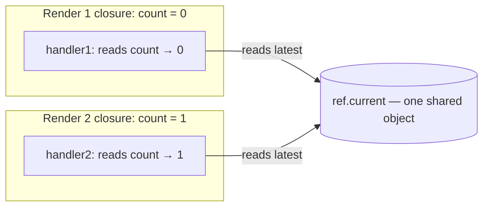
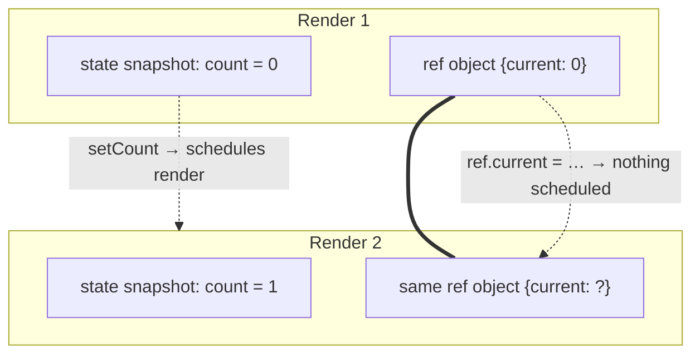
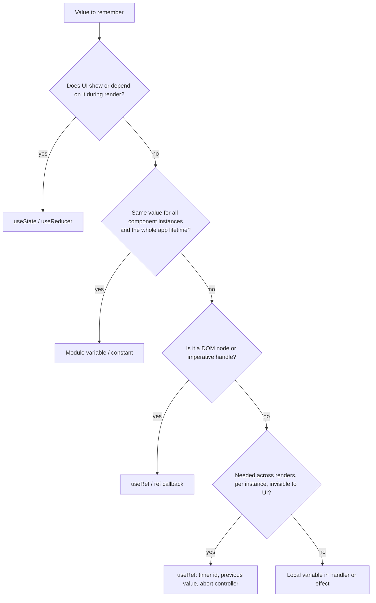

# 03 / 10 — useRef and Mutable References

## 1. Lesson metadata

| | |
|---|---|
| **Level** | Intermediate |
| **Study time** | 4–5 hours (reading 1.5 h, experiments 1 h, exercises 2 h) |
| **Prerequisites** | [Phase 1 / 14 — State as a snapshot](../01-react-fundamentals/14-state-as-a-snapshot.md), [Phase 0 / 06 — Lexical scope and closures](../00-web-and-javascript-foundations/06-lexical-scope-and-closures.md), [Phase 0 / 07 — Functions and referential identity](../00-web-and-javascript-foundations/07-functions-and-referential-identity.md), [Phase 2 / 12 — Why rendering must be pure](../02-react-rendering-and-internals/12-why-rendering-must-be-pure.md), [04 — useEffect](./04-useeffect-synchronization.md), [06 — Effect cleanup](./06-effect-cleanup.md), [08 — useLayoutEffect](./08-uselayouteffect.md) |
| **Next** | [11 — useMemo and useCallback](./11-usememo-and-usecallback.md) |
| **Related later** | [05 — Effect dependencies and stale closures](./05-effect-dependencies-and-stale-closures.md), [15 — Custom hooks](./15-custom-hooks.md), [22 — Modern hooks and APIs](./22-modern-hooks-and-apis.md) (`useEffectEvent`), [Phase 2 / 17 — How hooks attach to Fiber](../02-react-rendering-and-internals/17-hooks-and-fiber-state.md) |

**Learning objectives.** After this lesson you can:
1. Explain what `useRef` returns, why the returned object keeps its identity across renders, and why mutating it does not trigger a render.
2. Choose correctly between state, a ref, a module variable, and a derived value for a given piece of data, using criteria rather than habit.
3. Use refs to reach DOM nodes safely (focus, scroll, measure, media control), including lists of refs and ref callbacks with cleanup (React 19).
4. State and apply the rule "do not read or write `ref.current` during rendering" (with its one exception, lazy initialization) and explain why it exists.
5. Implement the standard ref patterns: timer/interval handles, previous value, latest-value-in-callback, "is mounted" caveats, imperative handles.
6. Type refs correctly in TypeScript with React 19 types, and pass `ref` as a regular prop.
7. Diagnose ref-related bugs: stale `null`, ref changes that don't re-render, ref reads during render, stale closures that a ref silently hides.

**Concepts covered:** escape hatches, mutable box, identity stability, render purity and refs, DOM refs, ref callbacks and cleanup (React 19), `ref` as a prop, `useImperativeHandle`, lazy ref initialization, `flushSync` with refs, ref vs state decision criteria, StrictMode and ref callbacks.

---

## 2. Deep conceptual explanation

### 2.1 What problem is this lesson solving?

React function components are functions that re-run on every render. Everything declared inside them is recreated on each call ([Phase 1 / 14](../01-react-fundamentals/14-state-as-a-snapshot.md)). Two needs follow that neither a plain `let` nor `useState` satisfy well:

1. **"I need to remember something across renders, but changing it should not re-render."** Examples: the ID returned by `setTimeout`/`setInterval`, the previous value of a prop, the last pointer position during a drag, an `AbortController`, the instance of a non-React library (a map, an audio context), whether the first render already happened. With a local `let`, the value is gone on the next render. With `useState`, every change re-renders, wasteful when nothing visible depends on it.
2. **"I need a handle to a DOM node (or other external object) that React created, to call imperative methods on it."** `inputEl.focus()`, `videoEl.play()`, `el.scrollIntoView()`, `el.getBoundingClientRect()`. React's JSX describes elements declaratively and never gives you the node during render. You need a sanctioned way to receive it *after* commit.

`useRef` answers both. It is React's **escape hatch for values and nodes that live outside the render data flow**.

### 2.2 What `useRef` returns

```ts
const ref = useRef(initialValue);
// ref is { current: initialValue }
```

Conceptually (teaching model), React stores a plain object `{ current: initialValue }` in the component's hook state on the first render and hands you the **same object** on every later render. Three consequences:

- **Stable identity.** `ref === previousRenderRef` is always true for the same component instance. That is why you can omit refs from effect dependency arrays *without* lint complaints (the lint rule knows `useRef` results are stable) and why putting one in a dependency array never retriggers the effect.
- **Mutable contents.** You assign `ref.current = x`. React does not wrap it in a proxy, does not observe it, and does not schedule a render when it changes. (It's literally a JS object.)
- **Initial value is used once.** `useRef(expensive())` evaluates `expensive()` on *every* render, and React ignores the result after the first. Use lazy initialization (§5.6) when construction is costly.

*Public guarantee:* `useRef` returns the same mutable object for the lifetime of the component instance; React does not read or write `current` itself except to attach/detach DOM nodes you pass via the `ref` attribute. *Implementation detail:* how the object is stored (hook list on the fiber; see [Phase 2 / 17](../02-react-rendering-and-internals/17-hooks-and-fiber-state.md)).

### 2.3 Why mutation doesn't re-render, and why that is a feature

State is a **snapshot** per render: reading `count` in a closure always gives that render's value, and changing it means "schedule a new render with a new snapshot". That gives React its predictability: a render is a pure function of props and state. A ref deliberately sits outside that model. It is a **mutable cell shared by every render's closures**: if render 1's event handler writes `ref.current = 5`, render 2's effect reads `5`. That is precisely the point, and precisely the danger: mutable shared cells make behavior depend on *when* you read, which is why React tells you not to read or write `ref.current` while rendering ([§3.3](#33-the-render-purity-rule-for-refs)).

### 2.4 The "refs vs state" decision

| Question | State | Ref |
|---|---|---|
| Does the screen need to change when this value changes? | **Yes → state** | No |
| Is it read during rendering to compute JSX? | **Yes → state** | No (not allowed) |
| Is it only read in event handlers, effects, timers, observers? | Either | **Good fit** |
| Must changes be batched, queued, and consistent within a render? | State | Not provided |
| Is it an external resource (timer ID, subscription, DOM node, library instance)? | No | **Yes** |
| Does it need to survive re-renders but is invisible to the user? | Overkill | **Yes** |

A useful test from the React docs: *if the value never appears in the rendered output, it may be a ref.* If you find yourself writing an Effect or a forced re-render (`forceUpdate` via `useReducer`) to make the screen reflect a ref, it should have been state.

### 2.5 Refs for the DOM

Passing a ref object to the `ref` attribute of a host element (`<input ref={inputRef} />`) tells React: *after you create this DOM node during commit, set `inputRef.current` to it; when you remove it, set `inputRef.current` to `null`.* From then on you can use ordinary DOM APIs ([Phase 0 / 04 — DOM structure and mutation](../00-web-and-javascript-foundations/04-dom-structure-and-mutation.md)).

Rules of thumb:
- **Use refs for non-destructive, imperative operations that React does not model declaratively:** focus, text selection, scrolling, measuring, playing/pausing media, triggering browser APIs (`showModal()` on `<dialog>`, `requestFullscreen()`).
- **Do not use refs to change what React renders** (adding/removing children, changing `className`/`textContent` that React also controls). React will not know and may overwrite or throw off reconciliation ("Failed to execute removeChild on Node" errors typically come from external mutation of React-owned DOM).

### 2.6 `ref` as a prop (React 19) (version-sensitive)

In React 19, function components receive `ref` as an ordinary prop; `forwardRef` is no longer needed for new code and is documented as "will be deprecated in a future release" (the react.dev `forwardRef` page, checked 2026-10-22, says "In React 19, forwardRef is no longer necessary. Pass ref as a prop instead"; the React 19 post says it will be deprecated and removed in future versions). In React 18 and below, `ref` was *not* a prop and `forwardRef` was required to pass one through a function component. Existing `forwardRef` code continues to work; treat it as legacy in new code ([Phase 5 — Design patterns](../05-design-patterns/19-polymorphic-components.md) revisits component APIs).

```tsx
// React 19
function TextInput({ ref, ...props }: React.ComponentProps<'input'>) {
  return <input ref={ref} {...props} />;
}
```

`React.ComponentProps<'input'>` includes `ref` in React 19 types; make sure your `@types/react` major version matches your React version.

### 2.7 Common misconceptions

| Misconception | Reality |
|---|---|
| "Refs are for the DOM only." | `useRef` is a general mutable box. DOM nodes are one use. |
| "Changing `ref.current` re-renders." | It never does. If the UI must reflect it, use state. |
| "A ref is a way to avoid stale closures, so I should use refs for everything in effects." | Reading from a ref sidesteps the *snapshot* contract and hides dependencies from the linter; used carelessly it creates inconsistent reads and bugs under concurrent rendering. Use deliberately ([§5.5](#55-advanced-example-latest-callback-and-previous-value-patterns)). |
| "`ref.current` is available in the first render." | For DOM refs it is `null` during the first render of the element; it's set during commit. |
| "`useRef` and `createRef` are the same." | `createRef` creates a new object on every call (class components, legacy). In function components use `useRef`. |
| "I can read `ref.current.value` in JSX to show the current input text." | That reads a mutable value during render; it will be stale or `null` and breaks purity. Use state (controlled input) for displayed values. |
| "Refs make DOM manipulation free." | Direct DOM writes bypass React; they are fine for the "safe" operations in §2.5, risky for anything React also renders. |

---

## 3. Internal mechanics

### 3.1 Where the ref object lives

*Teaching model:* on mount, `useRef` creates `{ current: init }` and stores it in the component instance's hook slot. On update, it returns the stored object. In a render where the component re-runs but the instance persists, you get the same object. When the component unmounts, the instance and its ref object are discarded, so the ref's contents are eligible for garbage collection ([Phase 0 / 16](../00-web-and-javascript-foundations/16-memory-management-and-gc.md); note: a ref holding a large object or DOM node that you never null out is kept alive as long as the component instance is).

*Implementation detail:* storage in a linked list of hooks on the component's fiber; the "rules of hooks" exist because slot lookup is by call order ([16 — Rules of hooks](./16-rules-of-hooks-and-composition.md)). See the "Reading React's source" lesson to verify.

Concurrent rendering subtlety: if React renders a component, discards the work, and later re-renders it, state/ref slots are from the *committed* instance for updates, but for a **first mount that is discarded** (for example a suspended initial render), the hook storage, including the ref object and anything you wrote into it during render, is thrown away. Another reason not to write to refs during render.

### 3.2 When React sets DOM refs

During the commit phase ([Phase 2 / 11](../02-react-rendering-and-internals/11-render-phase-and-commit-phase.md)):

1. React applies DOM mutations (creates/removes nodes).
2. Refs of removed elements are detached (`current = null`, or a ref callback receives `null`/cleanup runs).
3. Refs of new/updated elements are attached (`current = node`).
4. Layout effects run ([08](./08-uselayouteffect.md)), then, after paint, passive effects.

*Public guarantee:* by the time `useLayoutEffect`/`useEffect` setup runs, DOM refs for elements rendered in that commit are set; during the render function, they are not (for first mount) and may be stale (for updates).

**Version-sensitive (verified on React 19.3):** if the `ref` attribute's value *changes identity* between renders (for example an inline callback `ref={el => ...}`), React detaches the old and attaches the new on every commit: the old callback is called with `null` and the new with the node (or, in React 19, the old callback's cleanup function runs, if it returned one).

### 3.3 The render-purity rule for refs

React docs state: **do not write or read `ref.current` during rendering, except for initialization.** Why this rule exists, as causal reasoning:

1. **Render may run multiple times or be discarded** (StrictMode double render, concurrent interruptions, Suspense). A write during render is then a side effect that may happen for UI that never commits, or twice; a read during render yields values that depend on how many times and in what order React happened to render.
2. **Components that read refs in render stop being pure functions of props/state/context**, so React's optimizations and the React Compiler's assumptions ([§7](#7-alternative-approaches-and-trade-offs)) break. The React Compiler (stable 1.0 since October 2025, [Phase 9 / 08](../09-advanced-rendering-and-ecosystem/08-react-compiler.md)) bails out on components that read/write refs during render, and the `refs` lint rule in `eslint-plugin-react-hooks` flags such code.
3. **Nothing triggers a re-render when it changes**, so the output may be silently out-of-date.

**The initialization exception:** it is fine to write a ref during render *if the write is idempotent and conditional on it being unset*, because every render would arrive at the same state:

```tsx
const instanceRef = useRef<Foo | null>(null);
if (instanceRef.current === null) {
  instanceRef.current = new Foo();   // allowed: lazy init
}
```

### 3.4 Ref callbacks and cleanup (React 19)

Instead of an object, the `ref` attribute accepts a function:

```tsx
<div
  ref={node => {
    // setup: node is the DOM element
    const ro = new ResizeObserver(() => { /* ... */ });
    ro.observe(node!);
    return () => ro.disconnect(); // cleanup (React 19)
  }}
/>
```

*Public guarantee (React 19):* if the callback returns a function, React calls it when the ref is detached (instead of calling the callback with `null`). If it returns nothing, React falls back to the older behavior of calling the callback with `null`. **TypeScript consequence:** with React 19 types, a ref callback with an *implicit return* of a non-function value (for example `ref={el => (instance = el)}` , which returns the assigned value) is a type error, because TypeScript can't distinguish accidental returns from cleanup functions. Use a block body: `ref={el => { instance = el; }}`. The React 19 upgrade guide lists a codemod for this, `no-implicit-ref-callback-return`, as part of the react-19 codemod preset.

**StrictMode in development (React 19):** React additionally runs an extra "setup → cleanup → setup" cycle for ref callbacks on initial mount, mirroring Effects, to surface missing cleanup (documented on the react.dev `<StrictMode>` page; verified in the sandbox: a cleanup-returning callback logs `node, cleanup, node`; a callback without cleanup is called `node, null, node`). See [Phase 2 / 28](../02-react-rendering-and-internals/28-strict-mode-behavior.md).

Ref callbacks are the correct tool when you need to *react to attachment itself* (observe a node as it appears, register nodes into a Map for list items) rather than "use the node later in an event handler".

### 3.5 Refs, closures, and the stale-closure illusion

An event handler created in render N closes over render N's state snapshot. A ref read inside that handler reads the **current** `current`, not the snapshot. This difference is the basis for both the "latest value" pattern (useful) and for bugs where UI shows state S but a handler acts on ref value R that was written at a different time.



### 3.6 `useImperativeHandle`

When a parent has a ref to a child component (not a DOM node), what does `ref.current` hold? By default nothing useful for a function component. `useImperativeHandle(ref, () => ({ focus() {...} }), deps)` lets the child **choose what to expose**, narrowing the surface from "a whole DOM node" to a small API. It is an advanced escape hatch; prefer props and state for anything declarative (for example `open` prop instead of `ref.current.open()`). In React 19 the `ref` comes from props.

---

## 4. Step-by-step execution walkthrough

**Scenario:** a stopwatch with Start/Stop buttons that stores the interval ID in a ref, and shows elapsed seconds in state.

```tsx
function Stopwatch() {
  const [seconds, setSeconds] = useState(0);
  const intervalRef = useRef<number | null>(null);

  function start() {
    if (intervalRef.current !== null) return;
    intervalRef.current = window.setInterval(() => {
      setSeconds(s => s + 1);
    }, 1000);
  }
  function stop() {
    if (intervalRef.current === null) return;
    window.clearInterval(intervalRef.current);
    intervalRef.current = null;
  }
  useEffect(() => stop, []);   // cleanup on unmount

  return (
    <>
      <p>{seconds}s</p>
      <button onClick={start}>Start</button>
      <button onClick={stop}>Stop</button>
    </>
  );
}
```

| # | Event | State | `intervalRef.current` | Renders |
|---|---|---|---|---|
| 1 | Mount | `seconds = 0` | `null` | 1 |
| 2 | Click Start | unchanged | `7` (browser-assigned id) | **0**: ref assignment does not render |
| 3 | 1 s later: timer callback → `setSeconds(s => s + 1)` | `1` | `7` | 1 (render #2) |
| 4 | Click Start again | unchanged | `7` (guard returns early) | 0 |
| 5 | Click Stop | unchanged | `null` | 0 |
| 6 | Unmount (cleanup) | n/a | `stop` finds `null` → no-op | n/a |

**Predict.** If `intervalRef` were `let intervalId: number | null = null;` declared in the component body, what would clicking Start twice do, and why can't Stop find the interval?

*Reveal:* each render re-runs the function and creates a *new* `intervalId` variable initialized to `null`. Start's closure (from render 1) assigns the ID to render 1's variable. After the first `setSeconds` re-render, the Stop handler from render 2 sees *its own* `intervalId`, which is `null` → it cannot clear the interval → the timer keeps running forever (and Start can be pressed again, creating a second interval). This is the foundational reason a ref exists: a variable that survives renders without being state.

*StrictMode note:* in development, `useEffect(() => stop, [])` runs setup (returns `stop`), cleanup (calls `stop`: no-op since nothing started), setup again. No harm; this is why cleanup functions should be idempotent.

---

## 5. Code examples

### 5.1 Minimal example: focus an input

```tsx
import { useRef } from 'react';

export function SearchBox() {
  const inputRef = useRef<HTMLInputElement>(null);

  return (
    <>
      <input ref={inputRef} placeholder="Search…" />
      <button onClick={() => inputRef.current?.focus()}>Focus</button>
    </>
  );
}
```

*Line notes.* `useRef<HTMLInputElement>(null)` returns `RefObject<HTMLInputElement | null>` in current React 19 types (`@types/react` 19; in older types `RefObject<HTMLInputElement>` with a readonly `current`). `inputRef.current?.focus()`: `current` is `null` until commit; the optional chain handles unmounted/not-yet-committed cases. The handler runs after commit, so the node exists.

### 5.2 Practical example: scroll a list item into view, with a Map of refs

```tsx
import { useRef } from 'react';

type Item = { id: string; label: string };

export function Directory({ items }: { items: Item[] }) {
  const nodes = useRef(new Map<string, HTMLLIElement>());

  function scrollTo(id: string) {
    nodes.current.get(id)?.scrollIntoView({ behavior: 'smooth', block: 'nearest' });
  }

  return (
    <>
      <button onClick={() => scrollTo(items[items.length - 1].id)}>Jump to last</button>
      <ul>
        {items.map(item => (
          <li
            key={item.id}
            ref={node => {
              if (node) nodes.current.set(item.id, node);
              return () => {
                nodes.current.delete(item.id);
              };
            }}
          >
            {item.label}
          </li>
        ))}
      </ul>
    </>
  );
}
```

*Line notes.* One ref holds a `Map` keyed by item ID; you cannot call `useRef` in a loop (rules of hooks). The ref callback registers the node on attach and, in React 19, returns a cleanup that unregisters on detach. In React 18 the same callback would be invoked with `null` instead, and the cleanup return would be ignored: for code that must support both, handle `node === null` by deleting. `useRef(new Map())` constructs a new `Map` every render and discards it (cheap here; see §5.6 for lazy init). Because the callback is an inline arrow, its identity changes each render, so React detaches and re-attaches each `li` on every commit (cleanup then setup). That is correct but wasteful for long lists; memoizing the callback per item is possible but usually unnecessary. Edge: `items[items.length - 1]` crashes on an empty list; guard in real code.

### 5.3 Practical example: previous value of a prop

```tsx
function usePrevious<T>(value: T): T | undefined {
  const ref = useRef<T | undefined>(undefined);
  useEffect(() => {
    ref.current = value;
  });
  return ref.current;
}
```

**Predict:** `usePrevious(count)` with `count` going 0 → 1 → 2. What does each render return?

*Reveal:* render 1 returns `undefined`; effect then stores 0. Render 2 (count 1) returns the ref's current value `0` (read during render, before the effect updates it to 1). Render 3 (count 2) returns `1`. So it returns "the value from the previous *render*".

**This hook reads `ref.current` during render**, which violates the purity rule. It works in simple cases, but under concurrent rendering a discarded or repeated render can observe an inconsistent value, and the React Compiler may skip components using it and the `react-hooks/refs` lint rule flags such reads. The documented-safe alternative is to store the previous value in *state* and adjust it during render ([§7](#7-alternative-approaches-and-trade-offs), [17 — Derived state](./17-derived-state.md)):

```tsx
function usePreviousState<T>(value: T): T | undefined {
  const [current, setCurrent] = useState(value);
  const [previous, setPrevious] = useState<T | undefined>(undefined);
  if (value !== current) {         // Object.is would be more exact
    setPrevious(current);
    setCurrent(value);
  }
  return previous;
}
```
Trade-off: more code and an extra immediate re-render when the value changes, but fully render-pure. Many teams accept `usePrevious` via ref when the value is only used for a transition-direction hint; know the trade-off.

### 5.4 Incorrect example: ref used for displayed data

```tsx
function Counter() {
  const countRef = useRef(0);
  return (
    <>
      <p>Count: {countRef.current}</p>
      <button onClick={() => { countRef.current += 1; }}>+1</button>
    </>
  );
}
```

**Predict** what the user sees after three clicks, then after the parent re-renders for some unrelated reason.

*Reveal:* After three clicks the text still says `Count: 0`, since nothing triggers a render. If anything later re-renders `Counter` (parent update, a context change), the text jumps to `Count: 3`. The UI is inconsistent with data for an arbitrary period and the bug is intermittent. Also it reads `ref.current` during render (violates purity).

### 5.5 Corrected implementation (and when a ref is right instead)

```tsx
function Counter() {
  const [count, setCount] = useState(0);
  return (
    <>
      <p>Count: {count}</p>
      <button onClick={() => setCount(c => c + 1)}>+1</button>
    </>
  );
}
```

And a case where the ref *is* right: counting clicks for analytics without displaying them.

```tsx
const clickCountRef = useRef(0);
<button onClick={() => { clickCountRef.current += 1; track('cta', clickCountRef.current); }}>Buy</button>
```

### 5.6 Advanced example: latest callback and previous value patterns

**Lazy initialization of an expensive object**

```tsx
function Player() {
  const audioCtx = useRef<AudioContext | null>(null);
  if (audioCtx.current === null) {
    audioCtx.current = new AudioContext(); // note: browsers may suspend until a user gesture; also fails on the server
  }
  // ...
}
```
This is the documented render-time initialization exception, but `new AudioContext()` is a *browser* API with side effects and does not exist during SSR, so in practice create it in an effect or handler. The pattern is shown for pure, cheap-to-construct objects (`new Map()`, class instances without side effects). For anything with side effects, create inside `useEffect` and tear down in cleanup.

**Latest callback ("event handler ref") for a subscription whose lifetime should not depend on the callback**

```tsx
function useInterval(callback: () => void, delayMs: number | null) {
  const savedCallback = useRef(callback);

  // Always keep the ref pointing at the latest callback (write in an effect, not in render)
  useLayoutEffect(() => {
    savedCallback.current = callback;
  });

  useEffect(() => {
    if (delayMs === null) return;
    const id = setInterval(() => savedCallback.current(), delayMs);
    return () => clearInterval(id);
  }, [delayMs]);
}
```

*Why it works.* The interval is set up once per `delayMs`. Each tick calls whichever callback was most recently committed, so the tick never sees a stale closure, and a new callback identity doesn't restart the timer. *Why write in a layout effect (or effect), not render:* writing during render could publish a callback from a render that never commits. `useLayoutEffect` ensures the ref is updated before any event/timer that could fire after paint, closing a gap that a passive effect leaves open (a rare race between commit and the passive flush). *Trade-off:* you've told React (and the linter) "this Effect does not depend on `callback`", and made correctness depend on your discipline. `useEffectEvent` is the React-supported version of this idea (stable since React 19.2; Effect Events have no stable identity and may only be called from Effects or other Effect Events; see the react.dev `useEffectEvent` reference and [Phase 3 / 22](./22-modern-hooks-and-apis.md)).

### 5.7 Advanced example: ref callback with cleanup and observers (React 19)

```tsx
function useElementSize() {
  const [size, setSize] = useState<{ w: number; h: number } | null>(null);

  const ref = useCallback((node: HTMLElement | null) => {
    if (node === null) return;
    const ro = new ResizeObserver(([entry]) => {
      const { width, height } = entry.contentRect;
      setSize({ w: width, h: height });
    });
    ro.observe(node);
    return () => ro.disconnect();
  }, []);

  return [ref, size] as const;
}

// <div ref={ref}>…</div>
```

*Notes.* `useCallback` keeps the callback identity stable so React does not detach/attach on every render ([11](./11-usememo-and-usecallback.md)). The function returns `undefined` when `node` is `null` and a cleanup otherwise: valid in React 19 types (`void | (() => void)`), and with React 18 the cleanup is ignored (so for 18 you would need a `useRef` + `useEffect` approach). The state it sets is *derived from the DOM*, appropriate because the UI depends on the size.

### 5.8 Exposing an imperative API with `useImperativeHandle` (React 19)

```tsx
import { useImperativeHandle, useRef } from 'react';

type DialogHandle = { open(): void; close(): void };

function Dialog({ ref, children }: { ref?: React.Ref<DialogHandle>; children: React.ReactNode }) {
  const dialogRef = useRef<HTMLDialogElement>(null);

  useImperativeHandle(ref, () => ({
    open: () => dialogRef.current?.showModal(),
    close: () => dialogRef.current?.close(),
  }), []);

  return <dialog ref={dialogRef}>{children}</dialog>;
}
```

The parent holds `useRef<DialogHandle>(null)` and calls `ref.current?.open()`. Prefer a declarative `open` prop plus an effect that syncs to `showModal()` unless the imperative API is truly the natural contract (focus-like commands).

---

## 6. Visual explanations

### 6.1 State vs ref across renders



### 6.2 When a DOM ref is set

```text
render fn runs        → ref.current: null (first mount) or previous node (update)
commit: mutate DOM    → nodes created / removed
commit: attach refs   → ref.current = node  (or callback(node))
layout effects        → ref.current is the new node
paint
passive effects       → ref.current is the new node
unmount / key change  → ref.current = null (or ref cleanup runs)
```

### 6.3 Which container for which data



---

## 7. Alternative approaches and trade-offs

| Need | Option | Pros | Cons |
|---|---|---|---|
| Remember interval ID | `useRef` | Idiomatic, no re-render | Easy to forget cleanup |
| | Effect-local variable (`const id = setInterval` inside effect, cleanup closes over it) | Most robust; no ref at all | Only if start/stop are driven by effect dependencies, not event handlers |
| | `useState` for the ID | Visible in devtools | Pointless re-render; stale-closure traps |
| Previous value | `useRef` + effect | Short | Reads ref in render (breaks purity) |
| | State + set-during-render | Render-pure | More code; extra immediate re-render |
| | Store both in a reducer | Explicit transitions | Heavier API |
| Focus/scroll an element | `useRef` + handler/effect | Standard | Only after commit |
| | Ref callback | Reacts to attach; cleanup in 19 | Callback identity matters |
| | `autoFocus` attribute | Declarative for initial focus | Not for later focus; a11y considerations |
| Latest callback in subscription | Ref (`savedCallback`) | Works everywhere | Manual discipline; hides dependencies |
| | `useEffectEvent` | Intended semantics; lint-aware | React 19.2+; restricted call sites (Effects only) |
| | Re-subscribe on each callback change | Simple, correct | Teardown/setup churn; may lose events |
| Child API for parent | Props/state (`open`) | Declarative | Awkward for "do it now" commands |
| | `useImperativeHandle` | Direct commands | Breaks declarative flow; harder to test |
| Cross-component shared mutable data | Context + state | Observable | Re-renders consumers |
| | External store + `useSyncExternalStore` ([20](./20-usesyncexternalstore-and-external-stores.md)) | Tear-free, fine-grained | More setup |
| | Module-level mutable variable | Simple | Shared across instances, leaks across tests and SSR requests |

**A scenario where the recommended approach (a ref) is *not* best.** Suppose a drag-and-drop component stores the "current drop target" in a ref so it doesn't re-render during `pointermove` events, and the *highlight style* of the target is derived from it. The highlight must re-render when the target changes, which makes it state (or direct DOM class toggling in the event handler for performance, accepting that React doesn't know about it). A ref plus a "force update" hack is the worst of both worlds. Another scenario: multiple components need the same "previous value"; a ref hidden in one component's hook is invisible to the others; use shared state.

**React Compiler interplay.** The React Compiler (stable 1.0 since October 2025) (see [Phase 9 / 08](../09-advanced-rendering-and-ecosystem/08-react-compiler.md)) analyzes components assuming the Rules of React, including that refs aren't read or written during render. Per the react.dev `eslint-plugin-react-hooks` docs, when the compiler detects a violation it skips that component or hook, and the plugin's `refs` rule reports it. This is another practical reason to prefer the render-pure patterns above.

---

## 8. Best practices and anti-patterns

**Best practices**
- Choose by the decision table in §2.4; default to state, reach for a ref when the value is invisible to rendering.
- Only read/write `ref.current` in event handlers, effects, ref callbacks, and timers/observers; plus idempotent lazy init.
- Null-check DOM refs: `ref.current?.…`.
- Use ref callbacks (with cleanup in 19) when you need to react to attachment (observers, registries).
- Clean up what you store: clear timers, abort controllers, disconnect observers.
- Keep imperative DOM use to non-destructive operations; don't mutate React-managed DOM.
- Name refs by what they hold (`intervalRef`, `inputRef`, `latestOnChange`).
- Type precisely: `useRef<HTMLInputElement>(null)` for DOM; `useRef<number | undefined>(undefined)` for mutable values.

**Beginner mistakes**
- Rendering `ref.current` and expecting updates.
- Reading `inputRef.current.value` in render instead of using controlled state (or reading it in a handler).
- Forgetting `?.` and crashing when the element isn't mounted (conditional rendering).
- Storing a changing value in a ref and expecting `useEffect(..., [ref.current])` to re-run (it won't re-run on mutation; and reading `.current` in the deps array is flagged by lint for good reason).

**Experienced-developer mistakes**
- Using refs to dodge dependency arrays ("just put everything in a ref") so effects silently read inconsistent values.
- Copying server-unsafe lazy init (`new AudioContext()`, `window.matchMedia`) into render.
- Writing to refs in render for "memoization" (e.g., caching results) which breaks purity and concurrent safety.
- Mutating React-owned DOM through refs (`ref.current.innerHTML = ...` on an element that has React children).
- Using `ref.current` as a mount flag (`isMounted`) to guard `setState`. React removed the "setState on unmounted component" warning in 18 because the pattern masks real leaks; fix the cause (cleanup).

**Smells**
- A `forceUpdate`-like state used to make a ref visible.
- A component with more than a few refs holding "state-like" data.
- `useRef` whose `current` is assigned inside the render body outside lazy init.
- `// eslint-disable react-hooks/exhaustive-deps` accompanying ref-hidden dependencies.

**Justified exceptions.** `usePrevious` via ref for non-critical UI hints; render-time ref writes for logging/debug counters in development; library code with documented concurrency analysis. Mark them with a comment explaining why they are safe.

---

## 9. Real-world application

**Forms.** Focus management on validation errors: after submit, focus the first invalid field. Keep a `Map<fieldName, HTMLElement>` in a ref and call `focus()` in the submit handler (event, not render). Constraint: accessibility: error summary should receive focus or be announced via an `aria-live` region; keep the DOM order logical.

**Dashboards.** Chart libraries (Chart.js, D3, map libraries) are imperative: create the instance in an effect with a container ref, store the instance in a ref, update it in a separate effect when data changes, destroy it in cleanup. Constraint: StrictMode double invocation requires create → destroy → create to be safe; an instance stored only in a ref and never destroyed leaks.

**E-commerce.** Image zoom, carousels, scroll-to-reviews anchors (`scrollIntoView`), and sticky buy-box measurement. Use `IntersectionObserver` through ref callbacks for lazy impressions tracking: one "impression sent" flag per product in a ref to avoid duplicate analytics. Constraint: analytics must be deduped across remounts; a ref only dedupes per instance, so server-side or module-level dedupe may be needed.

**Realtime/chat.** `isAtBottom` flag in a ref updated by scroll events, read in a layout effect after messages arrive ([08 §5.6](./08-uselayouteffect.md)). Constraint: scroll events fire at high frequency; refs avoid re-render per event.

**Finance/trading.** High-frequency tick data: write the latest tick into a ref and flush to state at a controlled cadence (`requestAnimationFrame` or interval) to prevent render storms. Constraint: correctness over smoothness: never drop *trades* (store all in a buffer ref, display latest N) and show a "stale" indicator if updates stall.

**Auth.** Prevent double submit by storing an "in flight" flag in a ref in the submit handler *in addition to* disabling the button via state (state updates are asynchronous, two fast clicks can both run before the disabled state renders). Constraint: the server must also be idempotent.

**Multi-team libraries.** Design components to accept a `ref` prop (React 19) forwarded to the root DOM element, and document it as part of the public API; for React 18 consumers, ship `forwardRef`. Constraint: version support matrix; run type tests against both.

---

## 10. Debugging and troubleshooting

| Symptom | Likely cause | Investigation | Fix |
|---|---|---|---|
| `Cannot read properties of null (reading 'focus')` | Ref read before commit, or element conditionally unmounted | Breakpoint in handler; React DevTools → select component → hooks list shows ref value | Null-check; call after state that mounts it has committed (effect or `flushSync`) |
| UI shows stale value that updates "randomly" | Ref used for displayed data | Search JSX for `.current` | Make it state |
| Effect doesn't re-run when ref changes | Refs don't trigger | Confirm by logging in effect | Use state, or callback ref + state |
| Timer keeps running after unmount | ID stored in a render-scoped variable or never cleared | Check `intervalRef.current` cleared in cleanup; Performance panel timers | Clear in effect cleanup |
| Different instances share data unexpectedly | Module-level variable instead of ref | Create two instances and compare | Use `useRef` |
| Ref callback invoked twice in dev | StrictMode (React 19 ref setup/cleanup cycle) | Check `<StrictMode>`; production behaves once | Make callback idempotent with cleanup |
| TS error on a ref callback: "Type 'X' is not assignable to type 'void \| (() => void)'"  | React 19 types reject implicit returns | Use block body `{ … }` |
| Wrong element measured / `null` in `useEffect` after conditional render | Ref attached to a different or unmounted element | Elements panel; add `data-testid` and log `ref.current` | Ensure the element renders in the commit being measured |
| `removeChild` error | External DOM mutation of React-managed nodes | Search for `innerHTML`/`appendChild` via refs | Render via React or isolate in an unmanaged container node |

**Worked investigation: "autofocus works on page load but not after opening the modal".**
1. Repro: open modal; input not focused.
2. In handler `setOpen(true); inputRef.current?.focus();` → `inputRef.current` is `null` because the modal (and input) mounts in the next render.
3. Confirm: log `inputRef.current` right after `setOpen(true)`: `null`. (React DevTools: the modal component isn't mounted yet at that point.)
4. Fix options: (a) `useEffect(() => { if (open) inputRef.current?.focus(); }, [open])`; (b) `autoFocus` on the input (declarative, evaluates on mount); (c) `flushSync(() => setOpen(true)); inputRef.current?.focus();` for imperative flows.
5. Validate: open/close repeatedly; with StrictMode; with keyboard-only navigation; ensure focus returns to the trigger on close (a11y).

---

## 11. Exercises

### Level A — Knowledge
A1. What does `useRef(0)` return on the first render and on later renders?
A2. Why does `ref.current = x` not re-render, and is that a bug or a feature?
A3. State the rule about reading/writing refs during rendering and its one exception.
A4. When is a DOM ref's `current` set and cleared relative to render, layout effects, and passive effects?
A5. In React 19, what two things can a ref callback do that matters for cleanup, and what must you watch for in TypeScript?

### Level B — Code comprehension
B1. What does this log, and why? 
```tsx
function C() {
  const ref = useRef(0);
  const [, setN] = useState(0);
  ref.current += 1;
  console.log(ref.current);
  return <button onClick={() => setN(n => n + 1)}>go</button>;
}
```
(Assume production, no StrictMode: what after mount, and after one click? Then in StrictMode dev.)
B2. In §5.3, why does `usePrevious` return the earlier value even though the effect updates the ref to the newest?
B3. What breaks if `useInterval` in §5.6 writes `savedCallback.current = callback` directly in the render body? (Think concurrent rendering.)

### Level C — Implementation
C1. Implement `useDebouncedCallback(fn, ms)` that returns a stable function, always calls the latest `fn`, and clears the pending timer on unmount.
C2. Implement a `<VideoPlayer src>` that exposes `play()`/`pause()` through `useImperativeHandle`, and a parent button that toggles it.
C3. Implement `useIsFirstRender()` safely (what API does it use, what is its limitation, and what's an alternative that avoids a ref?).

### Level D — Debugging
D1. A "Copy" button copies `inputRef.current.value` into the clipboard but copies an empty string after the conditional input mounts later. Find the bug(s).
D2. A chat component auto-scrolls to bottom with `useEffect(() => { ref.current.scrollTop = ref.current.scrollHeight }, [messages])`; users sometimes see the list at the top for one frame. Diagnose and fix.

### Level E — Architecture and engineering decisions
E1. Your design system's `Input` currently uses `forwardRef`. The product is on React 19, but one team is stuck on 18. Decide how to migrate and what to promise.
E2. A teammate stores a large `Map` of 50k parsed rows in a ref to avoid re-renders and exposes it through context. Evaluate.

### Level F — Expert challenge
F1. Design a `useLatest(value)` / `useEvent`-style abstraction that is safe in concurrent rendering and StrictMode, state its guarantees and failure modes, and compare to `useEffectEvent` (stable since React 19.2).

---

## 12. Detailed answers and explanations

> Attempt the exercises first.

**A1.** An object `{ current: 0 }` on the first render; the *same* object (same identity) on every later render of that component instance. The `0` is only used the first time. Wrong: "a new object each time" (that's `createRef`).

**A2.** React doesn't observe `current`; it's a plain property on a plain object. That's a feature: it provides a mutable cell that survives renders without causing them. It becomes a bug only when the value is displayed or influences render output, which requires state.

**A3.** Don't read or write `ref.current` during render (renders must be pure; they may repeat, be discarded, or run twice; nothing re-renders on ref change). Exception: idempotent lazy initialization (`if (ref.current === null) ref.current = new Thing()`). Reading/writing in handlers, effects, ref callbacks is fine.

**A4.** During render: `null` on first mount (stale/previous on updates). During commit, after DOM mutations React attaches it; layout effects and passive effects see the node. On removal or when the `ref` prop changes, it is detached (`null`, or cleanup runs in React 19). Detail: detachment of removed nodes happens during commit mutation work; exact internal ordering is an implementation detail.

**A5.** (1) It can return a cleanup function, which React calls on detach instead of calling the callback with `null`. (2) If it returns nothing, React falls back to calling it with `null` as before. TypeScript: implicit return of a non-function value (arrow expression bodies like `el => (x = el)`) fails type checking in React 19 types; use a block body.

**B1.** Mount: logs `1`. Click: `setN` re-renders, `ref.current += 1` runs during render → logs `2`. Subsequent renders keep incrementing. In StrictMode dev, React renders each component twice per render pass and (in the intentional double render) the second invocation reuses hooks state; result: mount logs `1` then `2` (the ref increments on both invocations; verified on React 19.3: mount logs `1, 2`, and a later click logs `3, 4`, so the ref object persists across the double invocation; treat the exact numbers as an implementation detail); this is exactly why mutating refs in render is wrong: the value depends on how many times React chose to render.

**B2.** The hook reads `ref.current` *during render*, which occurs before the effect from the same render runs. So the returned value is whatever the previous render's effect stored: the previous render's `value`. The effect's write only becomes visible on the *next* render. Remember: effects run after commit.

**B3.** Writing in render publishes a callback from a render that might be discarded (interrupted/Suspended/transition abandoned) or from a StrictMode double invocation: a timer tick could call a callback whose render never committed (observing state/props the user never saw). Writing in a layout/passive effect ties it to committed renders. Evaluation: mentions committed vs uncommitted renders; notes concurrent rendering.

**C1.**
```tsx
import { useCallback, useEffect, useLayoutEffect, useRef } from 'react';

export function useDebouncedCallback<A extends unknown[]>(fn: (...args: A) => void, ms: number) {
  const fnRef = useRef(fn);
  const timer = useRef<ReturnType<typeof setTimeout> | undefined>(undefined);

  useLayoutEffect(() => { fnRef.current = fn; });
  useEffect(() => () => clearTimeout(timer.current), []);

  return useCallback((...args: A) => {
    clearTimeout(timer.current);
    timer.current = setTimeout(() => fnRef.current(...args), ms);
  }, [ms]);
}
```
Notes: stable identity as long as `ms` is stable; always calls the latest `fn`; cleanup clears the timer on unmount (idempotent under StrictMode). Edge: a pending call can be lost if the component unmounts, which may be unwanted (flush on unmount instead). Evaluation: stability, latest-callback, cleanup, typing of arguments.

**C2.**
```tsx
type PlayerHandle = { play(): void; pause(): void };

function VideoPlayer({ src, ref }: { src: string; ref?: React.Ref<PlayerHandle> }) {
  const videoRef = useRef<HTMLVideoElement>(null);
  useImperativeHandle(ref, () => ({
    play: () => { void videoRef.current?.play(); },
    pause: () => videoRef.current?.pause(),
  }), []);
  return <video ref={videoRef} src={src} controls />;
}

function Parent() {
  const player = useRef<PlayerHandle>(null);
  return (<>
    <VideoPlayer ref={player} src="/clip.mp4" />
    <button onClick={() => player.current?.play()}>Play</button>
    <button onClick={() => player.current?.pause()}>Pause</button>
  </>);
}
```
`play()` returns a promise that may reject (autoplay policies), so handle it. Evaluation: narrow API; React 19 `ref` prop; no leakage of the `<video>` element.

**C3.** With a ref: `const first = useRef(true); useEffect(() => { first.current = false; }, []); return first.current;` has the usual render-read caveat and, in StrictMode, the effect cleanup-and-rerun cycle can make results confusing: the second setup does not reset the ref to `true`. Limitation: it reports "first render of this instance *so far*"; with discarded renders it can lie. Alternative avoiding refs: derive from state (`useState(true)` + effect to flip), or avoid needing it by restructuring: skipping an effect on mount is usually a smell (see [07](./07-you-might-not-need-an-effect.md)); use `key`, handlers, or `useEffectEvent`.

**D1.** (1) The input mounts conditionally; if the user clicks Copy before it's mounted, `inputRef.current` is `null` and `null.value` would throw, not produce an empty string. If it "copies an empty string" the component probably reads the value in render (`const value = inputRef.current?.value ?? ''` inside the component body) and uses it in the handler: that captured value is from the render snapshot (when the ref was `null` → `''`). Fix: read `inputRef.current?.value` inside the click handler (at click time), or better, make the input controlled with state. (2) Add null handling for the not-mounted case.

**D2.** The effect runs after commit and, in some cases, after paint, so the first painted frame shows the new messages at scrollTop 0 (the previous position), then the effect scrolls. Fix: `useLayoutEffect` for the scroll adjustment ([08 §5.6](./08-uselayouteffect.md)); guard `ref.current` null; consider only auto-scrolling if the user was at bottom. Validate with a CPU-throttled Performance recording and screenshots.

**E1.** Options: (a) keep `forwardRef` for all consumers (works in 18 and 19) until 18 support ends; (b) publish `ref`-as-prop for 19 and keep a `forwardRef` wrapper for 18 via major-versioned packages or peer-dependency ranges; (c) conditional implementation based on `React.version` (fragile). Recommend: define support policy; if 18 is within support window, keep `forwardRef` (it still works in 19) and migrate when 18 is dropped, using a codemod (the React 19 upgrade guide links the react-codemod recipes; the `forwardRef`-to-`ref`-prop codemod was announced in the React 19 post, so check the react-codemod repo for its current name); communicate in a changelog. Evaluation: considers semver, consumers' versions, test matrix, deprecation timeline.

**E2.** Storing large data in a ref avoids render cost but makes consumers unaware of changes (stale UI) and moves "state" into an unobservable channel, violating data flow; exposing via context doesn't notify consumers when the ref mutates. Better: an external store with subscriptions and selectors via `useSyncExternalStore` ([20](./20-usesyncexternalstore-and-external-stores.md)) so only components using changed slices re-render; or normalize and virtualize ([Phase 7](../07-performance/09-windowing-and-virtualization.md)). Keep immutable updates if you need React to compare. Evaluation: identifies the notification gap, proposes an observable store.

**F1.** Example: `useLatest` as `const r = useRef(value); useLayoutEffect(() => { r.current = value; }); return r;` and `useStableCallback(fn)` returning a stable wrapper `useCallback((...a) => r.current(...a), [])`. Guarantees: calls inside handlers/effects/timers see the most recently *committed* callback; identity stable. Failure modes: (1) calling the wrapper during render observes the previous commit's callback (inconsistent); (2) between render and layout effect, a call could see an older value (only if invoked during render or by another layout effect declared earlier); (3) it hides dependencies, so effects calling it will not re-run when the callback's inputs change (by design); (4) transitions/Suspense: callbacks from uncommitted renders are never published (good). StrictMode: effects run twice, harmless. Compared with `useEffectEvent` (stable from React 19.2): that API formalizes this, with lint support to restrict calling it only from Effects and preventing passing it down; your hand-rolled version lacks the enforcement, so document "call only from handlers/effects". Evaluation: correct write-phase, explicit failure modes, comparison with the framework primitive and verification note.

---

## 13. Senior engineer interview questions

**Q1. "What is a ref, and how is it different from state?"**
A ref is a stable, mutable object that persists across renders without scheduling renders. State is a snapshot per render that triggers re-render when set. Choose a ref for values invisible to rendering (timer IDs, DOM nodes, instances); choose state for anything that appears in output. Cause: React's rendering model needs state changes to be observable and ordered; refs opt out.

**Q2. "Why shouldn't you read `ref.current` during render?"**
Renders must be pure and may repeat or be discarded; a mutable cell read during render makes output depend on hidden timing, and ref changes don't re-render, so output can be stale. It also blocks compiler optimizations (the compiler skips components that violate the rule). Exception: lazy initialization.

**Q3. "How does `ref` work in React 19 vs 18?"**
In 19, `ref` is an ordinary prop on function components and ref callbacks may return cleanup; `forwardRef` is legacy. In 18, `ref` isn't a prop, needing `forwardRef`; callback refs receive `null` on detach. `forwardRef` is documented as to-be-deprecated in a future release.

**Q4. "How do refs relate to stale closures?"**
Closures capture each render's snapshot; refs are shared mutable cells that read the latest value. This gives the "latest callback" pattern but can bypass the dependency model. Prefer proper dependencies, or `useEffectEvent`, and write to refs in effects, not render.

**Q5. "Design a hook that debounces a callback with latest-callback semantics."**
See C1: ref for latest fn, ref for timer, stable wrapper, cleanup on unmount; mention flush/cancel API and StrictMode idempotency.

**Q6. "A third-party chart library needs a container node. How do you integrate it?"**
Container ref; create instance in effect with cleanup (destroy); store instance in a ref for later updates; separate effect to update data/options; handle StrictMode double mount by making create/destroy symmetric; handle resize with ResizeObserver; don't let React manage children inside the container.

**Q7. "When would you reach for `useImperativeHandle`?"**
For commands that are inherently imperative (focus, play, scrollTo, reset) where a prop-based design would be awkward; keep the handle narrow; prefer declarative props for state-like behavior.

**Q8. "Is `isMountedRef` a good pattern?"**
Generally no: it masks missing cleanup (abort fetches, clear timers, unsubscribe). React removed the unmounted-setState warning in 18 for this reason.

---

## 14. Further learning resources

| Resource | URL | Covers / why | Level | Study |
|---|---|---|---|---|
| React docs — Referencing Values with Refs | <https://react.dev/learn/referencing-values-with-refs> | Refs vs state, best practices | Beginner–Int. | Whole page, challenges |
| React docs — Manipulating the DOM with Refs | <https://react.dev/learn/manipulating-the-dom-with-refs> | DOM refs, lists of refs, `flushSync`, safe DOM mutations | Intermediate | Whole page |
| React docs — `useRef` | <https://react.dev/reference/react/useRef> | Reference, caveats, lazy init | Intermediate | Caveats, Troubleshooting |
| React docs — `useImperativeHandle` | <https://react.dev/reference/react/useImperativeHandle> | Exposing handles | Advanced | Whole page |
| React docs — `ref` as a prop / React 19 | <https://react.dev/blog/2024/12/05/react-19> | `ref` as prop, ref cleanup | Intermediate | "ref as a prop", "Support for cleanup functions for refs" *(section anchors unverified)* |
| React docs — Components and Hooks must be pure | <https://react.dev/reference/rules/components-and-hooks-must-be-pure> | Why refs aren't read in render | Intermediate | "Side effects must run outside of render", "local mutation" |
| React docs — Rules of React | <https://react.dev/reference/rules> | Formal rules | Intermediate | Whole section |
| MDN — `AbortController` | <https://developer.mozilla.org/en-US/docs/Web/API/AbortController> | Common ref-stored resource | Intermediate | Whole page |
| MDN — `Element.scrollIntoView()` | <https://developer.mozilla.org/en-US/docs/Web/API/Element/scrollIntoView> | Common DOM-ref use | Beginner | Whole page |

All URLs above were checked to resolve (HTTP 200) on 2026-10-22; the npm page blocks automated requests.

---

## 15. Knowledge checkpoint

**You should now understand**
- That `useRef` is one stable mutable object per instance, invisible to React's rendering and unobserved.
- The decision criteria between state, ref, module variable and local variable.
- When DOM refs are set and why render-time access is wrong.
- React 19 changes: `ref` as prop, ref callback cleanup, types, StrictMode behavior.

**You should be able to explain without notes**
- Why a local `let` in a component cannot hold an interval ID.
- Why `usePrevious` via ref is a trade-off.
- Why writing a ref in render can publish uncommitted values.

**You should be able to implement**
- Focus/scroll/measure handlers, a Map of item refs, `useInterval`, debounced callback, an imperative handle.

**You should be able to debug**
- Null refs, stale UI from ref data, leaked timers, double-invoked ref callbacks, TS ref-callback errors.

**Before moving on:** read [11 — useMemo and useCallback](./11-usememo-and-usecallback.md), which caches *values* across renders (like a ref) but with *dependency-driven* invalidation and a very different contract.
