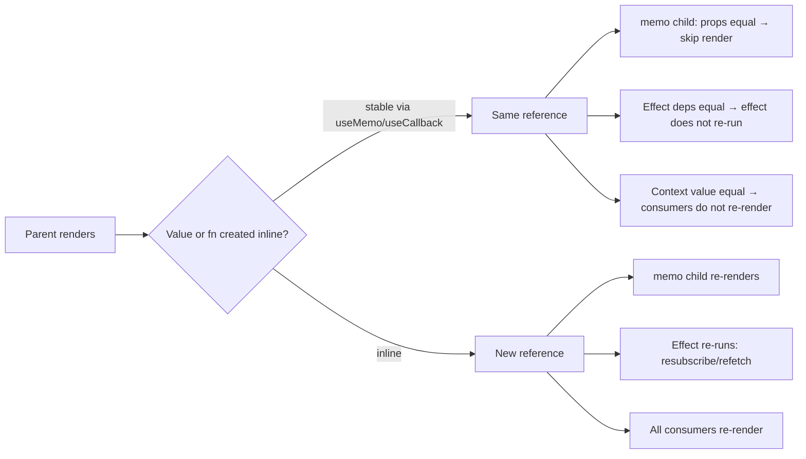
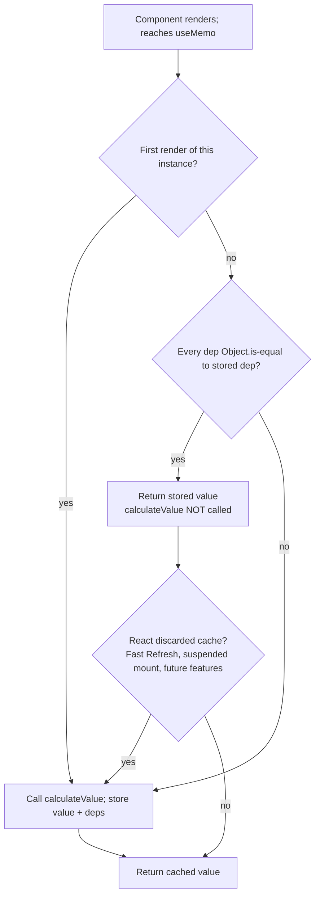
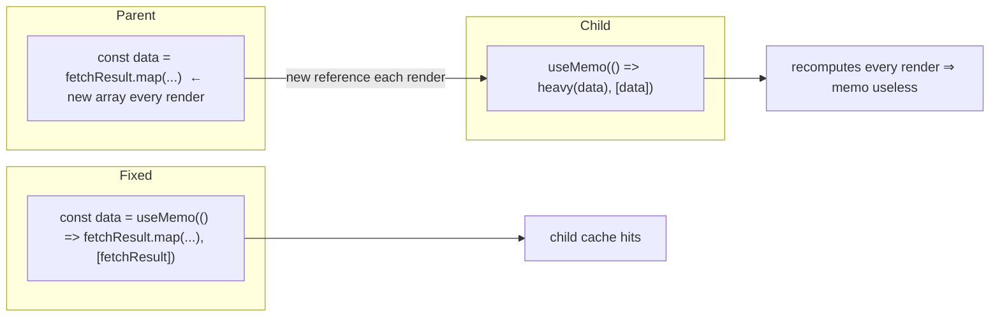
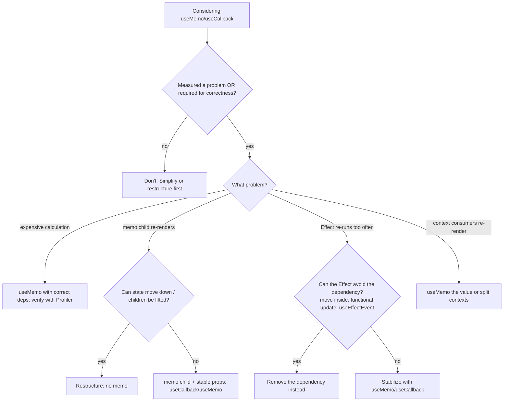

# 03 / 11 — useMemo and useCallback: Caching Across Renders

## 1. Lesson metadata

| | |
|---|---|
| **Level** | Intermediate–Advanced |
| **Study time** | 5–6 hours (reading 2 h, experiments 1.5 h, exercises 2 h) |
| **Prerequisites** | [Phase 0 / 07 — Functions and referential identity](../00-web-and-javascript-foundations/07-functions-and-referential-identity.md), [Phase 0 / 08 — Objects, references, immutability](../00-web-and-javascript-foundations/08-objects-references-immutability.md), [Phase 1 / 13 — The rendering mental model](../01-react-fundamentals/13-rendering-mental-model.md), [Phase 2 / 01 — What triggers a render](../02-react-rendering-and-internals/01-what-triggers-a-render.md), [05 — Effect dependencies and stale closures](./05-effect-dependencies-and-stale-closures.md), [07 — You might not need an Effect](./07-you-might-not-need-an-effect.md), [10 — useRef](./10-useref-and-mutable-references.md) |
| **Next** | [12 — React.memo](./12-react-memo.md) |
| **Related later** | [14 — Context performance](./14-context-performance.md), [Phase 7 / 04 — Memoization trade-offs](../07-performance/04-memoization-trade-offs.md), [Phase 7 / 05 — Referential equality](../07-performance/05-referential-equality.md), [Phase 7 / 10 — Expensive computations](../07-performance/10-expensive-computations.md), [Phase 9 / 08 — React Compiler](../09-advanced-rendering-and-ecosystem/08-react-compiler.md) |

**Learning objectives.** After this lesson you can:
1. Explain what problem `useMemo` and `useCallback` solve, in terms of *recomputation* and *referential identity*, and show that `useCallback(fn, deps)` is `useMemo(() => fn, deps)`.
2. State the contract precisely: what is guaranteed (dependency comparison with `Object.is`, a pure calculation) and what is explicitly *not* guaranteed (that the cache is never discarded).
3. List the legitimate reasons to memoize (expensive calculation, feeding a memoized child, stabilizing an Effect or Hook dependency, stabilizing context values) and the situations where memoization is useless or harmful.
4. Write correct dependency arrays, understand lint feedback, and recognize "dependencies that change every render" as the usual cause of ineffective memoization.
5. Measure before and after memoizing, and decide using evidence.
6. Describe how the React Compiler changes the practical need for manual memoization, and which parts of that story to verify against current documentation.

**Concepts covered:** recomputation cost, referential equality, `Object.is`, dependency arrays, cache invalidation, memoization as a performance hint vs semantic guarantee, StrictMode double-invocation of the calculation function, memoized children, context value stability, effect dependency stability, `useCallback` trade-offs, per-item memoization in lists, React Compiler interplay.

---

## 2. Deep conceptual explanation

### 2.1 What problem is this lesson solving?

React re-runs your component function on every render ([Phase 1 / 13](../01-react-fundamentals/13-rendering-mental-model.md)). That keeps the model simple, but it creates two recurring problems.

**Problem 1: repeated work.** Anything you compute in the component body is recomputed on every render, even if its inputs did not change. Usually that's fine: filtering 20 items costs microseconds. But if a render does something that costs 15 ms (filtering and sorting 20,000 rows, layout calculation, parsing) and the render is triggered by something unrelated (typing in a text field in the same component), every keystroke pays 15 ms.

**Problem 2: unstable identity.** Every render creates fresh objects and functions:

```tsx
function Parent() {
  const options = { dense: true };        // new object each render
  const onSelect = (id: string) => {...}; // new function each render
  return <Child options={options} onSelect={onSelect} />;
}
```

Two such values are `!==` across renders, although their *contents* are equivalent ([Phase 0 / 07](../00-web-and-javascript-foundations/07-functions-and-referential-identity.md)). Why does that matter? Because React and the code around it compare things *by identity*:

- A child wrapped in [`React.memo`](./12-react-memo.md) skips re-rendering only if props are identical (`Object.is`); a new object/function prop defeats that.
- An Effect or another hook with that value in its dependency array re-runs whenever the identity changes ([05](./05-effect-dependencies-and-stale-closures.md)), potentially re-subscribing, re-fetching, or resetting something every render.
- Context consumers re-render when the provided value's identity changes ([13](./13-usecontext-and-propagation.md), [14](./14-context-performance.md)).

`useMemo` and `useCallback` let you tell React: *"Keep the previous result as long as these inputs are unchanged."* The first addresses repeated work; both address identity stability.

### 2.2 The definitions

```ts
const value = useMemo(calculateValue, dependencies);
const fn    = useCallback(fnToCache, dependencies);
```

- **`useMemo(calculateValue, deps)`**: on the first render, calls `calculateValue()` and returns its result. On later renders, compares each dependency to its value from the previous render with `Object.is`. If **all** are equal, returns the previously cached result **without calling** `calculateValue`. If any differ, calls it again and caches the new result.
- **`useCallback(fn, deps)`**: the same caching rule, applied to the *function value itself* (it does not call `fn`). The functionally equivalent expression is `useMemo(() => fn, deps)`. React provides it only because the pattern is common and reads better.

Note on `useCallback`: the function you pass on every render is still **created** each render (the arrow function expression is evaluated); `useCallback` just returns the *older one* when dependencies are unchanged, discarding the new one. It saves identity, not allocation.

### 2.3 The contract, precisely

| Aspect | Status | Detail |
|---|---|---|
| Dependencies compared with `Object.is` | **Public guarantee** | Primitives by value (`NaN` equals `NaN`, `+0` ≠ `-0`), objects/functions by reference. |
| `calculateValue` must be pure and take no arguments | **Public contract** | It runs during rendering; it may not mutate external state. |
| In development with StrictMode, `calculateValue` is called **twice** on each recomputation | **Documented dev-only behavior** | To help surface impurity; one result is used, the other discarded. Production does not do it. |
| The returned value is *the same object* while dependencies are unchanged | **In practice, yes; officially "a performance optimization, not a semantic guarantee"** | See below. |
| React **may discard** the cache | **Documented** | The docs describe cases: editing the component's file during development (Fast Refresh), a component that suspends during its initial mount, and future features (for example virtualization support). |
| Cache persists across renders for one component instance | Yes (teaching model) | Stored with the component's hook state; each instance has its own cache. A different instance (another list row) doesn't share. |
| Cached result is shared between components | **No** | Not a global cache. |

> **Rule that follows:** *Your program must be correct if `useMemo` / `useCallback` were replaced by an uncached recomputation.* If removing memoization makes it *wrong* (not just slower), memoization was being misused as a semantic mechanism. Typical examples: relying on `useMemo` to generate a unique ID once, to run something "only once", or to hold state. Use `useState`/`useRef`/`useId`, or an Effect, for those.

### 2.4 Why does React expose memoization to developers at all?

React's model is "re-render everything below a change, then reconcile". That default is deliberately simple and usually fast enough, and it costs nothing to reason about. Two things push back against it in real apps: occasionally-expensive render work, and the use of identity for correctness-sensitive operations (Effects, subscriptions, context). A caching primitive keyed by explicit dependencies lets the developer opt in at the specific points where it matters. It is the *same trade-off* as caching anywhere: you add bookkeeping (comparison on every render, memory for the cached value, a dependency list you must keep correct) in exchange for fewer recomputations. Caches also introduce a classic bug class: **stale values from wrong invalidation** (missing dependencies).

### 2.5 Why not memoize everything?

Because memoization is not free and often has no benefit:

1. **Every render still pays** the cost of evaluating the dependency array, comparing each dependency, and allocating the closure you pass (for `useCallback` the new function is created anyway). It is small but non-zero, and applied everywhere it adds up and clutters code.
2. **It only helps if something downstream compares identity.** A memoized callback passed to a plain `<button>` (a host element, not `memo`) buys nothing: React updates the DOM event handler anyway (the DOM `onClick` isn't "re-attached" in a way that costs measurable time; React delegates events at the root, see [Phase 1 / 10](../01-react-fundamentals/10-event-handling.md)).
3. **It only helps if dependencies are stable.** Memoizing something that depends on a value that changes every render recomputes every render, with extra overhead.
4. **Memory.** The cache holds references to previous results and, via closures, to everything those closures captured.
5. **Readability and bug surface.** Dependency arrays are a source of stale-closure bugs.

React's documentation takes a measured stance: you can often avoid memoization entirely by restructuring (moving state down, passing children as props), and you should add it where measurements show it helps, or where it's needed for Effect/Hook dependency correctness. Treat memoization as **a performance hint**, applied with evidence ([Phase 7 / 01 — Measure before optimizing](../07-performance/01-measure-before-optimizing.md)).

### 2.6 Common misconceptions

| Misconception | Reality |
|---|---|
| "`useMemo` prevents a component from re-rendering." | It caches a *value inside* a render. The component still renders. To skip a child's render, use `React.memo` or restructure ([12](./12-react-memo.md)). |
| "`useCallback` prevents the function from being created." | The function expression is created every render; `useCallback` returns the old reference when deps are unchanged. |
| "Memoized values are guaranteed to persist." | They are a hint; React may discard. Don't build correctness on them. |
| "I should wrap all functions in `useCallback`." | Only matters when the identity is compared (memoized child, hook dependency, context value). Elsewhere it is overhead. |
| "Memoization makes expensive code fast." | It avoids *repeats*; the first computation and every invalidated one still pay full cost. If the dependencies change every time (typing), there's no benefit. |
| "`useMemo` with an empty array is a good way to run something once." | It happens to compute once per instance (barring discard), but it is the wrong tool and violates the contract. Also, in dev the calculation runs twice. |
| "The dependency array is an optimization knob I can trim." | It's a correctness declaration: omit a value read inside and you get stale results ([05](./05-effect-dependencies-and-stale-closures.md)). |
| "The React Compiler makes `useMemo` obsolete." | It auto-memoizes in many cases; manual memoization remains permitted and is used as an escape hatch ([§7](#7-alternative-approaches-and-trade-offs)); the react.dev compiler docs say `useMemo`/`useCallback` "can continue to be used with React Compiler as an escape hatch" (checked 2026-10-22). |

---

## 3. Internal mechanics

### 3.1 What React stores

*Teaching model* (see [Phase 2 / 17](../02-react-rendering-and-internals/17-hooks-and-fiber-state.md) for how hooks attach to Fiber): each `useMemo` call occupies a slot in the component instance's hook list. The slot stores `[value, deps]`. On a later render, React looks at the same slot (by call order, hence the rules of hooks, [16](./16-rules-of-hooks-and-composition.md)), compares `deps` element-by-element with `Object.is`, and either returns the stored `value` or calls your function, stores the new `[value, deps]`, and returns it.

Pseudocode, as a mental model rather than React's source:

```ts
function useMemoModel<T>(calc: () => T, deps: unknown[]): T {
  const slot = getHookSlot();            // same slot each render, by call order
  if (slot.initialized && depsEqual(slot.deps, deps)) {
    return slot.value;                    // cache hit: calc not called
  }
  const value = calc();                   // cache miss
  slot.value = value;
  slot.deps = deps;
  slot.initialized = true;
  return value;
}
function depsEqual(a: unknown[], b: unknown[]) {
  return a.length === b.length && a.every((x, i) => Object.is(x, b[i]));
}
```

*Public guarantee:* the behavior of dependency comparison and "calls calculate on miss". *Implementation detail:* the slot layout, when exactly the slot is created, how React discards on suspend (it simply doesn't commit the hook state from an abandoned initial render), and development-mode extras.

### 3.2 `Object.is` comparison

| Compare | `Object.is` result |
|---|---|
| `1`, `1` | true |
| `NaN`, `NaN` | **true** (unlike `===`) |
| `0`, `-0` | **false** (unlike `===`) |
| `{a:1}`, `{a:1}` | false (different objects) |
| `[]`, `[]` | false |
| same reference | true |
| function, function (distinct closures) | false |

Implication: a dependency array containing an object literal or a function defined in the component body *always* mismatches. That is the single most common reason memoization "doesn't work".

### 3.3 Why `useMemo(calc)` runs twice in development

StrictMode in development renders components twice and calls certain functions twice (state updater functions, `useMemo` calculations, `useState` initializers) to expose impurity ([Phase 2 / 28](../02-react-rendering-and-internals/28-strict-mode-behavior.md)). So a `console.log` inside `calculateValue` printing twice per recomputation in dev is expected, not a bug and not a sign of ineffective caching. In production it is called once per recomputation. If the double call breaks your code (for example you mutate something), the calculation is impure.

### 3.4 Memoization and concurrent rendering

A render can be interrupted or abandoned ([Phase 2 / 15](../02-react-rendering-and-internals/15-interruptible-restartable-abandoned-rendering.md)). Hook state, including a `useMemo` cache, is only kept from **committed** renders; a render that is thrown away does not leave its computation behind. This is one reason the cache is "may be discarded": for instance, on a component that suspends *during its initial mount*, React throws the in-progress hook state away, so the memoized value is recomputed when it retries. Therefore: expensive memoized work done in a suspending tree may run more than once; keep it pure and don't depend on "once".

### 3.5 Where memoization pays off: identity-compare sites



### 3.6 `useCallback` and closures: what does the cached function "see"?

A cached function is a closure over the render in which it was created. If dependencies are correct, a new function is created (and cached) whenever any variable it reads changes. If you *omit* a dependency, the cached function keeps reading the **old** value (stale closure). Two safe ways to keep callback identity stable *without* long dependency lists:

1. **Functional state updates**: `setItems(prev => [...prev, x])` instead of reading `items` (then `items` is not a dependency). See [02 — Functional state updates](./02-functional-state-updates.md).
2. **The latest-ref pattern** ([10 §5.6](./10-useref-and-mutable-references.md)) or `useEffectEvent` (React 19.2+) for Effects ([22](./22-modern-hooks-and-apis.md)).

---

## 4. Step-by-step execution walkthrough

**Scenario.** A product list with a text filter and a theme toggle; filtering/sorting 10,000 products is costly (assume 12 ms).

```tsx
function ProductList({ products }: { products: Product[] }) {
  const [query, setQuery] = useState('');
  const [dark, setDark] = useState(false);

  const visible = useMemo(() => {
    console.log('filtering…');
    return products
      .filter(p => p.name.toLowerCase().includes(query.toLowerCase()))
      .sort((a, b) => a.price - b.price);
  }, [products, query]);

  return (
    <div className={dark ? 'dark' : 'light'}>
      <button onClick={() => setDark(d => !d)}>Toggle theme</button>
      <input value={query} onChange={e => setQuery(e.target.value)} />
      <Rows items={visible} />
    </div>
  );
}
```

Production build, parent passes a stable `products` array.

| # | Event | Dependencies compared | `calculateValue` runs? | Cost |
|---|---|---|---|---|
| 1 | Mount | n/a (first render) | Yes | 12 ms |
| 2 | Click "Toggle theme" | `products` same, `query` same | **No** (cache hit) | ~0 |
| 3 | Type "a" | `query` changed | Yes | 12 ms |
| 4 | Type "ab" | `query` changed | Yes | 12 ms |
| 5 | Toggle theme again | same as step 4 | **No** | ~0 |
| 6 | Parent passes a *new* `products` array with equal contents (e.g. `.map` result in parent each render) | `products` identity changed | Yes | 12 ms |

**Predict.** Step 6 recomputes despite equal contents. How would you fix the *root cause* rather than remove the memo? 

*Reveal:* the parent should provide a stable array (memoize it there, derive it from state, or fetch via a cache library that returns structurally shared data). Identity discipline must start at the source: memoizing downstream of an unstable value does nothing.

**StrictMode note.** In development, steps 1, 3, 4, and 6 log "filtering…" twice, and you will see the work double in the Performance panel. Do not profile with dev builds or StrictMode on: use a production build ([Phase 7 / 02](../07-performance/02-profiler-workflows.md)).

---

## 5. Code examples

### 5.1 Minimal example: memoizing an expensive derivation

```tsx
import { useMemo, useState } from 'react';

function sumUpTo(n: number): number {
  let s = 0;
  for (let i = 0; i <= n; i++) s += i;
  return s;
}

export function Demo() {
  const [n, setN] = useState(50_000_000);
  const [text, setText] = useState('');

  const total = useMemo(() => sumUpTo(n), [n]);

  return (
    <>
      <p>Sum to {n.toLocaleString()} = {total.toLocaleString()}</p>
      <input value={text} onChange={e => setText(e.target.value)} placeholder="Type here" />
      <button onClick={() => setN(x => x + 1)}>n + 1</button>
    </>
  );
}
```

*Line notes.* Typing in the input changes `text` only; `[n]` is unchanged so `sumUpTo` is skipped. Clicking `n + 1` changes `n`, recomputing (a deliberately heavy loop). Try removing `useMemo` and see typing lag. (A realistic computation, not an arbitrary loop, is better in real code; here the loop makes the effect visible.)

### 5.2 Practical example: stable callbacks for a memoized list item

```tsx
import { memo, useCallback, useState } from 'react';

type Todo = { id: string; text: string; done: boolean };

const TodoRow = memo(function TodoRow({
  todo,
  onToggle,
}: {
  todo: Todo;
  onToggle: (id: string) => void;
}) {
  console.log('render row', todo.id);
  return (
    <li>
      <label>
        <input type="checkbox" checked={todo.done} onChange={() => onToggle(todo.id)} />
        {todo.text}
      </label>
    </li>
  );
});

export function TodoList({ initial }: { initial: Todo[] }) {
  const [todos, setTodos] = useState(initial);
  const [filter, setFilter] = useState('');

  const handleToggle = useCallback((id: string) => {
    setTodos(prev => prev.map(t => (t.id === id ? { ...t, done: !t.done } : t)));
  }, []);

  const shown = todos.filter(t => t.text.includes(filter));

  return (
    <>
      <input value={filter} onChange={e => setFilter(e.target.value)} />
      <ul>
        {shown.map(t => (
          <TodoRow key={t.id} todo={t} onToggle={handleToggle} />
        ))}
      </ul>
    </>
  );
}
```

**Predict:** with 100 todos, how many rows re-render (a) when typing in the filter input, (b) when toggling one todo?

*Reveal:* (a) Typing changes `filter`, re-rendering `TodoList`. Each shown `TodoRow` receives the *same* `todo` object (unchanged) and the *same* `handleToggle` identity, so `memo` skips them: zero row renders for rows that remain shown (rows entering/leaving the filtered list mount/unmount). (b) Toggling creates a new array in which only the toggled item is a *new object* (`{...t, done: !t.done}`); others keep identity; only that row re-renders. Combining *immutable updates that preserve identity* with `memo` and `useCallback` is what makes this efficient: if any one is missing, all rows re-render.

*Why `[]` as dependencies is right here.* `handleToggle` reads no render-scoped values: `setTodos` is guaranteed stable, and the updater form `prev => …` avoids reading `todos`. Lint (`exhaustive-deps`) agrees.

### 5.3 Practical example: stabilizing a context value

```tsx
type AuthState = { user: User | null; login(u: User): void; logout(): void };
const AuthContext = createContext<AuthState | null>(null);

export function AuthProvider({ children }: { children: React.ReactNode }) {
  const [user, setUser] = useState<User | null>(null);

  const login = useCallback((u: User) => setUser(u), []);
  const logout = useCallback(() => setUser(null), []);

  const value = useMemo<AuthState>(() => ({ user, login, logout }), [user, login, logout]);

  return <AuthContext value={value}>{children}</AuthContext>;
}
```

*Why.* Without `useMemo`, every `AuthProvider` render creates a new `value` object; **every** consumer re-renders, even when `user` is unchanged (for example when the provider re-renders because *its* parent re-rendered). With `useMemo`, consumers re-render only when `user` changes. In React 19 the context object can be used directly as a provider (`<AuthContext value=…>`); in 18 and earlier use `<AuthContext.Provider value=…>`. (version-sensitive; see [13](./13-usecontext-and-propagation.md)).

### 5.4 Incorrect example: dependencies that defeat the cache

```tsx
function Results({ query }: { query: string }) {
  const options = { caseSensitive: false, limit: 20 };           // new object each render
  const results = useMemo(() => search(query, options), [query, options]);
  // ...
}
```

**Predict:** how often does `search` run?

*Reveal:* every render, `options` is a new object so `Object.is` fails and the cache never hits; plus the overhead of memoization. Lint doesn't flag a bad dependency here (`options` is listed); it *does* flag it in other cases ("The 'options' object makes the dependencies of useMemo Hook change on every render"; the message appears in `exhaustive-deps` for this pattern).

### 5.5 Corrected implementation

Options in order of preference:

```tsx
// 1. Move constants out of the component
const SEARCH_OPTIONS = { caseSensitive: false, limit: 20 } as const;

function Results({ query }: { query: string }) {
  const results = useMemo(() => search(query, SEARCH_OPTIONS), [query]);
  // ...
}

// 2. Depend on primitives and build the object inside the calculation
function Results2({ query, limit }: { query: string; limit: number }) {
  const results = useMemo(
    () => search(query, { caseSensitive: false, limit }),
    [query, limit]
  );
}

// 3. If the object really is per-render input from the parent, fix the parent (stabilize at source)
```

### 5.6 Incorrect example 2: using `useMemo` for semantics

```tsx
function Form() {
  // ❌ Treating useMemo as "compute once, never again"
  const sessionId = useMemo(() => crypto.randomUUID(), []);
  // ...
}
```

Problems: (1) In dev StrictMode the calculation runs twice, producing two UUIDs where only one is used (harmless but proves the point); (2) React may discard the cache (for example on Fast Refresh in dev, or a suspended initial mount in production), generating a *different* ID mid-session; (3) it's not state: you can't update it. Use `useState(() => crypto.randomUUID())` (stable for the instance, lazy init), `useRef`, or `useId` (for DOM-linking IDs; [22](./22-modern-hooks-and-apis.md)). For an ID that must survive remounts, it belongs in application state or storage.

### 5.7 Advanced example: memoize a stable subscription handler without long dependency lists

```tsx
function useWindowEvent<K extends keyof WindowEventMap>(
  type: K,
  handler: (e: WindowEventMap[K]) => void
) {
  const handlerRef = useRef(handler);
  useLayoutEffect(() => { handlerRef.current = handler; });

  useEffect(() => {
    const listener = (e: WindowEventMap[K]) => handlerRef.current(e);
    window.addEventListener(type, listener);
    return () => window.removeEventListener(type, listener);
  }, [type]);
}

// usage: callers pass an inline arrow; no useCallback needed
useWindowEvent('resize', () => setWidth(window.innerWidth));
```

*Idea.* Instead of demanding `useCallback` at every call site (a leaky requirement on the hook's consumers), the hook absorbs the instability internally with the latest-ref pattern. For library/custom hooks that accept callbacks, this API design is friendlier. Trade-off: hides the dependency from the Effect; the callback is called from the latest committed render, never the one that scheduled the listener. See [15 — Custom hooks](./15-custom-hooks.md).

### 5.8 Memoizing JSX (element identity) as an alternative to `memo`

```tsx
function Page({ items }: { items: Item[] }) {
  const [tick, setTick] = useState(0);
  const list = useMemo(() => <ExpensiveList items={items} />, [items]);
  return (
    <>
      <button onClick={() => setTick(t => t + 1)}>{tick}</button>
      {list}
    </>
  );
}
```

When `items` is unchanged, `list` is the *same element object*; React sees identical element identity and skips re-rendering `ExpensiveList` (conceptually: same element reference → bail out). This is a legitimate technique when you can't edit the child to wrap it in `memo` (third-party component). Trade-off: it depends on identity semantics that are sound but subtle; `memo` or restructuring (moving `tick` into a separate component) is clearer ([12 §7](./12-react-memo.md)).

---

## 6. Visual explanations

### 6.1 Cache hit/miss decision



### 6.2 Identity stability chain (why you must stabilize at the source)



### 6.3 "Do I need this memo?" flow



---

## 7. Alternative approaches and trade-offs

| Technique | Solves | Pros | Cons |
|---|---|---|---|
| **No memoization** (default) | Nothing needed | Simplest; no stale-closure risk | Pays recomputation; fine in most cases |
| **Move constants/pure functions outside the component** | Unstable identity of static values | Free; stable forever; no deps | Only for values not depending on props/state |
| **Restructure: move state down** | Unrelated state causing wide re-render | Removes the problem; no cache | Requires layout/ownership changes ([18](./18-state-colocation-and-lifting.md)) |
| **Restructure: pass `children`/elements as props** ("lifting content up") | Slow subtree re-rendering with parent state | No memo needed; element identity from above | Requires composition-friendly API |
| **`useMemo`** | Expensive calc; stable object/array identity | Fine-grained, local | Dep bookkeeping; discard-able cache |
| **`useCallback`** | Stable function identity | Local | Same; often superfluous |
| **`React.memo`** ([12](./12-react-memo.md)) | Skipping child renders | Child-side; works with stable props | Needs stable props; comparison cost |
| **Latest-ref / `useEffectEvent`** | Stable handler reading latest values | No dependency lists | Hides dependencies; `useEffectEvent` (React 19.2+) may only be called from Effects and has no stable identity |
| **Compute on the server / in a worker / paginate** | Truly heavy work | Removes main-thread cost | Architecture change |
| **`useDeferredValue` / `useTransition`** ([22](./22-modern-hooks-and-apis.md)) | Keep input responsive while rendering heavy results | Concurrent scheduling; no cache keys | Doesn't reduce total work; requires memoized/skippable child to help |
| **React Compiler** | Auto memoization | Removes most manual memo | Requires adoption and Rules-of-React compliance (stable 1.0 since October 2025) |
| **External store selectors** (Zustand, Redux `useSelector`, [20](./20-usesyncexternalstore-and-external-stores.md)) | Fine-grained subscription | Components re-render only for selected slices | Dependency; selector identity pitfalls |

**A scenario where the recommended approach (measure first, memoize selectively) is *not* best.** Library code. A custom hook or component shipped in a design system is used by teams who will pass inline objects/functions, will put your returned values in their dependency arrays, and cannot see your performance characteristics. There, *proactively* stabilizing returned values (`useMemo`/`useCallback` on what the hook returns) is part of the API contract. React's own docs recommend memoizing functions returned from custom hooks for this reason. The cost of unnecessary stability is tiny compared with the cost of surprising downstream re-subscriptions across many consumers.

### React Compiler interplay

The React Compiler is a build-time tool that analyzes components and hooks that follow the Rules of React and inserts memoization automatically, at a finer granularity than most hand-written `useMemo`/`useCallback`. It reached a stable 1.0 release in October 2025 ([React Compiler v1.0 post](https://react.dev/blog/2025/10/07/react-compiler-1)). According to the current [React Compiler docs](https://react.dev/learn/react-compiler) (checked 2026-10-22) and [Phase 9 / 08](../09-advanced-rendering-and-ecosystem/08-react-compiler.md):

- For *new* code in a compiler-enabled project, rely on the compiler for memoization and use `useMemo`/`useCallback` where you need precise control, for example when a memoized value is an Effect dependency and you must guarantee it does not change identity needlessly.
- For existing code, leave existing manual memoization in place: removing it can change compiled output, so remove gradually with tests.
- The compiler **requires** purity: mutation of props/state, reading refs in render ([10](./10-useref-and-mutable-references.md)), and similar violations make it skip that component or hook; skipped components get no automatic memoization.
- It supports React 17, 18 and 19 (for 17/18 add `react-compiler-runtime` and a minimum-target config); check that your build tooling is supported.

Practical consequence for this lesson: **the model in this lesson remains the *semantics* underneath the compiler's output.** You still need to understand identity, dependencies, and the performance-hint nature to read compiled behavior, to debug, and to work in codebases that haven't adopted it.

---

## 8. Best practices and anti-patterns

**Best practices**
- **Measure first.** Profile with a production build and the React DevTools Profiler; use CPU throttling to emulate user devices ([Phase 7 / 02](../07-performance/02-profiler-workflows.md)). For a calculation, `console.time` around it in a production build, or the Performance panel; React's docs offer a rough 1 ms guideline, but the real criterion is *user-visible cost on target devices*.
- Include **every** reactive value read inside the function in the dependency array; follow `exhaustive-deps`.
- Use **primitives** as dependencies when possible; they compare by value.
- Prefer **functional updates** (`setX(prev => ...)`) to avoid depending on state.
- Move static values **outside** the component.
- **Stabilize at the source.** Fix unstable props/objects where they originate.
- Memoize **context values** and **functions/objects returned from custom hooks** that others will use as dependencies.
- Pair memoization with its consumer: `useCallback` for a function only matters if the receiver is `memo`, an Effect dependency, or a context value.
- Write calculations as **pure** functions; expect double invocation in dev.
- For lists, memoize **per item** by extracting an item component with `memo`; you cannot call hooks in loops, so don't try `useMemo` inside `.map`.
- Keep a comment on non-obvious memoization stating what it protects ("stable identity for effect; see issue #...").

**Beginner mistakes**
- Wrapping everything in `useCallback`/`useMemo` "to be fast".
- Passing inline objects/functions in the dependency array.
- Assuming `useMemo` skips rendering of the component or children.
- Mutating the memoized value (e.g., `.sort()` on a memoized array you also use elsewhere: `.sort()` mutates in place; memoize a *copy*).

**Experienced-developer mistakes**
- Using `useMemo` for correctness (IDs, "once" semantics, resource creation).
- Memoizing with deliberately incomplete dependencies, creating latent stale-closure bugs; later refactors make them visible.
- Memoizing deep, then forgetting that a parent produces new identities each render (wasted effort).
- Comparing "memoized vs not" without a production build or with StrictMode double-invocation inflating dev times.
- Replacing all state with refs plus memo to "avoid rendering", producing stale UI.
- Mutating objects and then expecting `useMemo` deps to detect changes (same reference → cache hit → stale).

**Smells**
- `useCallback` on a function passed only to host elements (`<button onClick>`).
- `useMemo(() => constant, [])` of a trivial literal.
- `useMemo` with an empty array and a comment "run once".
- Lint suppressions on `useMemo`/`useCallback` dependencies.
- A `useMemo` that returns JSX when a `memo` component would be clearer.
- Dependency arrays with 6+ items (design smell: the function does too much).

**Justified exceptions.** Trivial-cost `useMemo` for context values, custom-hook returns, and Effect dependencies are justified by *identity needs*, not by computational cost. Proactive memoization in shared libraries. Memoizing JSX for third-party children you can't wrap in `memo`.

---

## 9. Real-world application

**Dashboards / data grids.** 10k–50k rows, sort and filter on the client. `useMemo` keyed on `[rows, sortKey, filterText]` avoids re-sorting when unrelated state (selected row, hover, panel open/closed) changes. Constraints: the *first* computation still blocks; for >50 ms consider a worker, server-side sorting, or virtualization ([Phase 7 / 08–10](../07-performance/08-rendering-large-collections.md)); filter input should use `useDeferredValue` ([22](./22-modern-hooks-and-apis.md)) so typing stays responsive. Also ensure `rows` identity is stable: server-state libraries typically provide structural sharing.

**E-commerce.** Price/total calculations from cart items. These are cheap: *don't* memoize them (derive in render). Memoize the *tax-rules lookup table* built from a big JSON config if it's built per render. A product-card grid with 200 `memo` cards and a "wishlist" toggle: stable `onToggleWishlist` via functional update + `useCallback` so toggling one card re-renders one card.

**Finance.** Portfolio analytics (returns, risk metrics) computed from time series. `useMemo` per computed metric keyed by series identity. Correctness constraint: numbers must be the same with or without memoization; add tests that call the pure function directly. Never "memoize to keep the last valid number": that's state.

**Forms.** Validation schemas built from config: build once per config via `useMemo` (or module scope if static) to avoid recreating schema objects each keystroke (some schema libraries are costly to construct). The form library may require stable `resolver`/schema identity; check docs.

**Auth and permissions.** A `can(action)` permission function derived from the user's roles, provided via context: `useMemo` for the context value, `useCallback`/`useMemo` for the function, keyed on roles. Constraint: a wrong dependency here is a security-relevant stale permission; test role changes.

**Realtime.** WebSocket handler registration: stable handler identity or the latest-ref pattern to avoid reconnecting on every render. Dependency on connection parameters only (url, token), not on callbacks.

**Multi-team design systems.** Components that accept `options`/`columns` props: document that inline objects are acceptable *or not* (and if the component memoizes on identity, say so loudly), or internally compare structurally for small config objects (cost/benefit). Provide a lint rule or dev warning for per-render identity churn.

---

## 10. Debugging and troubleshooting

| Symptom | Likely cause | Investigation | Fix |
|---|---|---|---|
| `useMemo` recomputes every render | An unstable dependency (new object/array/function each render) | Log dependencies; compare with `Object.is` against the previous render (a `usePrevious`-style debug hook, or a breakpoint); lint message "makes the dependencies change on every render" | Stabilize at source; use primitives; move constants out |
| Memoized child still re-renders | A prop (often `children`, an inline object, or a function) changes identity; or context change | React DevTools Profiler → "Why did this render?" → lists changed props | Stabilize the offending prop; check context consumption |
| Stale data shown after state change | Missing dependency (stale closure) | Compare values read inside the function vs deps; enable/obey `exhaustive-deps` | Add dependency; use functional updates |
| Calculation logs twice | StrictMode dev double invocation | Check `<StrictMode>`; build for production to confirm | Expected; ensure purity |
| Results differ between dev and production | Impure calculation or mutation relying on single call | Remove the `useMemo`; if output differs the calc is impure | Make calculation pure |
| App got slower after adding memo everywhere | Comparison/allocation overhead; large dep arrays; memory growth | Production profile before/after; heap snapshot for retained closures | Remove ineffective memoization; keep targeted |
| Value "resets" unexpectedly | Cache discarded (Fast Refresh/suspense) while you used it as state | Reproduce with Suspense boundary or HMR | Use `useState`/`useRef` |
| Mutating a memoized array corrupts other uses | `.sort()`/`.reverse()` mutated cached array | Check for in-place mutation methods | Copy first: `[...arr].sort()` or `toSorted` |

**Worked investigation: "typing in the search box lags on a 5k-row table."**
1. Record in the React Profiler (production build, 4× CPU throttle): each keystroke commit takes ~140 ms; "Why did this render?" says `Table` re-rendered because props changed (`rows` identity).
2. Find that the parent creates `rows = data.map(toRow)` inline each render → new array each keystroke.
3. First fix (source): `useMemo(() => data.map(toRow), [data])` in the parent. Re-profile: `Table` still re-renders (it isn't `memo`) but sorting inside it (also keyed on `rows`) now hits the cache; commit drops to ~90 ms.
4. Next biggest cost: rendering 5k `<tr>`s; add `memo` to `Row` (stable props) and virtualize; commit drops to ~12 ms.
5. Validate: production Profiler traces before/after and a Performance panel INP-like measure (input latency) on a throttled device. Keep notes on which memo does what.

---

## 11. Exercises

### Level A — Knowledge
A1. What does `useMemo` return on a render where all dependencies are `Object.is`-equal to the previous render's? What does `useCallback` return?
A2. Write `useCallback(fn, deps)` using `useMemo`.
A3. Give two documented situations in which React may discard a memoized value.
A4. Why can `useMemo`'s calculation run twice in development?
A5. List four legitimate reasons to memoize and one illegitimate one.

### Level B — Code comprehension
B1. How many times does `expensive` run (production) in this sequence: mount, click A, click B, click A?
```tsx
function C() {
  const [a, setA] = useState(0);
  const [b, setB] = useState(0);
  const v = useMemo(() => expensive(a), [a]);
  return <>
    <button onClick={() => setA(x => x + 1)}>A</button>
    <button onClick={() => setB(x => x + 1)}>B</button>
    {v}{b}
  </>;
}
```
B2. Is this memoization effective? Why or why not?
```tsx
function Child({ onClick }: { onClick: () => void }) { /* not wrapped in memo */ }
function Parent() {
  const handle = useCallback(() => {}, []);
  return <Child onClick={handle} />;
}
```
B3. What bug does this contain?
```tsx
const [count, setCount] = useState(0);
const inc = useCallback(() => setCount(count + 1), []);
```
B4. What does `[1,2,3].sort()` do to a memoized array, and why does it matter for `useMemo`?

### Level C — Implementation
C1. Optimize this so typing in `note` doesn't re-sort the table. Keep correctness.
```tsx
function Page({ rows }: { rows: Row[] }) {
  const [note, setNote] = useState('');
  const [sortKey, setSortKey] = useState<keyof Row>('name');
  const sorted = [...rows].sort((a, b) => String(a[sortKey]).localeCompare(String(b[sortKey])));
  return (<>
    <input value={note} onChange={e => setNote(e.target.value)} />
    <Table rows={sorted} />
  </>);
}
```
C2. Write a custom hook `useToggle(initial)` returning `[value, toggle]` whose `toggle` identity is stable and doesn't read `value` from a closure.
C3. Convert a `useCallback`-heavy component into one that needs fewer `useCallback`s using a restructuring (moving state down or lifting content up) instead of memoization.

### Level D — Debugging
D1. `useMemo(() => buildIndex(items), [items.length])` serves search results that miss edits to existing items. Diagnose and fix.
D2. A `memo`ized `Row` re-renders on every parent render despite `useCallback` on `onSelect`. The row is `<Row item={item} style={{ color: item.color }} onSelect={onSelect} />`. Why?

### Level E — Architecture and engineering decisions
E1. Your team has an ESLint rule requiring `useCallback` on every function prop. Argue for or against and propose an alternative policy.
E2. You maintain a hook `useTableState` used by 30 screens that returns `{ sort, setSort, filters, setFilters }`. Decide what to memoize in its return value and why.

### Level F — Expert challenge
F1. A teammate claims: "With the React Compiler on, `useMemo`/`useCallback` are always unnecessary." Write a nuanced assessment, including at least three cases where you would still write them, and what you would verify in the docs and in your build.

---

## 12. Detailed answers and explanations

> Attempt the exercises first.

**A1.** `useMemo` returns the *previously cached value* (and does not call the calculation); `useCallback` returns the *previously cached function* (the new function created in this render is discarded). In both cases "previously cached" is subject to the discard caveat.

**A2.** `const cached = useMemo(() => fn, deps);` It returns the function itself rather than calling it.

**A3.** (1) During development, when you edit the component's file (Fast Refresh resets). (2) When the component suspends during its initial mount (the in-progress hook state is thrown away). (3) Future features, such as virtualization support (docs mention as an example). Evaluate: the learner should say "may" not "will", and conclude that correctness must not depend on the cache.

**A4.** StrictMode in development intentionally double-invokes functions that must be pure (component bodies, `useMemo` calculations, state initializers/updaters) to expose impurity. One result is used, the other discarded. Production doesn't.

**A5.** Legitimate: (1) measured expensive calculation; (2) stable props for a `memo` child; (3) stable dependency for an Effect/hook; (4) stable context value (or hook return value). Also acceptable: memoized JSX for third-party children. Illegitimate: using it as a semantic guarantee (once-only, unique IDs, or storing state), or "just in case".

**B1.** Production: mount (1), click A (2), click B (no: `a` unchanged; 2), click A (3). Total **3**. Wrong answer "4": counting the B click. In dev StrictMode each recomputation runs twice (6 calls).

**B2.** Not effective: `Child` isn't wrapped in `memo`, so it re-renders whenever `Parent` renders regardless of props. The stable `handle` identity gives no benefit (unless `Child` passes it on to a memoized grandchild or uses it as a dependency). Either wrap `Child` in `memo` (if re-render is costly and other props are stable) or remove the `useCallback`.

**B3.** Stale closure: `inc` captures `count = 0` at the time of the first render, since dependencies are `[]`; every call sets `count` to `1`. Fix: `useCallback(() => setCount(c => c + 1), [])`. Lint would catch this (`exhaustive-deps`).

**B4.** `Array.prototype.sort` sorts in place and returns the same reference. Mutating a memoized array changes it for every holder of the reference, can reorder data other code relies on, and because the identity doesn't change, dependent memoization will *not* invalidate (cache hit on mutated data). Always copy (`[...a].sort()`, `a.toSorted()` where available).

**C1.**
```tsx
function Page({ rows }: { rows: Row[] }) {
  const [note, setNote] = useState('');
  const [sortKey, setSortKey] = useState<keyof Row>('name');
  const sorted = useMemo(
    () => [...rows].sort((a, b) => String(a[sortKey]).localeCompare(String(b[sortKey]))),
    [rows, sortKey]
  );
  return (<>
    <input value={note} onChange={e => setNote(e.target.value)} />
    <Table rows={sorted} />
  </>);
}
```
Notes: copy before sorting; deps are exactly the values read. `Table` should also be `memo` for typing not to re-render it: with `sorted` stable, `memo(Table)` would skip. Alternative that needs no memo: move `note` into its own `NoteInput` component so typing doesn't re-render `Page` at all (state colocation, [18](./18-state-colocation-and-lifting.md)). Evaluation: identifies both.

**C2.**
```tsx
function useToggle(initial = false): [boolean, () => void] {
  const [value, setValue] = useState(initial);
  const toggle = useCallback(() => setValue(v => !v), []);
  return [value, toggle];
}
```
Functional update means `value` isn't a dependency; `setValue` is stable; `toggle` has a stable identity.

**C3.** Example: `Page` holds `hoveredId` state and passes `onHover` to 500 children. Move `hoveredId` into a `HoverHighlight` component that wraps only what depends on it, or have each row own its hover state (CSS `:hover` would need no JS at all). Or lift expensive static content as `children`: `<HoverProvider>{expensiveTree}</HoverProvider>` so the provider's state changes don't re-render `expensiveTree` (same element identity from the parent). Evaluation: demonstrates removal of the need for memo, not just substitution.

**D1.** The dependency `items.length` doesn't change when an item is *edited*, so the cache hits and returns an index built from old data. Correct dependency is `[items]` (and `items` must be replaced immutably when edited; if code mutates `items` in place, even `[items]` won't invalidate: fix the mutation). Plausible wrong fix: adding a counter state to force recompute: it treats the symptom.

**D2.** `style={{ color: item.color }}` creates a new object every render, so `memo`'s shallow comparison sees a changed `style` prop. Fix: pass `color` as a primitive and build the style inside `Row`, or memoize the style object (`useMemo` keyed on `item.color`, but you can't call hooks in `.map`, so extract the primitive approach). Another culprit candidate: `item` identity if the parent re-creates items each render.

**E1.** Against, as a blanket rule: `useCallback` is only valuable where identity is compared; a rule that requires it everywhere adds noise, runtime overhead, and stale-closure risk, and with the React Compiler may be redundant. For: consistency, and avoiding performance regressions when `memo` is used pervasively. Alternative policy: (1) memoize at *identity-compare sites* (memo children, Effect deps, context values, custom-hook returns); (2) require a comment or PR note with profiling evidence for other memoization; (3) enable `exhaustive-deps` as an error; (4) evaluate the compiler. Evaluation: reasoned, criteria-based, enforceable, acknowledges the legitimate use.

**E2.** Memoize the *returned object and the setter functions* if the hook's return is commonly placed in dependency arrays or passed to memoized components (which is likely across 30 screens): `setSort`/`setFilters` via `useCallback` with functional updates; the returned object via `useMemo` keyed on `sort`/`filters`/setters (or return a tuple/stable references and document). Rationale: consumers can't see internals; unstable returns create re-subscription/re-render churn everywhere. Cost: a few allocations per render: negligible. Counterpoint: if some screens never use the identity, the memoization is wasted but harmless. Evaluation: considers public API contract, documentation, tests for identity stability (render hook, rerender, `expect(result.current.setSort).toBe(prev)`).

**F1.** Example nuanced assessment: "Usually unnecessary for *performance*, not always unnecessary." Cases: (1) You need a guaranteed stable identity as an Effect dependency where re-running the Effect would be harmful (for example opening a socket), and you do not want to depend on compiler output details; (2) code that the compiler skips because it violates Rules of React or is flagged `"use no memo"` (verify directive name) or uses unsupported patterns; (3) library code shipped to consumers *without* the compiler; the library should memoize its own contract; (4) migration windows: existing memoization removed too aggressively changes behavior; (5) places where an explicit memo documents intent for readers. Verify: compiler version and React version compatibility, which files are compiled (build config, ESLint compiler rules), what the compiler outputs for a sample (the playground/Babel output), DevTools indicators that components are compiled (verify availability), behavior with refs/mutation, and performance on a production build before/after. Also keep in mind the discard caveat applies to compiler-generated memoization as well; do not build semantics on it. Evaluation: balanced; names verification steps; no dogma.

---

## 13. Senior engineer interview questions

**Q1. "When should you use `useMemo`?"**
When a calculation is measurably expensive relative to render frequency, or when a stable object identity is needed by something that compares identity (a memoized child, an Effect dependency, a context value). Not by default. The cache is a performance hint: removing it must not change behavior.

**Q2. "Is `useMemo` a guarantee that the function won't run again?"**
No. React may discard cached values (Fast Refresh, suspended initial mount, possible future features) and in dev StrictMode runs the calculation twice. Therefore it must be pure and correctness cannot depend on the cache.

**Q3. "Why doesn't wrapping a callback in `useCallback` stop a child from re-rendering?"**
Because a child re-renders whenever the parent renders unless it is wrapped in `memo` (or receives identical element/props through other mechanisms) *and* *all* of its props are stable. `useCallback` only stabilizes one prop. Also passing it to a host element has no effect.

**Q4. "How do you find which dependency breaks a memo?"**
React DevTools Profiler's "Why did this render?" for props, and for `useMemo` misses log each dependency vs previous with `Object.is` in a temporary debug hook; check the lint message about dependencies changing every render; trace the unstable value to its origin and stabilize there.

**Q5. "What's the relationship between memoization and the React Compiler?"**
The compiler automatically applies equivalent memoization where it can prove the code follows the Rules of React; manual hooks still work and act as escape hatches. Understanding identity and dependency semantics remains necessary.

**Q6. "Design the memoization strategy for a context provider holding state and actions."**
Stabilize the actions with `useCallback` + functional updates (or `useReducer`'s `dispatch`, which is stable), memoize the value object keyed on state and actions, or split state and dispatch into separate contexts so action-only consumers don't re-render on state changes ([14](./14-context-performance.md)). Verify consumer re-render counts in the Profiler.

**Q7. "Where does memoization hurt?"**
When dependencies change every time (pure overhead), when it hides design problems (state too high, props too wide), when it creates stale closures, when it retains big objects, and when it's cargo-culted around cheap work.

**Q8. "How do you test that a hook returns stable identities?"**
Render the hook with a test harness, store `result.current.fn`, `rerender()` with unchanged inputs, and assert `toBe` (reference equality) for stable parts, and `not.toBe` after relevant input changes. Under StrictMode, identities still need to be stable between *committed* renders.

---

## 14. Further learning resources

| Resource | URL | Covers / why | Level | Study |
|---|---|---|---|---|
| React docs — `useMemo` | <https://react.dev/reference/react/useMemo> | Official reference: caveats, discard behavior, StrictMode double call, troubleshooting | Intermediate | Whole page; "Caveats" and "Troubleshooting" |
| React docs — `useCallback` | <https://react.dev/reference/react/useCallback> | Reference and examples incl. memoizing custom hook returns | Intermediate | Whole page |
| React docs — `memo` | <https://react.dev/reference/react/memo> | Child-side skipping | Intermediate | Usage → "Skipping re-rendering when props are unchanged" |
| React docs — Choosing the State Structure / Reacting to Input | <https://react.dev/learn/choosing-the-state-structure> | Reduce derived state before memoizing | Intermediate | "Avoid redundant state" |
| React docs — Removing Effect Dependencies | <https://react.dev/learn/removing-effect-dependencies> | Alternatives to stabilizing dependencies | Intermediate | Whole page |
| React Compiler documentation | <https://react.dev/learn/react-compiler> | Compiler model and adoption | Advanced | Introduction, "How it works", incremental adoption |
| React Compiler working group | <https://github.com/reactwg/react-compiler> | Discussions, design notes | Advanced | Announcements |
| MDN — `Object.is()` | <https://developer.mozilla.org/en-US/docs/Web/JavaScript/Reference/Global_Objects/Object/is> | Comparison semantics | Beginner | Whole page |
| eslint-plugin-react-hooks | <https://www.npmjs.com/package/eslint-plugin-react-hooks> | `exhaustive-deps` rule | Intermediate | README |
| React DevTools Profiler | <https://react.dev/learn/react-developer-tools> | Measure renders | Beginner | Profiler section |

All URLs above were checked to resolve (HTTP 200) on 2026-10-22; the npm page blocks automated requests.

---

## 15. Knowledge checkpoint

**You should now understand**
- `useMemo` and `useCallback` as dependency-keyed caches whose purpose is to avoid recomputation and to stabilize identity.
- The contract: `Object.is` dependency comparison; pure calculation; cache is a hint, may be discarded; StrictMode double call in dev.
- Where memoization pays (identity-compare sites) and where it doesn't (host elements, unstable deps, cheap work).
- Why restructuring often beats memoization, and the React Compiler relationship.

**You should be able to explain without notes**
- Why a new object/function prop defeats `memo`, Effect dependencies, and context.
- Why correctness must never rely on a memo cache.
- The difference between memoizing a *value* and skipping a *render*.

**You should be able to implement**
- A memoized derivation, stable callbacks via functional updates, a stable context value, a hook with stable returns, JSX memoization.

**You should be able to debug**
- Ineffective memoization via "Why did this render?" and dependency logging; stale closures from missing dependencies; mutation of memoized arrays.

**Before moving on:** read [12 — React.memo](./12-react-memo.md), which is the child-side counterpart; the identity discipline from this lesson is what makes it work.
