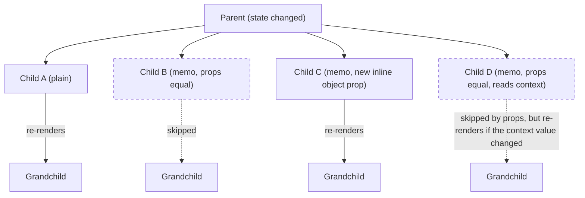
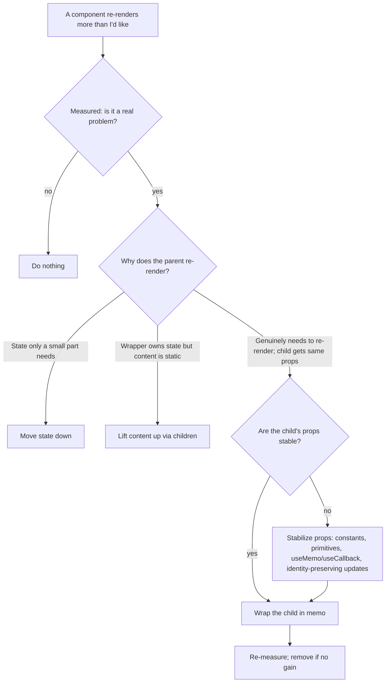

# 03 / 12 — React.memo: Skipping Re-renders When Props Are Unchanged

## 1. Lesson metadata

| | |
|---|---|
| **Level** | Intermediate–Advanced |
| **Study time** | 4–5 hours (reading 1.5 h, experiments 1.25 h, exercises 2 h) |
| **Prerequisites** | [11 — useMemo and useCallback](./11-usememo-and-usecallback.md), [Phase 1 / 06 — Props and one-way data flow](../01-react-fundamentals/06-props-and-one-way-data-flow.md), [Phase 1 / 13 — The rendering mental model](../01-react-fundamentals/13-rendering-mental-model.md), [Phase 2 / 01 — What triggers a render](../02-react-rendering-and-internals/01-what-triggers-a-render.md), [Phase 2 / 05 — React elements vs DOM nodes](../02-react-rendering-and-internals/05-elements-vs-dom-nodes.md), [Phase 0 / 08 — Objects, references, immutability](../00-web-and-javascript-foundations/08-objects-references-immutability.md) |
| **Next** | [13 — useContext and propagation](./13-usecontext-and-propagation.md) |
| **Related later** | [14 — Context performance](./14-context-performance.md), [18 — State colocation and lifting](./18-state-colocation-and-lifting.md), [Phase 2 / 29 — Reasoning about unnecessary renders](../02-react-rendering-and-internals/29-reasoning-about-unnecessary-renders.md), [Phase 2 / 32 — Scenario A: parent rerenders, child props unchanged](../02-react-rendering-and-internals/32-scenario-a-parent-rerender.md), [Phase 7 / 03 — Why components re-render](../07-performance/03-why-components-rerender.md), [Phase 7 / 04 — Memoization trade-offs](../07-performance/04-memoization-trade-offs.md), [Phase 9 / 08 — React Compiler](../09-advanced-rendering-and-ecosystem/08-react-compiler.md) |

**Learning objectives.** After this lesson you can:
1. State exactly when a parent's re-render causes a child to re-render, and how `memo` changes that rule.
2. Describe `memo`'s comparison (`Object.is` on each prop, in order), and list what `memo` does *not* stop: the component's own state updates and context changes.
3. Predict, for a given tree and update, which components render, which are skipped, and why; including the effect of `children`, inline objects, and inline functions.
4. Choose between `memo`, restructuring (moving state down, lifting content up), and doing nothing, using measured evidence.
5. Use `memo` correctly with TypeScript (named components, generics) and evaluate the use of a custom comparison function, including why it is usually a bad idea.
6. Diagnose "my memo component still re-renders" using React DevTools.
7. Explain how the React Compiler changes the picture and which statements need verification.

**Concepts covered:** parent-driven re-rendering, shallow prop comparison, bailout, referential equality of props, `children` as a prop, element identity bailout, `memo` with custom `arePropsEqual`, context and state exceptions, memo cost vs benefit, structural alternatives, DevTools "Why did this render?", React Compiler.

---

## 2. Deep conceptual explanation

### 2.1 What problem is this lesson solving?

React's default behavior: **when a component renders, React renders all of its children** (recursively, wherever their output is described by that render), whether or not their props changed ([Phase 2 / 01](../02-react-rendering-and-internals/01-what-triggers-a-render.md), [Phase 1 / 13](../01-react-fundamentals/13-rendering-mental-model.md)). "Render" here means *calling the function to compute a description of the UI*, not "touching the DOM". After the render, reconciliation compares the new description to the old and only changes the DOM where it differs, so unnecessary renders do not cause unnecessary DOM writes. But they do cost JavaScript time: the component function runs, its hooks run, child elements are created, and reconciliation walks them.

Most of the time that cost is negligible. It matters when:

- The child subtree is **large or expensive** (a chart, a grid of thousands of cells, a rich-text editor), and
- The parent re-renders **frequently** for reasons unrelated to that subtree (typing in an input, a running timer, mouse position, a hover state).

In that situation you want to say: *"If this component receives the same props as last time, there is nothing new to compute; reuse the last result."* That is `React.memo`.

### 2.2 The definition

```tsx
const MemoizedComponent = memo(Component);
const MemoizedComponent2 = memo(Component, arePropsEqual); // optional comparator
```

`memo` wraps a component. The returned component behaves like the original with one difference: **before re-rendering because its parent re-rendered, React compares the new props to the previous props.** If they are equal, React skips calling the component function and reuses the previous output (and the entire previous subtree beneath it, unless something inside has its own pending update).

*Equality* by default: for each prop, `Object.is(prev[key], next[key])`, over the same set of keys. In other words a *shallow* comparison of the props object. Contrast with `useMemo`/`useCallback` ([11](./11-usememo-and-usecallback.md)), which cache *values inside a component*; `memo` wraps a component to skip *rendering it*.

### 2.3 What `memo` does NOT block

| Trigger | Does `memo` prevent the re-render? | Why |
|---|---|---|
| Parent re-render with equal props | **Yes** (that's the feature) | Props comparison. |
| Parent re-render with a changed prop (including a new object/function identity) | No | Shallow comparison fails. |
| The component's **own state** changes (`useState`/`useReducer`) | **No** | `memo` only guards re-rendering *from the parent*. A state update on this component schedules its own render. |
| A **context** the component reads (`useContext`/`use`) changes | **No** | Context propagation targets consumers directly, bypassing the props comparison ([13](./13-usecontext-and-propagation.md), [14](./14-context-performance.md)). |
| An external store the component subscribes to (`useSyncExternalStore`) changes | No | Same as above: it schedules its own update. |
| Initial mount | No | `memo` is about updates. |
| Parent unmounts and remounts it (key change, conditional) | No | New instance. |

This matters for debugging: "I memoized it, why did it render?" is usually one of these, or a prop identity change.

### 2.4 Why does the abstraction exist rather than "just compare props by default"?

Because comparing is not free and *usually not worthwhile*. If React compared props for every component on every parent render, then for components whose props change most of the time (the majority: they display data that changed, or take callbacks recreated each render), React would pay the comparison *and then render anyway*. In addition, shallow prop comparison cannot know about *implicit inputs* such as mutable objects (an object whose contents changed but whose identity didn't would be wrongly skipped). The React team chose "always re-render, make DOM updates cheap through reconciliation" as the safe default and exposes `memo` as an opt-in for places where you know skipping is both safe and profitable.

### 2.5 The logic of "safe and profitable"

A `memo` wrapper is *worth it* when all of the following hold:

1. **It re-renders often with the same props.** (Else you pay for the comparison and never skip.)
2. **Rendering is costly relative to comparison.** (Else the saving is tiny.)
3. **Its props are stable** (primitives, or objects/functions with stable identity). (Else comparison always fails.)
4. **It is pure** with respect to its props, state, and context (Else skipping changes output.)

If #3 isn't true, `memo` is useless until you stabilize props (with `useMemo`/`useCallback`, constants, or restructuring). That pairing is why `memo`, `useMemo`, and `useCallback` are taught as a trio ([11 §3.5](./11-usememo-and-usecallback.md)).

### 2.6 Structural alternatives that remove the need

Before reaching for `memo`, look at *why* the parent re-renders and whether the cost can be avoided by structure ([18 — State colocation and lifting](./18-state-colocation-and-lifting.md)):

1. **Move state down.** If only a small part of the tree needs `hover`/`text` state, put that state in a small component. The parent no longer re-renders when it changes.
2. **Lift content up (children/slots).** If a component with changing state wraps expensive static content, pass the content as `children` created by a parent that *doesn't* have that state. React sees the same element identity for the unchanged `children` and skips them ([§3.3](#33-element-identity-bailout-why-children-from-above-are-free)).
3. **Reduce what is rendered.** Windowing/virtualization for long lists ([Phase 7 / 09](../07-performance/09-windowing-and-virtualization.md)).
4. **Make rendering cheaper.** Cheaper children, avoid derived work in render, move computation outside.

These are *design-level* fixes; `memo` is a *local patch*. The React docs explicitly encourage trying structural changes first.

### 2.7 Common misconceptions

| Misconception | Reality |
|---|---|
| "`memo` makes a component never re-render." | Only skips *parent-driven* re-renders with equal props. State and context still trigger renders. |
| "`memo` deep-compares props." | Shallow (`Object.is` per prop). Nested object contents aren't compared. |
| "Wrap everything in `memo` by default." | Costs comparison on every parent render, adds noise, and is useless when props are unstable. Some teams adopt it broadly; evaluate with data ([§7](#7-alternative-approaches-and-trade-offs)). |
| "`children` is free for memo." | `children` is a prop; JSX children created inline are *new element objects every render*, so they fail the shallow comparison. |
| "Memoized components always render less." | If props change every time, `memo` adds overhead and renders just as often. |
| "A custom comparison function makes `memo` smarter." | It's usually a bug source (forgetting a prop, ignoring function props → stale closures) and can cost more than the render. |
| "`memo` guarantees the render function won't be called." | It's a performance optimization. Treat render counts as non-semantic: don't base logic on "this component rendered exactly once". (In dev with StrictMode components also render twice.) |
| "Memoizing the parent protects children." | No. `memo(Parent)` only helps if *Parent's own props* are unchanged; children re-render when Parent's state changes regardless. |
| "`useMemo` and `memo` are the same thing." | One caches a value in a render, the other skips rendering a component. |

---

## 3. Internal mechanics

### 3.1 The bailout decision (teaching model)

When React reconciles a component's children after the parent renders, for each child fiber it asks, conceptually ([Phase 2 / 09](../02-react-rendering-and-internals/09-fiber-nodes-and-units-of-work.md)):

1. Is there a **pending update** (state/context/force) on this child *itself*? → must render.
2. Else, did the **props object change** compared to the previous render, according to the child's comparison rule? For ordinary function components: is `oldProps !== newProps` (object identity of the *props object*, which is a new object whenever the parent re-rendered and re-created the element)? For a `memo` component: shallow-compare each prop with `Object.is` (or call your custom comparator).
3. Did a **context** the child reads change? → must render.
4. If none of the above, **bail out**: reuse the previous child fibers (the previous output), without calling the component. React still may need to check whether *descendants* have pending updates; those are scheduled directly and are not lost.

*Public guarantee:* `memo` skips re-rendering when the props are equal per the documented comparison, absent state/context changes. *Teaching model:* the decision list. *Implementation detail:* the exact mechanics (flags on fibers, "lanes"/priority bookkeeping, how a skipped subtree is traversed for pending work; see [Phase 2 / 14 — Lanes](../02-react-rendering-and-internals/14-lanes.md)). Verify against source if you need exactness.

### 3.2 What "skipped" looks like to you

For a memoized `Child`:

- Its function **is not called**. `console.log` inside doesn't print; no hooks run; no effects re-run (effects only re-run after a render in which their deps changed).
- Its DOM nodes stay as they are; nothing in its subtree is reconciled again unless a descendant has its own pending update.
- DevTools Profiler shows it "Did not render" in that commit (greyed out).

### 3.3 Element identity bailout: why `children` from above are free

Render of a parent produces *elements* (plain objects `{ type, props, key, ... }`; [Phase 2 / 05](../02-react-rendering-and-internals/05-elements-vs-dom-nodes.md)). If a component receives an *already-created element* as a prop (e.g., `children`) and renders it unchanged, then on the next render of the **receiver**, the element object is the **same reference** (it was created by the grandparent, which did not re-render). React compares the element's props identity and finds it unchanged → it bails out for that child without any `memo` wrapper.

```tsx
function Parent() {
  return (
    <Counter>
      <ExpensiveTree />   {/* element created in Parent's render */}
    </Counter>
  );
}

function Counter({ children }: { children: React.ReactNode }) {
  const [n, setN] = useState(0);
  return (
    <div>
      <button onClick={() => setN(n + 1)}>{n}</button>
      {children}   {/* same element reference on every Counter render */}
    </div>
  );
}
```

Clicking the button re-renders `Counter` (its state changed), but `Parent` does not re-render, so `children` is the identical element; `ExpensiveTree` is skipped. This is the "lifting content up" technique. It works *because* of the same-identity rule that `memo` extends to *shallow-equal* props.

*Public/documented?* The behavior is documented in guidance ("pass JSX as children"), but the exact implementation (identity checks on props objects) is an implementation detail; the *pattern* is stable and widely relied upon. If you wrap in other layers that re-create elements (cloneElement, render props that create new elements), identity is lost.

### 3.4 Shallow comparison walk-through

```ts
function shallowEqualProps(prev: Props, next: Props): boolean {
  const pk = Object.keys(prev);
  const nk = Object.keys(next);
  if (pk.length !== nk.length) return false;
  return pk.every(k => Object.prototype.hasOwnProperty.call(next, k) && Object.is(prev[k], next[k]));
}
```

(Model; React's own implementation is equivalent in effect, in the same spirit as its internal `shallowEqual`.) Notice:
- `key` and `ref` are not part of this props object (`key` never; `ref` is a prop in React 19, so a new `ref` callback identity each render *does* defeat memo (verified on React 19.3: an inline ref callback re-rendered the memoized child on every parent render, a stable one did not); stabilize ref callbacks passed to memo components).
- Cost is O(number of props), cheap; but runs on every parent render for every memoized child, so thousands of memoized children make the cost visible, though still usually far below their render cost.

### 3.5 Custom `arePropsEqual`

```tsx
const Chart = memo(ChartImpl, (prev, next) => prev.series.id === next.series.id && prev.version === next.version);
```

If the comparator returns `true`, React treats props as equal and skips rendering, *even if some ignored prop changed*. Consequences documented in the React reference: if you use a custom comparison, you must compare **every** prop, **including functions** (closures capture values: an old function from an earlier render will keep seeing old state/props), and deep equality can be very slow and can freeze the app if data is cyclic or large. Most use cases are better served by stabilizing props.

### 3.6 `memo` and hooks inside the component

Inside a memoized component, hooks work normally. When it does re-render (because its props changed, or its own state/context changed), the usual rules apply. When its parent re-renders with equal props, nothing inside it runs, including *effects without dependency changes*, which wouldn't have re-run anyway.

### 3.7 `memo` + React 19 specifics

- Passing `ref` as a prop to a memoized function component (React 19) works like any prop: it participates in comparison. A fresh inline ref callback each render breaks skipping (verified in the sandbox).
- With the React Compiler (stable 1.0), compiled components get automatic memoization of their *output* depending on inputs; the compiler's memoization is conceptually similar to `memo` + `useMemo` combined at a finer granularity. A manually `memo`-wrapped component remains valid. See §7.

---

## 4. Step-by-step execution walkthrough

**Scenario.** `Parent` has a counter and renders three `Row` components. We compare four variants; the user clicks the "Increment" button once. (Production build, no StrictMode; each `Row` logs `render <label>`.)

```tsx
type RowProps = { label: string; onSelect: (label: string) => void };

function RowPlain({ label, onSelect }: RowProps) {
  console.log('render', label);
  return <li><button onClick={() => onSelect(label)}>{label}</button></li>;
}
const RowMemo = memo(RowPlain);

function Parent() {
  const [n, setN] = useState(0);
  const handleSelect = (label: string) => console.log('selected', label); // new function each render
  return (
    <>
      <button onClick={() => setN(n + 1)}>Increment ({n})</button>
      <ul>
        {['a', 'b', 'c'].map(l => <Row key={l} label={l} onSelect={handleSelect} />)}
      </ul>
    </>
  );
}
```

where `Row` is, per variant:

| Variant | `Row` is | `onSelect` | Logs after the click |
|---|---|---|---|
| 1 | `RowPlain` | inline (new each render) | `render a`, `render b`, `render c` (default behavior) |
| 2 | `RowMemo` | inline (new each render) | **`render a`, `render b`, `render c`**: `memo` wasted: `onSelect` identity changed |
| 3 | `RowMemo` | `useCallback(…, [])` stable | **nothing**: all props equal → bailout |
| 4 | `RowMemo` | stable, but a new prop `style={{ color: 'red' }}` added | `render a`, `render b`, `render c`: inline object defeats it |

**Trace of variant 3, step by step.**

| # | Step | What happens |
|---|---|---|
| 1 | Click → `setN(1)` | `Parent` scheduled to render. |
| 2 | Render `Parent` | Function runs: `handleSelect` is the cached function (identity same); returns elements: three `<RowMemo label="a" onSelect={h}>` objects (new element objects, new props objects). |
| 3 | Reconcile children | For each `RowMemo` fiber: no pending update; run shallow compare: `label` `'a' === 'a'`, `onSelect` same identity → equal → **bailout**. `RowPlain` is never called. |
| 4 | Commit | The only DOM change: the button text "Increment (1)". Rows untouched. |
| 5 | Effects | None re-run. |

**Predict (variant 5).** Same as variant 3, but `Parent` passes `data={{ label: l }}` instead of `label={l}` to `RowMemo`. What's logged, and what's the fix?

*Reveal:* all three rows render: `data` is a new object each time. Fix by passing primitives (`label`) when only the label is needed, or memoize per-item objects at the source (a stable data array whose items keep identity, e.g. items from state updated immutably).

**Predict (variant 6, own state).** Now give `RowMemo` its own `useState` (e.g. `selected`) and click inside a row to toggle it. Do siblings render? Does the parent?

*Reveal:* only that `Row` renders (its own state changed). The parent does not (state is local to the row). Siblings are unaffected regardless of `memo`: `memo` isn't involved because no parent render happened.

---

## 5. Code examples

### 5.1 Minimal example: a memoized component and visible skipping

```tsx
import { memo, useState } from 'react';

const Greeting = memo(function Greeting({ name }: { name: string }) {
  console.log('Greeting renders');
  return <h1>Hello, {name}</h1>;
});

export function App() {
  const [name, setName] = useState('Ada');
  const [count, setCount] = useState(0);
  return (
    <>
      <input value={name} onChange={e => setName(e.target.value)} />
      <button onClick={() => setCount(c => c + 1)}>Clicked {count}</button>
      <Greeting name={name} />
    </>
  );
}
```

**Predict:** after mount, how many times is "Greeting renders" logged after (a) three button clicks, (b) typing one character?

*Reveal:* (a) **0**: `name` is the same string. (b) **1**: `name` changed. Note: naming the inner function `Greeting` gives DevTools a good display name (an anonymous arrow passed to `memo` shows as "Anonymous" or "Memo" in older tools).

### 5.2 Practical example: memoized list rows with stable callbacks (the standard pattern)

```tsx
import { memo, useCallback, useState } from 'react';

type Contact = { id: string; name: string; starred: boolean };

const ContactRow = memo(function ContactRow({
  contact,
  onToggleStar,
}: {
  contact: Contact;
  onToggleStar: (id: string) => void;
}) {
  return (
    <li>
      {contact.name}
      <button aria-pressed={contact.starred} onClick={() => onToggleStar(contact.id)}>
        {contact.starred ? '★' : '☆'}
      </button>
    </li>
  );
});

export function ContactList({ initial }: { initial: Contact[] }) {
  const [contacts, setContacts] = useState(initial);
  const [filter, setFilter] = useState('');

  const handleToggleStar = useCallback((id: string) => {
    setContacts(prev => prev.map(c => (c.id === id ? { ...c, starred: !c.starred } : c)));
  }, []);

  const visible = contacts.filter(c => c.name.toLowerCase().includes(filter.toLowerCase()));

  return (
    <>
      <input value={filter} onChange={e => setFilter(e.target.value)} aria-label="Filter contacts" />
      <ul>
        {visible.map(c => (
          <ContactRow key={c.id} contact={c} onToggleStar={handleToggleStar} />
        ))}
      </ul>
    </>
  );
}
```

*Why it works (three cooperating pieces).*
1. `ContactRow` is `memo`: skips when props are shallow-equal.
2. `handleToggleStar` is stable (`useCallback` + functional update, no dependency on `contacts`).
3. Updates are **immutable and identity-preserving**: only the toggled contact becomes a new object; the others keep identity, so their `contact` props are equal.

If any of the three is missing, all visible rows re-render on each keystroke or toggle. Typing in the filter re-renders `ContactList` but not the rows that remain visible. Accessibility: `aria-pressed` conveys the toggle state; the visual star glyph alone would be inaccessible; label the button with the contact name in real code (e.g., `aria-label={`Star ${contact.name}`}`).

### 5.3 Practical example: lifting content up instead of `memo`

```tsx
// ❌ Typing re-renders the whole page, including the expensive chart
function Page() {
  const [query, setQuery] = useState('');
  return (
    <>
      <input value={query} onChange={e => setQuery(e.target.value)} />
      <ExpensiveChart />
    </>
  );
}

// ✅ Isolate the state that changes
function Page() {
  return (
    <>
      <SearchBox />          {/* owns `query` state */}
      <ExpensiveChart />     {/* not re-rendered when SearchBox's state changes */}
    </>
  );
}
function SearchBox() {
  const [query, setQuery] = useState('');
  return <input value={query} onChange={e => setQuery(e.target.value)} />;
}
```

No `memo`, no `useCallback`, no dependency arrays. `Page` doesn't re-render when `query` changes because `query` lives in `SearchBox`. The trade-off is that `query` is no longer available to `Page` or `ExpensiveChart`; if the chart needs the query, the state must be above both (then use `memo` on the chart with the query as a prop *only if* the chart's props don't change otherwise, or pass the chart as `children` into a component that owns the state).

### 5.4 Incorrect example: `memo` defeated by `children` and inline props

```tsx
const Card = memo(function Card({ title, children }: { title: string; children: React.ReactNode }) {
  console.log('Card renders');
  return <section><h2>{title}</h2>{children}</section>;
});

function Page() {
  const [n, setN] = useState(0);
  return (
    <>
      <button onClick={() => setN(n + 1)}>{n}</button>
      <Card title="Stats">
        <p>Static text</p>
      </Card>
    </>
  );
}
```

**Predict:** is "Card renders" logged on every click?

*Reveal:* Yes. The `<p>Static text</p>` element is created fresh in each `Page` render, so `children` is a new object each time; shallow comparison fails; `memo` does nothing. Same for `style={{...}}`, `options={{...}}`, `items={items.filter(...)}`, `onClick={() => ...}`.

### 5.5 Corrected implementation

Options, in preference order:

```tsx
// 1. Don't memo; Card is cheap. (Often the right answer.)

// 2. Hoist the static element out of the component (stable identity)
const statsContent = <p>Static text</p>;
function Page() {
  const [n, setN] = useState(0);
  return (<>
    <button onClick={() => setN(n + 1)}>{n}</button>
    <Card title="Stats">{statsContent}</Card>
  </>);
}

// 3. Memoize the element if it depends on props/state
function Page({ stats }: { stats: Stats }) {
  const [n, setN] = useState(0);
  const content = useMemo(() => <StatsTable stats={stats} />, [stats]);
  return (<>
    <button onClick={() => setN(n + 1)}>{n}</button>
    <Card title="Stats">{content}</Card>
  </>);
}

// 4. Move `n` into its own component so Page never re-renders on click
```

### 5.6 Incorrect example 2: custom comparator that hides a prop

```tsx
const Price = memo(
  function Price({ amount, currency, onRefresh }: PriceProps) {
    return <button onClick={onRefresh}>{format(amount, currency)}</button>;
  },
  (prev, next) => prev.amount === next.amount            // ❌ forgot currency and onRefresh
);
```

Two bugs: a currency change (EUR → USD with the same number) doesn't update the display; and if `onRefresh` closes over changing state, the button keeps calling an **old** closure. Fix: compare all props, or remove the comparator and stabilize props. A comparator that compares *everything* shallowly is just the default.

### 5.7 Advanced example: generics and display names in TypeScript

`memo` loses generic parameters. Pattern:

```tsx
type ListProps<T> = { items: T[]; render: (item: T) => React.ReactNode; getKey: (item: T) => string };

function ListImpl<T>({ items, render, getKey }: ListProps<T>) {
  return <ul>{items.map(i => <li key={getKey(i)}>{render(i)}</li>)}</ul>;
}

export const List = memo(ListImpl) as typeof ListImpl;
```

The cast restores the generic call signature. `render` and `getKey` are function props: callers must stabilize them (`useCallback`, or module-level functions) or `memo` never skips. For named components use a named function so DevTools shows `ListImpl`, or set `List.displayName` (on the cast value) if needed.

### 5.8 Advanced example: measuring whether `memo` helps

```tsx
import { Profiler, type ProfilerOnRenderCallback } from 'react';

const onRender: ProfilerOnRenderCallback = (id, phase, actualDuration) => {
  console.log(id, phase, actualDuration.toFixed(2) + 'ms');
};

<Profiler id="ContactList" onRender={onRender}>
  <ContactList initial={contacts} />
</Profiler>
```

`actualDuration` is the time spent rendering the profiled subtree for that commit. In a production build (per the react.dev `<Profiler>` page, profiling is disabled in the production build by default; you need a special production build with profiling enabled) compare keystroke commits before/after adding `memo`. In practice use the React DevTools Profiler on a profiling-enabled build with CPU throttling ([Phase 2 / 30](../02-react-rendering-and-internals/30-react-devtools-profiler.md)).

---

## 6. Visual explanations

### 6.1 Who re-renders, with and without `memo`



### 6.2 Decision procedure for "should I add `memo`?"



### 6.3 What counts as "equal props" (default comparison)

```text
prev: { label: "a", onSelect: f1, data: o1 }
next: { label: "a", onSelect: f1, data: o1 }  → equal   (Object.is on each)  → skip
next: { label: "a", onSelect: f2, data: o1 }  → NOT equal (f2 !== f1)        → render
next: { label: "a", onSelect: f1, data: {…same contents…} } → NOT equal      → render
next: { label: "a", onSelect: f1, data: o1, extra: undefined } → NOT equal (key count differs) → render
```

---

## 7. Alternative approaches and trade-offs

| Approach | What it addresses | Pros | Cons / limits |
|---|---|---|---|
| **Do nothing** | Cheap components | Simple, zero risk | May be slow for heavy subtrees |
| **Move state down** | Unrelated state causing wide re-render | Removes the problem; no comparison cost | Needs state ownership changes |
| **Lift content up (`children`)** | Wrapper-owned state with static content | No memo/deps; identity from parent | Requires composition-friendly API |
| **`memo` on a child + stable props** | Expensive child, frequent parent re-render | Local, explicit, familiar | Props must be stable; comparison cost; context/state not covered |
| **`memo` with custom comparator** | Rare cases where identity can't be stabilized | Control | Easy to get wrong (stale closures); could be slower than rendering |
| **`useMemo` for the child's element** | Child you can't edit | Works for third-party components | Obscure; deps must be right |
| **Virtualization / windowing** | Huge lists | Cuts work to visible items | More complexity, a11y considerations |
| **Selector-based subscriptions** (store hooks) | Context-wide re-renders | Fine-grained updates | External library |
| **`useDeferredValue` / `useTransition`** | Keeping input responsive when render is heavy | Concurrent scheduling | Doesn't reduce work; child must be skippable for deferral to help |
| **React Compiler** | Automatic memoization | Removes most manual `memo`/`useMemo`/`useCallback` | Requires Rules-of-React compliance and adoption (stable 1.0 since October 2025) |
| **Memo everything by default** | Uniform policy | No decisions; protects against accidental regressions | Comparison overhead; hides design problems; noise; many props are unstable anyway |

**A scenario where the recommended approach (structural fixes first) is *not* best.** A third-party data-grid or chart component you cannot restructure, living under a parent that necessarily re-renders (it owns the shared selection state used elsewhere in the page). You can't move state down (other components need it) and you can't edit the grid. The right tool here *is* `memo` (wrapping a thin adapter component) with carefully stabilized props (stable `columns`, stable `rowData` identity, stable handlers), verified in the Profiler. The same goes for a design system's `Row` rendered thousands of times: structural fixes don't apply; `memo` + stable props is the standard answer.

### The "memo everywhere" debate (present both sides, don't pick a dogma)

- *For:* shallow comparison is cheap relative to most renders; it protects against accidental O(N) re-renders as codebases grow; consistent policy avoids review debates.
- *Against:* for components whose props change on most renders the comparison is wasted; unstable props (inline objects, children) make most wrappers ineffective, giving a false sense of security; it adds noise and can hide the real structural problem; custom comparators and `useCallback` chains increase bug surface.
- *Guidance:* use evidence; adopt a team rule such as "memo list items and leaf components with known heavy render cost; everything else only with profiling evidence". With the React Compiler the debate shifts toward *not* hand-wrapping, subject to verifying the compiler covers your components (it skips components that violate the Rules of React).

### React Compiler interplay

The React Compiler reached stable 1.0 in October 2025 and the current react.dev docs (checked 2026-10-22) describe it as a build-time optimizer that supports React 17, 18 and 19. The compiler memoizes component output and intermediate values automatically for components that follow the Rules of React. Implications for `memo`:
- In a compiled codebase, you generally don't need to hand-write `memo` for performance; the compiler can skip re-rendering parts of a component when inputs didn't change, *including* inside a single component, which `memo` can't do.
- Existing `memo` wrappers remain valid; the compiler preserves semantics. The docs recommend leaving existing memoization in place (removing it can change compiled output) or carefully testing before removing it.
- Components not compiled (opted out, violating rules, in node_modules) behave as before; `memo` still applies to them.
- The compiler's memoization is also a performance mechanism, not a semantic guarantee; don't write code that depends on it.
See [Phase 9 / 08](../09-advanced-rendering-and-ecosystem/08-react-compiler.md).

---

## 8. Best practices and anti-patterns

**Best practices**
- **Profile first**; record the interaction in the Profiler with CPU throttling and a production-like build.
- Try structural fixes before `memo`.
- Pair `memo` with stable props. Audit every prop passed to a memoized component: primitives (good); objects/arrays/functions/JSX (must be stable or be removed).
- Keep prop surfaces **narrow**: pass the primitive or small slice a child needs, not a whole big object that changes for unrelated reasons.
- Keep updates **immutable and identity-preserving** (replace only changed items) so unchanged items remain equal.
- Name memoized components (`memo(function Foo() {})`), so DevTools shows meaningful names.
- Memoize **list items** and other repeated leaves; they are where `memo` pays most.
- When a memo component reads context, expect re-renders on context change; split contexts or select ([14](./14-context-performance.md)).
- Recheck after refactors: adding one unstable prop silently disables `memo`.
- Add a regression test or Profiler checklist for hot paths that rely on memoization (e.g., a render-count assertion in a perf test; note that render counts are not a semantic contract, so keep such tests to performance suites).

**Beginner mistakes**
- Wrapping a component in `memo` and passing inline objects/functions/children.
- Believing `memo` stops state or context updates.
- Memoizing the parent to protect children.

**Experienced-developer mistakes**
- Custom comparators with deep equality (or missing function props).
- Memoizing everything and then ignoring why it's still slow (context churn, massive lists).
- Mutating objects in place so identity-based comparison can't detect changes (and then adding comparators to compensate).
- Passing `ref` callbacks or `key`-like unstable values inline.
- Using render counts as business logic.
- Using `memo` to hide a real bug (an infinite loop of updates masked by skipping).

**Smells**
- `memo` on a component that is trivially cheap or that re-renders on every update anyway.
- `arePropsEqual` containing `JSON.stringify` or `_.isEqual`.
- A memoized component with `children` passed inline.
- `useCallback` chains created *only* to satisfy a `memo` child that renders in 0.1 ms.
- A top-level `memo(App)`; nothing above `App` re-renders it.

**Justified exceptions.** Design-system primitives rendered thousands of times; wrappers around third-party heavy components; components subscribed to high-frequency parents (cursor, scroll, timers) where the child output is independent.

---

## 9. Real-world application

**Dashboards.** A page with live-updating tiles (websocket pushes every 200 ms for various metrics). Each tile is `memo`; the parent holds a `Map` of metric → value updated immutably so only the changed tile receives a new value prop. Constraint: if the store replaces the whole object on each tick, every tile's prop changes: use per-metric selectors ([20](./20-usesyncexternalstore-and-external-stores.md)) so tiles subscribe to only their metric. Verify via the Profiler: one tile commit per tick, not forty.

**E-commerce product grids.** 100–500 `ProductCard`s with filters, sort, and a cart count in the header. `ProductCard` is memoized; its props are a stable `product` object (from a query cache with structural sharing), a `useCallback` `onAddToCart(productId)`, and primitives. Typing in the filter or changing the cart count in the header must not re-render untouched cards. Constraint: images use lazy loading; `memo` addresses JS cost only, not network or layout.

**Finance (tables/ledgers).** Thousands of rows with live price updates; use `memo` on `Row`, windowing for visible rows, and numeric formatting memoized at the row level. Constraint: accessibility of dense tables (semantic `<table>`, header associations) must survive the optimization; virtualization must preserve keyboard navigation and screen-reader semantics.

**Forms.** A big form where each field is a component. Typing in one field shouldn't re-render forty others. Using `memo` fields with stable `onChange` handlers and field-level state (or a form library with per-field subscriptions) achieves it. Constraint: validation state must update the right fields; test error display.

**Auth/layout shells.** App shell with header/sidebar/content. Route changes re-render the content; the sidebar `memo`'d with stable props avoids work, but a context-read (e.g., `useAuth()`) still triggers on auth changes: this is correct.

**Realtime collaboration.** Cursor positions of many users update at 30 Hz. Render cursors as `memo` components keyed by user ID with primitive coordinates; or bypass React for the cursor layer (canvas or direct style updates via refs, [10](./10-useref-and-mutable-references.md)). Constraint: don't let cursor updates re-render the document editor.

**Multi-team libraries.** Document which exported components are memoized and what props identity they expect ("pass stable `columns`"). Provide dev-time warnings for unstable props if the component is performance-critical.

---

## 10. Debugging and troubleshooting

| Symptom | Likely cause | Investigation (DevTools) | Fix |
|---|---|---|---|
| Memoized component renders on every parent render | An unstable prop (inline object/array/function/JSX) | Profiler → select commit → click component → "Why did this render?" (enable "Record why each component rendered while profiling" in Profiler settings) → "Props changed: onSelect, style" | Stabilize the props named there; pass primitives |
| It renders when nothing seems to change | Context value changed; own state; a hook (`useSyncExternalStore`) changed | Same panel: "Context changed" / "Hooks changed" | Split/select context; check store selectors |
| `memo` added but no visible speedup | Rendering wasn't the bottleneck; or comparison cost ≈ render cost | Profiler: ranked chart shows child cost is small; Performance panel shows layout/paint/network dominating | Remove `memo`; optimize the real bottleneck |
| Stale UI after adding custom comparator | Comparator ignores a prop or function | Add the missing props, or remove the comparator | Compare everything or drop it |
| Memoized child shows old data | In-place mutation (same reference) | Check for `.push`, `.sort`, direct field assignments | Immutable updates |
| Component name "Anonymous" in DevTools | `memo(() => ...)` | Elements tree | Use named function or `displayName` |
| Highlight-updates flashes everything on typing | State too high | DevTools → Components → settings → "Highlight updates when components render" | Move state down/lift content up |
| TypeScript error losing generics | `memo` flattens generic signature | | Cast as in §5.7 |

**Worked investigation: "Typing in the filter lags; 400 `ContactRow`s are memoized."**
1. Profiling build + CPU 4× throttle; record typing three characters. Each commit: 85 ms; ranked chart shows 400 `ContactRow` renders.
2. Click a `ContactRow` → "Why did this render?" says "Props changed: `onToggleStar`".
3. Inspect the parent: `onToggleStar={(id) => toggle(id)}` inline.
4. Replace with `useCallback` (functional update, `[]` deps). Re-record: `ContactRow` entries "Did not render"; commit 6 ms.
5. Validate: toggle one star → only that row renders; run unit/interaction test for behavior; keep a note in the PR describing the Profiler before/after.
6. Regression guard: a comment at the callback explaining it exists to keep `ContactRow` memoization effective, plus (optionally) a lint or perf test.

---

## 11. Exercises

### Level A — Knowledge
A1. What exactly does `memo` compare, and how?
A2. Name three triggers `memo` does not stop.
A3. Why does passing `children` as inline JSX defeat `memo`?
A4. What must a custom `arePropsEqual` compare, and what two risks does the documentation warn about?
A5. Is `memo` a semantic guarantee or a performance optimization? What does that imply for how you write tests?

### Level B — Code comprehension
B1. In §4, variant 2, why is `memo` ineffective? How many `RowPlain` calls on one click?
B2. What is logged after one click?
```tsx
const Leaf = memo(function Leaf({ n }: { n: number }) { console.log('Leaf', n); return <i>{n}</i>; });
function Mid({ count }: { count: number }) { console.log('Mid'); return <Leaf n={1} />; }
function Root() {
  const [c, setC] = useState(0);
  return <><button onClick={() => setC(c + 1)}>+</button><Mid count={c} /></>;
}
```
B3. Does `memo(Parent)` prevent `Parent`'s children from rendering when `Parent`'s own state changes? Explain.
B4. Given `const Row = memo(RowImpl)` and `<Row item={item} onSelect={useCallback(...)}/>` inside `.map`, what's wrong?

### Level C — Implementation
C1. Refactor `Page` (state `n` and `<ExpensiveChart />`) without `memo` so clicking the counter does not re-render the chart, in two different ways.
C2. Make this list efficient: when one item's `done` flips, only that row re-renders.
```tsx
function List() {
  const [items, setItems] = useState<Item[]>(seed);
  return <ul>{items.map(i => <Row key={i.id} item={i} onToggle={() => setItems(items.map(x => x.id === i.id ? { ...x, done: !x.done } : x))} />)}</ul>;
}
```
C3. Write a type-safe `memo` wrapper for a generic `Select<T>` component that preserves generics.

### Level D — Debugging
D1. A memoized `Toolbar` receives `actions={[ 'copy', 'paste' ]}` from `Page` and renders on every `Page` render. Find the cause and give two fixes.
D2. After adding a custom comparator `(a, b) => a.user.id === b.user.id` to `Avatar`, users see old names after editing their profile. Explain and fix.
D3. A memoized `Panel` reads `useContext(ThemeContext)`. Toggling theme re-renders it even though props are equal. Is that a bug? How would you reduce unnecessary renders if the context also contains rarely used fields?

### Level E — Architecture and engineering decisions
E1. Your team wants a lint rule forcing `memo` on all components. Evaluate, propose an alternative policy, and define the evidence required to add `memo`.
E2. A design-system `Table` accepts `columns` (array of objects with render functions). Consumers pass inline arrays. Design the API/documentation/dev tooling to avoid pathological re-renders without making consumers write `useMemo` everywhere.

### Level F — Expert challenge
F1. Build a test strategy that detects *accidental regressions* in memoization (e.g., someone adds an inline object prop to a memoized list row) without making tests brittle or treating render count as semantic behavior. Include tooling (React Profiler API, test utilities, lint rules, CI performance budgets) and failure triage.

---

## 12. Detailed answers and explanations

> Attempt the exercises first.

**A1.** For a parent-driven update, React compares the *new props* with the *previous props* for the memoized component: same set of keys, and `Object.is(prev[key], next[key])` for each. If everything is equal, the component's render is skipped (unless it has its own pending state/context update). It is shallow: nested contents are not inspected. A custom `arePropsEqual` replaces this comparison.

**A2.** (1) The component's own state updates. (2) Changes to context it consumes. (3) Updates from an external store it subscribes to (`useSyncExternalStore`). Also: initial mount and remounts. Evaluation: any three; also acceptable "forced updates" like `key` change which remounts.

**A3.** Inline JSX creates a new element object (a new `children` value) each time the parent renders, so `Object.is(prev.children, next.children)` is false. The default comparison treats the prop as changed. Remedy: hoist or memoize the element, or avoid `memo` there.

**A4.** It must compare **every prop**, including function props. Warnings: (1) ignoring a function prop can leave the component using a stale closure from an earlier render (the old function sees old state/props), and ignoring any other prop displays stale data; (2) deep equality checks can be very slow (and hang on cyclic structures), potentially costing more than the render they try to avoid. React's guidance: prefer stabilizing props; use a comparator only when you can ensure correctness and measure a win.

**A5.** A performance optimization. React may re-render in situations beyond what you'd predict and may in the future change when it skips; correct behavior must not depend on a component rendering or not rendering. Tests for behavior should assert on output/DOM and interactions, not on render counts; render-count assertions belong in separate performance tests where flakiness and policy are understood.

**B1.** `onSelect` is `handleSelect` re-created each `Parent` render (new identity), so `RowMemo`'s shallow comparison fails for every row. Three `RowPlain` calls: same as variant 1, plus the comparison overhead.

**B2.** After one click: `Mid` renders because `Root` re-rendered and `Mid` isn't memoized (it also receives a changed prop `count`). `Mid` returns `<Leaf n={1} />`: `n` is `1` both times, so `Leaf` is **skipped**. Log: `Mid` (and nothing from `Leaf`; its initial mount logged `Leaf 1` once at start). Insight: `memo` on a leaf protects it from parents that re-render for unrelated reasons.

**B3.** No. `memo(Parent)` only governs whether `Parent` re-renders *because Parent's parent re-rendered*. When `Parent`'s own state changes, it re-renders, and its children render unless they are themselves memoized (with equal props) or are identical elements passed from above. Memoizing the *children* (or restructuring) is what protects them.

**B4.** Hooks can't be called inside `.map` callbacks (rules of hooks; a different number/order of hook calls between renders is a violation: [16](./16-rules-of-hooks-and-composition.md)). The fix: define one stable handler `useCallback((id) => ..., [])` outside the loop and let `Row` call `onSelect(item.id)`; or extract a row-wrapper component that creates its own callback. Also an inline arrow per item defeats `memo` anyway.

**C1.** Way 1: move the counter into its own component (`Counter`) so `Page` doesn't hold state. Way 2: keep state in a wrapper that accepts the chart as `children`: `function CounterShell({ children }) { const [n, setN] = useState(0); return <><button>…</button>{children}</>; }` used as `<CounterShell><ExpensiveChart /></CounterShell>` in a parent without that state. (Way 3 would be `memo(ExpensiveChart)` if it takes no changing props.) Evaluation: two non-memo structural solutions, with their trade-offs (loses access to `n` outside).

**C2.**
```tsx
const Row = memo(function Row({ item, onToggle }: { item: Item; onToggle: (id: string) => void }) {
  return <li><label><input type="checkbox" checked={item.done} onChange={() => onToggle(item.id)} />{item.text}</label></li>;
});

function List() {
  const [items, setItems] = useState<Item[]>(seed);
  const handleToggle = useCallback((id: string) => {
    setItems(prev => prev.map(x => (x.id === id ? { ...x, done: !x.done } : x)));
  }, []);
  return <ul>{items.map(i => <Row key={i.id} item={i} onToggle={handleToggle} />)}</ul>;
}
```
Key points: stable handler with functional update; row receives the id-bearing item; unchanged items keep identity because `map` returns the same object `x` when not toggled.

**C3.**
```tsx
type SelectProps<T> = { options: readonly T[]; value: T; onChange: (v: T) => void; getLabel: (v: T) => string };
function SelectImpl<T>({ options, value, onChange, getLabel }: SelectProps<T>) { /* ... */ return null; }
export const Select = memo(SelectImpl) as typeof SelectImpl;
```
Callers need stable `options`, `onChange`, `getLabel`; document that. Evaluation: casts correctly; notes function props.

**D1.** `['copy', 'paste']` is a new array every render. Fixes: (a) hoist to a module-level constant `const ACTIONS = ['copy', 'paste'] as const`; (b) `useMemo(() => [...], [])` in `Page`; (c) pass a string union/ids as primitives and build the array inside `Toolbar`. Prefer (a).

**D2.** The comparator ignores `user.name`; changes to the name with the same `id` look "equal", so `Avatar` doesn't re-render. Fix: remove the comparator and ensure `user` identity changes when any field changes (immutable updates), or compare the specific fields displayed (`id`, `name`, `avatarUrl`), or pass those as primitive props. Edge: also check `onClick`-style function props.

**D3.** Not a bug: context consumers re-render when the context value changes, bypassing `memo`. To reduce: split the context (theme vs rarely used fields), memoize provider value ([11 §5.3](./11-usememo-and-usecallback.md)), or read theme through CSS custom properties rather than React context so toggling the theme doesn't need React re-renders at all. Evaluate: knowing the CSS-variable alternative is a plus.

**E1.** Against blanket enforcement: it adds comparison cost to components whose props change every time, encourages cargo-cult, produces false confidence when props are unstable, and may become unnecessary with the compiler. Propose: (1) default no `memo`; (2) add `memo` to list items, leaf components under frequently re-rendering parents, and wrappers around heavy third-party components; (3) evidence: Profiler screenshots or numbers showing wasted renders and measured benefit on throttled CPU in a production-like build; (4) require stable props and a code comment; (5) revisit when the compiler is adopted. Evaluation: policy is enforceable and evidence-based.

**E2.** Options: (1) document that `columns` should be stable (module constant or `useMemo`) and show examples; (2) provide a `defineColumns()` helper that returns a frozen/identity-marked object and warns in dev when a new `columns` array with the same shape is passed repeatedly (dev-only identity-churn warning); (3) internally normalize `columns` via a cheap structural comparison of a *derived key* (column ids + widths) so render functions that are semantically unchanged don't invalidate heavy internals, while documenting that render-function identity changes may re-render cells; (4) offer a column-config object API where render functions are keyed by id and read from a ref (latest-ref pattern, [10](./10-useref-and-mutable-references.md)); (5) memoize cells separately keyed by row identity. Trade-offs: structural comparison costs; ref-latest semantics hide updates. Evaluation: balances DX, correctness, dev tooling.

**F1.** Example. *Unit/behavior tests* never assert render counts. *Performance tests* (separate suite): render the hot component with `<Profiler>` (or a render-counter wrapper around row implementations injected via a test seam), perform the interaction (toggle one item; type in filter), assert an upper bound ("≤ 1 row render per toggle; 0 per filter keystroke for unchanged rows"). To keep them non-brittle: assert bounds with margin, run in a production-like build where practical (or accept dev-mode with StrictMode off), isolate from environment variations by counting renders not milliseconds. *Static guards*: lint rule or custom ESLint rule flagging object/array/function literals passed to components marked `memo` (e.g., `react/jsx-no-bind`, `react/jsx-no-constructed-context-values` style rules; evaluate noise). *CI/budget:* a Playwright trace with CPU throttle for a key interaction asserting INP-like latency threshold on a seeded dataset. *Triage:* when the test fails, use the DevTools "Why did this render?" to identify the prop; fix at source. Evaluation: separates semantic from performance tests; provides thresholds; acknowledges brittleness and compiler adoption's effect.

---

## 13. Senior engineer interview questions

**Q1. "What does `React.memo` do and when would you use it?"**
It skips re-rendering a component when its props are shallow-equal to last time (parent-driven re-renders only). Use for components that are expensive or numerous, re-render often with identical props, and whose props can be made stable, after measuring. Mention that structural fixes come first.

**Q2. "Why might a memoized component still re-render?"**
A prop identity changed (inline object/function/JSX/`children`/array derived each render), its own state changed, a context it reads changed, a subscribed store changed, or it was remounted. Diagnose with DevTools "Why did this render?".

**Q3. "How do `memo`, `useMemo`, and `useCallback` fit together?"**
`memo` is child-side skipping based on prop identity; `useMemo`/`useCallback` are parent-side tools that make object/function props stable so `memo`'s comparison can succeed. Without the stable props, `memo` is wasted; without `memo`, stable props rarely matter (except Effects/context).

**Q4. "Would you use a custom comparator?"**
Rarely. It must cover all props including functions to avoid stale closures, and deep comparisons can cost more than rendering. Prefer fixing prop identity, using primitives, or selecting narrower props. If used, document why and test staleness scenarios.

**Q5. "How does `children` relate to re-render performance?"**
`children` JSX created by an ancestor retains identity across renders of a component that merely receives it, so React can bail out; this is why "lifting content up" avoids re-rendering expensive subtrees when wrapper state changes. Conversely, inline `children` passed to a memoized component is a new element each render and defeats memo.

**Q6. "What changes with the React Compiler?"**
It can automatically insert memoization so manual `memo`/`useMemo`/`useCallback` are mostly unnecessary in compiled code that follows the Rules of React; existing memoization still works; verify the current status, version requirements, and behavior in the docs. The mental model of identity and bailouts remains relevant for debugging and for non-compiled code.

**Q7. "A teammate says 'we memoized everything and it's still slow.' How do you proceed?"**
Profile: find *what* is slow (render counts, durations, commit phases), check "Why did this render?" for unstable props/context, look at layout/paint and network, check list sizes (virtualization), and look for work in render (expensive derivations). Remove ineffective memoization to simplify. Fix the structural source.

**Q8. "Is skipping a render observable to users?"**
Only through performance (and effects not re-running). If skipping changes output, the component is impure or its comparator is wrong, a bug.

---

## 14. Further learning resources

| Resource | URL | Covers / why | Level | Study |
|---|---|---|---|---|
| React docs — `memo` | <https://react.dev/reference/react/memo> | Official semantics, custom comparison caveats, state/context exceptions, troubleshooting | Intermediate | Whole page, esp. "Minimizing props changes" |
| React docs — `useMemo` / `useCallback` | <https://react.dev/reference/react/useMemo> | Complementary caches; "Memoizing individual JSX nodes" | Intermediate | Usage: "Skipping re-rendering of components" |
| React docs — Preserving and Resetting State; Choosing the State Structure | <https://react.dev/learn/choosing-the-state-structure> | Structure state to avoid wide re-renders | Intermediate | "Avoid redundant state", "Avoid deeply nested state" |
| React docs — Passing Props to a Component (children) | <https://react.dev/learn/passing-props-to-a-component> | `children` as a prop | Beginner | "Passing JSX as children" |
| React docs — Render and Commit | <https://react.dev/learn/render-and-commit> | What "render" means | Beginner | Whole page |
| React docs — `<Profiler>` | <https://react.dev/reference/react/Profiler> | Measuring render cost in code | Intermediate | Whole page |
| React Developer Tools | <https://react.dev/learn/react-developer-tools> | Profiler, highlight updates | Beginner | Profiler usage |
| React Compiler docs | <https://react.dev/learn/react-compiler> | Automatic memoization | Advanced | Introduction, incremental adoption |
| MDN — `Object.is()` | <https://developer.mozilla.org/en-US/docs/Web/JavaScript/Reference/Global_Objects/Object/is> | Equality used for props | Beginner | Whole page |
| React source (`facebook/react`) | <https://github.com/facebook/react> | Verify bailout details | Advanced | Search for "shallowEqual" and memo handling (file names change; search the repo) |

All URLs above were checked to resolve (HTTP 200) on 2026-10-22; the npm page blocks automated requests.

---

## 15. Knowledge checkpoint

**You should now understand**
- That by default a render re-renders all children, and `memo` changes that for parent-driven updates with shallow-equal props.
- The three things `memo` does not stop: own state, context, external store updates.
- Why prop identity discipline (primitives, stable callbacks, identity-preserving updates) is a prerequisite for `memo`.
- The structural alternatives: move state down, lift content up (children identity), virtualization.
- Why custom comparators are risky, and the React Compiler's relationship.

**You should be able to explain without notes**
- Predict renders for a given tree and update, including children and inline props.
- Why `memo(Parent)` doesn't protect children from Parent's own state.

**You should be able to implement**
- Memoized list rows with stable callbacks, children lifting, a generics-preserving memo wrapper, a Profiler-based measurement.

**You should be able to debug**
- "Why did this render?" via DevTools, unstable props, context-triggered renders, comparator bugs.

**Before moving on:** read [13 — useContext and propagation](./13-usecontext-and-propagation.md); context is the main channel that bypasses `memo`, and understanding it completes the picture of what triggers renders.
