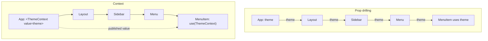
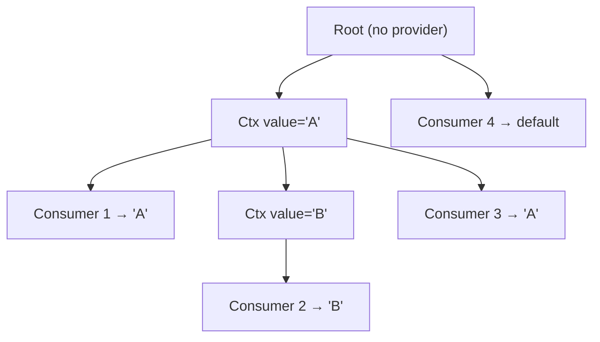
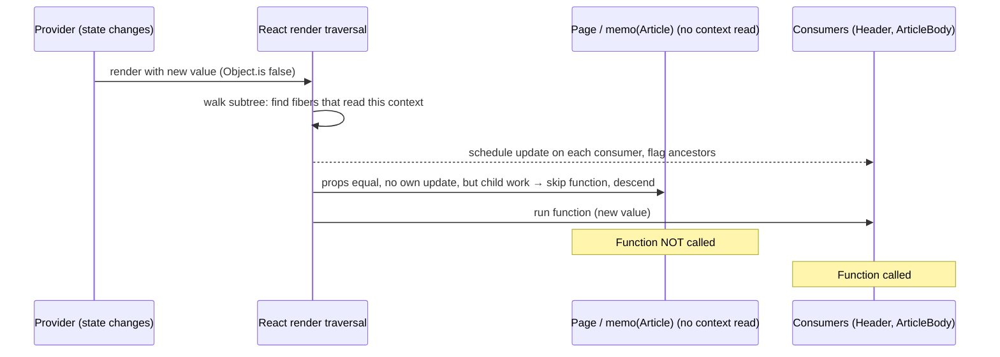

# 03 / 13 — `useContext`, `use(Context)`, and How Context Propagates

## 1. Lesson metadata

| | |
|---|---|
| **Level** | Intermediate → Advanced |
| **Study time** | 5–6 hours (reading 2.5 h, experiments 1.5 h, exercises 1.5 h) |
| **Prerequisites** | [01/06 — Props and one-way data flow](../01-react-fundamentals/06-props-and-one-way-data-flow.md), [01/07 — Composition and `children`](../01-react-fundamentals/07-composition-and-children.md), [01/14 — State as a snapshot](../01-react-fundamentals/14-state-as-a-snapshot.md), [02/01 — What triggers a render](../02-react-rendering-and-internals/01-what-triggers-a-render.md), [02/06 — Reconciliation fundamentals](../02-react-rendering-and-internals/06-reconciliation-fundamentals.md), [03/01 — `useState` internals](./01-usestate-internals-and-update-semantics.md), [03/12 — `React.memo`](./12-react-memo.md) |
| **Next** | [14 — Context performance](./14-context-performance.md) |
| **Related** | [15 — Custom hooks](./15-custom-hooks.md), [18 — State colocation and lifting](./18-state-colocation-and-lifting.md), [20 — `useSyncExternalStore`](./20-usesyncexternalstore-and-external-stores.md), [22 — Modern hooks and APIs](./22-modern-hooks-and-apis.md), [Phase 5/08 — Provider pattern](../05-design-patterns/08-provider-pattern.md), [Phase 7/06 — Context propagation cost](../07-performance/06-context-propagation-cost.md) |

**Learning objectives.** After this lesson you can:
1. Explain the problem context solves (prop drilling of *ambient* values) and the problem it does **not** solve (state management, selective subscription).
2. Create a context, provide a value with React 19's `<Context value={...}>` syntax, and read it with `useContext` and `use(Context)`; state precisely how `use` differs from `useContext`.
3. State exactly which value a consumer receives: nearest provider above it **in the React tree**, else the default value; and what "above" means with portals, separate roots, and re-used element trees.
4. Predict which components re-render when a provider's value changes — including consumers under `React.memo` — and which do not.
5. Build a type-safe provider/consumer pair in TypeScript with a custom hook that fails loudly outside the provider.
6. Describe, at the level of a teaching model, how React finds the consumers of a changed context without re-rendering the whole tree.
7. Identify legacy forms (`Context.Provider`, `Context.Consumer`, legacy `contextTypes` context) and recognize them in old code.

**Concepts covered:** prop drilling, ambient data, `createContext`, default value, provider, consumer, nearest-provider resolution, `Object.is` change detection, context propagation, bailout bypass, `use(Context)` vs `useContext`, provider nesting and override, display names, TypeScript patterns, server-component limits.

---

## 2. Deep conceptual explanation

### 2.1 The problem: values that many components need, at many depths

[Props](../01-react-fundamentals/06-props-and-one-way-data-flow.md) are React's explicit data channel: a parent hands a value to its direct child. That is exactly right for *most* data, because the dependency is visible at every call site. It becomes painful for **ambient** values: the current theme, the signed-in user, the locale, the router location, the design-system density mode. Such values share three traits:

1. They are needed by components at **arbitrary depth** (a `<Price>` ten levels down needs the currency and locale).
2. The intermediate components **do not care** about them; they only forward them (*prop drilling*).
3. They change **rarely** relative to the rest of the UI state.

Prop drilling has real costs: every intermediate component's signature mentions a prop it does not use, adding a new ambient value requires editing the whole chain, and refactors that move a component to a different place in the tree break the wiring.

Context is React's answer: a component higher in the tree **publishes** a value for its subtree; any component below can **subscribe** to it without the intermediates being involved.



### 2.2 What context is — and what it is not

Context is **a dependency-injection channel through the component tree**. It carries a value from provider to consumers. It is *not*:

| Common belief | Reality |
|---|---|
| "Context is a state management tool." | Context stores nothing. State lives in `useState`/`useReducer` (or an external store) in the **provider component**; context merely transports the current value downward. |
| "Context lets a component read only the part of the object it needs." | There is no selector. A consumer subscribes to the **whole value**; if the value's identity changes (`Object.is`), every consumer re-renders, whether or not the part it reads changed. See [Lesson 14](./14-context-performance.md). |
| "Context is global." | Context is **scoped to a subtree**. Two subtrees can hold different values for the same context at the same time. |
| "Context re-renders only consumers." | When a provider's *component* re-renders for any reason, React re-renders its children as usual; consumers are re-rendered *in addition* when the value changed, even through `memo` boundaries. |
| "`useContext` triggers a re-render when I call it." | Calling it **reads** the value during render and **registers** the component as dependent on that context. The re-render is triggered by a *provider value change*. |

### 2.3 The three roles

- **Context object**: created once, at module level, with `createContext(defaultValue)`. It is an identity token (plus a default). It holds no live value.
- **Provider**: in React 19 you render the context object itself as a component: `<ThemeContext value={theme}>…</ThemeContext>`. Everything in that subtree sees `theme`.
- **Consumer**: any component (or custom hook called by one) that calls `useContext(ThemeContext)` or `use(ThemeContext)` during render.

### 2.4 React 19 syntax and legacy forms

| Form | Status |
|---|---|
| `<MyContext value={v}>` | **Current (React 19).** The context object is itself a provider component. |
| `<MyContext.Provider value={v}>` | Still works in React 19. react.dev's `createContext` page now describes it as "a legacy way to provide the context value before React 19" (the React 19 post said it would be deprecated in a future version; no removal has happened as of 19.3). Prior to React 19 this was the only form. |
| `<MyContext.Consumer>{value => …}</MyContext.Consumer>` | Render-prop consumer. Still supported; **legacy** since hooks (Phase 1 era code and class components use it). |
| `static contextType` on class components | **Legacy** (class components). |
| `contextTypes` / `getChildContext` (legacy Context API) | **Long deprecated (since 16.6); removed in React 19** (it only ever worked with class components; confirmed in the React 19 upgrade guide). Never use. |

### 2.5 `useContext` vs `use(Context)`

React 19 adds `use`, an API that reads a resource — a Promise or a Context — during render. For context:

```tsx
import { createContext, use, useContext } from "react";

const ThemeContext = createContext<"light" | "dark">("light");

function A() {
  const theme = useContext(ThemeContext);   // hook: top-level only
  return <p>{theme}</p>;
}

function B({ show }: { show: boolean }) {
  if (!show) return null;
  const theme = use(ThemeContext);          // allowed after an early return
  return <p>{theme}</p>;
}
```

Documented differences:

| | `useContext(Ctx)` | `use(Ctx)` |
|---|---|---|
| Can be called conditionally / in loops / after early `return` | No — it is a Hook and obeys the [Rules of Hooks](./16-rules-of-hooks-and-composition.md). (In practice React 19 does not throw at runtime if you call it conditionally, because `useContext` does not occupy a slot in the hook list; the lint rule still flags it, and relying on that is unsupported.) | **Yes** — `use` is explicitly exempt from the "same order every render" rule |
| Can be called in event handlers, effects, `useMemo` callbacks | No (render only) | No (render only; React docs: `use` must be called in a Component or Hook) |
| Subscribes the component to value changes | Yes | Yes (same dependency semantics) |
| Reads the nearest provider | Yes | Yes |
| Also reads Promises | No | Yes (see [Lesson 22](./22-modern-hooks-and-apis.md)) |

*Public guarantee:* both return the value of the nearest provider (or default) and both cause the component to re-render when that value changes. *Implementation detail:* how React records the dependency on the fiber (conceptually a list of contexts read during the render, each with the value version seen) — see §3.

`use` is preferred in new code when the conditional read is useful; otherwise both are fine and `useContext` remains fully supported. Teams often keep `useContext` inside custom hooks (`useTheme`) for familiarity. Pick one per codebase.

### 2.6 Which value does a consumer get?

Resolution rule (public guarantee): **walk up the React tree from the consumer; the first provider of that context wins; if none exists, use the default value given to `createContext`.**

Subtleties that trip people:

1. **Default value ≠ initial value.** The default is used *only when there is no provider above*. If a provider exists and passes `undefined`, consumers receive `undefined`, **not** the default.
2. **"Above" is determined where the consumer is *rendered*, not where it is *defined or imported*.** Moving `<Sidebar/>` inside a different provider changes what it sees.
3. **React tree, not DOM tree.** Portals (`createPortal`) render into a different DOM node but remain children of their React parent, so they *do* see the context of where the portal element is written. A *separate* `createRoot` is a different React tree and does **not** inherit context.
4. **Nesting overrides.** An inner provider shadows an outer one for its subtree only.
5. **Consumers inside the provider's own component function don't see its value.** A component that renders `<Ctx value={x}>` cannot read `x` from `use(Ctx)` in the same function — it is *above* its own provider. It would read an outer provider or the default.

---

## 3. Internal mechanics

> ⚠ The following is a **teaching model** of React's implementation. Function and field names inside React's reconciler change between versions. Treat it as conceptual and verify against `packages/react-reconciler` in the [React repository](https://github.com/facebook/react) if you need precise behavior. Reading source is covered in [02/31](../02-react-rendering-and-internals/31-reading-react-source.md).

### 3.1 What a context object holds (teaching model)

A context object conceptually holds:
- the **default value**,
- a **current value** slot that React sets while it is *rendering inside* a provider and restores when it leaves it (a stack discipline — render descends into the provider: push, finishes the provider's subtree: pop),
- (internal) renderer-specific slots.

Because rendering is a depth-first walk of the tree (see [02/09 — Fiber nodes and units of work](../02-react-rendering-and-internals/09-fiber-nodes-and-units-of-work.md)), the "current value" during the render of any component equals the value of the nearest enclosing provider. That is *why* the rule in §2.6 is "nearest provider above in the tree": the stack discipline mirrors tree nesting. It is also why you can have two different values for the same context at the same moment in two sibling subtrees: React pushes and pops as it traverses.

### 3.2 What a consumer records

When a component reads a context during render, React records on that component's fiber a **dependency**: "this fiber read context X (at value V)". The record persists across renders and is rebuilt each render.

*Public guarantee:* a component that read a context in its last render will re-render when that context's value from its nearest provider changes.
*Implementation detail:* the dependency list is stored on the fiber; `use` can add dependencies conditionally because it is not tied to the ordered hook list.

### 3.3 Propagation: how React finds the consumers (teaching model)

When a provider renders with a new value (compared with `Object.is` to the previous one):

1. If the value is **identical** (`Object.is`) *and* the provider's `children` are the same element references as before, React can **bail out** of the whole subtree, exactly as in a normal memo-style bailout.
2. If the value **changed**, React must update every consumer below — but it cannot rely on the usual top-down "re-render children" path, because intermediate components may bail out (`React.memo`, stable `children` identity).
3. So React **walks the provider's subtree looking for fibers that depend on this context**. For each matching fiber it schedules an update on the fiber (marks it as needing render) and marks its ancestors (up to the provider) as having pending work below. Later, when the normal render traversal descends, it sees that a path leads to scheduled work and **does not skip** it, even though the intermediate components' props did not change.

That is the exact reason `memo` cannot protect a consumer from a context change: the update is not *prop-driven*; it was scheduled directly on the consumer's fiber.

The cost model follows from this: **the walk is proportional to the subtree size** (cheap per fiber, but real), and **the re-render cost is proportional to the number of consumers** (plus their non-memoized children). Neither depends on *what part* of the value changed.

### 3.4 What does NOT happen

- Context does not use events, observers, or a subscription list of callbacks (unlike `useSyncExternalStore`, [Lesson 20](./20-usesyncexternalstore-and-external-stores.md)). It piggybacks on the render traversal.
- Consumers are not told *what* changed. They get the new value and render.
- A provider re-rendering with an **identical** value does not re-render consumers *because of context*. (They may still re-render because their parent re-rendered and they are not memoized — a different mechanism.)

### 3.5 Where context is read relative to the render/commit phases

Context is read in the **render phase**. It must therefore be treated like props and state: you must not mutate it, and reading it is pure ([02/12 — Why rendering must be pure](../02-react-rendering-and-internals/12-why-rendering-must-be-pure.md)). Event handlers capture the value from the render in which they were created ([01/14](../01-react-fundamentals/14-state-as-a-snapshot.md)); they do not "read live context".

---

## 4. Step-by-step execution walkthrough

Scenario: a light/dark theme toggle. Tree:

```text
<ThemeProvider>            (owns useState<"light"|"dark">)
  <Page>                   (no context use; plain function component)
    <Header>               (uses theme)
    <Article>              (memo; no context use)
      <ArticleBody/>       (uses theme)
    <Footer/>              (no context use, not memoized)
```

Code in §5.2. The user clicks the toggle button inside `Header`, calling `setTheme("dark")`.

1. **Event.** The click handler (created during `Header`'s last render) calls `setTheme`, which belongs to `ThemeProvider`'s state. React enqueues an update on **`ThemeProvider`'s** fiber (Phase 1 [update queues](../01-react-fundamentals/15-update-queues-and-batching.md)).
2. **Render starts at `ThemeProvider`.** It re-runs its function: state is now `"dark"`; it builds a new `value` object (memoized on `theme`, so a *new* object this time) and returns `<ThemeContext value={value}>{children}</ThemeContext>`.
3. **`children` is the same element object** as the previous render, because `children` came from *`ThemeProvider`'s parent* (the root), which did not re-render. React compares the provider's child element by reference: unchanged → by the normal rule React would bail out of `Page`.
4. **But the context value changed** (`Object.is(oldValue, newValue)` is `false`). React walks the subtree, finds fibers that read `ThemeContext`: `Header` and `ArticleBody`. It marks them as needing an update, and marks their ancestors (`Page`, `Article`) as "has pending work below".
5. **Traversal continues.** `Page` has unchanged props and no own pending update, but it has *descendant* work → React does not render `Page`'s function; it **clones/continues into its children** (bailout "with child work").
6. `Header` is scheduled → its function runs; `use(ThemeContext)` returns `"dark"`; new JSX is produced.
7. `Article` is `memo` with unchanged props and no own update → function is skipped, but descendants have work → continue.
8. `ArticleBody` is scheduled → function runs and returns new output.
9. `Footer`: props unchanged, no dependency on context, no descendant work → **skipped entirely** (its function does not run).
10. **Commit.** Only DOM nodes whose output changed are mutated (class names or text); then effects run as usual.

**Render log you should see** (with `console.log` at the top of each component, StrictMode off): `ThemeProvider`, `Header`, `ArticleBody`. Not `Page`, not `Article`, not `Footer`.
⚠ In development with `<StrictMode>`, each component function that does run is invoked twice per render (the second invocation's logs may be dimmed or suppressed depending on the React/DevTools version). See [02/28](../02-react-rendering-and-internals/28-strict-mode-behavior.md).

**The crucial insight:** this clean result depends on `ThemeProvider` receiving `children` from *above* it. If `Page` were written *inside* `ThemeProvider`'s function body as `<ThemeContext value={value}><Page/></ThemeContext>`, the `<Page/>` element would be recreated on every `ThemeProvider` render, `Page` would re-render (with its unmemoized children `Footer`) on every theme change, and the context mechanism would be irrelevant to that result. This "children identity" mechanism is the single most important performance fact about providers.

---

## 5. Code examples

### 5.1 Minimal example

```tsx
import { createContext, use } from "react";

const LangContext = createContext("en");

function Greeting() {
  const lang = use(LangContext);
  return <p>{lang === "fr" ? "Bonjour" : "Hello"}</p>;
}

export function App() {
  return (
    <>
      <Greeting />                              {/* no provider: default "en" */}
      <LangContext value="fr">
        <Greeting />                            {/* nearest provider: "fr" */}
        <LangContext value="en">
          <Greeting />                          {/* inner override: "en" */}
        </LangContext>
      </LangContext>
    </>
  );
}
```

**Predict:** what three lines appear?
**Result:** `Hello`, `Bonjour`, `Hello`.
**Why:** the first has no provider above, so it gets the default `"en"`. The second sees the nearest provider (`"fr"`). The third sees the *inner* provider, which shadows the outer.
Line notes: `createContext("en")` infers `Context<string>`. `<LangContext value="fr">` is the React 19 provider form; in React 18 and earlier you must write `<LangContext.Provider value="fr">`.

### 5.2 Practical example — a type-safe theme provider with its hook

```tsx
// theme-context.tsx
import { createContext, use, useMemo, useState, type ReactNode } from "react";

export type Theme = "light" | "dark";

interface ThemeContextValue {
  theme: Theme;
  setTheme: (next: Theme) => void;
  toggle: () => void;
}

// null default: "no provider" is a programming error, not a valid state.
const ThemeContext = createContext<ThemeContextValue | null>(null);
ThemeContext.displayName = "ThemeContext"; // shows up in React DevTools

export function ThemeProvider({
  initial = "light",
  children,
}: {
  initial?: Theme;
  children: ReactNode;
}) {
  const [theme, setTheme] = useState<Theme>(initial);

  const value = useMemo<ThemeContextValue>(
    () => ({
      theme,
      setTheme,
      toggle: () => setTheme((t) => (t === "light" ? "dark" : "light")),
    }),
    [theme], // setTheme from useState is stable; toggle closes over only it
  );

  return <ThemeContext value={value}>{children}</ThemeContext>;
}

export function useTheme(): ThemeContextValue {
  const ctx = use(ThemeContext);
  if (ctx === null) {
    throw new Error("useTheme must be used inside <ThemeProvider>");
  }
  return ctx;
}
```

```tsx
// page.tsx
import { memo } from "react";
import { ThemeProvider, useTheme } from "./theme-context";

function Header() {
  const { theme, toggle } = useTheme();
  console.log("render Header");
  return (
    <header data-theme={theme}>
      <button onClick={toggle}>Switch to {theme === "light" ? "dark" : "light"}</button>
    </header>
  );
}

const Article = memo(function Article() {
  console.log("render Article");
  return <ArticleBody />;
});

function ArticleBody() {
  const { theme } = useTheme();
  console.log("render ArticleBody");
  return <article className={theme}>…</article>;
}

function Footer() {
  console.log("render Footer");
  return <footer>© Acme</footer>;
}

function Page() {
  console.log("render Page");
  return (
    <>
      <Header />
      <Article />
      <Footer />
    </>
  );
}

export function App() {
  return (
    <ThemeProvider>
      <Page />
    </ThemeProvider>
  );
}
```

**Predict:** you click the button once. Which `console.log` lines print (StrictMode off)?
**Result:** `render Header`, `render ArticleBody`. (Walkthrough in §4.)
**Why:** `App` did not re-render, so `<Page />` is the same element reference passed as `children`; `ThemeProvider` re-renders and changes the value; React walks to the two consumers.
Line notes:
- `createContext<ThemeContextValue | null>(null)` — the `| null` is a *type-level* representation of "no provider". The `useTheme` hook narrows it, so consumers get a non-null type with no `!`.
- `useMemo` keeps `value` referentially stable when `ThemeProvider` re-renders for reasons other than `theme` (e.g., its parent re-rendered). Without it, every `ThemeProvider` render creates a new object and re-renders every consumer. See [Lesson 14](./14-context-performance.md) and [Lesson 11](./11-usememo-and-usecallback.md).
- `setTheme((t) => …)` is the functional form ([Lesson 02](./02-functional-state-updates.md)): `toggle` has no dependency on `theme`, so it is correct inside a memo keyed on `theme` only.
- `displayName` is purely for DevTools.
**Trade-off:** one context carries three fields; a component that only calls `toggle` still re-renders when `theme` changes. For a theme that is acceptable (nearly every consumer needs `theme`). For hot state, split — see Lesson 14.

### 5.3 Incorrect examples

**(a) Object literal in the provider.**

```tsx
function BadProvider({ children }: { children: ReactNode }) {
  const [user, setUser] = useState<User | null>(null);
  const [notifications, setNotifications] = useState(0);
  return (
    <UserContext value={{ user, setUser }}>        {/* new object every render */}
      <NotifBadge n={notifications} onClear={() => setNotifications(0)} />
      {children}
    </UserContext>
  );
}
```
Every time `notifications` changes, `BadProvider` re-renders, creates a **new** `{ user, setUser }` object, and every `UserContext` consumer re-renders even though `user` did not change. Fix: `useMemo` the value *and* move the notification state out of the provider (colocation, [Lesson 18](./18-state-colocation-and-lifting.md)).

**(b) Relying on the default as a fallback for "no user".**

```tsx
const UserContext = createContext<User | null>(null);
// Provider rendered with value={undefined} when loading
```
`undefined` is a *provided* value; the default does not substitute. Consumers receive `undefined`, which the type `User | null` does not allow — and TypeScript only catches it if you don't cast. Model "loading" explicitly: `{ status: "loading" } | { status: "ready"; user: User }`.

**(c) Reading context in an event handler.**

```tsx
function Button() {
  function onClick() {
    const theme = useContext(ThemeContext); // ❌ Hook called outside render
  }
  …
}
```
Hooks (and `use`) are render-time APIs. Read in render, capture in closure: `const theme = use(ThemeContext); function onClick() { log(theme); }`.

**(d) Expecting a component to see its own provider.**

```tsx
function Panel() {
  return (
    <PanelContext value="compact">
      <Inner />
    </PanelContext>
  );
}
function PanelWrong() {
  const mode = use(PanelContext);  // sees outer provider/default, never "compact"
  return <PanelContext value="compact"><Inner mode={mode} /></PanelContext>;
}
```

### 5.4 Corrected implementation of (a)

```tsx
function UserProvider({ children }: { children: ReactNode }) {
  const [user, setUser] = useState<User | null>(null);
  const value = useMemo(() => ({ user, setUser }), [user]);
  return <UserContext value={value}>{children}</UserContext>;
}

function NotificationArea() {            // own state, colocated
  const [n, setN] = useState(0);
  return <NotifBadge n={n} onClear={() => setN(0)} />;
}
```

### 5.5 Advanced example — nested providers as scoped configuration

A data grid whose density depends on the nearest container, with a safe override.

```tsx
type Density = "comfortable" | "compact";
const DensityContext = createContext<Density>("comfortable"); // sensible default: no provider needed

export function Dense({ children }: { children: ReactNode }) {
  return <DensityContext value="compact">{children}</DensityContext>;
}

function Row({ children }: { children: ReactNode }) {
  const density = use(DensityContext);
  return <tr className={density === "compact" ? "py-1" : "py-3"}>{children}</tr>;
}
```
Here a default value *is* the right design: "comfortable" is a meaningful behavior without any provider, and `Dense` overrides locally. Contrast with `ThemeContext` above, where "no provider" is a bug.

**Conditional reading with `use`** — a real use case:

```tsx
function PermissionGate({ needs, children }: { needs: string; children: ReactNode }) {
  if (needs === "") return <>{children}</>;       // no permission needed: don't even read auth
  const auth = use(AuthContext);                  // legal after an early return; useContext would not be
  return auth.permissions.has(needs) ? <>{children}</> : null;
}
```
The component still re-subscribes to `AuthContext` only in renders where it read it. Version note: `use` is React 19; React 18 has only `useContext`.

---

## 6. Visual explanations

### 6.1 Resolution: nearest provider wins



### 6.2 Value change: bypassing ordinary bailouts



### 6.3 Render set (for §5.2 after one toggle)

```text
ThemeProvider ......... RENDERS (own state)
  Page ................ skipped (same element, no context read, has child work)
    Header ............ RENDERS (consumer)
    Article (memo) .... skipped
      ArticleBody ..... RENDERS (consumer)
    Footer ............ skipped
```

---

## 7. Alternative approaches and trade-offs

Delivering a value to many descendants:

| Approach | Explicitness | Re-render precision | Boilerplate | Testability | Best for |
|---|---|---|---|---|---|
| **Props (drill)** | Highest: every hop visible | Exact (only changed props) | High with depth | High | Shallow trees; values that matter to intermediates |
| **Composition** (pass elements/slots as props, [01/07](../01-react-fundamentals/07-composition-and-children.md)) | High | Exact | Low–Medium | High | Avoiding drilling when the intermediate layer is *layout only* |
| **Context** | Medium: implicit dependency | Coarse: *all* consumers of the changed value | Low | Medium (needs provider in tests) | Ambient, rarely-changing values: theme, locale, auth, router, feature flags |
| **Context + reducer** ([03/03](./03-usereducer-and-reducer-architecture.md)) | Medium | Coarse (split state/dispatch helps) | Medium | High (reducer pure) | Subtree-scoped state with many actions |
| **External store + `useSyncExternalStore`** ([Lesson 20](./20-usesyncexternalstore-and-external-stores.md)) | Medium | **Fine** (selectors) | Medium | High | Frequently changing shared state; cross-tree state |
| **Module singleton** (plain import) | Hidden global | None (no reactivity) | Lowest | Low (shared mutable global) | Constants, config that never changes |
| **URL/search params** | Highest for shareable state | Per-subscriber with router APIs | Medium | Medium | Filter/sort/page state ([Lesson 19](./19-ui-server-url-and-shared-state.md)) |

**When the recommended approach (context for ambient values) is NOT best.** A product list with a `selectedProductId` read by two distant components: the selection changes on every click. Putting it in context re-renders all consumers of that context on each change, including those that only needed, say, the filter. Here either lift state to the common ancestor and pass props/slots ([Lesson 18](./18-state-colocation-and-lifting.md)), or use an external store with selectors. Also not best: a value needed by **one child two levels down**; composition (passing the rendered `<Price/>` element down as a prop) is simpler and keeps the dependency visible.

Another instance: **testability-first libraries.** A reusable UI primitive (a `<Tabs>` component) can use context internally to connect `Tabs.List` and `Tabs.Panel`, but its public API must not require users to wrap an application-level provider ([Phase 5/05 — Compound components](../05-design-patterns/05-compound-components.md)).

---

## 8. Best practices and anti-patterns

**Do**
- Create contexts at module scope; export a **provider component** and a **hook**, not the raw context object — this keeps the shape private and lets you swap the implementation (to a store) without touching consumers.
- Put the **state** in the provider component and keep `value` referentially stable (`useMemo`, stable setters) when the provider can re-render for unrelated reasons.
- Have the provider accept `children` from its parent so child elements keep identity.
- Make "used outside provider" a thrown error for contexts that require a provider; give a default only when the default is a *meaningful behavior*.
- Set `displayName` for DevTools clarity.
- Keep each context **narrow**: one concern, one update frequency (see [Lesson 14](./14-context-performance.md)).

**Beginner mistakes**
- Treating context as global mutable state and mutating `value.items.push(x)` (no re-render; breaks purity).
- Putting everything (`user`, `cart`, `theme`, `modal`) into one `AppContext` object.
- Passing a new inline object/array/function as `value` on every render.
- Creating the context *inside* a component (a new context identity each render; consumers never match the provider).
- Forgetting that the default value is not the "loading" state.

**Experienced-developer mistakes**
- Using context for state that changes on every keystroke or animation frame.
- Assuming `React.memo` on a consumer stops context-driven re-renders.
- Treating the Provider as "free": large subtrees under a frequently-changing provider pay the subtree walk plus all consumer renders.
- A deep provider *pyramid* in `main.tsx` with 12 providers, some of which (e.g., a modal manager) are used by two screens: scope providers to the subtree that needs them.
- Reading from context inside a generic reusable component, silently coupling it to the application.

**Smells:** `useContext(AppContext)` destructuring one field in 60 components; a provider whose value changes on every render (see §10); tests failing with "must be used within provider" for components that only needed a prop.

**Justified exceptions:** (1) a single provider with a stable object (e.g., a store instance, a router, an i18n instance) never re-renders consumers by itself — context is then pure DI and a very good fit. (2) A tiny app with a single `useReducer` + context is entirely adequate; don't import a state library to avoid a 3-consumer context re-render.

**React Compiler.** React Compiler 1.0 (stable since 2025-10-07) can automatically memoize values and JSX, which may stabilize a provider's `value` and reduce intermediate re-renders. It does not turn context into a selector system: all consumers of a *changed* value still update. Check the compiler documentation for what it handles in your codebase (see [Phase 9/08](../09-advanced-rendering-and-ecosystem/08-react-compiler.md)).

**Server Components.** In frameworks that use React Server Components, `createContext` and context consumption belong to **Client Components**. A Server Component can render a client provider and pass server-rendered children through its `children` prop. As of React 19.3 a Server Component can also render a context object directly (`<UserContext value={…}>`) if it imports it from a `'use client'` module, without a wrapper Provider component (19.3 release post); it still cannot call `createContext` or read context. *Verify against your framework's docs* ([Phase 9/03](../09-advanced-rendering-and-ecosystem/03-server-components-in-depth.md)).

---

## 9. Real-world application

**(a) Authentication in a SaaS dashboard.** An `AuthProvider` fetches/holds the session once, exposes `{ user, can(permission) }`. Dozens of components (nav, buttons, route guards) need it. It changes on login/logout/token refresh — rare. *Constraints:* the value must be stable between refreshes; do not put the access token in context if it rotates every minute and only the HTTP client needs it (pass it via an API client in a module or a store). Test by rendering with a fake provider.

**(b) i18n / locale.** `LocaleContext` provides `locale` and a formatter object. Constraint: formatters (`Intl.NumberFormat`) are costly to create; build them in the provider with `useMemo` keyed on `locale`, not in each `<Price>`.

**(c) Design-system theming across multiple teams.** A shared `ThemeProvider` from the design-system package; each team's app mounts it once. Constraint: package versions must not duplicate the context object. If two copies of the library are bundled (version mismatch in a monorepo), `createContext` runs twice and consumers from copy B never see copy A's provider — a classic "works in Storybook, broken in the app" bug. Mitigate with a single resolved version (peer dependencies) and, in libraries, a dev-time provider check with a clear error.

**(d) Checkout wizard.** A `CheckoutProvider` scopes shipping/billing draft state to the checkout subtree only; it unmounts with the route, which also discards the state (compare with [Lesson 18](./18-state-colocation-and-lifting.md) and global stores).

**(e) Real-time dashboards.** Do **not** push a WebSocket tick stream through a context value: each tick would re-render every consumer. Provide a **stable store/subscription object** through context and let components subscribe to the slice they need via `useSyncExternalStore` ([Lesson 20](./20-usesyncexternalstore-and-external-stores.md), [Phase 6/17](../06-data-fetching-and-state-ecosystems/17-real-time-websockets-subscriptions.md)).

---

## 10. Debugging and troubleshooting

**Symptom 1: "`useTheme must be used inside <ThemeProvider>` — but I did wrap it."**
Investigation: React DevTools → Components → search for the consumer, inspect its ancestors; each provider shows as `ThemeContext.Provider`/`ThemeContext` with its `value` prop. Causes: (1) the provider is rendered in a *different tree* (a second `createRoot`, a micro-frontend, a test renderer without wrappers); (2) **duplicate module instances** of the context file (two copies of the package, or mixed ESM/CJS entry points) → two context identities; (3) the consumer is rendered by a portal into a *different root*; (4) the component renders above the provider (see §2.6 item 5). Validate: log `ThemeContext === imported` from both sites, or check `npm ls` for duplicates.

**Symptom 2: "Everything re-renders when I toggle one flag."**
Repro: open DevTools **Profiler** → ⚙ Settings → enable "Record why each component rendered while profiling" → record a toggle → inspect a re-rendered component: the tooltip shows "Context changed" (for context-driven renders) vs "Props changed"/"Parent rendered"/"Hooks changed". Root causes in order of frequency: new object `value` each render; one fat context; a provider placed *around inline JSX* so children identity is lost (§4 note). Validate: after the fix, repeat the recording and confirm the unrelated components are greyed out ("did not render").

**Symptom 3: "Consumer shows stale value."**
Causes: (1) a closure in an effect/callback captured an old render's value ([Lesson 05](./05-effect-dependencies-and-stale-closures.md)); (2) the *provider* stored a copy that it never updates (a derived-state bug, [Lesson 17](./17-derived-state.md)); (3) mutating the value object in place so `Object.is` sees no change and React bails out. Validate with the DevTools value inspector on the provider.

**Symptom 4: "Default value used even though a provider exists."**
The consumer is outside the provider's subtree: sibling instead of descendant, rendered in a portal into a separate root, or the provider is *conditionally* rendered and absent on first render. Check ancestors in DevTools.

**Symptom 5: TypeScript — `Object is possibly null` everywhere.**
Don't use `!`. Export the narrowing `useX()` hook (§5.2).

**Experiment to build intuition:** add `console.count("Header")` in each component of §5.2, toggle five times, and verify the counts match §6.3. Then move `<Page />` inline into `ThemeProvider` and re-run: `Page` and `Footer` now count too.

---

## 11. Exercises

### Level A — Knowledge
A1. What problem does context solve, and what problem does it explicitly *not* solve?
A2. When does a consumer receive the context's default value? Is `value={undefined}` such a case?
A3. Name two differences between `useContext(Ctx)` and `use(Ctx)`.
A4. In React 19, how do you write a provider without `.Provider`? Is the old form removed?
A5. How does React detect that a provider's value changed?

### Level B — Code comprehension
B1. Given the tree below, what does each `Show` print?
```tsx
const C = createContext("default");
function Show({ id }: { id: string }) { return <i>{id}:{use(C)}</i>; }
function App() {
  return (
    <>
      <Show id="1" />
      <C value="x">
        <Show id="2" />
        <C value="y"><Show id="3" /></C>
        <Show id="4" />
      </C>
      <C value={undefined as unknown as string}><Show id="5" /></C>
    </>
  );
}
```
B2. In the following, how many times does `Child` render after the button click, and why?
```tsx
const Ctx = createContext(0);
const Child = memo(function Child() { return <p>{use(Ctx)}</p>; });
function Parent() {
  const [n, setN] = useState(0);
  return (
    <Ctx value={n}>
      <button onClick={() => setN(n + 1)}>+</button>
      <Child />
    </Ctx>
  );
}
```
B3. In B2, if `Child` did not read the context and were memoized, would it render on click? Explain the mechanism difference from B2.
B4. `function Panel() { const v = use(Ctx); return <Ctx value={v + 1}><Inner/></Ctx>; }` — what does `Inner`'s `use(Ctx)` return if there is an outer provider with value 10?

### Level C — Implementation
C1. Implement `createRequiredContext<T>(name: string)` returning `[Provider, useCtx]` where `useCtx` throws a helpful error outside a provider and the returned value is non-nullable. Use React 19 syntax.
C2. Implement a `FeatureFlagsProvider` that takes `flags: Record<string, boolean>` as a prop, exposes `useFlag(name)`, and does **not** re-render consumers when the parent re-renders with an equal-content `flags` object (new reference, same content).
C3. Write a test (React Testing Library style) that renders a consumer with a custom provider wrapper and asserts that nested providers override.

### Level D — Debugging
D1. A teammate reports: "After adding `<CartProvider>` the whole product grid (2,000 cards) re-renders when I add an item, even though cards don't use the cart." The code is:
```tsx
function Shop() {
  const [cart, setCart] = useState<CartItem[]>([]);
  return (
    <CartContext value={{ cart, setCart }}>
      <ProductGrid />
      <CartButton />
    </CartContext>
  );
}
```
Find *all* the causes and fix them.
D2. The consumer below never updates in the UI after clicking. Why?
```tsx
function Provider({ children }: { children: ReactNode }) {
  const state = useRef({ count: 0 });
  return <Ctx value={state.current}>{children}</Ctx>;
}
// consumer: <button onClick={() => { ctx.count++; }}>{ctx.count}</button>
```
D3. In a monorepo, `<Toast>` from `@acme/ui` throws "must be used inside ToastProvider" although the app wraps with `ToastProvider` from `@acme/ui`. List three plausible causes and how to confirm each.

### Level E — Architecture and engineering decisions
E1. A form wizard has 5 steps sharing a draft object edited on every keystroke. Choose between context, lifted state with props, and an external store. Justify with at least four criteria.
E2. Your team debates "one `AppContext` vs many small contexts". Write a decision rule that includes update frequency, consumer count, and provider placement.

### Level F — Expert challenge
F1. Explain, using the propagation model, why an `Object.is`-equal value from a provider whose *parent re-rendered* may still re-render the consumers, and give two independent ways to prevent it. Then explain why neither prevents re-renders when the value is genuinely new.
F2. Design a typed `createSelectableContext<T>()` with `useSelector(selector)` that avoids re-rendering when the selected slice is unchanged. Identify its constraints (selector stability, tearing, concurrent rendering) and when you would adopt a library instead.

---

## 12. Detailed answers and explanations

> Attempt the exercises first.

**A1.** Solves: delivering ambient values to deep descendants without threading props through components that do not use them. Does not solve: state storage (the provider's `useState`/`useReducer` does), selective subscription (consumers cannot subscribe to a slice), or performance of high-frequency updates. Wrong answer: "context avoids re-renders". It *causes* a defined set of them.

**A2.** Only when no provider of that context exists above the consumer in the React tree. `value={undefined}` is a provided value, so consumers receive `undefined` (the default is **not** substituted). Typical wrong belief: "default fills in for missing values".

**A3.** (1) `use` may be called conditionally/after early returns/in loops; `useContext` follows the Rules of Hooks. (2) `use` also accepts a Promise (Lesson 22). Same: render-only, nearest provider, subscription semantics. Edge: neither works in handlers/effects.

**A4.** `<MyContext value={…}>`. The `.Provider` form still works in 19 (react.dev calls it the legacy form) — so it is "older", not removed.

**A5.** `Object.is(prevValue, nextValue)` when the provider renders. Mutations of the same object are invisible. NaN is equal to NaN; `+0` and `-0` are different under `Object.is`.

**B1.** `1:default`, `2:x`, `3:y`, `4:x`, `5:undefined`. Show 4 is a sibling of the inner provider, so it sees `x`. Show 5's provider supplies `undefined` (cast to bypass TS), so the default is not used. Plausible wrong answer for 5: `default`.

**B2.** `Child` renders **once more** (initial render + one render per click). `memo` compares props (none) and would skip, but `Child` reads `Ctx`, whose value changed from `0` to `1`; the update is scheduled on `Child`'s fiber directly, bypassing the props comparison. Parent itself also renders (state). Wrong answer: "memo protects it". Note that `<Child />` is recreated by `Parent`'s render, but `memo` would have bailed out; the context change is why it does not.

**B3.** No. Without a context dependency, memo with equal props bails out (its element is recreated but props are shallow-equal: `{}` vs `{}`). The difference: prop-driven bailout depends on the comparison at the parent's render; a context dependency creates an independent update path.

**B4.** `11`. `Panel` reads the *outer* provider (10), provides `v + 1` to `Inner`. Edge: `Panel` itself sees 10, never 11.

**C1. Reference solution**
```tsx
import { createContext, use, type ReactNode } from "react";

export function createRequiredContext<T>(name: string) {
  const Ctx = createContext<T | undefined>(undefined);
  Ctx.displayName = name;

  function Provider({ value, children }: { value: T; children: ReactNode }) {
    return <Ctx value={value}>{children}</Ctx>;
  }
  function useCtx(): T {
    const v = use(Ctx);
    if (v === undefined) throw new Error(`use${name} must be used inside <${name}Provider>`);
    return v;
  }
  return [Provider, useCtx] as const;
}
```
Notes: using `undefined` as the sentinel prevents a legitimate `T` that includes `undefined` (e.g., `T = string | undefined`). If that's needed, use a unique symbol sentinel. A more careful version distinguishes "no provider" from "provided undefined" using a private `const NONE = Symbol()` default.

**C2. Reference solution**
```tsx
import { createContext, use, useRef, type ReactNode } from "react";

const FlagsContext = createContext<Readonly<Record<string, boolean>> | null>(null);

function shallowEqual(a: Record<string, boolean>, b: Record<string, boolean>) {
  const ka = Object.keys(a), kb = Object.keys(b);
  return ka.length === kb.length && ka.every((k) => a[k] === b[k]);
}

export function FeatureFlagsProvider({ flags, children }: { flags: Record<string, boolean>; children: ReactNode }) {
  const ref = useRef(flags);
  if (!shallowEqual(ref.current, flags)) ref.current = flags; // identity changes only on content change
  return <FlagsContext value={ref.current}>{children}</FlagsContext>;
}

export function useFlag(name: string): boolean {
  const flags = use(FlagsContext);
  if (!flags) throw new Error("useFlag outside FeatureFlagsProvider");
  return flags[name] ?? false;
}
```
Evaluation: the key is preserving identity when content is equal. Caveat: assigning to `ref.current` during render is the "idempotent identity-stabilizing cache" exception to purity (the result is a deterministic function of the inputs); some linters flag it. An alternative with no ref write: derive a content key (`JSON.stringify` of sorted entries) and `useMemo(() => flags, [key])` — simpler and lint-clean, at the cost of serialization each render. ⚠ For concurrent rendering the ref pattern is acceptable here only because the write is idempotent; see [02/12](../02-react-rendering-and-internals/12-why-rendering-must-be-pure.md).

**C3. Sample**
```tsx
import { render, screen } from "@testing-library/react";

function Probe() { return <span data-testid="p">{useTheme().theme}</span>; }

test("inner provider overrides outer", () => {
  render(
    <ThemeProvider initial="light">
      <ThemeProvider initial="dark"><Probe /></ThemeProvider>
    </ThemeProvider>,
  );
  expect(screen.getByTestId("p")).toHaveTextContent("dark");
});
```
Evaluation: test asserts observable output, not internals; wraps with real providers (or a `wrapper` option) rather than mocking the hook.

**D1.** Causes: (1) `value={{ cart, setCart }}` is a fresh object on every `Shop` render; `Shop` renders whenever `cart` changes (state) — but also whenever *its parent* re-renders; (2) more importantly, `<ProductGrid />` is created *inside* `Shop`, so it is a new element on every `Shop` render → `ProductGrid` and all 2,000 cards re-render regardless of context. Context isn't even the cause for the cards. Fix: extract `CartProvider({ children })` holding the state, render `<CartProvider><ProductGrid/><CartButton/></CartProvider>` from a parent that does not re-render; `memo` the card; memoize the value; split `cart` and `setCart` (setter is stable) so cards that only add items don't re-render on cart change. Plausible wrong fix: wrapping only the cards in `memo` — helps (2) partially, but the grid still re-renders as a component.

**D2.** The value is a mutable object with stable identity; mutation doesn't call a setter, so nothing schedules a render, and `Object.is` sees the same object anyway. State must go through `useState`/`useReducer` with a new object per update. Also the mutation of a value read during render violates purity.

**D3.** (a) Two copies of `@acme/ui` (different versions or dual ESM/CJS builds) → two context objects; confirm with `npm ls @acme/ui` / `pnpm why`, bundle analyzer, or `console.log` identity check. (b) Toast rendered into a portal attached to a separate `createRoot`; confirm in DevTools that it is a separate root. (c) The Toast is rendered above the provider (e.g., called from an error boundary or app shell that wraps the provider); confirm by ancestors in DevTools. Fix respectively: dedupe/peerDependency, share via the same root or re-wrap, move the provider up.

**E1. Evaluation criteria & example.** Criteria: update frequency (every keystroke), consumer count, subtree distance, testability, persistence/URL needs, team familiarity, future growth. A good answer: keystroke-frequency + 5 steps with distinct consumers → context with a single big value re-renders all steps on every key; prefer lifting a `useReducer` to the wizard component and passing each step only its slice via props (steps are siblings under one parent — no drilling problem), with `memo` on steps; escalate to an external store with selectors only if profiling shows cost or if the draft must be shared across routes. Reject context for the *draft*; context is still fine for ambient wizard config (step metadata). State what measurement would change the decision.

**E2.** Example rule: split a context when (a) its fields change at different frequencies, or (b) consumers typically need different subsets; keep one when fields always change together and all consumers need them. Place providers at the lowest common ancestor of consumers, not at the app root, unless needed app-wide. Consider an external store when consumer count × update frequency makes coarse re-render measurable in the Profiler. Good answers use measurements and name exceptions.

**F1.** If the provider's *parent* re-renders and the provider's `value` is built inline (new object each time), `Object.is` fails → full consumer update. Even if `value` is stable, if `children` elements are newly created by the parent, the children re-render by ordinary top-down rendering (not a context effect). Prevention: (1) `useMemo`/stable value; (2) keep provider state *inside* the provider component so unrelated parent renders don't happen, and pass `children` from above; also `memo` the provider's children. Neither helps when the value truly changes, since propagation unconditionally updates all consumers (no selector).

**F2.** Design: context carries a **stable store object** `{ getSnapshot, subscribe, set }` (never changes → context never triggers renders); `useSelector(sel)` calls `useSyncExternalStore(store.subscribe, () => sel(store.getSnapshot()))`. Constraints: the selector must return a *referentially stable* result for unchanged state (otherwise `getSnapshot` returns a different value each call → infinite loop warning/ extra renders); selectors that derive new objects need caching or `shallowEqual`-style wrappers; `useSyncExternalStore` prevents tearing in concurrent rendering but forces sync updates for store changes (can't be deferred by transitions); the store must be created per provider instance (`useState(() => createStore(...))`) for SSR safety. Adopt a library (Zustand, Redux Toolkit/react-redux, Jotai) when you need devtools, middleware, async patterns, persistence, or have multiple teams. Sketch in [Lesson 14 §5.5](./14-context-performance.md).

---

## 13. Senior engineer interview questions

**Q1. "Why does `React.memo` not stop a context consumer from re-rendering?"**
*Strong answer:* `memo` is a prop-comparison bailout applied when the parent renders. A context update is not prop-driven: when a provider value changes, React finds consumer fibers (they recorded a dependency on the context) and schedules work on them directly, flagging ancestors so traversal reaches them. The intermediate memo component's function is skipped, the consumer's is not. To avoid re-rendering the consumer you need to change *what changes* (split the context, stabilize the value, move to a store with selectors), not wrap it in memo. Caveat: put the memo *around the expensive child* of the consumer so the consumer re-renders cheaply.

**Q2. "Is context a state management solution?"**
*Strong answer:* No; it's a transport. State lives in the provider via `useState`/`useReducer` or an external store. Context + reducer is adequate for low-frequency, subtree-scoped state. Its limits (no selectors, all consumers update) are why high-frequency or large shared state goes to external stores. Name the exception: if the value is a *stable store handle*, context is excellent DI.

**Q3. "What changed about context in React 19?"**
*Strong answer:* `<Context value>` replaces `<Context.Provider value>`; `use(Context)` can read context conditionally; legacy `.Provider` still works but react.dev now labels it legacy; legacy `contextTypes`/`getChildContext` is gone. Codemods exist for migrating.

**Q4. "Two sibling subtrees need different values of the same context at the same time — how does React do it?"**
*Strong answer:* Resolution is by tree position, implemented as a push/pop discipline during depth-first rendering, plus the dependency records for updates. Each subtree gets the nearest provider's value; updates propagate only beneath the provider whose value changed.

**Q5. "Where would you place providers in a large app, and why not all at the root?"**
*Strong answer:* At the lowest common ancestor of consumers: this scopes the subtree walk and the lifetime of state (unmount discards it), keeps unrelated routes from paying, and makes ownership visible. Root-level for truly global values (auth, locale, theme). Mention test ergonomics and code-splitting (a provider imported at the root drags its code into the main bundle).

**Q6. "How do you make a provider not re-render the world?"**
*Strong answer:* (1) Provider component owns state and takes `children` from above; (2) stable value; (3) split by update frequency, and separate dispatch from state; (4) memoize expensive consumers' children; (5) when consumers need slices, switch to selector-capable store. Back with Profiler's "why did this render".

---

## 14. Further learning resources

| Resource | URL | Covers / why | Level | Study |
|---|---|---|---|---|
| React docs — Passing Data Deeply with Context | <https://react.dev/learn/passing-data-deeply-with-context> | The canonical tutorial: prop drilling, createContext, providers, overriding | Beginner–Int. | Whole page |
| React docs — `useContext` | <https://react.dev/reference/react/useContext> | API reference, caveats (default value, `Object.is`, memoizing `value`) | Intermediate | Caveats, Troubleshooting |
| React docs — `createContext` | <https://react.dev/reference/react/createContext> | Context object, `Provider`/`Consumer` forms, default value | Intermediate | Reference + Caveats |
| React docs — `use` | <https://react.dev/reference/react/use> | Reading context conditionally; Promises | Intermediate | "Reading context with `use`" |
| React docs — Scaling Up with Reducer and Context | <https://react.dev/learn/scaling-up-with-reducer-and-context> | Provider + reducer pattern with split contexts | Intermediate | Whole page |
| React 19 release post | <https://react.dev/blog/2024/12/05/react-19> | `<Context>` as provider, `use` | Intermediate | "`<Context>` as a provider" |
| React source (reconciler) | <https://github.com/facebook/react/tree/main/packages/react-reconciler> | Real propagation implementation; names change by version | Advanced | Search for "context" in begin-work / propagation files |
| Phase 3/14 in this course | [Context performance](./14-context-performance.md) | Next lesson | Advanced | All |

Links to specific sub-anchors are not given because anchors change; use the page's table of contents.

---

## 15. Knowledge checkpoint

**You should now understand**
- Context is an injection channel scoped by tree position; state belongs to the provider's component.
- The consumer's value is the nearest provider above in the React tree, else the default; `undefined` provided ≠ default.
- A changed value (by `Object.is`) re-renders **all** consumers, bypassing `memo`, because React schedules work on the consumer fibers directly.
- Children identity (`children` from above) is what keeps non-consumers from re-rendering.
- `use(Context)` vs `useContext`; `<Context value>` vs `.Provider`; which are legacy.

**You should be able to explain without notes**
- Why `memo` doesn't shield a consumer.
- Why creating an inline `value={{...}}` is a performance bug and when it doesn't matter.
- Why the provider cannot read its own value.

**You should be able to implement**
- A typed provider + hook that throws outside the provider; nested overrides; a stable-identity provider.

**You should be able to debug**
- "Must be used inside provider" (duplicate module / separate root / ordering) and "everything re-renders" (Profiler "Context changed" reasons).

**Before moving on:** continue to [14 — Context performance](./14-context-performance.md); then [15 — Custom hooks](./15-custom-hooks.md), which uses `useTheme`-style hooks as its running example.
