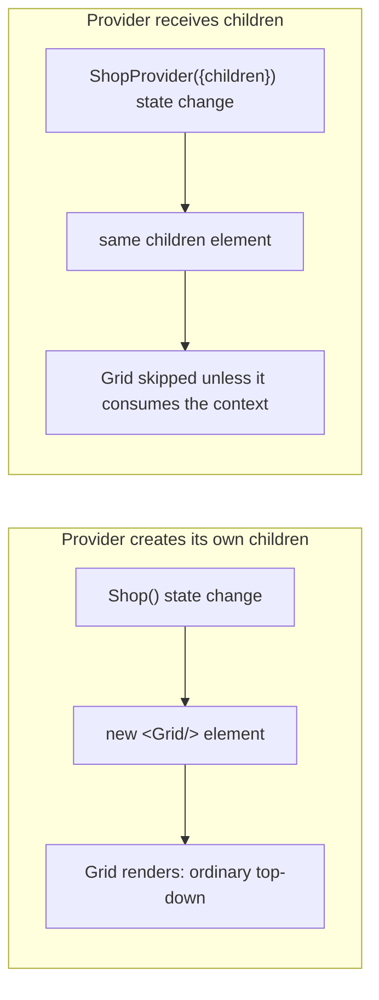
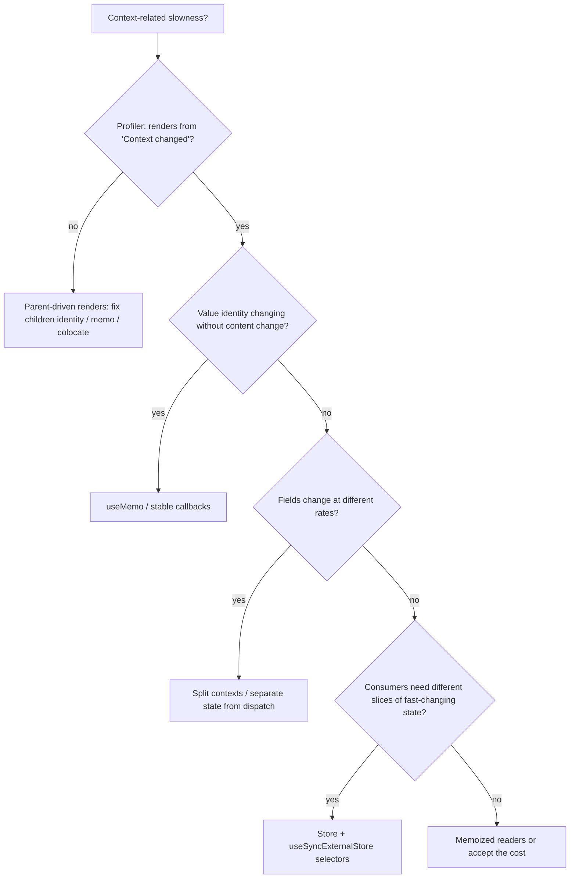

# 03 / 14 — Context Performance: Value Identity, Splitting, and Selectors

## 1. Lesson metadata

| | |
|---|---|
| **Level** | Advanced |
| **Study time** | 5–6 hours (reading 2.5 h, experiments 2 h, exercises 1.5 h) |
| **Prerequisites** | [13 — `useContext`, `use(Context)`, and propagation](./13-usecontext-and-propagation.md), [11 — `useMemo` and `useCallback`](./11-usememo-and-usecallback.md), [12 — `React.memo`](./12-react-memo.md), [03 — `useReducer`](./03-usereducer-and-reducer-architecture.md), [02/12 — Why rendering must be pure](../02-react-rendering-and-internals/12-why-rendering-must-be-pure.md) |
| **Next** | [15 — Custom hooks](./15-custom-hooks.md) |
| **Related** | [18 — State colocation and lifting](./18-state-colocation-and-lifting.md), [20 — `useSyncExternalStore` and external stores](./20-usesyncexternalstore-and-external-stores.md), [Phase 6/11 — Context vs external stores](../06-data-fetching-and-state-ecosystems/11-context-vs-external-stores.md), [Phase 7/06 — Context propagation cost](../07-performance/06-context-propagation-cost.md) |

**Learning objectives.** After this lesson you can:
1. Derive, from the propagation model of Lesson 13, the exact set of components that re-render for any provider update — and the three independent levers that shrink that set.
2. Diagnose "context makes my app slow" using the React DevTools Profiler (including "why did this render"), and distinguish *context cost* from *ordinary parent-driven re-renders* that merely happen near a provider.
3. Apply, in the right order: **colocate** → **stabilize** → **split** → **separate state from dispatch** → **narrow with memo'd readers** → **switch to a selector-capable store**.
4. Write a provider whose value identity is stable when and only when its content is.
5. Implement a selector-based context on top of `useSyncExternalStore` and state its correctness constraints.
6. Decide, with criteria, when *not* to optimize context at all.

**Concepts covered:** value identity, `Object.is`, over-subscription, update frequency, context splitting, state/dispatch split, children-as-props isolation, memoized readers, selector contexts, tearing, subscription cost vs propagation cost, measurement.

---

## 2. Deep conceptual explanation

### 2.1 The problem

[Lesson 13](./13-usecontext-and-propagation.md) established the contract: **when a provider's value changes (`Object.is`), every component that read that context re-renders, regardless of which part of the value it actually used.** There is no way for a consumer to say "only wake me when `value.user.name` changes."

That contract is a *design decision*, not an oversight. It keeps context simple: no subscription registry, no selector comparison on the hot path, no user-visible rules about memoizing selectors, and it works with every rendering mode React supports. The price is **over-subscription**:

```text
value = { user, theme, cart, notifications }
Consumer A reads only theme.
cart changes  →  new value object  →  A re-renders anyway.
```

Whether that matters depends on three quantities:

| Quantity | Question |
|---|---|
| **Update frequency** | How often does the provider's value get a new identity? (login: rarely; cart: occasionally; cursor position: 60×/s) |
| **Consumer count** | How many components read this context? (and how expensive is each, including its non-memoized descendants?) |
| **Work per consumer** | How costly is one re-render of the consumer plus the subtree under it that is *not* shielded by memo? |

Cost ≈ frequency × Σ(consumer render cost). Context optimization is the practice of reducing one of those three factors. Everything in this lesson fits that equation.

### 2.2 Misconceptions to remove first

| Misconception | Reality |
|---|---|
| "Context is slow; avoid it." | Context for rarely-changing values (theme, locale, auth, a store handle) is effectively free. The propagation walk is cheap; the cost appears with *frequent* changes × *many* or *expensive* consumers. |
| "`useMemo` on the value fixes context performance." | It fixes **spurious** value changes (new identity, same content). It does nothing when the content genuinely changes. |
| "Wrap the consumer in `memo`." | `memo` is bypassed by context dependencies ([13 §3.3](./13-usecontext-and-propagation.md)). Memo helps on the consumer's *children*, not on the consumer's own context-triggered render. |
| "Every re-render near a provider is a context re-render." | Often it isn't. A provider that holds state and re-renders **re-renders its un-memoized descendants through ordinary top-down rendering** unless `children` identity is preserved. Profile first; see §10. |
| "Split the context into one per field." | Over-splitting yields provider pyramids and still re-renders consumers that read several. Split along **update-frequency and consumer-set boundaries**, not field boundaries. |
| "A render is a DOM update." | A "wasted" render that produces identical output commits no DOM changes ([02/04](../02-react-rendering-and-internals/04-virtual-dom-what-it-means.md)). The cost is JavaScript time, which only matters if it adds up past frame budget ([00/01](../00-web-and-javascript-foundations/01-how-the-browser-works.md)). |

### 2.3 The ordered toolbox

Apply these in order; each one is cheaper and more robust than the next.

1. **Don't use context for it** (colocate state, [Lesson 18](./18-state-colocation-and-lifting.md)). The cheapest context optimization is a state variable that lives in the one component that needs it.
2. **Make the provider an isolating component:** state inside the provider, `children` from above, so non-consumers are not re-rendered by ordinary rendering.
3. **Stabilize identity:** `useMemo` the value (and stable callbacks) so unrelated provider re-renders don't change it.
4. **Split by update frequency / consumer sets:** separate contexts for things that change at different speeds or are read by different component groups.
5. **Separate state from dispatch:** actions-only consumers never re-render for state changes.
6. **Narrow with readers:** a thin component reads context and passes *primitives* to a memoized child, so the child re-renders only when the specific slice changes.
7. **Switch to a store with selectors:** context carries a *stable handle*; subscription precision comes from `useSyncExternalStore` ([Lesson 20](./20-usesyncexternalstore-and-external-stores.md)).

---

## 3. Internal mechanics

### 3.1 Two different costs: propagation and consumer renders

From the teaching model in [13 §3.3](./13-usecontext-and-propagation.md):

- **Propagation cost.** When a provider renders with a new value, React walks the provider's subtree looking for fibers with a dependency on that context and marks them. This is linear in the number of fibers below the provider *that must be inspected*. *Implementation detail:* React's implementation is optimized, but it is not O(consumers) — it's tied to subtree size. A provider at the root of a 50,000-fiber tree changing at 60 Hz pays walk costs every frame even if only three components read it.
- **Consumer render cost.** Each marked consumer re-runs its function and any descendants that are not bailed out.

Public guarantee: consumers of a changed value re-render. Implementation details (how efficient the walk is) vary by version. Thus: do not design around a specific constant; design so that high-frequency state **doesn't flow through the context value at all**.

### 3.2 `Object.is` on the value, and what it means for literals

`<Ctx value={{ a, b }}>` creates a new object every time the *provider component* renders. React compares `Object.is(prev, next)` → `false` → propagation. The comparison is *shallow, by identity*; React never compares the object's fields. Hence:

- A provider that re-renders for unrelated reasons (its own other state, its parent re-rendering) fires propagation on every such render unless the value is memoized.
- A memoized value changes identity only when a dependency changes. The dependency array is where you encode "what counts as a change".

### 3.3 Why `children` identity matters (the other half)

A re-render of the provider function re-runs *its* JSX. If a descendant element is **created in that JSX**, it is a new element object → React renders it (unless memoized with equal props). If a descendant element arrives via `props.children`, it was created by the *parent of the provider*, and is the same object unless the parent re-rendered → React can bail out ([13 §4](./13-usecontext-and-propagation.md)).



This single structural choice often removes 90% of "context performance problems" because the problem was never context propagation; it was ordinary re-rendering of a big subtree beneath a stateful component.

### 3.4 `useReducer` / `useState` setter identity

Public guarantee (React docs): the `set` function returned by `useState` and the `dispatch` returned by `useReducer` have **stable identity** across renders. That is what makes a *dispatch context* constant, and why `useMemo(..., [theme])` earlier needn't list `setTheme`.

### 3.5 Selector contexts and `useSyncExternalStore`

If you want "re-render only if my slice changed", React's context cannot provide it. The documented React primitive for subscribing to an **external** mutable source with tear-free reads is `useSyncExternalStore(subscribe, getSnapshot)`:

- `subscribe(callback)` registers a listener, returns unsubscribe.
- `getSnapshot()` returns the current value; React calls it during render and after notifications and **compares with `Object.is`**: re-render only if the snapshot changed.
- Because the *snapshot* is the selected slice, precision comes for free.

Public guarantee: `getSnapshot` must return the same value if the store hasn't changed; otherwise React warns and may loop. Teaching model: context is used purely as DI to pass the store object (stable identity ⇒ no context-driven updates ever); `useSyncExternalStore` does the fine-grained wake-ups. Full treatment in [Lesson 20](./20-usesyncexternalstore-and-external-stores.md).

---

## 4. Step-by-step execution walkthrough

Scenario: an analytics dashboard with a **single** `DashboardContext`:

```ts
interface DashboardValue {
  query: string;                       // changes on every keystroke
  setQuery: (q: string) => void;
  dateRange: DateRange;                // changes rarely
  user: User;                          // changes ~never
}
```

Tree: `DashboardProvider` → `Toolbar` (reads `query`, `setQuery`), `Sidebar` (reads `user`), `ChartGrid` → 12 × `Chart` (each reads `dateRange`), `ResultsTable` (reads `query`).

The user types "a" in the search box inside `Toolbar`.

**Before optimization**

1. Input `onChange` → `setQuery("a")` → update queued on `DashboardProvider`.
2. `DashboardProvider` renders; `useMemo` deps include `query` → **new value object**.
3. `Object.is` false → propagation walk finds consumers: `Toolbar`, `Sidebar`, 12× `Chart`, `ResultsTable` = **15 consumers**.
4. All 15 re-render. 13 of them (`Sidebar`, 12 charts) didn't use `query`. If each `Chart` costs 4 ms (SVG building), that's 48 ms **per keystroke** wasted, producing identical output.
5. Commit: only `Toolbar`'s input and `ResultsTable` have DOM changes.
6. The user types fast: 5 keys/s ⇒ ≈ 240 ms/s of wasted main thread, plus input latency spikes on mid-range phones (see INP, [00/01](../00-web-and-javascript-foundations/01-how-the-browser-works.md)).

**After splitting** into `QueryContext` (`{ query, setQuery }`), `DateRangeContext` (`dateRange`), `UserContext` (`user`):

1. `setQuery("a")` → `QueryProvider` renders, new value.
2. Propagation walk finds consumers of `QueryContext` only: `Toolbar`, `ResultsTable` — **2 renders**.
3. `Chart`s read `DateRangeContext`, whose provider did not render ⇒ no value change ⇒ skipped.
4. 48 ms → ~0 ms of chart work. Same behavior, no memo needed.

**Note the prerequisites for that result:** each provider owns its state and receives `children`; if a single `DashboardProvider` still held all three states and rendered three nested providers with inline children, its re-render would still re-run the inline JSX.

---

## 5. Code examples

### 5.1 Minimal example — measure over-subscription

```tsx
import { createContext, use, memo, useState, type ReactNode } from "react";

interface Fat { count: number; label: string }
const FatContext = createContext<Fat | null>(null);

function Provider({ children }: { children: ReactNode }) {
  const [count, setCount] = useState(0);
  const [label] = useState("hello");
  return (
    <FatContext value={{ count, label }}>   {/* new object per render */}
      <button onClick={() => setCount((c) => c + 1)}>inc</button>
      {children}
    </FatContext>
  );
}

function LabelOnly() {
  const ctx = use(FatContext)!;
  console.log("LabelOnly render");
  return <p>{ctx.label}</p>;
}

export function App() {
  return (
    <Provider>
      <LabelOnly />
    </Provider>
  );
}
```

**Predict:** you click "inc" three times. How many `LabelOnly render` logs after mount (StrictMode off)?
**Result:** **3** (plus 1 on mount).
**Why:** `count` changes → `Provider` renders → fresh `{ count, label }` object → `Object.is` false → consumer scheduled, even though `LabelOnly` only reads the unchanged `label`. `children` identity does not help because the consumer is subscribed.
**Fix options:** put `label` in its own context, or read `label` via a context whose value is only `label`.

### 5.2 Practical example — splitting by frequency + separating state from dispatch

Using `useReducer` ([Lesson 03](./03-usereducer-and-reducer-architecture.md)) for a cart:

```tsx
// cart-context.tsx
import {
  createContext, use, useMemo, useReducer,
  type Dispatch, type ReactNode,
} from "react";

export interface CartItem { sku: string; qty: number; priceCents: number }
export type CartAction =
  | { type: "add"; sku: string; priceCents: number }
  | { type: "remove"; sku: string }
  | { type: "clear" };

function cartReducer(items: readonly CartItem[], action: CartAction): readonly CartItem[] {
  switch (action.type) {
    case "add": {
      const existing = items.find((i) => i.sku === action.sku);
      return existing
        ? items.map((i) => (i.sku === action.sku ? { ...i, qty: i.qty + 1 } : i))
        : [...items, { sku: action.sku, qty: 1, priceCents: action.priceCents }];
    }
    case "remove":
      return items.filter((i) => i.sku !== action.sku);
    case "clear":
      return items.length === 0 ? items : [];   // return same ref when nothing changes
  }
}

const CartItemsContext = createContext<readonly CartItem[] | null>(null);
const CartDispatchContext = createContext<Dispatch<CartAction> | null>(null);

export function CartProvider({ children }: { children: ReactNode }) {
  const [items, dispatch] = useReducer(cartReducer, []);
  return (
    <CartDispatchContext value={dispatch}>       {/* dispatch identity is stable */}
      <CartItemsContext value={items}>
        {children}
      </CartItemsContext>
    </CartDispatchContext>
  );
}

export function useCartItems() {
  const v = use(CartItemsContext);
  if (v === null) throw new Error("useCartItems outside <CartProvider>");
  return v;
}
export function useCartDispatch() {
  const v = use(CartDispatchContext);
  if (v === null) throw new Error("useCartDispatch outside <CartProvider>");
  return v;
}

// Derived, memoized reader hook for a slice:
export function useCartCount() {
  const items = useCartItems();
  return useMemo(() => items.reduce((n, i) => n + i.qty, 0), [items]);
}
```

```tsx
function AddToCartButton({ sku, priceCents }: { sku: string; priceCents: number }) {
  const dispatch = useCartDispatch();       // dispatch-only consumer
  console.log("render AddToCartButton", sku);
  return <button onClick={() => dispatch({ type: "add", sku, priceCents })}>Add</button>;
}
function CartBadge() {
  const count = useCartCount();
  console.log("render CartBadge");
  return <span>{count}</span>;
}

export function Shop() {
  return (
    <CartProvider>
      <header><CartBadge /></header>
      <main>
        <AddToCartButton sku="A" priceCents={500} />
        <AddToCartButton sku="B" priceCents={700} />
      </main>
    </CartProvider>
  );
}
```

**Predict:** click "Add" on `A` once. Which logs print?
**Result:** `render CartBadge` only.
**Why:** `dispatch` is stable, so `CartDispatchContext`'s value never changes; the buttons' only dependency is that one. `CartProvider` re-renders (reducer state changed), but `children` identity is unchanged (created in `Shop`, which didn't re-render), so the buttons are not re-rendered by ordinary rendering either. `CartBadge` depends on `CartItemsContext`, whose value (a new array) changed.
**Trade-off:** two contexts, two hooks, and a nested provider pair. If *every* consumer needs both items and dispatch, the split gives nothing.

Notes on lines:
- The reducer returns the **same** array in the `clear` of an empty cart: returning an identical reference lets React bail out of the update entirely (documented: if the new state is identical per `Object.is`, React skips re-rendering children and firing effects. With `useReducer` the component function itself may still run — in the sandbox, dispatching an action whose reducer returns the same state re-ran the reducer's component on each dispatch while its children were skipped; see [Lesson 01](./01-usestate-internals-and-update-semantics.md)).
- `useCartCount` is a *derived value inside a hook*, computed per consumer render; for a 20-line cart this is trivial and `useMemo` is optional ([Lesson 17](./17-derived-state.md)). Shown to illustrate where memoization would attach.

### 5.3 Incorrect examples

**(a) The "one context to rule them all".**

```tsx
const AppContext = createContext<AppState | null>(null);
function App() {
  const [state, dispatch] = useReducer(appReducer, initial);
  return <AppContext value={{ state, dispatch }}>…</AppContext>;
}
// 80 components: const { state } = use(AppContext); … state.cart.items
```
Every dispatched action — even `HOVER_ROW` — produces a new `state` and a new `{ state, dispatch }` object ⇒ 80 re-renders. This is the pattern behind most "React is slow" reports on mid-sized apps.

**(b) `useMemo` with a dependency that changes every render.**

```tsx
const value = useMemo(() => ({ user, logout }), [user, logout]);
// logout = () => {...} defined in the component body: new function each render
```
`logout` changes each render ⇒ the memo is recomputed each render ⇒ identity changes each render. The memo is pure overhead. Fix: `useCallback` for `logout`, or define it inside the memo callback with stable dependencies (e.g., via `dispatch`).

**(c) Memoizing the consumer instead of the provider.**

```tsx
const Chart = memo(function Chart() {
  const { dateRange } = use(DashboardContext);   // still re-renders on every value change
  …
});
```
`memo` has no effect on the context-driven path.

**(d) Context for fast-changing UI state.**

```tsx
function PointerProvider({ children }: { children: ReactNode }) {
  const [pos, setPos] = useState({ x: 0, y: 0 });
  useEffect(() => {
    const h = (e: PointerEvent) => setPos({ x: e.clientX, y: e.clientY });
    window.addEventListener("pointermove", h);
    return () => window.removeEventListener("pointermove", h);
  }, []);
  return <PointerContext value={pos}>{children}</PointerContext>;
}
```
Re-renders all consumers on every pointer event (up to once per event; pointer events may be coalesced per frame in some browsers, but that is not something React guarantees for you). Use a store with a selector, or write to a ref/CSS custom property for visual effects that don't need React state.

### 5.4 Corrected approach to (a): split + stable, plus a readers layer

```tsx
// Split into: SessionContext (user; rare), FiltersContext (query/range; moderate),
// SelectionContext (selected row id; frequent) — each owned by its own provider component.
function Providers({ children }: { children: ReactNode }) {
  return (
    <SessionProvider>
      <FiltersProvider>
        <SelectionProvider>{children}</SelectionProvider>
      </FiltersProvider>
    </SessionProvider>
  );
}
```
Each provider is a component with its own `useState`/`useReducer` and receives `children`; `Providers` itself never re-renders. Nesting order only matters when one provider depends on another's value.

### 5.5 Advanced example — a selector context over `useSyncExternalStore`

```tsx
import { createContext, use, useRef, useSyncExternalStore, type ReactNode } from "react";

interface Store<S> {
  getState: () => S;
  setState: (update: (prev: S) => S) => void;
  subscribe: (listener: () => void) => () => void;
}

export function createStore<S>(initial: S): Store<S> {
  let state = initial;
  const listeners = new Set<() => void>();
  return {
    getState: () => state,
    setState(update) {
      const next = update(state);
      if (Object.is(next, state)) return;
      state = next;
      listeners.forEach((l) => l());
    },
    subscribe(listener) {
      listeners.add(listener);
      return () => { listeners.delete(listener); };
    },
  };
}

export function createStoreContext<S>() {
  const Ctx = createContext<Store<S> | null>(null);

  function StoreProvider({ initial, children }: { initial: S; children: ReactNode }) {
    // One store per provider instance; useRef lazy init (stable for the component's lifetime).
    const ref = useRef<Store<S> | null>(null);
    if (ref.current === null) ref.current = createStore(initial);
    return <Ctx value={ref.current}>{children}</Ctx>;   // value never changes ⇒ no context-driven renders
  }

  function useStore(): Store<S> {
    const store = use(Ctx);
    if (!store) throw new Error("useStore outside <StoreProvider>");
    return store;
  }

  function useSelector<T>(selector: (s: S) => T): T {
    const store = useStore();
    return useSyncExternalStore(
      store.subscribe,
      () => selector(store.getState()),      // must return a stable value for unchanged state
      () => selector(store.getState()),      // server snapshot; see Lesson 20
    );
  }

  return { StoreProvider, useStore, useSelector };
}
```

Usage:

```tsx
interface UIState { query: string; selectedId: string | null; sidebarOpen: boolean }
export const { StoreProvider: UIProvider, useStore: useUIStore, useSelector: useUI } =
  createStoreContext<UIState>();

function QueryBox() {
  const query = useUI((s) => s.query);                  // primitive ⇒ stable
  const store = useUIStore();
  return (
    <input value={query} onChange={(e) => store.setState((s) => ({ ...s, query: e.target.value }))} />
  );
}
function SidebarToggle() {
  const open = useUI((s) => s.sidebarOpen);
  console.log("render SidebarToggle");
  return <span>{open ? "open" : "closed"}</span>;
}
```

**Predict:** type "x" in `QueryBox`. Does `SidebarToggle` log?
**Result:** No. `getSnapshot` for `SidebarToggle` returns `s.sidebarOpen`, unchanged ⇒ `Object.is` equal ⇒ no render. `QueryBox` re-renders.
**Constraints and traps (documented/derivable):**
1. **Selector result stability.** `useUI((s) => ({ q: s.query }))` returns a fresh object every call ⇒ `getSnapshot` result differs each call ⇒ React warns ("The result of getSnapshot should be cached") and can loop. Select primitives or existing references; for derived objects, cache or use a library's equality-aware selector.
2. **Inline selector identity.** The selector function may be a new closure each render — fine here because `getSnapshot` is re-evaluated; the cost is calling the selector on each check. Keep selectors cheap.
3. **Store per provider instance**, not module-global, for tests and SSR safety.
4. **Updates are synchronous-ish.** Store updates delivered via `useSyncExternalStore` cannot be deferred by transitions: they render synchronously. Great for correctness (no tearing), a consideration for expensive renders ([Lesson 22](./22-modern-hooks-and-apis.md) and [Phase 7/12](../07-performance/12-usetransition-in-practice.md)).
5. **You re-implemented a small Zustand.** For production, weigh a maintained library (Zustand, Redux Toolkit with react-redux, Jotai) for devtools, middleware, and edge-case correctness. See [Phase 6/10–11](../06-data-fetching-and-state-ecosystems/10-zustand.md).

### 5.6 Advanced — memoized reader: narrowing without a store

```tsx
const ChartBody = memo(function ChartBody({ theme, data }: { theme: Theme; data: Point[] }) {
  // expensive SVG
  return <svg data-theme={theme}>…</svg>;
});

function Chart({ data }: { data: Point[] }) {
  const { theme } = useTheme();          // re-renders when ANY field of the theme context changes
  return <ChartBody theme={theme} data={data} />;  // ChartBody re-renders only when theme or data change
}
```
`Chart` is cheap and re-renders on any context change; `ChartBody` receives primitives/stable references and bails out. This is the pragmatic "narrowing" step before a store. It requires the props be shallow-stable: passing `{ ...ctx }` or a newly built array would defeat it.

---

## 6. Visual explanations

### 6.1 Before / after render sets

```mermaid
flowchart TB
  subgraph Before["One fat context: query keystroke"]
    P[DashboardProvider ↻] --> T[Toolbar ↻]
    P --> S[Sidebar ↻ wasted]
    P --> C["12 × Chart ↻ wasted"]
    P --> R[ResultsTable ↻]
  end
  subgraph After["Split by frequency: query keystroke"]
    QP[QueryProvider ↻] --> T2[Toolbar ↻]
    QP --> R2[ResultsTable ↻]
    DP[DateRangeProvider] --> C2["12 × Chart (skipped)"]
    UP[UserProvider] --> S2[Sidebar (skipped)]
  end
```

### 6.2 Decision flow



### 6.3 Where does a re-render come from?

```text
Consumer re-rendered because:
  ├─ its own state changed ................ not context
  ├─ parent re-rendered (not memoized) .... not context   ← most common near providers
  ├─ context value it read changed ........ context        ← DevTools: "Context changed"
  └─ a hook it uses changed ............... depends
```

---

## 7. Alternative approaches and trade-offs

For state shared across many components:

| Approach | Precision of updates | Boilerplate | Concurrent-safe | Devtools/debuggability | Best when |
|---|---|---|---|---|---|
| Single context (fat) | Poor | Lowest | Yes | React DevTools only | ≤ ~10 consumers, low-frequency, prototypes |
| Split contexts by frequency | Medium | Medium (more providers) | Yes | React DevTools | Known update-frequency boundaries; rarely-changing groups |
| State/dispatch split | Medium–Good for action-only consumers | Medium | Yes | React DevTools; reducer log | Many "writers" and few "readers" (buttons, menus) |
| Context + memoized readers | Good for expensive leaves | Medium (extra wrapper components) | Yes | React DevTools | A few expensive consumers; no external deps |
| Context-carried store + `useSyncExternalStore` selectors | Fine-grained | Medium–High (or a library) | Yes (tear-free); updates are not deferrable | Library devtools possible | Frequent updates, many consumers, slices |
| External library store (Zustand/Redux/Jotai) | Fine-grained | Low (library) | Yes | Strong tooling | Large apps, multi-team, need middleware/persistence |
| Lifting state + props + composition | Exact | Medium (drilling) but explicit | Yes | Explicit data flow | Consumers cluster under one parent ([Lesson 18](./18-state-colocation-and-lifting.md)) |

**When the generally recommended path (split first, store later) is NOT best:**
- A **static** context (theme/locale/store handle). Splitting buys nothing; don't.
- **Few consumers, cheap renders.** 6 consumers each rendering in 0.1 ms: a fat context re-render costs < 1 ms per update — do not add providers. Optimizing without a measured problem creates provider pyramids and hooks that future maintainers must understand ([Phase 7/04](../07-performance/04-memoization-trade-offs.md) and [7/23](../07-performance/23-counterproductive-optimizations.md)).
- **Selector stores for tiny slices** where updates are infrequent: the machinery (subscription, snapshot discipline) outweighs a few extra renders.
- **Transition-driven heavy renders:** store-driven updates are synchronous; if the consumer is expensive and the update is non-urgent, a context/state update inside `startTransition` can be interruptible while a store update cannot. This is a real case where plain React state beats a store.

---

## 8. Best practices and anti-patterns

**Do**
- Measure first (Profiler, "why did this render"); optimize the measured worst offender.
- Keep provider state *inside* provider components that receive `children`.
- Treat the `useMemo` dependency array of a context value as the **definition of a change**.
- Separate **frequently changing** values from **rarely changing** ones, and **dispatch/actions** from **state**.
- Provide **stable handles** (stores, clients, dispatch) via context; they never invalidate consumers.
- Name each context and hook for its content (`useCartItems`, `useCartDispatch`), not for the provider.

**Beginner mistakes**
- Putting `{ state, setState }` inline in `value`.
- Expecting `memo(Consumer)` to help.
- Splitting every field into its own context.

**Experienced-developer mistakes**
- Building a bespoke selector system with `useContext` + manual `useRef` comparisons that breaks under concurrent rendering (reading mutable data during render without `useSyncExternalStore` can tear).
- Migrating to a store prematurely when the actual cause was parent-driven re-rendering.
- Using `useMemo` to hide an unstable dependency (e.g., an options object recreated each render) rather than fixing the source of instability.
- Ignoring the *tests*: providers composed in a deep pyramid make unit tests verbose; supply a `renderWithProviders` helper.

**Smells:** "context hell" pyramids with 10+ providers at the root; hooks whose names reveal that they return everything (`useApp`); `useMemo(() => ({...}), [])` with a mutated `ref` inside the object (breaks update detection).

**Justified exceptions:** a deliberately **fat, rarely-updating** context (e.g., `config` loaded once) needs no splitting. Mutation-based "context + ref + manual forceUpdate" patterns appear in some libraries for performance reasons; they require expert-level discipline about purity and concurrency and are not recommended for application code.

**React Compiler** ([Phase 9/08](../09-advanced-rendering-and-ecosystem/08-react-compiler.md)). React Compiler 1.0 is stable (announced 2025-10-07). It memoizes components, hooks, and expressions at build time, which can make `useMemo`/`useCallback`/`memo` in application code unnecessary and may stabilize provider values. It does not change the semantics that a changed context value updates all consumers. Treat guidance about manual memoization as *"required unless you've adopted the compiler and verified it handles your case"* (react.dev/learn/react-compiler/introduction).

---

## 9. Real-world application

**(a) E-commerce storefront.** `CartContext` initially `{ items, add, remove }` inline. Product listing pages with 60 `AddToCart` buttons re-rendered on every add. Constraint: Largest page has 200 cards. Fix applied: dispatch/state split + memoized `ProductCard`, plus `CartBadge` as the only items consumer. Validate: Profiler shows `Add` on one card re-renders badge + provider only. Don't forget optimistic updates ([Phase 6/05](../06-data-fetching-and-state-ecosystems/05-optimistic-updates.md)): server-confirmed cart state belongs in a server-state cache, not necessarily a context.

**(b) Trading/finance dashboard.** Price ticks arrive 20×/s for 500 instruments; 30 widgets each watch a few instruments. A context carrying the `prices` map would re-render all 30 widgets 20×/s. Constraint: each widget's render ~3 ms ⇒ 1.8 s of render work per second ⇒ unusable. Solution: store keyed by instrument with per-instrument `useSyncExternalStore` subscription (§5.5 with `selector = s => s.prices[id]`), batching ticks per animation frame in the store. Context only carries the store handle.

**(c) Multi-step form with live validation.** Field values change per keystroke. Context-per-form with values in a fat object re-renders every field input per keystroke. Often fine for 8 fields; at 80 fields (insurance forms) use per-field subscriptions or uncontrolled inputs with a form library ([Lesson 21](./21-forms-and-complex-state.md)). The constraint is the *consumer cost*, not the context itself.

**(d) Collaborative/real-time apps.** Presence cursors are the canonical high-frequency state; use refs + `requestAnimationFrame`, or a store. Never route cursor positions through context.

**(e) Multi-team shell.** Shared providers (auth, feature flags, locale) are owned by the platform team and are read-heavy and change rarely: ideal context use. Team-specific feature state must be provided in the feature subtree, so one team's high-frequency updates don't invalidate other teams' components ([Phase 4/15 — State ownership](../04-react-architecture/15-state-ownership.md)).

---

## 10. Debugging and troubleshooting

**Symptom:** typing in an input is laggy; the Profiler shows dozens of components re-rendering per keystroke.

1. **Record.** React DevTools → Profiler → ⚙ → check *"Record why each component rendered while profiling"* → record 3–5 keystrokes → stop.
2. **Inspect the flame/ranked chart.** Greyed components did not render; coloured ones did. Click a coloured component not expected to change; the sidebar shows **why**: "Props changed", "Parent component rendered", "Hooks changed", or **"Context changed"**.
3. **Classify.**
   - "Parent component rendered" for most ⇒ ordinary re-render under a stateful component (children identity/memo/colocation). *Not a context problem.*
   - "Context changed" for non-readers of the changed field ⇒ over-subscription.
4. **Check provider value identity.** In the Components panel, select the provider: its `value` prop. If you can see it change on renders where its inputs did not (e.g., a `ref`-stable parent re-rendered), the value isn't memoized. Add a temporary `useEffect(() => console.log("value changed"), [value])` in a consumer to count changes.
5. **Apply the lowest-cost lever** from §2.3, one at a time, re-recording the *same* scenario after each.
6. **Validate.** Compare commit counts and total "scripting" time; check INP via the Performance panel for the same interaction ([00/01 §10](../00-web-and-javascript-foundations/01-how-the-browser-works.md)).

**Symptom:** after moving to a selector store, "The result of getSnapshot should be cached" warning or "Maximum update depth exceeded".
Cause: the selector returns a new object/array each call. Fix: select primitives, memoize derived data in the store (cache by input identity), or use an equality-aware selector from your library.

**Symptom:** a consumer shows an old value for one frame after a store update (tearing-like flashes).
Cause: custom subscription via `useEffect` + `useState` instead of `useSyncExternalStore`, so the render may read a store value that changed mid-render or the update lands after paint. Fix: use `useSyncExternalStore`.

**Symptom:** the split context works but `AddToCartButton` still re-renders on every cart change.
Cause: its parent re-renders (e.g., parent reads items too or builds the button inline from state). The "why did this render" tooltip says "Parent component rendered" — fix by not reading items in the parent or by `memo`.

---

## 11. Exercises

### Level A — Knowledge
A1. Why is there no way for a consumer to subscribe to only part of a context value? What does React compare?
A2. Why does `useMemo` on a context value *not* help when the content genuinely changes?
A3. Name three levers (other than a library) that reduce context re-renders, in the order you'd try them.
A4. What identity guarantee do `useState`'s setter and `useReducer`'s `dispatch` have, and how does it enable the dispatch-context trick?
A5. What does `getSnapshot` in `useSyncExternalStore` have to guarantee, and what happens otherwise?

### Level B — Code comprehension
B1. For `Provider2`, after one click, which of `A`, `B`, `C` log?
```tsx
const Ctx = createContext(0);
function Provider2({ children }: { children: ReactNode }) {
  const [n, setN] = useState(0);
  return (
    <Ctx value={n}>
      <button onClick={() => setN(1)}>go</button>
      <A />
      {children}
    </Ctx>
  );
}
function A() { console.log("A"); return null; }
function B() { console.log("B"); return <span>{use(Ctx)}</span>; }
function C() { console.log("C"); return null; }
export const App = () => <Provider2><B /><C /></Provider2>;
```
B2. Same code, but `A` is `memo(A)`. Does the answer for `A` change?
B3. When does this context value change identity, and is it correct?
```tsx
const value = useMemo(() => ({ items, add: (x: Item) => setItems([...items, x]) }), [items]);
```
(Identify any correctness issue under rapid consecutive calls to `add`.)
B4. In §5.5, if `SidebarToggle`'s selector were `(s) => ({ open: s.sidebarOpen })`, what goes wrong?

### Level C — Implementation
C1. Convert this to a state/dispatch split with typed hooks that throw outside the provider:
```tsx
const TodoContext = createContext<{ todos: Todo[]; dispatch: Dispatch<TodoAction> } | null>(null);
```
C2. Write `useStableValue<T>(value: T, isEqual: (a: T, b: T) => boolean): T` that returns the previous reference if `isEqual` holds. State why mutating a ref during render is acceptable (or not) here.
C3. Implement `useSelector` with a custom equality function (`useSelectorWith(selector, isEqual)`) on top of `useSyncExternalStore` that tolerates selectors returning fresh-but-equal objects.

### Level D — Debugging
D1. The Profiler says `PriceRow` ×500 re-render with reason "Context changed" at 20 Hz although each row displays one instrument. Propose and justify a redesign.
D2. After you wrapped the provider's value in `useMemo(…, [state])`, consumers still re-render on every parent render. The provider is declared as:
```tsx
function App() {
  const [tick, setTick] = useState(0);
  useInterval(() => setTick((t) => t + 1), 1000);
  return (
    <Provider>
      <Dashboard />
    </Provider>
  );
}
```
Why, and how do you fix it *without* touching `Provider`?
D3. A `useEffect` in a consumer depends on `[ctx]` and runs on every provider render although nothing visible changed. Why? Fix.

### Level E — Architecture and engineering decisions
E1. Your team's app has `AuthContext` (changes on token refresh every 10 min), `ThemeContext`, `NotificationsContext` (websocket, 1–2/s), `FormDraftContext` (keystroke). Decide for each: context, store, or colocated state. Justify with frequency, consumer count and tests.
E2. Argue for or against a team standard: "No context values with more than one field."

### Level F — Expert challenge
F1. Design a benchmark harness (test or profiling script) that produces *evidence*, not anecdotes, that your context split reduced renders: what do you instrument, what are the control conditions, and what threshold would justify the added complexity?
F2. Explain why a context-with-`useRef`-and-forceUpdate "selector" hook can produce inconsistent UI under concurrent rendering, and how `useSyncExternalStore` addresses it.

---

## 12. Detailed answers and explanations

> Attempt the exercises first.

**A1.** React stores a dependency "this fiber read context X", not "this fiber read field `x.a`"; the check on the provider side is a single `Object.is(prevValue, nextValue)`. Selectors would require evaluating a function per consumer per update (and rules about its stability); React chose not to. Wrong answer: "because of performance reasons only" — it's also semantic simplicity and render-phase purity.

**A2.** `useMemo` caches the *object* between renders while dependencies are unchanged. If the content changes, the dependencies change, the memo recomputes, a new object is produced, `Object.is` fails and all consumers update — correct. Memoization only prevents *spurious* identity changes.

**A3.** (1) Colocate/lift less or isolate: provider owns state and receives `children`; (2) stabilize value (`useMemo`, stable callbacks); (3) split by frequency or separate state/dispatch; (then narrow with memoized readers; then a store). Order rationale: cheapest/least structural first.

**A4.** Both are guaranteed stable across renders (React docs). So a context whose value is only `dispatch` never changes, making dispatch-only consumers immune to state changes.

**A5.** It must return the same (`Object.is`) value across calls when the store hasn't changed. Otherwise React can't tell whether a change occurred; it warns about uncached snapshots in development and can re-render in a loop (maximum update depth).

**B1.** After one click: `A`, `B` (consumer). `C`? `C` is created in `App`; `App` doesn't re-render; `children` is unchanged ⇒ skipped. `A` is created inside `Provider2`'s JSX ⇒ new element ⇒ renders (ordinary rendering). So logs: `A`, `B`. Wrong answer: "A, B, C because the provider changed" — the value changing only updates *consumers*; non-consumers update only via normal rendering, and `C` is a stable child.

**B2.** Yes: `memo(A)` has no props, equal ⇒ skipped. Logs: only `B`.

**B3.** The `useMemo` is keyed on `items`, so the object changes identity exactly when `items` changes (needed, since `add` closes over `items`). Correctness issue: `add` closes over `items` from its render and uses `setItems([...items, x])` — two calls in the same event handler/batch would both start from the same snapshot, so the second overwrites the first ([Lesson 02](./02-functional-state-updates.md)). Use `setItems((prev) => [...prev, x])` and the `add` function no longer depends on `items`, allowing a stable `add` (e.g., `useCallback(..., [])`) and a state/actions split.

**B4.** Each `getSnapshot` call returns a new object ⇒ `Object.is` never equal ⇒ React's consistency check (it calls `getSnapshot` repeatedly) sees changes constantly ⇒ warning about caching and potentially an infinite re-render loop. Select `s.sidebarOpen` and build the object outside.

**C1. Solution**
```tsx
const TodosContext = createContext<readonly Todo[] | null>(null);
const TodoDispatchContext = createContext<Dispatch<TodoAction> | null>(null);

export function TodoProvider({ children }: { children: ReactNode }) {
  const [todos, dispatch] = useReducer(todoReducer, [] as readonly Todo[]);
  return (
    <TodoDispatchContext value={dispatch}>
      <TodosContext value={todos}>{children}</TodosContext>
    </TodoDispatchContext>
  );
}
export function useTodos() {
  const v = use(TodosContext);
  if (!v) throw new Error("useTodos outside <TodoProvider>");
  return v;
}
export function useTodoDispatch() {
  const v = use(TodoDispatchContext);
  if (!v) throw new Error("useTodoDispatch outside <TodoProvider>");
  return v;
}
```
Evaluation: both contexts typed non-null in hooks; dispatch nested outside (order is irrelevant for correctness); providers receive `children`.

**C2. Solution**
```tsx
function useStableValue<T>(value: T, isEqual: (a: T, b: T) => boolean): T {
  const ref = useRef(value);
  if (ref.current !== value && !isEqual(ref.current, value)) {
    ref.current = value;
  }
  return ref.current;
}
```
Discussion: writing `ref.current` during render is normally discouraged ([Lesson 10](./10-useref-and-mutable-references.md), [02/12](../02-react-rendering-and-internals/12-why-rendering-must-be-pure.md)). Here the write is an idempotent cache: the returned value is a deterministic function of (previous returned value, new value); repeating or discarding a render doesn't change observable results beyond keeping an older-but-equal reference. It is the accepted exception, but a discarded concurrent render could leave `ref.current` updated by a render that never committed — harmless because the *content is equal or newer*. If `isEqual` is not an equivalence relation, results become order-dependent; document it. Alternative without refs: `useMemo(() => value, [stableKey])` with a computed key.

**C3. Solution**
```tsx
function useSelectorWith<S, T>(
  store: Store<S>,
  selector: (s: S) => T,
  isEqual: (a: T, b: T) => boolean = Object.is,
): T {
  const last = useRef<{ value: T } | null>(null);
  const getSnapshot = () => {
    const next = selector(store.getState());
    if (last.current !== null && isEqual(last.current.value, next)) return last.current.value;
    last.current = { value: next };
    return next;
  };
  return useSyncExternalStore(store.subscribe, getSnapshot, getSnapshot);
}
```
Reasoning: returning the cached previous value when equal gives `useSyncExternalStore` a stable snapshot. Caveat: writing the ref inside `getSnapshot` runs during render; it is an idempotent memo. Libraries implement a more careful variant (e.g., `useSyncExternalStoreWithSelector` in the `use-sync-external-store` shim package *(verify package/API in current repository)*).

**D1.** Redesign: context carries a stable `PriceStore` handle; each `PriceRow` calls `useSyncExternalStore` with a selector `s => s.prices[id]` (primitive/stable number or immutable record). Batch socket messages to once per animation frame in the store (`requestAnimationFrame`) to cap update rate. `memo(PriceRow)` is unneeded for context reasons but harmless. Wrong answers: "wrap rows in memo" (bypassed); "split into 500 contexts" (impractical; subscription granularity belongs to a store). Validate: Profiler shows only rows whose price changed re-rendering.

**D2.** `App` re-renders every second; it creates `<Provider><Dashboard/></Provider>`, so `<Dashboard />` is a **new element** each second ⇒ `Dashboard` and its descendants re-render ordinarily. The memoized value is irrelevant. Fix without touching `Provider`: move the ticking state/interval into its own component (`<Clock/>`), or hoist `<Dashboard />`'s element out of `App` (e.g., pass as `children` of a component that doesn't tick), or `memo(Dashboard)`.

**D3.** The effect's dependency `ctx` is the *context value object*; if the provider's value is a new object on each provider render, the effect re-fires although the content is the same. Fix at the source (memoize the value) or depend on the primitive fields you actually use (`[ctx.user.id]`) — [Lesson 05](./05-effect-dependencies-and-stale-closures.md).

**E1. Evaluation criteria & example answer.** *AuthContext:* context — rare changes, many consumers; keep token itself in a module/API client if only fetch layer needs it, so refresh doesn't propagate. *ThemeContext:* context. *NotificationsContext:* 1–2 updates/s; if few consumers (badge, list), context with the split of dispatch/state is fine; if many components subscribe, store with selectors. *FormDraftContext:* keystroke frequency ⇒ not a context for the *values*: colocate with the form component or use a form library/store; context only for the stable `form` handle. Good answers justify with numbers (frequency × consumers × cost), name test strategy (providers with fake values), and acknowledge that re-evaluation after measuring is part of the decision.

**E2.** Evaluate: argument for — encourages narrow contexts, fewer unrelated re-renders. Against — fields that always change together (`{ user, status }`, `{ locale, formatters }`) are better kept as one value; splitting increases boilerplate and may create *inconsistent intermediate states* (two contexts updated in two renders). A stronger standard: "A context value must have one reason to change and one update frequency; justify any exception in a comment." Reject absolutes.

**F1.** Instrument render counts per component with `<Profiler onRender>` ([Phase 2/30](../02-react-rendering-and-internals/30-react-devtools-profiler.md)) or counters in a test harness; scripted scenario (type 20 characters; add 5 items) with the same data; control: baseline commit vs. split commit; metrics: render counts per component, total actual duration, and INP in a throttled-CPU Performance recording. Threshold: define up front (e.g., "reduces scripting time per interaction below 50 ms on 4× throttling, or removes ≥ 80 % of unrelated renders") and require the benefit to exceed the complexity cost; repeat runs to account for variance; Strict Mode doubles renders in dev — count in production builds or account for the factor.

**F2.** If a hook subscribes via refs and forces updates through `useState`, React may render different components of the same tree at different points in time with the store mutated in between (concurrent rendering yields to the browser between components), so one component reads `v1` and its sibling `v2` — a *tear*. Also, reading mutable data during render violates purity assumptions (render may repeat/be discarded). `useSyncExternalStore` makes React re-check `getSnapshot` before committing and, if the store changed during a concurrent render, re-render synchronously so that all components commit consistent data. (Public behavior: it guarantees consistent reads; exact algorithm is an implementation detail.)

---

## 13. Senior engineer interview questions

**Q1. "Our context-based store makes the app slow. What do you do?"**
*Strong answer:* Measure before changing: Profiler with "why did this render". Separate parent-driven renders from "Context changed". Then apply the cheapest lever: isolate provider/children identity, stabilize value, split by frequency, separate dispatch, narrow with memoized readers; if consumers need slices of fast-changing state, move to `useSyncExternalStore`-based selectors (passing the store through context). Re-measure after each change; stop when the budget is met.

**Q2. "Why not just use `useMemo` for the context value everywhere?"**
*Strong answer:* It only prevents spurious identity changes; with genuine changes all consumers update. Also adds a dependency array to maintain; wrong deps lead to stale values. Use it where the provider can re-render for reasons unrelated to the value, or when the value is passed to effects/memo dependencies downstream.

**Q3. "How does splitting state and dispatch help, and when does it not?"**
*Strong answer:* Dispatch identity is stable, so dispatch-only consumers aren't subscribed to changing state. It doesn't help when all consumers read state, or when the dispatch-only consumers still re-render because their parent does. Mention cost: more providers/hooks.

**Q4. "What are the correctness hazards of rolling your own selector context?"**
*Strong answer:* tearing under concurrent rendering, unstable selector results causing loops, render-phase mutation, SSR hydration mismatch (server snapshot), stale closures in subscriptions. `useSyncExternalStore` solves tearing and hydration snapshot concerns; selector stability remains your responsibility. In production, a library often beats bespoke code.

**Q5. "Context vs Redux/Zustand — how do you choose?"**
*Strong answer:* Not "context vs store" but "update granularity and ecosystem needs". Context for DI and low-frequency values; store for fine-grained subscriptions, middleware, devtools, cross-tree access, and non-React consumers. Mention that stores often use context only to provide the instance, so the two are complementary.

**Q6. "Does React Compiler make this lesson obsolete?"**
*Strong answer:* It reduces the need for hand-written `useMemo/useCallback/memo` and can stabilize values, but it doesn't change context semantics (a genuinely changed value updates all consumers) nor remove the architectural levers (colocation, splitting, selector stores). Verify specifics against current compiler docs; keep the mental model.

---

## 14. Further learning resources

| Resource | URL | Covers / why | Level | Study |
|---|---|---|---|---|
| React docs — `useContext` (caveats and "Optimizing re-renders when passing objects and functions") | <https://react.dev/reference/react/useContext> | Official guidance on memoizing the value and callbacks | Intermediate | "Optimizing re-renders when passing objects and functions" |
| React docs — Scaling Up with Reducer and Context | <https://react.dev/learn/scaling-up-with-reducer-and-context> | Split state/dispatch contexts with a reducer | Intermediate | Whole page |
| React docs — `useSyncExternalStore` | <https://react.dev/reference/react/useSyncExternalStore> | Snapshot caching rules, subscription semantics, SSR snapshot | Advanced | Caveats, Troubleshooting |
| React docs — `useMemo` / `useCallback` | <https://react.dev/reference/react/useMemo> · <https://react.dev/reference/react/useCallback> | When memoization applies; "may throw away cache" notes | Intermediate | Caveats |
| React docs — React Developer Tools / Profiler | <https://react.dev/learn/react-developer-tools> | Installing DevTools; Profiler features are described in the extension UI | Beginner | Whole page *(Profiler specifics: use the extension's own settings)* |
| React docs — `<Profiler>` | <https://react.dev/reference/react/Profiler> | Programmatic render timing | Intermediate | `onRender` parameters |
| React Compiler docs | <https://react.dev/learn/react-compiler/introduction> | What it memoizes; adoption | Intermediate | Overview |
| `use-sync-external-store` package | <https://github.com/facebook/react/tree/main/packages/use-sync-external-store> | Shim and `withSelector` helper used by libraries | Advanced | README/source |
| Zustand docs | <https://zustand.docs.pmnd.rs/> | A real minimal selector store; compare to §5.5 | Intermediate | "Getting started" |
| Redux Toolkit docs | <https://redux-toolkit.js.org/> | Production store with selectors; used with react-redux | Intermediate | "Quick Start" |

---

## 15. Knowledge checkpoint

**You should now understand**
- Context cost = update frequency × consumer renders (+ propagation walk); it is bounded by value identity, not by which field changed.
- Parent-driven re-renders beneath a stateful provider are *not* context costs; `children` identity isolates them.
- The ordered toolbox: colocate → isolate → stabilize → split → separate dispatch → narrow readers → selector store.
- Why `memo` on consumers doesn't help but `memo` on their children does.
- Selector stores via `useSyncExternalStore` and their stability constraints.

**You should be able to explain without notes**
- Why `useMemo` can't make a changing value stop notifying consumers.
- Why dispatch contexts are stable.
- Why a selector returning a fresh object breaks `useSyncExternalStore`.

**You should be able to implement**
- State/dispatch split provider with typed hooks; `useStableValue`; a small selector store with provider and `useSelector`.

**You should be able to debug**
- With the Profiler: classify each unnecessary render as context-driven or parent-driven, then pick and validate the right lever.

**Before moving on:** read [15 — Custom hooks](./15-custom-hooks.md). Later, [Lesson 20](./20-usesyncexternalstore-and-external-stores.md) completes the selector-store story and [Phase 7/06](../07-performance/06-context-propagation-cost.md) measures these costs systematically.
