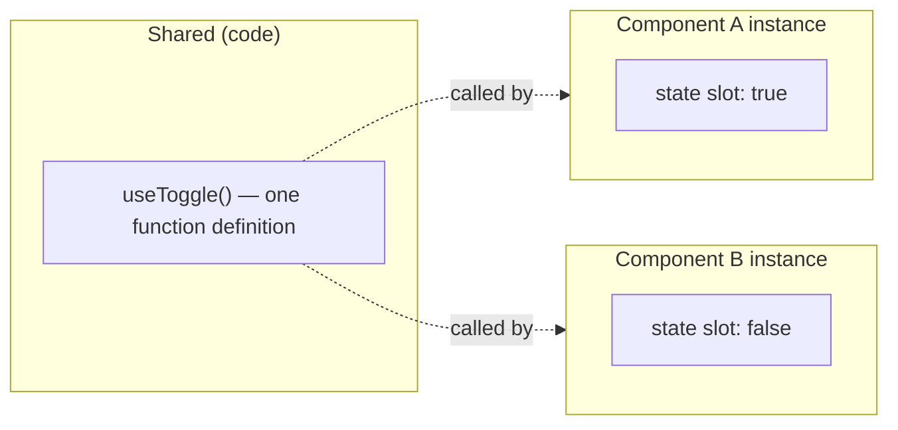
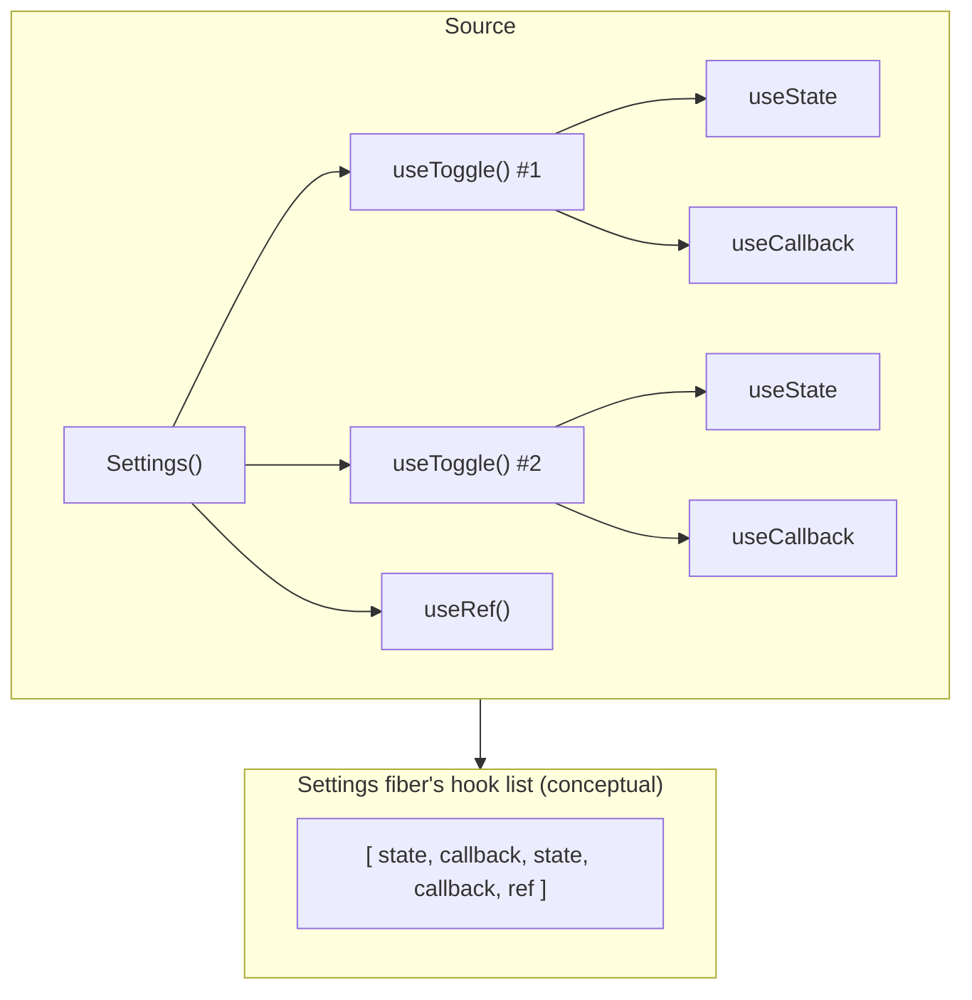
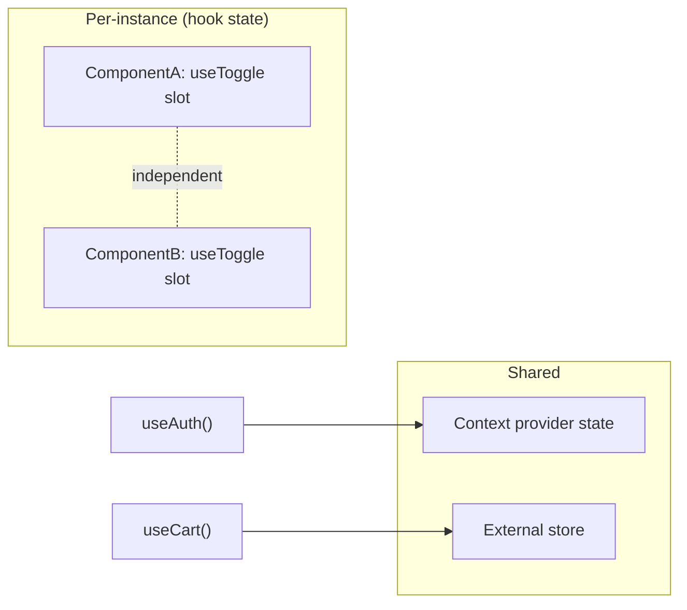

# 03 / 15 — Custom Hooks: Reusing Stateful Logic

## 1. Lesson metadata

| | |
|---|---|
| **Level** | Intermediate |
| **Study time** | 5–6 hours (reading 2 h, experiments 1.5 h, exercises 2 h) |
| **Prerequisites** | [01 — `useState`](./01-usestate-internals-and-update-semantics.md), [04 — `useEffect`](./04-useeffect-synchronization.md), [05 — Effect dependencies and stale closures](./05-effect-dependencies-and-stale-closures.md), [06 — Effect cleanup](./06-effect-cleanup.md), [10 — `useRef`](./10-useref-and-mutable-references.md), [11 — `useMemo` and `useCallback`](./11-usememo-and-usecallback.md), [13 — `useContext` and propagation](./13-usecontext-and-propagation.md) |
| **Next** | [16 — Rules of Hooks and composition](./16-rules-of-hooks-and-composition.md) |
| **Related** | [20 — `useSyncExternalStore`](./20-usesyncexternalstore-and-external-stores.md), [23 — Hooks anti-patterns](./23-hooks-anti-patterns.md), [Phase 5/06 — Custom hook patterns](../05-design-patterns/06-custom-hook-patterns.md), [Phase 8/05 — Testing custom hooks](../08-testing-and-quality/05-testing-custom-hooks.md) |

**Learning objectives.** After this lesson you can:
1. Explain what problem custom hooks solve that components, utility functions, HOCs and render props did not, and what they deliberately do **not** share.
2. State precisely what a custom hook *is* at runtime (nothing special: a function that calls hooks) and what the `use` prefix does (convention + tooling contract).
3. Demonstrate that each call of a custom hook gets **isolated** state, and that sharing state requires context or an external store.
4. Design a hook API: inputs (arguments vs options object), outputs (tuple vs object), identity stability, error and loading modeling, cleanup, SSR behavior.
5. Decide between a custom hook, a plain function, a component, and a context/store.
6. Write, test, and review hooks that are free of stale closures, leaks, and hidden global state.
7. Recognize hooks that are bad abstractions (lifecycle wrappers, "god hooks", hooks that hide data flow).

**Concepts covered:** logic reuse vs state sharing, naming convention, hook composition, hook isolation, API design (tuple/object returns, options), referential stability of returns, "latest ref" pattern, effect encapsulation, `useSyncExternalStore`-backed hooks, generic hooks in TypeScript, hook testing, abstraction level.

---

## 2. Deep conceptual explanation

### 2.1 The problem: stateful logic is welded to components

Before hooks, React had three ways to reuse *behavior* across components, and each had a cost:

| Mechanism | How it reused logic | Cost |
|---|---|---|
| **Class mixins** (removed) | Copy methods/lifecycle into a class | Name clashes, implicit dependencies; abandoned by React |
| **Higher-order components** (HOC) | `withX(Component)` wraps and injects props | "Wrapper hell" in the tree; prop-name collisions; types are awkward; behavior is invisible at the call site ([Phase 5/09](../05-design-patterns/09-higher-order-components.md)) |
| **Render props** | `<Mouse>{pos => …}</Mouse>` | Nesting ("callback pyramid"); extra component in the tree; pushes logic into JSX ([Phase 5/10](../05-design-patterns/10-render-props.md)) |

All three reused logic by **inserting components into the tree**. But the thing being reused (e.g., "track window width", "subscribe to online status", "debounce a value") is not UI; it is *behavior that needs state and effects*. Plain functions can't hold per-component state or subscribe/unsubscribe on mount/unmount, because those capabilities were attached to the component, not to functions.

Hooks changed that: state and effects became **calls made during render**, so any function that is called *during a component's render* can make them. Therefore **a function that calls hooks can be extracted, named, tested and reused** with no extra component in the tree. That function is a *custom hook*.

### 2.2 Definition

> A **custom hook** is a JavaScript function whose name starts with `use` and that calls other hooks (built-in or custom).

That is all. There is no `createHook` API and no registration. At runtime, React has no concept of "this call is a custom hook": the built-in hooks that the custom hook calls become **part of the calling component's ordered hook list** ([Lesson 16](./16-rules-of-hooks-and-composition.md); mechanism in [Phase 2/17](../02-react-rendering-and-internals/17-hooks-and-fiber-state.md)). A custom hook is a **refactoring of call sites**, like extracting a function; it has no runtime identity.

Consequences:
- Hook state belongs to the **component instance that calls it** (via its fiber), not to the hook.
- Extracting logic into a custom hook never changes behavior by itself — inline the body and you get the same program.
- Anywhere a built-in hook may be called, a custom hook may be called, under identical rules.

### 2.3 What is shared and what is not



A custom hook shares **logic**, not **state**. Two components calling `useToggle()` each get their own boolean. Two calls *in the same component* each get their own slot. Misreading this is the most common beginner misconception ("why doesn't my `useAuth()` state sync between components?" — because each call created its own `useState`).

To share state across components, use **context** ([Lesson 13](./13-usecontext-and-propagation.md)), an **external store** with `useSyncExternalStore` ([Lesson 20](./20-usesyncexternalstore-and-external-stores.md)), or lift state ([Lesson 18](./18-state-colocation-and-lifting.md)). A custom hook can *wrap* those (`useAuth()` calls `use(AuthContext)`), which is the typical way an app exposes shared state with a clean API.

### 2.4 The `use` prefix is a contract, not magic

React does not check names at runtime. The prefix matters because:
1. **Linting** (`eslint-plugin-react-hooks`) uses it to identify hook calls and to enforce the [Rules of Hooks](./16-rules-of-hooks-and-composition.md) — "don't call hooks conditionally" can only be checked if hooks are recognizable.
2. **Human signaling:** a reader knows the function must be called during render, in a stable order, from a component or another hook.

A function named `getWindowSize` that calls `useState` internally *works* at runtime but is invisible to the linter and misleads readers. Conversely, a function named `useFormat` that calls **no** hooks is allowed but pointless; the prefix then falsely constrains callers (they can't call it conditionally under the linter's rules). **Name a function `use…` iff it calls hooks.**

### 2.5 Why not just a utility function or a component?

| Need | Right tool | Why |
|---|---|---|
| Pure computation (format currency, filter an array) | **Plain function** | No state/effect; callable anywhere, including handlers and tests |
| Per-instance state + effects, no UI of its own | **Custom hook** | Stateful logic with no tree presence |
| Rendering UI that includes the behavior | **Component** | UI belongs to the tree |
| State shared by many components | **Context / store** (+ a hook as the access API) | Hooks don't share state |
| Behavior with *no* render-time access (event handler logic) | **Plain function** taking arguments | Hooks can't run in handlers |

### 2.6 Misconceptions

| Misconception | Reality |
|---|---|
| "Custom hooks share state between components." | Each call has its own state. |
| "A custom hook runs once." | It runs on **every render** of the calling component, like any code in the component body. |
| "Custom hooks are an optimization." | They're an organizational tool; they don't skip any work. |
| "Every `useEffect` belongs in a custom hook." | Extract when it names a coherent concept ("synchronize with online status"), not mechanically. A hook that is used once and only renames an `useEffect` can hide intent. |
| "A hook should expose everything it has." | Narrow, intention-revealing APIs are more valuable than flexible ones. |
| "Custom hooks are for the whole app's architecture." | They're one tool; heavy domain logic belongs in pure modules that hooks *call* ([Phase 4/12](../04-react-architecture/12-domain-logic-vs-ui-logic.md)). |

---

## 3. Internal mechanics

### 3.1 What actually happens when a component calls a custom hook

*Teaching model* (see Phase 2/17 for detail): React keeps, per component instance (fiber), an ordered list of hook "slots". Each built-in hook call in a render takes the *next* slot. Nested calls flatten:

```tsx
function useToggle(initial = false) {        // custom hook
  const [on, setOn] = useState(initial);     // → slot k
  const toggle = useCallback(() => setOn((v) => !v), []); // → slot k+1
  return [on, toggle] as const;
}

function Settings() {
  const [dark, toggleDark] = useToggle();         // slots 0,1
  const [beta, toggleBeta] = useToggle(true);     // slots 2,3
  const ref = useRef(null);                       // slot 4
  …
}
```

`Settings`' hook list is `[state(false), callback, state(true), callback, ref]`. There is no "useToggle slot", which is why:
- You must call the custom hook the same number of times in the same order every render (it expands to a fixed number of built-in calls).
- Two calls cannot interfere: they occupy different slots.

*Public guarantee:* hooks' state is tied to component instance + call order; custom hooks compose without additional rules.
*Implementation detail:* the list is a linked structure on the fiber in current React; do not rely on that.

### 3.2 Hook code runs on every render

The body of a custom hook executes inside the calling component's render. So:
- Any non-hook work inside it (parsing, allocation) happens every render; use `useMemo` ([Lesson 11](./11-usememo-and-usecallback.md)) for expensive work, **not** for trivial work.
- It must be pure with respect to rendering ([02/12](../02-react-rendering-and-internals/12-why-rendering-must-be-pure.md)): no side effects in the body — effects go in `useEffect` (or in event handlers).
- In development with Strict Mode, the body runs twice per render and effects run, clean up and re-run once on mount ([02/28](../02-react-rendering-and-internals/28-strict-mode-behavior.md)). A correct hook survives this.

### 3.3 Referential stability of what a hook returns

Anything a hook returns that is a function or object is a *new value on every render* unless the hook stabilizes it. Consumers may place it into dependency arrays or `memo` props, where instability causes effect re-runs and wasted renders. Contract design question for every hook: **"which returned values are stable, and is that documented?"** Typical policy: setters and event-handler-like functions are stable (`useCallback` with stable deps or functional updates); *state values* change when they change.

### 3.4 Stale closure in hooks that accept callbacks

A hook taking `onChange` and using it inside an effect or a subscription has two bad options: (1) put `onChange` in the dependency array (effect re-subscribes each render because the caller's inline function is new) or (2) omit it (stale closure). The **latest-ref pattern** resolves this:

```ts
function useLatest<T>(value: T) {
  const ref = useRef(value);
  useEffect(() => { ref.current = value; });  // update after commit; no dep array
  return ref;
}
```

Reading `ref.current` inside the subscription callback (which executes *later*, after commits) always sees the latest committed value. `useEffectEvent` is React's intended primitive for this: it has been stable since React 19.2 (react.dev/reference/react/useEffectEvent; covered in [Lesson 22](./22-modern-hooks-and-apis.md)). Rules: call it at the top level of the component or hook, call the returned function only from Effects (or other Effect Events), never pass it to other components or hooks, and do not list it in dependency arrays (its identity changes every render). A custom hook like `useEventListener` can wrap the incoming `handler` in `useEffectEvent` internally. Don't write `ref.current = value` *during render*: under concurrent rendering a render can be discarded, leaving the ref pointing at props that never committed.

---

## 4. Step-by-step execution walkthrough

Scenario: `useDebouncedValue` in a search box (code in §5.2). Debounce 300 ms; the user types "r", "re", "rea" with 100 ms between keys, then stops.

```tsx
function Search() {
  const [text, setText] = useState("");
  const debounced = useDebouncedValue(text, 300);
  const results = useSearch(debounced);   // runs only when debounced changes
  …
}
```

1. **Mount.** `Search` renders: `text=""`; `useDebouncedValue` calls `useState("")` (slot), registers an effect keyed on `[value, delay]`. Returns `""`. After commit the effect runs: `setTimeout(() => setDebounced(""), 300)` and stores cleanup `clearTimeout(id)`.
2. **t=0, "r".** `setText("r")` → render. `debounced` is still `""` (its state didn't change). Hook's effect deps changed (`value: "r"`) → React runs **previous cleanup** (`clearTimeout` of the mount timer) then the new effect: schedules a timer for t=300.
3. **t=100, "re".** Render; cleanup cancels the timer from step 2; new timer for t=400.
4. **t=200, "rea".** Cleanup cancels; new timer for t=500.
5. **t=500.** Timer fires: `setDebounced("rea")` → render: `debounced = "rea"`; effect deps of `useDebouncedValue` change again (`value` unchanged, but state changed — the effect depends on `[value, delay]`, **not** on its own state, so it does not re-run). Downstream `useSearch("rea")` effect re-runs and fetches once.
6. **Result:** one request instead of three, and between t=0 and t=500 `Search` rendered 3 times (keystrokes) + 1 (debounced update). The extra render at step 5 is the price of representing the debounced value as state ([Lesson 17](./17-derived-state.md) discusses why this is *synchronization* with time, a legitimate use of an effect).
7. **Unmount mid-timer.** The cleanup clears the timer; no `setState` after unmount.
8. **Strict Mode (dev).** On mount, the effect runs, cleans up, and runs again: the first timer is cleared immediately, only the second fires. Correct hooks tolerate this.

---

## 5. Code examples

### 5.1 Minimal example — extract and isolate

```tsx
import { useCallback, useState } from "react";

export function useToggle(initial = false) {
  const [on, setOn] = useState(initial);
  const toggle = useCallback(() => setOn((v) => !v), []);
  return [on, toggle] as const;     // `as const` ⇒ readonly [boolean, () => void], not (boolean | fn)[]
}

function Panel({ title }: { title: string }) {
  const [open, toggle] = useToggle();
  return (
    <section>
      <button onClick={toggle} aria-expanded={open}>{title}</button>
      {open && <p>Contents</p>}
    </section>
  );
}

export const Page = () => (
  <>
    <Panel title="Shipping" />
    <Panel title="Billing" />
  </>
);
```

**Predict:** click "Shipping". Does "Billing" open?
**Result:** No. Each `Panel` calls `useToggle()`, producing its own `useState` slot in its own fiber.
**Why:** custom hooks share code, not state (§2.3).
Line notes: `as const` yields a tuple type so destructuring infers `[boolean, () => void]`. `useCallback(..., [])` is valid because `setOn` is stable and the functional update has no outer dependencies.
**Trade-off:** `useCallback` here is only valuable if consumers put `toggle` into dependency arrays or memoized props. For a tiny hook, many teams skip it; the contract "toggle is stable" is the thing documented, not the micro-optimization.

### 5.2 Practical examples

**(a) `useDebouncedValue`**

```ts
import { useEffect, useState } from "react";

export function useDebouncedValue<T>(value: T, delayMs: number): T {
  const [debounced, setDebounced] = useState(value);

  useEffect(() => {
    const id = setTimeout(() => setDebounced(value), delayMs);
    return () => clearTimeout(id);
  }, [value, delayMs]);

  return debounced;
}
```
Line notes: the effect *synchronizes* an external clock with state; cleanup cancels the pending timer when `value`/`delayMs` change or the component unmounts. `useState(value)` seeds the first render, so the first output is the input immediately (no flash of `undefined`). Edge: when `value` is a fresh object each render, the effect resets the timer each render and the debounced value is never updated — pass primitives or stabilized values.

**(b) `useOnlineStatus` — subscribing to an external source correctly**

```ts
import { useSyncExternalStore } from "react";

function subscribe(onChange: () => void) {
  window.addEventListener("online", onChange);
  window.addEventListener("offline", onChange);
  return () => {
    window.removeEventListener("online", onChange);
    window.removeEventListener("offline", onChange);
  };
}

export function useOnlineStatus(): boolean {
  return useSyncExternalStore(
    subscribe,
    () => navigator.onLine,    // client snapshot
    () => true,                // server snapshot: assume online during SSR
  );
}
```
Why not `useState` + `useEffect`? That version works but can show a stale value between render and effect, flashes on mount, and can *tear* in concurrent rendering. `useSyncExternalStore` is React's documented primitive for subscribing to external mutable sources ([Lesson 20](./20-usesyncexternalstore-and-external-stores.md)). The hook hides this decision behind a stable interface — the key value of a custom hook: **callers don't change when the implementation improves.**

**(c) `useEventListener` using the latest-ref pattern**

```ts
import { useEffect, useRef } from "react";

export function useEventListener<K extends keyof WindowEventMap>(
  type: K,
  handler: (e: WindowEventMap[K]) => void,
  options?: AddEventListenerOptions,
): void {
  const handlerRef = useRef(handler);
  useEffect(() => { handlerRef.current = handler; });   // always current after commit

  const { capture, passive, once } = options ?? {};     // primitives, safe as deps
  useEffect(() => {
    const listener = (e: WindowEventMap[K]) => handlerRef.current(e);
    window.addEventListener(type, listener, { capture, passive, once });
    return () => window.removeEventListener(type, listener, { capture });
  }, [type, capture, passive, once]);
}
```
Line notes: the subscription effect does not depend on `handler`, so inline arrow handlers don't cause re-subscription each render; the ref ensures the listener calls the latest handler. `removeEventListener` matches by `type`, `listener` and `capture` only. Ordering: effects run in declaration order within a component, so the ref update happens before the subscription effect on mount. A handler running between render commit and the ref-updating effect could see the previous handler for a moment; for event listeners that gap is immaterial, but it is one reason `useEffectEvent` (stable since React 19.2) is preferable on React 19.2+.

**(d) A data hook with status, abort and race-safety**

```ts
import { useEffect, useState } from "react";

type AsyncState<T> =
  | { status: "idle" }
  | { status: "loading" }
  | { status: "success"; data: T }
  | { status: "error"; error: Error };

export function useJson<T>(url: string | null): AsyncState<T> {
  const [state, setState] = useState<AsyncState<T>>({ status: "idle" });

  useEffect(() => {
    if (url === null) {
      setState({ status: "idle" });
      return;
    }
    const controller = new AbortController();
    setState({ status: "loading" });

    fetch(url, { signal: controller.signal })
      .then((res) => {
        if (!res.ok) throw new Error(`HTTP ${res.status}`);
        return res.json() as Promise<T>;
      })
      .then((data) => setState({ status: "success", data }))
      .catch((err: unknown) => {
        if (controller.signal.aborted) return;           // superseded or unmounted: ignore
        setState({ status: "error", error: err instanceof Error ? err : new Error(String(err)) });
      });

    return () => controller.abort();
  }, [url]);

  return state;
}
```
Why this shape: a **discriminated union** makes impossible states unrepresentable (`loading` with `data`); the abort handles the **race** where an older request resolves after a newer one ([Phase 6/02](../06-data-fetching-and-state-ecosystems/02-cancellation-and-race-conditions.md)); `url: string | null` models "don't fetch yet" without conditional hook calls. **Limits:** no caching, deduplication, retry, revalidation, or shared state across components — each call fetches independently. For application data, prefer TanStack Query/SWR or framework data loading ([Phase 6/08](../06-data-fetching-and-state-ecosystems/08-tanstack-query.md)); this hook is a teaching artifact and appropriate for tiny tools. In Strict Mode dev, the effect runs twice on mount, causing two requests (the first aborted) — expected, not a bug. Lint note: the `set-state-in-effect` rule in the current `eslint-plugin-react-hooks` recommended preset flags synchronous `setState` calls in an effect body (such as `setState({ status: "loading" })` above) as avoidable extra renders; for a teaching hook this is acceptable, and a library or framework loader avoids the pattern entirely. Verified against react.dev's eslint-plugin-react-hooks reference (2026-10-22).

### 5.3 Incorrect examples

**(a) Expecting shared state.**

```ts
export function useCart() {
  const [items, setItems] = useState<Item[]>([]);
  return { items, add: (i: Item) => setItems((p) => [...p, i]) };
}
// <Header /> and <ProductPage /> both call useCart(): two unrelated carts.
```
Fix: hold state in a provider and expose the hook as the access API (`useCart = () => use(CartContext)`), or use a store.

**(b) Lifecycle wrapper hook.**

```ts
export function useMount(fn: () => void) {
  useEffect(fn, []);          // lint: missing dependency; also ignores cleanup & Strict Mode
}
```
Hides dependencies, invites stale closures, and encodes the wrong mental model (effects synchronize; they are not "mount callbacks", [Lesson 04](./04-useeffect-synchronization.md)).

**(c) Conditional hook inside a hook.**

```ts
function useUser(enabled: boolean) {
  if (enabled) {
    const [u, setU] = useState<User | null>(null);   // ❌ Rules of Hooks
    …
  }
}
```
Fix: always call hooks; model "disabled" in the hook's logic (like `url: string | null` above). See [Lesson 16](./16-rules-of-hooks-and-composition.md).

**(d) Unstable returns that break consumers.**

```ts
export function useFilters() {
  const [q, setQ] = useState("");
  return { q, setQ, params: { q } };          // `params` is a new object each render
}
// consumer: useEffect(() => fetch(`/api?${new URLSearchParams(params)}`), [params]);  // re-runs every render
```
Fix: return only primitives/stable references or `useMemo` the object; better, document exactly which returns are stable.

**(e) Hidden global state.**

```ts
let cache: Record<string, Data> = {};          // module-level
export function useData(id: string) { … cache[id] … }   // shared across tests, SSR requests, users
```
Module-level mutable state is shared across component instances (and, in SSR, **across requests** — a data leak). Put it behind an explicit store or a provider-scoped instance.

### 5.4 Corrected implementation of (a)

```tsx
const CartContext = createContext<CartApi | null>(null);

export function CartProvider({ children }: { children: ReactNode }) {
  const [items, setItems] = useState<readonly Item[]>([]);
  const api = useMemo<CartApi>(
    () => ({ items, add: (i) => setItems((p) => [...p, i]) }),
    [items],
  );
  return <CartContext value={api}>{children}</CartContext>;
}

export function useCart(): CartApi {
  const api = use(CartContext);
  if (!api) throw new Error("useCart must be used within <CartProvider>");
  return api;
}
```
The *hook name and signature are unchanged for callers*; only the state's location changed. This is the abstraction benefit in action.

### 5.5 Advanced example — a generic, typed, composable hook (`usePersistentState`)

```ts
import { useCallback, useRef, useSyncExternalStore } from "react";

export function usePersistentState<T>(
  key: string,
  initial: T,
): readonly [T, (next: T | ((prev: T) => T)) => void] {
  const initialRef = useRef(initial);                       // stable fallback value

  const subscribe = useCallback((onChange: () => void) => {
    const onStorage = (e: StorageEvent) => { if (e.key === key || e.key === null) onChange(); };
    window.addEventListener("storage", onStorage);          // other tabs
    window.addEventListener(`local:${key}`, onChange);      // same-tab writes (custom event)
    return () => {
      window.removeEventListener("storage", onStorage);
      window.removeEventListener(`local:${key}`, onChange);
    };
  }, [key]);

  // getSnapshot must return a *cached* value: use the raw string, parse outside.
  const raw = useSyncExternalStore(
    subscribe,
    () => window.localStorage.getItem(key),
    () => null,
  );

  const value = raw === null ? initialRef.current : (JSON.parse(raw) as T);
  // ⚠ JSON.parse each render yields a new object for objects/arrays; for object T
  // memoize on `raw`:  useMemo(() => (raw === null ? initial : JSON.parse(raw)), [raw])

  const set = useCallback(
    (next: T | ((prev: T) => T)) => {
      const prevRaw = window.localStorage.getItem(key);
      const prev = prevRaw === null ? initialRef.current : (JSON.parse(prevRaw) as T);
      const resolved = typeof next === "function" ? (next as (p: T) => T)(prev) : next;
      window.localStorage.setItem(key, JSON.stringify(resolved));
      window.dispatchEvent(new Event(`local:${key}`));
    },
    [key],
  );

  return [value, set] as const;
}
```
What this teaches (and where it is deliberately imperfect):
- **Why `useSyncExternalStore`:** `localStorage` is an external, mutable store that other tabs change; it avoids hydration flash and tearing; the server snapshot `null` makes SSR render the initial value.
- **Snapshot caching rule:** returning the *raw string* (a primitive) is stable; returning parsed objects directly from `getSnapshot` would violate the caching rule. The `useMemo` note shows how to produce stable object values.
- **Failure modes not handled** (be honest in code review): `JSON.parse` throwing on corrupt data, `localStorage` unavailable/quota errors (private modes), non-serializable `T`, schema evolution/versioning of stored data. A production hook needs `try/catch`, validation (e.g., a schema), and a `remove` function.
- **Hydration:** the server renders `initial`, the client's first render also returns the *server snapshot* during hydration, then updates — preventing mismatch ([Phase 9/02](../09-advanced-rendering-and-ecosystem/02-hydration-internals-deep-dive.md)).
- **Design question:** is a hook the right home? If many components share the same key, the custom-event bridge makes them stay in sync — a lightweight store.

---

## 6. Visual explanations

### 6.1 Hooks flatten into the caller's slot list



### 6.2 Where shared state really lives



### 6.3 Abstraction layers

```text
UI components
   │ call
Feature hooks      useCheckout(), useProductSearch()          ← domain vocabulary
   │ call
Primitive hooks    useDebouncedValue(), useOnlineStatus()      ← generic, reusable
   │ call
React hooks        useState, useEffect, useSyncExternalStore
   │ delegate pure logic to
Pure modules       priceCalculator.ts, validators.ts            ← testable without React
```

---

## 7. Alternative approaches and trade-offs

For reusing behavior:

| Approach | Readability | Composability | Tree impact | Testability | Types | When it wins |
|---|---|---|---|---|---|---|
| **Custom hook** | High (named, call-site explicit) | Excellent (hooks call hooks) | None | `renderHook` or via a test component | Straightforward generics | Default for stateful/effectful reuse |
| **Plain function** | Highest | Excellent | None | Trivial | Straightforward | No state/effects needed: always prefer |
| **Component** | High for UI | Via composition | Adds nodes | RTL | Props | The behavior renders UI or manages a DOM subtree ([Phase 5/07 headless components](../05-design-patterns/07-headless-components.md)) |
| **Render prop** | Medium | Nesting | Adds nodes | RTL | Awkward generics | Legacy code; library needing to inject into a specific render position |
| **HOC** | Low–Medium (hidden props) | Wrapper stacks | Adds nodes | Awkward | Hard to type | Legacy; cross-cutting wrappers over *class* components; some auth gating |
| **Context + hook** | High | Good | Provider nodes | Needs provider | Fine | State shared across the tree |
| **External store + hook** | High | Good | None | Store unit tests | Fine | Cross-tree/high-frequency state |
| **Library hook** (TanStack Query, react-hook-form, usehooks-style collections) | High | Good | None | Library-tested | Library-supplied | Problems with well-known edge cases (data fetching, forms) |

**When the recommended approach (custom hook) is NOT best:**
- **The logic is pure.** `formatMoney`, `groupBy`, `validateIban` should be plain functions; wrapping them in `useFormat` forces callers to obey hook rules and complicates testing.
- **The "reuse" is hypothetical.** One call site, one component: a well-named local function inside the component (or just inline code) is clearer than a file in `hooks/`. Extract when the second use or a clear concept appears (rule of three is a heuristic, not a law).
- **The behavior is a UI concern.** A `useModal()` that returns `{ Modal, open }` (a component factory) breaks component identity: a component created inside a hook is re-created each render and remounts its subtree ([Phase 5/19](../05-design-patterns/19-polymorphic-components.md)). Make it a component.
- **Problem is well solved by a library** with caching/retry/dedupe semantics you would otherwise reimplement.

---

## 8. Best practices and anti-patterns

**Do**
- Name hooks for the **concept** they provide (`useOnlineStatus`, `useDocumentVisibility`), not the mechanism (`useEventListenerState`).
- Keep each hook cohesive: one concern; compose small hooks into feature hooks.
- Make the API honest about **time**: return `{ status, data, error }`, not `data` that may be `undefined` for three different reasons.
- **Document stability** of returned functions/objects; stabilize setters; return primitives where possible.
- Accept **primitive or stable arguments**; for callbacks use the latest-ref pattern (or `useEffectEvent`, stable in React 19.2+) rather than forcing callers to wrap in `useCallback`.
- Always provide cleanup for subscriptions, timers, observers; assume Strict Mode double-invocation.
- Make hooks **SSR-safe**: no `window`/`localStorage` access during render; use `useSyncExternalStore` with a server snapshot or effects.
- Keep heavy logic in **pure functions** and have the hook adapt them to React.
- Return tuples for 1–2 values users commonly rename (`const [open, toggle] = …`); return objects for 3+ or when names are self-describing.

**Beginner mistakes**
- Treating custom hooks as shared singletons.
- Putting everything in one hook ("`useApp`").
- Omitting dependencies or silencing the linter with `// eslint-disable-next-line react-hooks/exhaustive-deps`.
- Calling hooks inside loops/conditions inside hooks.

**Experienced-developer mistakes**
- **Over-abstracting early:** generic `useAsync`/`useForm` homebrews that reimplement libraries with fewer features.
- **Leaky hook APIs:** returning `setState`-like functions that let consumers bypass invariants (`setItems` instead of `addItem`/`removeItem`).
- **Hidden effects:** a hook named like a getter (`useUser`) that triggers network requests and mutations; callers don't know when side effects occur.
- **Options objects as dependencies** without stabilizing: `useThing({ retries: 3 })` creates a new object every render; if used in a dependency array, effects loop.
- **Global singletons inside hooks** (module-level caches) that leak across SSR requests and tests.
- **Test-hostile hooks** that directly access `window.fetch` or `Date.now` without injection.

**Smells:** a hook file with 400 lines; hooks with 7+ parameters (use an options object or split); hooks that return 10 values; hooks named `useHelper`, `useUtils`, `useCommon`; a hook that calls `useContext` for something the caller could pass explicitly (hidden dependency makes reuse harder — sometimes desirable, often not).

**Justified exceptions:** a one-use hook is fine when it names a concept and isolates complexity (e.g., `useCheckoutMachine`) — the criterion is *readability and testability*, not reuse. A hook returning a component-ish render function is occasionally justified in libraries (headless UI) if identity stability is handled.

---

## 9. Real-world application

**(a) Design-system library (multi-team).** `useControllableState(value, defaultValue, onChange)` — the hook that powers "controlled or uncontrolled" components ([Phase 5/11](../05-design-patterns/11-controlled-component-pattern.md)). Constraints: must not warn on switching modes unexpectedly, must keep `onChange` call semantics consistent, and API stability matters because multiple teams depend on it (semver).

**(b) Dashboard with real-time panels.** `useWebSocketChannel(channel, onMessage)` encapsulates connection lifecycle: connect on mount, subscribe, reconnect with backoff, unsubscribe on cleanup, with the latest-ref for `onMessage`. Constraint: **one connection per page, not per widget** — so the hook delegates to a shared client held in context (hook shares *code*, the client shares *connection*). Back-pressure and batching live in the client, not the hook.

**(c) Finance forms.** `useMoneyInput({ currency, locale })` wraps parsing/formatting using pure functions (`parseMoney`, `formatMoney`) with `Intl.NumberFormat` instances memoized per `[locale, currency]`. Constraint: correctness over cleverness: never use floating-point arithmetic for money; hooks only adapt input behavior (caret position, formatting on blur) while pure code does the math.

**(d) Auth.** `useAuth()` is the access API over a provider (`use(AuthContext)`), plus `useRequireRole(role)` that redirects (an *effect*) when unauthorized. Constraint: security decisions are made on the server; a client hook only drives UX ([Phase 9/12](../09-advanced-rendering-and-ecosystem/12-auth-boundaries.md)).

**(e) E-commerce search.** `useProductSearch(query)` composes `useDebouncedValue`, a query-cache hook, and URL sync (`useSearchParam`). Constraint: keep the **hook layers** thin and let a server-state library own caching; the hook names the domain operation.

---

## 10. Debugging and troubleshooting

**Symptom: "State from my hook resets / differs between components."**
Cause: each call has its own state (§2.3). Investigation: React DevTools → Components → select the component; the right pane lists hooks by *custom hook name* with nested built-in hooks (DevTools infers names from the function names). Two components show two separate `useToggle` entries with independent state values. Fix: provider/store.

**Symptom: "Effect inside my hook runs on every render."**
Cause: dependency array contains an unstable value (inline object/function/array) *from the caller* — `useThing({ a: 1 })`. Investigation: temporarily log each dep with `Object.is` against its previous value (`usePrevious` in dev) or use the DevTools Profiler "Hooks changed". Fix: depend on primitives, stabilize in the caller, or restructure with latest-ref/`useEffectEvent`.

**Symptom: "After unmount, warning/crash from my hook."**
Cause: missing cleanup (timer, listener, in-flight request setting state). Reproduce by navigating away quickly (or throttle the network). Fix: cleanup + abort; verify with Strict Mode on.

**Symptom: "Works in dev, double requests/events in dev only."**
Cause: Strict Mode runs effects twice on mount. If the **second** run behaves wrongly (duplicate analytics, double subscriptions that aren't cleaned), your cleanup is incomplete. Fix cleanup rather than disabling Strict Mode ([Lesson 06](./06-effect-cleanup.md)).

**Symptom: "Hook state is stale in a callback."**
Cause: closure over an old render's value ([Lesson 05](./05-effect-dependencies-and-stale-closures.md)). Fix with functional updates, deps, or latest-ref.

**Symptom: "Hydration mismatch warning in a hook reading `window`."**
Cause: render returns different output on server vs client. Fix: `useSyncExternalStore` with `getServerSnapshot`, or defer to an effect for client-only data.

**Symptom: "'Rendered more hooks than during the previous render'."** — a conditional call somewhere inside the custom hook or its callers ([Lesson 16](./16-rules-of-hooks-and-composition.md)).

---

## 11. Exercises

### Level A — Knowledge
A1. What is a custom hook, technically? Is there any runtime API that registers one?
A2. Do two components that call the same custom hook share state? Why/why not?
A3. Why must a function that calls hooks start with `use`?
A4. Name two reasons a hook's returned function should have stable identity.
A5. Why can't hooks run in event handlers, and what is the right way to use hook-provided data in a handler?

### Level B — Code comprehension
B1. How many independent `useState` slots does this component's fiber have, and what does it render after clicking once?
```tsx
function useCounter() { const [n, setN] = useState(0); return [n, () => setN(n + 1)] as const; }
function App() {
  const [a, incA] = useCounter();
  const [b, incB] = useCounter();
  return <button onClick={() => { incA(); incA(); incB(); }}>{a},{b}</button>;
}
```
B2. In `useDebouncedValue`, what happens if the effect deps were `[value]` only, and `delayMs` changes from 300 to 1000 while a timer is pending?
B3. What is wrong with this hook? Identify at least two defects.
```ts
export function useWindowWidth() {
  const [w, setW] = useState(window.innerWidth);
  useEffect(() => {
    window.addEventListener("resize", () => setW(window.innerWidth));
  }, []);
  return w;
}
```
B4. In §5.2(c), why is the ref updated in an effect rather than during render?

### Level C — Implementation
C1. Write `usePrevious<T>(value: T): T | undefined` and explain at which render the "previous" value updates.
C2. Write `useInterval(callback, delayMs | null)` where `null` pauses, the callback can change without resetting the timer, and cleanup is correct.
C3. Write `useMediaQuery(query: string): boolean` with `useSyncExternalStore` and an SSR-safe server snapshot.
C4. Write a `renderHook` test (React Testing Library) for `useToggle` covering initial value, toggle, and stability of `toggle`.

### Level D — Debugging
D1. `useJson(url)` from §5.2(d) is called with `` `/api/items?filter=${JSON.stringify(filters)}` `` where `filters` is an object created in render. The UI flickers into "loading" repeatedly. Explain precisely and fix.
D2. A hook returns `{ data, refetch }` where `refetch` is a new function each render. A consumer has `useEffect(() => { refetch(); }, [refetch]);` and the network panel shows an infinite request loop. Explain and fix at both the hook and consumer levels.
D3. `usePersistentState` shows the initial value, flashes to the stored value after hydration, and logs a hydration warning. Which design detail prevents or causes it?

### Level E — Architecture and engineering decisions
E1. A team has 40 `useEffect` + `fetch` call sites with three subtly different loading/error conventions. Propose an approach: homemade `useFetch`, a library, or framework loaders. Evaluate with criteria (caching, dedupe, testing, bundle, onboarding) and state what would change your mind.
E2. Where should business rules like "shipping is free over €50 except for oversized items" live: inside `useCart`, in a pure module, or in a component? Justify.

### Level F — Expert challenge
F1. Design the API of `useControllableState<T>` (supports controlled and uncontrolled usage), including how to warn about switching modes, how `onChange` is called, and what identity guarantees the returned setter has. Identify at least three edge cases (e.g., controlled value rejected by parent, functional updates, StrictMode).
F2. Analyze whether `useLatest` assigning `ref.current = value` during render is safe under concurrent rendering. Provide a concrete failure scenario and the safe alternative.

---

## 12. Detailed answers and explanations

> Attempt the exercises first.

**A1.** A plain function named `use…` that calls other hooks; its hook calls become part of the caller's ordered hook list. No registration API exists. Wrong: "React creates a hook object for each custom hook".

**A2.** No. Each call allocates its own state slot on the calling component's fiber. Shared state requires context, an external store, or lifted state.

**A3.** Tooling contract: the lint rules identify hook calls by name to enforce the Rules of Hooks; readers rely on it. React does not check at runtime. A mis-named hook works but escapes lint and surprises readers.

**A4.** (1) Consumers put it in dependency arrays: instability re-runs effects; (2) passing to `memo`'d children defeats their memoization. Also (3) documents that calling it repeatedly is safe.

**A5.** Hooks require React's rendering context to locate the current fiber/slot; handlers run outside render. Read hook values in render and capture them in the closure, or move logic to a plain function that the handler calls with the values; for event-time reads that must be latest, use a ref.

**B1.** Two `useState` slots (one per `useCounter` call). Click: `incA()` twice and `incB()` once; because `incA` closes over `n = 0` (snapshot), both calls set `1`, so `a = 1` (not 2); `b = 1`. Renders `1,1`. Fix with `setN(n => n + 1)` to get `2,1` ([Lesson 02](./02-functional-state-updates.md)). The classic wrong answer is `2,1`.

**B2.** With deps `[value]` the effect doesn't re-run when only `delayMs` changes, so the pending timer keeps its old 300 ms delay and subsequent timers still use whatever `delayMs` *that effect closure captured*, i.e., the stale 300 (until `value` changes next). The linter flags the missing dependency; correct deps `[value, delayMs]` re-arm the timer with the new delay.

**B3.** Defects: (1) `useState(window.innerWidth)` reads `window` during render ⇒ crashes in SSR (`window` undefined) and mismatches on hydration; (2) the listener is never removed (no cleanup) ⇒ leaks and `setState` after unmount, accumulating on Strict Mode's double effect; (3) the initial value can be stale between render and effect if the window resized (minor); (4) every resize event sets state → render per event (consider throttling or `useSyncExternalStore` with a cached snapshot). Fix: `useSyncExternalStore(subscribe, () => window.innerWidth, () => 1024)` with proper subscribe/unsubscribe.

**B4.** Writing during render is a side effect on a mutable object visible outside the render; with concurrent rendering a render may be abandoned, leaving the ref pointing to props that never committed, and listeners reading it would call a handler from an uncommitted render ([02/12](../02-react-rendering-and-internals/12-why-rendering-must-be-pure.md)). Writing in an effect updates only after commit.

**C1. Solution**
```ts
function usePrevious<T>(value: T): T | undefined {
  const ref = useRef<T | undefined>(undefined);
  useEffect(() => { ref.current = value; });
  return ref.current;
}
```
The hook returns `ref.current` *before* the effect assigns the new value, so during render N it returns the value from render N−1 (committed). Edge: if the component re-renders without value change, previous equals current thereafter (previous is "value in the last render", not "last different value"). An alternative using state (`useState` pair adjusting during render) returns the last *different* value; choose per need. Caveat: reading `ref.current` during render is allowed here because the value being read was written in a past commit; some lint rules flag ref reads in render; document.

**C2. Solution**
```ts
function useInterval(callback: () => void, delayMs: number | null) {
  const saved = useRef(callback);
  useEffect(() => { saved.current = callback; });
  useEffect(() => {
    if (delayMs === null) return;
    const id = setInterval(() => saved.current(), delayMs);
    return () => clearInterval(id);
  }, [delayMs]);
}
```
Criteria: restarts only when `delayMs` changes; `null` pauses and clears; latest callback always called; works in Strict Mode (interval cleared and recreated).

**C3. Solution**
```ts
function useMediaQuery(query: string): boolean {
  const subscribe = useCallback(
    (onChange: () => void) => {
      const mql = window.matchMedia(query);
      mql.addEventListener("change", onChange);
      return () => mql.removeEventListener("change", onChange);
    },
    [query],
  );
  return useSyncExternalStore(
    subscribe,
    () => window.matchMedia(query).matches,
    () => false,                       // server: choose the mobile-first default
  );
}
```
Note: `subscribe` must be stable per `query` or React resubscribes each render (hence `useCallback`). The server snapshot must match the first client hydration render; mismatches produce hydration warnings only if the server and client *snapshots* differ during hydration — React uses the server snapshot during hydration then updates.

**C4. Sample**
```tsx
import { renderHook, act } from "@testing-library/react";

test("useToggle", () => {
  const { result, rerender } = renderHook(() => useToggle(false));
  expect(result.current[0]).toBe(false);
  const firstToggle = result.current[1];
  act(() => result.current[1]());
  expect(result.current[0]).toBe(true);
  rerender();
  expect(result.current[1]).toBe(firstToggle);   // stable identity
});
```
Evaluation: asserts public behavior, uses `act`, checks identity guarantee. (`renderHook` has been exported from `@testing-library/react` since v13.1 and is present in v16 — [Phase 8/05](../08-testing-and-quality/05-testing-custom-hooks.md).)

**D1.** `filters` is a new object each render ⇒ `JSON.stringify` gives equal *strings* for equal contents, so `url` is the same string and the effect **does not** re-run — if the key order is stable. The flicker therefore means the string changes: either keys inserted in different order, or `filters` includes volatile fields (e.g., `Date.now()`, a new `Set` serialized differently). Fix: build the URL from primitives with deterministic key order (`URLSearchParams` with sorted keys), and `useMemo` on primitive filter values; verify by logging `url` per render. The common wrong answer ("object identity re-triggers the effect") would be correct only if the *object* were a dependency; here a string is. Teaching point: dependency identity is about what you pass to the array.

**D2.** Each render yields a new `refetch` ⇒ effect deps changed ⇒ effect runs `refetch()` ⇒ state update ⇒ render ⇒ new `refetch` ⇒ loop. Hook-level fix: `useCallback` `refetch` with deps `[url]`, or latest-ref and expose a stable function. Consumer-level fix: don't put hook-provided functions in the dependency array when only the *trigger* matters; trigger from the event that matters (the effect is wrongly modelling "fetch on mount" — and even if it were intended, the hook should fetch itself).

**D3.** The flash is caused by returning the *initial* value during server render and during the hydration pass, then switching to the stored value — that is by design with `useSyncExternalStore`'s server snapshot, and does **not** produce a hydration warning. A warning arises if the *client* initial render reads `localStorage` directly (via `useState(() => localStorage…)`), producing different markup than the server HTML. To avoid the flash entirely, you must render the value on the server (cookie-based) or accept the flash/hide the UI until hydrated.

**E1. Evaluation criteria & example answer.** Criteria: cache/dedupe, race-safety, devtools, SSR/streaming compatibility, testing, bundle size, learning curve, migration cost. Good answer: adopt TanStack Query (or the framework's data loading if already on a framework) rather than evolve a homemade `useFetch`, because caching, deduplication, retries and invalidation are the hard parts and they're already solved/tested; migrate incrementally by wrapping each call site in domain hooks (`useOrders`, `useProduct`) so that the library choice stays behind hook boundaries. What would change your mind: a tiny app with 3 endpoints and no caching needs (a 30-line hook is fine), or a bundle constraint that rules out the library. Mention reviewing server-state vs client-state boundary ([Phase 6/07](../06-data-fetching-and-state-ecosystems/07-server-state-management.md)).

**E2.** Pure module. Business rules are deterministic functions of data: put them in `shipping.ts` (`calculateShipping(cart, rules)`), test with unit tests (no React), call from the hook/server/other consumers. The hook adapts: reads state, calls the pure function, memoizes if costly. Rule definitions affecting money must also be enforced on the server; client code only previews. Component placement couples rules to UI and duplicates logic; `useCart` placement is acceptable only as a thin delegating call.

**F1. Evaluation criteria & reference design.** Signature `useControllableState<T>({ value, defaultValue, onChange })`. Mode = `value !== undefined`. Internal state holds the uncontrolled value. `setValue(next)`: compute `resolved` from functional updates against the *current effective value*; if uncontrolled, set internal state; **always** call `onChange(resolved)` (if provided) when the resolved value differs by `Object.is`. Returned value: `isControlled ? value : internal`. Setter identity: stable (latest-ref for `onChange` and for the controlled value). Mode switching: record the initial mode in a ref; in dev, warn if it changes (`console.error` once). Edge cases: (1) controlled parent ignores `onChange` ⇒ UI doesn't change (correct, controlled means parent decides); (2) functional updates in controlled mode need the latest `value` (use latest-ref) and consecutive calls in one tick see stale `value` — document or resolve against a pending ref; (3) Strict Mode double-invocation must not call `onChange` during render (call in the event path, not in an updater function — updater functions must be pure, [02/12](../02-react-rendering-and-internals/12-why-rendering-must-be-pure.md)); (4) `defaultValue` changes after mount are ignored (document); (5) `NaN`/`-0` via `Object.is`. 

**F2.** Failure scenario: a transition render starts with new props (`handler = h2`) and assigns `ref.current = h2` during render; React then discards that render (an urgent update interrupts, or Suspense suspends before commit). The committed UI still uses `h1`, but an event listener firing before the next commit calls `h2` — logic from an uncommitted render (e.g., closing over state that never became visible). Safe alternatives: update the ref in an effect (or layout effect if reads can happen before passive effects), or `useEffectEvent` ⚠ where available. Conversely, for *idempotent* caches (same output regardless of render) render-time writes are tolerable; handlers aren't.

---

## 13. Senior engineer interview questions

**Q1. "What is a custom hook and what does it *not* give you?"**
*Strong answer:* A function that calls hooks; it composes into the caller's hook list, so it reuses logic with no tree impact. It doesn't share state — each call has independent state; for sharing use context/store. Nor does it optimize anything; it runs every render. Add an example of a hook as an *access API* over a context so that implementation can change without call-site changes.

**Q2. "How do you decide whether something should be a custom hook?"**
*Strong answer:* If it needs state/effects/context during render *and* names a coherent concept ⇒ hook; if pure ⇒ function; if it renders UI ⇒ component; if state is shared ⇒ context/store with a hook facade. Criteria: reuse, readability, testability, and whether the abstraction hides or reveals data flow. Counter: don't extract a hook for a single `useEffect` that is clearer inline.

**Q3. "How do you design a hook that accepts a callback without stale closures or re-subscribing?"**
*Strong answer:* Latest-ref updated in an effect (or `useEffectEvent` on React 19.2+), with the subscription effect independent of the callback; never write refs during render for values that handlers read, due to concurrent render discarding. Mention trade-off: indirection vs correctness, and that this pattern *hides* the dependency from the linter intentionally, so document it.

**Q4. "Why is `useSyncExternalStore` better than `useState` + `useEffect` for subscribing to a browser API?"**
*Strong answer:* Avoids tearing and the initial stale value gap; integrates with SSR via server snapshot; React re-reads the snapshot before commit and forces a consistent sync render if it changed. The effect version can render stale data first, then update after paint.

**Q5. "A teammate wrote `useUser()` that fetches on call; 12 components call it. What's wrong?"**
*Strong answer:* 12 independent fetches and states (hook state isn't shared); inconsistent views of the user; request storms; no cache. Fix: provider or server-state library (cache keyed by `["user"]`), keep `useUser()` as the facade. Also worth mentioning Strict Mode dev doubles.

**Q6. "How do you test custom hooks?"**
*Strong answer:* Prefer testing hooks through components that use them when behavior is UI-visible; use `renderHook` for library-grade hooks; test the pure logic separately; assert public API (values, identity guarantees), use fake timers for debounce; wrap with providers; test cleanup via unmount. Avoid asserting internal calls.

---

## 14. Further learning resources

| Resource | URL | Covers / why | Level | Study |
|---|---|---|---|---|
| React docs — Reusing Logic with Custom Hooks | <https://react.dev/learn/reusing-logic-with-custom-hooks> | The canonical tutorial: extraction, naming, sharing logic not state | Beginner–Int. | Whole page |
| React docs — Rules of Hooks | <https://react.dev/reference/rules/rules-of-hooks> | Why the `use` prefix matters; where hooks may be called | Intermediate | Whole page |
| React docs — `useSyncExternalStore` | <https://react.dev/reference/react/useSyncExternalStore> | `useOnlineStatus`-style subscriptions, snapshot rules, SSR | Advanced | Usage, Caveats |
| React docs — Lifecycle of Reactive Effects | <https://react.dev/learn/lifecycle-of-reactive-effects> | Why effects aren't mount callbacks; hooks that wrap them | Intermediate | Whole page |
| React docs — Separating Events from Effects | <https://react.dev/learn/separating-events-from-effects> | `useEffectEvent` rationale (stable in 19.2) | Advanced | Effect Events |
| React docs — You Might Not Need an Effect | <https://react.dev/learn/you-might-not-need-an-effect> | When hooks shouldn't use effects | Intermediate | Whole page |
| React Testing Library — `renderHook` | <https://testing-library.com/docs/react-testing-library/api/#renderhook> *(anchor confirmed)* | Hook testing API | Intermediate | `renderHook` |
| `eslint-plugin-react-hooks` | <https://github.com/facebook/react/tree/main/packages/eslint-plugin-react-hooks> | The lint rules behind the naming contract | Intermediate | README |
| TanStack Query | <https://tanstack.com/query> | The library you'd use instead of homemade `useFetch` | Intermediate | Overview, Queries |

---

## 15. Knowledge checkpoint

**You should now understand**
- A custom hook is a refactoring of hook calls with no runtime identity; it shares *logic*, never state.
- The `use` prefix is a lint/human contract; functions that call hooks must carry it.
- Hooks run every render; their returned identities, cleanups and SSR behavior are part of their API.
- Hooks as access APIs over context/stores let implementations evolve without changing callers.

**You should be able to explain without notes**
- Why two components calling `useToggle` don't sync, and how to make them sync.
- Why `useMount`-style wrappers mislead.
- Why the latest-ref update must be in an effect.

**You should be able to implement**
- `useDebouncedValue`, `useEventListener`, `useInterval`, `useMediaQuery`, `usePrevious`, and a race-safe `useJson`; a test with `renderHook`.

**You should be able to debug**
- Looping effects from unstable returns; leaked listeners; hydration mismatches in client-only hooks; "more hooks than previous render" errors.

**Before moving on:** read [16 — Rules of Hooks and composition](./16-rules-of-hooks-and-composition.md) to understand exactly why call order matters and how hooks compose safely.
