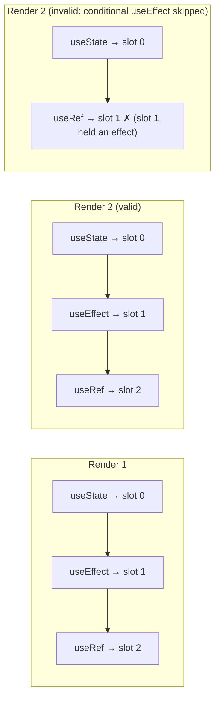
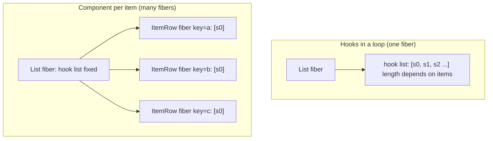
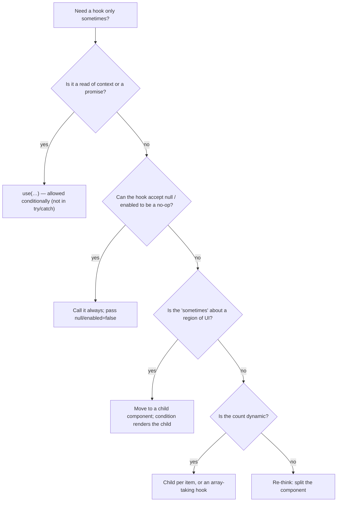

# 03 / 16 — The Rules of Hooks and Hook Composition

## 1. Lesson metadata

| | |
|---|---|
| **Level** | Intermediate → Advanced |
| **Study time** | 5 hours (reading 2 h, experiments 1 h, exercises 2 h) |
| **Prerequisites** | [01 — `useState` internals](./01-usestate-internals-and-update-semantics.md), [04 — `useEffect`](./04-useeffect-synchronization.md), [10 — `useRef`](./10-useref-and-mutable-references.md), [13 — `useContext`](./13-usecontext-and-propagation.md), [15 — Custom hooks](./15-custom-hooks.md), [02/11 — Render phase vs commit phase](../02-react-rendering-and-internals/11-render-phase-and-commit-phase.md), [02/12 — Why rendering must be pure](../02-react-rendering-and-internals/12-why-rendering-must-be-pure.md) |
| **Next** | [17 — Derived state](./17-derived-state.md) |
| **Related** | [22 — Modern hooks and APIs (`use`)](./22-modern-hooks-and-apis.md), [23 — Hooks anti-patterns](./23-hooks-anti-patterns.md), [Phase 2/17 — How hooks attach to Fiber](../02-react-rendering-and-internals/17-hooks-and-fiber-state.md), [Phase 5/06 — Custom hook patterns](../05-design-patterns/06-custom-hook-patterns.md) |

**Learning objectives.** After this lesson you can:
1. State the Rules of Hooks and derive each one from the single underlying mechanism (call-order-indexed slots on a component instance).
2. Predict, for any buggy component, whether React throws, warns, or silently misbehaves, and what the error messages mean.
3. Refactor every common violation (conditional hook, hook after early return, hook in loop, hook in callback, hook behind `try/catch`) into a legal equivalent.
4. Explain why `use` is exempt from the ordering rule and where its own limits lie.
5. Compose hooks: layering, parameter passing, returning stable APIs, ordering of effects, and avoiding dependency cycles.
6. Explain what the ESLint rules (`rules-of-hooks`, `exhaustive-deps`) guarantee and what they cannot.
7. Spot the "component called as a function" trap and understand why hooks tie to *component instances*.

**Concepts covered:** call-order identity, hook slots, mount vs update, order-mismatch errors, top-level rule, "only from React functions" rule, `use` exception, effect ordering, lint rules, hook composition patterns, hook-in-render-function trap, dynamic numbers of hooks.

---

## 2. Deep conceptual explanation

### 2.1 The problem the rules solve

A component function is **re-invoked from scratch on every render**. Local variables vanish; yet `const [count, setCount] = useState(0)` returns the *current* count. Somewhere, React must store "the state that belongs to *this* `useState` call in *this* component instance" and give it back on the next invocation.

JavaScript gives React nothing to identify the call with:
- A function call has no name for the variable being assigned (`const [count] = …`; the name `count` is not visible to `useState`).
- `useState` is called without a key.
- The call site (file/line) is not exposed to the runtime.

So React identifies each hook call by **its position in the sequence of hook calls made during that component's render**: first call → slot 0, second call → slot 1, and so on. That is the whole mechanism, and the entire set of rules is the consequence: *the sequence must be identical on every render of the same component instance*.

> **The rule behind the rules:** *Every render of a component must call the same hooks, in the same order.*

Everything the docs list — don't call hooks in loops, conditions, nested functions, after an early return — are ways of making that sequence vary.



### 2.2 The official rules

From the React reference ("Rules of Hooks"; checked against [react.dev](https://react.dev/reference/rules/rules-of-hooks) on 2026-10-22):

1. **Only call Hooks at the top level.** Not inside loops, conditions, nested functions, after a conditional `return`, in `try`/`catch`/`finally` blocks, in event handlers, or in functions passed to `useMemo`, `useReducer`, `useEffect`.
2. **Only call Hooks from React functions:** function components or custom hooks (functions named `use…`). Not from regular JS functions, not from class components.

And one *exception* introduced with React 19's `use` API:
3. **`use` may be called conditionally and in loops**, but still only during render in a component or hook; and it **cannot be called inside a `try`/`catch` block** (the `use` reference: "`use` cannot be called inside a try-catch block. Instead, wrap your component in an Error Boundary"; React 19.3 dev builds also log a console error when `use` is called inside `try`/`catch`).

Why rule 2? Hooks need the *currently rendering component instance*. A hook called from a plain function that is invoked from an event handler, a timer or at module load has no "current component" and no slot list. Calling a hook from a plain function **during render** technically works at runtime (it contributes to the caller's list), but it escapes the linter, and violates the naming contract ([Lesson 15 §2.4](./15-custom-hooks.md)).

### 2.3 Why call order and not names? (Design trade-offs)

Call-order identity was a deliberate trade:

| Design | Pros | Cons |
|---|---|---|
| **Order-indexed (React)** | Zero ceremony: no key strings; each custom hook call gets fresh state automatically; composition just works (the same hook can be called twice; names can't collide) | Fragile if order varies; needs lint support; slightly unintuitive |
| **Named slots** (`useState("count", 0)`) | Conditional calls would be possible | Name collisions between custom hooks (two libraries both using `"value"`); every custom hook needs namespacing; keys become API |
| **Class-style fields** | Familiar | The original problem hooks solved: reuse requires wrappers |

*Teaching model:* React chose "composition for free" over "conditions allowed", then recovered most of the flexibility via other tools — `use` (conditional reads), child components (one hook list per instance), `key`.

### 2.4 Misconceptions

| Misconception | Reality |
|---|---|
| "Hooks can't be conditional because React is magic." | They can't be conditional because identity = position. There is no magic, only an index. |
| "The rule is about *rendering* conditionally." | Rendering `<Child/>` conditionally is fine; the child has its own list. The rule is about **hook calls inside one component's function**. |
| "A hook can be called anywhere inside a component function." | Only at the top level of the body (or top level of a custom hook), in an unconditional path **before any early return**. |
| "The linter is optional style." | The rules prevent *incorrect program behavior*; violating them yields runtime errors or silent state corruption. |
| "Hooks must be at the top of the file/function literally." | They must be unconditional and in consistent order; you can interleave them with ordinary statements. |
| "If my component never changes the condition at runtime, it's fine." | The linter can't prove that, and refactors/props change; it's still a latent bug. A condition that is truly constant for the instance's lifetime (e.g., a module-level `const IS_PROD`) is technically safe but still flagged; prefer rewriting. |

---

## 3. Internal mechanics

> ⚠ *Teaching model.* Names like "dispatcher", "memoizedState" and the linked-list structure are implementation details of current React; they have changed across versions and may change again. Use them to build intuition; verify in the source if you need to depend on specifics ([Phase 2/17](../02-react-rendering-and-internals/17-hooks-and-fiber-state.md), [02/31](../02-react-rendering-and-internals/31-reading-react-source.md)).

### 3.1 Per-instance hook list

Each mounted component instance (a *fiber*, see [02/09](../02-react-rendering-and-internals/09-fiber-nodes-and-units-of-work.md)) holds an ordered list of **hook records**. Each record stores whatever that hook needs: state value + update queue (`useState`/`useReducer`), `{current}` box (`useRef`), `{create, deps, destroy}` (effects), `[value, deps]` (`useMemo`/`useCallback`).

*Mount:* during the first render, each hook call **appends** a new record. *Update:* during later renders, each hook call **advances a cursor** through the previous list and reads/updates the record at that position.

```text
fiber.hooks (conceptual)
  [0] state   { memoized: 0, queue: … }
  [1] effect  { deps: [id], cleanup: fn }
  [2] ref     { current: null }

render N+1:  cursor→0 useState   ✓ returns record[0]
             cursor→1 useEffect  ✓ compares deps against record[1]
             cursor→2 useRef     ✓ returns record[2]
```

### 3.2 Which implementation is used: "mount" vs "update" behavior

React uses different internal behavior for hook calls during the first render of an instance vs. later renders (conceptually, different *dispatchers*; outside render, a third "invalid" dispatcher that produces the "Invalid hook call" error). That is how a call to `useState` outside of any component render can be detected: there's no valid dispatcher installed. The message "Invalid hook call. Hooks can only be called inside of the body of a function component" is raised in such cases — and also for **duplicate React copies** (two `react` packages), which is a common cause (§10).

### 3.3 What happens when the order varies

Cases depending on how the sequences differ (observable behavior; messages below were reproduced in a React 19.3.1 development build, and exact wording may vary slightly by version):

| Situation | Typical outcome |
|---|---|
| **More hooks** called in this render than the previous render | Throws: *"Rendered more hooks than during the previous render."* |
| **Fewer hooks** called than the previous render | Usually throws *"Rendered fewer hooks than expected. This may be caused by an accidental early return statement."*; when the skipped hook was an effect that sat before a state hook, you may instead see *"Should have a queue. You are likely calling Hooks conditionally, which is not allowed."* (both reproduced in 19.3.1) |
| **Same count, different hook types/order** (e.g., a conditional swap) | **Development:** a console error *"React has detected a change in the order of Hooks called by `X`…"* with a table of previous vs next hook names. Swapping `useState` for `useRef` rendered without crashing (silent misbehavior); swapping `useState` for `useMemo` crashed with `TypeError: Cannot read properties of undefined (reading 'length')` (reproduced). **Production:** no check; React blindly reads the record at that index ⇒ state/effect deps of one hook interpreted as another ⇒ silent corruption or later crashes. |
| **A conditional that's stable for the instance's lifetime** | Works, but flagged by lint; fragile. |
| **A conditional `useContext`** (no state slot) | In the sandbox (19.3.1), toggling `if (s) { useContext(C) }` threw nothing and logged nothing, because `useContext` does not occupy a hook-list slot. This is an implementation accident: the Rules and the lint rule still forbid it, and conditional context reads belong to `use(Context)`. |

Public guarantee: nothing — behavior with a violated rule is *undefined*. The dev-time checks are a courtesy.

### 3.4 Why `use` can be conditional

`use(Promise)` and `use(Context)` do not allocate an ordered slot in the same way as `useState`. For context, React records a dependency set on the fiber (a list "contexts read this render" that is rebuilt each time); for promises, it uses the thenable's state (tracked by the promise object, plus a per-render cache for suspension; details version-sensitive). Neither relies on positional identity. Hence "conditional `use` is OK" is a **documented guarantee**, while *how* that works is implementation detail. See [Lesson 22](./22-modern-hooks-and-apis.md).

### 3.5 Effect ordering — composition's hidden dimension

Within one component, effects are created in **hook call order** and executed in that order after commit. Across components, children's effects run before parents' (post-order), and in an update, React runs the cleanups of effects whose deps changed **before** running the new effects (React docs on effect cleanup; in React 19.3.1 all cleanups for a commit ran before any new setup — reproduced as `cleanup A, cleanup B, cleanup Parent, setup A, setup B, setup Parent` — but treat cross-component interleaving as version-sensitive and don't depend on it). Layout effects run before passive effects ([Lesson 08](./08-uselayouteffect.md)). Composition consequence: a custom hook that calls `useEffect` *adds an effect at that point of the caller's order*. If hook B reads something hook A's effect sets (through a ref), declaration order matters.

---

## 4. Step-by-step execution walkthrough

Scenario: a conditional hook that "worked in the demo".

```tsx
function Profile({ userId }: { userId: string | null }) {
  const [tab, setTab] = useState<"info" | "posts">("info");     // hook #1
  if (userId !== null) {
    const [draft, setDraft] = useState("");                     // ❌ conditional hook
  }
  const inputRef = useRef<HTMLInputElement>(null);              // hook #2 or #3
  return <input ref={inputRef} />;
}
```

1. **Mount with `userId = null`.** Hook calls: `useState` (tab) → slot 0; the `if` body is skipped; `useRef` → slot 1. List: `[state, ref]`.
2. **Re-render with `userId = "u1"`.** Calls: `useState` (tab) → reads slot 0 ✓; `useState` (draft) → React's cursor points at slot 1, which holds the **ref** record; `useRef` → cursor goes to slot 2 — **no such record**.
3. **Outcome (development):** the dev check compares hook-name sequences (`[useState, useRef]` vs `[useState, useState, useRef]`) and warns about a change in order; then runtime reaches the third call with no record left and throws **"Rendered more hooks than during the previous render"**. The component's subtree unmounts up to the nearest error boundary ([Phase 4/19](../04-react-architecture/19-error-boundaries.md)).
4. **Hypothetical production behavior if counts happened to match** (e.g., `userId` flips and you had `useState` in the else-branch): the second `useState` would read the **ref's** record `{ current: null }` as if it were state, silently returning garbage.
5. **Fix path:** hooks always run; only *use* of the result is conditional (`draft` is always allocated), or split into a `<DraftEditor userId=…>` child rendered only when `userId !== null` (then `key={userId}` also resets the draft per user, [01/16](../01-react-fundamentals/16-state-preservation-and-reset.md)).

### Second walkthrough: early return before a hook

```tsx
function Details({ item }: { item: Item | undefined }) {
  const [open, setOpen] = useState(false);       // #1
  if (!item) return <Skeleton />;                // early return
  const label = useMemo(() => format(item), [item]);   // #2 ❌ only reached when item exists
  …
}
```
Render 1: `item` undefined → 1 hook. Render 2: `item` present → 2 hooks ⇒ **"Rendered more hooks than during the previous render."** Reverse direction (item disappears) ⇒ **"Rendered fewer hooks than expected. This may be caused by an accidental early return statement."** The message itself tells you the usual cause.

Fix: move the `useMemo` above the early return, handling `undefined` inside the memo callback (`item ? format(item) : null`), or push the guarded part into a child component.

---

## 5. Code examples

### 5.1 Minimal example — a legal and an illegal component

```tsx
// ✅ Legal: same hooks, same order, every render
function Counter({ step }: { step: number }) {
  const [n, setN] = useState(0);
  const ref = useRef<HTMLButtonElement>(null);
  useEffect(() => { ref.current?.focus(); }, []);
  return <button ref={ref} onClick={() => setN((v) => v + step)}>{n}</button>;
}

// ❌ Illegal: hook order depends on a prop
function BadCounter({ enabled }: { enabled: boolean }) {
  if (enabled) {
    useEffect(() => { document.title = "enabled"; });
  }
  const [n, setN] = useState(0);
  return <button onClick={() => setN(n + 1)}>{n}</button>;
}
```

**Predict:** `BadCounter` mounts with `enabled=false`, then re-renders with `enabled=true`. What happens?
**Result:** Mount list: `[state]`. Update calls: `useEffect` (cursor 0 → record is *state*), `useState` (cursor 1 → no record). Dev: order-change warning; runtime: **"Rendered more hooks than during the previous render"**.
**Why:** identity = position; the effect took slot 0 from the state.
**Legal rewrite:**

```tsx
function GoodCounter({ enabled }: { enabled: boolean }) {
  useEffect(() => {
    if (!enabled) return;              // condition INSIDE the effect
    document.title = "enabled";
  }, [enabled]);
  const [n, setN] = useState(0);
  return <button onClick={() => setN((v) => v + 1)}>{n}</button>;
}
```

### 5.2 Practical examples — the five standard refactors

**(a) Conditional logic → move the condition inside.**

```ts
// ❌
function useWidget(id: string | null) {
  if (id === null) return null;
  const data = useResource(id);       // hook after early return
  return data;
}
// ✅
function useWidget(id: string | null) {
  const data = useResource(id);       // always called; hook accepts null = "disabled"
  return id === null ? null : data;
}
```
This is why well-designed hooks take `null`/`enabled` options (`useJson(url: string | null)` in Lesson 15).

**(b) Conditional *UI with state* → child component.**

```tsx
// ❌
function Row({ editing }: { editing: boolean }) {
  if (editing) { const [draft, setDraft] = useState(""); … }
}
// ✅
function Row({ editing }: { editing: boolean }) {
  return editing ? <RowEditor /> : <RowView />;   // each has its own hook list; RowEditor's state is created on mount, destroyed on unmount
}
```

**(c) Hooks in a loop → child component per item.**

```tsx
// ❌
function List({ items }: { items: Item[] }) {
  return <ul>{items.map((i) => { const [open, setOpen] = useState(false); return <li key={i.id}>…</li>; })}</ul>;
}
// ✅
function List({ items }: { items: Item[] }) {
  return <ul>{items.map((i) => <ItemRow key={i.id} item={i} />)}</ul>;
}
function ItemRow({ item }: { item: Item }) {
  const [open, setOpen] = useState(false);       // one list per item instance; identity by key
  …
}
```
When one **parent** really needs a dynamic number of *derived* things (N queries, N subscriptions), use a hook designed for it that takes an array — e.g., TanStack Query's `useQueries` accepts an array of query configs — or maintain a `Map<id, state>` in one `useReducer`. The hook count stays constant; the data structure varies.

**(d) Hooks inside callbacks → hoist, or pass values.**

```tsx
// ❌
function Form() {
  function onSubmit() {
    const user = useContext(UserContext);   // Invalid hook call
    send(user);
  }
}
// ✅
function Form() {
  const user = use(UserContext);
  function onSubmit() { send(user); }       // closure over the render's value
}
```

**(e) Hooks behind `try/catch` or in `useMemo`:**

```tsx
// ❌
const v = useMemo(() => { const x = useContext(Ctx); return x.a + 1; }, []);
// ✅
const x = useContext(Ctx);
const v = useMemo(() => x.a + 1, [x.a]);
```

### 5.3 Incorrect examples (subtle ones)

**(a) Calling a component as a function.**

```tsx
function Stat({ label }: { label: string }) {
  const [hover, setHover] = useState(false);
  return <span onMouseEnter={() => setHover(true)}>{hover ? "→" : ""}{label}</span>;
}
function Dashboard({ stats }: { stats: string[] }) {
  return <div>{stats.map((s) => Stat({ label: s }))}</div>;   // ❌ no <Stat/>: hooks join Dashboard's list
}
```
Calling `Stat(...)` executes its hooks as part of **`Dashboard`'s** hook list. If `stats.length` changes, `Dashboard`'s hook count changes ⇒ "Rendered more/fewer hooks" errors (and all rows share one component instance's state ownership). Always create elements: `<Stat label={s} key={s} />`. The same trap appears with **render functions** (`renderRow(item)`) that call hooks: the render function's hooks belong to whichever component calls it; if it is called in a loop or conditional, order varies.

**(b) Hook in a class-based or plain utility.**

```ts
export function getUser() { return useContext(UserContext); } // plain name, not `use…`
```
Works only if every caller happens to call it unconditionally during render; invisible to linter; will break the first time a caller calls it in a handler. Rename `useUser`, call at top level.

**(c) `early return` inside a custom hook.**

```ts
function useAuthedFetch(url: string) {
  const user = use(AuthContext);
  if (!user) return null;               // ❌ if subsequent hooks follow
  const [data, setData] = useState(null);
  …
}
```
Reordered: hooks first, `return user ? … : null` last.

**(d) Dynamic hook selection.**

```tsx
const useValue = props.live ? useLiveValue : useStaticValue;   // ❌ different hooks per render if props.live changes
const v = useValue();
```
Allowed only if `props.live` never changes for the instance's lifetime — which you cannot enforce. Use two components (`key` to remount) or one hook that handles both modes internally.

**(e) Catching `use`.**

```tsx
try { const data = use(promise); } catch (e) { … }   // ❌ docs: use can't be called in try/catch
```
Use an Error Boundary, or `promise.catch(...)` creating a *new* promise that resolves to an error value.

### 5.4 Corrected implementation for (a)

```tsx
{stats.map((s) => <Stat key={s} label={s} />)}
```
Now each `Stat` is a distinct component instance with its own hook list; adding/removing stats changes the *number of instances* (managed by reconciliation and keys, [01/09](../01-react-fundamentals/09-lists-keys-and-identity.md)), not the hook sequence of any instance.

### 5.5 Advanced example — composing hooks in layers

A feature hook built from primitives, showing parameter passing, ordering, and stable returns:

```ts
// Primitive hooks (generic) — see Lesson 15
declare function useDebouncedValue<T>(v: T, ms: number): T;
declare function useJson<T>(url: string | null): AsyncState<T>;
declare function useSearchParam(name: string): readonly [string, (next: string) => void];

type AsyncState<T> =
  | { status: "idle" } | { status: "loading" }
  | { status: "success"; data: T } | { status: "error"; error: Error };

// Feature hook: composes primitives; hook count is constant
export function useProductSearch() {
  const [query, setQuery] = useSearchParam("q");                 // hook 1 (URL is source of truth)
  const debounced = useDebouncedValue(query.trim(), 250);        // hook 2
  const url = debounced.length >= 2
    ? `/api/products?q=${encodeURIComponent(debounced)}`
    : null;                                                       // null = idle, no conditional hook
  const result = useJson<ReadonlyArray<Product>>(url);            // hook 3

  const isStale = query.trim() !== debounced;                     // derived, not stored (Lesson 17)

  return { query, setQuery, result, isStale } as const;
}
```

Composition principles visible here:
1. **Data flows downward through arguments** (`query → debounced → url → result`); no hidden shared state between hooks.
2. **Constant hook count**, "conditions" encoded as values (`url = null`).
3. **Derivation over synchronization:** `isStale` is computed in render rather than duplicated in state ([Lesson 17](./17-derived-state.md)).
4. **Layering:** the feature hook knows the domain (`/api/products`); the primitives know nothing about products. Swapping `useJson` for a TanStack Query hook changes one line.
5. **Order matters only where data dependencies exist:** `useJson` needs `url`, so it comes after; independent hooks may be ordered by readability.

**Trade-off:** a feature hook that composes four hooks hides four effects behind one name. Document which behaviors it triggers (network, URL writes) in its JSDoc and keep side effects visible in the hook's name or return (`result.status`).

---

## 6. Visual explanations

### 6.1 Position-indexed identity

```text
Component instance A (fiber A)             Component instance B (fiber B)
  slot0: useState      → 3                   slot0: useState      → "x"
  slot1: useRef        → {current: <div>}    slot1: useEffect     → deps [id]
  slot2: useEffect     → deps []             slot2: useMemo       → [v, deps]

Slots are per instance, matched by call order. A and B are unrelated even if they run the same function.
```

### 6.2 Why a loop of components is legal and a loop of hooks is not



### 6.3 Decision flow for "I need a hook, but only sometimes"



### 6.4 Error classification

```text
more hooks than before ......... something added on this render path (conditional / skipped early return before it)
fewer hooks than expected ...... an early return skipped hooks that previously ran
order changed (dev warning) .... a hook type swapped at a position (production: silent corruption)
invalid hook call .............. outside render / duplicate React / non-function-component context / hook in class
```

---

## 7. Alternative approaches and trade-offs

For "behavior that varies by condition":

| Approach | Rule-safe | Readability | State isolation | Costs | Best when |
|---|---|---|---|---|---|
| **Condition inside the effect/hook** (`if (!enabled) return;`) | Yes | High | Same instance | None | The hook is cheap when disabled |
| **Hook parameter `null`/`enabled`** | Yes | High | Same instance | Hook must support it | Designing reusable hooks |
| **Child component per variant / `key`** | Yes | High | Separate instance; state resets on switch | Extra component | Variant has its own state lifecycle |
| **`use(Context)` / `use(promise)` conditionally** | Yes (documented exception) | High | Same instance | React 19 only | Conditional reads |
| **Hook factory selected at module load** (`const useX = IS_BROWSER ? useA : useB`) | Yes if truly constant | Medium | Same | Surprising; flagged by some linters | Isomorphic libs choosing `useLayoutEffect` vs `useEffect` on server (a known practice) |
| **Dynamic hook selection at render** | **No** | — | — | Corruption | Never |
| **`// eslint-disable`** | No | — | — | Latent bugs | Never for rules-of-hooks |

**When the recommended approach is NOT best:** Using child-component splitting for *every* conditional hook creates trivial wrapper components that scatter a tightly coupled behavior; if a hook is cheap and a no-op when disabled (`useEffect` with an early return inside), keeping it in the parent is simpler and avoids remounting. Conversely, if the conditional part has meaningful state that should *reset* when the condition flips, the child component is not merely allowed — it's *preferable*, since remounting is exactly the semantics you want.

The **isomorphic-hook-selection** exception is an example of the rule's *intent* (stable sequence per instance) being honored by an expression the linter can't prove: the choice is made once per module evaluation, not per render. It's an advanced technique used in libraries; application code rarely needs it.

---

## 8. Best practices and anti-patterns

**Do**
- Run `eslint-plugin-react-hooks` with `rules-of-hooks` as **error** and `exhaustive-deps` as at least a **warning** in CI ([Phase 8/14](../08-testing-and-quality/14-linting-and-static-analysis.md)).
- Put all hooks at the **top** of the component, before any early `return`, then branch.
- Design hooks that accept `null`/`enabled` for "off".
- Treat a hook's *signature* as its contract: inputs → outputs, constant hook count.
- Document side effects a composed hook triggers.
- Prefer composition by **arguments and return values**, not through hidden module-level state.

**Beginner mistakes**
- Early `return` followed by hooks.
- `if (x) useEffect(...)`.
- Calling a component (`Child()`) instead of rendering it.
- Hooks in event handlers/`useEffect` callbacks.
- Silencing `rules-of-hooks`.

**Experienced-developer mistakes**
- Dynamic hook selection ("strategy hooks") per render.
- Hooks inside `render*` helper functions called in loops/conditions.
- Returning *hooks* from hooks (`const useIt = useFactory()`) — creates conditional call sites and breaks lint analysis.
- Over-composing: a feature hook that calls 12 hooks and returns 20 values, impossible to reason about or test.
- Relying on cross-component effect ordering for correctness.
- Overusing `exhaustive-deps` suppressions to "fix" loops instead of fixing the unstable dependency.

**Smells:** `// eslint-disable-next-line react-hooks/…`; a component whose hooks are interleaved with several early returns; wrapper hooks `useAll()`; names like `useCommon`; hooks called through variables (`const h = useX; h()`).

**Justified exceptions:** the module-constant isomorphic selection above; `use` conditional reads; hooks inside a *test helper* that renders them within a proper component (RTL's `renderHook` does this for you).

**React Compiler.** React Compiler 1.0 is stable (2025-10-07) and opt-in. It assumes the Rules of React (including Rules of Hooks and purity) and skips components it can't prove safe; violations that "worked" today may be flagged or compiled incorrectly. `eslint-plugin-react-hooks` (v7.x at time of writing) ships compiler-powered rules in its `recommended` preset; check its README for the current rule list.

---

## 9. Real-world application

**(a) Feature flags in a design system.** `useFeature("new-checkout")` reads from a context; a developer wants to skip expensive hooks when the flag is off. Wrong: `if (!flag) return <Old/>; const …` (hooks after early return). Right: split `CheckoutRouter` (reads flag, picks `<NewCheckout/>` or `<OldCheckout/>`) so each branch owns its hooks. Constraint: mid-session flag flips remount the subtree, losing state; acceptable for flags, not for per-keystroke toggles.

**(b) Dashboard widgets from configuration.** Layout config says which widgets render; each widget has hooks. Don't call widget hooks in a `.map` of the config inside the dashboard; render `<Widget key={cfg.id} cfg={cfg} />`. For widget-specific subscription batching, a single `useWidgetData(configs)` taking the array (internally diffing subscriptions in one effect) is acceptable — the hook count remains constant.

**(c) Realtime subscriptions to N channels.** `useChannels(ids: string[])` — one hook, one effect keyed on a stable key (`ids.join(",")`), subscribing/unsubscribing differences inside. Avoid `ids.map(id => useChannel(id))`: breaks when `ids.length` changes.

**(d) Auth gating.** `useRequireAuth()` should not early-return from the hook; it should return `{ user, status }` and let the *component* branch after all hooks have run, or navigate in an effect. Gating at the route level (a component/loader that renders either the page or a redirect) avoids hook-order issues entirely and keeps each page free of "if not logged in" checks.

**(e) Monorepo with multiple React copies.** Hook errors ("Invalid hook call", or `useContext` returns null from a provider that exists) when a linked package brings its own `node_modules/react`. Constraint: libraries must declare `react` as a peer dependency; apps use `resolutions`/`overrides`/aliases to dedupe ([Phase 4/22](../04-react-architecture/22-monorepos-and-shared-packages.md)).

---

## 10. Debugging and troubleshooting

**Symptom 1: "Rendered more hooks than during the previous render."**
Reproduce: the action that changes the condition (log in/out, data loads). Investigation: search the component *and every custom hook it calls* for an early `return`, `if`, `&&`, ternary, or loop before a hook call; the error stack names the component. Use the lint output on that file. Fix: §5.2. Validate: toggle the condition both ways repeatedly (including Strict Mode) with no errors.

**Symptom 2: "Rendered fewer hooks than expected. This may be caused by an accidental early return statement."**
Same, reverse direction. Typical cause: `if (loading) return <Spinner/>` placed above hooks.

**Symptom 3: Dev warning "React has detected a change in the order of Hooks called by `X`."**
Read the table: it lists previous vs next hook names by index; the first mismatch is where the order diverged. Fix as above. **Do not ignore:** in production no check exists and state can silently cross-wire.

**Symptom 4: "Invalid hook call. Hooks can only be called inside of the body of a function component."**
Causes (React docs' list): (1) mismatched `react`/`react-dom` versions; (2) breaking the Rules (hook in handler, class component, plain function called outside render); (3) **more than one copy of React**. Check: `npm ls react react-dom` (or `pnpm why react`); in a suspect library add a temporary `console.log(React === window.__reactCopy)`-style identity check (store the first import on `window` in dev) to confirm duplication; check bundler `resolve.alias`/`dedupe`. Fix: single version, peer dependencies, alias.

**Symptom 5: State appears to "jump" between two unrelated pieces of state (production only).** A conditional swap with equal hook count (§3.3). Reproduce in dev: the order-change warning exists there; run Strict Mode and cover both branches in tests.

**Symptom 6: Hook count differs only with certain data.** Hooks inside loops over data or calling components as functions (§5.3a). Search for `Component(` calls or `render…` helpers.

**Symptom 7: Lint says "React Hook is called conditionally" but I can't see why.**
The rule treats early returns, `&&`/`||`/`??` short-circuits containing hook calls, and loops as conditional paths: `const x = flag && useThing();` is a violation (the call is skipped when `flag` is falsy).

**DevTools:** the Components panel's "hooks" section lists each hook in order (with custom-hook grouping), letting you see the list for the *current* render and compare before/after the triggering action.

---

## 11. Exercises

### Level A — Knowledge
A1. State the Rules of Hooks and the single invariant they protect.
A2. Why can't React identify a `useState` call by its variable name?
A3. What are the three categories of failure when the hook sequence varies (more / fewer / same count different order)? Which is silent in production?
A4. What is the exception for `use`, and what restrictions remain?
A5. Why is conditionally *rendering* a child that contains hooks legal?

### Level B — Code comprehension
B1. What error (if any) occurs, and on which render?
```tsx
function Page({ user }: { user: User | null }) {
  const [theme] = useState("light");
  if (!user) return <Login />;
  const [cart] = useState<Item[]>([]);
  return <Shop theme={theme} cart={cart} />;
}
// rendered first with user=null, later with user=…
```
B2. Does this violate the rules? Explain.
```tsx
function Field({ show }: { show: boolean }) {
  const label = show && useId();
  return <label>{label}</label>;
}
```
B3. What happens here when `items` grows from 2 to 3?
```tsx
function Menu({ items }: { items: string[] }) {
  return <>{items.map((i) => Item({ name: i }))}</>;
}
function Item({ name }: { name: string }) {
  const [hot, setHot] = useState(false);
  return <button onClick={() => setHot(!hot)}>{hot ? "🔥" : name}</button>;
}
```
B4. Is this legal? Why/why not?
```tsx
function Panel({ mode }: { mode: "a" | "b" }) {
  const value = mode === "a" ? use(ContextA) : use(ContextB);
  return <p>{value}</p>;
}
```
B5. Two effects in one component and one effect in a custom hook the component calls between them. In what order do their setups run on mount?

### Level C — Implementation
C1. Refactor so there are no violations while keeping behavior:
```tsx
function Todos({ items }: { items: Todo[] | undefined }) {
  if (!items) return <Spinner />;
  const [filter, setFilter] = useState<"all" | "done">("all");
  const visible = useMemo(() => filter === "all" ? items : items.filter((t) => t.done), [items, filter]);
  return <List items={visible} onFilter={setFilter} />;
}
```
C2. A component renders N sparkline charts and each needs a `useResizeObserver`. Implement it legally; then show a version where *one* hook handles N elements.
C3. Write a hook `useWhen(condition, callback)` that safely runs an effect only when a condition holds, without conditional hook calls, with correct dependencies and latest-callback semantics.
C4. Configure ESLint (flat config) to enforce the hook rules; list what it will and won't catch.

### Level D — Debugging
D1. "Invalid hook call" appears only after linking a local copy of a shared UI package into the app. Give a diagnostic plan and a fix.
D2. Production state seems swapped between two fields on rare user flows; dev doesn't reproduce. Hypothesize and design a test that would have caught it.
D3. A custom hook `useThing(options)` contains `if (options.lazy) return null;` on its first line and calls `useEffect` afterward. It "works" in all existing call sites. Why is that a time bomb, and how do you demonstrate the failure?

### Level E — Architecture and engineering decisions
E1. Your team wants an "async strategy hook": `useData(strategy: "rest" | "graphql" | "cache")` that internally picks different hooks. Evaluate approaches and recommend a design that respects hook rules and is testable.
E2. Should the team ban the `useX = cond ? useA : useB` module-level selection idiom? Evaluate.

### Level F — Expert challenge
F1. Explain, from the slot model, exactly why `use(Context)` can be conditional while `useContext` cannot, then explain what that implies for how React tracks context dependencies, and how that affects the "consumer re-render" model from Lesson 13.
F2. Design a lint rule (conceptually) that detects "hook called through a component-as-function call" (`Stat({…})` in a map). What are the false positives/negatives and why would a runtime check be more reliable?

---

## 12. Detailed answers and explanations

> Attempt the exercises first.

**A1.** (1) Call hooks only at the top level of a component/custom hook: not in conditions, loops, nested functions, after early returns, in try/catch or in callbacks like `useMemo`'s. (2) Only from function components or custom hooks. Invariant: **the same hooks in the same order on every render of an instance**, because hook state is matched by position.

**A2.** The runtime never sees binding names (`const [count] = …` is destructuring in the caller); `useState` is an ordinary function call. Without a name or key, position in the call sequence is the only stable identifier across renders.

**A3.** More hooks → throws "Rendered more hooks…"; fewer hooks → throws "Rendered fewer hooks than expected…"; same count/different order → dev warning (it may also crash, e.g. a `useState`/`useMemo` swap), **no check in production** (the wrong record is read). The last is the most dangerous.

**A4.** `use` can be called conditionally and in loops (it doesn't rely on slot order). Still: only during render in a component/hook, not in event handlers/effects, and not within `try`/`catch` (use Error Boundaries or promise `.catch`); confirmed against the `use` reference.

**A5.** Each child instance has its own fiber and its own hook list. The parent's hook sequence is unaffected by whether a child exists.

**B1.** First render (`user = null`): hooks = `[useState]` (1 hook), returns `<Login/>`. Second render (user present): hooks = `[useState, useState]` (2). Error on the **second render**: "Rendered more hooks than during the previous render". Reverse flow (logout) gives "Rendered fewer hooks than expected…". Fix: hoist `cart` state above the early return or move `Shop` logic to a child (`<Shop theme=… />` owning `cart`). Wrong answer: "fine because `Login` is returned" — the hook list is for `Page`.

**B2.** Yes, a violation: `show && useId()` calls `useId` only when `show` is truthy (short-circuit), so the hook sequence depends on a prop. Linter flags "React Hook is called conditionally". Fix: `const id = useId(); const label = show ? id : undefined;`.

**B3.** Calling `Item(...)` runs `useState` inside `Menu`'s render: `Menu`'s hook list grows with `items.length`. From 2 to 3 items: 3 hooks vs 2 ⇒ "Rendered more hooks…". Fix: `<Item key={i} name={i} />`. Additional observation: even without the length change, all those `useState`s live on `Menu`'s fiber, not `Item`'s; there are no `Item` instances in DevTools.

**B4.** Legal in React 19: `use` may be called conditionally (a ternary choosing which context). `useContext` in the same pattern would be a violation. Consumers of whichever context was read are re-subscribed per render. Note the React 19 requirement. Edge: if `mode` flips, the component re-renders only through its normal triggers, and reads the other context at that render.

**B5.** Setups run in hook declaration order within the component after commit: effect 1 → the custom hook's effect → effect 2 (cleanups of previously changed effects run first on updates). Cross-component order: children's effects before parents'.

**C1. Solution**
```tsx
function Todos({ items }: { items: Todo[] | undefined }) {
  const [filter, setFilter] = useState<"all" | "done">("all");
  const visible = useMemo(
    () => (items === undefined ? [] : filter === "all" ? items : items.filter((t) => t.done)),
    [items, filter],
  );
  if (!items) return <Spinner />;
  return <List items={visible} onFilter={setFilter} />;
}
```
Alternative: split `Todos` (loading branch) from `TodosView` (hooks) so that the loaded branch is a child with its own list; filter state then resets if `items` goes undefined again — a semantics difference. Evaluation: all hooks before the return; behavior preserved; mention that `useMemo` is optional.

**C2. Solution**
```tsx
function Sparklines({ series }: { series: Series[] }) {
  return <>{series.map((s) => <Sparkline key={s.id} series={s} />)}</>;
}
function Sparkline({ series }: { series: Series }) {
  const ref = useRef<HTMLDivElement>(null);
  const width = useResizeObserver(ref);          // one hook per instance
  return <div ref={ref}>{/* draw using width */}</div>;
}
```
One-hook-for-N version: `useResizeObservers(refs: RefObject<HTMLElement>[]): number[]` implemented with a single effect creating one `ResizeObserver`, observing all current elements, and diffing on change. Trade-off: fewer observers vs more intricate cleanup and identity management for dynamic element lists (callback refs usually better: `useElementSizes()` returning `register(id)` callback refs).

**C3. Solution**
```ts
function useWhen(condition: boolean, callback: () => void | (() => void)) {
  const saved = useRef(callback);
  useEffect(() => { saved.current = callback; });
  useEffect(() => {
    if (!condition) return;
    return saved.current();
  }, [condition]);
}
```
Reasoning: the hook is always called; the condition is inside the effect; the callback may return a cleanup, which the effect returns; `saved` ensures the latest callback runs when the condition becomes true (but a callback captured at the time the condition flips is the one executed — an intentional semantics; mention `useEffectEvent`, stable since React 19.2). Edge: the callback's cleanup refers to values at the time it ran.

**C4. Sample**
```js
// eslint.config.js
import reactHooks from "eslint-plugin-react-hooks";

export default [
  {
    plugins: { "react-hooks": reactHooks },
    rules: {
      "react-hooks/rules-of-hooks": "error",
      "react-hooks/exhaustive-deps": "warn",
    },
  },
];
// Or, with the plugin's preset (README, current v7.x):
// import { defineConfig } from "eslint/config";
// export default defineConfig([reactHooks.configs.flat.recommended]);
```
The `recommended` preset also includes the compiler-powered rules (e.g. `set-state-in-effect`, `refs`, `purity`) in current plugin versions. Catches: conditional/looped hook calls, hooks after early returns, hooks in nested functions/classes, non-`use`-named callers. Doesn't catch: component-as-function calls in some forms, dynamic hook references through variables, hooks called in functions that are *only ever called* unconditionally by convention but named without `use` (it may flag them in the wrong direction), semantic dependency problems (wrong but "complete" deps).

**D1.** Plan: (1) read the error list: "more than one copy of React" is the most likely; (2) in the app, `npm ls react` / `pnpm why react` / `yarn why react` — look for two paths; (3) in the linked package's directory, check for its own `node_modules/react`; (4) inspect the bundle (analyzer) for two React copies; (5) confirm with `require.resolve("react")` from both locations. Fix: make `react`/`react-dom` **peer dependencies** of the shared package, remove the nested copy (or use package-manager `overrides`/`resolutions`, bundler `resolve.alias`/`resolve.dedupe`, and for linked packages the bundler's `preserveSymlinks`/`resolve.symlinks` as appropriate). Validate: single copy in the analyzer; hooks work.

**D2.** Hypothesis: a conditional hook swap with equal hook count (e.g., `if (flag) useState(a) else useState(b)` or `useMemo`/`useCallback`/`useRef` swapped), which in production reads the other hook's record. Dev would warn (the order check does not need Strict Mode) but only if the path is actually exercised. Test: component tests that render the component through **every branch transition** (A→B and B→A) with dev warnings turned into failures (spy `console.error` and fail), plus the lint rule. Also an integration test that toggles the rare flow.

**D3.** Early return before `useEffect` makes the hook count depend on `options.lazy`. All existing call sites pass a constant `lazy`, so each instance's sequence never changes (works by coincidence). Time bomb: a future caller flips `lazy` at runtime (e.g., `lazy={!isVisible}`) ⇒ "Rendered more/fewer hooks". Demonstration: a test rendering the hook with `renderHook` and `rerender({ lazy: true })` after `lazy: false`. Fix: put the condition inside the effect (`if (options.lazy) return;`) and return a stable value.

**E1. Evaluation criteria & example answer.** Criteria: rule compliance, testability, tree-shakeability, API clarity, ability to switch strategies at runtime, mental load. Options: (a) per-render dynamic selection — **rejected** (violates rules); (b) one hook with internal `if` inside each effect and `enabled` flags per strategy (always calls all strategy hooks with `enabled` false) — legal but wasteful and entangles strategies; (c) **dependency injection**: callers import the strategy hook they need (`useRestData`, `useGraphqlData`) with a shared return type; a facade `useData` maps a *stable* build-time config to the chosen hook (module-level selection); (d) child-component-per-strategy with `key` for runtime switching. Recommendation: (c) for compile-time configuration; (d) for runtime switching; contract tests that both strategies satisfy the same return interface. Mention bundle impact and testing with a fake strategy.

**E2.** Evaluation: the idiom is safe if the choice is made once at module evaluation and constant for all renders of all instances (e.g., `typeof window !== "undefined" ? useLayoutEffect : useEffect`); problems arise when the condition can change between server/client renders in the *same* process (SSR hydration is a separate evaluation environment per process, so each process is internally consistent), or in hot-module-reload edge cases; linters may flag it; readability cost. Reasonable policy: **allow only in library/infrastructure code with a comment**, disallow in feature code; prefer `useSyncExternalStore`/`useEffect` + guards or `useInsertionEffect` where appropriate. Also mention modern alternatives for the isomorphic layout-effect case: usually unnecessary if you restructure.

**F1.** `useState`, `useEffect`, `useRef`, `useMemo` and the other stateful hooks each allocate/read a *slot* in the instance's ordered hook list, and the Rules forbid conditional `useContext` for the same family reason (it is a Hook, lint treats it as one, and the implementation is free to change). Notably, the sandbox showed that in React 19.3.1 `useContext` itself does not take a slot (a conditional `useContext` did not throw), because like `use(Context)` it only records a context dependency; the rule is a contract, not a description of that quirk. `use(Context)` is the sanctioned conditional form: it doesn't need a slot because the information React needs from a context read is "this fiber depends on context X" — a **set of dependencies attached to the fiber** that is rebuilt every render, independent of position. The order of reads is irrelevant to correctness; only membership matters. Implication for Lesson 13's consumer model: a component that did not execute `use(Ctx)` in a given render has no dependency on `Ctx` for that render, so a provider change doesn't schedule it; a later render that reads it re-subscribes. Example: `if (!show) return null; const t = use(ThemeContext);` re-renders on theme changes only when `show` was true in its last render. The conditional-`use` behavior is documented; the dependency-set mechanism is a teaching model.

**F2.** A static rule would flag a call expression whose callee resolves (via import/declaration analysis) to a function that (a) is PascalCase and (b) calls hooks (transitively) when the call is *not* in JSX position. False negatives: components passed through props/variables (`const C = props.component; C(props)`), dynamic imports, re-exports; transitive hook detection across files needs type-aware, whole-program analysis. False positives: PascalCase factory functions or classes (`new Foo`), helper functions that happen to be PascalCase. A runtime check (dev-only) is more reliable: React already knows whether a hook call occurs during the render of the component on top of the stack; however, calling a component as a function is *indistinguishable* from inline code at runtime — the hooks simply register to the current fiber; what runtime *can* detect is the **count change** next render (the existing error). So the best defense is lint + the existing dev warning + tests that vary list lengths.

---

## 13. Senior engineer interview questions

**Q1. "Why can't you call hooks conditionally?"**
*Strong answer:* State is matched to hook calls by position in the sequence on a given component instance, because JS gives no identifier for the call. Varying the sequence misaligns the slots: React throws if counts differ, warns in dev if types swap, and silently corrupts in production if counts match. React chose position-indexing to get zero-cost composition and per-call isolation of custom hooks. Escape hatches: put conditions inside hooks, split components, `use` for conditional reads.

**Q2. "How does `use` differ regarding the rules?"**
*Strong answer:* It can be called conditionally and in loops, because it doesn't depend on positional slots (context reads are tracked as dependencies; promise reads are tracked via the promise state); it still must be called in render, and not in try/catch. Mention that the conditional context read changes the subscription semantics: the component depends on the context only in renders that read it.

**Q3. "A teammate suppressed `rules-of-hooks` with a comment 'it's safe, the prop never changes'. How do you respond?"**
*Strong answer:* "Never changes" is an assumption the type system cannot enforce; refactors, remounts via keys, or a new caller can flip it, causing crashes or—worse—silent state corruption in production. Show the safe rewrite (condition inside, split component) which costs little. If it's truly constant at module level, restructure to make it so (module-level selection) with a comment rather than a disable.

**Q4. "What's the difference between calling `<Item />` and `Item()`?"**
*Strong answer:* `<Item />` creates an element; React creates a separate instance (fiber) with its own hook list and reconciliation identity (keys). `Item()` just executes the function inline: its hooks register on the *caller's* fiber, so hook counts vary with data, and you lose isolation, memoization boundaries, error boundaries and DevTools representation.

**Q5. "How do you compose hooks without creating a mess?"**
*Strong answer:* Layer them: generic primitives (no domain knowledge), feature hooks (domain vocabulary), UI components on top; data flows through arguments/returns; constant hook counts; "disabled" modeled as `null`; document stability and side effects; keep business rules in pure modules; test layers separately; avoid hooks that return hooks.

**Q6. "What does `exhaustive-deps` guarantee and what can't it?"**
*Strong answer:* It checks that reactive values referenced in an effect/memo/callback are in the dependency array. It cannot know whether a dependency is semantically unstable, whether the effect is correct, or catch stale-closure bugs that come from refs, functions from outside React, or wrong abstractions. It is a *necessary but not sufficient* check; fix the code so that dependencies are right instead of suppressing.

---

## 14. Further learning resources

| Resource | URL | Covers / why | Level | Study |
|---|---|---|---|---|
| React docs — Rules of Hooks | <https://react.dev/reference/rules/rules-of-hooks> | Official rules with examples | Intermediate | Whole page |
| React docs — Rules of React | <https://react.dev/reference/rules> | Purity, immutability, hooks rules in one umbrella | Intermediate | Overview |
| React docs — `use` | <https://react.dev/reference/react/use> | The conditional-call exception and limits | Intermediate | Caveats |
| React docs — Invalid hook call warning | <https://react.dev/warnings/invalid-hook-call-warning> | Official troubleshooting for the three causes incl. duplicate React | Beginner–Int. | Whole page |
| React docs — Reusing logic with custom hooks | <https://react.dev/learn/reusing-logic-with-custom-hooks> | Composition and naming | Intermediate | "Custom Hooks let you share stateful logic" |
| `eslint-plugin-react-hooks` | <https://github.com/facebook/react/tree/main/packages/eslint-plugin-react-hooks> | The lint implementation; read the rule docs and tests | Intermediate–Adv. | README, `RulesOfHooks` tests *(repository path confirmed 2026-10-22)* |
| Dan Abramov — "Why Do React Hooks Rely on Call Order?" | <https://overreacted.io/why-do-hooks-rely-on-call-order/> | The design rationale vs named-slot alternatives | Advanced | Whole post |
| React Hooks FAQ / original RFC | <https://github.com/reactjs/rfcs/pull/68> | Original proposal and discussion of alternatives | Advanced | Design discussion |

All react.dev links above were fetched on 2026-10-22 and resolve.

---

## 15. Knowledge checkpoint

**You should now understand**
- Hook identity is positional per component instance; the rules protect that invariant.
- The three failure modes of a varying sequence and which is silent in production.
- Why `use` can be conditional and what limits remain.
- That calling a component as a function merges its hooks into the caller's list.
- How to compose hooks with constant counts, layers, and data-flow by arguments.

**You should be able to explain without notes**
- Why `if (x) useEffect()` breaks and the three legal alternatives.
- Why a component per list item is the legal "hook in a loop".
- What `Invalid hook call` can mean beyond "wrong place".

**You should be able to implement**
- The five standard refactors (§5.2); layered feature hooks; an N-element hook; a lint config.

**You should be able to debug**
- "More/fewer hooks", order warnings, duplicate React copies, production-only state swaps.

**Before moving on:** read [17 — Derived state](./17-derived-state.md), which builds on the "compute in render" principle used in §5.5, then [18 — State colocation and lifting](./18-state-colocation-and-lifting.md).
