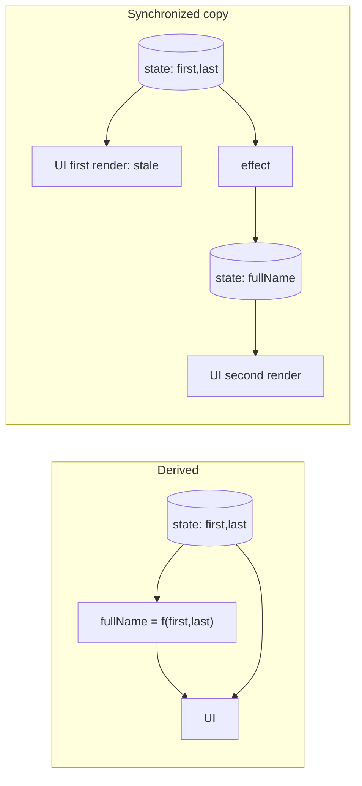

# 03 / 17 — Derived State: Compute It, Don't Store It

## 1. Lesson metadata

| | |
|---|---|
| **Level** | Intermediate |
| **Study time** | 4–5 hours (reading 2 h, experiments 1 h, exercises 1.5 h) |
| **Prerequisites** | [01/03 — UI as a function of state](../01-react-fundamentals/03-ui-as-a-function-of-state.md), [01/14 — State as a snapshot](../01-react-fundamentals/14-state-as-a-snapshot.md), [01/16 — State preservation and reset](../01-react-fundamentals/16-state-preservation-and-reset.md), [01 — `useState`](./01-usestate-internals-and-update-semantics.md), [04 — `useEffect`](./04-useeffect-synchronization.md), [07 — You might not need an effect](./07-you-might-not-need-an-effect.md), [11 — `useMemo` and `useCallback`](./11-usememo-and-usecallback.md) |
| **Next** | [18 — State colocation and lifting](./18-state-colocation-and-lifting.md) |
| **Related** | [03 — `useReducer`](./03-usereducer-and-reducer-architecture.md), [21 — Forms and complex state](./21-forms-and-complex-state.md), [Phase 2/12 — Why rendering must be pure](../02-react-rendering-and-internals/12-why-rendering-must-be-pure.md), [Phase 4/12 — Domain logic vs UI logic](../04-react-architecture/12-domain-logic-vs-ui-logic.md) |

**Learning objectives.** After this lesson you can:
1. Define derived state precisely and apply the *minimal state* principle to any component: given a UI, list the smallest set of state variables from which everything else can be computed.
2. Explain, with a render/commit timeline, why syncing derived values with `useEffect` + `setState` is slower, flickers, and is bug-prone compared with computing during render.
3. Fix the three classic derivation bugs: "copying props into state", "storing an object that is also in a list", and "contradictory boolean flags".
4. Choose among **compute in render**, **`useMemo`**, **`key` reset**, **adjusting state during render**, and **an event handler** for each "state that depends on other state" situation.
5. Recognize the legitimate cases where duplicating data is *correct* (drafts, snapshots, optimistic copies) and name the semantics you intend.
6. Use the render-phase state-adjustment pattern correctly (guarded, same component only) and explain why it terminates.
7. Decide when a derivation is expensive enough to deserve memoization, using measurement.

**Concepts covered:** single source of truth, minimal state, derived value, redundant state, contradictory state, state mirroring, `key` reset, render-phase `setState`, `useMemo` as a performance hint, snapshot vs derived semantics, normalization, selectors.

---

## 2. Deep conceptual explanation

### 2.1 What problem does this lesson solve?

[UI = f(state)](../01-react-fundamentals/03-ui-as-a-function-of-state.md) only holds if the state is **consistent**. Each additional state variable is a place where the application can disagree with itself:

```text
items = [{id:1, done:true}, {id:2, done:false}]
doneCount = 2        ← someone forgot to update it
```

The UI shows two sources of "how many are done" and they differ. This class of bug has a name: **redundant (derived) state out of sync**. It cannot occur if the second value doesn't exist as state — if it is *computed from the first during render*.

> **Principle (React docs: "Choosing the State Structure"):** *Avoid redundant state. If you can calculate some information from the component's props or its existing state variables during rendering, you should not put that information into that component's state.*

### 2.2 Definitions

| Term | Meaning | Example |
|---|---|---|
| **State** | Data that must be remembered across renders and cannot be computed from anything else you already have | `query`, `selectedId`, `items` (if user-edited), `page` |
| **Derived value** | Anything computable from props/state/context by a *pure function* | `visibleItems`, `total`, `isEmpty`, `fullName`, `canSubmit` |
| **Redundant state** | A state variable whose value is always a function of other state | `const [total, setTotal] = useState(…)` where total = Σ items |
| **Contradictory state** | Several variables that can hold impossible combinations | `isLoading && isError`, `isSending && isSent` |
| **Mirrored state** | State initialized from a prop and expected to follow it | `const [name, setName] = useState(props.name)` |
| **Duplicated object state** | The same entity stored in two places | `items` and `selectedItem` (a copy of one of the items) |

### 2.3 The test for "is this state?"

Ask, for each variable, in order (adapted from the React docs' "Thinking in React" / "Choosing the State Structure" checklist):

1. **Does it stay unchanged over time?** → not state (constant; a module variable or prop).
2. **Is it passed from a parent via props?** → not this component's state.
3. **Can you compute it from existing props or state?** → **not state; derive it.**
4. Otherwise → state.

Worked example — a product table with search and "in stock only" filter:

| Candidate | Verdict |
|---|---|
| The original product list | Props / server data (not this component's state) |
| Search text | State (user input; not derivable) |
| "In stock only" checkbox | State |
| The filtered list | **Derived** from list + search + checkbox |
| The number of results | **Derived** from the filtered list |

Result: two state variables. Everything else is `const` inside render.

### 2.4 Why compute in render? (the argument from correctness)

1. **No synchronization code ⇒ no synchronization bugs.** There's no "forgot to update" path.
2. **No intermediate inconsistent render.** With effect-based syncing the component renders once with stale derived data, commits that to the DOM, then re-renders ([§4](#4-step-by-step-execution-walkthrough)). With derivation the first render is already consistent.
3. **Fewer renders.** One render per state change, not two.
4. **It's what render is for.** Rendering is a pure computation from inputs to a UI description ([02/12](../02-react-rendering-and-internals/12-why-rendering-must-be-pure.md)); a derived value is just a smaller piece of the same computation.
5. **Easier testing.** A derivation is a pure function: `selectVisible(items, query)`.

### 2.5 When derivation is *not* what you want

Sometimes a copy is the correct model, because the second value has **independent semantics**:

| Case | Why it's real state, not derived |
|---|---|
| **Draft vs saved** (edit form initialised from server data) | User edits diverge from the source; later source updates shouldn't clobber edits (or should — a product decision). The draft is *its own* state. |
| **Snapshot at a moment in time** | "Price when added to cart" must not change when the catalogue price changes. |
| **Optimistic value** | The UI shows a value the server hasn't confirmed; it's temporary state layered over the source ([Phase 6/05](../06-data-fetching-and-state-ecosystems/05-optimistic-updates.md); React 19 `useOptimistic` — [Lesson 22](./22-modern-hooks-and-apis.md)). |
| **Previous value / history** | Cannot be computed from the current value. |
| **Memory of the last *valid* value** | e.g., last successful response while a refetch is failing. |

The mistake is not copying; it's copying **without deciding the semantics** (does the copy follow the source or not?) and naming it accordingly (`draftName`, `initialName`).

### 2.6 Misconceptions

| Misconception | Reality |
|---|---|
| "Computing in render is slow; I should cache it in state." | Most derivations are microseconds. State is not a cache; `useMemo` is the cache, and only for measured cost. |
| "`useEffect` is how you react to a state change." | For deriving *data*, no: effects are for synchronizing with *external systems* ([Lesson 07](./07-you-might-not-need-an-effect.md)). |
| "`useState(props.x)` keeps in sync with `props.x`." | It only uses `props.x` for the **first render**; subsequent changes are ignored ([01/14](../01-react-fundamentals/14-state-as-a-snapshot.md)). |
| "Setting state during render is illegal." | Setting state of the **same component** during its own render is a documented pattern (guarded); setting *another* component's state during render is a bug/warning. |
| "`useMemo` guarantees the callback won't re-run." | It's a performance hint: React may discard cached values (e.g., in future features, or for offscreen/suspended trees). Correctness must never depend on it. |
| "Derived state means state derived from props only." | Derived from *any* inputs: props, state, context, URL, server cache. |

---

## 3. Internal mechanics

### 3.1 Why a derived const is always consistent

Within a single render, props and state are **fixed snapshots** ([01/14](../01-react-fundamentals/14-state-as-a-snapshot.md)). Any value computed from them in the same function call is consistent with them *by construction*; the next render recomputes from the next snapshot. The correctness argument doesn't depend on React internals — it follows from "a render is a pure function of its inputs" (public contract).

### 3.2 What `setState` in an effect costs

A `setState` call in an effect **schedules another render** after the commit:

```text
state change → render #1 (derived value stale) → commit → (paint?) → passive effect → setState → render #2 → commit
```

*Public guarantee:* effects run after the render that scheduled them has committed; the update scheduled inside is a new render. *Implementation detail:* when the original update came from a discrete event (e.g., click), React may flush passive effects synchronously at the end of the commit, so render #2 can happen before the browser paints; for other update sources (e.g., transitions, network responses) the browser may paint the stale intermediate frame. Never rely on either; **design so that the intermediate frame is not wrong.**

### 3.3 `useMemo` semantics

`useMemo(fn, deps)`:
- On each render, React compares `deps` to the previous deps with `Object.is`; if equal, returns the cached value; otherwise calls `fn` and caches.
- *Public guarantee (React docs):* it's a performance optimization; React **may** throw away the cache (the useMemo reference lists editing the component file in development and a component suspending during its initial mount as cases where it does). Your code must be correct if `fn` re-runs.
- *Strict Mode (dev):* the calculation function runs twice per render to expose impurities ([02/28](../02-react-rendering-and-internals/28-strict-mode-behavior.md)).
- `fn` must be pure (no side effects, no reading mutable globals).

When is it worth using? React's docs suggest measuring: wrap the calculation in `console.time/timeEnd`; if the total time logged is significant (their example: 1 ms or more), memoization may pay off; test with CPU throttling since your dev machine is faster than users' devices.

**React Compiler.** React Compiler 1.0 (stable since 2025-10-07), when adopted, may memoize derived values automatically, reducing the need for manual `useMemo`. It does not change the principle "derive, don't store" (see [Phase 9/08](../09-advanced-rendering-and-ecosystem/08-react-compiler.md) and the compiler docs).

### 3.4 Setting state during render (the "adjust state when a prop changes" pattern)

Documented pattern (React docs: "You Might Not Need an Effect → Adjusting some state when a prop changes"):

```tsx
function List({ items }: { items: Item[] }) {
  const [selection, setSelection] = useState<string | null>(null);
  const [prevItems, setPrevItems] = useState(items);
  if (items !== prevItems) {          // guard: runs only when the prop changed
    setPrevItems(items);
    setSelection(null);
  }
  …
}
```

*Teaching model of what React does:* when a component calls its **own** `setState` during render, React finishes the current invocation of that function, **discards its output**, and immediately re-runs the function with the queued state (before rendering children and before commit; nothing reaches the DOM from the discarded attempt). The guard ensures the second invocation does not set state again, so the loop ends. Without a guard (or with one that never becomes false) React throws **"Too many re-renders"**.

Constraints:
- Only the **same component's** state (setting a parent's or other component's state during render triggers a warning and is a bug).
- The condition must compare against **state** (like `prevItems`), not a ref mutated during render, to remain correct under concurrent rendering.
- It is an escape hatch; prefer **no state at all** (derive) or **`key`** (reset) first.

### 3.5 `key` as a reset mechanism

Changing a component's `key` makes React treat it as a **different instance**: old subtree unmounts (state destroyed), new one mounts with initial state ([01/16](../01-react-fundamentals/16-state-preservation-and-reset.md), [02/07](../02-react-rendering-and-internals/07-identity-keys-and-reconciliation.md)). This is the right tool for "reset *all* of this component's state when entity X changes", with zero synchronization code.

---

## 4. Step-by-step execution walkthrough

Scenario: `fullName` displayed while editing first and last name — implemented the "synchronized state" way vs the derived way.

```tsx
// Version A: redundant state + effect
function ProfileA() {
  const [first, setFirst] = useState("Ada");
  const [last, setLast] = useState("Lovelace");
  const [fullName, setFullName] = useState("Ada Lovelace");     // redundant
  useEffect(() => { setFullName(`${first} ${last}`); }, [first, last]);
  return (
    <>
      <input value={first} onChange={(e) => setFirst(e.target.value)} />
      <input value={last} onChange={(e) => setLast(e.target.value)} />
      <h1>{fullName}</h1>
    </>
  );
}

// Version B: derived
function ProfileB() {
  const [first, setFirst] = useState("Ada");
  const [last, setLast] = useState("Lovelace");
  const fullName = `${first} ${last}`;                            // computed
  …same JSX
}
```

The user types "x" into the first-name input, making `first = "Adax"`.

**Version A timeline**
1. Event: `setFirst("Adax")` queued.
2. **Render #1:** `first="Adax"`, `last="Lovelace"`, `fullName="Ada Lovelace"` (stale). JSX `<h1>Ada Lovelace</h1>`.
3. **Commit #1:** DOM input updated to "Adax"; `<h1>` unchanged. The DOM is **inconsistent**: input and heading disagree.
4. **Passive effect runs:** deps `[first, last]` changed → `setFullName("Adax Lovelace")`.
5. **Render #2:** `fullName="Adax Lovelace"`. **Commit #2:** `<h1>` text updated.
6. Component renders: **2** per keystroke; commits: **2**; one committed-but-inconsistent state. Whether the browser paints between 3 and 5 depends on update source and timing (§3.2).
7. Under StrictMode in dev the render function additionally runs twice per render.
8. An assistive technology or a test that reads the DOM synchronously after the event can observe the stale heading.

**Version B timeline**
1. `setFirst("Adax")` queued.
2. **Render #1:** `fullName = "Adax Lovelace"` computed inline. Commit #1 updates both input and heading.
3. 1 render, 1 commit, never inconsistent. No effect exists to clean up, no deps to get wrong.

**Third scenario: props mirrored into state.**

```tsx
function Avatar({ name }: { name: string }) {
  const [label, setLabel] = useState(name);   // initial value only
  return <span>{label}</span>;
}
// parent re-renders with name="Grace" after first render with "Ada"
```
Render 1: `label = "Ada"`. Parent re-renders with `name="Grace"`: `Avatar` re-renders, `useState(name)` **ignores** the argument (state exists), `label` stays `"Ada"`. The UI shows stale data and no error occurs. The fix is to derive (`const label = name`) or, if `label` is a draft that should reset when the entity changes, `key={entityId}`.

---

## 5. Code examples

### 5.1 Minimal example

```tsx
function Cart({ items }: { items: readonly { id: string; priceCents: number; qty: number }[] }) {
  const totalCents = items.reduce((sum, i) => sum + i.priceCents * i.qty, 0);   // derived
  const isEmpty = items.length === 0;                                            // derived
  return (
    <section>
      {isEmpty ? <p>Your cart is empty</p> : <p>Total: {(totalCents / 100).toFixed(2)}</p>}
    </section>
  );
}
```
**Predict:** how many times does `totalCents` get recomputed when the parent re-renders with the same `items` array?
**Result:** Once per render of `Cart` — i.e., yes, every time `Cart` renders (the parent re-render re-renders `Cart` unless memoized). It's O(n) and trivial for realistic carts.
**Why this is fine:** cost proportional to cart size; no state to keep in sync; correctness over micro-optimization. Add `memo`/`useMemo` only if the Profiler shows this matters.
Money note: integers in minor units (cents) avoid floating-point rounding in sums; format only for display (and use `Intl.NumberFormat` in real code).

### 5.2 Practical examples

**(a) Filter + sort + paginate — all derived, one source of truth.**

```tsx
type SortKey = "name" | "price";
interface Product { id: string; name: string; priceCents: number; inStock: boolean }

const PAGE_SIZE = 20;

export function ProductTable({ products }: { products: readonly Product[] }) {
  const [query, setQuery] = useState("");
  const [inStockOnly, setInStockOnly] = useState(false);
  const [sortKey, setSortKey] = useState<SortKey>("name");
  const [page, setPage] = useState(0);

  const filtered = useMemo(() => {
    const q = query.trim().toLowerCase();
    return products.filter(
      (p) => (!inStockOnly || p.inStock) && p.name.toLowerCase().includes(q),
    );
  }, [products, query, inStockOnly]);

  const sorted = useMemo(
    () => [...filtered].sort((a, b) =>
      sortKey === "name" ? a.name.localeCompare(b.name) : a.priceCents - b.priceCents),
    [filtered, sortKey],
  );

  const pageCount = Math.max(1, Math.ceil(sorted.length / PAGE_SIZE));
  const safePage = Math.min(page, pageCount - 1);                     // derived clamp
  const pageItems = sorted.slice(safePage * PAGE_SIZE, (safePage + 1) * PAGE_SIZE);

  return (
    <>
      <input value={query} onChange={(e) => { setQuery(e.target.value); setPage(0); }} />
      <label>
        <input type="checkbox" checked={inStockOnly}
          onChange={(e) => { setInStockOnly(e.target.checked); setPage(0); }} />
        In stock only
      </label>
      <p>{sorted.length} results</p>
      <Rows items={pageItems} onSort={setSortKey} />
      <Pager page={safePage} pageCount={pageCount} onChange={setPage} />
    </>
  );
}
```
Line notes:
- State: `query`, `inStockOnly`, `sortKey`, `page` (4 variables). Derived: `filtered`, `sorted`, `pageCount`, `safePage`, `pageItems`, result count.
- `safePage` **derives a valid page from a possibly-stale state value**. If `products` shrinks while `page = 5`, `page` is still 5 in state, but the rendered page is clamped; no effect "resets the page when data changes".
- `setPage(0)` inside the handlers is *event-driven reset*: the correct place for "when the user changes the filter, go back to page 0" — a consequence of a **user action**, not a derivation. (If filters could change from several places, a `useReducer` with a `filterChanged` action centralizes it, [Lesson 03](./03-usereducer-and-reducer-architecture.md).)
- `useMemo` is used because `products` may be large (thousands); it's keyed on exactly the inputs. `[...filtered].sort(...)` copies before sorting because `sort` mutates and `filtered` is a memoized value that must not be mutated ([00/08](../00-web-and-javascript-foundations/08-objects-references-immutability.md)).
- `localeCompare` is acceptable for simple sorting; production i18n may need `Intl.Collator` with explicit locale and options.

**(b) Store IDs, not objects.**

```tsx
function Inbox({ messages }: { messages: readonly Message[] }) {
  const [selectedId, setSelectedId] = useState<string | null>(null);
  const selected = messages.find((m) => m.id === selectedId) ?? null;   // derived
  …
}
```
If `messages` updates (e.g., the server marks the message as read), `selected` reflects the new data automatically; if the message disappears, `selected` becomes `null` — no stale copy. With `useState<Message | null>` the copy would hold the *old* object forever.

**(c) Status union instead of boolean flags.**

```ts
type Submit =
  | { status: "idle" }
  | { status: "submitting" }
  | { status: "success"; receiptId: string }
  | { status: "error"; message: string };

const [submit, setSubmit] = useState<Submit>({ status: "idle" });
const canSubmit = submit.status !== "submitting" && formIsValid;     // derived
```
Four values, four mutually exclusive states; `isSubmitting && isSuccess` can't exist. TypeScript narrows `submit.receiptId` only in the `success` branch.

### 5.3 Incorrect examples

**(a) Effect-synchronized derived state** (§4 Version A).

**(b) Mirroring props into state.**

```tsx
function Editor({ initialValue }: { initialValue: string }) {
  const [value, setValue] = useState(initialValue);
  useEffect(() => { setValue(initialValue); }, [initialValue]);   // "keep in sync"
  …
}
```
Problems: (1) extra render with stale value each time `initialValue` changes; (2) **wipes the user's edits** whenever the parent passes a new value, even a re-fetched identical string if it's a new object/array; (3) the name `initialValue` says "initial" but the code treats it as "current" — the contract is muddled.

**(c) Duplicated entity.**

```tsx
const [items, setItems] = useState<Item[]>(initial);
const [selected, setSelected] = useState<Item | null>(null);   // copy
function rename(id: string, name: string) {
  setItems((prev) => prev.map((i) => (i.id === id ? { ...i, name } : i)));
  // forgot: setSelected(...) ⇒ detail panel shows the old name
}
```

**(d) Contradictory booleans.**

```tsx
const [isLoading, setLoading] = useState(false);
const [isError, setError] = useState(false);
// fetch fails: setError(true) but forgot setLoading(false) ⇒ spinner + error message together
```

**(e) Expensive derivation inline in a hot component without measurement, or memoized with an unstable dependency.**

```tsx
const rows = useMemo(() => compute(data, { mode: "fast" }), [data, { mode: "fast" }]);  // dependency literal: new each render ⇒ memo never hits
```

### 5.4 Corrected implementations

**For (b), pick the semantics you actually want:**

```tsx
// 1. The editor is controlled by the parent (single source of truth):
function Editor({ value, onChange }: { value: string; onChange: (v: string) => void }) {
  return <input value={value} onChange={(e) => onChange(e.target.value)} />;
}

// 2. The editor owns a draft; it starts from the entity and resets when the entity changes:
function EditorShell({ entity }: { entity: { id: string; text: string } }) {
  return <Draft key={entity.id} initialText={entity.text} />;     // key resets the draft per entity
}
function Draft({ initialText }: { initialText: string }) {
  const [text, setText] = useState(initialText);                   // name says "initial": honest contract
  return <input value={text} onChange={(e) => setText(e.target.value)} />;
}
```
Semantics 2 means: *later changes to `entity.text` for the same id do NOT overwrite the draft.* If the product requires "follow server updates until the user types", model it explicitly (`const shown = dirty ? draft : serverValue`) — also derived, from `dirty` + the two values.

**Derived "dirty-aware" value (no effect):**

```tsx
function Field({ serverValue }: { serverValue: string }) {
  const [draft, setDraft] = useState<string | null>(null);   // null = untouched
  const value = draft ?? serverValue;                          // derived: follows server until edited
  return (
    <>
      <input value={value} onChange={(e) => setDraft(e.target.value)} />
      <button onClick={() => setDraft(null)} disabled={draft === null}>Reset</button>
    </>
  );
}
```
Here the state is just `draft` (nullable); "which value to show" is derived. Elegant: the "untouched" case needs no copy of the server value.

### 5.5 Advanced example — adjusting state during render, correctly

A paginated list that must reset its *expanded row* when the dataset identity changes, and where `key` is not available because the component is a *part* of a larger stateful component:

```tsx
function Results({ items }: { items: readonly Item[] }) {
  const [expandedId, setExpandedId] = useState<string | null>(null);
  const [prevItems, setPrevItems] = useState(items);

  if (items !== prevItems) {            // compares to STATE, not to a ref
    setPrevItems(items);
    setExpandedId(null);
  }
  …
}
```
**Predict:** how many times is `Results`'s function body executed when the parent passes a new `items` array, and what reaches the DOM?
**Result:** The body runs twice for that render pass (first attempt: sets state, output discarded; second: guard false, output used). Only the second result is committed. (Add one more run in dev for Strict Mode's extra invocation.)
**Why it's safe:** the update is on the component's own state, the guard converges, and nothing is committed from the discarded attempt.
**Cheaper alternative in this example:** because `expandedId` is just an *id*, you can derive validity instead of resetting: `const expanded = items.some(i => i.id === expandedId) ? expandedId : null`. No setState at all. Prefer it whenever the stale state can be *validated* against current data.

### 5.6 Advanced — selectors and normalization for derived data at scale

```ts
// Normalized state: entities by id + ordered ids
interface State {
  byId: Readonly<Record<string, Task>>;
  order: readonly string[];
  filter: "all" | "open" | "done";
}

// Selector functions are pure and testable without React:
export const selectVisibleTasks = (s: State): readonly Task[] =>
  s.order.map((id) => s.byId[id]).filter((t) => s.filter === "all" || (s.filter === "done") === t.done);

export const selectOpenCount = (s: State): number =>
  s.order.reduce((n, id) => n + (s.byId[id].done ? 0 : 1), 0);
```
Used in components as `const visible = useMemo(() => selectVisibleTasks(state), [state])`, or inside store selectors ([Lesson 14 §5.5](./14-context-performance.md)). Benefits: single copy of each task (updates are O(1) by id, no "update it in three arrays"), derivations in one place. Cost: more indirection; for a 10-item list, nested arrays are simpler. Normalization pays off when the same entity appears in multiple views or updates are frequent ([Phase 6/04](../06-data-fetching-and-state-ecosystems/04-api-normalization.md)).

---

## 6. Visual explanations

### 6.1 Single source of truth vs synchronized copies



### 6.2 Render/commit timeline comparison

```text
Derived:      event ─▶ render ─▶ commit
Effect-sync:  event ─▶ render(stale) ─▶ commit ─▶ effect ─▶ render ─▶ commit
                                         ▲ inconsistent DOM here
```

### 6.3 "Which tool?" for state that depends on other state

```mermaid
flowchart TD
  A["Value depends on props/state"] --> B{Computable by a pure function now?}
  B -- yes --> C{Expensive (measured)?}
  C -- no --> D[const x = f(...)]
  C -- yes --> E[useMemo / selector]
  B -- no --> F{Must ALL state reset when an entity changes?}
  F -- yes --> G[key on the component]
  F -- no --> H{Only a slice must reset / be validated?}
  H -- validate against data --> I[derive validity: no setState]
  H -- reset a slice --> J[adjust state during render, guarded]
  H -- caused by a user action --> K[do it in the event handler / reducer]
  F -- no, external system --> L[useEffect (synchronization)]
```

### 6.4 Redundant vs minimal state for a table

```text
Redundant:  products, filtered, sorted, pageItems, count, query, page   (7 state vars → 5 sync points)
Minimal:    query, inStockOnly, sortKey, page                           (4 state vars; products from props)
```

---

## 7. Alternative approaches and trade-offs

For "a value that depends on other values":

| Approach | Consistency | Renders per change | Complexity | Best when |
|---|---|---|---|---|
| **Compute in render** | Always consistent | 1 | Lowest | Default; cheap derivations |
| **`useMemo`** | Consistent | 1 | Low (deps discipline) | Measured expensive derivations; stable identity for downstream `memo` |
| **Selector (pure function) + memo** | Consistent | 1 | Medium | Shared derivations; stores; tested logic |
| **`key` reset** | Consistent (fresh instance) | 1 (+ mount cost) | Low | Reset *all* local state on entity change |
| **Adjust state during render** | Consistent | 1 committed (2 invocations) | Medium (guard discipline) | Reset a *slice* when an input changed and you can't derive validity |
| **Event handler updates both** | Consistent if all paths covered | 1 | Medium (every writer must update both) | Genuine user-action chains (reset page on filter change) |
| **`useEffect` + `setState`** | Transiently inconsistent | 2 | Medium–High | **Not for derived data.** For external-system sync only |
| **`useReducer` that maintains an invariant** | Consistent if the reducer enforces it | 1 | Medium | Several fields must change together atomically |
| **External store with computed selectors** | Consistent | 1 per subscriber change | Medium–High | Cross-tree derived data ([Lesson 20](./20-usesyncexternalstore-and-external-stores.md)) |

**When the recommended approach (compute in render) is NOT best:**
1. **Truly expensive derivations** (e.g., 100k-row aggregation, layout computation): compute once, memoize, move to a worker, or compute on the server; per-render recomputation on every keystroke is the problem ([Phase 7/10](../07-performance/10-expensive-computations.md)).
2. **Independent-lifetime copies** (drafts, snapshots, optimistic values — §2.5).
3. **Derivations whose result must keep identity for reasons beyond performance** (e.g., passing to a library that does identity-based diffing). Memoize for identity, with the awareness that `useMemo` may recompute.
4. **Values that depend on time** (`Date.now()`): "derived from now" isn't pure; model time as state/external store and derive from it, or compute at event time.
5. **When derivation requires side effects** (writing to storage, analytics): that is an effect/event, not derived state.

---

## 8. Best practices and anti-patterns

**Do**
- Start every component by listing minimal state; derive the rest inline.
- Store **identifiers** and **primitive inputs**, derive objects and counts.
- Model mutually exclusive situations with a **discriminated union** or a `status` field.
- Name copy-semantics state honestly: `initialX` (starts from, then diverges), `draftX`, `savedX`, `snapshotX`.
- Prefer `key` to reset a whole subtree's state; prefer deriving validity to resetting a slice; prefer event handlers for user-action-caused resets.
- Extract derivations as pure functions (`selectX`) and unit-test them.
- Measure before memoizing; include a dependency array that contains exactly the inputs.

**Beginner mistakes**
- `useEffect(() => setX(f(y)), [y])`.
- `useState(props.value)` expecting updates.
- Storing a filtered list in state.
- Two booleans for one status.

**Experienced-developer mistakes**
- Over-memoizing cheap derivations, creating dependency bugs worse than the cost saved.
- Using `useMemo` for *semantics* (e.g., "run this only once") — it's a hint.
- Reaching for "adjusting state during render" when `key` or deriving would do.
- Resetting state in effects after navigation instead of keying by route params.
- Duplicating server data into local state "to avoid refetch", re-implementing a cache badly ([Phase 6/07](../06-data-fetching-and-state-ecosystems/07-server-state-management.md)).

**Smells:** a `useEffect` whose only content is `setSomething(...)`; state variables named with `filtered*`, `computed*`, `current*Total`; two state variables always set together in the same handler (candidate for one object or a reducer); a ref mirroring a prop "for the latest value" outside event callbacks.

**Justified exceptions:** a memoized derived value held in `useState` via lazy initializer when the derivation is an *initial value* by design (`useState(() => parse(raw))`); denormalized copies in a state container for performance with an explicit invariants test; `useEffect` to compute asynchronously (e.g., results from a worker) — then it's synchronization with an async source and needs loading/stale handling.

---

## 9. Real-world application

**(a) E-commerce cart.** State: `items` (id, sku, qty, unit price snapshot). Derived: subtotal, discount (from rules), tax, shipping, total, "free shipping progress". Constraint: totals must never disagree with line items; *prices at time of adding* are snapshots (intentional copies) while the discount is recomputed from rules; the server recomputes authoritative totals on checkout. Test the pure `calculateTotals(items, rules)` with property-based or table-driven tests.

**(b) Data grid in a finance dashboard.** State: sort model, filter model, column visibility, selection (ids), scroll position. Derived: visible rows, aggregates, "all selected" checkbox state (`checked`/`indeterminate` from selected ids vs visible ids). Constraint: 50k rows ⇒ derivations are expensive; use memoized selectors keyed on the *minimal inputs*, consider server-side filtering/virtualization ([Phase 7/08–09](../07-performance/09-windowing-and-virtualization.md)).

**(c) Multi-step form.** State: field values and `touched` set. Derived: `errors = validate(values)`, `isValid`, `canGoNext`, which steps are complete. Storing `errors` in state yields "stale error after fixing the field" bugs. Constraint: async validation (uniqueness) *is* external — track as `{status, forValue}` state and derive "is the result for the current value?" to avoid showing a stale result ([Lesson 21](./21-forms-and-complex-state.md)).

**(d) Auth/permissions.** State: `user` (or `null`). Derived: `can("invoice.approve")`, `isAdmin`. Constraint: derive in one hook (`usePermissions()`); never store `isAdmin` separately from the role list; real enforcement is server-side.

**(e) Realtime presence.** State: map of `userId → lastSeenTimestamp`. Derived: `online` status (needs "now") — a time-dependent derivation: keep a coarse ticking `now` state (updated each 30 s) and derive online status from it, avoiding per-user timers and avoiding impure `Date.now()` reads in render.

---

## 10. Debugging and troubleshooting

**Symptom 1: "The UI shows an old value after props changed."**
Investigation: search the component for `useState(props.…)`; in React DevTools → Components, compare the prop (new) and the hook state (old). Root cause: mirrored state. Fix: derive, control, or `key`. Validate: change the prop from the parent; the child output updates; edit-then-prop-change behavior matches the intended semantics.

**Symptom 2: "A flash of stale/wrong content for one frame after an interaction."**
Investigation: React DevTools Profiler shows **two commits** for one interaction; the first is the stale one. Look for an effect that calls `setState` with a value computable from current state. Fix: derive. Validate: one commit per interaction.

**Symptom 3: "Too many re-renders" after adding a state adjustment in render.**
Cause: guard never becomes false (e.g., `if (items.length !== prev.length)` where prev updated incorrectly, or comparing a fresh array each render: `items.filter(...) !== prevFiltered`). Fix: compare stable inputs; ensure `setPrev` stores the same value that the guard compares; prefer deriving.

**Symptom 4: "Selected item shows old data / doesn't disappear when deleted."**
Cause: duplicated object state. Fix: store `selectedId` and derive.

**Symptom 5: "Spinner and error visible together."**
Cause: contradictory flags. Fix: status union; TypeScript exhaustiveness.

**Symptom 6: "`useMemo` doesn't help; component still slow."**
Investigation: Profiler → check *why* it renders and whether the memo is recomputing (log inside the memo function). Common causes: unstable dependency (new object/array each render), or the expensive part isn't the derivation (it's rendering 5,000 rows). Fix: stabilize inputs; virtualize; measure with throttling.

**Symptom 7: A test passes in isolation but derived value is wrong in app.**
Cause: derivation reads a mutable source (`Date.now()`, a module variable) — an impure derivation. Fix: pass the input explicitly or model it as state.

---

## 11. Exercises

### Level A — Knowledge
A1. List the questions that decide whether a value should be state.
A2. Why does `useState(props.x)` not follow `props.x`?
A3. Name three situations where duplicating data into state is correct, and the naming convention that makes the intent clear.
A4. Why is `useMemo` a performance hint rather than a semantic guarantee?
A5. What prevents "Too many re-renders" when setting state during render?

### Level B — Code comprehension
B1. Identify all redundant state and rewrite the state declarations:
```tsx
const [todos, setTodos] = useState<Todo[]>([]);
const [doneTodos, setDoneTodos] = useState<Todo[]>([]);
const [doneCount, setDoneCount] = useState(0);
const [filter, setFilter] = useState<"all" | "done">("all");
const [visible, setVisible] = useState<Todo[]>([]);
```
B2. How many renders and commits occur after clicking "+1"? Draw the timeline.
```tsx
function C() {
  const [n, setN] = useState(0);
  const [double, setDouble] = useState(0);
  useEffect(() => { setDouble(n * 2); }, [n]);
  return <button onClick={() => setN(n + 1)}>{n} / {double}</button>;
}
```
B3. What does the following render after the parent changes `user` from `{id:1,name:"A"}` to `{id:1,name:"B"}` (same id)? What if `key={user.id}` is added to `<Form user={user} />`?
```tsx
function Form({ user }: { user: User }) {
  const [name, setName] = useState(user.name);
  return <input value={name} onChange={(e) => setName(e.target.value)} />;
}
```
B4. In §5.2(a), the user is on page 4 (index 3), then types a search term. What are the values of `page`, `safePage` immediately after `setQuery` *without* the `setPage(0)` call, if the filtered list has 25 items?

### Level C — Implementation
C1. Implement a `useDerivedDraft` hook or component pattern that shows the server value until the user edits, supports "reset", and warns visually when the server value changed after the user started editing.
C2. Convert this effect-based code to derived state:
```tsx
const [results, setResults] = useState<Item[]>([]);
useEffect(() => { setResults(items.filter((i) => i.name.includes(q))); }, [items, q]);
```
C3. Write the status union and `canSubmit` for a form with states idle, validating, submitting, success, error — and a reducer that cannot reach an invalid combination.
C4. Write a pure `selectCartSummary(items, couponCode)` returning subtotal, discount, shipping, total in cents, plus 4 test cases including empty cart and rounding.

### Level D — Debugging
D1. "Our detail panel shows the old title after renaming in the list." Find the root cause in this snippet and propose two fixes:
```tsx
const [selected, setSelected] = useState<Doc | null>(null);
<List docs={docs} onSelect={setSelected} />
<Detail doc={selected} />
```
D2. A "reset page to 1 when filters change" feature is implemented with an effect. Users report a flash of an empty page when filtering from page 5. Explain exactly why and fix it two ways.
D3. After adding adjust-state-during-render code, the console shows "Too many re-renders". Diagnose:
```tsx
const [prev, setPrev] = useState(items);
if (items.filter(isActive) !== prev) { setPrev(items.filter(isActive)); }
```

### Level E — Architecture and engineering decisions
E1. A teammate wants to store a computed `visibleRows` array in global state "for performance". Evaluate and give a decision procedure for where derivations should live (component, hook, selector, store, server).
E2. When should an edit form's draft follow the server value vs ignore subsequent server updates? Provide a decision framework with at least four criteria and implementation sketches for each outcome.

### Level F — Expert challenge
F1. Explain why "adjusting state during render" is safe under concurrent rendering while mutating a ref during render is not. Include what React does with a discarded render and how the guard ensures termination.
F2. Design a time-dependent derivation (e.g., "online if lastSeen within 60 s") without calling `Date.now()` in render. Discuss correctness, SSR hydration, tests, and update frequency trade-offs.

---

## 12. Detailed answers and explanations

> Attempt the exercises first.

**A1.** (1) Does it stay constant? ⇒ not state. (2) Is it passed via props? ⇒ not (this component's) state. (3) Can it be computed from other props/state? ⇒ derive. (4) Else state. Wrong approach: deciding by "I need it in several places" — that's a reason to derive in a hook/selector, not to store.

**A2.** The argument to `useState` is used only during the first render of that instance. Later renders return the stored value regardless of the argument ([01/14](../01-react-fundamentals/14-state-as-a-snapshot.md)); this is by design, so state can diverge from the prop (a draft).

**A3.** (1) Drafts/edits that diverge from the source; (2) snapshots at a point in time (price at purchase); (3) optimistic/pending values; (4) history/previous values. Convention: `initialX`, `draftX`, `snapshotX`, `pendingX`, `prevX`. The naming documents semantics so readers don't assume it tracks the source.

**A4.** React may discard cached memo values (documented; e.g., during development/Strict Mode, offscreen trees, potential future features). Code relying on "runs exactly once" will break. Also under Strict Mode in dev the function runs twice.

**A5.** The guard condition: after the first invocation sets state to match the input, the second invocation finds the condition false and doesn't call `setState`; React limits repeated render-phase updates and throws "Too many re-renders" when they don't converge.

**B1.** Only `todos` and `filter` are state. `doneTodos`, `doneCount`, `visible` are derived: 
```tsx
const [todos, setTodos] = useState<Todo[]>([]);
const [filter, setFilter] = useState<"all" | "done">("all");
const doneTodos = todos.filter((t) => t.done);
const doneCount = doneTodos.length;
const visible = filter === "all" ? todos : doneTodos;
```
Eliminated: three sync points. Wrong answer: keeping `visible` "so we don't filter twice" — a cost of microseconds.

**B2.** Click: render #1 (`n=1`, `double=0` stale) → commit #1 (`1 / 0`) → effect → `setDouble(2)` → render #2 (`1 / 2`) → commit #2. Two renders, two commits, an inconsistent intermediate UI state (`1 / 0`) — which a user may or may not see depending on timing. Derived: `const double = n * 2;` one render.

**B3.** Without key: `name` stays `"A"` (initial value only) — the input shows `"A"` although `user.name` is `"B"`. With `key={user.id}`: the `id` is the same (1), so the key doesn't change ⇒ **no reset**; still `"A"`. A key by `id` resets on *entity* change, not on field changes. If the intended semantics are "follow server until edited", use the `draft ?? serverValue` pattern; if "reset when the record is reloaded", use a key containing a version/`updatedAt` — a deliberate decision.

**B4.** `page = 3` (state unchanged), `pageCount = ceil(25/20) = 2`, `safePage = min(3, 1) = 1` ⇒ the table silently shows page 2 of 2 (not the first page) and the pager's page-1-of-2 shows 2. The clamp prevents an empty page but isn't the same as resetting to page 0; "go to the first page on filter change" is a user-intent reset belonging in the handler (`setPage(0)`).

**C1. Solution**
```tsx
function useServerDraft(serverValue: string) {
  const [draft, setDraft] = useState<{ base: string; value: string } | null>(null);
  const value = draft ? draft.value : serverValue;
  const isDirty = draft !== null;
  const serverChangedSinceEdit = draft !== null && draft.base !== serverValue;   // derived
  return {
    value,
    isDirty,
    serverChangedSinceEdit,
    edit: (next: string) => setDraft((d) => ({ base: d ? d.base : serverValue, value: next })),
    reset: () => setDraft(null),
  } as const;
}
```
Reasoning: the draft remembers the **base** it started from; "server changed" is derived by comparing base to the current server value; no effects. Edge: `edit` closes over `serverValue` at call time; functional update ensures the base is captured only once. Evaluation criteria: no effect; derived flags; reset path; honest naming.

**C2.** `const results = useMemo(() => items.filter((i) => i.name.includes(q)), [items, q]);` or plain `const results = items.filter(...)`. Reason: removes the intermediate render and the `[]` initial state mismatch (first render had empty results even though `items` was available).

**C3. Solution**
```ts
type FormState =
  | { status: "idle" }
  | { status: "validating" }
  | { status: "submitting" }
  | { status: "success"; receiptId: string }
  | { status: "error"; message: string };

type Action =
  | { type: "validate" } | { type: "submit" }
  | { type: "succeeded"; receiptId: string } | { type: "failed"; message: string }
  | { type: "reset" };

function reducer(s: FormState, a: Action): FormState {
  switch (a.type) {
    case "validate": return s.status === "idle" || s.status === "error" ? { status: "validating" } : s;
    case "submit": return s.status === "validating" ? { status: "submitting" } : s;
    case "succeeded": return s.status === "submitting" ? { status: "success", receiptId: a.receiptId } : s;
    case "failed": return s.status === "submitting" || s.status === "validating" ? { status: "error", message: a.message } : s;
    case "reset": return { status: "idle" };
  }
}
const canSubmit = (s: FormState, valid: boolean) => valid && (s.status === "idle" || s.status === "error");
```
Notes: transitions guard against impossible sequences; returning `s` on an illegal transition keeps identity (no re-render). Evaluation: exhaustive switch, derived `canSubmit`.

**C4. Sample solution and tests**
```ts
interface Line { unitCents: number; qty: number }
export function selectCartSummary(items: readonly Line[], coupon: string | null) {
  const subtotal = items.reduce((s, i) => s + i.unitCents * i.qty, 0);
  const discount = coupon === "SAVE10" ? Math.round(subtotal * 0.10) : 0;
  const shipping = subtotal - discount >= 5000 || subtotal === 0 ? 0 : 499;
  return { subtotal, discount, shipping, total: subtotal - discount + shipping } as const;
}
// tests: empty cart → all 0; 1×999 → shipping 499, total 1498; 6000 with SAVE10 → discount 600, shipping 0, total 5400;
// rounding: subtotal 1005, SAVE10 → discount Math.round(100.5)=101 (document rounding rule!)
```
Evaluation: integer arithmetic, explicit rounding rule, pure, covers edges. The server remains authoritative.

**D1.** `selected` is a **copy** of the doc object from when it was clicked; renaming updates `docs` but not `selected`. Fixes: (1) store `selectedId` and `const selected = docs.find(...) ?? null`; (2) lift/derive via a selector. A "fix" that adds an effect to re-sync `selected` from `docs` reintroduces redundant state.

**D2.** Render #1 (new filter, `page=4` stale, fewer results ⇒ out-of-range page ⇒ empty list) → commit (empty page) → effect `setPage(0)` → render #2. The empty page is a real committed frame; whether it paints depends on timing but it can. Fixes: (1) reset in the same event handler (`setFilter(x); setPage(0);` batched into one render, [01/15 — update queues and batching](../01-react-fundamentals/15-update-queues-and-batching.md)); (2) derive a clamped `safePage` (no reset needed), or combine filter and page in a reducer where `filterChanged` resets the page.

**D3.** `items.filter(isActive)` returns a **new array every call**, so `!== prev` is always true ⇒ guard never becomes false ⇒ infinite render-phase updates ⇒ "Too many re-renders". Fix: compare the stable input (`items`), or compute `activeItems = useMemo(() => items.filter(isActive), [items])` and compare that; best of all, avoid state if only derived values are needed.

**E1.** Decision procedure: (1) derived from one component's state → inline/`useMemo` there; (2) used by several components under one parent → compute in the parent or a hook and pass down, or a selector; (3) shared across the tree with frequent updates → store with memoized selectors (computed in selector, not stored); (4) heavy/data-dependent → server-side or worker. Storing `visibleRows` globally creates two sources of truth plus invalidation code; its "performance" claim must be measured, and a memoized selector achieves the same caching without the invalidation bug surface. Also mention SSR/hydration and debugging snapshots.

**E2.** Criteria: collaborative editing (others change the record), cost of overwriting user edits, concurrency control (ETags/versions), form length (long edits are costly to lose), auditability, UX conventions (banner "This record changed — reload?"). Outcomes: *Ignore server updates after editing begins* ⇒ draft state + `key` or `initial` semantics; *Follow server until dirty* ⇒ `draft ?? server` (C1); *Merge field-wise* ⇒ store per-field dirty flags and derive each field's value; *Conflict detection* ⇒ keep `base` and show conflict UI when `base !== server`. Choose by data-loss risk and product expectations.

**F1.** A discarded render attempt in the render-phase-update pattern never reaches commit and never persists anything outside React's own state queue for *that component*: React re-runs the function with the updated state; the only observable outputs are the committed ones, and React's own state/update queue is designed to handle this. Mutating a ref in render, by contrast, writes to an object that survives the discarded render and is visible to event handlers/effects of *committed* output — so a render that is later abandoned (interrupted by an urgent update, suspended, or Strict Mode's repeated invocation) leaves observable mutations from a render that "never happened". The guard guarantees termination because the condition depends on state that the first pass updates; React also bounds the loop and throws on too many consecutive render-phase updates.

**F2.** Options: (1) Store `now` as state updated by an interval (coarse granularity: 15–30 s), derive `online = now - lastSeen < 60_000`; render stays pure given `now`. (2) A shared external clock store with `useSyncExternalStore` (one timer for all components). (3) Compute at event time (when a message arrives) and store a boolean — loses time-based expiry. Discussion: SSR—render `now` from the server request time and avoid hydration mismatch by initializing `now` from a server-provided timestamp or rendering a neutral state until mounted; tests—inject the clock (fake timers or pass `now`); update frequency vs accuracy: one timer ticking every second re-renders all consumers each second (consider the shared store with a selector so only components whose derived boolean flips re-render — `useSyncExternalStore` with a selector returning the boolean). Correctness: derive the boolean from `now` and `lastSeen`, never store it.

---

## 13. Senior engineer interview questions

**Q1. "Why shouldn't you sync derived values with `useEffect`?"**
*Strong answer:* It adds a render and a commit with an inconsistent intermediate UI, introduces a synchronization path that must be kept correct, and is conceptually wrong — effects synchronize with external systems, while derived data is just a function of render inputs. Compute in render (memoize only if measured), and use `key`/event handlers for resets. Mention the exception: async derivation from an external source needs loading/stale modelling.

**Q2. "A child component copies a prop into state. When is that right and when is it a bug?"**
*Strong answer:* Right when the state is a draft/initial value and diverging from the source is intended; name it `initialX`, reset by `key` when the entity changes. A bug when the child is expected to show the *current* prop: state ignores later prop changes. Fix by deriving or making it controlled. The decision hinges on the intended semantics, which the code should communicate.

**Q3. "What is the 'adjust state during render' pattern and why does it work?"**
*Strong answer:* A component sets its own state during render under a guard comparing a stored previous value; React discards that pass and immediately re-renders with the new state before children/commit, so no inconsistent UI is committed and no extra paint. It terminates because the guard flips. It's an escape hatch: prefer deriving or `key`. Only for own state; comparing with refs is unsafe.

**Q4. "How do you decide whether to memoize a derived value?"**
*Strong answer:* Measure: Profiler/`console.time` with CPU throttling; memoize if the computation or downstream re-renders are significant (≈ ≥ 1 ms as a docs heuristic) or if identity matters for `memo` children/effect deps. Keep dependencies exact; treat it as a hint. With the React Compiler it may be automatic—verify.

**Q5. "Should derived values live in Redux/global state?"**
*Strong answer:* No — keep normalized source data in the store and derive via memoized selectors, so there is one source of truth and no invalidation logic; store derived only when it's expensive and you have a tested invalidation strategy, or when it has independent semantics (snapshots).

**Q6. "Explain contradictory state and how types help."**
*Strong answer:* Multiple flags permit impossible combinations; a discriminated union restricts states to valid ones and lets TypeScript narrow; reducers with guarded transitions prevent illegal sequences; derive booleans (`isLoading = status === "loading"`) rather than storing them.

---

## 14. Further learning resources

| Resource | URL | Covers / why | Level | Study |
|---|---|---|---|---|
| React docs — Choosing the State Structure | <https://react.dev/learn/choosing-the-state-structure> | Principles: group, avoid contradictions, avoid redundancy, avoid duplication, avoid deeply nested state | Beginner–Int. | Whole page |
| React docs — You Might Not Need an Effect | <https://react.dev/learn/you-might-not-need-an-effect> | Calculating during render; resetting/adjusting state without effects; `useMemo` guidance | Intermediate | "Updating state based on props or state", "Resetting all state when a prop changes", "Adjusting some state when a prop changes" |
| React docs — Preserving and Resetting State | <https://react.dev/learn/preserving-and-resetting-state> | `key` as a reset mechanism | Intermediate | "Resetting state at the same position" |
| React docs — Thinking in React | <https://react.dev/learn/thinking-in-react> | The minimal-state exercise | Beginner | Step 3 |
| React docs — `useMemo` | <https://react.dev/reference/react/useMemo> | Caching semantics, how to tell if a calculation is expensive, Strict Mode double calls | Intermediate | Caveats, "How to tell if a calculation is expensive" |
| React docs — `useState` | <https://react.dev/reference/react/useState> | "Storing information from previous renders", "Resetting state with a key" | Intermediate | Those sections |
| TypeScript Handbook — Narrowing / discriminated unions | <https://www.typescriptlang.org/docs/handbook/2/narrowing.html> | Status unions and exhaustiveness | Intermediate | "Discriminated unions" |
| React Compiler docs | <https://react.dev/learn/react-compiler/introduction> | Automatic memoization; check current status before relying | Intermediate | Overview |

---

## 15. Knowledge checkpoint

**You should now understand**
- Minimal state: state is what cannot be computed; everything else is `const` in render.
- Why effect-synchronized derived state produces extra renders and transient inconsistency.
- Mirrored props, duplicated entities and contradictory flags as the three canonical redundancy bugs.
- The decision ladder: derive → memoize (measured) → `key` → guarded render-phase adjustment → event handler → effect (external systems only).
- When copies are correct (drafts, snapshots, optimistic values) and how to name/model them.

**You should be able to explain without notes**
- Why `useState(prop)` doesn't follow the prop.
- Why storing `selectedId` beats storing `selectedItem`.
- How the guard makes render-phase `setState` terminate.

**You should be able to implement**
- Filter/sort/paginate with minimal state; `draft ?? server`; status unions with guarded reducers; pure selectors with tests.

**You should be able to debug**
- Two-commit interactions in the Profiler; stale mirrored state; "Too many re-renders" from non-converging guards.

**Before moving on:** read [18 — State colocation and lifting](./18-state-colocation-and-lifting.md), which answers the next question: given minimal state, *where* should each variable live?
