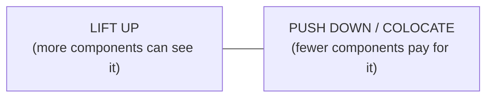
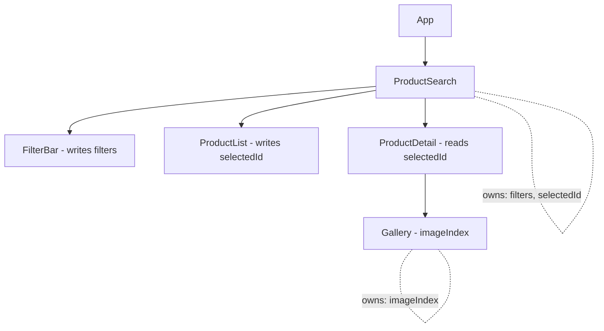
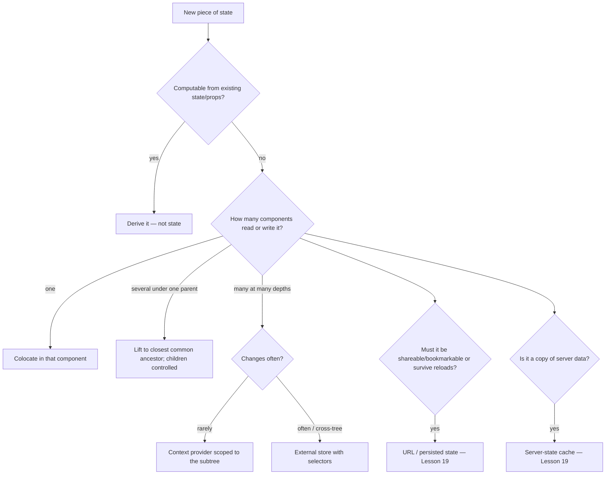

# 03 / 18 — State Colocation and Lifting State Up

## 1. Lesson metadata

| | |
|---|---|
| **Level** | Intermediate → Advanced |
| **Study time** | 5 hours (reading 2 h, experiments 1 h, exercises 2 h) |
| **Prerequisites** | [01/06 — Props and one-way data flow](../01-react-fundamentals/06-props-and-one-way-data-flow.md), [01/07 — Composition and `children`](../01-react-fundamentals/07-composition-and-children.md), [01/11 — Controlled and uncontrolled inputs](../01-react-fundamentals/11-controlled-and-uncontrolled-inputs.md), [01/16 — State preservation and reset](../01-react-fundamentals/16-state-preservation-and-reset.md), [02/01 — What triggers a render](../02-react-rendering-and-internals/01-what-triggers-a-render.md), [13 — `useContext` and propagation](./13-usecontext-and-propagation.md), [14 — Context performance](./14-context-performance.md), [17 — Derived state](./17-derived-state.md) |
| **Next** | [19 — UI, server, URL, and shared state](./19-ui-server-url-and-shared-state.md) |
| **Related** | [03 — `useReducer`](./03-usereducer-and-reducer-architecture.md), [12 — `React.memo`](./12-react-memo.md), [Phase 4/15 — State ownership](../04-react-architecture/15-state-ownership.md), [Phase 7/07 — State colocation for performance](../07-performance/07-state-colocation-for-perf.md), [Project 2 — Task manager](../projects/) |

**Learning objectives.** After this lesson you can:
1. State where a piece of state *should* live, using a rule that is derived from first principles (readers, writers, lifetime, update frequency) rather than habit.
2. Lift state to the closest common ancestor and wire it with props and callbacks, producing correctly *controlled* children.
3. Colocate state: move it down to the smallest subtree that needs it, and explain the consequences for re-render scope, code deletion, and reset behavior.
4. Apply the two composition techniques that make colocation possible in awkward trees: *move state down* and *lift content up* (`children`/slots).
5. Choose between lifting, composition, context, a store, and URL state for sharing, with explicit trade-offs.
6. Predict the render set of a state change from the owner's position in the tree.
7. Diagnose state that is too high (laggy, over-rendering), too low (out-of-sync, lost on unmount), or duplicated.

**Concepts covered:** state ownership, single source of truth, closest common ancestor, inverse data flow, controlled components, colocation, re-render scope, prop drilling, slots/children composition, state lifetime, persistence across unmount, derived vs owned data.

---

## 2. Deep conceptual explanation

### 2.1 The question

Phase 1 taught you how to declare state. Lessons 13–17 gave you tools for moving values through the tree (context), reusing logic (custom hooks), and not storing what you can compute. One question remains for every `useState` you write:

> **In which component should this state live?**

The answer is never arbitrary, because *the owner's position determines three things*:

1. **Who can read and write it** — only the owner and its descendants (via props/context). Components outside the owner's subtree cannot access it without something above them.
2. **What re-renders when it changes** — the owner and, by default, every descendant that is not bailed out ([02/01](../02-react-rendering-and-internals/01-what-triggers-a-render.md)).
3. **How long it lives** — until the owner unmounts, or until its identity/position changes ([01/16](../01-react-fundamentals/16-state-preservation-and-reset.md)).

Position = visibility + render cost + lifetime. State design is the management of those three.

### 2.2 Two opposing forces



| Force | Pulls state | Reason |
|---|---|---|
| **Sharing / consistency** | **Up** to a common ancestor | If two components must agree, they must read the same single value; the only way in React's one-way data flow is a common parent. |
| **Locality / cost** | **Down** toward the one component that uses it | A state change re-renders the owner's subtree; the lower the owner, the smaller the subtree. Also: easier to understand, delete, test, and reset. |

The correct position is the **lowest point that still satisfies the sharing requirement**: the *closest common ancestor* of every component that reads or writes the state. Not higher (needless cost and coupling), not lower (impossible to share).

### 2.3 Lifting state up: why it works

React data flows **down** (props). A child cannot write into its parent's variables. Two siblings cannot see each other's state. If A and B must agree:

1. Remove the state from A and B.
2. Put it in their closest common parent P.
3. P passes the **value** down via props, and passes **callbacks** (`onChange`) down so children can *request* changes.

This is called **inverse data flow** (data down, events up). Afterwards, A and B are **controlled components**: their behavior is determined entirely by props ([01/11](../01-react-fundamentals/11-controlled-and-uncontrolled-inputs.md)). They have become *pure functions of props*, which makes them easier to test and reuse, at the price that every consumer must now supply the state.

### 2.4 Colocation: why it matters

**Colocation** = keep state as close as possible to where it's used. Benefits:

| Benefit | Mechanism |
|---|---|
| **Fewer re-renders** | State change re-renders only the owner's subtree. A text input's state inside the input component re-renders the input, not the page. |
| **Local reasoning** | Reader sees state, handlers and UI together; no hunting through parents. |
| **Safe deletion** | Delete the component, its state disappears with it; no orphaned state in a distant ancestor. |
| **Natural reset** | Unmounting resets state; `key` resets state for entity changes ([01/16](../01-react-fundamentals/16-state-preservation-and-reset.md)). |
| **Lower coupling** | Parents don't know about child-internal details (is a dropdown open? which row is hovered?). |
| **Better code-splitting** | State and its logic ride with the component's chunk. |

Colocation is not a performance trick that appears only in Phase 7. It's a *modeling* principle, and the performance benefit follows from it ([Phase 7/07](../07-performance/07-state-colocation-for-perf.md)).

### 2.5 "State too high" and "state too low" — the two failure modes

| Failure | Symptoms | Typical cause |
|---|---|---|
| **Too high** | Typing/hovering is laggy; Profiler shows large subtrees re-rendering for tiny changes; parents full of unrelated state; prop-drilling of rarely-used props | "Just in case" lifting; global stores for local UI state; app-level `useState` for a modal's open flag |
| **Too low** | Two components disagree; state lost when a component unmounts (tab switch, conditional render, route change); duplicated fetches; "why did my draft vanish?" | Siblings each keep their own copy; state inside something that gets unmounted but must persist |
| **Duplicated** | Out-of-sync copies; update in one place doesn't show in another | Same entity held in two states ([Lesson 17](./17-derived-state.md)) |

### 2.6 The ownership questions

For each state variable ask, in order:

1. **Who reads it?** (list the components)
2. **Who writes it?** (list the components/events)
3. **Closest common ancestor of all of them?** That's the *minimum* height.
4. **Should it outlive that ancestor's unmounting?** If yes, it must live higher or outside React (URL, store, server).
5. **How often does it change, and how large is the subtree below the owner?** If a hot state sits above a large subtree, restructure (move down / lift content up) before reaching for memoization.
6. **Can it be derived** from something already owned? ([Lesson 17](./17-derived-state.md)) If so, it isn't a new piece of state.

### 2.7 Misconceptions

| Misconception | Reality |
|---|---|
| "Put state at the top so it's always available." | Availability is bought with re-render scope and coupling. Lift only as far as needed. |
| "Global state is for state shared by *many* components." | Context/stores are for state with **wide readership or lifetime beyond a subtree**. A modal's open flag used by one button and one modal is *local* state. |
| "Lifting means all state ends up in `App`." | Lift only to the *closest common ancestor*; that is usually a feature component, not the root. |
| "Prop drilling is always bad." | Drilling 1–3 levels is explicit, searchable and cheap. Fix it with composition first, context second, store third ([§7](#7-alternative-approaches-and-trade-offs)). |
| "Colocation means each component must have its own state." | It means state lives in the *lowest sufficient* component. Controlled children with parent-owned state are fine when sharing is required. |
| "State in a parent keeps children in sync automatically." | Only if children *read from props*. A child that copies props into its own state is no longer synchronized ([Lesson 17](./17-derived-state.md)). |

---

## 3. Internal mechanics

### 3.1 What a state update re-renders

*Public guarantee:* calling a state setter schedules a re-render of the component that **owns** that state. When a component renders, React by default re-renders its children (calls their functions), recursively, unless a child's props are identical *and* it is wrapped in `memo`, or the child element is the same reference as in the previous render (a bailout) ([02/01](../02-react-rendering-and-internals/01-what-triggers-a-render.md), [Lesson 12](./12-react-memo.md)).

```text
Owner re-renders → each child element created in Owner's JSX is a NEW object → child function runs
                   unless: memo(child) with shallow-equal props, or child element came from outside (props.children) and is the same object.
```

Therefore the **render set** of a state change = *owner* + *descendants created by the owner's own JSX (or otherwise changed)* + *context consumers whose value changed* (minus memoized bailouts). The owner's position decides how many descendants this includes.

### 3.2 `children` as an isolation boundary

Elements passed in `props.children` (or any prop) are created by the **parent of the owner**, not by the owner. If the owner re-renders because of its **own state**, the parent did not re-render, so those prop elements are the *same objects* as in the previous render. React's reconciler sees identical element references and can skip re-rendering those subtrees (no `memo` required) — the same mechanism that kept non-consumers from re-rendering under a stateful context provider ([Lesson 13 §4](./13-usecontext-and-propagation.md), [Lesson 14 §3.3](./14-context-performance.md)).

*Public guarantee:* identical element reference + no pending work ⇒ bailout is permitted. *Teaching model:* this is the same optimization as "props did not change". The behavior is longstanding and relied on by libraries, but, being an optimization of the renderer, treat it as a **performance property, not a semantic one** — never write code whose correctness depends on a child *not* re-rendering.

### 3.3 State lifetime and position

State is attached to a **component instance at a position in the tree** ([01/16](../01-react-fundamentals/16-state-preservation-and-reset.md), [02/06](../02-react-rendering-and-internals/06-reconciliation-fundamentals.md)):

- If the instance **unmounts** (conditional render becomes false, different component type at that position, key changes, route change), its state is destroyed.
- If the owner stays mounted, the state persists even when its UI isn't shown.

This is what makes **lifting** also a *persistence* tool: moving a draft's state from a panel (that unmounts when its tab is hidden) up to the tab container makes the draft survive tab switches. Colocation is the opposite: letting state die with its UI — usually what you want for a dropdown's open flag, rarely for a half-written form.

### 3.4 One-way data flow and consistency within a render

All components in a render see the same snapshot of the owner's state (props passed from the owner are fixed for that render; [01/14](../01-react-fundamentals/14-state-as-a-snapshot.md)). Lifted state therefore gives **consistency by construction**: siblings can't render different values of the same piece of state in the same commit. Two *copies* of the state (one in each sibling) can only be kept consistent by explicit synchronization, which can't be done atomically without effects — and effect-based synchronization renders inconsistent intermediate frames ([Lesson 17 §4](./17-derived-state.md)).

---

## 4. Step-by-step execution walkthrough

### Scenario 1: lifting state to synchronize two inputs

Requirement: one input in Celsius, one in Fahrenheit; editing either updates both.

**Without lifting** (each input holds its own state): editing Celsius updates only `Celsius`'s state; `Fahrenheit` has its own state; they diverge. Any attempt to "sync" with effects creates inconsistent intermediate renders.

**With lifting:**

```tsx
function TemperaturePair() {
  const [celsiusText, setCelsiusText] = useState("");          // single source of truth
  const celsius = parseFloat(celsiusText);
  const fahrenheitText = Number.isNaN(celsius) ? "" : String(Math.round((celsius * 9) / 5 + 32));

  return (
    <>
      <Field label="°C" value={celsiusText} onChange={setCelsiusText} />
      <Field
        label="°F"
        value={fahrenheitText}
        onChange={(f) => {
          const n = parseFloat(f);
          setCelsiusText(Number.isNaN(n) ? "" : String(Math.round(((n - 32) * 5) / 9)));
        }}
      />
    </>
  );
}
```

User types "100" into the Celsius field (one keystroke "1", then "0", then "0"; walk the last):

1. `onChange` → `setCelsiusText("100")` — the parent's state.
2. `TemperaturePair` re-renders: `celsius = 100`, `fahrenheitText = "212"`.
3. Both `Field`s re-render with new props (both are children created by the parent's JSX).
4. Commit: Celsius input shows "100" (value prop), Fahrenheit input shows "212". The browser's input value equals the controlled prop by the end of the event.
5. Consistent in a single commit; there is one piece of state and one derived value.

*Design note:* the single state is the **raw text typed in the Celsius field**; Fahrenheit's text is derived. Typing in °F converts *back* into Celsius text — with rounding, so typing "213" in °F rounds back to 101 °C and then displays 214 °F (reproduced in the sandbox). Lossy round-trips are a modeling choice you must make explicit (store the user's last-edited field and its raw text if lossless editing matters).

### Scenario 2: moving state down to stop over-rendering

```tsx
function Page() {
  const [query, setQuery] = useState("");
  return (
    <>
      <input value={query} onChange={(e) => setQuery(e.target.value)} />
      <SlowChart />                       {/* 40 ms to render; doesn't use query */}
    </>
  );
}
```
User types five characters.

1. Each keystroke: `setQuery` on `Page`; `Page` re-renders; `<SlowChart />` is a **new element** created in `Page`'s JSX; `SlowChart` isn't memoized ⇒ its function runs.
2. Five keystrokes × 40 ms ≈ 200 ms of wasted scripting in the interaction path, producing identical output, plus the initial render: `SlowChart` renders **6 times** total.
3. **Fix: move state down.**

```tsx
function Page() {
  return (<><SearchBox /><SlowChart /></>);
}
function SearchBox() {
  const [query, setQuery] = useState("");
  return <input value={query} onChange={(e) => setQuery(e.target.value)} />;
}
```
4. Keystrokes now update `SearchBox`'s state; `Page` does not re-render (it holds no state), so `<SlowChart />` is not recreated. `SlowChart` renders **once**.

### Scenario 3: the lifted-state version that *does* need `query` in siblings

If `SlowChart` genuinely depends on `query`, the lift is justified and the cost is real; options: `memo` the chart with stable props, `useDeferredValue` ([Lesson 22](./22-modern-hooks-and-apis.md)), debounce, virtualize. Colocation can't remove a *real* dependency, only imaginary ones.

### Scenario 4: lift content up (children trick)

```tsx
function ColorPicker({ children }: { children: ReactNode }) {
  const [color, setColor] = useState("tomato");
  return (
    <div style={{ background: color }}>
      <input value={color} onChange={(e) => setColor(e.target.value)} />
      {children}
    </div>
  );
}
function App() {
  return (
    <ColorPicker>
      <SlowChart />
    </ColorPicker>
  );
}
```
The state **cannot** move below the wrapper `div` (it styles the wrapper), yet `SlowChart` is expensive. By taking `SlowChart` as `children`, its element is created by `App` — which doesn't re-render when `color` changes — so React reuses it. Result: color edits re-render `ColorPicker` only; `SlowChart` renders once.

---

## 5. Code examples

### 5.1 Minimal example — lifting for an accordion (the canonical case)

```tsx
import { useState, type ReactNode } from "react";

function Panel({
  title,
  isActive,
  onShow,
  children,
}: {
  title: string;
  isActive: boolean;
  onShow: () => void;
  children: ReactNode;
}) {
  return (
    <section>
      <h3>{title}</h3>
      {isActive ? <p>{children}</p> : <button onClick={onShow}>Show</button>}
    </section>
  );
}

export function Accordion() {
  const [activeIndex, setActiveIndex] = useState(0);   // owned by the common parent
  return (
    <>
      <Panel title="About" isActive={activeIndex === 0} onShow={() => setActiveIndex(0)}>…</Panel>
      <Panel title="Etymology" isActive={activeIndex === 1} onShow={() => setActiveIndex(1)}>…</Panel>
    </>
  );
}
```
**Predict:** if each `Panel` kept its own `isActive` state, could "only one open at a time" be enforced?
**Result:** Not without cross-panel communication; panels cannot see each other's state. The constraint "at most one active" is a property of the *set*, so its state must belong to the set's owner: `Accordion` stores a single `activeIndex`, which makes "two active panels" **unrepresentable**.
**Why:** this shows lifting for *invariants*, not just sharing — the one value encodes a constraint that independent booleans cannot.
Trade-off: `Panel` is now controlled and depends on the parent; for a standalone, self-managing panel, expose a *controlled-or-uncontrolled* API ([Phase 5/11](../05-design-patterns/11-controlled-component-pattern.md)).

### 5.2 Practical example — typed controlled components and a feature container

A product search page with filters, results, and a detail panel. Ownership decisions are annotated.

```tsx
interface Filters { query: string; inStockOnly: boolean; maxPriceCents: number | null }

// Controlled leaf: no state, fully determined by props.
function FilterBar({ value, onChange }: { value: Filters; onChange: (next: Filters) => void }) {
  return (
    <form role="search" onSubmit={(e) => e.preventDefault()}>
      <input
        aria-label="Search products"
        value={value.query}
        onChange={(e) => onChange({ ...value, query: e.target.value })}
      />
      <label>
        <input
          type="checkbox"
          checked={value.inStockOnly}
          onChange={(e) => onChange({ ...value, inStockOnly: e.target.checked })}
        />
        In stock only
      </label>
    </form>
  );
}

function ProductList({
  products,
  selectedId,
  onSelect,
}: {
  products: readonly Product[];
  selectedId: string | null;
  onSelect: (id: string) => void;
}) {
  return (
    <ul>
      {products.map((p) => (
        <li key={p.id}>
          <button aria-pressed={p.id === selectedId} onClick={() => onSelect(p.id)}>{p.name}</button>
        </li>
      ))}
    </ul>
  );
}

// Feature container: owns the state needed by ≥2 children.
export function ProductSearch({ all }: { all: readonly Product[] }) {
  const [filters, setFilters] = useState<Filters>({ query: "", inStockOnly: false, maxPriceCents: null });
  const [selectedId, setSelectedId] = useState<string | null>(null);

  const visible = useMemo(() => applyFilters(all, filters), [all, filters]);           // derived
  const selected = visible.find((p) => p.id === selectedId) ?? null;                    // derived: vanishes if filtered out

  return (
    <div>
      <FilterBar value={filters} onChange={setFilters} />
      <ProductList products={visible} selectedId={selected?.id ?? null} onSelect={setSelectedId} />
      {selected && <ProductDetail product={selected} />}
    </div>
  );
}

function ProductDetail({ product }: { product: Product }) {
  const [imageIndex, setImageIndex] = useState(0);   // colocated: only the gallery cares
  …
}
```

Ownership analysis (exactly the questions of §2.6):
- `filters`: read by `FilterBar` (writer) and the container (to derive `visible`) ⇒ owned by `ProductSearch` (closest common ancestor of reader/writer of the derived list).
- `selectedId`: read/written by `ProductList` and read by `ProductDetail` ⇒ container.
- `imageIndex`: only the gallery ⇒ inside `ProductDetail`. If `selectedId` changes, should the gallery reset to image 0? Add `key={selected.id}` on `ProductDetail` — colocated state + `key` gives the reset for free ([01/16](../01-react-fundamentals/16-state-preservation-and-reset.md)).
- `visible`, `selected`: **derived**, not state ([Lesson 17](./17-derived-state.md)).
- `FilterBar` and `ProductList` are controlled: state-free, easy to test and to move.
**Trade-off:** typing in the search box re-renders `ProductSearch` and thus `ProductList` and `ProductDetail`. For hundreds of products, memoize `ProductList` rows or split the *typing* state from the *committed* filter (debounce) — measure first.

### 5.3 Incorrect examples

**(a) State too high: everything in `App`.**

```tsx
function App() {
  const [isMenuOpen, setMenuOpen] = useState(false);       // only Header cares
  const [tooltip, setTooltip] = useState<string | null>(null);   // only one button
  const [draftComment, setDraftComment] = useState("");    // only CommentBox
  const [hoveredRow, setHoveredRow] = useState<number | null>(null);   // only Table rows
  …
}
```
Each hover re-renders the entire app root and everything under it that isn't memoized. Every new piece of local UI state increases `App`'s size and coupling.

**(b) State too low: siblings keep separate copies.**

```tsx
function Left() { const [user, setUser] = useState<User | null>(null); … }
function Right() { const [user, setUser] = useState<User | null>(null); … }
// both fetch and edit "the user" — they will disagree
```

**(c) Duplicated state between parent and child.**

```tsx
function Parent() {
  const [value, setValue] = useState("");
  return <Child initial={value} onChange={setValue} />;
}
function Child({ initial, onChange }: { initial: string; onChange: (v: string) => void }) {
  const [v, setV] = useState(initial);          // second copy
  return <input value={v} onChange={(e) => { setV(e.target.value); onChange(e.target.value); }} />;
}
```
If the parent resets `value` to `""` (e.g., after submit), the child still shows the old text. Two sources of truth. Fix: make `Child` controlled (`value`/`onChange`), or make the child own it and expose a reset via `key`.

**(d) Lifting too far via context for something local.**

```tsx
// ModalContext at the root holding { isOpen, content } for a confirm dialog used in one screen
```
Now every consumer re-renders on any modal change, state outlives the screen, and tests need the provider. A local `useState` next to the button and dialog, or a `<Dialog>` primitive with `open`/`onOpenChange`, is simpler.

**(e) Lifting state through an intermediate component that is `memo` with unstable callbacks.**

```tsx
const List = memo(function List({ onSelect }: { onSelect: (id: string) => void }) { … });
<List onSelect={(id) => setSelected(id)} />   // new function each render ⇒ memo defeated
```
Pass `setSelected` directly (stable) or `useCallback` ([Lesson 11](./11-usememo-and-usecallback.md)).

### 5.4 Corrected approaches

**For (a):** each state moves to the component that uses it (`Header` owns `isMenuOpen`; `CommentBox` owns `draftComment`; rows track hover with CSS `:hover` — no React state needed at all). Rule: *if CSS or the DOM can express it (hover, focus, `<details>` open), prefer that over React state.*

**For (b):** lift `user` to the closest common parent, or better, fetch via a shared cache (server state) so that both read the same cached entity ([Lesson 19](./19-ui-server-url-and-shared-state.md), [Phase 6/07](../06-data-fetching-and-state-ecosystems/07-server-state-management.md)).

**For (c):**
```tsx
function Child({ value, onChange }: { value: string; onChange: (v: string) => void }) {
  return <input value={value} onChange={(e) => onChange(e.target.value)} />;
}
```

### 5.5 Advanced example — composition (slots) to avoid drilling, then context as the escalation

Prop drilling scenario: `user` is needed by an avatar deep in the layout.

```tsx
// Drilling
<Layout user={user}><Sidebar user={user}><Nav user={user}><Avatar user={user} />…
```

**Step 1 — composition (pass elements, not data).** `Layout` doesn't need `user`; it needs *a place to put the header*:

```tsx
function Layout({ header, sidebar, children }: { header: ReactNode; sidebar: ReactNode; children: ReactNode }) {
  return (
    <div className="layout">
      <header>{header}</header>
      <aside>{sidebar}</aside>
      <main>{children}</main>
    </div>
  );
}

function App() {
  const user = useCurrentUser();                       // owner: closest common ancestor of its readers
  return (
    <Layout
      header={<Header avatar={<Avatar user={user} />} />}
      sidebar={<Nav />}
    >
      <Page />
    </Layout>
  );
}
```
`Layout`, `Header` and `Nav` know nothing about `user`. The drilling is gone *without* context and without hiding the data flow: the dependency is visible in `App`. Also, `Layout` isn't re-rendered when `user` changes *unless App renders*, because the elements are created at the owner.

**Step 2 — context for ambient values.** If many components at many depths need `user` (permissions, avatar, greeting) and changes are rare, provide it via context ([Lesson 13](./13-usecontext-and-propagation.md)).

**Step 3 — store for frequently changing or cross-tree values** ([Lesson 20](./20-usesyncexternalstore-and-external-stores.md), [Phase 6](../06-data-fetching-and-state-ecosystems/10-zustand.md)).

**Trade-offs of slots:** props like `header`, `sidebar` multiply as layouts grow; deep chains of slot-passing can be as heavy as drilling; compose responsibly (compound components, [Phase 5/05](../05-design-patterns/05-compound-components.md)).

### 5.6 Advanced — preserving drafts across tab switches by lifting (and the alternative)

```tsx
type TabId = "details" | "notes";

function RecordEditor({ record }: { record: RecordDto }) {
  const [tab, setTab] = useState<TabId>("details");
  const [notes, setNotes] = useState(record.notes);            // lifted: survives switching tabs

  return (
    <>
      <TabBar value={tab} onChange={setTab} />
      {tab === "details" && <DetailsPanel record={record} />}
      {tab === "notes" && <NotesPanel value={notes} onChange={setNotes} />}
    </>
  );
}
```
If `NotesPanel` owned `notes` locally, switching to "details" unmounts it and **destroys the draft**. Lifting to `RecordEditor` keeps it. **Alternative:** keep all panels mounted and hide the inactive ones (`hidden` attribute / CSS) so *each panel keeps its own colocated state*; trade-offs: hidden panels still render on updates (cost), effects keep running (subscriptions, timers), and accessibility/focus management must handle hidden content. React 19.2+ has a stable `<Activity mode="visible" | "hidden">` component for exactly this: when hidden, React hides the children with `display: none`, destroys their Effects (cleaning up subscriptions), keeps their state and DOM, and re-renders them at lower priority when props change; when visible again it restores the state and re-creates the Effects (react.dev/reference/react/Activity; sandbox 19.3.1: a typed draft survived hide/show and the effect ran setup, cleanup, setup). Choose based on state size, panel cost, and whether other components need the draft.

---

## 6. Visual explanations

### 6.1 Finding the owner: closest common ancestor



### 6.2 Render scope by owner height

```text
State owned by App:        re-renders App → Header, Sidebar, Page, Footer, Chart ... (everything not bailed out)
State owned by Page:       re-renders Page → its children
State owned by SearchBox:  re-renders SearchBox only
```

### 6.3 Decision flow



### 6.4 Move state down / lift content up

```text
Before:               After (move down):         After (lift content up):
App[state]            App                        App
 ├ Input               ├ SearchBox[state]          └ Wrapper[state]
 └ SlowChart           └ SlowChart                     ├ Input
 (chart re-renders)    (chart stable)                  └ {children = SlowChart (created by App)}
```

---

## 7. Alternative approaches and trade-offs

For "several components need this state":

| Approach | Visibility of data flow | Re-render scope | Boilerplate | Testability | Lifetime control | Best when |
|---|---|---|---|---|---|---|
| **Colocate** (one reader) | Highest | Minimal | None | Highest | Dies with component | Default for local UI state |
| **Lift + props** | High (explicit) | Owner + descendants (unless memo) | Medium (drilling for deep trees) | High (children are pure) | Owner's lifetime | A few components under one parent |
| **Composition/slots** | High | Smaller (elements created at owner) | Low–Medium | High | Owner's | Layout components that only *place* things |
| **Context + state in provider** | Medium (implicit) | All consumers | Medium | Needs provider | Provider's | Ambient, rarely changing, deep readers |
| **External store + selectors** | Medium | Per-selector | Medium | Good | App/store lifetime | Frequent updates, cross-tree, non-React consumers |
| **URL (search params / route)** | High + shareable | Router-driven | Medium | Good | Survives reload, back/forward | Filters, sort, page, selected entity ([Lesson 19](./19-ui-server-url-and-shared-state.md)) |
| **Server-state cache** | Medium | Per-query subscribers | Library | Good | Cache policy | Remote data ([Lesson 19](./19-ui-server-url-and-shared-state.md)) |
| **Uncontrolled + refs/`FormData`** | Low | None | Low | Medium | DOM-held | Simple forms without live coupling ([01/11](../01-react-fundamentals/11-controlled-and-uncontrolled-inputs.md)) |

**When the recommended approach (colocate; lift only to the closest common ancestor) is NOT best:**
1. **State needs to survive unmounting** (draft across tabs/routes, wizard progress): it must live above the unmounting boundary — or in the URL/store.
2. **A very hot, widely read value** (selection, current time, live prices): even a perfectly placed owner re-renders a wide subtree; use a store with selectors rather than contorting the tree.
3. **Library components** where consumers expect either controlled or uncontrolled operation: forcing parent ownership burdens every user; offer both.
4. **Feature teams with different lifecycles**: global shell state (auth, locale) at the root is right even if only some pages read it; scoping per page adds repeated providers.
5. **Debugging/DevTools ergonomics**: a centralized store with an action log may justify centralization for cross-cutting flows (undo/redo, collaboration) even if the state is technically colocatable.

---

## 8. Best practices and anti-patterns

**Do**
- Default to colocation; lift only when a *second* component truly needs the state.
- Lift to the **closest** common ancestor, not to the root.
- Make children controlled after lifting; give them clear `value`/`onChange` (or domain-specific `onSelect`) props.
- Store the **minimal** representation (ids, raw inputs); derive the rest ([Lesson 17](./17-derived-state.md)).
- Use **`key`** to reset colocated state when the entity changes.
- Use **CSS** for presentational state (hover, focus-within, `:target`, `<details>`) before React state.
- Prefer composition/slots to remove prop drilling before reaching for context.
- Document each non-trivial state's *owner* and *lifetime* in code review.
- Split the **hot** input state (typing) from the **committed** state (applied filters) when the subtree is expensive.

**Beginner mistakes**
- Duplicating state in parent and child.
- Lifting everything to `App` "to be safe".
- Putting non-shared UI state (`isOpen`) in a global store.
- Passing setters down 5 levels instead of restructuring.

**Experienced-developer mistakes**
- Using context as a lifting shortcut for hot state.
- Memoizing an over-high state's descendants instead of moving the state down (more code, more bugs).
- Over-lifting for hypothetical future needs (YAGNI): "someone may need it later".
- Building generic "FormContext" for 3 fields.
- Making every component controlled, making simple widgets unusable without wiring.
- Forgetting lifetime: state in a route component lost on navigation when users expect it kept; or kept globally when users expect a fresh start.

**Smells:** a root component with 15 `useState`; a component whose props are mostly setters passed straight through; `useEffect` that copies a prop into state; a Profiler recording where a hover re-renders the whole page; `selectedItem` + `items` both in state; tests that need heavy provider setups for simple components.

**Justified exceptions:** central state for cross-cutting concerns (undo stack, collaborative cursors, global command palette); state kept high deliberately so that it survives remounts (wizard); coarse state high up where the subtree is cheap and the code is clearer (small apps: the render cost is negligible, and a single owner is easy to reason about). The choice is a cost/benefit decision, not a law.

---

## 9. Real-world application

**(a) Analytics dashboard with global filters.** Date range and segment filters affect all widgets. Owner: the dashboard container (closest common ancestor); better still, URL search params so views are shareable and survive refresh. Widget-local state (chart tooltips, hover, selected series) stays in the widget. Constraint: widgets must not re-render on tooltip hover; hovering is colocated state or CSS. Per-widget data: server-state cache keyed by `(widgetId, filters)`.

**(b) E-commerce product page.** `selectedVariant` is read by gallery, price, add-to-cart ⇒ lifted to `ProductPage` (or in URL for deep links `?color=red`). Gallery's `zoomed`/`imageIndex` colocated. The cart: global (header badge, cart page, checkout) ⇒ context or store; mutated by "add" in many places ⇒ expose actions. Constraint: the page remains interactive on low-end phones; keep hot, high-frequency state (zoom pan) out of the shared owner.

**(c) Complex form (insurance quote).** Each field's `touched`/`error`-display state is colocated per field; the *values* are in the form owner (needed for cross-field validation and submit). Large forms (100+ fields) re-render the form owner on every keystroke if values are in `useState`; solutions: field-level subscriptions via a form library or uncontrolled inputs read at submit ([Lesson 21](./21-forms-and-complex-state.md), [Project 4](../projects/)). Constraint: a validation rule spanning fields forces some shared owner; the owner can be a store with per-field selectors.

**(d) Multi-team shell (micro-frontends or module federation).** Each team owns state inside its feature boundary; cross-feature state goes through explicit, versioned contracts (events, URL, a thin shared store). Hoisting a team's state into the shell couples release cycles and re-renders across team boundaries ([Phase 4/23](../04-react-architecture/23-multi-team-ownership.md)).

**(e) Realtime collaboration board.** Card drag state (pointer position) is colocated in the dragging component/ref and *not* in the board state until drop; the board holds committed positions. Constraint: 60 fps drag; commit once per drop (or throttled) to the shared model, which also syncs to the server.

---

## 10. Debugging and troubleshooting

**Symptom 1: "Typing/hovering is laggy; the whole page re-renders."**
Investigation: React DevTools → Components → ⚙ → enable **"Highlight updates when components render"**; interact; large regions flash. Profiler → record → inspect "why did this render" ("Parent component rendered" dominating). Root cause: state owned too high or expensive children re-created by the owner. Fix: *move state down*, *lift content up*, then `memo` as a last step. Validate: highlight shows only the input flashing; Profiler commit time drops.

**Symptom 2: "Two components show different values for the same thing."**
Investigation: DevTools → check both components' hooks: two separate `useState` for the same concept (or a child copying props). Fix: single owner, controlled children; derive the rest. Validate: change in one appears in the other in the *same* commit.

**Symptom 3: "My draft disappears when I switch tabs/navigate."**
Cause: state colocated in a component that unmounts. Verify by logging in an effect cleanup, or watching the component vanish in DevTools on switch. Fix by lifting above the unmount boundary, keeping panels mounted, or persisting (URL/store/sessionStorage with care). Validate with the same navigation.

**Symptom 4: "State doesn't reset when I select another record."**
Cause: same component instance, same position ⇒ state preserved ([01/16](../01-react-fundamentals/16-state-preservation-and-reset.md)). Fix: `key={record.id}`. Validate: switch records; state resets; verify focus/scroll implications of remount.

**Symptom 5: "Stale closure/old value in callback passed down."**
Cause: callback created in an old render passed to a `memo` child with outdated deps ([Lesson 05](./05-effect-dependencies-and-stale-closures.md)). Fix: functional updates; correct deps.

**Symptom 6: "Passing props through five layers; every change touches many files."**
Fix path: first composition (slots/children); then context for ambient values; then a store. Check whether the intermediate components can be *removed* or made to accept elements.

**Symptom 7: "Memoizing everything but still slow."**
Probably an over-high hot state or an unstable prop. Count commits per interaction and identify the owner; the Profiler's flamegraph shows which component's state triggered the commit (the render's origin appears as the first colored node at the top of the affected subtree).

---

## 11. Exercises

### Level A — Knowledge
A1. State the rule for choosing where state lives, and the three things the owner's position determines.
A2. What is "inverse data flow"? Why is it needed?
A3. What makes a component *controlled*, and what do you gain/lose by lifting state out of it?
A4. Give two reasons to colocate and two reasons to lift.
A5. Why can a parent's `children` prop avoid re-rendering when the parent's own state changes?

### Level B — Code comprehension
B1. For each state below, decide: colocate, lift (to what), derive, or URL? Justify.
`isDropdownOpen` (one dropdown), `sortKey` (table header + table body), `selectedRowIds` (table + toolbar showing "3 selected"), `filteredRows`, `hoveredRowId`, `currentPage` (pager + table + shareable link).
B2. How many times does `Heavy` render in total (mount + after typing "abc")? Explain.
```tsx
function App() {
  const [text, setText] = useState("");
  return (<><input value={text} onChange={(e) => setText(e.target.value)} /><Heavy /></>);
}
```
Then restructure in two different ways to reduce it to one.
B3. What's wrong with this `Child`, and what happens when the parent calls `setValue("")`?
```tsx
function Parent() {
  const [value, setValue] = useState("a");
  return (<><Child value={value} /><button onClick={() => setValue("")}>clear</button></>);
}
function Child({ value }: { value: string }) {
  const [text, setText] = useState(value);
  return <input value={text} onChange={(e) => setText(e.target.value)} />;
}
```
B4. In §5.6, when does the notes draft get lost, and what happens if `RecordEditor` itself is unmounted?

### Level C — Implementation
C1. Lift state to implement a "select all / individual checkboxes" component where the master checkbox shows `checked`, `unchecked` or `indeterminate` — with minimal state.
C2. Implement a `Tabs` component that supports both controlled (`value`/`onValueChange`) and uncontrolled (`defaultValue`) usage with a single internal code path.
C3. Refactor a layout that drills `theme` and `user` through four levels using composition for `user` and context for `theme`; explain the split.
C4. Implement the "move state down" refactor for a page with a search input and a 5,000-row table, where the table needs the *debounced* query but the input needs the raw text.

### Level D — Debugging
D1. A colleague says "hovering a card re-renders the whole grid of 200 cards". The state is `const [hoverId, setHoverId] = useState<string | null>(null)` in `Grid`, used to style the hovered card. Propose three fixes ordered from most to least preferable and justify.
D2. After adding `key={user.id}` to a form, typing is fine but focus is lost on every keystroke. What did they do wrong? (Hint: where did the key change?)
D3. Two sibling widgets each fetch `/api/me` and each hold `user` in state; after a profile edit in one, the other is stale. Provide a minimal and a proper fix.

### Level E — Architecture and engineering decisions
E1. A multi-step checkout (address → shipping → payment → review) must preserve data across steps, allow back/forward browser navigation, and survive a refresh. Where does each piece of state live? Compare local state, a reducer in the wizard component, context, URL, and a store.
E2. Your team debates "no component-local `useState` for anything beyond trivial UI toggles — put everything in the store for debuggability". Evaluate with arguments for and against, and propose a policy.

### Level F — Expert challenge
F1. Given a tree where a 10-level-deep component both reads and writes a hot state (updates at 60 Hz) that also needs to be displayed in the header and a sidebar widget, design the data flow to keep per-update render work bounded. Discuss refs/transient updates, external store with selectors, and where React state is still appropriate.
F2. Explain, with the reconciliation model, why `<Wrapper>{expensive}</Wrapper>` avoids re-renders and when that optimization silently stops working (list at least four ways it breaks).

---

## 12. Detailed answers and explanations

> Attempt the exercises first.

**A1.** State belongs in the closest common ancestor of all components that read or write it (and no higher unless lifetime/persistence requires). The owner's position determines: who can access it, what re-renders on change, and how long it lives.

**A2.** React data flows downward as props; children cannot mutate parent state. To let a child request a change, the parent passes a callback (`onChange`, `onSelect`); the child calls it with the new value; the parent updates its state; new props flow down. Needed because siblings can't talk directly; the shared owner mediates.

**A3.** A controlled component's displayed value/behavior is determined by props, not internal state. Gain: single source of truth, easy synchronization, testing, reusability, and the ability to enforce invariants. Lose: every consumer must supply state and handlers (boilerplate), and the owner (and its subtree) re-renders on every change.

**A4.** Colocate: fewer re-renders; easier deletion/local reasoning; natural reset. Lift: sharing/consistency; invariants across siblings (accordion); persistence beyond a child's unmount.

**A5.** Elements passed via props are created by the parent of the stateful wrapper; when the wrapper re-renders alone, it receives the same element objects as before; React can reuse the subtree (identical reference, no pending work). A performance optimization — don't rely on it for correctness.

**B1.**
- `isDropdownOpen`: **colocate** in the dropdown (only one reader/writer; also consider native `<details>`/popover).
- `sortKey`: **lift** to the table component (header writes; body reads) — or URL if shareable.
- `selectedRowIds`: **lift** to the table container (table + toolbar); store ids (not row objects); count is derived.
- `filteredRows`: **derive** from rows + filters.
- `hoveredRowId`: **colocate in row / CSS `:hover`**; not state in the table.
- `currentPage`: **URL** (shareable link, back/forward) with derived clamping; if no sharing requirement, lift to the table container.
Common wrong answer: global store for `sortKey`/`hoveredRowId` "because several components touch the table" — they all live under the same container.

**B2.** `Heavy` renders 4 times: mount + 3 keystrokes (each keystroke re-renders `App`, creating a new `<Heavy />` element; `Heavy` is not memoized). Fixes: (1) *move state down*: `<SearchBox />` owns `text`; `App` has no state, so `<Heavy />` is not recreated ⇒ 1 render. (2) *lift content up*: `<TextWrapper><Heavy /></TextWrapper>` where `TextWrapper` owns `text` and renders `children` ⇒ 1 render. (3) (not asked) `memo(Heavy)` also gives 1 because props are equal (`{}`) — but keep it as the third choice because it adds per-render comparison and doesn't remove the owner's own re-render. Strict Mode (dev) doubles invocations, not committed renders.

**B3.** `Child` copies `value` into state once; the parent's `setValue("")` changes the prop to `""`, but `text` is still `"a"` (or whatever the user typed). The "clear" button appears to do nothing. Fix: lift the whole state (controlled child) or use a key on `Child` tied to a reset token. (§5.3c.)

**B4.** The notes draft is lifted into `RecordEditor`, so switching tabs does not lose it. If `RecordEditor` itself unmounts (navigating away or the `record` identity changes with a `key`), the draft is lost too; and note `useState(record.notes)` uses the *initial* record only — if `record` changes without remount, the draft won't follow (Lesson 17 semantics: use `key={record.id}`).

**C1. Solution**
```tsx
function SelectableList({ items }: { items: readonly { id: string; label: string }[] }) {
  const [selected, setSelected] = useState<ReadonlySet<string>>(new Set());   // minimal state
  const allChecked = items.length > 0 && items.every((i) => selected.has(i.id));         // derived
  const noneChecked = items.every((i) => !selected.has(i.id));                           // derived
  const indeterminate = !allChecked && !noneChecked;                                    // derived
  const masterRef = useRef<HTMLInputElement>(null);
  useEffect(() => { if (masterRef.current) masterRef.current.indeterminate = indeterminate; }, [indeterminate]);

  function toggleAll() {
    setSelected(allChecked ? new Set() : new Set(items.map((i) => i.id)));
  }
  function toggle(id: string) {
    setSelected((prev) => { const next = new Set(prev); next.has(id) ? next.delete(id) : next.add(id); return next; });
  }
  return (
    <>
      <label><input ref={masterRef} type="checkbox" checked={allChecked} onChange={toggleAll} /> All</label>
      {items.map((i) => (
        <label key={i.id}><input type="checkbox" checked={selected.has(i.id)} onChange={() => toggle(i.id)} /> {i.label}</label>
      ))}
    </>
  );
}
```
Notes: `indeterminate` is a DOM property (no HTML attribute), so an effect (synchronizing with the DOM, a legitimate effect use) sets it. The tri-state is derived. Stale ids when `items` changes could linger in `selected` — derive effective selection by intersecting with current ids if needed.

**C2. Solution**
```tsx
function useControllable<T>(value: T | undefined, defaultValue: T, onChange?: (v: T) => void) {
  const [inner, setInner] = useState(defaultValue);
  const isControlled = value !== undefined;
  const current = isControlled ? value : inner;
  const set = useCallback((next: T) => {
    if (!isControlled) setInner(next);
    onChange?.(next);
  }, [isControlled, onChange]);
  return [current, set] as const;
}

function Tabs({ value, defaultValue, onValueChange, tabs }: {
  value?: string; defaultValue: string; onValueChange?: (v: string) => void;
  tabs: readonly { id: string; label: string; panel: ReactNode }[];
}) {
  const [active, setActive] = useControllable(value, defaultValue, onValueChange);
  return (
    <div>
      <div role="tablist">
        {tabs.map((t) => (
          <button key={t.id} role="tab" aria-selected={t.id === active} onClick={() => setActive(t.id)}>{t.label}</button>
        ))}
      </div>
      {tabs.filter((t) => t.id === active).map((t) => <div role="tabpanel" key={t.id}>{t.panel}</div>)}
    </div>
  );
}
```
Evaluation: single code path; honors parent rejection of changes (controlled); mention a11y (roving tabindex, arrow keys, `aria-controls`) omitted here and mode-switch warnings ([Lesson 15 F1](./15-custom-hooks.md)).

**C3. Reference.** `user`: read by `Avatar` only, deep in header ⇒ composition (`header={<Header avatar={<Avatar user={user}/>} />}`) — dependency stays visible and intermediates are free of it. `theme`: ambient, read by many components at many depths, changes rarely ⇒ context provider at the app (or section) root. Justify by readership count, depth, change frequency, and visibility of data flow. Wrong answer: put both in one context.

**C4. Solution sketch**
```tsx
function SearchPage({ rows }: { rows: readonly Row[] }) {
  const [committed, setCommitted] = useState("");            // used by the table
  return (
    <>
      <SearchBox onCommit={setCommitted} />                   // owns raw text; commits debounced
      <ResultsTable rows={rows} query={committed} />          // memo(ResultsTable)
    </>
  );
}
function SearchBox({ onCommit }: { onCommit: (q: string) => void }) {
  const [text, setText] = useState("");
  const debounced = useDebouncedValue(text, 250);
  useEffect(() => { onCommit(debounced); }, [debounced, onCommit]);   // external-ish sync to parent
  return <input value={text} onChange={(e) => setText(e.target.value)} />;
}
```
Reasoning: keystrokes re-render only `SearchBox`; `SearchPage` and the table re-render after the debounce. A purer alternative: parent owns `text` and uses `useDeferredValue(text)` for the table. (Some prefer calling `onCommit` from the debounce *callback* rather than an effect — an event-like call; decide per Lesson 07.) Memoize `ResultsTable` and keep `onCommit` stable (`setCommitted` is).

**D1.** (1) **CSS `:hover`** for styling — no state at all (most preferable: zero renders). (2) **Colocate hover** in each `Card` (`useState` inside `Card`): hover re-renders one card. (3) Keep `hoverId` in `Grid` but `memo(Card)` with props `isHovered` boolean (only the previously/next hovered cards re-render): most code, least preferable. Wrong: lifting hover to a context/store "for performance".

**D2.** The key was likely placed on an element whose value changes on every keystroke (e.g., `key={form.name}` or an unstable key like `Math.random()`/`Date.now()`), so React remounts the input each keystroke, losing focus. Keys must be stable identifiers for the *entity*, not for fields being edited.

**D3.** Minimal: lift `user` to the common parent and pass down (+ the edit callback). Proper: use a **server-state cache** keyed by `["me"]`, so both widgets subscribe to the same cached entity; the mutation updates/invalidates the cache; avoid duplicate fetches ([Lesson 19](./19-ui-server-url-and-shared-state.md), [Phase 6/08](../06-data-fetching-and-state-ecosystems/08-tanstack-query.md)). Wrong: syncing the two widget states via effects/events.

**E1. Evaluation criteria & example answer.** Criteria: persistence (refresh), back/forward semantics, shareability, step independence, validation across steps, sensitive data (payment data must not go in URL/localStorage), lifetime, testability. A reasonable design: *Current step* in the URL (`/checkout/shipping`) for back/forward and refresh; *form data* for completed steps in a reducer owned by the wizard layout route (survives step changes because the layout stays mounted), optionally mirrored to `sessionStorage` for refresh survival for non-sensitive fields; *payment details* never in URL or web storage — held in the provider's iframe/tokenization flow and kept only in transient state; *server cart/quote* in server-state cache; *per-field touched/errors* colocated in each step. Compare: local state per step loses data on navigation; context is fine for the wizard's subtree but not for persistence; a global store makes cleanup after completion necessary; URL for everything leaks data and bloats links.

**E2.** For: single place to inspect, time-travel/log, consistent patterns, easy cross-feature access. Against: every hover/focus/open-flag is global, creating coupling and over-subscription; selectors needed everywhere; deletion of a component leaves orphaned store state; harder reuse of components outside the app; ceremony. Policy: local state for UI-ephemeral concerns (open/hover/focus/transient drafts); store for cross-cutting, long-lived, multi-reader state (session, cart, entity cache); URL for navigational state; server-state library for remote data. Include an escape hatch: "move to the store when a second unrelated component needs it or when lifetime must exceed the component", and measure DevTools/debuggability needs (Redux DevTools can be attached to selected slices only).

**F1. Evaluation criteria & example answer.** Distinguish *render-driving* from *non-render-driving* state: if the 60 Hz value only affects pixels (an element's position), update it imperatively via a ref/CSS custom property/Web Animations API in the pointer handler — React state isn't needed. For values that must appear in the header and sidebar as text, use a store with `useSyncExternalStore` selectors and *throttle store notifications to animation frames*, so only subscribers whose selected value changed re-render, and each subscriber is cheap. Keep committed values (on drag end) in React state/store for the rest of the app. Where React state is still appropriate: low-frequency derived UI. Describe measuring with the Profiler and a CPU-throttled trace; consider `useDeferredValue` for the sidebar widget if it is heavy; verify no hot state in context.

**F2.** Mechanism: React compares the previous and next element for each child; when the element object is identical (same reference) and no update is pending in that subtree, the work for it can be skipped. `expensive` was created by a component that didn't re-render. It silently stops working when: (1) the **element is recreated** — the parent of `Wrapper` re-renders (its own state/props), producing new `children` objects; (2) the element is **wrapped/cloned in the wrapper** (`cloneElement`, or wrapped in another JSX) so identity changes; (3) the child **reads context** whose value changed or has its own state updates (it renders for other reasons); (4) a **key change** or position/type change remounts it; (5) you pass children through a component that maps over them and recreates elements; (6) in development, Strict Mode/Fast Refresh may re-run things (not an actual break but affects observation). Also: React Compiler or `memo` may make it unnecessary or alter observations. Never depend on it for correctness.

---

## 13. Senior engineer interview questions

**Q1. "Where should this piece of state live?"**
*Strong answer:* Ask who reads and writes it; the owner is their closest common ancestor; check lifetime (must it outlive that ancestor?), update frequency × subtree size, and whether it's derivable or belongs to the URL/server cache. Prefer colocation; lift for sharing, invariants, persistence. Escalate sharing tools in order: lift/props → composition → context → store. Always justify with the render and lifetime consequences.

**Q2. "Why does typing in this input slow my page, and how do you fix it without `memo`?"**
*Strong answer:* The input's state is above an expensive subtree that gets re-created on every keystroke. Move the state down into the input component or lift the expensive content up via `children`; both prevent the element from being recreated. Then consider deferring/debouncing if the expensive part truly depends on the text. `memo` is a patch of last resort and fragile with unstable props.

**Q3. "Is prop drilling a problem? What do you do about it?"**
*Strong answer:* It's a cost proportional to depth and the number of intermediate components. Keep it if shallow; otherwise first restructure with composition (slots/children) so intermediates don't know about the data; use context for ambient values with rare changes; use a store for frequent/cross-tree state. Note that context makes dependencies implicit and affects re-renders.

**Q4. "Controlled or uncontrolled for a reusable component?"**
*Strong answer:* Support both when it's cheap: controlled for parent coordination/validation, uncontrolled for convenience, via one internal hook that handles the mode. Document that switching modes is unsupported. Internal state should be minimal; avoid copying props into state.

**Q5. "How do you keep a draft across tab switches?"**
*Strong answer:* Lift above the unmounting boundary, keep tabs mounted but hidden (with perf/a11y trade-offs), or persist in a store/URL/session storage depending on sensitivity and shareability. Mention `<Activity mode="hidden">` (stable since React 19.2), which preserves state while unmounting Effects.

**Q6. "How would you review a PR that adds a global store for a modal's open flag?"**
*Strong answer:* Ask who else needs it; if only the opener and the modal, colocate or use a `Dialog` with `open/onOpenChange`; global state adds coupling, re-renders, and lifetime issues. Acceptable only if truly cross-cutting (a global confirm service) with a minimal interface and tests. Explain how to reconsider later.

---

## 14. Further learning resources

| Resource | URL | Covers / why | Level | Study |
|---|---|---|---|---|
| React docs — Sharing State Between Components | <https://react.dev/learn/sharing-state-between-components> | The canonical lifting-state-up tutorial (accordion), controlled/uncontrolled, single source of truth | Beginner–Int. | Whole page |
| React docs — Choosing the State Structure | <https://react.dev/learn/choosing-the-state-structure> | Principles of state shape; avoid duplication | Intermediate | Whole page |
| React docs — Thinking in React | <https://react.dev/learn/thinking-in-react> | Identifying where state lives (step 4–5) | Beginner | Steps 3–5 |
| React docs — Passing Data Deeply with Context | <https://react.dev/learn/passing-data-deeply-with-context> | Includes "Before you use context": try passing props, then extract components and pass `children` | Intermediate | "Before you use context" |
| React docs — Preserving and Resetting State | <https://react.dev/learn/preserving-and-resetting-state> | State tied to tree position, `key` reset | Intermediate | Whole page |
| React docs — Scaling Up with Reducer and Context | <https://react.dev/learn/scaling-up-with-reducer-and-context> | When local reducer state becomes shared | Intermediate | Whole page |
| React docs — React Developer Tools | <https://react.dev/learn/react-developer-tools> | DevTools installation; use extension settings for "Highlight updates" | Beginner | Whole page |
| Dan Abramov — "Before You memo()" | <https://overreacted.io/before-you-memo/> | The move-state-down / lift-content-up techniques in depth | Intermediate | Whole post |
| Kent C. Dodds — "State Colocation will make your React app faster" | <https://kentcdodds.com/blog/state-colocation-will-make-your-react-app-faster> | Colocation as a performance and maintainability principle | Intermediate | Whole post |

All links above were fetched on 2026-10-22 and resolve.

---

## 15. Knowledge checkpoint

**You should now understand**
- The owner's position fixes visibility, render scope and lifetime, so ownership is a design decision with measurable consequences.
- The rule: closest common ancestor of readers and writers; lift for sharing/invariants/persistence; colocate otherwise.
- Controlled children + inverse data flow; why duplicated state breaks consistency.
- *Move state down* and *lift content up* as structural fixes before memoization.
- The escalation ladder for sharing: props → composition → context → store; plus URL and server-state as separate categories.

**You should be able to explain without notes**
- Why an accordion's `activeIndex` is lifted and what invariant that encodes.
- Why `children` avoids re-rendering when a wrapper's state changes, and four ways it stops.
- When state that "could be local" should deliberately be higher.

**You should be able to implement**
- Lifted controlled components; controlled-or-uncontrolled hook; select-all tri-state; slot-based layouts; split typing/committed state.

**You should be able to debug**
- Over-rendering from too-high state (Highlight updates + Profiler), out-of-sync duplicates, lost state on unmount, state not resetting without `key`.

**Before moving on:** read [19 — UI, server, URL, and shared state](./19-ui-server-url-and-shared-state.md) to classify *kinds* of state (UI, server, URL, form, derived, shared) — each with a natural home — and then continue to [20 — `useSyncExternalStore` and external stores](./20-usesyncexternalstore-and-external-stores.md). Apply everything in [Project 2 — Task manager](../projects/).
