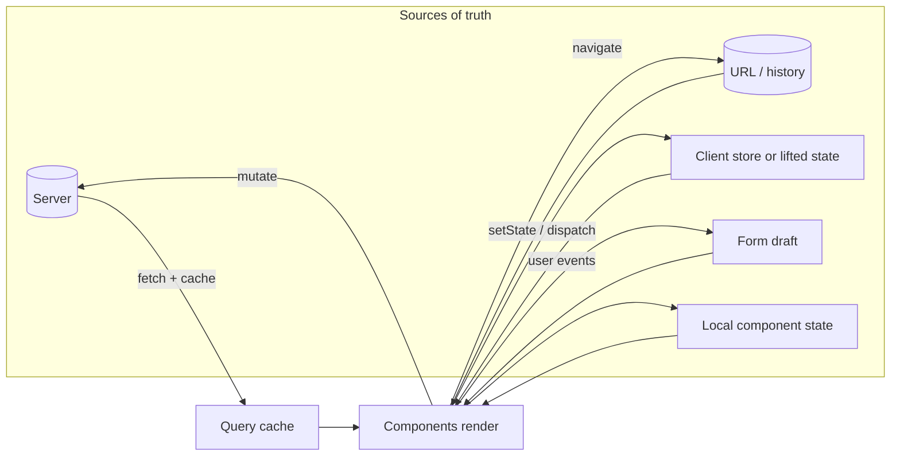
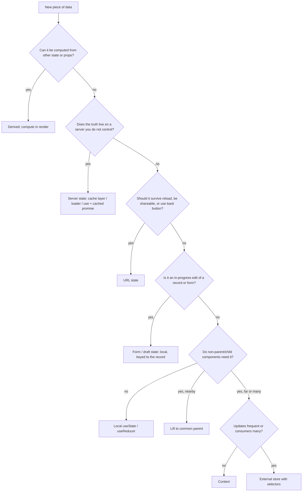
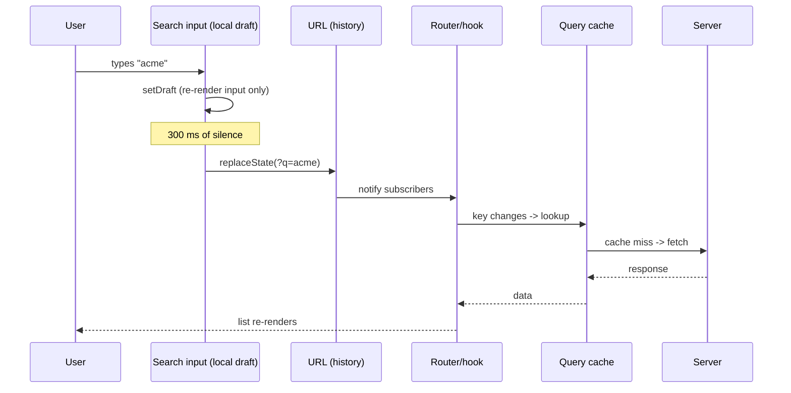

# 03 / 19 — UI, Server, URL, and Shared State: Choosing Where State Lives

## 1. Lesson metadata

| | |
|---|---|
| **Level** | Intermediate–Advanced |
| **Study time** | 4–5 hours (reading 2 h, experiments 1 h, exercises 1.5 h) |
| **Prerequisites** | [01 — useState internals](./01-usestate-internals-and-update-semantics.md), [03 — useReducer](./03-usereducer-and-reducer-architecture.md), [13 — useContext](./13-usecontext-and-propagation.md), [14 — Context performance](./14-context-performance.md), [17 — Derived state](./17-derived-state.md), [18 — State colocation and lifting](./18-state-colocation-and-lifting.md) |
| **Next** | [20 — useSyncExternalStore and external stores](./20-usesyncexternalstore-and-external-stores.md) |
| **Related later** | [Phase 4 / 15 — State ownership](../04-react-architecture/15-state-ownership.md), [Phase 4 / 16 — Server vs client state](../04-react-architecture/16-server-vs-client-state.md), [Phase 6 / 07 — Server state management](../06-data-fetching-and-state-ecosystems/07-server-state-management.md), [Phase 6 / 18 — URL state management](../06-data-fetching-and-state-ecosystems/18-url-state-management.md), [Phase 6 / 11 — Context vs external stores](../06-data-fetching-and-state-ecosystems/11-context-vs-external-stores.md) |

**Learning objectives.** After this lesson you can:
1. Classify any piece of data in an app as UI state, server state, URL state, form state, shared client state, or derived data, and say who the *source of truth* is for each.
2. Explain why `useState` + `useEffect` is a poor fit for server state, listing the specific problems it leaves unsolved.
3. Decide when state belongs in the URL, using shareability, back-button behavior, and reload survival as criteria.
4. Implement a URL-backed filter with correct history semantics (push vs replace) and a local-draft/committed-value split.
5. Choose between lifting state, context, and an external store for shared client state, with explicit trade-offs.
6. Detect and fix "duplicated source of truth" bugs between server cache, local state, and URL.

**Concepts covered:** source of truth, state taxonomy, ephemeral UI state, server state (cache of remote data), URL state, form state, shared client state, derived data, synchronization bugs, history push vs replace, serialization of state, hydration implications.

---

## 2. Deep conceptual explanation

### 2.1 What problem is this lesson solving?

Up to this point, Phase 3 treated "state" as one thing: a value held by `useState` or `useReducer`. Real applications contain data with very different *properties*:

- A dropdown's open/closed flag lives for seconds, belongs to one component, and nobody cares about it after reload.
- A list of invoices is owned by a server, can be changed by other users, goes stale, and must be re-fetched.
- A "page 3, sorted by date, status = overdue" filter is something a user wants to bookmark, share in chat, and navigate with the back button.
- A shopping-cart count is displayed in the header and read in the checkout page, written from product cards.

If you put all of these in `useState` at the top of the tree, you get a well-known set of bugs: stale data, impossible loading states, filters that reset on refresh, props drilled through eight components, and re-renders of the entire page when a tooltip opens. The fix is not a library. It is **classification**: ask *what kind of state is this, and who owns it?* Then pick the mechanism that matches.

> **Core principle.** State is not "data in React". State is *data that changes over time and that the UI must reflect*. For each such datum there should be exactly one **source of truth**, and every other representation should be derived from it or explicitly synchronized with it.

### 2.2 The taxonomy

| Category | Source of truth | Lifetime | Typical examples | Typical tool |
|---|---|---|---|---|
| **Ephemeral UI state** | The component that renders the control | Until unmount (or less) | Tooltip open, hover, accordion expanded, input focus | `useState`, `useReducer`, `useRef` |
| **Form state** | The form (until submission), then the server | Until submit/reset/navigation | Draft text, touched fields, validation errors | Uncontrolled inputs + `FormData`, or `useState`/`useReducer`, or a form library ([21](./21-forms-and-complex-state.md)) |
| **Server state** | A remote system you do not control | Persistent; *your copy* is a cache that goes stale | Invoices, user profile, product catalog | A data-fetching layer with caching (TanStack Query, framework loaders, `use` + cached promises) |
| **URL state** | The address bar (`location`) | Survives reload, shareable, tied to history | Search query, page, sort, selected tab, selected item id | Router APIs, `URLSearchParams`, `history` |
| **Shared client state** | A client-side owner above all consumers | Session (sometimes persisted) | Cart draft, theme, sidebar collapsed, current user *session flags* | Lifted state, context, external store |
| **Derived data** | Nothing — computed from the above | Recomputed | Filtered list, totals, "is form valid" | Plain expressions during render (see [17](./17-derived-state.md)) |
| **Persistent client storage** | `localStorage`, IndexedDB, cookies | Across sessions | Draft autosave, feature-flag overrides | Synchronized via effects or external store ([20](./20-usesyncexternalstore-and-external-stores.md)) |

Two observations:

1. **Categories are properties of the data, not of the tool.** "Server state" does not mean "uses a server library"; it means *the truth lives elsewhere and your copy can be wrong*.
2. **The same real-world concept may appear in several categories at different moments.** A search box: the characters being typed are ephemeral/form state; the *committed* query is URL state; the results are server state; the highlighted result count is derived data.

### 2.3 Ephemeral UI state

This is what [01](./01-usestate-internals-and-update-semantics.md) taught. Default home for any new piece of state is the nearest component that needs it; lift only when a second consumer appears ([18](./18-state-colocation-and-lifting.md)). Cheap to reason about because the blast radius of a change is one subtree.

### 2.4 Server state: why `useState` + `useEffect` is not enough

The textbook beginner pattern:

```tsx
function Invoices() {
  const [data, setData] = useState<Invoice[] | null>(null);
  const [error, setError] = useState<Error | null>(null);

  useEffect(() => {
    fetch('/api/invoices')
      .then((r) => r.json())
      .then(setData)
      .catch(setError);
  }, []);
  // ...
}
```

This *works* for a demo. What it leaves unsolved:

| Problem | Why it appears |
|---|---|
| **Race conditions** | Two quick requests can resolve out of order; the older response overwrites the newer ([Phase 6 / 02](../06-data-fetching-and-state-ecosystems/02-cancellation-and-race-conditions.md)). |
| **No caching / deduplication** | Two components mount, two identical requests; navigating away and back refetches and shows a spinner again. |
| **Staleness** | Nothing tells you the data is out of date after a mutation or after the tab was in the background for an hour. |
| **Loading/error modelling** | Three independent pieces of state (`data`, `error`, `loading`) permit impossible combinations such as "loading and error". |
| **StrictMode double effect** | In development the effect runs, cleans up, runs again — two requests ([Phase 2 / 28](../02-react-rendering-and-internals/28-strict-mode-behavior.md)). |
| **Waterfalls** | Fetching starts only after the component has rendered *and* the effect has run; nested components fetch sequentially. |
| **Mutations** | After `POST`, which cached copies are now wrong? Who refetches? |
| **Server rendering** | Effects do not run on the server; the data is not in the initial HTML. |

None of these is a defect in React; React deliberately does not ship a cache. The data-fetching layer is a **separate abstraction**: it owns the cache, keys it by request identity, tracks freshness, deduplicates, and exposes the result to components. In the browser you typically use a library (Phase 6 covers [TanStack Query](../06-data-fetching-and-state-ecosystems/08-tanstack-query.md) in depth); in framework setups, loaders or Server Components fetch before or during render ([22](./22-modern-hooks-and-apis.md) shows how `use` consumes a promise you cached).

**The rule for this phase:** *never copy server data into `useState` just to display it.* If the cache is the source of truth, read from the cache. A local copy creates two sources of truth that drift apart (see §8, "mirrored server state").

There is one legitimate exception: **drafts**. If the user is editing an invoice, the draft (form state) is *their* data until saved. You initialize it from the server value, keep it locally, and on save send it to the server and invalidate/refresh the cache.

### 2.5 URL state

The URL is state that the **browser** manages and that outlives your React tree. Put something in the URL when most of these hold:

| Question | If yes → URL |
|---|---|
| Should reloading the page restore it? | ✔ |
| Should I be able to paste a link to a colleague and they see the same view? | ✔ |
| Should the back button undo it? | ✔ (push) — or deliberately no (replace) |
| Should search engines or analytics distinguish it? | ✔ |
| Is it a *view of the data* (filter/sort/page/selection) rather than a transient interaction? | ✔ |

Do **not** put in the URL: hover state, in-progress keystrokes of a text draft (commit on blur/submit/debounce), secrets, large objects, anything that would leak PII into logs/referrers, or state whose "back" semantics would be confusing (a modal's internal step might be, or might not — decide on purpose).

The URL has its own properties you inherit:

- **It is a string.** Everything must be serialized and parsed; types are lost (`"3"` not `3`). Validate on read — users can edit URLs by hand.
- **It is external to React.** Changing it does not by itself re-render anything. A router subscribes to history events and re-renders; if you roll your own you must do the same ([20](./20-usesyncexternalstore-and-external-stores.md) shows the correct primitive).
- **It has history semantics.** `history.pushState` adds an entry; `history.replaceState` rewrites the current one. `popstate` fires on back/forward but **not** when you call `pushState` yourself.
- **It is available on the server** in SSR/RSC frameworks, so URL state can render the correct initial HTML; local `useState` cannot.

### 2.6 Shared client state

When two or more components that are not parent and child need the same *client-owned* value, you have three escalating options (detailed in §7):

1. **Lift** the state to the nearest common ancestor and pass props ([18](./18-state-colocation-and-lifting.md)).
2. **Context** to avoid drilling: the provider holds the state; consumers read it ([13](./13-usecontext-and-propagation.md)). Remember the propagation cost ([14](./14-context-performance.md)): every consumer re-renders when the context value changes.
3. **External store** with selective subscriptions ([20](./20-usesyncexternalstore-and-external-stores.md)): components subscribe to *slices*, so only affected components re-render.

Most apps have far less genuinely shared client state than their store suggests. Authors routinely put server data, URL-derivable data, or single-screen UI state into a global store, and then spend effort keeping it synchronized.

### 2.7 Derived data

Anything computable from other state should be computed, not stored. `visibleInvoices = invoices.filter(...)` during render needs no state and cannot go stale. Memoize only when profiling shows cost ([11](./11-usememo-and-usecallback.md)).

### 2.8 Common misconceptions

| Misconception | Reality |
|---|---|
| "Global state means Redux/Zustand." | "Global" describes *scope*. Context, a module-level store, and the URL are all global in scope. |
| "Server data should go in a global store so every component can use it." | Server data belongs in a *cache* keyed by request. Components read from the cache; they do not need a hand-written global copy. |
| "The URL is just for routing." | The URL's query string and path are a first-class state container with unique benefits (shareable, restorable, history). |
| "Context is a state manager." | Context is a *transport* for a value; state still lives in a `useState`/`useReducer` in the provider. |
| "If two components share a value, it must be global." | Often a common parent suffices. Lift first. |
| "More state in one object is simpler." | Mixed lifetimes in one object mean any change re-renders (or invalidates) everything that reads any field. |

---

## 3. Internal mechanics

### 3.1 Public guarantees

- **Public guarantee.** `useState`/`useReducer` state is private to the component instance (identified by position + key, see [Phase 1 / 16](../01-react-fundamentals/16-state-preservation-and-reset.md)). React re-renders a component when its state changes or when a context it reads changes value (by `Object.is`).
- **Public guarantee.** `useSyncExternalStore` lets components subscribe to a store outside React and guarantees that all components in one render see a consistent snapshot ([20](./20-usesyncexternalstore-and-external-stores.md)).
- **Public guarantee (Web platform).** `history.pushState`/`replaceState` change the URL without a reload and do **not** fire `popstate`; `popstate` fires on back/forward traversal between entries of the same document. See the HTML Standard's session history sections.

### 3.2 Teaching model

Think of an application as a set of **stores with different owners**, and React components as *views* that read from those stores:



Rendering is the pure function; the arrows into the components are **reads**, and the arrows out are **writes through the owner's API**. Bugs live where one datum has two owners.

### 3.3 Implementation detail

- How React schedules the re-render when state changes (lanes, batching) is an implementation detail; the guarantees are in [Phase 2 / 22](../02-react-rendering-and-internals/22-automatic-batching.md) and [23](../02-react-rendering-and-internals/23-transitions-and-deferred-rendering.md).
- Router libraries differ in how they subscribe to history (some listen to `popstate` and wrap `pushState`, some use the Navigation API where available). MDN lists the Navigation API as Baseline 2026 ("newly available" as of 2026-10-22), so check support against your browser targets before depending on it directly.
- Data-fetching libraries differ in their cache-key hashing, garbage-collection timers, and retry defaults. Read the library's docs for exact behavior.

---

## 4. Step-by-step execution walkthrough: a filterable invoice list

Scenario: `/invoices?status=overdue&page=2`. The user types in a search box, which should update the URL after they stop typing for 300 ms, and the list should refresh.

1. **Navigation / initial render.** The browser (or the framework on the server) has the URL. The route component reads `status=overdue`, `page=2` from the URL (URL state) and renders.
2. **Server state read.** The list component asks the cache for `['invoices', {status:'overdue', page:2}]`. Cache miss → request starts; the component shows a fallback/skeleton (loading is a *state of the cache entry*, not of the component).
3. **Response arrives.** The cache stores the entry with a timestamp. Subscribers (the list) re-render with data.
4. **User types "acme".** The input is controlled by **local draft state** (`useState('')`). Each keystroke re-renders only the search box (and whatever it renders).
5. **Debounce fires.** An effect (or event-driven timer) calls `setSearchParam('q', 'acme', 'replace')`. We use `replace` because intermediate searches should not each be a back-button stop.
6. **URL changes.** The router/store notifies subscribers. Components reading `q` re-render.
7. **New cache key.** `['invoices', {status:'overdue', page:1, q:'acme'}]` (reset page to 1 when the filter changes — a *business rule*, applied in the same handler that writes the URL).
8. **Fetch / cache.** Miss → fetch; the old data may be shown as placeholder while loading (library-dependent).
9. **Back button.** The user presses back. `popstate` fires; the URL reverts to `?status=overdue&page=2`; the components re-read; the cache likely still holds that entry (instant).
10. **Reload.** The whole page state is reconstructed from the URL; the local draft is initialized from the URL's `q`, not lost.

Notice what was *not* needed: no global store, no copy of the invoices in `useState`, no manual synchronization effect between "filter state" and "URL".

---

## 5. Code examples

### 5.1 Minimal: classify before you code

Predict: for each item, what is the source of truth?

```text
a) Whether the user menu dropdown is open
b) The list of invoices
c) Which invoice tab ("details" | "history") is selected, if a colleague might get a link to it
d) The text currently typed in the search box
e) The number of overdue invoices shown in the header badge
f) A theme choice that persists across sessions
```

**Answer.** a) local UI state. b) server state (cache). c) URL state. d) local/form draft; the *committed* query is URL state. e) derived (from b) — or, if the server computes it separately, its own cache entry; do not hand-sync). f) client-persistent state: a store backed by `localStorage` plus a context/external store for read access, ideally with the pre-hydration script concerns of SSR ([20](./20-usesyncexternalstore-and-external-stores.md)).

### 5.2 Incorrect: mirrored server state

```tsx
function InvoiceEditor({ invoiceId }: { invoiceId: string }) {
  const { data } = useInvoice(invoiceId); // cached server state (hypothetical hook)
  const [invoice, setInvoice] = useState(data); // 🔴 copy

  return (
    <input
      value={invoice?.customer ?? ''}
      onChange={(e) => setInvoice({ ...invoice!, customer: e.target.value })}
    />
  );
}
```

**Predict:** What does the input show on first render if `data` is still loading? What happens when the cache refreshes with newer data while the user is on this screen? What happens when `invoiceId` changes?

**Result.**
- `useState(data)` captures `data` **only on the first render** ([01](./01-usestate-internals-and-update-semantics.md)). If it is `undefined` then, `invoice` stays `undefined` forever, even after `data` arrives; the field is empty and typing hits `invoice!` with a spread of `undefined` (it works at runtime, producing `{customer: 'x'}` — a corrupted object missing every other field).
- When the cache refreshes, the UI ignores it: two sources of truth have diverged.
- When `invoiceId` changes without remounting, the old invoice's draft persists ([Phase 1 / 16](../01-react-fundamentals/16-state-preservation-and-reset.md)).

### 5.3 Corrected: draft is explicit and keyed

```tsx
function InvoiceEditorShell({ invoiceId }: { invoiceId: string }) {
  const { data, isPending } = useInvoice(invoiceId);
  if (isPending || !data) return <Skeleton />;
  // key resets the draft when the identity of the thing being edited changes
  return <InvoiceEditor key={invoiceId} initial={data} />;
}

function InvoiceEditor({ initial }: { initial: Invoice }) {
  const [draft, setDraft] = useState<Invoice>(initial); // a *draft*, intentionally a copy
  const dirty = draft.customer !== initial.customer; // derived, not stored
  // ...
}
```

Why this is correct:
- The component is only mounted once data exists, so the initial value is real.
- `key` makes "different invoice" a different instance (identity reset, see [Phase 1 / 16](../01-react-fundamentals/16-state-preservation-and-reset.md)).
- The copy is *deliberately* a draft with a name that says so, and `dirty` is derived.
- Trade-off: if the server value changes while editing, the draft does not follow. That is usually right (do not overwrite what the user is typing) but should be handled explicitly (a "this invoice changed" banner) in collaborative apps.

### 5.4 Practical: URL state with correct history semantics

First the **naive** attempt. Predict what goes wrong.

```tsx
// 🔴 naive: URL read once, state mirrored
function useQueryParamNaive(key: string) {
  const [value, setValue] = useState(() => new URLSearchParams(window.location.search).get(key));

  const set = (next: string | null) => {
    const url = new URL(window.location.href);
    if (next === null) url.searchParams.delete(key);
    else url.searchParams.set(key, next);
    window.history.pushState(null, '', url);
    setValue(next);
  };
  return [value, set] as const;
}
```

**Problems.**
1. Press **Back**: the URL changes, `popstate` fires, but nothing listens → the UI shows the old value while the address bar shows the new one.
2. Two components call `useQueryParamNaive('q')`: each has its own `useState`. Setting in one does not update the other.
3. A link click elsewhere that changes `?q=` leaves the hook stale.
4. Not SSR-safe (`window` during server render).

The cause is a **duplicated source of truth**: the hook mirrors the URL into component state.

**Corrected** with the primitive built for exactly this ([20](./20-usesyncexternalstore-and-external-stores.md) explains it in depth):

```tsx
import { useSyncExternalStore } from 'react';

const URL_CHANGE_EVENT = 'app:urlchange';

function subscribeToUrl(onChange: () => void) {
  window.addEventListener('popstate', onChange);
  window.addEventListener(URL_CHANGE_EVENT, onChange);
  return () => {
    window.removeEventListener('popstate', onChange);
    window.removeEventListener(URL_CHANGE_EVENT, onChange);
  };
}

export function setSearchParam(
  key: string,
  value: string | null,
  mode: 'push' | 'replace' = 'push',
) {
  const url = new URL(window.location.href);
  if (value === null || value === '') url.searchParams.delete(key);
  else url.searchParams.set(key, value);
  window.history[mode === 'push' ? 'pushState' : 'replaceState'](null, '', url);
  // pushState/replaceState do NOT fire popstate, so notify subscribers ourselves.
  window.dispatchEvent(new Event(URL_CHANGE_EVENT));
}

export function useSearchParam(key: string): string | null {
  return useSyncExternalStore(
    subscribeToUrl,
    () => new URLSearchParams(window.location.search).get(key), // snapshot: a primitive
    () => null, // server snapshot
  );
}
```

Line notes:
- `subscribeToUrl` is defined **outside** the component so its identity is stable; an inline function would resubscribe every render ([20](./20-usesyncexternalstore-and-external-stores.md)).
- The snapshot is a `string | null` — a primitive, so `Object.is` comparison between calls is meaningful. Returning a freshly built object each call would cause an infinite render loop (explained in 20).
- `() => null` as server snapshot means: on the server and during hydration, render as if the param is absent. (Verified in the sandbox: hydration with a differing server snapshot logs no mismatch error and re-renders to the client snapshot.) If the page was server-rendered *with* the param, a framework router that supplies the real value on the server is preferable; this hand-rolled hook would hydrate with `null` and then re-render with the real value (a visible flash, not a mismatch error, because React re-renders after hydration when the client snapshot differs).

In production prefer your router's hooks (React Router's `useSearchParams`, Next.js's `useSearchParams`, TanStack Router's typed search params). They handle SSR, transitions, and typing. APIs differ by router and version, so follow the current docs of the router you use.

### 5.5 Practical: draft/committed split for a search box

```tsx
function SearchBox() {
  const committed = useSearchParam('q') ?? '';
  const [draft, setDraft] = useState(committed);

  // Sync draft when the URL changes from elsewhere (back button, link).
  // Compare during render, not in an effect (see 17 — derived state).
  const [prevCommitted, setPrevCommitted] = useState(committed);
  if (committed !== prevCommitted) {
    setPrevCommitted(committed);
    setDraft(committed);
  }

  useEffect(() => {
    if (draft === committed) return;
    const id = setTimeout(() => setSearchParam('q', draft, 'replace'), 300);
    return () => clearTimeout(id);
  }, [draft, committed]);

  return (
    <input
      value={draft}
      onChange={(e) => setDraft(e.target.value)}
      aria-label="Search invoices"
    />
  );
}
```

Predict: the user types "ac", pauses 100 ms, types "me", then waits. How many history entries and URL writes occur?

**Answer.** One URL write, using `replace`, 300 ms after the last keystroke. Each keystroke re-runs the effect: its cleanup clears the previous timer ([06](./06-effect-cleanup.md)). Back-button history is unaffected by search typing.

Notes on the "adjust state while rendering" block: this is the documented pattern for resetting/adjusting state from changed props or other state (React re-renders the component immediately, before children). It avoids an extra effect pass with a stale frame. Prefer a `key` if resetting *everything* is acceptable.

### 5.6 Advanced: pagination + filters as a single typed URL schema

Parsing and validating once at the boundary keeps the rest of the app typed:

```ts
type StatusFilter = 'all' | 'open' | 'overdue' | 'paid';

interface InvoiceQuery {
  status: StatusFilter;
  page: number;
  q: string;
}

const STATUSES: readonly StatusFilter[] = ['all', 'open', 'overdue', 'paid'];

export function parseInvoiceQuery(params: URLSearchParams): InvoiceQuery {
  const rawStatus = params.get('status');
  const status = STATUSES.includes(rawStatus as StatusFilter)
    ? (rawStatus as StatusFilter)
    : 'all';

  const rawPage = Number.parseInt(params.get('page') ?? '1', 10);
  const page = Number.isFinite(rawPage) && rawPage >= 1 ? rawPage : 1;

  return { status, page, q: params.get('q') ?? '' };
}

export function serializeInvoiceQuery(q: InvoiceQuery): URLSearchParams {
  const p = new URLSearchParams();
  if (q.status !== 'all') p.set('status', q.status);
  if (q.page !== 1) p.set('page', String(q.page));
  if (q.q) p.set('q', q.q);
  return p; // defaults omitted → canonical, short URLs
}
```

Design points:
- **Parse, don't trust.** `?page=-5` or `?status=banana` must degrade to defaults.
- **Canonical form.** Omitting defaults gives one URL per state, which matters for caching and analytics.
- **Reset dependent state in the writer**, not in an effect: `changeStatus` sets `page: 1` in the same navigation.
- A schema validation library may replace the hand-written parsing; choose per project and check its current docs.

### 5.7 Advanced: shared client state, three implementations

The same requirement — "cart count in the header, add button in product cards" — implemented three ways.

**(a) Lifted state** (fine when the header and cards share a nearby parent):

```tsx
function Shop() {
  const [items, setItems] = useState<CartItem[]>([]);
  return (
    <>
      <Header count={items.length} />
      <Products onAdd={(i) => setItems((xs) => [...xs, i])} />
    </>
  );
}
```

**(b) Context** (drilling is deep, updates are infrequent):

```tsx
const CartContext = createContext<{ items: CartItem[]; add(i: CartItem): void } | null>(null);

function CartProvider({ children }: { children: React.ReactNode }) {
  const [items, setItems] = useState<CartItem[]>([]);
  const value = useMemo(
    () => ({ items, add: (i: CartItem) => setItems((xs) => [...xs, i]) }),
    [items],
  );
  return <CartContext value={value}>{children}</CartContext>;
}
```

(React 19 allows rendering `<Context>` directly as a provider; `<Context.Provider>` still works — see [13](./13-usecontext-and-propagation.md). Version-sensitive: in React 18 you must use `.Provider`.)

**(c) External store** (many consumers, frequent updates, need selective subscription): see [20](./20-usesyncexternalstore-and-external-stores.md) for a hand-built store and the library discussion in [Phase 6 / 10 (Zustand)](../06-data-fetching-and-state-ecosystems/10-zustand.md).

When each wins is the subject of §7.

---

## 6. Visual explanations

### 6.1 Decision flow



### 6.2 Ownership timeline for one search interaction



### 6.3 Where duplicated truth creeps in

```text
Server ──fetch──► query cache ──► component
                          │
                          └─ useState(copy)   ← second owner: drifts
URL ?page=2  ──►  useState(page)             ← second owner: back button breaks
Context value ◄── useState ◄── props from API ← third owner: stale after refetch
```

Rule of thumb: every arrow into a `useState` initializer from another state container deserves a second look.

---

## 7. Alternative approaches and trade-offs

### 7.1 Shared client state mechanisms

| Criterion | Lift state | Context + `useState`/`useReducer` | External store (`useSyncExternalStore`, Zustand, Redux Toolkit) | URL |
|---|---|---|---|---|
| Boilerplate | Lowest | Low–medium | Medium (library) or high (hand-rolled) | Medium (parse/serialize) |
| Re-render scope | Subtree of owner | **All consumers** on any value change | Only components whose selected slice changed | Components reading changed params |
| Works outside React (timers, sockets) | No | No (needs a ref/callback bridge) | Yes | Yes (`history`) |
| Survives reload | No | No | Only with persistence | **Yes** |
| Shareable | No | No | No | **Yes** |
| DevTools / time travel | React DevTools | React DevTools | Library-specific (Redux DevTools etc.) | Browser |
| SSR friendliness | Good | Good | Needs per-request store instances and care | **Best** |
| Testing | Easy | Provider wrapper | Often easy (store is plain JS) | Router test helpers |
| Best when | 2–3 nearby consumers | Low-frequency values (theme, locale, session) | High-frequency, many consumers, non-React writers | View state users navigate |

### 7.2 Server state mechanisms

| Criterion | `useEffect` + `useState` | Data library cache (TanStack Query etc.) | Framework loaders / Server Components | `use(cachedPromise)` hand-rolled |
|---|---|---|---|---|
| Caching/dedupe | None (build it) | Built in | Framework-dependent | You build the cache |
| Race handling | Manual (`ignore` flag / abort) | Built in | Built in (navigation-scoped) | Cache identity solves it |
| Mutations & invalidation | Manual | First-class | Revalidation APIs | Manual |
| SSR | No | Supported (hydration APIs) | Native | Possible with care |
| Learning cost | Lowest | Medium | Framework-wide | High (you own the hard parts) |

### 7.3 A scenario where the recommended approach is NOT best

*Recommendation:* "Keep filters in the URL."

*Counter-scenario:* An internal trading widget has a dense panel of 25 transient chart toggles that change several times per second during analysis; the URL would produce history spam, expose internal identifiers, and cost layout from URL parsing. Here, local/persisted client state (and perhaps one "save view" action that writes a *named view id* to the URL) is better. Likewise, `/search?q=` for **private** terms in a regulated product may be undesirable because URLs end up in server logs, browser history, and `Referer` headers.

*Counter-scenario for "don't use useEffect for server data":* A tiny internal page with one read-only request and no navigation. A 10-line `useEffect` with an abort controller is acceptable and avoids a dependency. The line is crossed when you need the second request, the cache, or the mutation.

---

## 8. Best practices and anti-patterns

### 8.1 Practices

- **Name the owner.** For every state variable you add, you should be able to finish the sentence "the source of truth for this is ___".
- **Start local, lift on demand**, and move to external mechanisms only when the pain is measurable (prop drilling across many layers, re-render cost, non-React writers).
- **Treat the URL as an input to rendering.** Read it; write it through one function; parse/validate at the boundary.
- **Commit, don't stream, into the URL.** Debounce or commit on blur/submit; use `replace` for refinements, `push` for navigations a user would want to undo.
- **Derive instead of store** (counts, filtered lists, validity).
- **Model async state as one thing.** `{ status: 'pending' | 'error' | 'success', ... }` (a discriminated union) or the library's status, never three booleans.

### 8.2 Beginner mistakes

| Mistake | Fix |
|---|---|
| `useState(props.x)` to "keep a copy" | Use the prop directly; or make a draft with a `key` |
| Fetching in `useEffect` in ten components | Central cache / loader |
| Storing the filtered list in state | Store the filter, derive the list |
| Page number in `useState` | URL if it should survive reload/back |
| Context for everything | Context for low-frequency, widely-needed values |

### 8.3 Experienced-developer mistakes

| Mistake | Why it hurts |
|---|---|
| Copying query results into a global store "for convenience" | Two caches, two invalidation strategies, race conditions between them |
| Syncing URL ↔ store with effects both ways | Infinite loops, flicker, ordering bugs. Pick one owner; derive the other |
| Putting objects in context values without stable identity | Every consumer re-renders each provider render ([14](./14-context-performance.md)) |
| Putting *everything* in the URL | History spam, long URLs, leaked data, hard to evolve |
| One giant "app state" context | Mixed update frequencies cause avoidable re-renders |
| Persisting state to `localStorage` without versioning | Old shape + new code = crashes on load |

### 8.4 Smells

- `useEffect(() => setX(f(y)), [y])` — derived state in disguise ([17](./17-derived-state.md), [07](./07-you-might-not-need-an-effect.md)).
- A `loading` boolean next to `data` and `error` booleans.
- Props named `initialX` that are passed from a value that changes.
- A reducer action named `SET_FROM_SERVER`.

### 8.5 Justified exceptions

- **Optimistic UI** deliberately keeps a temporary second copy of server state; it is bounded and reconciled ([22](./22-modern-hooks-and-apis.md) covers `useOptimistic`; [Phase 6 / 05](../06-data-fetching-and-state-ecosystems/05-optimistic-updates.md)).
- **Offline-first** apps own a local database as the source of truth and sync to the server.
- **Wizards** may legitimately keep draft state of several steps at the wizard level while the step number lives in the URL.

---

## 9. Real-world application

**Dashboards (analytics).** Date range, selected metric, and segment are URL state (shareable dashboards). Chart data is server state keyed by those parameters. Hover tooltip is local state. Series visibility toggles might be local or URL depending on whether people share the view. Constraint: avoid re-fetching on every hover — keep ephemeral state out of the cache key.

**E-commerce.** Category, sort, price range, and page are URL state (SEO and sharing). Product data is server state. Cart is *both*: server-authoritative for logged-in users (server state with optimistic updates) and a client draft for guests (persisted client state). A common bug is a guest-cart store and a server cart that both render in the header with different counts.

**Finance (statement viewer).** Selected account and period in URL; transactions as server state; "mask balances" toggle as persisted client state; selected rows for bulk action as local/lifted state that must be *cleared when the filter changes* — a dependent-state reset, best done by keying the table on the filter or deriving selection validity.

**Auth.** Session identity is server state with an unusual freshness requirement; "current user" in context is acceptable as a *transport* of cached server state. Redirect-after-login target belongs in the URL (`?next=`) — and must be validated to prevent open redirects.

**Multi-team apps.** Each team owns a route and its URL schema; shared shell state (nav collapsed, theme) is a tiny, versioned store with a documented interface. Constraint: URL param names are a public contract between teams — changing them breaks bookmarks and other teams' deep links.

**Real-time.** WebSocket messages are server state arriving by push; they update the cache (or an external store) outside React. This is the canonical reason to use an external store with `useSyncExternalStore` ([20](./20-usesyncexternalstore-and-external-stores.md)).

---

## 10. Debugging and troubleshooting

### 10.1 Symptom: "The page shows old data after I save"

**Repro.** Edit an invoice, save, navigate back to the list; the old customer name is shown until a refresh.

**Investigation.**
1. React DevTools → Components: find the list component, inspect hooks. If you see a `State` hook holding a list of invoices, you have a mirrored copy.
2. Network panel: after the `PUT`, was a refetch of the list issued? If not, nothing invalidated the cache.
3. If a cache library is used, open its devtools (if installed) and check the entry's `stale`/`fetching` status.

**Root cause.** Either a local copy (never updated) or missing invalidation after mutation.

**Fix and validation.** Remove the copy / add invalidation of the affected keys. Validate: repeat the repro with Network throttling; the list must update without a manual refresh; Network shows exactly one refetch.

### 10.2 Symptom: "Back button changes the URL but not the UI"

Likely a mirrored URL param in `useState`, or a custom `pushState` without notifying subscribers (§5.4). Check: does the component read `window.location` during render *without* a subscription? In DevTools, a hook list showing `State` initialized from `location` is the smell. Fix with the router's hook or `useSyncExternalStore`.

### 10.3 Symptom: "Typing in search feels laggy / history has 40 entries"

- History entries: you used `pushState` per keystroke; switch to local draft + debounced `replace`.
- Lag: Profiler (React DevTools) → record typing; if the whole page re-renders, the draft state or URL subscription is too high in the tree; colocate the draft in the input component.

### 10.4 Symptom: "Filters reset when I navigate within the app"

The link omits the query string, or a router `navigate('/invoices')` drops params. Check the rendered `href`s in Elements; fix by building links via the serializer (§5.6).

### 10.5 Symptom: "Hydration warning on pages with filters"

Server rendered with one URL-derived value, client first render with another (e.g., a hand-rolled hook returns `null` from `getServerSnapshot` but the markup was generated with the param). Look at the console diff; give the server the real URL (framework router) or render a neutral placeholder until mounted.

---

## 11. Exercises

### Level A — Knowledge
A1. List the six state categories from §2.2 and give the source of truth of each.
A2. Give four reasons `useEffect` + `useState` is insufficient for server state.
A3. Which of these should usually be URL state: tooltip hover, selected tab, sort column, the draft of an unsent comment, current page number?
A4. What is the difference between `pushState` and `replaceState`, and which one fires `popstate`?
A5. Why is `useState(props.value)` a smell?

### Level B — Code comprehension
B1. In §5.5, what happens if the user presses Back while the draft is `"acme"` and the committed URL value goes from `"acme"` to `""`? Trace which lines run.
B2. What does this render, and what is the bug?
```tsx
function Counter({ initial }: { initial: number }) {
  const [n, setN] = useState(initial);
  return <button onClick={() => setN(n + 1)}>{n}</button>;
}
// parent: <Counter initial={count} />, and count changes from 1 to 5 while mounted
```
B3. `useSearchParam` returns `new URLSearchParams(window.location.search)` (the object) instead of a string. What goes wrong with `useSyncExternalStore`?

### Level C — Implementation
C1. Write `usePageParam()` returning `[page: number, setPage(n)]`, parsing `?page=` safely (≥1, integer, default 1), using `useSearchParam`/`setSearchParam`. `setPage(1)` must remove the param.
C2. Implement `changeStatus(status)` that sets `status` and resets `page` in **one** history entry.

### Level D — Debugging
D1. Users report: "I open a shared link `/orders?status=open`, but the filter dropdown shows All and the list shows open orders." The dropdown is `const [status, setStatus] = useState('all')`; the list reads the URL. Find the root cause and fix it.
D2. A product page has `const [product, setProduct] = useState<Product|null>(null)` set in an effect from the cache hook's data. After a mutation refreshes the cache, the page still shows the old name. Why, and what is the minimal fix?

### Level E — Architecture decisions
E1. For a CRM app, categorize and choose a mechanism for: current user, contact list, contact search term, selected contact, unsaved contact edits, "compact table" preference, unread notification count (pushed via WebSocket). Justify each with the §7 criteria.
E2. Your team debates moving all server data into Redux. Argue for or against with at least four concrete criteria and one condition under which Redux for server data is reasonable.

### Level F — Expert challenge
F1. Design the state architecture for a collaborative document list with: filters shareable by link, optimistic rename, server push updates, per-user column layout persisted across devices, and SSR for first paint. Specify the owner of each datum, how conflicts between optimistic and pushed updates are resolved, URL schema (including versioning), and how you would test back-button behavior.

---

## 12. Detailed answers and explanations

> Attempt the exercises first.

**A1.** Ephemeral UI state — the component; form state — the form until submit; server state — the remote system (your copy is a cache); URL state — the address bar/history; shared client state — a client owner above consumers (lifted state, context provider, store); derived data — none (computed). (Persistent client storage is a seventh, listed in the table.)

**A2.** Any four of: race conditions; no caching/dedupe; no staleness/refetch policy; impossible state combinations; StrictMode double fetch in dev; waterfalls; no mutation/invalidation story; no SSR data. The *why* is that React provides no cache; the effect only runs after render and commit, so everything cache-like must be hand-written.

**A3.** Selected tab, sort column, current page: URL (if views are shareable/restorable). Tooltip hover: never. Unsent comment draft: local/form state (persisting it is a separate concern, *not* URL).

**A4.** `pushState` appends a history entry; `replaceState` rewrites the current one. Neither fires `popstate`; `popstate` fires on back/forward traversal. Wrong answer "pushState fires popstate" is common — MDN states it does not.

**A5.** The argument is only used on first render, so later changes are ignored, producing stale UI and two sources of truth. Acceptable when it is a deliberate *initial value* of a draft (name it `initialX`, and reset via `key`).

**B1.** Back changes the URL → `popstate` → `onChange` → React re-renders `SearchBox`. `committed` is `""` while `prevCommitted` is `"acme"` → the render-phase branch runs: `setPrevCommitted("")`, `setDraft("")`; React discards the current render output and immediately re-renders with the new state. The effect: `draft === committed` (`""`), so it returns early. Input shows empty. If instead the adjust-during-render block were missing, the draft would stay `"acme"`, `draft !== committed`, and the effect would, 300 ms later, **write `acme` back into the URL**, undoing the Back — a nasty bug.

**B2.** It renders `1`. When the parent's `count` changes to 5, `n` stays 1 (the initializer ran once). Fix: use the prop directly if it is not a draft; or give the component `key={count}` if "new initial value ⇒ new instance" is wanted; or lift state up. Edge case: with `key={count}`, any in-progress state is lost on each change, which may be undesirable for fast-changing props.

**B3.** `useSyncExternalStore` calls `getSnapshot` repeatedly (during render and to check for changes) and compares results with `Object.is`. A fresh `URLSearchParams` each call is never equal, so React considers the store changed on every check; in development React warns "The result of getSnapshot should be cached" and the component can loop (Maximum update depth exceeded). Snapshots must be referentially stable between store changes.

**C1.**
```ts
export function usePageParam(): [number, (n: number) => void] {
  const raw = useSearchParam('page');
  const parsed = raw === null ? 1 : Number.parseInt(raw, 10);
  const page = Number.isInteger(parsed) && parsed >= 1 ? parsed : 1;
  const setPage = (n: number) =>
    setSearchParam('page', n <= 1 ? null : String(n), 'push');
  return [page, setPage];
}
```
Reasoning: parse after reading a primitive snapshot, so no object identity concern. `push` because page changes are navigations the user may want to undo. Edge: `?page=2abc` — `parseInt` yields 2; stricter parsing (`/^\d+$/`) is a design choice. `setPage` is recreated each render; wrap in `useCallback` only if passed to memoized children ([11](./11-usememo-and-usecallback.md)).

**C2.**
```ts
export function changeStatus(status: StatusFilter) {
  const url = new URL(window.location.href);
  if (status === 'all') url.searchParams.delete('status');
  else url.searchParams.set('status', status);
  url.searchParams.delete('page'); // reset in the same write
  window.history.pushState(null, '', url);
  window.dispatchEvent(new Event(URL_CHANGE_EVENT));
}
```
Calling `setSearchParam('status', …)` then `setSearchParam('page', null)` would create **two** history entries and two notifications. A grading answer must produce one entry. Evaluation: single `pushState`, event dispatched once.

**D1.** Root cause: two owners — the dropdown's `useState('all')` captured the default; the list reads the URL. Fix: read the dropdown's value from the URL (`useSearchParam('status') ?? 'all'`), and make its `onChange` write to the URL. No local state. Wrong fix: `useState(urlValue)` — works for first load but breaks on Back and link navigation.

**D2.** `useState` + effect-sync creates a copy; the effect probably has `[]` deps or the copy is only set when `null`. Minimal fix: delete the state and use the hook's `data` directly; if a draft is needed, follow §5.3. Validation: after mutation, the name updates with no manual refresh and React DevTools shows no `State` hook mirroring `product`.

**E1.** (Example well-reasoned answer; accept variations with justification.)
- Current user: server state (session), exposed via context as a transport; low-frequency → context is fine.
- Contact list: server state, cache keyed by filter.
- Contact search term: URL (shareable) with local debounced draft.
- Selected contact: URL (`/contacts/:id`) — deep-linkable, back-button friendly.
- Unsaved edits: form/draft state keyed by contact id; warn on navigation.
- Compact-table preference: persisted client state (localStorage-backed store), read via `useSyncExternalStore`; could be a tiny context if only a few consumers.
- Unread count (WebSocket): external store updated outside React or write into the query cache; selective subscription since the header must update without re-rendering the page.
Criteria: shareability, reload survival, who writes (React vs non-React), consumer count, update frequency, SSR.

**E2.** *Against:* (1) Redux does not provide request dedupe, staleness, retries or garbage collection unless you build them (or use RTK Query, which is a cache layer); (2) hand-written loading/error reducers per endpoint create boilerplate and impossible states; (3) invalidation after mutation becomes manual; (4) SSR hydration of a global store needs per-request instances; (5) two sources of truth if components also fetch directly. *For (reasonable condition):* the app already standardizes on RTK, and uses **RTK Query** for endpoints so the cache *is* the server-state layer; or when server events must be merged with client-only state in complex reducers under a single audit log. Evaluation: distinguishes "Redux as store" from "Redux as cache layer".

**F1.** Evaluation criteria: each datum has exactly one owner; no bidirectional effect-sync. Example answer: filters → URL with a versioned schema (`v` param or unknown-param tolerance), parsed at the boundary, SSR reads them; list → server-state cache keyed by filters, prefetched on the server and hydrated; rename → optimistic update layered over the cache entry (`useOptimistic` or the library's mutation-optimistic feature) with the server response as the final truth; push updates → written into the cache by a subscription; conflict rule: a pushed update with a newer server version/timestamp for the same record supersedes the optimistic overlay once the mutation settles, and while pending the optimistic value is shown but the push is stored in the cache (so it appears if the mutation fails); column layout → server-stored user preference (server state) with an optimistic local overlay and a localStorage fallback for first paint; tests: Playwright script that applies filters, presses Back/Forward and reloads, asserting URL and DOM agree; unit tests for parse/serialize round-trip (`serialize(parse(x))` canonical). Pitfall to mention: SSR requires `getServerSnapshot` consistency to avoid hydration mismatch.

---

## 13. Senior engineer interview questions

**Q1. "Where would you store the currently selected tab of an invoice page, and why?"**
In the URL if the tab is a meaningful view someone would link to or return to via Back, because the URL is shareable, reload-surviving state with history semantics and it is available at SSR time. If the tabs are purely transient inside a widget, local state is simpler and avoids history noise. The causal point: the decision hinges on user-visible properties (shareable, restorable, undoable), not on technology preference.

**Q2. "What's wrong with copying fetched data into `useState`?"**
It creates a second owner. `useState`'s initializer runs once, so later cache updates are ignored; the copy cannot be invalidated by mutations elsewhere; and identity changes (new route param) don't reset it unless keyed. Exceptions are explicit drafts, which are intentionally decoupled until save.

**Q3. "Context versus a store for shared state?"**
Context is a propagation mechanism: when the provider value changes, every consumer re-renders, regardless of which field they use. That's fine for low-frequency values (theme, locale). When updates are frequent or consumers want slices, an external store with selector-based subscriptions avoids the broad re-render, and it can be written from outside React. The trade-off is another abstraction and SSR/test setup.

**Q4. "`pushState` vs `replaceState` for a search box?"**
`replace` for incremental refinement (history stays meaningful), `push` for committed navigations (new page, different filter chosen deliberately). Debounce or commit on blur/Enter; never push per keystroke. Also reset dependent params (page) in the same write so one history entry represents one user intent.

**Q5. "How do you avoid hydration issues with URL-derived state?"**
The server must render with the same URL information the client will see on first render. Frameworks provide this via router hooks. Hand-rolled hooks must provide a `getServerSnapshot` that matches what the server rendered, or the UI must render a neutral placeholder and update after mount. Mismatched text/attributes lead to hydration warnings or incorrect UI.

**Q6. "How do you decide something is *derived* rather than state?"**
If it can be computed from existing props/state/cache during render, storing it adds a synchronization obligation without any benefit. Storing is justified only for expensive computations *after* measuring (memoization — not state) or when it's an independent user decision (like selection).

**Q7. "Why not put everything in the URL?"**
Because the URL is a public, string-typed, size-limited, history-affecting, loggable channel. Transient interactions would spam history; sensitive values leak to logs and referrers; evolution requires backward compatibility; and parse/validate cost applies to every field.

---

## 14. Further learning resources

| Resource | URL | Covers / why | Level | Study |
|---|---|---|---|---|
| React docs — Choosing the State Structure | <https://react.dev/learn/choosing-the-state-structure> | Principles: group, avoid contradictions, avoid duplication, avoid deep nesting | Beginner–Int. | Whole page |
| React docs — Sharing State Between Components | <https://react.dev/learn/sharing-state-between-components> | Lifting state, controlled vs uncontrolled | Beginner | Whole page |
| React docs — Scaling Up with Reducer and Context | <https://react.dev/learn/scaling-up-with-reducer-and-context> | Context + reducer for shared state | Intermediate | Whole page |
| React docs — `useSyncExternalStore` | <https://react.dev/reference/react/useSyncExternalStore> | Subscribing to browser/external state | Intermediate | Usage, caveats |
| React docs — You Might Not Need an Effect | <https://react.dev/learn/you-might-not-need-an-effect> | Avoid mirroring state with effects | Intermediate | "Adjusting state on prop change" |
| MDN — History API | <https://developer.mozilla.org/en-US/docs/Web/API/History_API> | `pushState`, `replaceState`, `popstate` | Intermediate | Whole page |
| MDN — URLSearchParams | <https://developer.mozilla.org/en-US/docs/Web/API/URLSearchParams> | Parsing/serializing query strings | Beginner | Methods |
| TanStack Query docs | <https://tanstack.com/query/latest> | Server-state cache concepts (important defaults, query keys) | Intermediate | "Important Defaults", "Query Keys" |
| React Router docs — Search Params | <https://reactrouter.com/> | Router-managed URL state *(deep link not verified; search "useSearchParams")* | Intermediate | `useSearchParams` |

Links not marked were checked against well-known documentation structure; if one has moved, search the site for the quoted title.

---

## 15. Knowledge checkpoint

**You should now understand**
- That "state" splits into categories with different owners and lifetimes, and that a bug usually means one datum has two owners.
- Why server data needs a cache layer, not `useState` copies.
- What makes data URL-worthy and how history semantics work.
- The cost and benefit profile of lifting, context, and external stores.

**You should be able to explain without notes**
- Why `useState(props.x)` ignores later prop changes.
- Why `pushState` doesn't update React, and what to use instead.
- The draft vs committed vs derived split for a search box.

**You should be able to implement**
- A typed URL query schema with parse/serialize and safe defaults.
- A debounced URL-backed search input using `replace`.
- A keyed draft editor initialized from cached data.

**You should be able to debug**
- "UI doesn't match URL after Back", "stale data after save", and "filters reset on navigation" by locating the second owner.

**Before moving on:** read [20 — useSyncExternalStore and external stores](./20-usesyncexternalstore-and-external-stores.md), which explains the primitive used in §5.4 and how external stores integrate with concurrent rendering.
