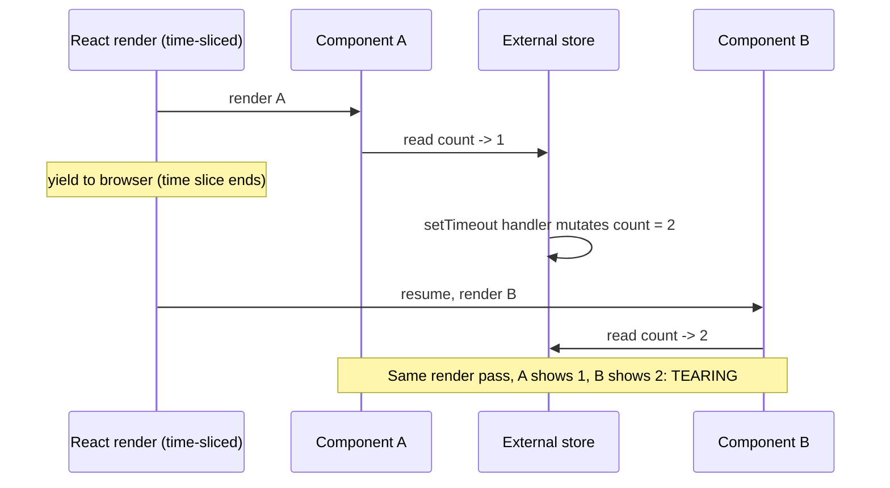
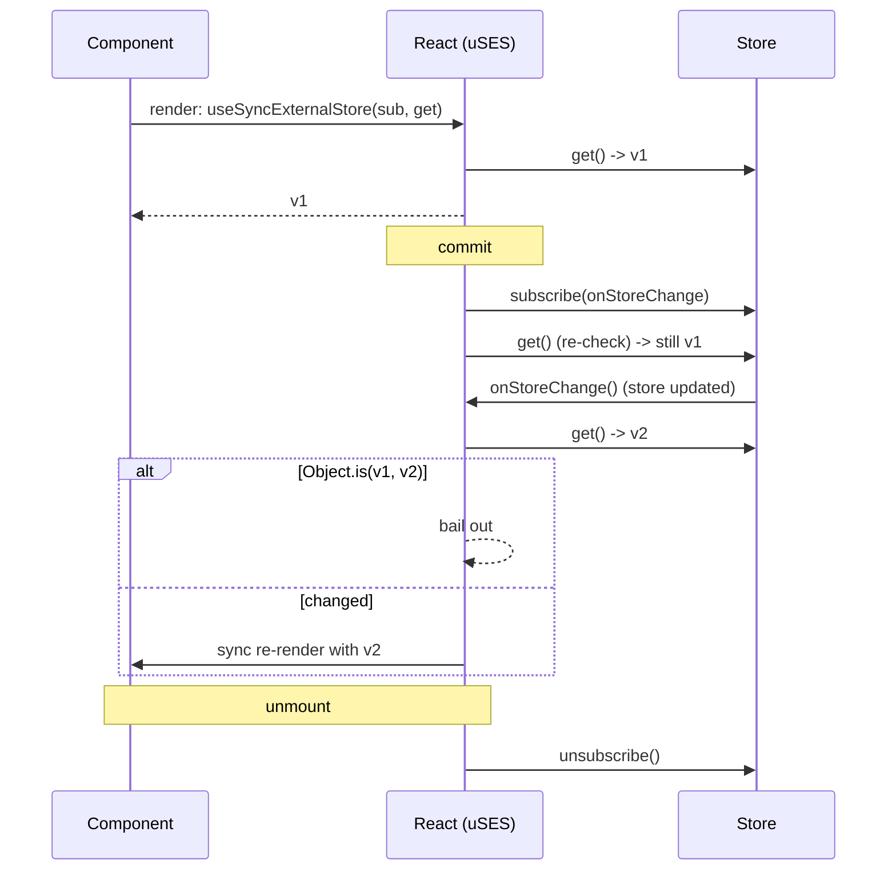
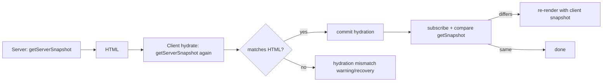

# 03 / 20 — `useSyncExternalStore` and External Stores

## 1. Lesson metadata

| | |
|---|---|
| **Level** | Advanced |
| **Study time** | 4–5 hours (reading 2 h, experiments 1.5 h, exercises 1.5 h) |
| **Prerequisites** | [04 — useEffect synchronization](./04-useeffect-synchronization.md), [06 — Effect cleanup](./06-effect-cleanup.md), [11 — useMemo/useCallback](./11-usememo-and-usecallback.md), [14 — Context performance](./14-context-performance.md), [19 — UI, server, URL, shared state](./19-ui-server-url-and-shared-state.md); Phase 2: [12 — Why rendering must be pure](../02-react-rendering-and-internals/12-why-rendering-must-be-pure.md), [15 — Interruptible renders](../02-react-rendering-and-internals/15-interruptible-restartable-abandoned-rendering.md), [23 — Transitions](../02-react-rendering-and-internals/23-transitions-and-deferred-rendering.md) |
| **Next** | [21 — Forms and complex state](./21-forms-and-complex-state.md) |
| **Related later** | [Phase 6 / 09 — Redux Toolkit](../06-data-fetching-and-state-ecosystems/09-redux-toolkit.md), [10 — Zustand](../06-data-fetching-and-state-ecosystems/10-zustand.md), [11 — Context vs external stores](../06-data-fetching-and-state-ecosystems/11-context-vs-external-stores.md), [17 — Real-time](../06-data-fetching-and-state-ecosystems/17-real-time-websockets-subscriptions.md), [Phase 5 / 14 — Observer and subscription](../05-design-patterns/14-observer-and-subscription.md) |

**Learning objectives.** After this lesson you can:
1. Explain *tearing* and why a concurrent renderer makes naive store subscriptions unsafe.
2. State the contract of `subscribe`, `getSnapshot`, and `getServerSnapshot`, including the identity and caching rules.
3. Build a minimal typed external store and a selector-based hook on top of `useSyncExternalStore`.
4. Wrap browser APIs (`navigator.onLine`, `matchMedia`, `localStorage`) correctly, including SSR and hydration.
5. Diagnose "getSnapshot should be cached", infinite-loop, and hydration-mismatch errors.
6. Explain the trade-offs of external stores versus context, and what `useSyncExternalStore` gives up (transitions).

**Concepts covered:** external store, subscription, snapshot, tearing, synchronous updates, selector, referential stability, server snapshot, hydration, store lifecycle, persistence, `storage` event, library integration (conceptual).

---

## 2. Deep conceptual explanation

### 2.1 What problem is this lesson solving?

Some state is **not owned by React**:

- Browser state: `navigator.onLine`, `window.matchMedia(...)`, `document.visibilityState`, `window.location`, `localStorage`.
- Application state that must be written from outside React: a WebSocket message handler, a timer, a Web Worker, an analytics singleton.
- Third-party stores: Redux, Zustand, MobX-style observables, a router's history object.

A component that displays such state must (1) read the current value during render, and (2) re-render when it changes. Before React 18 the standard recipe was:

```tsx
function useOnlineStatusOld() {
  const [online, setOnline] = useState(navigator.onLine);
  useEffect(() => {
    const on = () => setOnline(true);
    const off = () => setOnline(false);
    window.addEventListener('online', on);
    window.addEventListener('offline', off);
    return () => {
      window.removeEventListener('online', on);
      window.removeEventListener('offline', off);
    };
  }, []);
  return online;
}
```

This is acceptable for one hook reading rarely-changing browser state, and it is *still what many apps ship*. But it has three structural weaknesses, which become severe with concurrent rendering and with real stores:

1. **A gap between render and subscription.** The value is read during render, the subscription is established after commit (in an effect). If the store changes in between, the component misses the change and shows a stale value until the next change. Libraries patched around this with an extra "re-check after subscribe" step.
2. **Tearing.** With interruptible rendering, a render may be paused and resumed. If an external store is *mutated* between the time component A reads it and the time component B reads it, one render pass can show **two different values of the same store** on screen — an inconsistent UI.
3. **Copying into state.** Mirroring the store into `useState` means two owners (see [19](./19-ui-server-url-and-shared-state.md)).

`useSyncExternalStore` (uSES) is React's built-in primitive that makes the *read-and-subscribe* contract correct:

```tsx
const snapshot = useSyncExternalStore(subscribe, getSnapshot, getServerSnapshot?);
```

It was introduced in React 18 for library authors (it replaced the `use-subscription`-style patterns) and is available as a shim package for older versions. In React 19 it remains the primitive that external-store bindings are built on (for example, Zustand's React binding and react-redux's `useSelector` both call it, directly or through the `use-sync-external-store` shim); which libraries do so in which version is library-specific, so read each library's changelog rather than assuming.

### 2.2 What is "tearing"?

React's own state (`useState`, `useReducer`, context) is **immutable per render**: when React starts rendering a tree it has a consistent set of values; updates are queued and applied by lane ([Phase 2 / 14](../02-react-rendering-and-internals/14-lanes.md)). Even if rendering is paused (e.g., during a transition) and later resumed, every component in that pass sees the same snapshot of React state.

An external **mutable** store does not give that guarantee. Imagine a store `{ count: 1 }` and 1,000 components reading it during a time-sliced render:



Before concurrency, a render was a single uninterrupted synchronous pass, so no mutation could slip in between two reads. Concurrent rendering makes the interleaving possible, so React needs the store to cooperate.

**What uSES does about it (conceptual teaching model).** It requires you to expose a *snapshot* function. During a render React reads the snapshot; after finishing render (and again before committing) it checks whether the snapshot changed. If the store changed during a concurrent render, React **discards that render and re-renders synchronously** with the new snapshot, so the committed UI is consistent. This is why store-triggered updates are synchronous and cannot be deferred as transitions (§3.3).

### 2.3 The contract

```ts
function useSyncExternalStore<Snapshot>(
  subscribe: (onStoreChange: () => void) => () => void,
  getSnapshot: () => Snapshot,
  getServerSnapshot?: () => Snapshot,
): Snapshot;
```

| Argument | Meaning | Rules |
|---|---|---|
| `subscribe(callback)` | Registers `callback` to be called whenever the store changes; returns an unsubscribe function. | Must call `callback` on *any* change that might alter the snapshot. **Should have a stable identity** across renders (define it outside the component or memoize it); if it changes, React unsubscribes and resubscribes. |
| `getSnapshot()` | Returns the current value of the store. | Must be **pure and cheap**. Between two calls with no store change it must return a value for which `Object.is(a, b)` is `true`. Return immutable data; never mutate the returned snapshot. |
| `getServerSnapshot()` | Returns the initial value used during server rendering and during client **hydration**. | Required if the component renders on the server; must return the **same** value on server and on the client's hydration pass. |

Consequences, each of which is a common bug source (§5, §10):

- **Snapshots must be cached.** If `getSnapshot` builds a new object/array each call, React sees "changed" on every check → infinite re-render loop. In development React calls `getSnapshot` twice in a row and warns "The result of getSnapshot should be cached to avoid an infinite loop" if the values differ.
- **Primitives are the easy case.** Strings, numbers, booleans compare by value with `Object.is`.
- **Snapshots are compared with `Object.is`.** Returning a *selected slice* (a number, or an existing nested object reference) is how you get fine-grained subscriptions.
- **`subscribe` must notify synchronously about relevant changes**; the notification only says "something changed, re-read" — it carries no data.

### 2.4 Why not just `useEffect` + `useState`?

| Concern | `useEffect` + `useState` | `useSyncExternalStore` |
|---|---|---|
| Missed change between render and subscribe | Possible (you must re-read after subscribing) | React re-checks the snapshot after subscribing |
| Tearing in concurrent render | Possible with mutable stores | Prevented by sync re-render on detected change |
| Hydration | Initial `useState(navigator.onLine)` differs between server and client → mismatch | `getServerSnapshot` makes server/hydration value explicit |
| Boilerplate | Moderate, repeated | Declarative |
| Updates deferrable via transitions | Yes (setState in transition) | **No** — store updates are synchronous |

For a single hook over a rarely-changing, non-critical browser value, `useEffect` + `useState` is *not wrong*. For stores shared across many components, for anything hydrated from the server, and for library code, use uSES.

### 2.5 Misconceptions

| Misconception | Reality |
|---|---|
| "uSES makes the store reactive." | The store must already be observable (implement `subscribe`). uSES only *binds* it to React correctly. |
| "uSES is a state manager." | It is a subscription primitive. A store (state + subscribe + update functions) is separate. |
| "I can return a derived object from getSnapshot." | Only if it is cached; otherwise infinite loop. Derive *after* the hook, or memoize in the store. |
| "Selectors are built into uSES." | They are not; you select by returning a slice from `getSnapshot`, or use a with-selector helper from a library/shim package. |
| "Store updates can be wrapped in `startTransition`." | They can be called inside one, but React treats store-triggered updates as synchronous; the transition won't defer them (documented caveat). |
| "Context is the same as an external store." | Context re-renders **all** consumers of a changed value and can only be written from React. A store with selectors re-renders only components whose slice changed and can be written from anywhere. |
| "I should use uSES in app code everywhere." | Usually you use a library built on it. Hand-rolling is for browser-API wrappers and small stores. |

---

## 3. Internal mechanics

### 3.1 Public guarantees

- **Public guarantee.** React will call `subscribe` after the component commits (with the `onStoreChange` callback) and call the returned function on unmount or when `subscribe` changes.
- **Public guarantee.** During rendering React calls `getSnapshot`; if it returns a value that differs (`Object.is`) from the one used for the last committed render, the component re-renders. The committed UI will not mix different snapshots of this store from one render pass.
- **Public guarantee.** During server rendering and hydration React uses `getServerSnapshot`; if it is absent when rendering on the server, React throws an error. After hydration, React compares the client snapshot to the server one and re-renders if they differ.
- **Public guarantee (documented caveat).** Updates caused by store changes are **synchronous** and cannot be marked as transitions. As a consequence, if a store change occurs during a transition, React may need to fall back to showing an already-revealed Suspense fallback for the sync update. The React reference page for `useSyncExternalStore` lists these caveats (verified against the 19.3 docs, 2026-10-22); it also advises against suspending a render on a store value for this reason. Additionally, if the store is mutated during a Transition, React calls `getSnapshot` a second time just before applying the DOM changes and, if the value differs, restarts that update as a blocking one.

### 3.2 Teaching model

Think of uSES as three steps:

```text
RENDER:   value = getSnapshot()                (pure, cheap, cached)
COMMIT:   unsubscribe = subscribe(onChange)    (in a post-commit phase, like an effect)
          then: if getSnapshot() !== value -> schedule a sync re-render
ON CHANGE (callback fired by store):
          if getSnapshot() !== lastRenderedValue -> schedule a SYNC re-render
CONCURRENT RENDER IN PROGRESS + store changed -> discard, restart synchronously
```

The second bullet is the closing of the "gap" (§2.1.1): after subscribing, React re-checks the snapshot so nothing is missed.

### 3.3 Implementation detail

- Exact hook implementation, the consistency check performed before commit, and how the re-render is scheduled (which lane) are internal and have changed across versions. Conceptually it resembles a layout-effect-timed subscription plus a snapshot comparison. Verify in React's source (`ReactFiberHooks`) if you need specifics — do not rely on those names.
- The development-only double call of `getSnapshot` (to detect uncached snapshots) is a dev diagnostic; don't write code that depends on call counts.
- In StrictMode development, `subscribe`/unsubscribe is exercised an extra time (mount → unmount → mount of effects, see [Phase 2 / 28](../02-react-rendering-and-internals/28-strict-mode-behavior.md)). Your `subscribe` must be idempotent: unsubscribe must fully undo it.

### 3.4 Why synchronous?

If store updates could be deferred like transition updates, one component tree could show state N of the store while another part of the app (e.g., an imperative integration reading the same store) already acted on state N+1. Since the very reason for an external store is that *non-React code writes to it and treats it as authoritative*, React chooses correctness over deferral: the UI is brought up to date synchronously. The cost: expensive renders caused by store updates cannot be time-sliced. If this hurts, reduce render cost (selectors, memoization — [11](./11-usememo-and-usecallback.md), [12](./12-react-memo.md)) or keep that state in React state so transitions apply ([22](./22-modern-hooks-and-apis.md)).

---

## 4. Step-by-step execution walkthrough

Scenario: `useOnlineStatus()` implemented with uSES (§5.1), used in `<StatusBadge />`, in a server-rendered app, user goes offline.

**Server render**
1. Framework calls `renderToPipeableStream` (or equivalent). `StatusBadge` renders; `useSyncExternalStore` calls `getServerSnapshot()` → `true` ("assume online"). HTML contains "Online".

**Client hydration**
2. Client JS loads, hydration starts ([Phase 2 / 25](../02-react-rendering-and-internals/25-hydration-and-selective-hydration.md)). React calls `getServerSnapshot()` again → `true`; output matches the HTML; no mismatch.
3. After hydration commits, React subscribes (`subscribe` adds `online`/`offline` listeners) and re-checks `getSnapshot()` → `navigator.onLine`. If the user was *already offline*, it differs (`false`) → React schedules a re-render → "Offline". (This is the correct, documented way to reconcile a server default with client truth.)

**User goes offline**
4. Browser fires `offline`. Our listener is `onStoreChange` (React's callback).
5. React calls `getSnapshot()` → `false`; compares with last committed `true` → different.
6. React schedules a synchronous re-render of `StatusBadge` (and every other component subscribed to this store with a different result).
7. Render: `getSnapshot()` returns `false`; JSX updates; commit patches the DOM text.
8. Components whose snapshot did not change (none here — one boolean) would bail out.

**Unmount**
9. React calls the unsubscribe function; listeners removed.

**Concurrent edge case**
10. Suppose during step 7 (time-sliced render of a large page) the `online` event fires again. React detects the snapshot changed during render, abandons the in-progress render, and restarts synchronously so that all components see the same value.

---

## 5. Code examples

### 5.1 Minimal: `useOnlineStatus`

```tsx
import { useSyncExternalStore } from 'react';

function subscribe(onStoreChange: () => void) {
  window.addEventListener('online', onStoreChange);
  window.addEventListener('offline', onStoreChange);
  return () => {
    window.removeEventListener('online', onStoreChange);
    window.removeEventListener('offline', onStoreChange);
  };
}

const getSnapshot = () => navigator.onLine;
const getServerSnapshot = () => true; // server cannot know; pick a safe default

export function useOnlineStatus(): boolean {
  return useSyncExternalStore(subscribe, getSnapshot, getServerSnapshot);
}
```

Line notes:
- Everything is module-level so identities are stable.
- `onStoreChange` takes no argument and returns nothing; we pass it straight to `addEventListener`, so the event object is ignored — React re-reads via `getSnapshot`.
- `navigator.onLine` is a boolean → trivially cacheable. Note: `onLine === true` means "connected to a network", not "internet works"; treat it as a hint.

### 5.2 Incorrect: a snapshot that isn't cached

```tsx
// 🔴
function useViewport() {
  return useSyncExternalStore(
    (cb) => {
      window.addEventListener('resize', cb);
      return () => window.removeEventListener('resize', cb);
    },
    () => ({ width: window.innerWidth, height: window.innerHeight }),
  );
}
```

**Predict:** What happens?

**Answer.** Each `getSnapshot()` call allocates a new object, so `Object.is(prev, next)` is always `false`. React thinks the store changed after every check → re-render → check → ... In development you get the "result of getSnapshot should be cached" warning and ultimately "Maximum update depth exceeded". Also, the inline `subscribe` is a new function every render, causing unsubscribe/resubscribe each render. Two bugs: unstable `subscribe`, uncached snapshot. And no `getServerSnapshot`, so SSR throws.

### 5.3 Corrected: primitives, or a cached object

Option 1 — **subscribe to primitives separately** (simplest):

```tsx
function subscribeResize(cb: () => void) {
  window.addEventListener('resize', cb);
  return () => window.removeEventListener('resize', cb);
}

export function useWindowWidth(): number {
  return useSyncExternalStore(
    subscribeResize,
    () => window.innerWidth,
    () => 1024, // server/hydration default
  );
}
```

Option 2 — **cache the object, replace it only when values change**:

```tsx
type Viewport = { width: number; height: number };

let cached: Viewport = { width: 0, height: 0 };

function readViewport(): Viewport {
  const w = window.innerWidth;
  const h = window.innerHeight;
  if (cached.width !== w || cached.height !== h) {
    cached = { width: w, height: h }; // new identity only on real change
  }
  return cached;
}

const SERVER_VIEWPORT: Viewport = { width: 1024, height: 768 }; // module constant -> stable

export function useViewport(): Viewport {
  return useSyncExternalStore(subscribeResize, readViewport, () => SERVER_VIEWPORT);
}
```

Why correct: between two `resize` events, `readViewport()` returns the same reference, satisfying `Object.is`. The server snapshot is a constant. Trade-off: module-level cache is shared across all hook users (that is desired); for multiple *windows/iframes* or tests you'd need to reset it.

### 5.4 Practical: `useMediaQuery` with a stable per-query subscription

```tsx
import { useCallback, useSyncExternalStore } from 'react';

export function useMediaQuery(query: string, serverDefault = false): boolean {
  const subscribe = useCallback(
    (onChange: () => void) => {
      const mql = window.matchMedia(query);
      mql.addEventListener('change', onChange);
      return () => mql.removeEventListener('change', onChange);
    },
    [query], // changes only when the query string changes -> resubscribe is correct
  );

  return useSyncExternalStore(
    subscribe,
    () => window.matchMedia(query).matches,
    () => serverDefault,
  );
}
```

Here `subscribe` legitimately depends on `query`, so it is memoized with `useCallback` ([11](./11-usememo-and-usecallback.md)). When `query` changes React unsubscribes the old listener and subscribes the new. The snapshot is a boolean.

Hydration (verified in the sandbox: `renderToString` emitted the server snapshot, `hydrateRoot` produced no mismatch error and then updated to the client snapshot): if the server default is `false` and the client matches `true`, the first client render (hydration) uses `getServerSnapshot` (`false`) so markup matches, then React re-renders with `true`. Users with the media query true see a brief flash of the default layout. For layout-critical decisions prefer CSS media queries over JS; use the hook for behavior that CSS cannot express.

### 5.5 Practical: a minimal typed external store

```ts
// store.ts
export type Listener = () => void;

export interface Store<T> {
  getState: () => T;
  setState: (updater: T | ((prev: T) => T)) => void;
  subscribe: (listener: Listener) => () => void;
}

export function createStore<T>(initial: T): Store<T> {
  let state = initial;
  const listeners = new Set<Listener>();

  return {
    getState: () => state,
    setState(updater) {
      const next =
        typeof updater === 'function' ? (updater as (prev: T) => T)(state) : updater;
      if (Object.is(next, state)) return; // no change -> no notification
      state = next; // replace, never mutate
      listeners.forEach((l) => l());
    },
    subscribe(listener) {
      listeners.add(listener);
      return () => {
        listeners.delete(listener);
      };
    },
  };
}
```

```tsx
// useStore.ts
import { useSyncExternalStore } from 'react';
import type { Store } from './store';

export function useStore<T, S>(store: Store<T>, selector: (state: T) => S): S {
  return useSyncExternalStore(
    store.subscribe,
    () => selector(store.getState()),
    () => selector(store.getState()), // see SSR note below
  );
}
```

```tsx
// usage
interface CartState {
  items: { id: string; qty: number }[];
  coupon: string | null;
}

export const cartStore = createStore<CartState>({ items: [], coupon: null });

export function addItem(id: string) {
  cartStore.setState((s) => {
    const existing = s.items.find((i) => i.id === id);
    return {
      ...s,
      items: existing
        ? s.items.map((i) => (i.id === id ? { ...i, qty: i.qty + 1 } : i))
        : [...s.items, { id, qty: 1 }],
    };
  });
}

function CartBadge() {
  const count = useStore(cartStore, (s) => s.items.reduce((n, i) => n + i.qty, 0));
  return <span aria-label={`${count} items in cart`}>{count}</span>;
}
```

**Predict:** `CartBadge` selects a number; the coupon changes from `null` to `'SAVE10'`. Does `CartBadge` re-render?

**Answer.** The store notifies all listeners, and React calls the snapshot function again for each subscribed component. For `CartBadge` the snapshot is the same number (`Object.is` equal) → React bails out of re-rendering. That is the selective subscription benefit and the difference from context, where changing any field of the value re-renders all consumers ([14](./14-context-performance.md)).

Notes:
- `listeners.forEach` calls each listener synchronously; React's callbacks only *schedule* work.
- Mutating `state` in place (e.g. `s.items.push`) would keep `Object.is(next, state)` true and never notify — and would break the "immutable snapshot" contract. Always replace.
- SSR note: a module-level singleton store on the server is **shared across requests** — user A's data would leak to user B. For SSR, create a store per request and provide it through context, and use `getServerSnapshot` returning the initial state serialized to the client. Libraries document their SSR recipes; follow your library's guidance.
- The selector `s.items.reduce(...)` returns a number; if a selector returned `s.items.filter(...)` (a new array each call) you reproduce bug 5.2.

### 5.6 Incorrect: selector returning a new reference

```tsx
// 🔴
const expensive = useStore(cartStore, (s) => s.items.filter((i) => i.qty > 1));
```

Every `getSnapshot` call returns a fresh array → warning/infinite loop. Fix options:

```tsx
// (a) select the stable source and derive afterwards
const items = useStore(cartStore, (s) => s.items);
const multi = useMemo(() => items.filter((i) => i.qty > 1), [items]);

// (b) use an equality-aware selector helper (library-provided) that returns the previous result when shallow-equal
//     e.g. a `useShallow`-style wrapper, or a with-selector variant of uSES.
```

Option (a) is simplest and relies only on core React. For (b), APIs are library-specific (Zustand, `use-sync-external-store/with-selector`, Redux's `useSelector` with equality function) — check each library's current docs.

### 5.7 Practical: persisted preference with the `storage` event

```tsx
type Theme = 'light' | 'dark' | 'system';
const KEY = 'app:theme:v1';

const themeListeners = new Set<() => void>();

function subscribeTheme(cb: () => void) {
  themeListeners.add(cb);
  const onStorage = (e: StorageEvent) => {
    if (e.key === KEY || e.key === null) cb(); // other tabs wrote it (or storage.clear())
  };
  window.addEventListener('storage', onStorage);
  return () => {
    themeListeners.delete(cb);
    window.removeEventListener('storage', onStorage);
  };
}

function readTheme(): Theme {
  try {
    const v = localStorage.getItem(KEY);
    return v === 'light' || v === 'dark' || v === 'system' ? v : 'system';
  } catch {
    return 'system'; // storage blocked (privacy mode, sandboxed iframe)
  }
}

export function setTheme(next: Theme) {
  try {
    localStorage.setItem(KEY, next);
  } catch {
    /* ignore: preference won't persist */
  }
  themeListeners.forEach((l) => l()); // same-tab writes don't fire `storage`
}

export function useTheme(): Theme {
  return useSyncExternalStore(subscribeTheme, readTheme, () => 'system');
}
```

Important facts:
- The `storage` event fires in **other** documents of the same origin, not the one that wrote the value. So same-tab notification is manual (`themeListeners`).
- `readTheme` returns a string → cacheable by value.
- Validation on read: stored data may be old, hand-edited, or from a previous version (the `:v1` suffix supports migration).
- `try/catch`: `localStorage` access can throw.
- SSR: server returns `'system'`; the client's first (hydration) render also `'system'`, then re-renders with the stored value. To avoid a theme flash, apply the theme with a small blocking inline script before first paint that sets a class/attribute on `<html>` (a CSS/HTML concern outside React), and treat React state as secondary.

### 5.8 Advanced: a store updated from a WebSocket

```ts
type Price = { symbol: string; px: number; ts: number };

const prices = createStore<Record<string, Price>>({});

export function connectPrices(url: string) {
  const ws = new WebSocket(url);
  ws.onmessage = (ev) => {
    const msg = JSON.parse(ev.data) as Price;
    prices.setState((prev) => ({ ...prev, [msg.symbol]: msg })); // immutable replace
  };
  return () => ws.close();
}

function PriceCell({ symbol }: { symbol: string }) {
  const px = useStore(prices, (s) => s[symbol]?.px);
  return <td>{px?.toFixed(2) ?? '—'}</td>;
}
```

Each `PriceCell` selects a number; a tick for `AAPL` re-renders only the `AAPL` cell (others' snapshots are unchanged). Constraints at scale (hundreds of ticks/sec): the full-object spread is O(number of symbols) per tick; batch messages (e.g., apply a micro-batch per animation frame) so React gets at most one update per frame. Because store updates are synchronous, a rapid stream can saturate the main thread — see [Phase 6 / 17](../06-data-fetching-and-state-ecosystems/17-real-time-websockets-subscriptions.md).

`connectPrices` should be called from outside render — in an app initialization module or an effect with cleanup ([06](./06-effect-cleanup.md)) — never during render.

---

## 6. Visual explanations

### 6.1 Subscription lifecycle



### 6.2 Context vs external store re-render fan-out

```text
Context value {a, b} changes b
Provider --> [Consumer reading a]  re-renders   (value identity changed)
         --> [Consumer reading b]  re-renders
         --> [Consumer reading a]  re-renders

External store {a, b} changes b
Store notifies all subscribers; each calls selector:
         [select a] -> same -> bail out
         [select b] -> changed -> re-render
         [select a] -> same -> bail out
(selectors still run for every subscriber: keep them cheap)
```

### 6.3 Server → hydration → client truth



---

## 7. Alternative approaches and trade-offs

| Criterion | `useEffect` + `useState` | `useSyncExternalStore` + hand-rolled store | Context + `useReducer` | Store library (Zustand/Redux Toolkit/etc.) | URL/router state |
|---|---|---|---|---|---|
| Tearing-safe with concurrent rendering | Not guaranteed | **Yes** | Yes (React state) | Yes if built on uSES (check) | Router-dependent |
| Selective re-render | Manual | Via selector | No (all consumers) | Yes | Per param (router-dependent) |
| Writable from non-React code | Only by exposing setState | **Yes** | No | Yes | Yes (`history`) |
| Updates can be deferred (transitions) | Yes | **No** | Yes | No (if uSES-based) | Router-dependent |
| SSR | Hydration mismatch risk | Needs `getServerSnapshot` + per-request store | Natural | Library recipes | Natural |
| Cost to adopt | Lowest | Low–medium | Low | Dependency + conventions | Medium |
| Devtools/middleware | None | Build it | React DevTools | Rich | Browser |
| Best for | One-off browser API hook | Small, well-bounded stores, library-like code | Low-frequency app-wide values | Many consumers, complex updates, devtools | Navigational view state |

### 7.1 Scenario where uSES is NOT the best choice

You have a large dashboard whose filter panel updates a heavy chart (50 ms render per change). If the filter state lives in an external store, each change triggers a **synchronous** re-render of the chart: typing in a filter text box would lag. If the same state lives in `useState`/`useReducer`, you can render the input with a urgent update and the chart with a **transition** or `useDeferredValue` ([22](./22-modern-hooks-and-apis.md)), keeping typing responsive. So: React-owned state is better when you need time-slicing of expensive downstream work, and uSES is better when non-React code is authoritative or when you need cross-tree selective subscriptions. (A hybrid is common: store holds data; a component copies a selected slice into `useDeferredValue`.)

### 7.2 Scenario where context is better

A theme or locale that changes a few times per session and is read by hundreds of components that all need to re-render anyway when it changes: context is simpler, SSR-friendly, and has no tearing concerns. A store adds nothing.

---

## 8. Best practices and anti-patterns

**Practices**
- Define `subscribe` and `getSnapshot` at module scope when possible; memoize with `useCallback` only when they depend on props.
- Make snapshots **immutable** and return the **same reference** when nothing changed.
- Keep selectors **cheap and pure**; they run on every store notification for every subscriber.
- Notify only when state actually changed (`Object.is` check in `setState`).
- Always provide `getServerSnapshot` for components that may render on the server; ensure it is consistent with the markup.
- Make unsubscription complete (StrictMode will test this).
- Version persisted shapes and validate on read.
- Prefer a well-maintained library for application stores (middleware, devtools, tests, SSR recipes) and reserve hand-rolling for browser-API hooks and small cases.

**Beginner mistakes**
- Returning a new object/array from `getSnapshot` (infinite loop).
- Inline `subscribe` (resubscribes every render).
- Forgetting the server snapshot → SSR error.
- Mutating store state in place.

**Experienced-developer mistakes**
- Using a module-level store in SSR (cross-request leakage).
- Selecting large objects when only a field is needed (defeats selective rendering).
- Storing non-serializable or huge data and hydrating it.
- Writing to the store during render (violates purity — [Phase 2 / 12](../02-react-rendering-and-internals/12-why-rendering-must-be-pure.md)).
- Duplicating server state in a client store ([19](./19-ui-server-url-and-shared-state.md)).
- Making the store the *only* place for state that benefits from transitions.

**Smells:** a `useEffect` whose only job is `store.subscribe(() => setX(store.get()))`; `forceUpdate` hooks; a store with five selectors that each return `.filter()` results.

**Justified exceptions:** `useEffect`+`useState` for a one-off rarely-changing value in a client-only app; reading a store imperatively via `store.getState()` inside an event handler (no subscription needed because the handler runs at event time).

---

## 9. Real-world application

- **Realtime trading/monitoring UI.** Prices arrive over WebSocket; a normalized store keyed by symbol and per-cell selectors prevent whole-grid re-renders. Constraints: coalesce messages per frame; virtualize rows ([Phase 7](../07-performance/)); keep the store write path free of React.
- **Auth/session.** A token refresh module (outside React, used by the HTTP client) updates a small store; UI reads `isAuthenticated` via selector. Constraint: don't put the raw token in React-visible state if not needed; avoid leaking per-request in SSR.
- **Design-system preferences.** Theme, density, reduced motion: persisted store + `matchMedia` for `prefers-reduced-motion`/`prefers-color-scheme`.
- **Multi-team micro-frontends.** A shared event-bus-like store lets independent React roots (possibly different React copies) share state; uSES works per root. Constraint: the store contract becomes a public API; version it.
- **Collaborative editors.** A CRDT/document model is an external store; React views subscribe to slices (selection, cursor). The model is authoritative; React renders it.
- **Forms with cross-field subscriptions.** Form libraries commonly expose field state through external stores to avoid re-rendering the whole form ([21](./21-forms-and-complex-state.md)).

---

## 10. Debugging and troubleshooting

**Symptom A: "The result of getSnapshot should be cached to avoid an infinite loop" / "Maximum update depth exceeded".**
- *Repro:* §5.2.
- *Investigation:* find `getSnapshot` (or the selector); log `Object.is(getSnapshot(), getSnapshot())`; if `false`, it returns a fresh reference.
- *Root cause:* object/array created per call.
- *Fix:* return a primitive, a stored reference, or memoize on inputs. *Validate:* the warning disappears and the Profiler (React DevTools) shows one commit per store change.

**Symptom B: "Missing getServerSnapshot" error during SSR.**
- *Root cause:* server render of a component using uSES without the third argument.
- *Fix:* supply it (and make it deterministic and equal to what the client will use at hydration).

**Symptom C: Hydration mismatch / text differs between server and client.**
- *Investigation:* console hydration diff; check whether `getServerSnapshot` returns something other than what `getSnapshot` yields at first client render — that is expected to differ *after* hydration, but the hydration pass itself uses the server snapshot. If you see a mismatch, your server markup was produced with a different value than `getServerSnapshot` returns (e.g., the server read the cookie but the hook default is different).

**Symptom D: Component never updates.**
- Is `onStoreChange` actually called? Add a log in `subscribe`'s listener registration and in the store's notify loop. Common cause: store state mutated in place and `setState` skipped notification via `Object.is`; or the listener is registered on a *different store instance* (module duplicated by bundler, or per-request store mismatch).

**Symptom E: Whole page re-renders on every store change.**
- React DevTools → Profiler → "Why did this render?" (enable "Record why each component rendered"). Check that selectors return primitives/stable references and that components don't select the whole state.

**Symptom F: Subscriptions leak in tests / StrictMode warns of duplicate listeners.**
- Check unsubscribe symmetry; use a `Set` and delete the exact function registered.

**Symptom G: Typing lags after moving state into a store.**
- Updates are synchronous. Profile; either keep the input state local and push the *committed* value to the store, or defer the heavy consumer ([22](./22-modern-hooks-and-apis.md)).

---

## 11. Exercises

### Level A — Knowledge
A1. Define tearing and explain why it was not possible before concurrent rendering.
A2. What are the three arguments of `useSyncExternalStore`, and which is optional?
A3. Why must `getSnapshot` return a cached value?
A4. Why is `subscribe` best defined outside the component?
A5. Why can't store updates be deferred with `startTransition`?

### Level B — Code comprehension
B1. In §5.5, `setState(prev => prev)` is called. What happens, and why?
B2. What does `useStore(store, s => s.items.length)` do when `coupon` changes? When `items` changes from `[a]` to `[b]`?
B3. Predict the console output order in StrictMode dev for a component using `useOnlineStatus` that logs inside `subscribe` ("sub") and in the unsubscribe closure ("unsub"), on mount.

### Level C — Implementation
C1. Implement `useDocumentVisibility()` returning `'visible' | 'hidden'` with SSR support.
C2. Write `createStore` additions: `subscribeSelector` (non-React) that calls a callback only when `selector(state)` changes, and use it in a unit test.
C3. Implement `useLocalStorageState<T>(key, initial)` with uSES that supports cross-tab sync and JSON parsing, caching parsed values so `getSnapshot` is stable.

### Level D — Debugging
D1. Find all bugs:
```tsx
function useScroll() {
  return useSyncExternalStore(
    (cb) => { window.addEventListener('scroll', cb); return () => window.removeEventListener('scroll', cb); },
    () => ({ x: window.scrollX, y: window.scrollY }),
  );
}
```
D2. After moving a filter value into a global store, typing in the filter input is laggy although it wasn't before. Explain and propose two fixes.
D3. An SSR app leaks one user's cart into another's HTML under load. Hypothesize and fix.

### Level E — Architecture decisions
E1. Choose among context, store, URL, and local state for: locale; WebSocket presence list; table column widths; multi-select rows; unsaved form values. Justify.
E2. Should your design-system's `useBreakpoint` use JS or CSS? When is each correct?

### Level F — Expert challenge
F1. Design a store for 5,000 live-updating rows where only visible rows render. Specify the data structure, subscription granularity, batching strategy, and how you would verify that a tick affects only one row's render.
F2. Explain, using the concurrent rendering model, a scenario in which a naive `useEffect`-subscription store binding shows inconsistent UI, and exactly how uSES prevents it.

---

## 12. Detailed answers and explanations

> Attempt the exercises first.

**A1.** Tearing: during one render pass, different components observe different values of the same mutable external source, so the committed UI is inconsistent. Previously rendering was a single synchronous uninterrupted pass: nothing could mutate the store between two reads (JS run-to-completion, [Phase 0 / 05](../00-web-and-javascript-foundations/05-execution-contexts-and-call-stack.md)). Time-slicing yields to the browser mid-render, allowing event handlers/timers to mutate the store in between.

**A2.** `subscribe`, `getSnapshot`, and optional `getServerSnapshot` (required when rendering on the server).

**A3.** React compares successive snapshots with `Object.is` to decide whether the store changed. A fresh reference each call makes it always "changed" → re-render loop. The dev double-call check exists to catch exactly this.

**A4.** Identity: a new function each render makes React unsubscribe and resubscribe on every render (wasted work, and potential missed events in the gap). Module scope or `useCallback` with real dependencies keeps it stable.

**A5.** To prevent tearing and inconsistency with non-React code that treats the store as authoritative, React processes store-driven updates synchronously. Calling the store's setter inside `startTransition` doesn't change that for the uSES subscribers.

**B1.** `Object.is(next, state)` is true → early return → no listeners notified → no renders. This guard makes idempotent updates free. Wrong answer: "it re-renders everything with the same state" — that is what a naive `forEach` without the guard would cause (listeners would run, but React would still bail out because snapshots are equal; the cost would be selector re-evaluation).

**B2.** On `coupon` change: listeners notified, selector yields the same number → bail out, no render. On `[a]`→`[b]` (same length): the number is the same → **no re-render**, even though the items differ; correct for a badge that only shows count, but a bug if the component also showed item names — then you must select what you render.

**B3.** Mount (effects/subscriptions in strict dev mount-unmount-mount): "sub", "unsub", "sub". Exact scheduling relative to render logs isn't guaranteed; the invariant is that `unsub` fully undoes `sub`. (If your answer lists renders too, accept anything consistent with double-render in StrictMode — dev render functions run twice; `subscribe` is not a render function.)

**C1.**
```tsx
function subscribeVisibility(cb: () => void) {
  document.addEventListener('visibilitychange', cb);
  return () => document.removeEventListener('visibilitychange', cb);
}
export function useDocumentVisibility(): 'visible' | 'hidden' {
  return useSyncExternalStore(
    subscribeVisibility,
    () => (document.visibilityState === 'hidden' ? 'hidden' : 'visible'),
    () => 'visible',
  );
}
```
Reasoning: the snapshot maps to a two-valued primitive union (older spec values like `prerender` collapse to `'visible'` — a design choice). Edge: `document` doesn't exist on the server; only the snapshot closures reference it, and React doesn't call `getSnapshot` on the server.

**C2.**
```ts
function subscribeSelector<T, S>(
  store: Store<T>,
  selector: (s: T) => S,
  cb: (next: S, prev: S) => void,
  isEqual: (a: S, b: S) => boolean = Object.is,
) {
  let prev = selector(store.getState());
  return store.subscribe(() => {
    const next = selector(store.getState());
    if (!isEqual(next, prev)) {
      const old = prev;
      prev = next;
      cb(next, old);
    }
  });
}
```
Test: create store `{a:1,b:1}`, subscribe to `a`, call `setState` changing only `b` → cb not called; change `a` → called once with `(2, 1)`; unsubscribe → no more calls. Evaluation: update `prev` before invoking `cb` (re-entrancy safety), supports custom equality.

**C3.** Key points (evaluate on these): module-level `Map<string, listeners>`; a cache `Map<string, {raw: string|null, parsed: T}>` — `getSnapshot` reads `localStorage.getItem(key)`; if the raw string equals the cached raw, return cached parsed object; else parse and update cache (so identical raw yields identical reference); `try/catch` around `JSON.parse`; `setValue` writes raw, updates cache, notifies same-tab listeners; `storage` event handler for cross-tab; `getServerSnapshot` returns `initial` (must be a stable reference, e.g., captured by `useRef` or required to be constant). Pitfall: if `initial` is an inline object literal and returned from `getSnapshot` when nothing is stored, it changes per render → loop. Use a ref/constant.

**D1.** Bugs: (1) snapshot returns a new object each call → infinite loop; (2) inline `subscribe` → resubscribes per render; (3) no `getServerSnapshot` → SSR error; (4) scroll events fire at high frequency, each triggers sync re-render — consider reading `scrollY` into a primitive and throttling (via `requestAnimationFrame`) or avoiding React state for scroll-linked effects altogether (CSS scroll-driven animations/`IntersectionObserver`). Fix: separate primitive hooks or cached object; module-level subscribe; server snapshot `{x:0,y:0}` constant.

**D2.** Store updates are synchronous: each keystroke re-renders all subscribed consumers, including the expensive list, before the browser can paint the keystroke. Previously the filter lived in `useState`, so the heavy list could be deferred. Fixes: (a) keep the input value in local state and commit to the store debounced or in a transition-friendly way (`useDeferredValue` on the store-derived value in the heavy consumer); (b) narrow the selectors/memoize the heavy child so it only re-renders when its inputs change ([12](./12-react-memo.md)); (c) virtualize the list. Evaluation: identifies synchronous nature; proposes ≥2 distinct mitigations.

**D3.** Likely a module-level singleton store on the server, shared across concurrent requests; one request mutates it while another renders. Fix: create the store per request (inside the request handler), pass via context provider, serialize its initial state into the HTML, and hydrate a fresh client store; make `getServerSnapshot` read from that instance. Validate with a test firing two parallel requests with different carts.

**E1.** Locale: context (low frequency, widely read) or URL segment for i18n routing. WebSocket presence list: external store with selector per user avatar. Column widths: local state if per table; persisted client store (`storage`) if remembered across sessions; no URL unless shareable. Multi-select rows: local/lifted state near the table; reset when filter/page changes (key or derive). Unsaved form values: local draft state (or form library), not global. Criteria: writer location, frequency, persistence, consumers.

**E2.** CSS media/container queries for layout and visibility (no hydration issue, no JS). JS hook only when behavior differs (e.g., choose a different component structure, virtualization window, drag behavior) and cannot be expressed in CSS; then accept a flash or render nothing for the pre-hydration state. Evaluation: acknowledges SSR/hydration.

**F1.** Example answer: normalized `Map<id, Row>` plus `ids` array; per-row subscription: `subscribeRow(id, cb)` with a `Map<id, Set<cb>>` so a tick notifies only that row's listeners (O(1) rather than O(rows) selectors); the row component uses `useSyncExternalStore(subscribeRow(id), () => rows.get(id))`—note `subscribe` must be memoized per id (`useCallback` with `[id]`); visible rows only mount (virtualization), so there are ≤ ~50 subscribers; batching: collect incoming messages in a buffer and flush once per `requestAnimationFrame`, replacing only changed rows (new object identity for those rows). Verification: React DevTools Profiler with "why did this render"; counters in a test (`render count per row`) after simulating one tick; Performance panel to ensure frame time stays under budget. Stale/dropped data policy, e.g., last write wins by timestamp.

**F2.** Scenario: a large tree reading `store.value` in render and subscribing in `useEffect`. A transition render of 1,000 components is time-sliced; after 300 components rendered `value=1`, a WebSocket handler sets `value=2` and the effect-based subscribers (not yet committed, so not yet subscribed — and committed ones call `setState` in a *transition-priority-or-default* update) schedule a later update. The remaining 700 components read `2`. The commit shows 1 and 2 mixed until the scheduled updates catch up. uSES prevents it: the snapshot check after render detects `value` changed relative to what earlier components read, so React throws away the in-progress render and re-renders synchronously with `2` for everyone before committing. Evaluation: mentions interleaving due to yielding, inconsistency of one committed frame, and sync fallback.

---

## 13. Senior engineer interview questions

**Q1. "Why does React need `useSyncExternalStore` — can't you just use `useEffect`?"**
`useEffect` subscribes after commit, leaving a window to miss changes and — worse — does not stop a time-sliced render from reading a mutable store at different moments, so one commit can show two values of the same store. uSES makes the read part of the contract: React re-validates the snapshot before committing and falls back to a synchronous re-render if the store changed. It also gives an explicit server snapshot for hydration. For a trivial client-only value `useEffect` can be acceptable, but libraries need the guarantee.

**Q2. "What are the consequences of its snapshots being compared with `Object.is`?"**
Snapshots must be immutable and referentially stable when unchanged: primitives, or cached objects replaced only on change. Selectors that derive new arrays/objects each call cause infinite loops. Fine-grained subscription works *because* a selector returning an unchanged primitive/reference bails out of the render.

**Q3. "Context or a store for global state?"**
Context re-renders all consumers when the value reference changes and can only be written from React; a store with selectors limits re-renders to affected slices and can be written from anywhere. Context is simpler and better for rarely-changing values; stores for frequently changing or externally written state. Trade-off: stores' updates are synchronous and not transition-deferrable.

**Q4. "How do you handle SSR with an external store?"**
Create the store per request, never as a module singleton; serialize its initial state; provide `getServerSnapshot` returning the same state the server rendered with; the client store initializes from the serialized state so hydration matches; subsequent client-only changes flow through `getSnapshot`. Otherwise cross-request leakage and hydration mismatches occur.

**Q5. "A teammate's `getSnapshot` calls `JSON.parse(localStorage.getItem(k))`. What's wrong?"**
Each call yields a new object → uncached snapshot. Cache by raw string: parse only when the raw value differs from the cached one. Also guard parse failures and storage exceptions.

**Q6. "Where does `useSyncExternalStore` hurt?"**
Its updates are synchronous, so an expensive subscriber can't be time-sliced and typing can lag; mitigate with narrower selectors, memoization, virtualization, or by keeping urgent input state in React state and deferring heavy derived rendering.

**Q7. "How would you test a store hook?"**
Unit-test the store without React (set/subscribe/unsubscribe semantics, no notification on equal state); test hook behavior with React Testing Library using `act` around store writes; assert render counts for selectors; in SSR tests, assert server and hydration output match with and without stored values.

---

## 14. Further learning resources

| Resource | URL | Covers / why | Level | Study |
|---|---|---|---|---|
| React docs — `useSyncExternalStore` | <https://react.dev/reference/react/useSyncExternalStore> | Official contract, caveats, SSR, subscribing to browser APIs | Intermediate–Adv. | Entire page, esp. Caveats and Troubleshooting |
| React 18 announcement ("React v18.0") | <https://react.dev/blog/2022/03/29/react-v18> | Introduction of concurrent rendering and uSES for libraries | Intermediate | Section on new hooks *(anchor names unverified)* |
| React docs — You Might Not Need an Effect | <https://react.dev/learn/you-might-not-need-an-effect> | "Subscribing to an external store" section recommends uSES | Intermediate | That section |
| React Working Group — "useSyncExternalStore" discussion | <https://github.com/reactwg/react-18/discussions> | Design discussion for library authors *(specific thread number not verified; search the discussions for the title)* | Advanced | Search by title |
| Zustand documentation | <https://zustand.docs.pmnd.rs/> | Practical store API; check how it binds to React  | Intermediate | Getting started, SSR guidance |
| Redux Toolkit docs | <https://redux-toolkit.js.org/> | Store + `react-redux` hooks | Intermediate | "Usage with TypeScript", "Quick Start" |
| MDN — `Window: storage` event | <https://developer.mozilla.org/en-US/docs/Web/API/Window/storage_event> | Cross-tab notification semantics | Intermediate | Whole page |
| MDN — `Window.matchMedia()` | <https://developer.mozilla.org/en-US/docs/Web/API/Window/matchMedia> | `MediaQueryList` and `change` events | Beginner | Whole page |
| React source | <https://github.com/facebook/react> | Hooks implementation (conceptual reading only) | Expert | Search "useSyncExternalStore" |

---

## 15. Knowledge checkpoint

**You should now understand**
- What tearing is and why concurrent rendering needs a snapshot-based subscription contract.
- The roles and rules of `subscribe`, `getSnapshot`, `getServerSnapshot`.
- Why store updates are synchronous and what that means for performance design.
- How selectors give fine-grained re-rendering while context cannot.

**You should be able to explain without notes**
- The "should be cached" warning and its root cause.
- How server snapshot, hydration, and client snapshot interact.
- Why a module-level store is dangerous in SSR.

**You should be able to implement**
- Browser-API hooks (`online`, `matchMedia`, `visibilitychange`, `storage`).
- A small immutable store with selector subscriptions and a React hook.

**You should be able to debug**
- Infinite loops from uncached snapshots, missing server snapshots, hydration mismatches, and store-induced input lag.

**Before moving on:** read [21 — Forms and complex state](./21-forms-and-complex-state.md), where subscription-based field state reappears, and [22 — Modern hooks and APIs](./22-modern-hooks-and-apis.md) for the transition/deferred tools that stores cannot use directly.
