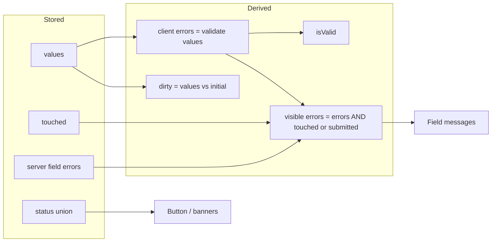
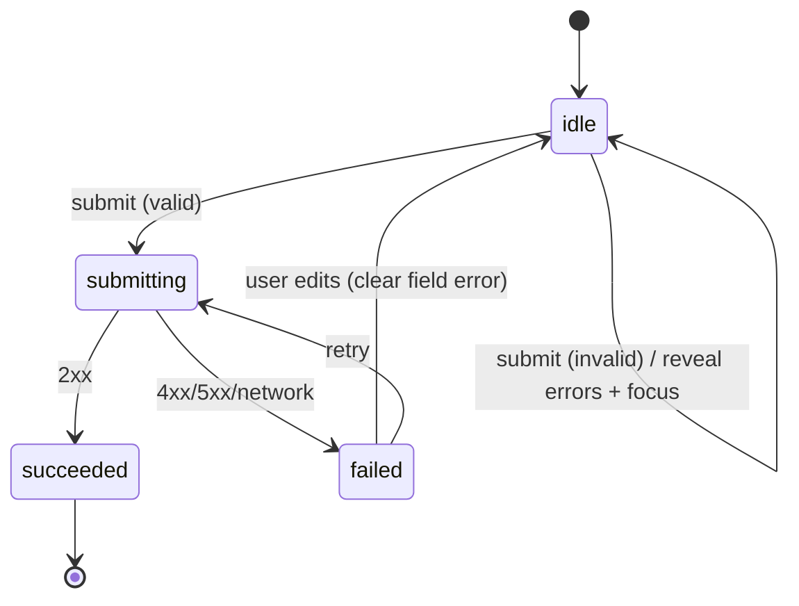

# 03 / 21 — Forms and Complex State

## 1. Lesson metadata

| | |
|---|---|
| **Level** | Intermediate–Advanced |
| **Study time** | 5–6 hours (reading 2 h, building 2 h, exercises 1.5 h) |
| **Prerequisites** | [Phase 1 / 11 — Controlled and uncontrolled inputs](../01-react-fundamentals/11-controlled-and-uncontrolled-inputs.md), [03 — useReducer](./03-usereducer-and-reducer-architecture.md), [10 — useRef](./10-useref-and-mutable-references.md), [17 — Derived state](./17-derived-state.md), [18 — Colocation and lifting](./18-state-colocation-and-lifting.md), [19 — UI, server, URL, shared state](./19-ui-server-url-and-shared-state.md), [20 — useSyncExternalStore](./20-usesyncexternalstore-and-external-stores.md) |
| **Next** | [22 — Modern hooks and APIs](./22-modern-hooks-and-apis.md) (the Actions hooks are introduced here and detailed there) |
| **Related later** | [Phase 6 / 05 — Optimistic updates](../06-data-fetching-and-state-ecosystems/05-optimistic-updates.md), [Phase 5 / 12 — Reducer pattern](../05-design-patterns/12-reducer-pattern.md), [Phase 5 / 13 — State machine pattern](../05-design-patterns/13-state-machine-pattern.md), Project 4 — Complex form system (`projects/`) |

**Learning objectives.** After this lesson you can:
1. Decompose "form state" into values, touched/dirty flags, validation errors, and submission status, and decide which are stored and which are derived.
2. Choose between uncontrolled inputs + `FormData`, controlled inputs, and React 19 form Actions for a given form.
3. Model a complex form (nested/array fields, dependent fields, multi-step wizard) with `useReducer` and a discriminated-union status.
4. Implement validation as pure functions with the right timing (on change, blur, submit) and the right error-display policy.
5. Use `<form action>` with `useActionState`, understand automatic form reset, and preserve user input on validation failure.
6. Build accessible forms (labels, `aria-invalid`, `aria-describedby`, focus management) and avoid common performance traps.
7. Evaluate when a form library is justified.

**Concepts covered:** form state anatomy, controlled vs uncontrolled, `FormData`, form Actions, `useActionState` (usage), pending state, validation timing, error derivation, dirty/touched, field arrays and keys, dependent fields, wizard state machines, server validation, accessibility, re-render cost, form libraries.

---

## 2. Deep conceptual explanation

### 2.1 What problem is this lesson solving?

Forms are where most application state complexity concentrates. A "simple" signup form already has:

- **Values** the user is typing (strings, booleans, files, selections).
- **Validity** (what is wrong, when to *show* it).
- **Interaction history** (was this field visited? changed from the initial value?).
- **Submission lifecycle** (idle → submitting → success/failed; double-submit prevention).
- **Server responses** (field errors, global errors, redirects).
- **Accessibility** (announcements, focus movement).

Put all of that in a dozen unrelated `useState` calls and you get inconsistent state (submitting while errors show), stale validation, huge re-render fans, and untestable logic. This lesson gives a systematic model and shows where React 19's form primitives simplify things and where they don't.

### 2.2 The anatomy of form state

| Piece | Stored or derived? | Notes |
|---|---|---|
| **Values** | Stored (in the DOM for uncontrolled inputs; in React state for controlled) | The only truly independent data entered by the user. |
| **Initial values** | Prop / constant | Needed for `dirty` and reset. |
| **Errors** | **Derived** from values (+ server errors) by pure `validate()` | Storing client-side errors in state invites staleness. Server-originated errors *are* stored (they come from outside). |
| **Touched** (per field) | Stored | A UX policy flag: "has the user left this field?". |
| **Dirty** (per field/form) | **Derived** from values vs initial values | `!Object.is(values[k], initial[k])` — never separately stored. |
| **isValid** | **Derived** | `Object.keys(errors).length === 0`. |
| **Submission status** | Stored (discriminated union) | `idle | submitting | succeeded | failed` and, on failure, the error. |
| **Submit count** | Stored (optional) | Lets you reveal all errors after the first submit attempt. |

The derive-don't-store rule from [17](./17-derived-state.md) is the main simplification: only **values**, **touched**, **status**, and **server errors** are state.

### 2.3 Three ways to hold values

| Approach | Where the truth lives while typing | Re-renders per keystroke | Good for |
|---|---|---|---|
| **Uncontrolled** (`name` attributes, `defaultValue`, read with `FormData` on submit) | The DOM | None | Simple forms, file inputs, forms validated on submit, progressive enhancement |
| **Controlled** (`value` + `onChange`) | React state | The component owning the state and its children | Live validation, formatting/masking, dependent fields, character counters |
| **Hybrid**: uncontrolled with `ref`s or `onChange`/`onBlur` listeners that *read* values for validation | DOM + a small amount of React state | Only when validation result changes | Large forms where re-render cost matters (this is, in essence, how some form libraries work; check each library's docs) |

Refresher on the controlled contract ([Phase 1 / 11](../01-react-fundamentals/11-controlled-and-uncontrolled-inputs.md)): a controlled input's displayed value is *always* the prop `value`; if you don't update it in `onChange`, typing appears to do nothing. Switching an input between controlled and uncontrolled (`value` going from `undefined` to a string) triggers a warning and indicates a bug (initialize with `''`, not `undefined`).

### 2.4 React 19 form Actions

React 19 lets you pass a **function** as `<form action>`:

```tsx
<form action={async (formData: FormData) => { await save(formData); }}>
```

Public behavior (react.dev reference for `<form>`):
- React calls your function with the form's `FormData` when the form is submitted, and prevents the default browser submission (for function actions).
- The call is wrapped in a **Transition**, so UI during the async work remains responsive and pending state is available (`useFormStatus`, `useActionState`'s `isPending`) — see [22](./22-modern-hooks-and-apis.md).
- After the Action completes, React **resets uncontrolled form fields** to their default values (documented in the React 19 release post: "When a `<form>` Action succeeds, React will automatically reset the form for uncontrolled components"; sandbox-verified on 19.3.1, including after a *failed validation* that merely returns an error state). This surprises developers who return validation errors and find their input cleared. Strategies are in §5.4.
- When `action` is a string URL, it behaves like the normal HTML form submission.
- `requestFormReset` (from `react-dom`) lets you trigger the reset behavior programmatically (React 19 release post; the function takes the form element, and we confirmed that calling it inside `startTransition` resets uncontrolled fields to their `defaultValue`). There is currently no dedicated reference page for it on react.dev.

`useActionState(action, initialState)` ([22](./22-modern-hooks-and-apis.md)) layers state on top: the Action's return value becomes the next `state`, and the Action receives `(previousState, formData)`.

Actions do not replace controlled inputs. They are best at **submission** (async lifecycle, pending, results, progressive enhancement with Server Functions); they say nothing about per-keystroke validation or formatting.

### 2.5 Validation: when and what

Validation is a **pure function** from values to errors:

```ts
type Errors<V> = Partial<Record<keyof V, string>>;
function validate(values: V): Errors<V> { /* pure, synchronous */ }
```

Separate three questions that beginners fuse:

1. **When do we compute errors?** (Always during render, derived from current values — cheap.)
2. **When do we show errors?** (A UX policy: after blur, after first submit attempt, or live after the first showing.)
3. **Where is the authority?** (Server. Client validation is a convenience; the server must re-validate everything.)

Common display policies:

| Policy | Pros | Cons |
|---|---|---|
| On submit only | Never nags | Late feedback; many errors at once |
| On blur ("touched") | Feedback after the user finished a field | Needs touched flags; cross-field rules show late |
| On change | Immediate | Noisy ("invalid email" after typing 'a') — use "reward early, punish late": show errors on blur first time, then live while the field is invalid |
| Debounced async (e.g., username availability) | Server-checked uniqueness | Race conditions, needs cancellation ([Phase 6 / 02](../06-data-fetching-and-state-ecosystems/02-cancellation-and-race-conditions.md)) |

### 2.6 Complex forms

Complexity multiplies along these axes:

- **Dependent fields** (country → state list; plan → available add-ons): derive options from values; clear dependent values *in the event handler that changes the parent* (not in an effect).
- **Field arrays** (line items, phone numbers): each item needs a **stable id** for `key` ([Phase 1 / 09](../01-react-fundamentals/09-lists-keys-and-identity.md)); index keys cause values to jump between rows when removing items.
- **Nested objects**: update immutably; a reducer with path-based updates or a normalized structure keeps updates localized.
- **Multi-step wizards**: step is *navigation state* (possibly URL — [19](./19-ui-server-url-and-shared-state.md)); values persist across steps (lifted to the wizard); validation is per step; submission aggregates.
- **Async submission & concurrency**: disable or ignore duplicate submissions; handle server-side field errors mapping.
- **Large forms**: re-rendering 100 inputs per keystroke can matter ([11](./11-usememo-and-usecallback.md), [12](./12-react-memo.md)).

### 2.7 Misconceptions

| Misconception | Reality |
|---|---|
| "Every input must be controlled." | Uncontrolled + `FormData` is simpler and often better, particularly for submit-only validation and file inputs. |
| "`required`/`type=email` HTML attributes are old-fashioned." | Native constraint validation is accessible, localized, and free. Use it as a baseline; layer custom validation on top (and set `noValidate` only when you replace its UI deliberately). |
| "Client validation makes the form secure." | Client checks are bypassable. The server must validate. |
| "Store `errors` in state." | Derive them; store only what cannot be recomputed. |
| "A form library is always required." | For 1–10 field forms, platform + React is enough. Libraries pay off with large dynamic forms, complex validation schemas, and team consistency. |
| "After a form Action fails, my fields are broken." | React resets *uncontrolled* fields after an Action completes. It's designed behavior; you preserve input by returning values and using `defaultValue`, or by using controlled inputs. |
| "`onSubmit` + `preventDefault` is obsolete." | Still valid and necessary for controlled-form flows or when you need event details. Actions are an additional option. |

---

## 3. Internal mechanics

### 3.1 Public guarantees

- **Public guarantee.** Controlled inputs: React sets the DOM `value` to the prop on each render and restores it if the DOM value differs after an event handler without a state update ("controlled" semantic). Details in [Phase 1 / 11](../01-react-fundamentals/11-controlled-and-uncontrolled-inputs.md).
- **Public guarantee.** `FormData` built from a `<form>` contains the *successful controls* by `name`: disabled controls and controls without a `name` are omitted; unchecked checkboxes/radios are omitted; the submitter button's `name/value` is included when it triggered the submit. (HTML standard, "constructing the entry list".)
- **Public guarantee.** A function passed to `<form action>` receives the `FormData`, runs inside a Transition, and (for uncontrolled fields) triggers a form reset when it completes. Pending UI is available through `useFormStatus` (in a child of the form) and `useActionState`.
- **Public guarantee.** `useActionState`'s dispatch queues actions and runs them in order, each receiving the previous returned state ([22](./22-modern-hooks-and-apis.md)).

### 3.2 Teaching model

```text
user types ──► (controlled) onChange ──► reducer ──► new values ──► render
                                                        │
                                           derive: errors, dirty, isValid
                                                        │
user blurs ──► touched[field] = true ──► render shows errors only for touched fields
user submits ─► if !isValid: reveal all errors, focus first invalid, stop
             ─► else: status = submitting ─► await server ─► status = succeeded | failed(+serverErrors)
```

With form Actions the "submit" half is delegated: the Action function does the async work, React supplies pending status and applies the returned state.

### 3.3 Implementation detail

- How React coordinates the form reset with the Transition completion and how it handles `defaultValue` updates in the same commit is internal; rely on documented behavior and test your flow in the React version you ship. If you need to preserve typed values after failures, prefer approaches the docs show (returning values and re-rendering with `defaultValue`, or controlled inputs) and verify in a test.
- DOM-level details (e.g., `input.value` vs `defaultValue` vs the `value` attribute) are part of the HTML/DOM platform; React's controlled implementation sets the property, not just the attribute.

---

## 4. Step-by-step execution walkthrough

**Scenario:** a controlled signup form with blur validation, using the reducer from §5.3. The user types an invalid email, tabs away, fixes it, and submits.

1. **Initial render.** `values = {email:'', password:''}`, `touched = {}`, `status = idle`. `validate(values)` computes `{email: 'Required', password: 'Required'}` — but nothing is shown because no field is touched and no submit attempted (`showError(field) = touched[field] || submitCount > 0`).
2. **Type "a".** `onChange` → `dispatch({type:'change', field:'email', value:'a'})` → reducer returns new `values` → component re-renders; `validate` yields `'Invalid email'`; still hidden (not touched).
3. **Tab out.** `onBlur` → `dispatch({type:'blur', field:'email'})` → `touched.email = true` → re-render shows "Invalid email" under the field with `aria-invalid="true"` and `aria-describedby` pointing to the error element.
4. **Type "a@b.co".** Each keystroke re-renders; the error disappears as soon as validation passes (live correction after first display).
5. **Click Submit** (`type="submit"` button, `onSubmit` on `<form>`).
6. **`onSubmit` handler.** `e.preventDefault()`. Compute errors; password is still `''` → invalid. Dispatch `{type:'submitAttempt'}` → `submitCount = 1` → all errors now visible. Focus the first invalid field via a ref (imperative, in the handler). Return.
7. **Fix password, submit again.** Valid. Dispatch `{type:'submitStart'}` → `status = 'submitting'`; the button is `disabled` (and the handler also ignores duplicate calls via status check, since `disabled` is only a UI guard).
8. **Await server.** On 200 → `{type:'submitSuccess'}`; on 422 with field errors → `{type:'submitFailure', serverErrors}`; on network error → `{type:'submitFailure', error}`.
9. **Render.** Success: navigate or show confirmation. Failure: show server errors merged with client errors; values preserved (controlled state was never reset).

---

## 5. Code examples

### 5.1 Minimal: uncontrolled form with `FormData`

```tsx
function NewsletterForm() {
  function onSubmit(e: React.FormEvent<HTMLFormElement>) {
    e.preventDefault();
    const data = new FormData(e.currentTarget);
    const email = String(data.get('email') ?? '').trim();
    console.log({ email, consent: data.get('consent') === 'on' });
  }

  return (
    <form onSubmit={onSubmit}>
      <label htmlFor="email">Email</label>
      <input id="email" name="email" type="email" required autoComplete="email" />
      <label>
        <input type="checkbox" name="consent" /> I agree to receive email
      </label>
      <button type="submit">Subscribe</button>
    </form>
  );
}
```

Notes:
- No state at all: zero re-renders while typing. Browser constraint validation (`required`, `type="email"`) blocks submission and shows native messages; `onSubmit` only fires when the form is valid (unless `noValidate`).
- `data.get(...)` returns `FormDataEntryValue | null` (`string | File | null`): coerce deliberately.
- An unchecked checkbox is absent from `FormData` (`null`); a checked checkbox without `value` yields `"on"`.

**Predict:** What does `data.get('age')` give for `<input name="age" type="number" value=...>` with the value `42`?
**Answer:** The string `"42"`. All form values are strings (or `File`); parse numbers explicitly.

### 5.2 Incorrect: scattered state and effect-driven validation

```tsx
// 🔴
function Signup() {
  const [email, setEmail] = useState('');
  const [emailError, setEmailError] = useState('');
  const [valid, setValid] = useState(false);

  useEffect(() => {
    setEmailError(/^\S+@\S+$/.test(email) ? '' : 'Invalid email');
  }, [email]);

  useEffect(() => {
    setValid(emailError === '');
  }, [emailError]);
  // ...
}
```

**Problems:** `emailError` and `valid` are derived state stored via effects ([07](./07-you-might-not-need-an-effect.md)): each keystroke causes up to three renders, with intermediate frames where `email` is new but `emailError`/`valid` are old (e.g., submit button enabled for one frame with an invalid email). It also scales poorly: N fields, 2N effects.

### 5.3 Corrected: a reducer-driven form with derived errors

```tsx
import { useReducer, useRef } from 'react';

interface SignupValues {
  email: string;
  password: string;
  plan: 'free' | 'pro';
}

type Errors = Partial<Record<keyof SignupValues, string>>;

function validate(v: SignupValues): Errors {
  const e: Errors = {};
  if (!v.email) e.email = 'Email is required';
  else if (!/^\S+@\S+\.\S+$/.test(v.email)) e.email = 'Enter a valid email';
  if (v.password.length < 8) e.password = 'At least 8 characters';
  return e;
}

type Status =
  | { kind: 'idle' }
  | { kind: 'submitting' }
  | { kind: 'succeeded' }
  | { kind: 'failed'; message: string; fieldErrors: Errors };

interface FormState {
  values: SignupValues;
  touched: Partial<Record<keyof SignupValues, boolean>>;
  submitCount: number;
  status: Status;
}

type Action =
  | { type: 'change'; field: keyof SignupValues; value: string }
  | { type: 'blur'; field: keyof SignupValues }
  | { type: 'submitAttempt' }
  | { type: 'submitStart' }
  | { type: 'submitSuccess' }
  | { type: 'submitFailure'; message: string; fieldErrors: Errors };

const initial: FormState = {
  values: { email: '', password: '', plan: 'free' },
  touched: {},
  submitCount: 0,
  status: { kind: 'idle' },
};

function reducer(state: FormState, action: Action): FormState {
  switch (action.type) {
    case 'change': {
      // clear stale server error for this field when the user edits it
      let status: Status = state.status;
      if (status.kind === 'failed') {
        // omit the key (do not set it to undefined: `{...a, ...{k: undefined}}` overrides a.k)
        const { [action.field]: _removed, ...rest } = status.fieldErrors;
        status = { ...status, fieldErrors: rest };
      }
      return {
        ...state,
        values: { ...state.values, [action.field]: action.value },
        status,
      };
    }
    case 'blur':
      return { ...state, touched: { ...state.touched, [action.field]: true } };
    case 'submitAttempt':
      return { ...state, submitCount: state.submitCount + 1 };
    case 'submitStart':
      return { ...state, status: { kind: 'submitting' } };
    case 'submitSuccess':
      return { ...state, status: { kind: 'succeeded' } };
    case 'submitFailure':
      return {
        ...state,
        status: { kind: 'failed', message: action.message, fieldErrors: action.fieldErrors },
      };
  }
}
```

Design notes:
- **Only four things are stored**: values, touched, submitCount, status. Client errors are **not** stored.
- `status` is a discriminated union: you cannot be `submitting` and `failed` simultaneously; the failed variant carries its data ([Phase 0 / 19](../00-web-and-javascript-foundations/19-typescript-generics-and-utility-types.md) for discriminated unions).
- The `change` case clears the server error for the edited field — a business rule expressed in the reducer, not in an effect.
- The reducer is pure; `Date.now()`/network calls live in the event handler.

```tsx
export function SignupForm({ onSubmitToServer }: {
  onSubmitToServer: (v: SignupValues) => Promise<{ ok: true } | { ok: false; fieldErrors: Errors; message: string }>;
}) {
  const [state, dispatch] = useReducer(reducer, initial);
  const refs = {
    email: useRef<HTMLInputElement>(null),
    password: useRef<HTMLInputElement>(null),
  };

  // Derived, not stored:
  const clientErrors = validate(state.values);
  const serverErrors = state.status.kind === 'failed' ? state.status.fieldErrors : {};
  const errors: Errors = { ...clientErrors, ...serverErrors }; // server overrides while present
  const isValid = Object.keys(clientErrors).length === 0;
  const show = (f: keyof SignupValues) => (state.touched[f] || state.submitCount > 0) && errors[f];

  async function handleSubmit(e: React.FormEvent<HTMLFormElement>) {
    e.preventDefault();
    if (state.status.kind === 'submitting') return; // duplicate-submit guard
    dispatch({ type: 'submitAttempt' });
    if (!isValid) {
      const firstInvalid = (['email', 'password'] as const).find((f) => clientErrors[f]);
      if (firstInvalid) refs[firstInvalid].current?.focus();
      return;
    }
    dispatch({ type: 'submitStart' });
    try {
      const result = await onSubmitToServer(state.values);
      if (result.ok) dispatch({ type: 'submitSuccess' });
      else dispatch({ type: 'submitFailure', message: result.message, fieldErrors: result.fieldErrors });
    } catch {
      dispatch({ type: 'submitFailure', message: 'Network error. Try again.', fieldErrors: {} });
    }
  }

  return (
    <form onSubmit={handleSubmit} noValidate>
      <div>
        <label htmlFor="email">Email</label>
        <input
          id="email"
          ref={refs.email}
          value={state.values.email}
          onChange={(e) => dispatch({ type: 'change', field: 'email', value: e.target.value })}
          onBlur={() => dispatch({ type: 'blur', field: 'email' })}
          aria-invalid={Boolean(show('email'))}
          aria-describedby={show('email') ? 'email-error' : undefined}
          autoComplete="email"
        />
        {show('email') && <p id="email-error" role="alert">{errors.email}</p>}
      </div>
      {/* password field analogous */}
      <button type="submit" disabled={state.status.kind === 'submitting'}>
        {state.status.kind === 'submitting' ? 'Creating…' : 'Create account'}
      </button>
      {state.status.kind === 'failed' && <p role="alert">{state.status.message}</p>}
    </form>
  );
}
```

Key lines:
- `noValidate` turns off native bubbles because we render our own accessible messages; if you keep native validation instead, omit `noValidate` and rely on browser UI.
- The duplicate-submit guard reads `state.status` from the closure: it reflects the state **of the render in which the handler was created** ([Phase 1 / 14](../01-react-fundamentals/14-state-as-a-snapshot.md)). Two very fast clicks within the same render could both pass the check before the `submitStart` render commits. For strict protection use a ref (`inFlightRef.current`) or rely on the disabled button after the first update plus server idempotency. Realistically, React processes a discrete event's updates synchronously before the next click's event, so double-click protection by state works for human clicks; programmatic double calls or Enter-key + click races deserve the ref guard. ⚠ Don't rely on `disabled` alone for money-moving operations: the server must be idempotent (idempotency keys).
- `role="alert"` makes assistive tech announce errors when inserted; use sparingly (one live region per message is fine; for many errors prefer an error summary region with focus management).

**Predict:** The user types an invalid email, never blurs, and presses Enter. What shows?
**Answer:** `submitAttempt` increments `submitCount`, so `show('email')` is truthy → error appears; the email input receives focus; no request is made.

### 5.4 Form Actions with `useActionState`: preserving input after validation failure

```tsx
import { useActionState } from 'react';

interface ContactState {
  status: 'idle' | 'error' | 'success';
  values: { email: string; message: string };
  errors: Partial<Record<'email' | 'message', string>>;
}

const initialContact: ContactState = {
  status: 'idle',
  values: { email: '', message: '' },
  errors: {},
};

async function sendContact(prev: ContactState, formData: FormData): Promise<ContactState> {
  const values = {
    email: String(formData.get('email') ?? '').trim(),
    message: String(formData.get('message') ?? '').trim(),
  };
  const errors: ContactState['errors'] = {};
  if (!/^\S+@\S+\.\S+$/.test(values.email)) errors.email = 'Enter a valid email';
  if (values.message.length < 10) errors.message = 'Tell us a bit more (10+ chars)';
  if (Object.keys(errors).length > 0) return { status: 'error', values, errors };

  const res = await fetch('/api/contact', { method: 'POST', body: JSON.stringify(values),
    headers: { 'Content-Type': 'application/json' } });
  if (!res.ok) return { status: 'error', values, errors: { message: 'Server rejected the message' } };
  return { status: 'success', values: { email: '', message: '' }, errors: {} };
}

export function ContactForm() {
  const [state, formAction, isPending] = useActionState(sendContact, initialContact);

  return (
    <form action={formAction}>
      <label htmlFor="c-email">Email</label>
      <input
        id="c-email"
        name="email"
        type="email"
        defaultValue={state.values.email}
        aria-invalid={Boolean(state.errors.email)}
        aria-describedby={state.errors.email ? 'c-email-err' : undefined}
        key={`email-${state.status}-${state.values.email}`}
      />
      {state.errors.email && <p id="c-email-err">{state.errors.email}</p>}

      <label htmlFor="c-msg">Message</label>
      <textarea id="c-msg" name="message" defaultValue={state.values.message}
        aria-invalid={Boolean(state.errors.message)} />
      {state.errors.message && <p role="alert">{state.errors.message}</p>}

      <button type="submit" disabled={isPending}>{isPending ? 'Sending…' : 'Send'}</button>
      {state.status === 'success' && <p role="status">Thanks! We'll reply soon.</p>}
    </form>
  );
}
```

Explanation:
- The Action receives `(prevState, formData)` — **previous state first**. The most common mistake is writing `async (formData) => ...` and getting the previous state instead.
- On validation failure we **return the submitted values** and render them as `defaultValue`. React resets the uncontrolled fields after the Action completes; the reset restores the (new) `defaultValue`, which now contains what the user typed. ⚠ Sandbox-verified on React 19.3.1: after the Action returns `{ email }`, an input with `defaultValue={state.email}` shows the submitted text, and an input without it is cleared. A `key` that changes with the returned state is an optional extra for fields that must remount; it is not required for this to work, and it discards focus. Keep a test for this flow. Alternatively use controlled inputs and leave the Action only for submission.
- The Action function is a plain async function: it can run on the client (here) or, in a framework, be a Server Function (`'use server'`), which makes the form work before JS loads (progressive enhancement) — see [22](./22-modern-hooks-and-apis.md) and framework docs (framework-specific).
- Returning errors instead of throwing keeps queued Actions alive; throwing sends the error to the nearest Error Boundary ([Phase 4 / 19](../04-react-architecture/19-error-boundaries.md)).
- `isPending` is true while the Action runs because React wraps the form submission in a Transition.

### 5.5 Field arrays: stable ids and immutable updates

```tsx
interface LineItem { id: string; sku: string; qty: number }

type ItemsAction =
  | { type: 'add'; id: string } // id generated in the event handler, not here
  | { type: 'remove'; id: string }
  | { type: 'update'; id: string; patch: Partial<Omit<LineItem, 'id'>> };

function itemsReducer(items: LineItem[], a: ItemsAction): LineItem[] {
  switch (a.type) {
    case 'add':
      return [...items, { id: a.id, sku: '', qty: 1 }];
    case 'remove':
      return items.filter((i) => i.id !== a.id);
    case 'update':
      return items.map((i) => (i.id === a.id ? { ...i, ...a.patch } : i));
  }
}
```

Two traps:
1. **Index keys** (`items.map((item, i) => <Row key={i} .../>)`): remove row 0 and rows shift; each `<Row>` instance (and any internal state — uncontrolled inputs, focus) stays attached to the *index*, so the DOM input of the old row 0 now shows the data of old row 1 or retains stale uncontrolled text. Use the stable `id` ([Phase 1 / 09](../01-react-fundamentals/09-lists-keys-and-identity.md), [Phase 2 / 07](../02-react-rendering-and-internals/07-identity-keys-and-reconciliation.md)).
2. **ID generation inside the reducer** (the tempting `crypto.randomUUID()` in the `add` case) is impure: in StrictMode dev reducers run twice and would yield different ids per call, and React may re-run a reducer. The version above takes the id from the action; generate it in the event handler: `dispatch({ type: 'add', id: crypto.randomUUID() })`. `crypto.randomUUID` also requires a secure context (HTTPS/localhost).

### 5.6 Dependent fields without effects

```tsx
function setCountry(values: Values, country: string): Values {
  // changing the parent resets the dependent child *in the same update*
  return { ...values, country, region: '' };
}
```

Used in the `change` handler/reducer case for `country`. The `useEffect(() => setRegion(''), [country])` alternative renders once with the **stale region** before the effect runs and clears it (an invalid combination visible for a frame, and possibly validated). See [07](./07-you-might-not-need-an-effect.md).

### 5.7 Advanced: a wizard as a state machine

```ts
type Step = 'account' | 'profile' | 'review';

type WizardState =
  | { step: 'account'; data: Partial<AccountData> }
  | { step: 'profile'; data: { account: AccountData } & Partial<{ profile: ProfileData }> }
  | { step: 'review'; data: { account: AccountData; profile: ProfileData } };

type WizardAction =
  | { type: 'next'; payload: AccountData | ProfileData }
  | { type: 'back' };
```

Encoding "you cannot be on review without account and profile" in the **types** prevents a class of bugs (undefined data on later steps). Full state-machine treatment: [Phase 5 / 13](../05-design-patterns/13-state-machine-pattern.md), [Phase 6 / 12 — XState](../06-data-fetching-and-state-ecosystems/12-state-machines-and-xstate.md). Where should the current step live? In the URL (`/signup/profile`) if users should be able to reload/Back through steps ([19](./19-ui-server-url-and-shared-state.md)); values in a wizard-level reducer (or a draft saved to the server) so steps can unmount without losing data. Validate each step on "Next"; revalidate everything on final submit — and again on the server.

### 5.8 Performance: don't re-render 100 inputs per keystroke

If a controlled form with 100 fields lags: profile first ([Phase 2 / 30](../02-react-rendering-and-internals/30-react-devtools-profiler.md)). Options, from least to most invasive:

1. **Colocate** field-local state: a `<TextField>` keeps its own draft and reports to the parent on blur or debounced.
2. **Memoize rows** with `React.memo` + stable props ([12](./12-react-memo.md)); pass `dispatch` (stable) instead of fresh callbacks, and per-field values/errors only.
3. **Uncontrolled inputs** and read values on submit/blur.
4. **Field-level subscriptions** via an external store ([20](./20-usesyncexternalstore-and-external-stores.md)): each field subscribes to its slice; typing in one field re-renders only that field. Several form libraries are built around this idea; check the exact mechanism and APIs in your chosen library's current docs.

```tsx
const TextField = React.memo(function TextField(props: {
  name: string; label: string; value: string; error?: string;
  dispatch: React.Dispatch<Action>;
}) {
  // render only when this field's value/error changes
  return /* label + input */ null;
});
```

---

## 6. Visual explanations

### 6.1 Form state ownership



### 6.2 Submission lifecycle



### 6.3 Where the form Action fits

```text
<form action={fn}>  ─ submit ─►  React: startTransition(() => fn(formData))
                                   │ isPending = true (useFormStatus / useActionState)
                                   ▼
                              fn runs (client or Server Function)
                                   │ returns next state (useActionState)
                                   ▼
                    commit new state  +  reset uncontrolled fields
```

---

## 7. Alternative approaches and trade-offs

| Criterion | Uncontrolled + `FormData` | Controlled `useState` per field | Controlled `useReducer` | Form Actions + `useActionState` | Form library (React Hook Form, TanStack Form, Formik; check each library's current maintenance status) |
|---|---|---|---|---|---|
| Boilerplate | Lowest | Low, grows linearly | Medium | Low | Low per field; dependency |
| Re-renders per keystroke | None | Form component | Form component | None (uncontrolled) | Library-dependent (often minimized) |
| Live validation / masking | Awkward | Easy | Easy | Awkward (use controlled inputs inside) | Built in |
| Submission lifecycle (pending, result) | Manual | Manual | Reducer status | **Built in** | Built in |
| Progressive enhancement | Yes (native) | No | No | **Yes** with Server Functions | Usually no |
| Dynamic arrays/nesting | Manual | Painful | Manageable | Manual | Built in |
| Testability | Easy (user events) | Easy | Reducer unit tests + UI | Easy | Library idioms |
| TypeScript ergonomics | `FormData` is untyped | Good | Good | Return type typed | Good (schemas) |
| Best when | Simple/submit-only forms | ≤5 fields, live feedback | Complex single-form state, wizard | Submit lifecycle, SSR/progressive | Large, dynamic, many forms, team standard |

### 7.1 When the recommended approach is NOT best

*Recommendation:* "Derive errors; store only values/touched/status in a reducer."

*Counter-scenario:* A 300-field insurance application with conditional sections, cross-field rules, field-level async validation, and autosave. A hand-rolled reducer re-renders too much and you will reimplement dirty/touched tracking, array handling, schema validation, and devtools. A mature form library plus a schema validator, with the same server contract, will be cheaper and more consistent across teams. Conversely, for a login form, a library is overhead and a 30-line `FormData` handler is the best choice.

*Counter-scenario for Actions:* A form that needs per-keystroke formatting (credit-card spacing), cross-field live validation, and optimistic UI. Use controlled fields for editing and an Action for submission only.

---

## 8. Best practices and anti-patterns

**Practices**
- Start from **markup**: `<form>`, `<label htmlFor>`, `name`, correct `type`, `autoComplete`, `inputMode`; those give mobile keyboards, autofill, password managers, and accessibility for free.
- Submit with a **real submit button** inside a `<form>`; Enter-to-submit works without extra code.
- Validate with **pure functions** (shareable with the server/tests); derive errors; show them by policy.
- **Preserve user input** on every failure path.
- Use **stable ids** for dynamic rows.
- Disable the submit button while submitting *and* guard in the handler *and* design the server to be idempotent for important operations.
- Associate errors with inputs (`aria-describedby`, `aria-invalid`), announce them, and move focus to the first invalid field or an error summary after a failed submit.
- Treat server validation as the authority; map server field errors back to fields.
- Warn about unsaved changes only when `dirty` (derived), via `beforeunload` and router blockers — sparingly.

**Beginner mistakes:** missing `name`s (field missing from `FormData`); `value` without `onChange` (read-only warning); `undefined` → controlled switch; number inputs stored as numbers while typing (typing "1." loses the dot — keep the string, parse on submit); not calling `preventDefault` in `onSubmit` for SPA flows.

**Experienced-developer mistakes:** a global form store used for local forms; validating on every keystroke with expensive schemas (debounce or validate the changed field only); resetting forms with `key` hacks that also discard focus/scroll; trusting `disabled` for double-submit protection; storing derived errors; mixing controlled and uncontrolled strategies in one form without a rule; ignoring IME composition (CJK input) when live-formatting — modifying the value during composition breaks input. ⚠ Test with an IME if you format on change.

**Smells:** `useEffect` that calls `setErrors`; a `isValid` state; a `loading` boolean plus `error` boolean plus `success` boolean; field components that take 12 props because the form owns everything.

**Justified exceptions:** storing computed errors when validation is expensive/async (then it's *server-like state* with its own staleness handling); using `key` to reset a form when switching the edited entity (intentional identity reset).

---

## 9. Real-world application

- **E-commerce checkout.** Multi-step (address → shipping → payment). Address autocomplete is async; dependent fields (country → postal code format); payment fields are hosted iframes from the PSP, so you do **not** control their values — your form state only tracks completeness events. Constraints: idempotency keys for order submission, double-click protection, PCI scope.
- **Finance (transfer form).** Amount parsing (locale decimal separators, integers in minor units), cross-field rules (available balance), confirmation step, strong server validation, audit of submission attempts. Use `string` state and parse to integer minor units at the boundary; avoid floating point money.
- **Auth.** Login uses native form semantics to cooperate with password managers (`autocomplete="username"`, `current-password`); show non-enumerating errors ("invalid credentials"); throttle on the server.
- **Dashboards with filters.** A filter form that updates the URL on submit — the form is just an editor of URL state ([19](./19-ui-server-url-and-shared-state.md)); use `<form method="get">` with a route's search params for progressive enhancement.
- **CRUD admin (Project 4).** Schema-driven forms from a descriptor; field registry; shared validation between client and server; unsaved-changes guard; optimistic save with rollback ([22](./22-modern-hooks-and-apis.md)).
- **Multi-team design system.** Provide `<Field>` primitives that wire label/description/error ids and `aria-*` automatically so every team gets accessibility right by default ([Phase 4 / 20](../04-react-architecture/20-design-systems.md)).

---

## 10. Debugging and troubleshooting

**Symptom: "My field is missing on the server."**
Check the `name` attribute and that the control isn't `disabled` (disabled controls are excluded). In DevTools console: `[...new FormData(document.querySelector('form')).entries()]`.

**Symptom: "Typing does nothing."**
A controlled input whose `onChange` doesn't update the state it reads. React DevTools: inspect the component's hook values while typing; if they do not change, the handler is wrong. Also check that the `value` isn't being overwritten by a reducer case that returns the previous values.

**Symptom: "Warning: A component is changing an uncontrolled input to be controlled."**
`value` was `undefined` initially (e.g., from data not loaded). Initialize with `''` or gate rendering until data is present.

**Symptom: "Form clears after a failed submit" (Actions).**
React reset uncontrolled fields when the Action finished. Return submitted values and bind `defaultValue`, or switch to controlled inputs. Repro with a validation error; validate fix by typing, failing validation, and confirming the text remains and focus handling works.

**Symptom: "Rows swap values when deleting one."**
Index keys on field arrays. React DevTools shows the `key` prop on each row; switch to ids.

**Symptom: "Error appears for one frame then disappears" / "Submit enabled for a frame."**
Derived state implemented with effects (§5.2). Profile with the React DevTools Profiler: you'll see two commits per keystroke. Replace with derived values.

**Symptom: "Double submission creates two orders."**
Network panel shows two POSTs milliseconds apart. Add an in-flight ref guard, disable the button, and implement an idempotency key on the server.

**Symptom: "Typing lags in a big form."**
Profiler flame graph: every field re-renders per keystroke. Apply §5.8 in order, measuring each step.

**Symptom: "Screen reader doesn't announce errors."**
Inspect the accessibility tree (DevTools → Accessibility): is the error element associated (`aria-describedby`) and is a live region present? Test with a real screen reader; automated linters (axe) catch only part of this.

---

## 11. Exercises

### Level A — Knowledge
A1. Which parts of form state should be stored, and which derived? Justify each.
A2. What is excluded from `FormData`?
A3. Why does a form Action receive `(prevState, formData)` when used with `useActionState`?
A4. Give two reasons to prefer uncontrolled inputs and two to prefer controlled ones.
A5. Why must the server validate even when the client does?

### Level B — Code comprehension
B1. What does this log, and why? `<input name="n" type="number" defaultValue={5}/>` then `Number(new FormData(form).get('n')) + 1` after the user leaves it unchanged.
B2. In §5.3, the user edits the email after a server error "Email already taken". Trace the reducer and the displayed error.
B3. In §5.4, why is the Action's `values` returned even on error?

### Level C — Implementation
C1. Add a `reset` action to the reducer in §5.3 and an "unsaved changes" derived boolean `dirty`.
C2. Implement a `useFormField` hook returning `{ id, inputProps, errorProps }` that wires `htmlFor`, `aria-invalid`, `aria-describedby` consistently using `useId` (see [22](./22-modern-hooks-and-apis.md)).
C3. Build a line-items editor with add/remove, stable ids, per-row validation, and a total derived from rows (money in integer cents).

### Level D — Debugging
D1. A teammate's Action-based form loses the user's text on validation errors. Diagnose and give two fixes with trade-offs.
D2. Deleting the first row of a dynamic list moves its text into the second row's input. The rows are uncontrolled. Explain.
D3. The submit button is enabled for one frame with an invalid email. Find the mechanism and fix.

### Level E — Architecture decisions
E1. A product team wants 14 forms (login, settings, onboarding wizard, etc.). Decide the approach (platform/hand-rolled/library) and the shared abstractions (Field, validation, error mapping) with criteria.
E2. Where should wizard state live: component state, context, URL, server? Decide for a 4-step onboarding where users may close the tab and resume.

### Level F — Expert challenge
F1. Design an autosaving form (drafts every few seconds) with conflict detection across devices, optimistic UI, and offline tolerance. Specify state shapes, conflict policy, failure modes, and test strategy.

---

## 12. Detailed answers and explanations

> Attempt the exercises first.

**A1.** Stored: values (independent input), touched (UX history), submission status (async lifecycle), server field errors (external info), optional submit count. Derived: client errors (pure function of values), dirty (values vs initial), isValid (errors empty), visible errors (errors + policy). Storing the derived pieces creates synchronization bugs and extra renders ([17](./17-derived-state.md)).

**A2.** Controls without a `name`; disabled controls; unchecked checkboxes/radios; unselected options of a `<select>`; submit buttons other than the one that triggered the submit; `<input type=file>` with no file contributes an empty file entry (browser-specific details — check MDN). Also elements outside the form unless associated with the `form` attribute.

**A3.** `useActionState` implements a reducer-like pattern: the Action produces the next state from the previous state plus an input; the input is the `FormData` when used as a form action (or whatever you dispatch). Prior state is first so that the same function can be used as a reducer with any payload. Mixing the order up is the commonest error.

**A4.** Uncontrolled: no re-renders; simpler for file inputs and submit-only validation; works with native form submission/progressive enhancement. Controlled: live validation/formatting; dependent fields; programmatic setting (reset, defaults); instant derived UI (character counter).

**A5.** Client code is under the user's control: requests can be crafted without your UI. Also some rules (uniqueness, authorization, business invariants) are knowable only by the server. Client validation is UX; server validation is correctness/security.

**B1.** `6`. The value is the string `"5"`; `Number("5") + 1 = 6`. Without `Number`, `"5" + 1` would be `"51"` — a classic string-concatenation bug. Edge case: an empty number input yields `""`, so `Number("")` is `0` — handle empty explicitly.

**B2.** `change` case: `status.kind === 'failed'`, so the reducer destructures the edited field out of `fieldErrors` (the key is *omitted*) and updates `values`. In the component, `serverErrors.email` is now absent, so `errors` falls back to `clientErrors.email` — if the new value is valid, the message disappears immediately. Wrong answer: "the error stays until next submit" — that would happen if the reducer didn't clear it; clearing on edit avoids stale server messages. The subtle point is *omitting* the key rather than assigning `undefined`: `{ ...{email:'Invalid'}, ...{email: undefined} }` yields `email: undefined`, which would hide a legitimate **client** error, because spread copies own keys even when their value is `undefined`.

**B3.** Because React resets uncontrolled fields after the Action completes. Returning the submitted values lets the component render them as `defaultValue`, so the reset restores what the user typed instead of blank. With controlled inputs the problem doesn't arise.

**C1.**
```ts
// action: { type: 'reset' }
case 'reset': return initial;
// in component
const dirty = (Object.keys(initial.values) as (keyof SignupValues)[])
  .some((k) => !Object.is(state.values[k], initial.values[k]));
```
Reasoning: `dirty` derived each render; `reset` returns the constant initial state (immutable, safe to reuse). Edge: for objects/arrays inside values, use deep equality or compare serialized snapshots.

**C2.**
```tsx
import { useId } from 'react';

export function useFormField(error?: string) {
  const id = useId();
  const errorId = `${id}-error`;
  return {
    id,
    labelProps: { htmlFor: id },
    inputProps: {
      id,
      'aria-invalid': error ? (true as const) : undefined,
      'aria-describedby': error ? errorId : undefined,
    },
    errorProps: { id: errorId, role: 'alert' as const },
  };
}
```
Reasoning: `useId` generates SSR-stable unique ids (no `Math.random`, which breaks hydration). Evaluation: unique ids across multiple instances; association by id not by position; error element id only referenced when rendered.

**C3.** Evaluation criteria: reducer with `{type:'add', id}` (id generated in the handler), `update` by id, `remove` by id; qty/price kept as strings while typing and parsed to integers on blur/submit; total `rows.reduce((s, r) => s + toCents(r.price) * toInt(r.qty), 0)` computed in render and formatted with `Intl.NumberFormat`; per-row errors derived by `validateRow`; `React.memo` row component receiving `dispatch` and the row; keys are ids; test removing the first row keeps the right values. Pitfall mention: floating point (`0.1 + 0.2`).

**D1.** Diagnosis: React reset the uncontrolled fields after the Action. Fixes: (1) return submitted values and bind `defaultValue` (plus a `key` if needed) — keeps progressive enhancement and the Action flow, but you must keep the returned shape in sync with fields and verify reset timing; (2) switch to controlled inputs — more code and re-renders, but input state is independent of the reset. A third: use `onSubmit` with `preventDefault` and call the Action manually, no reset. Evaluation: names the reset, offers ≥2 fixes with trade-offs.

**D2.** Index keys (`key={i}`) mean React keeps instance *i* for position *i*. Uncontrolled inputs keep their DOM value in the DOM node; after removing the data for row 0, the first DOM node (with the text the user typed) stays attached to the new row 0 (old row 1's data) — React doesn't reset the DOM value because `defaultValue` changes don't overwrite what the user typed. Fix: stable ids as keys, which removes the *right* instance.

**D3.** `isValid` (or `disabled`) derives from `valid` state set in an effect after the email state changes: render N shows the new invalid email with the old `valid=true`; the effect then runs and sets `valid=false` causing render N+1. Fix: compute `isValid` during render from `validate(values)`.

**E1.** Example well-reasoned answer: Hybrid. Standardize on platform markup + a thin in-house `<Field>` component and pure `validate` functions (schemas via one validation library shared with the server) for simple forms (login, settings); adopt Actions for submission lifecycle where the framework supports Server Functions; adopt a form library for the two large dynamic forms (wizard, admin) if profiling/maintenance cost justifies. Criteria: field count and dynamism, live validation need, accessibility consistency, bundle size, learning curve, test strategy, SSR/progressive enhancement, long-term support of the library (verify maintenance status before adopting). Shared abstractions: Field wiring ids and aria; error-mapping function from server response to fields; `useUnsavedChanges`. Reject "one tool for everything" without evidence.

**E2.** Current step in the URL (reload/Back works, deep-linkable, analytics) validated against saved progress (don't allow jumping to step 4 without data); values in a wizard-level reducer for in-session editing and **persisted as a server-side draft** (or localStorage as fallback) so a closed tab can resume; sensitive data (passwords, card numbers) never persisted client-side. Component-local state alone loses data on unmount; context alone doesn't survive reload. Trade-off: server drafts need an API and cleanup policy.

**F1.** Example: State: `{ serverVersion, serverValues, draftValues, status: 'clean' | 'dirty' | 'saving' | 'conflict' | 'offline-queued', lastSavedAt }`. Autosave: debounce changes (e.g., 2 s), send `PATCH` with `baseVersion`; server uses optimistic concurrency (ETag/version) and returns 409 + latest server values on mismatch. Conflict policy: field-level merge when edits touch disjoint fields (three-way merge using base/server/draft); otherwise present a "keep mine / take theirs / merge" UI. Optimistic UI: show draft immediately; `saving` indicator is derived from status. Offline: queue saves in IndexedDB; replay on reconnect with version checks; keep a visible "offline — changes saved locally" state. Failure modes: out-of-order responses (use a request sequence number; ignore stale responses), tab duplication (BroadcastChannel/`storage` event), partial failures, unload during save (`navigator.sendBeacon` for last-chance, with caveats). Tests: reducer unit tests for every status transition; fake timers for debounce; MSW for 409/offline; Playwright with two browser contexts editing concurrently. Evaluation: explicit versioning, deterministic transitions, handles out-of-order responses, and tests conflicts.

---

## 13. Senior engineer interview questions

**Q1. "Controlled or uncontrolled inputs — how do you decide?"**
I ask what needs to react per keystroke. If nothing (submit-only validation), uncontrolled inputs plus `FormData` give zero re-renders, simpler code, native validation and progressive enhancement. If I need live validation, masking, dependent fields, or programmatic changes, controlled inputs make React the owner of the value so the UI is a pure function of state. For big forms I keep controlled state *per field* (or subscribe per field) to avoid re-rendering the entire form.

**Q2. "Why shouldn't validation errors be state?"**
They are a pure function of values; storing them creates two sources of truth and an interval where they disagree (typically one render behind when updated in an effect). Derive them every render and store only UX policy (touched/submitted) and external information (server errors).

**Q3. "What changes with React 19 form Actions?"**
Submission becomes a function with built-in async lifecycle: React runs it in a Transition, exposes pending state to children (`useFormStatus`) and to the owning component (`useActionState`), threads returned state through, and resets uncontrolled fields afterwards. With Server Functions, forms can even work before hydration. It doesn't replace field-level state management or validation policy.

**Q4. "A user double-clicks Pay. How do you ensure one charge?"**
Layered: disable the button after the first click, guard in the handler (a ref for synchronous protection), and — decisively — make the server operation idempotent with an idempotency key tied to the checkout attempt. UI guards fail with retries, multiple tabs, or network replays; only the server can be authoritative.

**Q5. "How do you keep a 100-field form fast?"**
Measure first. Then reduce re-render scope: per-field state or subscriptions, memoized field components with stable props (`dispatch`, ids), uncontrolled fields where live feedback is not needed, debounced/targeted validation (only the changed field), and avoid recreating handler props. Each change is validated by the Profiler showing only the edited field re-rendering.

**Q6. "How do you make forms accessible?"**
Native elements and labels first; programmatic association of errors and hints through `aria-describedby`; `aria-invalid`; announcing errors (live region or focus to an error summary); logical focus order and focus-first-error on failed submit; sufficient contrast and not relying on color alone; keyboard operation; testing with a screen reader, not only automated tools.

**Q7. "Why use ids instead of indexes as keys for field arrays?"**
Keys define identity; state (including DOM state of uncontrolled inputs and focus) is attached to identity. With index keys, deleting a row reassigns identities by position, so state attaches to the wrong item. Stable ids make removal affect the correct instance.

---

## 14. Further learning resources

| Resource | URL | Covers / why | Level | Study |
|---|---|---|---|---|
| React docs — `<form>` | <https://react.dev/reference/react-dom/components/form> | Form Actions, `action` prop, pending state, reset behavior | Intermediate | Usage sections |
| React docs — `<input>` | <https://react.dev/reference/react-dom/components/input> | Controlled/uncontrolled inputs and caveats | Beginner–Int. | Usage, Troubleshooting |
| React docs — `useActionState` | <https://react.dev/reference/react/useActionState> | Signature, `permalink`, error behavior | Intermediate | Whole page |
| React docs — `useFormStatus` | <https://react.dev/reference/react-dom/hooks/useFormStatus> | Pending status in child components | Intermediate | Whole page |
| React docs — Reacting to Input with State | <https://react.dev/learn/reacting-to-input-with-state> | Form modeled as a state machine (statuses) | Beginner | The form example |
| React docs — Choosing the State Structure | <https://react.dev/learn/choosing-the-state-structure> | Avoid contradictory/redundant state | Beginner–Int. | Principles |
| MDN — Client-side form validation | <https://developer.mozilla.org/en-US/docs/Learn/Forms/Form_validation> | Native constraint validation | Beginner | Whole page *(path may have moved under `Learn_web_development`; search the title)* |
| MDN — `FormData` | <https://developer.mozilla.org/en-US/docs/Web/API/FormData> | Construction and entries semantics | Beginner | Whole page |
| WAI — Forms tutorial | <https://www.w3.org/WAI/tutorials/forms/> | Accessible labels, instructions, validation, notifications | Intermediate | Validation, Notifications |
| React Hook Form docs | <https://react-hook-form.com/> | Uncontrolled-first form library  | Intermediate | Get started |
| TanStack Form docs | <https://tanstack.com/form> | Headless, typed form library  | Intermediate | Overview |

---

## 15. Knowledge checkpoint

**You should now understand**
- Form state anatomy and which pieces are stored versus derived.
- Controlled, uncontrolled, and Action-based approaches and their costs.
- Validation as pure functions with a separate display policy.
- Why identity (keys) and purity (ids generated in handlers) matter in dynamic forms.

**You should be able to explain without notes**
- Why React resets uncontrolled fields after an Action and how to preserve input.
- Why disabling a button is not double-submit protection.
- Why `useActionState` passes previous state first.

**You should be able to implement**
- A reducer-driven form with a discriminated-union status and derived errors.
- A `<form action>` with `useActionState` that preserves values on failure.
- A field array editor with stable ids and a wizard with typed steps.

**You should be able to debug**
- Missing `FormData` fields, controlled/uncontrolled warnings, effect-lag in validation, key-related row corruption, and typing lag in large forms.

**Before moving on:** read [22 — Modern hooks and APIs](./22-modern-hooks-and-apis.md) for the full treatment of `useActionState`, `useOptimistic`, `useFormStatus`, `useTransition`, `use`, `useId`, and `useEffectEvent`.
