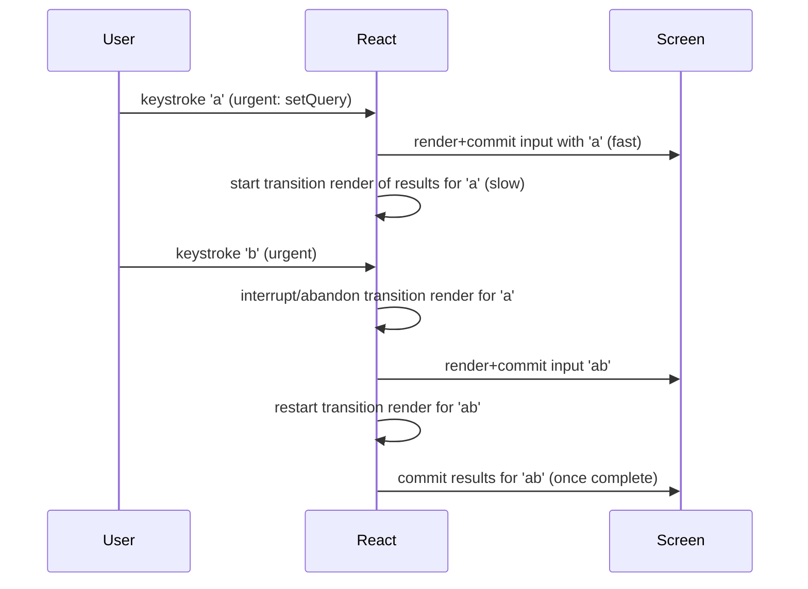
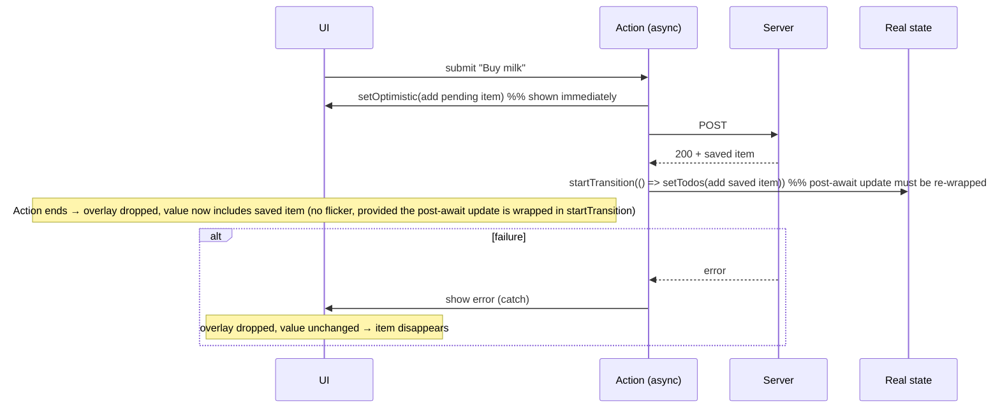
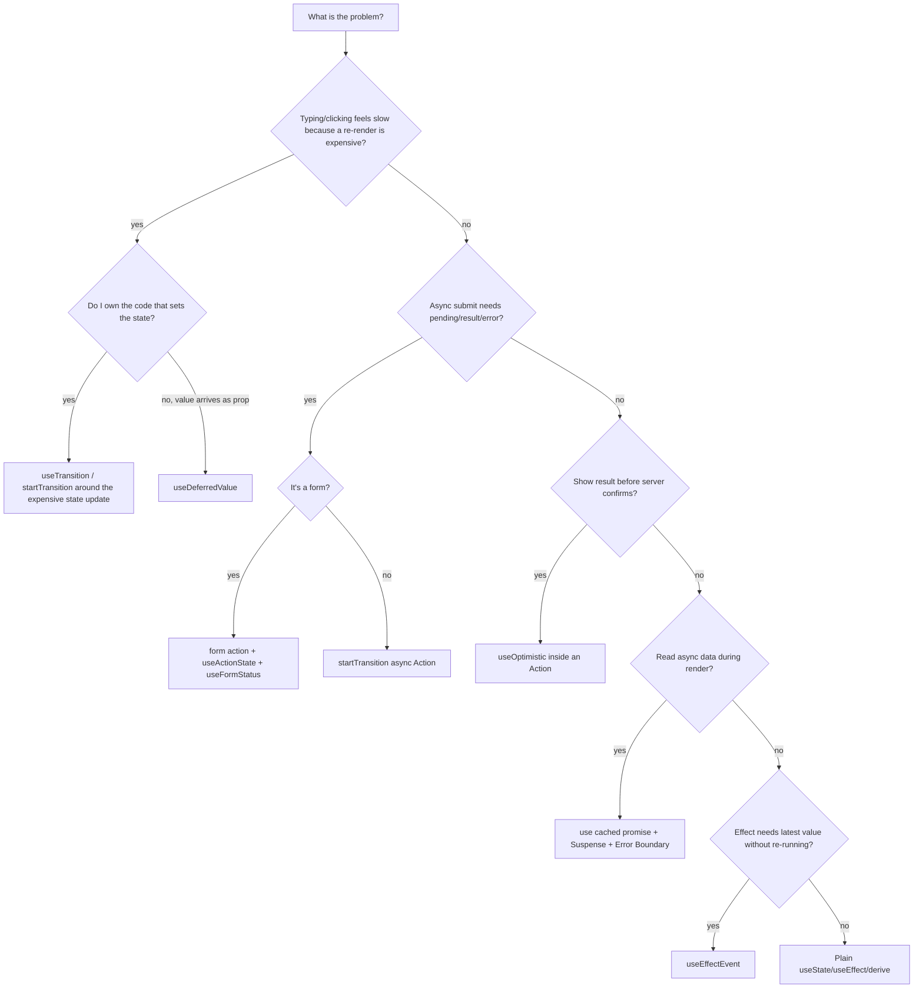
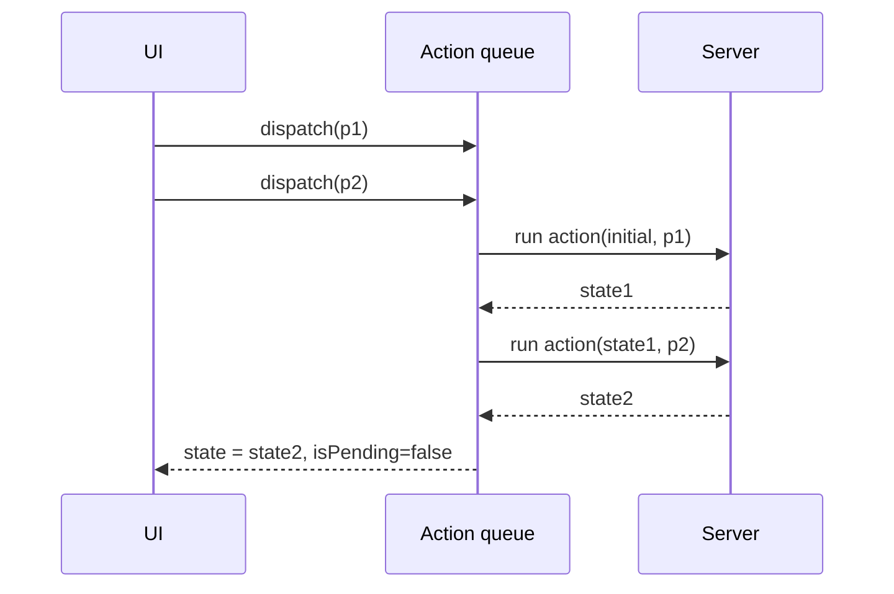

# 03 / 22 — Modern Hooks and APIs: `use`, Transitions, Actions, Optimistic UI, `useId`, `useEffectEvent`

## 1. Lesson metadata

| | |
|---|---|
| **Level** | Advanced |
| **Study time** | 7–8 hours (reading 3 h, experiments 2 h, exercises 2 h) |
| **Prerequisites** | [01 — useState internals](./01-usestate-internals-and-update-semantics.md), [04 — useEffect synchronization](./04-useeffect-synchronization.md), [05 — Effect dependencies and stale closures](./05-effect-dependencies-and-stale-closures.md), [11 — useMemo/useCallback](./11-usememo-and-usecallback.md), [12 — React.memo](./12-react-memo.md), [13 — useContext](./13-usecontext-and-propagation.md), [16 — Rules of Hooks](./16-rules-of-hooks-and-composition.md), [21 — Forms and complex state](./21-forms-and-complex-state.md); Phase 2: [13 — Scheduler and priorities](../02-react-rendering-and-internals/13-scheduler-and-priorities.md), [15 — Interruptible renders](../02-react-rendering-and-internals/15-interruptible-restartable-abandoned-rendering.md), [23 — Transitions and deferred rendering](../02-react-rendering-and-internals/23-transitions-and-deferred-rendering.md), [24 — Suspense](../02-react-rendering-and-internals/24-suspense-conceptual-internals.md) |
| **Next** | [23 — Hooks anti-patterns](./23-hooks-anti-patterns.md) |
| **Related later** | [Phase 6 / 05 — Optimistic updates](../06-data-fetching-and-state-ecosystems/05-optimistic-updates.md), [Phase 6 / 13 — Suspense data loading](../06-data-fetching-and-state-ecosystems/13-suspense-data-loading.md), [Phase 7 — Performance](../07-performance/), [Phase 9 — Advanced rendering](../09-advanced-rendering-and-ecosystem/) |

> **Version and stability.** This lesson targets **React 19.x** (verified against the react.dev reference pages and the installed `react@19.3.1` / `react-dom@19.3.1` on 2026-10-22). `use`, `useActionState`, `useOptimistic`, `useFormStatus`, `useTransition`, `useDeferredValue`, `useId` and `useEffectEvent` (stable since 19.2, October 2025) are all documented stable APIs. React 19.3 (September 2026) added stable `<ViewTransition>` and Fragment refs but did not change the hooks covered here. Check <https://react.dev/versions> for anything newer.

**Learning objectives.** After this lesson you can:
1. Explain what a **Transition** and an **Action** are, and how `useTransition`, `startTransition`, and form `action` relate.
2. Use `useTransition` and `useDeferredValue` to keep input responsive, and say precisely when each is the right tool and what neither does.
3. Use `use(promise)` and `use(context)` correctly, including promise caching and the no-`try/catch` rule.
4. Build forms with `useActionState`, `useFormStatus`, and `useOptimistic`, and explain their rollback and ordering semantics.
5. Use `useId` correctly (accessibility, SSR) and know what it must not be used for.
6. Explain the problem `useEffectEvent` solves, use it within its rules, and recognize misuse.
7. Choose between these tools and older patterns (debouncing, effects, `useState` + `fetch`).

**Concepts covered:** Transitions, Actions, pending state, urgent vs transition updates, deferred values, Suspense integration, reading resources during render, promise caching, `useActionState` reducer semantics, `useFormStatus` tree rules, optimistic state lifetime, stable ids, Effect Events, effect-dependency honesty.

---

## 2. Deep conceptual explanation

### 2.1 What problem is this lesson solving?

Through lesson 21 you built UI whose updates are all treated as equally urgent and whose async work (fetching, saving) lives in hand-managed `useState` flags and effects. React 18 and 19 added a coherent set of primitives for the three hard problems in interactive UI:

| Problem | Pre-18/19 pattern | Modern primitive |
|---|---|---|
| **Responsiveness:** an expensive re-render blocks typing/clicking | Debounce, throttle, `useMemo`, virtualization | `useTransition`, `startTransition`, `useDeferredValue` |
| **Async orchestration:** loading/error/pending state hand-wired per call | `isLoading`/`error` `useState`s and `try/finally` | **Actions** (async functions in transitions), `useActionState`, `useFormStatus`, `use` + Suspense |
| **Showing results before the server confirms** | Manual local copy + rollback | `useOptimistic` |
| **Effects that read "latest" values without re-subscribing** | Refs to latest callback / lying about dependencies | `useEffectEvent` |
| **Unique, hydration-safe ids** | Counters, `Math.random()` (break SSR) | `useId` |

They share a vocabulary:

- **Transition:** a state update that React treats as *non-urgent*: it can be rendered in the background, interrupted by urgent updates (typing, clicking), and — if it would show a Suspense fallback for already-visible content — React keeps showing the old UI instead ([Phase 2 / 23](../02-react-rendering-and-internals/23-transitions-and-deferred-rendering.md)).
- **Action:** by React's convention (per react.dev), a function that is called inside a Transition (so it may be async and has an associated *pending* state). A function passed to `<form action>`, to a component's `action` prop, or run in `startTransition(async () => ...)` is an Action.

> **A misconception to retire immediately.** Transitions do not make code faster and do not move work off the main thread. They change **priority and commit timing**: urgent work can interrupt the transition render. Total CPU work may even go *up* (abandoned renders are wasted work). See [Phase 0 / 01](../00-web-and-javascript-foundations/01-how-the-browser-works.md) and [Phase 2 / 16](../02-react-rendering-and-internals/16-concurrent-react-misconceptions.md).

### 2.2 `useTransition` and `startTransition`

```tsx
const [isPending, startTransition] = useTransition();
```

- `startTransition(fn)`: marks state updates **scheduled synchronously inside `fn`** as transition (non-urgent) updates.
- `isPending`: `true` from when the transition starts until it has finished (including async Action work when `fn` is async, in React 19).
- `startTransition` from `import { startTransition } from 'react'` is the same idea without `isPending` — usable outside components (e.g., in a router or library).

**What it is for:** updates whose *rendering* is expensive or may suspend, where you want input to stay responsive and/or keep the current UI visible while new content loads: tab switches, route changes, filtering large lists, navigations that suspend.

**What it is not for:** controlling text input values (an input's `value` update must be urgent; if it were a transition, typed characters would lag/ not appear — React docs warn that transitions can't be used to control inputs), network request deduplication, or "making a slow function fast".

**React 19 additions (public API):** `startTransition` callbacks may be `async` ("Actions"). While the async function is pending, `isPending` stays `true`. **Caveat documented on react.dev (still present in the 19.3 docs):** state updates made *after* an `await` inside the callback are not tracked as part of the transition (React loses the async context) — wrap them in another `startTransition` if you want them to be transitions. We confirmed in the sandbox: a `setState` after `await` renders with `isPending` still `true` but as an ordinary update, not a transition.

**Interruption model.** If an urgent update arrives while a transition render is in progress, React can pause/discard the transition render, process the urgent update, then restart the transition. Consequences: render functions must be pure ([Phase 2 / 12](../02-react-rendering-and-internals/12-why-rendering-must-be-pure.md)); and a transition render may **never commit** if superseded.

### 2.3 `useDeferredValue`

```tsx
const deferred = useDeferredValue(value);           // React 18+
const deferred2 = useDeferredValue(value, initial); // React 19: optional initialValue
```

Returns a value that, during an urgent update, **lags behind** `value`: React first re-renders with the *old* deferred value (cheap, keeps input snappy), then schedules a **background re-render** with the new value, which can be interrupted by further typing.

It is the "I don't own the state-setting code" counterpart of `useTransition`: if you receive a value as a prop, or the state setter is in code you can't wrap in `startTransition`, defer the *value* instead.

Rules and facts (react.dev):
- Pass primitive values or objects created **outside render**. Passing a freshly created object each render defeats it (the deferred value is considered always changed, causing endless background renders).
- Deferring only helps if the expensive subtree **skips work when its props haven't changed** — i.e., it is wrapped in `memo` or otherwise depends only on the deferred value. If the heavy child also receives the *urgent* value (or an unstable prop), it re-renders in both passes and you gain nothing.
- It doesn't delay network calls and doesn't debounce; the background render starts immediately, but is interruptible. Unlike debouncing there is no fixed delay: on a fast device the deferred render completes at once.
- `initialValue` (React 19): on the **initial render** of the component, `useDeferredValue` returns `initialValue` (if you omit it, nothing is deferred on the initial render, because there is no previous value), and React immediately schedules a background re-render with `value`. Useful to show a skeleton/empty state first. Sandbox-verified: a client mount logs `'INIT'` then `'a'`; `renderToString` emits only the `initialValue` output, so the real value arrives after hydration.
- **Inside a Transition**, `useDeferredValue` returns the new value immediately and spawns no deferred render, because the update is already deferred (react.dev caveat; sandbox-verified). Don't stack `startTransition` and `useDeferredValue` on the same update and expect two stages.
- The background render does not fire Effects until it is committed.
- During a deferred render that suspends, React keeps showing the old UI rather than a fallback (no fallback for the already-shown content).

### 2.4 `use`

`use` reads a resource **during render**: a Promise or a Context.

```tsx
const value = use(promiseOrContext);
```

- It is **not a Hook** in the sense of the Rules of Hooks: it *can* be called conditionally and in loops. It still must be called in a component or Hook (not in event handlers, effects, or plain functions).
- **`use(context)`** works like `useContext(context)` but may be called after early returns and in conditionals. (Not supported in Server Components.)
- **`use(promise)`** returns the resolved value; while pending the component **suspends** (nearest `<Suspense>` shows its fallback); if rejected, the error propagates to the nearest Error Boundary. 
- **The promise must be stable across renders.** `use(fetch(...))` creates a new promise each render → React warns about "uncached promise", re-suspends endlessly. Create the promise outside the component (event handler, route loader, parent Server Component) or via a **cache** keyed by input. react.dev: *Promises created in Client Components during render aren't supported*; use ones created elsewhere or a library/framework cache.
- **No `try/catch` around `use`.** It signals suspension by throwing internally; catching it breaks Suspense. Use an Error Boundary (or `promise.catch(...)` *when creating* the promise to supply a fallback value).
- A Server Component can `await` directly; to stream data to a Client Component, pass the promise as a prop and `use` it there (the resolved value must be serializable). Details of how the promise is created and streamed are framework-specific.

### 2.5 Actions: `useActionState`, `useFormStatus`

```tsx
const [state, dispatchAction, isPending] = useActionState(reducerAction, initialState, permalink?);
```

- `reducerAction(previousState, payload)` may be sync or async. Its return value becomes the next `state`.
- `dispatchAction(payload)` queues the call; **calls run in order**, each receiving the previous result. The reducerAction is not double-invoked in StrictMode (per docs).
- `isPending` is true while queued/running actions exist — it is accurate when `dispatchAction` is called inside a Transition. Passing `dispatchAction` as `<form action>` (or to an `action` prop) wraps it in a transition for you; outside those contexts, wrap in `startTransition` (React logs an error if you call it outside a Transition).
- `permalink` (3rd arg): for Server Function + progressive enhancement (the form posts to this URL if submitted before JS loads). Frameworks handle this.
- If the action **throws**, queued actions are cancelled and the error goes to the nearest Error Boundary; return an error state instead to keep going.

```tsx
import { useFormStatus } from 'react-dom';
const { pending, data, method, action } = useFormStatus();
```

- Must be called from a component **rendered inside** a `<form>` (a child, not the component that renders the `<form>`). It reads the *parent* form's status. If not inside a form, `pending` is always `false`.
- Imported from `react-dom`, not `react` (verified against react.dev: `react-dom` exports it; its returned object is `{ pending, data, method, action }`, where `data` is a `FormData` or `null`, and `method` is `'get'` or `'post'`; the form default is `'get'`).

### 2.6 `useOptimistic`

```tsx
const [optimisticState, setOptimistic] = useOptimistic(value, reducer?);
```

- `value`: the "real" state (props/state/cache) shown when no Action is pending.
- `setOptimistic` must be called **inside an Action/transition**. While the Action is pending, `optimisticState` reflects your update (computed by the optional `reducer(current, action)` or by the value/updater passed); when the Action finishes (success or failure) React renders with the real `value` again.
- On success, you update the real state inside the same Action so that when optimistic state is discarded, `value` already equals the intended outcome — so no flicker. **Caveat (sandbox-verified):** a `setState` placed *after* an `await` is not part of the transition (see §2.2), so it commits as an urgent update *while the overlay is still applied*. With an append-style reducer that renders the item twice for one frame (`a, a*`) before the Action ends. Wrapping the post-`await` update in `startTransition(() => setTodos(...))` gives the clean sequence (overlay → real value). On failure, the real state is unchanged → UI reverts automatically; you should surface the error.
- Calling `setOptimistic` outside an Action triggers a warning; the optimistic value would flash and revert.
- Prefer a **reducer/updater** (functions of the current state) over a fixed value when the base may change while pending.

Optimistic state is a *temporary overlay*, not a store. It never replaces your source of truth (cache/server).

### 2.7 `useId`

```tsx
const id = useId();
```

- Generates a string that is **stable between server and client render of the same component position** (so hydration matches) and unique within the app (including across multiple React roots when `identifierPrefix` is used).
- Use for: associating `<label htmlFor>`, `aria-describedby`, `aria-labelledby`, and similar attribute links. For several related elements, append suffixes: `${id}-error`.
- **Do not** use for list `key`s (keys should come from your data), and don't parse/depend on the format: the generated format has changed across versions (per the React 19.2 release post the default prefix moved from `:r:` (19.0) / `«r»` (19.1) to `_r_`, so ids are valid for `view-transition-name` and CSS selectors; in 19.3.1 we observed client ids like `_r_0_` and `renderToString` ids like `_R_1_`). Treat it as an opaque string and don't hard-code it. Also per react.dev: don't use `useId` to build cache keys for `use()` (the id is stable while mounted but may change during rendering); derive cache keys from your data.
- It's not for generating ids per *event/record* at runtime; it's tied to component identity and render position.

### 2.8 `useEffectEvent`

The problem: an Effect should list **every reactive value it reads** as a dependency ([05](./05-effect-dependencies-and-stale-closures.md)). But sometimes an Effect needs to *read* a value in response to something that is conceptually an **event**, without re-synchronizing when that value changes:

```tsx
// Reconnects every time `theme` changes, even though the connection doesn't depend on the theme
useEffect(() => {
  const conn = createConnection(roomId);
  conn.on('connected', () => showToast('Connected', theme));
  conn.connect();
  return () => conn.disconnect();
}, [roomId, theme]); // theme in deps -> reconnect on theme change
```

`useEffectEvent` extracts the non-reactive logic:

```tsx
const onConnected = useEffectEvent(() => showToast('Connected', theme));

useEffect(() => {
  const conn = createConnection(roomId);
  conn.on('connected', onConnected);
  conn.connect();
  return () => conn.disconnect();
}, [roomId]); // onConnected is NOT a dependency
```

Facts (react.dev reference and the 19.2 post):
- The function returned **always sees the latest props/state from the last committed render** when called; its **identity is not stable** (changes every render) — so it must **not** be put in dependency arrays or passed around.
- It may only be called from **inside Effects** (`useEffect`, `useLayoutEffect`, `useInsertionEffect`) **or other Effect Events** of the same component/Hook. Not during render; not from regular event handlers; not passed to children or other hooks. `eslint-plugin-react-hooks` (a current version) enforces this and knows not to demand it as a dependency.
- It's a Hook: call at the top level of a component/custom Hook.
- Do **not** use it to silence the exhaustive-deps lint rule. If the logic *should* re-run when a value changes (e.g., re-fetch when `query` changes), that value is a legitimate dependency. The docs say overusing it hides bugs.

Mental test: *"Is this code something that happens **because of** the value changing (synchronization → dependency) or something that happens **at a moment** (an event from the external system) and merely **reads** the latest value (→ Effect Event)?"*

### 2.9 Misconceptions

| Misconception | Reality |
|---|---|
| "`useTransition` debounces." | No timer. It marks updates non-urgent; on a fast machine the transition finishes immediately. |
| "`useDeferredValue` fetches less." | It defers *rendering*, not network. Combine with a cached data layer for fetch control. |
| "`use` is `await` for components." | It suspends and re-renders when the promise resolves; the component function re-runs from the top. Anything before `use` runs again. |
| "`use(fetch(url))` is the new fetching pattern." | Only with a **cached** promise. Creating a promise during render is the bug react.dev warns about. |
| "`useOptimistic` stores data." | It's a temporary overlay; real data lives elsewhere. |
| "`useFormStatus` works in the component that renders `<form>`." | It must be in a child component of the form. |
| "`useEffectEvent` = `useCallback` with fresh closure." | It can't be passed around or used in handlers; its identity changes every render; it is only for Effects. |
| "Transitions are for async only." | They're for any non-urgent update, sync or async. |
| "`useId` replaces `key`." | Keys identify list items from data; ids connect DOM attributes. |

---

## 3. Internal mechanics

### 3.1 Public guarantees

- **Public guarantee.** Updates inside `startTransition` are non-urgent; urgent updates (e.g., from discrete events) can render and commit first; if a transition would hide already-revealed content behind a Suspense fallback, React keeps the old content visible until the new content is ready (react.dev: transitions/Suspense docs).
- **Public guarantee.** `useDeferredValue(value)` eventually returns `value` once the deferred render completes; during urgent updates it may return the previous value.
- **Public guarantee.** `use(promise)` suspends until resolution; a rejected promise throws to the nearest Error Boundary; `use(context)` reads the nearest provider's value or the default.
- **Public guarantee.** `useActionState` runs queued actions sequentially; state returned from one is passed to the next.
- **Public guarantee.** Optimistic state exists while an Action is pending and is replaced by `value` when the Action's transition completes.
- **Public guarantee.** `useId` returns the same value during server render and hydration for the same tree position.
- **Public guarantee (documented restrictions).** Effect Events only callable from Effects/Effect Events; not for dependency arrays.

### 3.2 Teaching model

**Lanes and priorities (conceptual).** Think of two queues: *urgent* (typing, clicks) and *transition* (everything inside `startTransition`, deferred values' background renders). React always prefers urgent work. A transition render is a **draft** that can be thrown away. See [Phase 2 / 13–14](../02-react-rendering-and-internals/13-scheduler-and-priorities.md).



**`useDeferredValue` as "a transition on a derived value":**

```text
urgent render:  query='ab', deferred='a'   → input shows 'ab', results (memoized on deferred) skip
background:     query='ab', deferred='ab'  → results re-render (interruptible)
```

**Optimistic overlay timeline.**



### 3.3 Implementation detail

- How React tracks "the current transition" across `await` (and why post-`await` updates are not auto-tracked) relies on a synchronous-scope mechanism internal to React; async-context propagation in JavaScript is limited (there's no standard async context in browsers at this time) — hence the documented wrapping rule. Treat the rule as the contract; don't infer the mechanism.
- How suspended `use(promise)` is implemented — React attaches handlers to the thenable and re-renders when it settles, sometimes using internal fields on the promise (`status`/`value`) — is an implementation detail. Don't read or write those fields yourself (react.dev says to always pass the promise to `use`).
- Lane assignment for deferred values and entanglement of transition lanes are internal ([Phase 2 / 14](../02-react-rendering-and-internals/14-lanes.md)).
- The `useId` string format is explicitly not a public contract.
- Effect Event identity and when its closure is updated (conceptually: assigned during commit/layout phase so Effects see the latest) is implementation-level; rely only on "always reads the latest committed values when called from an Effect".

---

## 4. Step-by-step execution walkthrough

### 4.1 Typing into a filter with `useDeferredValue` (500 items, each row 0.2 ms ⇒ ≈100 ms full render)

State: `query: string`; `const deferredQuery = useDeferredValue(query)`; `<ResultList query={deferredQuery} />` wrapped in `memo`.

1. User types `"a"` (urgent update): `setQuery('a')`.
2. **Render 1 (urgent):** `App` renders with `query='a'`; `useDeferredValue` returns the *previous* value `''`. `<input value='a'>` is correct; `ResultList` receives `query=''` (unchanged) → `memo` bails out, rendering cost ≈ 0.
3. **Commit 1:** DOM input shows "a". The browser can paint: typing is instant.
4. React schedules a **background render** for `deferredQuery='a'`.
5. **Render 2 (background, interruptible):** `ResultList` renders 500 rows (~100 ms, in time slices). Suppose the user types `"b"` at 40 ms: an urgent update arrives.
6. React pauses/abandons render 2, performs **Render 3 (urgent)** with `query='ab'`, `deferred` still `''` (since no deferred render has committed) → input shows "ab"; `ResultList` skipped again.
7. **Commit 3**, paint. React restarts the background render with `deferred='ab'`; no further input; completes in ~100 ms.
8. **Commit 4:** list shows results for "ab". The intermediate `'a'` results were never shown.

DOM effect: input updated twice immediately; list DOM updated once. Compare with no deferral: each keystroke would block ~100 ms before the input updates.

### 4.2 Submitting a form with `useActionState` + `useOptimistic` (detailed in §5.8)

1. Click "Add". The form `action` runs inside a Transition.
2. First lines of the Action call `addOptimisticTodo(title)` → React schedules an urgent-ish update of the optimistic overlay; the UI shows the new item with a "sending…" style immediately; `isPending = true`.
3. `await api.createTodo(title)` — no render needed.
4. Action calls `startTransition(() => setTodos(prev => [...prev, saved]))` (real state; re-wrapped because it runs after an `await`).
5. Action returns → transition completes; React commits a render where `todos` contains `saved` and no overlay remains. No flash. (Without the re-wrap, the sandbox shows an extra intermediate render in which the list contains both the real item and the still-applied overlay item.)
6. On error: the `catch` block records the error (return an error state); the overlay vanishes with the transition end; UI shows the old list plus an error message.

### 4.3 `use(promise)` with Suspense and a refetch inside a transition

1. First render of `<Albums promise={p1}>`: `use(p1)` → p1 pending → component suspends; nearest Suspense shows fallback.
2. p1 resolves → React retries rendering `Albums` from the top; `use(p1)` now returns the value; commit replaces fallback with content.
3. User clicks "Refresh": handler does `startTransition(() => setPromise(fetchAlbums()))` (new promise created in the event handler, not in render).
4. Transition render of `<Albums promise={p2}>`: `use(p2)` pending → suspends. Because we're in a transition and content is already visible, React **does not** show the fallback; it keeps the old content, `isPending` is true.
5. p2 resolves → transition render completes → commit with new data.

---

## 5. Code examples

### 5.1 Minimal: `useTransition` for tab switching

```tsx
import { useState, useTransition } from 'react';

type Tab = 'about' | 'posts' | 'contact';

export function Tabs() {
  const [tab, setTab] = useState<Tab>('about');
  const [isPending, startTransition] = useTransition();

  function select(next: Tab) {
    startTransition(() => {
      setTab(next); // non-urgent: rendering <Posts/> is slow
    });
  }

  return (
    <>
      <nav>
        {(['about', 'posts', 'contact'] as const).map((t) => (
          <button key={t} onClick={() => select(t)} aria-current={tab === t}>
            {t}
          </button>
        ))}
      </nav>
      <main style={{ opacity: isPending ? 0.6 : 1 }}>
        {tab === 'about' && <About />}
        {tab === 'posts' && <SlowPosts />}
        {tab === 'contact' && <Contact />}
      </main>
    </>
  );
}
```

**Predict:** The user is on "about", clicks "posts" (renders slowly, 300 ms), then immediately clicks "contact". What is shown, and is `SlowPosts` ever committed?

**Answer.** The click on "contact" is a new discrete event whose update is wrapped in its own transition. React discards the in-progress `posts` render (or, if it already committed, `contact` follows). If `posts` didn't finish, it's never committed; the screen goes about → contact, and the "posts" button's click had no visible effect. The UI stays interactive during the 300 ms (buttons respond). Without `startTransition`, the first click would freeze the UI during rendering, and the second click would be handled only after `posts` committed.

**Why `isPending` is shown as opacity:** instant feedback, not a spinner replacing content. Trade-off: opacity-based pending doesn't announce to screen readers; add `aria-busy={isPending}` to the region.

### 5.2 Incorrect: transition on a controlled input

```tsx
// 🔴
const [text, setText] = useState('');
const [, startTransition] = useTransition();

<input
  value={text}
  onChange={(e) => startTransition(() => setText(e.target.value))}
/>
```

**Predict:** What happens when typing quickly?

**Answer.** The input's `value` is controlled by non-urgent state. The browser has already changed the DOM value; React must restore the controlled value until the transition commits, so typed characters can visibly lag, revert, or drop (the input is "stuck" on the old value while the transition render is pending). Controlled input values must be updated urgently. Correct design: keep `text` urgent; transition (or defer) the *expensive derived* state:

```tsx
const [text, setText] = useState('');          // urgent
const [query, setQuery] = useState('');        // non-urgent copy driving the expensive tree
const [, startTransition] = useTransition();

<input
  value={text}
  onChange={(e) => {
    setText(e.target.value);
    startTransition(() => setQuery(e.target.value));
  }}
/>
<ResultList query={query} />
```

(Or, simpler: `const deferred = useDeferredValue(text)`.) The "two state variables for one conceptual value" is a deliberate exception to the single-source-of-truth guideline ([19](./19-ui-server-url-and-shared-state.md)) — `query` is a *lagging view* of `text`; `useDeferredValue` expresses that more directly with one state.

### 5.3 `useDeferredValue` for filtering

```tsx
import { memo, useDeferredValue, useState } from 'react';

interface Product { id: string; name: string }

const ProductList = memo(function ProductList({
  products,
  query,
}: {
  products: readonly Product[];
  query: string;
}) {
  const q = query.trim().toLowerCase();
  const visible = q ? products.filter((p) => p.name.toLowerCase().includes(q)) : products;
  return (
    <ul>
      {visible.map((p) => (
        <li key={p.id}><ExpensiveRow product={p} /></li>
      ))}
    </ul>
  );
});

export function ProductSearch({ products }: { products: readonly Product[] }) {
  const [query, setQuery] = useState('');
  const deferredQuery = useDeferredValue(query);
  const isStale = query !== deferredQuery; // derived: no extra state

  return (
    <>
      <label>
        Search
        <input value={query} onChange={(e) => setQuery(e.target.value)} />
      </label>
      <div style={{ opacity: isStale ? 0.5 : 1 }} aria-busy={isStale}>
        <ProductList products={products} query={deferredQuery} />
      </div>
    </>
  );
}
```

Line notes:
- `memo` is what makes the urgent render cheap; `products` must be a stable reference (from props/state/cache) or memo fails ([12](./12-react-memo.md)).
- `isStale` is the idiomatic pending signal for deferral: urgent value differs from the deferred one.
- Passing `query` (urgent) *instead of* `deferredQuery` to `ProductList` would re-render the list on every keystroke — defeating the purpose.

**Trade-off vs debounce:** debounce delays the work by a fixed time and doesn't interrupt long renders; deferral starts right away and yields to input. Debounce is still right to **reduce network requests**.

### 5.4 `use(promise)` — incorrect, then corrected

```tsx
// 🔴 new promise every render
function Albums({ artistId }: { artistId: string }) {
  const albums = use(fetch(`/api/artists/${artistId}/albums`).then((r) => r.json()));
  return <AlbumList albums={albums} />;
}
```

**Predict:** What happens?

**Answer.** Each render creates a new promise; `use` suspends on it; when it resolves React re-renders `Albums` from scratch, which creates *another* new promise → suspends again → infinite loading loop (plus a dev warning about uncached promise). The component never settles.

**Corrected** — a small cache keyed by input, created outside render:

```tsx
const albumCache = new Map<string, Promise<Album[]>>();

export function fetchAlbums(artistId: string): Promise<Album[]> {
  let p = albumCache.get(artistId);
  if (!p) {
    p = fetch(`/api/artists/${artistId}/albums`).then((r) => {
      if (!r.ok) throw new Error(`HTTP ${r.status}`);
      return r.json() as Promise<Album[]>;
    });
    albumCache.set(artistId, p);
  }
  return p;
}

function Albums({ artistId }: { artistId: string }) {
  const albums = use(fetchAlbums(artistId)); // same promise for the same artistId
  return <AlbumList albums={albums} />;
}

export function ArtistPage({ artistId }: { artistId: string }) {
  return (
    <ErrorBoundary fallback={<p>Couldn't load albums.</p>}>
      <Suspense fallback={<AlbumsSkeleton />}>
        <Albums artistId={artistId} />
      </Suspense>
    </ErrorBoundary>
  );
}
```

Notes:
- `ErrorBoundary` is your own class component or a library one (`react-error-boundary`) — error boundaries still require a class or a library ([Phase 4 / 19](../04-react-architecture/19-error-boundaries.md)).
- A bare module-level `Map` never evicts, is shared across users in SSR (leak risk), and ignores staleness/invalidations. **It is a teaching tool.** In production, rely on a framework or data library's cache (TanStack Query, router loaders, Server Components). Check the data library's current Suspense/`use` integration docs ([Phase 6 / 13](../06-data-fetching-and-state-ecosystems/13-suspense-data-loading.md)).
- Caching a rejected promise caches the failure forever; real caches evict on error.
- Even better: start the fetch **before** render (in the event handler that navigates, or a route loader) to avoid render-then-fetch waterfalls: `onMouseEnter={() => fetchAlbums(id)}` preloads.

### 5.5 `use(context)` after an early return

```tsx
function PriceLabel({ amount, hidden }: { amount: number; hidden: boolean }) {
  if (hidden) return null;
  const { currency, locale } = use(CurrencyContext); // OK: conditional, unlike useContext
  return <span>{new Intl.NumberFormat(locale, { style: 'currency', currency }).format(amount)}</span>;
}
```

`use(Context)` subscribes the component to the context *only on renders where it's called*; propagation and performance characteristics are the same as `useContext` ([13](./13-usecontext-and-propagation.md), [14](./14-context-performance.md)). Convenience, not a different mechanism.

### 5.6 Async transition (Action) with pending UI and error handling

```tsx
function RenameButton({ id, current }: { id: string; current: string }) {
  const [isPending, startTransition] = useTransition();
  const [error, setError] = useState<string | null>(null);

  function rename(next: string) {
    setError(null);
    startTransition(async () => {
      try {
        await api.rename(id, next);
        // the cache/state update after `await` must be wrapped to remain a transition
        startTransition(() => {
          cache.updateName(id, next);
        });
      } catch (e) {
        setError(e instanceof Error ? e.message : 'Rename failed');
      }
    });
  }

  return (
    <>
      <button disabled={isPending} onClick={() => rename(prompt('New name', current) ?? current)}>
        {isPending ? 'Renaming…' : 'Rename'}
      </button>
      {error && <p role="alert">{error}</p>}
    </>
  );
}
```

Points:
- `isPending` stays `true` across the `await`.
- `setError` inside `catch` is *after* an `await`: it is an ordinary (urgent) update, which is what we want for showing an error.
- Errors thrown (not caught) from the Action propagate to the nearest Error Boundary (per react.dev); catching and storing is the "inline error" approach.
- `cache.updateName` is hypothetical: any state update that would render something slow after the await is wrapped.

### 5.7 `useActionState` + `useFormStatus`

```tsx
// SubmitButton.tsx
import { useFormStatus } from 'react-dom';

export function SubmitButton({ children }: { children: React.ReactNode }) {
  const { pending } = useFormStatus(); // reads the nearest PARENT <form>
  return (
    <button type="submit" disabled={pending} aria-disabled={pending}>
      {pending ? 'Saving…' : children}
    </button>
  );
}
```

```tsx
// ProfileForm.tsx
import { useActionState } from 'react';

interface ProfileState {
  message: string | null;
  fieldErrors: { name?: string };
  name: string;
}

async function saveProfile(prev: ProfileState, formData: FormData): Promise<ProfileState> {
  const name = String(formData.get('name') ?? '').trim();
  if (name.length < 2) {
    return { message: null, fieldErrors: { name: 'Name is too short' }, name };
  }
  const res = await fetch('/api/profile', {
    method: 'PUT',
    headers: { 'Content-Type': 'application/json' },
    body: JSON.stringify({ name }),
  });
  if (!res.ok) return { message: 'Could not save. Try again.', fieldErrors: {}, name };
  return { message: 'Saved!', fieldErrors: {}, name };
}

export function ProfileForm({ initialName }: { initialName: string }) {
  const [state, formAction, isPending] = useActionState<ProfileState, FormData>(saveProfile, {
    message: null,
    fieldErrors: {},
    name: initialName,
  });

  return (
    <form action={formAction}>
      <label htmlFor="name">Name</label>
      <input id="name" name="name" defaultValue={state.name} aria-invalid={Boolean(state.fieldErrors.name)} />
      {state.fieldErrors.name && <p role="alert">{state.fieldErrors.name}</p>}
      <SubmitButton>Save</SubmitButton>
      {isPending && <span aria-live="polite">Working…</span>}
      {state.message && <p role="status">{state.message}</p>}
    </form>
  );
}
```

Notes:
- `SubmitButton` is a **child of the form**: it works. Inlining `useFormStatus()` in `ProfileForm` would always give `pending=false` (documented limitation). In this component we could use `isPending` from `useActionState` instead, since the owner has it. `useFormStatus` is for *reusable leaf components* (design-system submit buttons) that shouldn't receive `isPending` as a prop.
- `useActionState<ProfileState, FormData>` explicit generics document the payload; TypeScript infers from the function in most cases.
- The action returns `name` so the reset leaves the user's typed value as `defaultValue` (see [21](./21-forms-and-complex-state.md) §5.4 and its reset caveat).
- If `saveProfile` throws (network down), the error goes to the Error Boundary and queued actions are cancelled; here we handle `!res.ok` but not a thrown `fetch` — in production wrap in try/catch and return an error state.

**Predict:** The user clicks Save three times quickly. How many requests, and in what order?

**Answer.** The submit button is disabled after the first state update, so normally one. If three submissions got through (e.g., programmatic `requestSubmit()` or Enter key repeats before the pending UI commits), `useActionState` **queues** them and runs them sequentially: request 2 starts after request 1's action finishes, with `prev` equal to request 1's returned state. They are not deduplicated — idempotency is your server's job ([21](./21-forms-and-complex-state.md) Q4).

### 5.8 `useOptimistic` — a todo list

```tsx
import { useOptimistic, useState, startTransition } from 'react';

interface Todo { id: string; title: string; pending?: boolean }

export function Todos({ initial }: { initial: Todo[] }) {
  const [todos, setTodos] = useState<Todo[]>(initial);
  const [error, setError] = useState<string | null>(null);

  const [optimisticTodos, addOptimisticTodo] = useOptimistic(
    todos,
    (current: Todo[], title: string): Todo[] => [
      ...current,
      { id: `optimistic-${title}`, title, pending: true },
    ],
  );

  async function addTodoAction(formData: FormData) {
    const title = String(formData.get('title') ?? '').trim();
    if (!title) return;
    setError(null);
    addOptimisticTodo(title); // inside the form Action → allowed
    try {
      const saved = await api.createTodo(title); // returns Todo with real id
      startTransition(() => setTodos((prev) => [...prev, saved])); // post-await: re-wrap so it stays in the Action's transition
    } catch {
      setError('Could not add the todo.');
    }
  }

  return (
    <>
      <form action={addTodoAction}>
        <input name="title" required aria-label="New todo" />
        <button type="submit">Add</button>
      </form>
      {error && <p role="alert">{error}</p>}
      <ul>
        {optimisticTodos.map((t) => (
          <li key={t.id} style={{ opacity: t.pending ? 0.5 : 1 }}>{t.title}</li>
        ))}
      </ul>
    </>
  );
}
```

Walkthrough ([§4.2](#42-submitting-a-form-with-useactionstate--useoptimistic-detailed-in-58)):
- The `reducer` computes the overlay from the *current real* `todos` and the action (`title`). If `todos` changes while pending (another tab's push), React recomputes the overlay on top of the new base ([documented behavior](https://react.dev/reference/react/useOptimistic)).
- `key`: the optimistic item has a temporary id; when the real item arrives with a different id, React sees a different key → remounts that `<li>`; harmless here, but if the row has local state or focus, give the client a **client-generated id** that the server accepts (so keys stay stable across the optimistic → real transition).
- **Post-`await` update (verified in the sandbox with React 19.3.1).** Per the `useTransition` caveat, updates after `await` are not part of the transition. Measured render sequence for an add: unwrapped `setTodos` gives `[] → [a*] → [a, a*] → [a]` (a transient duplicate row while the overlay is still applied); wrapped in `startTransition` gives `[] → [a*] → [a]`. Same result for a `<form action>` and for `startTransition(async …)`. This is why the example re-wraps.
- Failure: no real-state update → overlay vanishes → list reverts; we show an error.
- Unlike hand-rolled rollback, there's no "undo" code: removal of the overlay *is* the rollback.

### 5.9 `useId`

```tsx
import { useId } from 'react';

export function TextField({ label, hint, error, ...inputProps }: {
  label: string; hint?: string; error?: string;
} & React.InputHTMLAttributes<HTMLInputElement>) {
  const id = useId();
  const hintId = hint ? `${id}-hint` : undefined;
  const errorId = error ? `${id}-error` : undefined;
  return (
    <div>
      <label htmlFor={id}>{label}</label>
      <input
        id={id}
        aria-describedby={[hintId, errorId].filter(Boolean).join(' ') || undefined}
        aria-invalid={error ? true : undefined}
        {...inputProps}
      />
      {hint && <p id={hintId}>{hint}</p>}
      {error && <p id={errorId} role="alert">{error}</p>}
    </div>
  );
}
```

**Incorrect alternatives and why:** `id={Math.random().toString(36)}` → differs between server and client → hydration mismatch and a new id every render (breaks label association momentarily). A module counter (`let n = 0; id = 'f' + n++`) → increments differently in server vs client and in StrictMode double render. Hard-coded `id="email"` → duplicates when the component appears twice.

### 5.10 `useEffectEvent` — the chat room

```tsx
import { useEffect, useEffectEvent } from 'react'; // stable since React 19.2

function ChatRoom({ roomId, theme }: { roomId: string; theme: 'light' | 'dark' }) {
  const onConnected = useEffectEvent(() => {
    showToast(`Connected to ${roomId}`, theme); // reads latest roomId and theme
  });

  useEffect(() => {
    const conn = createConnection(roomId);
    conn.on('connected', onConnected);
    conn.connect();
    return () => conn.disconnect();
  }, [roomId]); // `roomId` because the connection depends on it; onConnected excluded
  // ...
}
```

**Predict:** The user changes `theme` while connected. Does the connection reconnect? What theme does the toast use for a later reconnect-triggered `connected` event?

**Answer.** No reconnect (`theme` isn't a dependency). When `connected` fires, `onConnected` runs with the **latest committed** `theme`. Without `useEffectEvent`, you'd either list `theme` (reconnect on theme change: a bug) or omit it (stale closure: toast uses the theme from when the effect last ran — the lint error exists to catch that).

**Incorrect uses:**

```tsx
// 🔴 silencing the linter: the effect SHOULD re-run when `query` changes
const doSearch = useEffectEvent(() => fetchResults(query));
useEffect(() => { doSearch(); }, []);       // never re-fetches when query changes

// 🔴 calling from an event handler / passing to a child → not allowed
<button onClick={() => onConnected()} />   // lint error; use a normal function
<Child onSomething={onConnected} />        // lint error
```

For the first case the correct code is a plain effect with `[query]`: the fetch is *synchronization with the query*, not an event.

**Pre-`useEffectEvent` workaround** (for React versions without it, or where you can't adopt it yet): store the latest callback/value in a ref, updated in a layout effect (or during commit), and read `ref.current` inside the effect ([10](./10-useref-and-mutable-references.md)). It has the same "escape hatch" risks and none of the lint support — and writing refs during render is unsafe ([Phase 2 / 12](../02-react-rendering-and-internals/12-why-rendering-must-be-pure.md)).

### 5.11 Advanced: composing transition, deferral, and Suspense

```tsx
function SearchPage() {
  const [query, setQuery] = useState('');
  const deferred = useDeferredValue(query);

  return (
    <>
      <input value={query} onChange={(e) => setQuery(e.target.value)} />
      <Suspense fallback={<Skeleton />}>
        <Results query={deferred} /> {/* uses a Suspense-enabled data source, e.g. use(cachedPromise(deferred)) */}
      </Suspense>
    </>
  );
}
```

When `deferred` changes, `Results` may suspend; because that happens in the deferred (background) render and old content is on screen, React keeps showing the old results instead of the skeleton (the "no unwanted fallback" behavior). The first load (no old content) shows the skeleton. This is the canonical "search-as-you-type with Suspense" pattern; confirm the fallback semantics for your data layer in [Phase 6 / 13](../06-data-fetching-and-state-ecosystems/13-suspense-data-loading.md).

---

## 6. Visual explanations

### 6.1 Choosing the primitive



### 6.2 Urgent vs transition timeline for typing

```text
time ──────────────────────────────────────────────────────────►
key:      a         b              c
urgent:   [input]   [input]        [input]       ← always commit immediately
transition:   [░░░░░░ abandoned ] [░░░ abandoned ]  [░░░░░░░ done ► commit results for "abc"]
screen:   input=a   input=ab       input=abc        results appear for "abc" once idle
```

### 6.3 `useActionState` queue



---

## 7. Alternative approaches and trade-offs

### 7.1 Responsiveness tools

| Criterion | Debounce | Throttle | `useTransition` | `useDeferredValue` | `useMemo`/`memo` | Virtualization | Web Worker |
|---|---|---|---|---|---|---|---|
| Needs access to setter | Yes | Yes | **Yes** | No (value only) | n/a | n/a | n/a |
| Fixed delay | Yes | Yes | No | No | n/a | n/a | n/a |
| Reduces total work | Fewer runs | Fewer runs | No (may add wasted renders) | No | Yes (skips) | **Yes** (renders visible only) | Moves work off main thread |
| Interrupts long renders | No | No | **Yes** | **Yes** | No | n/a | n/a |
| Reduces network | **Yes** | Yes | No | No | No | No | No |
| Complexity | Low | Low | Low | Low | Medium (correctness of deps) | Medium–High | High |
| Best for | Request reduction | Scroll/resize handlers | Navigations, tab/route switches | Filtering/rendering from props | Expensive pure computation | Huge lists | CPU-heavy non-DOM work |

### 7.2 Async-orchestration tools

| Criterion | `useState` flags + `try/finally` | Transition Action | `useActionState` | Data library mutation (e.g., TanStack Query `useMutation`) |
|---|---|---|---|---|
| Pending state | Manual | `isPending` | `isPending` | `isPending`/`status` |
| Error state | Manual | Error Boundary or manual | Returned state | Built in + retries |
| Sequential queue | Manual | Manual | **Built in** | Manual / mutation scope options |
| Progressive enhancement | No | No | **Yes** with Server Functions (framework) | No |
| Cache invalidation | Manual | Manual | Manual | **Built in** |
| Best for | Simple one-off | Non-form async UI updates | Forms and reducer-like server actions | Client apps with server-state cache |

### 7.3 Scenario where the recommended approach is NOT best

*Recommendation:* "Use `useDeferredValue` for expensive filtering."

*Counter-scenario 1:* The filter runs on a 100k-row dataset (a 400 ms synchronous `filter`). Deferral won't help much: a single synchronous computation can't be interrupted *within* the computation; React can only interrupt between components. You need to reduce the work (indexing, web worker, server-side filtering, virtualization).

*Counter-scenario 2:* Each keystroke triggers an HTTP search request. Deferral doesn't reduce requests; combine with debounce or cancel in-flight requests (via a query library's `signal`).

*Recommendation:* "Use `useOptimistic` for instant feedback."

*Counter-scenario:* Irreversible or money-moving actions (transfer funds, place order). Showing success before the server confirms misleads users; prefer a pending state with disabled controls and explicit confirmation. Also when the success probability is low or when failure is hard to explain after the UI has "moved on".

*Recommendation:* "Use `use(promise)` with Suspense."

*Counter-scenario:* A client-only SPA without a cache layer, where you'd hand-roll promise caching with eviction and invalidation: TanStack Query's hooks (or its Suspense mode) are the safer route.

---

## 8. Best practices and anti-patterns

**Practices**
- Keep **urgent** (input values, hover, focus) and **non-urgent** (derived heavy views) updates separate.
- Make the expensive subtree skippable (`memo`, stable props) before relying on deferral.
- Provide **pending feedback** (opacity, spinner next to the control, `aria-busy`) — transitions keep old UI visible, so users need a signal.
- Create promises **outside render**; prefer preloading on intent (hover/focus/route change).
- Put an **Error Boundary and Suspense boundary** around `use(promise)` consumers deliberately; size boundaries to the UI that should load together.
- Return **error states** from `useActionState` actions for expected failures; throw only for unexpected failures you want the boundary to catch.
- Use optimistic updates only when the action is **likely to succeed, reversible, and cheap to explain on failure**.
- Use `useId` for every id that links DOM elements.
- Use `useEffectEvent` only for logic that is *an event emitted by the external system inside an effect*.

**Beginner mistakes**
- Wrapping a controlled input's `setState` in `startTransition`.
- `use(fetch())` in render.
- Calling `useFormStatus` in the form-owning component.
- Forgetting `startTransition` when calling `dispatchAction` from a non-form handler (isPending wrong; console error).
- Using `Math.random()` for ids.

**Experienced-developer mistakes**
- Treating transitions as a performance fix without profiling: wasted abandoned renders; hiding a deeper problem (a render that should be cheap).
- Passing an object created each render to `useDeferredValue` (endless background updates).
- Optimistic overlays with unstable keys causing remounts and lost focus.
- Using `useEffectEvent` to **hide a missing dependency** — a stale-closure bug moved behind an API.
- Relying on update ordering across `await` inside transitions without wrapping later updates.
- Storing the `useActionState` `state` as the source of truth for server data (it's the *last action result*, not a cache).

**Smells:** `useEffect(() => { startTransition(() => setX(f(y))) }, [y])` (derived state in disguise — compute in render); `isPending` spinners replacing whole pages on each transition; four `useOptimistic` instances for one list.

**Justified exceptions:** a deliberately delayed spinner for a transition that exceeds a threshold (to avoid flicker); an optimistic update for money-moving UI *only* when explicitly designed with a "pending" visual state and reconciliation.

---

## 9. Real-world application

- **E-commerce search/filter.** Query input urgent; results grid via `useDeferredValue` + `memo`; facet counts from a cached server query; "add to cart" as an optimistic Action with a client-generated line id; failure toasts. Constraint: the add-to-cart must be idempotent (server), inventory conflicts need an explicit error path.
- **Dashboards.** Switching date ranges or tabs wrapped in transitions with `aria-busy` panels; heavy chart renders deferred. Constraint: Suspense data sources must preload on intent to avoid waterfalls.
- **Finance.** Transfer forms use `useActionState` with server validation, **no** optimistic success; recent-transactions list may use optimistic "pending" rows labeled as pending (not completed). Constraint: audit and idempotency keys.
- **Auth.** Login form action with `useActionState`; shows pending state; never reveals which field failed. With Server Functions + `permalink`, login works before hydration (framework-dependent).
- **Real-time collaborative apps.** Optimistic edits layered over a server-pushed state; reducer-based `useOptimistic` recomputes the overlay when the base changes. Constraint: conflict resolution policy ([21](./21-forms-and-complex-state.md) F1).
- **Multi-team design system.** `SubmitButton` with `useFormStatus`, `TextField` with `useId`, so product teams get accessible, pending-aware primitives for free.
- **Chat/streaming.** `useEffectEvent` for message handlers in connection effects (`onMessage` reads latest filter/mute settings without reconnecting) — only if those values are truly non-reactive for the connection.

---

## 10. Debugging and troubleshooting

**Symptom: Transition has no visible effect.**
Investigate: React DevTools Profiler — is the heavy component actually inside the transition's updated subtree? Is the update that triggers the heavy render *also* done urgently elsewhere (e.g., you set the same state outside `startTransition`)? Is the expensive work in the *urgent* render (e.g., a `useMemo` computing at the parent on every keystroke)? Fix by moving the heavy dependency to the transition state or deferring. Validate: record a Performance trace while typing; the input's frame time drops below the budget.

**Symptom: `useDeferredValue` doesn't help; list still re-renders each keystroke.**
Check that the child is `memo`-wrapped and receives only the deferred value and stable props. Use the Profiler's "Why did this render?" to see which prop changed ([12](./12-react-memo.md)).

**Symptom: Infinite loading spinner with `use`.**
New promise each render. Log `promise === previousPromise` in a ref (in dev only) or check where the promise is created. Fix: cache/hoist. Dev console: "A component was suspended by an uncached promise".

**Symptom: "Suspense Exception: This is not a real error!"**
`use` called inside `try/catch`. Remove the `try/catch`; use an Error Boundary.

**Symptom: `useFormStatus().pending` is always `false`.**
The component isn't a descendant of the `<form>`, or the form isn't using a function `action`. Move the hook into a child component.

**Symptom: Console: "An async function with useActionState was called outside of a transition."**
You called `dispatchAction` from a plain event handler. Wrap in `startTransition` or pass it as a form action.

**Symptom: Optimistic item flashes away then returns, or shows twice for a frame.**
The real state was updated after the Action's transition ended, or the post-`await` update was not re-wrapped in `startTransition` (it then commits while the overlay is still applied, giving a duplicate), or the real update came from a refetch that finished later. Wrap post-await updates in `startTransition` or invalidate and wait inside the Action (`await refetch()`); check with network throttling.

**Symptom: "An optimistic state update occurred outside a transition or action."**
`addOptimistic` called from a plain handler or effect. Move inside `startTransition`/form action.

**Symptom: Hydration mismatch on ids.**
Hand-rolled ids; replace with `useId`. If you have multiple React roots on a page, set `identifierPrefix` to avoid collisions.

**Symptom: Lint error "Functions returned from useEffectEvent must not be included in the dependency array" / "can only be called from Effects".**
Remove it from deps; ensure it is called only within effects. If you need it in a handler, you wanted a normal function.

**Symptom: Effect Event reads outdated value in tests.**
It reads the latest *committed* render; if you trigger the external event before React has committed the state update (e.g., missing `act`), you'll see the previous value. Use `act`/`await` flush in tests.

---

## 11. Exercises

### Level A — Knowledge
A1. Define Transition and Action. How do they relate to `startTransition`, `useTransition`, `<form action>`?
A2. What two things does `useTransition` return, and what does each do?
A3. When does `useDeferredValue` return an old value?
A4. State three rules for `use(promise)`.
A5. Where must `useFormStatus` be called?
A6. What is the signature order of a `useActionState` action?
A7. When is optimistic state discarded?
A8. Why can't `useId` be used for list keys?
A9. List the restrictions on calling an Effect Event.

### Level B — Code comprehension
B1. Given `startTransition(async () => { await save(); setSaved(true); })`, is `setSaved(true)` a transition update? What do you do if you need it to be?
B2. Predict the number of renders of `Heavy` for typing "abc" quickly in §5.3 on a slow device vs a fast device.
B3. In §5.8, what does `optimisticTodos` contain after the server call fails?
B4. What does `use` do differently from `useContext` in §5.5?
B5. Why does `useEffectEvent`'s result not appear in the dependency array?

### Level C — Implementation
C1. Implement a `SlowTabs` using `useTransition` where the pending tab button shows a spinner and the content keeps the old tab until ready.
C2. Implement a Suspense-based `UserCard` with `use`, a keyed promise cache with error-eviction, an Error Boundary, and a "Refresh" button that refetches inside a transition without showing the fallback.
C3. Implement a `LikeButton` with `useOptimistic` (boolean + count) calling `api.like(id, next)`; handle failure with a message.
C4. Implement `useInterval(callback, delay)` using `useEffectEvent` so changing `callback` does not reset the timer.

### Level D — Debugging
D1. This list is laggy while typing despite `useDeferredValue`. Why?
```tsx
const deferred = useDeferredValue(query);
return <Results query={deferred} onSelect={(id) => setSelected(id)} />; // Results is memo'd
```
D2. `const data = use(loadData(id));` causes an infinite spinner; `loadData` is `async function loadData(id){ ... }`. Fix it.
D3. A custom button calls `useFormStatus()` but never disables. The form is `<form onSubmit={handle}>`.
D4. A teammate used `useEffectEvent` to fix an exhaustive-deps warning for `userId` in a data-fetching effect. Review.
D5. `dispatchAction` from `useActionState` is called in `onClick`; `isPending` never becomes true and React logs an error.

### Level E — Architecture decisions
E1. For a product catalog with live filtering, add-to-cart, and wishlists, decide where to use transitions, deferred values, Actions, optimistic UI, and a data library. Justify with criteria.
E2. Design the pending and error UX for a transition-based route navigation that sometimes takes 3 s.
E3. Your team wants to replace all debounced search with `useDeferredValue`. Evaluate.

### Level F — Expert challenge
F1. Write a design doc section for an optimistic "reorder rows" drag-and-drop feature with server persistence, including reducer design for `useOptimistic`, rapid successive reorders, out-of-order responses, and failure recovery.
F2. Explain with a timeline why updates after `await` in an async transition lose transition status, and design an abstraction (a helper) to make a multi-step async Action safe.

---

## 12. Detailed answers and explanations

> Attempt the exercises first.

**A1.** A Transition is a non-urgent state update scheduled via `startTransition`/`useTransition` that React can render in the background, interrupt, and avoid showing Suspense fallbacks for. An Action (react.dev convention) is a function run inside a Transition; it can be async and thereby carries pending state. `startTransition(fn)`/`useTransition`'s function run `fn` as an Action; passing a function to `<form action>` makes React run it as an Action on submit.

**A2.** `[isPending, startTransition]`: `isPending` is true while the transition (including async work in React 19) is in progress; `startTransition(fn)` marks updates inside `fn` as non-urgent.

**A3.** During an urgent re-render triggered by a change to the source value, React first re-renders with the old deferred value, then re-renders in the background with the new one (React 19 also returns `initialValue` on mount if provided).

**A4.** Any three: promise must be stable (created outside render or cached); not in `try/catch`; call only in components/Hooks (but may be conditional); suspends until resolved; rejection → Error Boundary; don't read `promise.status`/`.value` yourself; resolved value must be serializable when passed from Server to Client Components.

**A5.** In a component rendered **inside** the `<form>` (descendant), because it reads the parent form's status.

**A6.** `(previousState, payload)` — with a form action payload is `FormData`.

**A7.** When the Action's transition completes (success or failure); afterward React renders the real `value`. If the real state was updated within the Action, the same commit shows the final data.

**A8.** Keys must be stable identifiers derived from the data and unique among siblings across renders; `useId` ids are bound to component position/instance and would not follow a data item when the list reorders; calling `useId` inside `.map` also violates the Rules of Hooks.

**A9.** Only inside Effects (`useEffect`/`useLayoutEffect`/`useInsertionEffect`) or other Effect Events of the same component/Hook; not during render; not in event handlers; not passed to children/other hooks; not in dependency arrays; called as a Hook at top level.

**B1.** Not tracked as a transition (per the documented `useTransition` caveat): after `await` the async scope is lost, so it's an ordinary (urgent) update. To make it a transition: `startTransition(() => setSaved(true))` after the await. If it's just a flag, urgent is fine; it matters when the update triggers expensive rendering.

**B2.** Slow device: typing "abc" fast: each keystroke urgent-renders the app (Heavy memo-skipped: 0 heavy renders), and the background heavy render restarts after each keystroke; likely **1** completed Heavy render (for "abc") plus partial/abandoned work — abandoned partial renders aren't commits. Fast device: the background render finishes before the next key, so up to 3 Heavy commits (for "a", "ab", "abc"). Exact counts depend on timing (that's the point: no fixed delay). Wrong answer: "always 1" — that's debounce behavior.

**B3.** The same as `todos` (the real state), because the overlay is discarded when the Action finishes and `setTodos` wasn't called. The error message is displayed.

**B4.** Nothing about propagation; `use(Context)` can be called after the early return (conditionally), where `useContext` would violate the Rules of Hooks (the Hook order would change).

**B5.** Its identity changes every render by design and it is not reactive — it reads the latest values when called but shouldn't trigger re-synchronization. Including it would re-run the effect every render (defeating the purpose). The lint rule knows to exclude it.

**C1.**
```tsx
function SlowTabs({ tabs }: { tabs: { id: string; label: string; render: () => React.ReactNode }[] }) {
  const [active, setActive] = useState(tabs[0].id);
  const [pendingId, setPendingId] = useState<string | null>(null);
  const [isPending, startTransition] = useTransition();

  function select(id: string) {
    setPendingId(id); // urgent: show spinner on the clicked tab right away
    startTransition(() => {
      setActive(id);
    });
  }
  // clear pendingId when the transition finishes: derive instead
  const showSpinnerFor = isPending ? pendingId : null;

  return (
    <>
      <div role="tablist">
        {tabs.map((t) => (
          <button key={t.id} role="tab" aria-selected={active === t.id} onClick={() => select(t.id)}>
            {t.label} {showSpinnerFor === t.id && <Spinner />}
          </button>
        ))}
      </div>
      <div role="tabpanel" aria-busy={isPending}>{tabs.find((t) => t.id === active)!.render()}</div>
    </>
  );
}
```
Reasoning: `pendingId` set urgently; spinner visibility derived from `isPending` so we never need an effect to clear it. Content keeps old tab until the transition commits. Edge: rapid clicks A→B→C: `pendingId` is C; fine. Evaluation: isPending derived, no effect; urgent vs transition separation; ARIA.

**C2.** Key points: `userCache: Map<string, Promise<User>>`; `loadUser(id)` returns cached or creates; on rejection attach `.catch(() => userCache.delete(id))` *as a side branch* while still returning the original rejecting promise (e.g., `p.catch(() => userCache.delete(id))` without replacing `p`); `invalidate(id)` deletes. Component: `UserCard({ userPromise })` with `use(userPromise)`. Parent holds `const [promise, setPromise] = useState(() => loadUser(id))`; Refresh: `startTransition(() => { invalidate(id); setPromise(loadUser(id)); })`. Because the new promise is created **in an event handler** (inside the transition callback, synchronously), render sees a stable promise. Fallback isn't shown on refresh because it's a transition and content exists. Error Boundary with reset on id change (`key`). Pitfall: creating `loadUser(id)` in render. Pitfall: parent `useState(() => loadUser(id))` doesn't update on `id` change — key the parent by id or derive.

**C3.**
```tsx
function LikeButton({ id, liked, count }: { id: string; liked: boolean; count: number }) {
  const [real, setReal] = useState({ liked, count });
  const [error, setError] = useState<string | null>(null);
  const [optimistic, setOptimistic] = useOptimistic(
    real,
    (cur, nextLiked: boolean) => ({ liked: nextLiked, count: cur.count + (nextLiked ? 1 : -1) }),
  );

  function toggle() {
    const next = !optimistic.liked;
    setError(null);
    startTransition(async () => {
      setOptimistic(next);
      try {
        await api.like(id, next);
        startTransition(() => setReal((r) => ({ liked: next, count: r.count + (next ? 1 : -1) })));
      } catch {
        setError('Could not update like.');
      }
    });
  }
  return (
    <>
      <button aria-pressed={optimistic.liked} onClick={toggle}>♥ {optimistic.count}</button>
      {error && <span role="alert">{error}</span>}
    </>
  );
}
```
Reasoning: reducer-based (functions of current state, so rapid toggles compose); `setOptimistic` inside the Action; real state updated after success (wrapped); on failure the overlay vanishes. Edge: two rapid clicks produce two Actions; each computes `next` from `optimistic.liked` at click time — the second click sees the first's overlay, so it's correct; server calls may complete out of order → server should treat `like(id, desired)` as idempotent set-state, not toggle. Evaluation: uses reducer form, within action, idempotent API.

**C4.**
```tsx
function useInterval(callback: () => void, delay: number | null) {
  const onTick = useEffectEvent(callback);
  useEffect(() => {
    if (delay === null) return;
    const id = setInterval(() => onTick(), delay);
    return () => clearInterval(id);
  }, [delay]);
}
```
Reasoning: `delay` is a legitimate dependency (the timer must restart); `callback` changes every render but shouldn't. Note `onTick()` is called inside the interval callback, which is inside the Effect closure — allowed. Alternative for React < 19.2: a latest-callback ref.

**D1.** `onSelect` is an inline arrow function — a new reference each render — so the `memo`'d `Results` re-renders on every urgent render, defeating deferral. Fix: `useCallback` for `onSelect` (or pass `setSelected` directly since state setters are stable): `<Results query={deferred} onSelect={setSelected} />`. Verify in Profiler "why did this render": prop `onSelect` changed.

**D2.** Each render calls `loadData(id)`, creating a new promise. Cache by `id` outside render (or pass a promise from the parent/route loader/created in an event handler). Wrong fix: `useMemo(() => loadData(id), [id])` — React may discard memoized values (and the component state is thrown away when it suspends on first mount, so the memo doesn't persist across the suspended initial render). react.dev says to use a cache or a promise created outside render.

**D3.** `useFormStatus` only reports on forms using a function `action` (Actions); `onSubmit` handlers don't register status, so `pending` stays `false`. Convert to `<form action={fn}>` or pass `isPending` manually. Also the button is not a child... it is, but status is not reported.

**D4.** Reject. `userId` is something the fetch *depends on*: when it changes, the effect must re-run to synchronize. Wrapping the fetch in an Effect Event makes the effect never re-run (or re-run with stale deps), producing stale data. The correct fix is to list `userId` and handle races with cleanup/abort ([06](./06-effect-cleanup.md)) or use a data library. Effect Events are for logic that is event-like within the effect, not for suppressing dependencies.

**D5.** `dispatchAction` must run inside a Transition for `isPending` to work. Wrap: `startTransition(() => dispatchAction(payload))`, or pass it to a form `action`/an Action prop. React logs the "outside of a transition" error otherwise.

**E1.** Example: query input urgent; product grid receives `deferredQuery` (`memo`); facets/results from a cached data layer keyed by (deferred) query — the data library handles dedupe/cancellation; route/tab changes in transitions with pending indicators; add-to-cart as an Action + `useOptimistic` overlay for the cart badge/line (reversible, usually succeeds), server idempotent by client-generated line id; wishlist toggle optimistic (cheap, reversible). Not optimistic: payment/checkout submission (pending UI + disabled), inventory-limited items (show server result). Criteria: reversibility, failure rate, cost of wrong UI, who owns the state, network reduction needs (still debounce requests if no data library). Evaluate on explicit criteria and noting what NOT to optimize.

**E2.** Keep old page visible with `aria-busy`, a subtle top progress indicator that appears after a short delay (e.g., 150–300 ms, to avoid flicker), disable repeated link activation or accept "last click wins" semantic, preserve scroll, announce navigation via live region/focus management on completion; after a timeout (e.g., 8–10 s) show an inline error with retry; ensure Back works during pending. Trade-offs: old content may appear unresponsive; mitigate with progress and optimistic highlight of the clicked item. Mention that a framework router usually provides pending navigation state; use it.

**E3.** Partial. Deferral improves **render responsiveness** but doesn't reduce network or CPU; debounce reduces requests. If search is client-side filtering of in-memory data, deferral is better (no fixed lag). If it hits the server per keystroke, keep debounce (or rely on the data library's cancellation plus deferral). Also keep debounce for analytics. Evaluation: separates render cost vs request cost; acknowledges hybrid.

**F1.** Evaluate for: stable ids as keys; optimistic state as an ordered id list with reducer `(cur, {id, toIndex}) => move(cur, id, toIndex)` (pure, based on current overlay so successive drags compose); each drop starts an Action carrying `baseVersion`; server applies `moveAfter(id, afterId)` operations rather than absolute indices (more robust to concurrent changes); responses carry the new server order + version; real state updated only with the **latest** version (ignore stale responses: monotonic version counter); failure: overlay reverts to real state and shows error; when later actions are queued after a failed one, they were computed on a state that never existed — either serialize actions (disable drag while pending), or on failure refetch authoritative order and drop the queue; test with Playwright throttling and artificially reordered responses; accessibility (keyboard reordering, live announcements). Good answers call out that `useOptimistic` overlays are per-Action and that multiple concurrent actions require the reducer to compose them.

**F2.** Timeline: `startTransition(async fn)`: React calls `fn()` synchronously within a scope where "current transition" is set; code before the first `await` runs in that scope so `setX` calls are tagged; at the first `await`, `fn` returns a promise and control returns to React, which clears the scope; when the continuation runs later (a microtask/after I/O) there's no ambient context identifying the transition (JavaScript has no standard async context propagation in browsers), so `setX` is a normal update. Hence the documented rule to wrap post-await updates in another `startTransition`. Helper design: `async function inTransition<T>(fn: () => Promise<T>, apply: (result: T) => void)` that awaits `fn` inside the outer transition and then calls `startTransition(() => apply(result))`; or a small wrapper making each stage explicit: `const step = (u: () => void) => startTransition(u)`. Evaluation: accurately explains the scope loss without claiming specific internal fields; proposes a typed helper; mentions error handling and the `isPending` lifecycle staying true until the outer async fn resolves.

---

## 13. Senior engineer interview questions

**Q1. "What does `useTransition` actually do? Does it make the app faster?"**
It marks state updates as non-urgent so React can render them in the background and let urgent updates (typing, clicking) interrupt them, and so already-visible content stays on screen instead of falling back to a Suspense fallback. It doesn't reduce work or move it off the main thread; it improves *perceived* responsiveness by prioritization. Abandoned renders can even increase total work, so the render must be pure, and profiling should confirm a benefit.

**Q2. "`useTransition` vs `useDeferredValue` vs debounce?"**
Transition: wrap the *setter* when you own it. Deferred value: derive a lagging *value* when you receive it (props) or can't wrap the setter. Debounce: delays an action by a fixed time, useful to reduce network calls or non-React side effects. Transition/deferral are interruptible and adapt to device speed; debounce adds latency even on fast machines and can't interrupt a long render.

**Q3. "Why must promises passed to `use` be cached?"**
When the component suspends, React discards the in-progress render and retries after the promise settles by calling the component again. A promise created inline is new each time, so React can never observe a settled promise for the "same" thing: it suspends forever. A cache (or promise created in a loader/event handler/Server Component) provides identity across retries.

**Q4. "How do `useActionState` and `useOptimistic` relate?"**
`useActionState` manages the *result state* of a sequence of Actions; `useOptimistic` manages a *temporary overlay* shown while an Action is pending. They're complementary: an Action adds an optimistic overlay, performs the async work, updates real state (or returns it), and when it completes the overlay is dropped. Neither is a cache or a source of truth for server data.

**Q5. "When is optimistic UI a bad idea?"**
When the action is irreversible, high-stakes (payments), has a high failure rate, or when failure can't be communicated clearly after the UI has moved on. Also when the server may transform the result significantly (then the flash from optimistic → real is jarring). Then use explicit pending states.

**Q6. "Explain `useEffectEvent` and when it's misused."**
It separates event-like logic from synchronization in an Effect, so the logic reads the latest props/state without making the Effect re-run when they change. It's misused whenever the value *should* trigger re-synchronization (e.g., fetching based on `userId`) — then hiding it behind an Effect Event creates stale-data bugs that the dependency rule would have prevented. The litmus test: does the effect need to re-run when this value changes?

**Q7. "How do you handle errors in Actions?"**
Expected failures (validation, 4xx) are returned as state so the UI renders them inline and queued actions continue; unexpected failures can throw to an Error Boundary, which also cancels queued actions. In async transitions, catch and store errors if inline handling is desired. Idempotency and retry belong to the server contract.

**Q8. "Why is `useFormStatus` import from `react-dom` and why child-only?"**
It's DOM/form-specific, and it reads context-like status provided by the nearest `<form>` ancestor, so it can only see forms above it in the tree — the owner component renders the form, so it's not "inside" it. It lets reusable leaf components (submit buttons) show pending state without prop drilling.

**Q9. "What changed about `useId` in 19.x?"**
The default prefix changed `:r:` (19.0) → `«r»` (19.1) → `_r_` (19.2+) so ids are valid in CSS selectors and `view-transition-name` (19.2 release post), which is why you must treat ids as opaque and never parse or hard-code them in selectors.

---

## 14. Further learning resources

| Resource | URL | Covers / why | Level | Study |
|---|---|---|---|---|
| React docs — `useTransition` | <https://react.dev/reference/react/useTransition> | Signature, Actions, caveats incl. async updates | Intermediate | Usage, Troubleshooting |
| React docs — `startTransition` | <https://react.dev/reference/react/startTransition> | Standalone API | Intermediate | Whole page |
| React docs — `useDeferredValue` | <https://react.dev/reference/react/useDeferredValue> | Deferral, `initialValue`, memo requirement | Intermediate | Usage, Caveats |
| React docs — `use` | <https://react.dev/reference/react/use> | Promises and context, caching rules, no try/catch | Intermediate–Adv. | Whole page |
| React docs — `useActionState` | <https://react.dev/reference/react/useActionState> | Signature, queueing, permalink, errors | Intermediate | Whole page |
| React docs — `useFormStatus` | <https://react.dev/reference/react-dom/hooks/useFormStatus> | Parent-form status | Intermediate | Whole page |
| React docs — `useOptimistic` | <https://react.dev/reference/react/useOptimistic> | Overlay semantics, reducer form, failure behavior | Intermediate | Whole page |
| React docs — `useId` | <https://react.dev/reference/react/useId> | Stable ids, accessibility, multiple roots | Beginner–Int. | Whole page |
| React docs — `useEffectEvent` | <https://react.dev/reference/react/useEffectEvent> | Effect Events, restrictions | Advanced | Whole page |
| React docs — Separating Events from Effects | <https://react.dev/learn/separating-events-from-effects> | Conceptual motivation for Effect Events | Intermediate | Whole page |
| React blog — React 19 | <https://react.dev/blog/2024/12/05/react-19> | Actions, `use`, `useOptimistic`, `useActionState`, form features | Intermediate | Overview sections *(verify date path)* |
| React blog — React 19.2 | <https://react.dev/blog/2025/10/01/react-19-2> | `useEffectEvent`, `<Activity>`, `useId` prefix change | Intermediate | New features |
| React docs — Suspense | <https://react.dev/reference/react/Suspense> | Fallback behavior with transitions | Intermediate | Preventing hiding content already revealed |
| web.dev — Optimize INP | <https://web.dev/articles/optimize-inp> | Why interaction responsiveness matters (metric context) | Intermediate | Overview |
| React GitHub | <https://github.com/facebook/react> | Changelog and source | Expert | CHANGELOG.md |

---

## 15. Knowledge checkpoint

**You should now understand**
- Urgent vs transition updates; Actions as functions in transitions; why neither is a speed-up by itself.
- How `use`, Suspense, and Error Boundaries cooperate, and why promise identity is essential.
- Queue and error semantics of `useActionState`; the parent-only rule of `useFormStatus`.
- Optimistic overlays: lifetime, rollback-by-discard, and key stability.
- `useId` as an opaque, hydration-safe id and `useEffectEvent` as an Effect-only escape hatch with a dependency-honesty obligation.

**You should be able to explain without notes**
- The sequence of renders when typing with `useDeferredValue`.
- Why post-`await` updates in an async transition need their own `startTransition`.
- When *not* to use optimistic UI.

**You should be able to implement**
- Responsive search with `useDeferredValue` + `memo`; tab switching with `useTransition`.
- A Suspense + Error Boundary data component using a cached promise and transition refresh.
- A form with `useActionState`, `useFormStatus`, and `useOptimistic`.
- `useInterval` with `useEffectEvent`.

**You should be able to debug**
- Infinite suspense loops, uncached promise warnings, ineffective deferral, wrong `pending` state, optimistic flicker, and hydration id mismatches.

**Before moving on:** read [23 — Hooks anti-patterns](./23-hooks-anti-patterns.md), which consolidates how misuse of the Phase 3 hooks (including the escape hatches here) fails in practice. Then re-read [Phase 2 / 23 — Transitions](../02-react-rendering-and-internals/23-transitions-and-deferred-rendering.md) with the API knowledge from this lesson.
