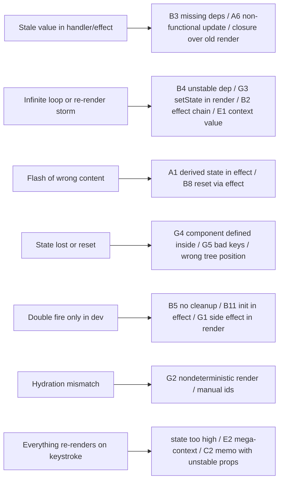
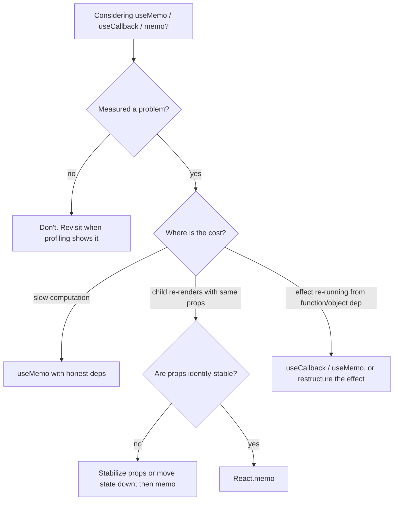

# 03 / 23 — Hooks Anti-Patterns: How Good Hooks Go Wrong

## 1. Lesson metadata

| | |
|---|---|
| **Level** | Advanced |
| **Study time** | 5–6 hours (reading 2 h, refactoring labs 2 h, exercises 1.5 h) |
| **Prerequisites** | All of Phase 3 lessons [01](./01-usestate-internals-and-update-semantics.md)–[22](./22-modern-hooks-and-apis.md); in particular [05 — Effect dependencies and stale closures](./05-effect-dependencies-and-stale-closures.md), [07 — You might not need an effect](./07-you-might-not-need-an-effect.md), [11 — useMemo/useCallback](./11-usememo-and-usecallback.md), [14 — Context performance](./14-context-performance.md), [16 — Rules of Hooks](./16-rules-of-hooks-and-composition.md), [17 — Derived state](./17-derived-state.md) |
| **Next** | [24 — Phase 3 assessment](./24-phase-assessment.md) |
| **Related later** | [Phase 5 / 06 — Custom hook patterns](../05-design-patterns/06-custom-hook-patterns.md), [Phase 5 / 25 — Comparative refactoring labs](../05-design-patterns/25-comparative-refactoring-labs.md), [Phase 7 — Performance](../07-performance/), [Phase 4 / 24 — Refactoring legacy React](../04-react-architecture/24-refactoring-legacy-react.md) |

**Learning objectives.** After this lesson you can:
1. Recognize at least 25 hook anti-patterns on sight and name the underlying principle each violates (purity, single source of truth, synchronization honesty, identity, ownership).
2. Explain *why* each fails in terms of React's execution model (render snapshots, effect timing, identity comparison, StrictMode), not only "the linter complains".
3. Refactor each anti-pattern to an idiomatic alternative, and state when the "anti-pattern" is actually justified.
4. Classify a bug report ("stale value", "infinite loop", "flash of wrong content", "re-render storm") to a short list of probable anti-patterns.
5. Review a pull request containing hooks with a structured checklist.

**Concepts covered:** derived state in state/effects, effect misuse, dependency dishonesty, unstable identities, over- and under-memoization, ref misuse, context misuse, custom-hook design smells, conditional/looped hooks, async-in-effect pitfalls, premature abstraction, the effect of the React Compiler on memoization advice.

---

## 2. Deep conceptual explanation

### 2.1 What is an anti-pattern here?

In this course an **anti-pattern** is a code shape that *looks reasonable, often works in a demo,* and **fails in a systematic way** under realistic conditions: concurrency, StrictMode, SSR, scale, change over time, or maintenance by other people. Not every violation is a bug today; some are *latent* bugs that become incidents when a requirement changes.

This is not a list of "never do this". Section 8 of each earlier lesson already listed justified exceptions. Here we organize by **root principle**, because memorizing 40 patterns is less useful than recognizing the five principles that generate them:

| # | Principle | One-line statement | Lessons |
|---|---|---|---|
| P1 | **Purity** | Rendering computes UI from props/state/context; it doesn't mutate, subscribe, fetch, or read time/randomness. | [Phase 2 / 12](../02-react-rendering-and-internals/12-why-rendering-must-be-pure.md) |
| P2 | **Single source of truth** | Each datum has one owner; everything else is derived or explicitly synchronized. | [17](./17-derived-state.md), [19](./19-ui-server-url-and-shared-state.md) |
| P3 | **Synchronization honesty** | An Effect synchronizes with an external system; its dependencies state exactly what it reads. | [04](./04-useeffect-synchronization.md), [05](./05-effect-dependencies-and-stale-closures.md) |
| P4 | **Identity awareness** | `Object.is` on props/deps/context decides everything: re-renders, effect re-runs, memo hits. | [11](./11-usememo-and-usecallback.md), [12](./12-react-memo.md), [14](./14-context-performance.md) |
| P5 | **Ownership and scope** | State lives at the lowest component that needs it; hooks encapsulate one concern; escape hatches stay small. | [15](./15-custom-hooks.md), [18](./18-state-colocation-and-lifting.md) |

Everything below is tagged with its principle(s).

### 2.2 Why anti-patterns persist

1. **They pass the first test.** Most hook bugs need a second event (a prop change, a rapid click, a slow network, StrictMode, SSR) to manifest.
2. **They resemble patterns from other frameworks or class components** (lifecycle thinking: "run this when X changes" → `useEffect`).
3. **Linter suppression is cheap.** `// eslint-disable-next-line react-hooks/exhaustive-deps` converts a compile-time signal into a runtime bug.
4. **Performance folklore.** "Wrap everything in `useCallback`" survived long after its justification expired.
5. **Abstraction by enthusiasm.** Custom hooks encourage extraction before there is a shared concern.

### 2.3 How to read this lesson

Each entry has: **Smell → Why it fails → Fix → When it's OK.** Code shows `// 🔴` for the problem and `// ✅` for the fix. Predict prompts appear on the subtle ones.

---

## 3. Internal mechanics

The anti-patterns below all reduce to a handful of mechanics from earlier lessons. A compact recap, with the guarantee level:

| Mechanic | Statement | Level |
|---|---|---|
| Render snapshot | State/props/handlers captured by closures belong to the render that created them ([Phase 1 / 14](../01-react-fundamentals/14-state-as-a-snapshot.md)). | **Public guarantee** |
| Batching | Multiple updates in one event are batched into one render ([Phase 2 / 22](../02-react-rendering-and-internals/22-automatic-batching.md)). | **Public guarantee** (React 18+) |
| Effects after commit | Passive effects run after the browser may have painted; layout effects before paint ([Phase 2 / 19](../02-react-rendering-and-internals/19-layout-vs-passive-effects.md)). | **Public guarantee** (relative order); exact scheduling = implementation detail |
| Dependency comparison | Effect/memo deps compared with `Object.is`, element by element. | **Public guarantee** |
| StrictMode (dev) | Renders twice; mounts, unmounts, remounts effects once ([Phase 2 / 28](../02-react-rendering-and-internals/28-strict-mode-behavior.md)). | **Public guarantee for dev behavior**; don't depend on it in prod |
| Hook identity by call order | Hooks are matched to slots by call order ([Phase 2 / 17](../02-react-rendering-and-internals/17-hooks-and-fiber-state.md)). | **Teaching model** (storage details are implementation) |
| Bail-out on equal state | `setState` with an `Object.is`-equal value may skip re-render (React may still call the component once more before bailing; don't rely on exact counts). | **Public guarantee** that equal state eventually doesn't commit changes; **implementation detail** how many extra calls |
| Memoization is a hint | `useMemo`/`useCallback` may be discarded by React in the future; code must be correct without them. | **Public guarantee** (docs wording) |

**React Compiler.** React Compiler 1.0 has been stable since October 2025 (<https://react.dev/blog/2025/10/07/react-compiler-1>; docs at <https://react.dev/learn/react-compiler/introduction>). It is still an opt-in build step, and compatible with React 17+. With it, many manual `useMemo`/`useCallback`/`memo` become unnecessary because the compiler memoizes automatically *if your code follows the Rules of React*. Several anti-patterns below (over-memoization) become less important, while purity-related ones (mutating props, reading refs in render, conditional side effects in render) become *more* important because the compiler assumes purity. The React team still recommends keeping `useMemo`/`useCallback` where you need precise control (for example a memoized value used as an Effect dependency).

---

## 4. Step-by-step: how to triage a hook bug

A repeatable procedure for the labs and for real incidents.

1. **Classify the symptom.**
   - *Stale value* (UI/handler uses old data) → closures/deps (P3, P4).
   - *Infinite or excessive re-renders / effect loops* → unstable identity or state set in render/effect without guard (P1, P4).
   - *Flash of wrong content for a frame* → derived state via effect, or layout-effect timing (P2).
   - *State lost / reset unexpectedly* → identity/keys/component defined inside component (P4/P5).
   - *Works in prod, double-fires in dev* → missing cleanup; StrictMode revealing it (P3).
   - *Hydration mismatch* → impurity in render (time, random, `window`) (P1).
   - *Whole page re-renders on every keystroke* → state too high, giant context, unstable props (P4/P5).
2. **Reproduce deterministically** (React DevTools, StrictMode on, network throttling, 6× CPU slowdown).
3. **Inspect**: DevTools Components → hooks values; Profiler → "Why did this render?"; log effect run reasons in dev.
4. **Locate the owner of the datum** (P2) and the identity of each dependency (P4).
5. **Fix at the root principle**, not at the symptom (don't add `useRef` to mask a loop).
6. **Validate** with the original repro + StrictMode + a test.

---

## 5. Code examples: the catalog

### Group A — State anti-patterns

#### A1. Derived state stored in state (P2)

```tsx
// 🔴
function Cart({ items }: { items: Item[] }) {
  const [total, setTotal] = useState(0);
  useEffect(() => {
    setTotal(items.reduce((s, i) => s + i.price * i.qty, 0));
  }, [items]);
  return <p>Total: {total}</p>;
}
```
**Why it fails.** First paint shows `0`, then a second render shows the real total (flash; also wrong in SSR HTML, since effects don't run on the server). Every prop change costs an extra render. Two sources of truth.
```tsx
// ✅
const total = items.reduce((s, i) => s + i.price * i.qty, 0);
// if profiling shows cost: const total = useMemo(() => ..., [items]);
```
**OK when:** the value is an independent user decision that *initially* derives from something (a draft). See [17](./17-derived-state.md).

#### A2. Mirroring props into state (P2)

```tsx
// 🔴
function Name({ name }: { name: string }) {
  const [value, setValue] = useState(name); // ignores later `name` changes
  ...
}
```
**Fix:** use the prop; or if it's a draft, name it so and reset with `key`; or make it controlled (`value`, `onChange` props). **OK when:** "initial value" semantic is the documented API (`defaultValue`-style).

#### A3. Mutating state (P1/P4)

```tsx
// 🔴
const [todos, setTodos] = useState<Todo[]>([]);
function toggle(i: number) {
  todos[i].done = !todos[i].done;
  setTodos(todos); // same reference → Object.is equal → React may bail out
}
```
**Why.** Same reference means no re-render (or, if another update re-renders, memoized children with the old reference won't update). Also breaks time-travel and `memo`.
```tsx
// ✅
setTodos((ts) => ts.map((t, idx) => (idx === i ? { ...t, done: !t.done } : t)));
```
Use id, not index, if the list can reorder.

#### A4. Many booleans for one status (P2)

```tsx
// 🔴
const [isLoading, setIsLoading] = useState(false);
const [isError, setIsError] = useState(false);
const [isSuccess, setIsSuccess] = useState(false); // can all be true → impossible states
```
```tsx
// ✅
type Status = { kind: 'idle' } | { kind: 'loading' } | { kind: 'error'; error: Error } | { kind: 'success'; data: Data };
const [status, setStatus] = useState<Status>({ kind: 'idle' });
```
See [03](./03-usereducer-and-reducer-architecture.md) and [21](./21-forms-and-complex-state.md).

#### A5. Expensive initializer evaluated every render (P1/perf)

```tsx
// 🔴
const [state] = useState(readHugeLocalStorageJson()); // runs on EVERY render (result ignored after the first)
// ✅ lazy initializer
const [state] = useState(() => readHugeLocalStorageJson());
```
(StrictMode calls the initializer twice in dev; it must be pure.)

#### A6. Non-functional updates in async/closure contexts (P3/P4)

```tsx
// 🔴 stale closure: all three increments base on the same `count`
function addThree() {
  setCount(count + 1);
  setCount(count + 1);
  setCount(count + 1); // result: +1
}
// ✅
setCount((c) => c + 1); // ×3 → +3
```
Also in intervals/timeouts that captured an old `count`. See [02](./02-functional-state-updates.md).

#### A7. Storing objects/functions in state for identity convenience (P2)

Putting a component instance, DOM node, or class instance in state (`useState<HTMLElement|null>`) is occasionally right (a callback ref capturing a node to trigger a render), but storing *large derived structures* (a parsed AST) that can be recomputed from state creates synchronization duty. Prefer `useMemo` or store the source.

#### A8. One giant state object updated wholesale (P5/P4)

`const [form, setForm] = useState({...50 fields})` with `setForm({...form, [k]: v})` re-renders everything and invites stale-closure overwrites (`form` captured in an async callback overwrites other fields). Use functional updates (`setForm(f => ({...f, [k]: v}))`) or a reducer; split state by change frequency ([18](./18-state-colocation-and-lifting.md)).

#### A9. Reading state right after setting it (P3/P4)

```tsx
// 🔴
setCount(count + 1);
console.log(count); // still the old value — snapshot
```
Compute the next value in a variable, use it for both, or read it in an effect/derived. See [01](./01-usestate-internals-and-update-semantics.md).

### Group B — Effect anti-patterns

#### B1. Effect as event handler (P3)

```tsx
// 🔴
const [submitted, setSubmitted] = useState(false);
useEffect(() => {
  if (submitted) { api.post(form); setSubmitted(false); }
}, [submitted]);
<button onClick={() => setSubmitted(true)} />
```
**Why.** Indirection: the *cause* (click) is separated from the *effect* (POST); StrictMode and re-renders can double-fire; hard to reason about ordering. 
```tsx
// ✅
function handleClick() { api.post(form); }
```
Rule: *if it happens because of a user event, do it in the event handler.* Effects are for synchronizing with external systems **because the component is displayed / its inputs changed** ([07](./07-you-might-not-need-an-effect.md)).

#### B2. Effect chains (P3/P2)

```tsx
// 🔴 each effect triggers a re-render that triggers the next effect
useEffect(() => { setB(f(a)); }, [a]);
useEffect(() => { setC(g(b)); }, [b]);
useEffect(() => { setD(h(c)); }, [c]);
```
Four renders, intermediate inconsistent frames, hard to trace. Compute `b`, `c`, `d` during render from `a`, or compute everything in the event handler that changes `a`.

#### B3. Missing or lying dependencies (P3)

```tsx
// 🔴
useEffect(() => {
  const id = setInterval(() => setCount(count + 1), 1000); // reads `count`
  return () => clearInterval(id);
}, []); // lint: count missing
```
**Predict:** what does the counter do?
**Answer:** `count` is captured as `0`; every tick sets `1`. The display stops at 1.
```tsx
// ✅ functional update removes the dependency honestly
useEffect(() => {
  const id = setInterval(() => setCount((c) => c + 1), 1000);
  return () => clearInterval(id);
}, []);
```
Never suppress exhaustive-deps without a written justification; usually the right fix is: functional update, move the value inside the effect, `useEffectEvent` (for event-like reads, [22](./22-modern-hooks-and-apis.md)), or restructure.

#### B4. Unstable object/function dependencies causing loops (P4)

```tsx
// 🔴
function Search({ filters }: { filters: string[] }) {
  const options = { limit: 10, filters }; // new object each render
  useEffect(() => { load(options).then(setData); }, [options]); // runs every render → setData → render → ...
}
```
Fix: depend on primitives (`[filters, limit]`), `useMemo` the object, or move construction into the effect. If `filters` itself is a new array each parent render, fix at the source or serialize deliberately.

#### B5. No cleanup / race conditions (P3)

```tsx
// 🔴
useEffect(() => {
  fetch(`/api/user/${id}`).then((r) => r.json()).then(setUser);
}, [id]);
```
Two quick `id` changes → responses may arrive out of order → wrong user displayed; unmounted component sets state. 
```tsx
// ✅
useEffect(() => {
  const ac = new AbortController();
  fetch(`/api/user/${id}`, { signal: ac.signal })
    .then((r) => r.json())
    .then(setUser)
    .catch((e) => { if (e.name !== 'AbortError') setError(e); });
  return () => ac.abort();
}, [id]);
```
Better: a data library ([19](./19-ui-server-url-and-shared-state.md), [Phase 6](../06-data-fetching-and-state-ecosystems/01-fetch-lifecycle.md)). StrictMode's double mount makes this visible in dev: two requests, first aborted.

#### B6. `async` effect callback (P3)

```tsx
// 🔴
useEffect(async () => { const d = await load(); setData(d); }, []); // returns a Promise, not a cleanup function
```
React warns: effect callbacks must return nothing or a cleanup function. Define an inner async function and call it, with cancellation.

#### B7. Using effects to notify the parent (P2/P3)

```tsx
// 🔴
useEffect(() => { onChange(value); }, [value, onChange]);
```
Extra render pass of the parent after the child's, flicker, double-calls with unstable `onChange`. Call `onChange` in the same event handler that updates `value`, or lift the state ([18](./18-state-colocation-and-lifting.md)).

#### B8. Resetting state with an effect when a prop changes (P2/P4)

```tsx
// 🔴
useEffect(() => { setComment(''); }, [userId]); // one render with stale comment visible
// ✅
<Profile key={userId} userId={userId} />   // new identity = fresh state
```
See [Phase 1 / 16](../01-react-fundamentals/16-state-preservation-and-reset.md).

#### B9. Effect that does nothing external (P3)

If an effect only calls `setState` based on props/state, it's almost certainly derived state (A1/B2). Valid effects touch the outside world: DOM APIs, network, subscriptions, timers, analytics, third-party widgets.

#### B10. Subscriptions without `useSyncExternalStore` for shared stores (P3/P4)

`useEffect` + `setState` to mirror a store risks tearing and missed updates; use [20](./20-usesyncexternalstore-and-external-stores.md). OK for a single rare, client-only value.

#### B11. Initializing app-wide things in a component effect (P3)

```tsx
// 🔴
useEffect(() => { analytics.init(); }, []); // StrictMode runs it twice; remounts run it again
```
Do module-level/once-per-app initialization outside React (guard with a module variable) or make `init` idempotent. React docs discuss "Initializing the application" in the effects guidance ([You Might Not Need an Effect](https://react.dev/learn/you-might-not-need-an-effect)).

#### B12. `useLayoutEffect` as a "run earlier" effect (P3/perf)

Layout effects block paint. Use them only when you must measure/mutate the DOM before paint (tooltips positioning, scroll restoration). Using them for data fetching or logging delays first paint ([08](./08-uselayouteffect.md)). They also don't run on the server (older React versions logged a warning; we confirmed that `renderToString` with `useLayoutEffect` logs no warning on React 19.3.1).

#### B13. Mutating the DOM imperatively when React owns it (P1)

`document.getElementById('x').textContent = ...` in an effect for an element React renders → next render overwrites or desynchronizes. Use state/props; if integrating third-party DOM widgets, give them a dedicated container node that React doesn't manage and sync in an effect with cleanup.

### Group C — Memoization anti-patterns

#### C1. `useCallback`/`useMemo` everywhere (P4)

```tsx
// 🔴 pays comparison + closure allocation, benefits nothing
const onClick = useCallback(() => setOpen(true), []); // passed to a plain <button>
```
Memoization pays only when the result's identity matters: a `memo`'d child receives it, it is a dependency of another hook, or the computation is genuinely expensive. Otherwise it adds code and risk ([11](./11-usememo-and-usecallback.md)). Compiler note in §3.

#### C2. `memo` with unstable props (P4)

```tsx
// 🔴
<MemoChild style={{ color: 'red' }} onSelect={(id) => select(id)} items={data.filter(f)} />
```
Every render creates new `style`, `onSelect`, `items` → `memo` never hits. Either stabilize the props (constants outside, `useCallback`, `useMemo`) or drop `memo`. See [12](./12-react-memo.md).

#### C3. Semantic reliance on memoization (P4)

```tsx
// 🔴 correctness depends on useMemo returning the same value
const id = useMemo(() => crypto.randomUUID(), []);
```
`useMemo` is a performance hint; React may recompute. Use `useState(() => crypto.randomUUID())`, `useId`, or `useRef` for values that must persist. (And `Math.random()`/`crypto.randomUUID()` in render breaks SSR hydration; `useId` for DOM ids.)

#### C4. Wrong or missing dependency array in `useMemo` (P3)

`useMemo(() => compute(a, b), [a])` returns stale data when `b` changes — the same honesty rule as effects.

#### C5. Memoizing cheap work (P4)

`useMemo(() => a + b, [a, b])` costs more than `a + b`. Measure (Profiler, `console.time` with realistic data and CPU throttling) before memoizing.

#### C6. Memoizing the wrong level (P4/P5)

Memoizing a deep child while its parent holds fast-changing state that could be moved down (colocation) or passed as `children` ([Phase 1 / 07](../01-react-fundamentals/07-composition-and-children.md)). Moving state down is usually free and more robust than `memo`.

### Group D — Ref anti-patterns

#### D1. Reading or writing `ref.current` during render (P1)

```tsx
// 🔴
const renders = useRef(0);
renders.current += 1;                     // mutation in render: impure
return <p>{renders.current}</p>;          // output depends on a mutable not tracked by React
```
Breaks purity (StrictMode double render doubles it; concurrent renders may be discarded). Refs are for values *not used for rendering*: timers, DOM nodes, previous values updated in effects, "latest callback" holders updated in effects. React docs: don't read or write `ref.current` during rendering except for initialization patterns ([10](./10-useref-and-mutable-references.md)).

#### D2. Ref as hidden state that should trigger re-render (P2)

If the UI must update when the value changes, it's state. A ref change doesn't re-render. Symptom: "value changes but UI doesn't update until something else re-renders".

#### D3. `useEffect` to sync a ref to state for use in render (P2)

Using `ref` + `useEffect(() => { ref.current = value })` for render logic yields one-render-late data. Keep it state/derived.

#### D4. Callback refs with unstable identity causing churn (P4)

An inline `ref={(el) => ...}` is called with `null` then the element on every render (sandbox-verified on React 19.3.1: logs `el`, `null`, `el` across a re-render; in React 19 a ref callback may instead return a cleanup function, in which case React calls that cleanup rather than the callback with `null`). Stabilize with `useCallback` if the callback has side effects.

### Group E — Context anti-patterns

#### E1. Unmemoized provider value (P4)

```tsx
// 🔴
<Ctx value={{ user, setUser }}>{children}</Ctx> // new object every render → all consumers re-render
// ✅
const value = useMemo(() => ({ user, setUser }), [user]);
```
(Only matters when the provider re-renders for reasons other than `user` changing. Often it's cleaner to split state/dispatch contexts, or keep the provider's own state change the only trigger — [14](./14-context-performance.md).)

#### E2. One mega-context for unrelated concerns (P5/P4)

Theme + user + cart + feature flags in one value: any change re-renders all consumers. Split by update frequency and domain; or use an external store with selectors ([20](./20-usesyncexternalstore-and-external-stores.md)).

#### E3. Context as a state manager for frequently changing data (P4)

Mouse position, form keystrokes, or WebSocket ticks in context re-render every consumer. Use local state + props, or a selector-based store.

#### E4. Default value that hides missing providers (P5)

`createContext<Ctx>({} as Ctx)` makes `useCtx().user.name` crash far from the cause. Use `createContext<Ctx | null>(null)` and a `useCtx()` that throws a clear error.

### Group F — Custom hook anti-patterns

#### F1. Hooks that return a new object/array/function every render without need (P4)

A hook returning `{ data, refetch }` creates a new object each render; consumers who put it in deps will loop. Return stable references where it matters (`useCallback` for functions meant for deps), or document that consumers should destructure.

#### F2. "God hooks" (P5)

`useDashboard()` that fetches, filters, paginates, handles URL, and owns UI toggles. Any change re-renders everything; unit tests are painful. Split by concern; compose ([15](./15-custom-hooks.md)).

#### F3. Hook hides required context/provider or global singletons (P5)

A hook that quietly reads a module-level cache or a singleton makes components untestable and SSR-unsafe (shared across requests). Inject through context or parameters.

#### F4. Hooks that can't be called conditionally but are (P5; Rules of Hooks)

```tsx
// 🔴
if (user) { const [x, setX] = useState(0); }       // conditional hook
for (const item of items) { useItemStatus(item); } // hook in loop
```
Hook order must be the same each render ([16](./16-rules-of-hooks-and-composition.md)). Fix: extract a child component per item (`<Item />` calls the hook), or use a data structure that holds the per-item state (`Map` in one reducer). Note `use` is the exception: can be conditional.

#### F5. Custom hook that is really just a function (P5)

A function that doesn't call hooks shouldn't be named `useX` — it misleads readers and tooling (the lint rule would force hook rules on it). Name by purpose: `formatPrice`.

#### F6. Premature abstraction (P5)

Extracting `useToggle` for a single `useState(false)` adds indirection without removing duplication. Extract when you have (a) ≥2–3 call sites with the same logic or (b) a cohesive stateful concern worth testing in isolation.

#### F7. Hooks that fetch on mount with hidden refetch behavior (P3/P5)

`useUser(id)` that refetches on every render of any consumer (no cache) → N consumers = N requests. Centralize via a cache layer.

### Group G — Render-phase anti-patterns

#### G1. Side effects in render (P1)

```tsx
// 🔴
function Logger() { analytics.track('viewed'); return null; }   // runs on every render, twice in StrictMode dev
function Counter() { globalCount++; ... }                       // module mutation during render
```
Move to effects (with cleanup/idempotence) or event handlers.

#### G2. Non-deterministic render output (P1)

`Date.now()`, `Math.random()`, `window.innerWidth`, `localStorage.getItem` in render → hydration mismatches and flicker. Use `useSyncExternalStore` with a server snapshot ([20](./20-usesyncexternalstore-and-external-stores.md)), `useId`, or effects after mount.

#### G3. `setState` unguarded in render (P1)

```tsx
// 🔴 infinite loop
function C({ a }: { a: number }) { const [b, setB] = useState(0); setB(a); ... }
// ✅ the documented "adjust state during render" pattern is guarded by a comparison
if (a !== prevA) { setPrevA(a); setB(a); }
```
Only for the same component's state, and only when guarded ([17](./17-derived-state.md)).

#### G4. Defining components inside components (P4/P5)

```tsx
// 🔴
function Parent() {
  const Row = ({ x }: { x: number }) => <li>{x}</li>; // new component type every render
  return <ul>{items.map((i) => <Row key={i} x={i} />)}</ul>;
}
```
Each render creates a new function → a *different component type* → React unmounts and remounts all rows (state lost, focus lost, effects re-run). Define components at module scope; pass data via props ([Phase 2 / 07](../02-react-rendering-and-internals/07-identity-keys-and-reconciliation.md)).

#### G5. Index (or random) keys for dynamic lists (P4)

`key={Math.random()}` remounts every item every render; `key={index}` misassociates state on reorder/delete ([Phase 1 / 09](../01-react-fundamentals/09-lists-keys-and-identity.md)).

### Group H — Concurrency/modern API anti-patterns ([22](./22-modern-hooks-and-apis.md))

- **H1.** `startTransition` around a controlled input's `setState`.
- **H2.** `useDeferredValue` of a fresh object each render; deferred child not memoized.
- **H3.** `use(fetch(...))` in render; `use` inside `try/catch`.
- **H4.** `useEffectEvent` used to hide a legitimate dependency; passing an Effect Event to children or calling it from handlers.
- **H5.** `useOptimistic` calling the setter outside an Action; optimistic UI for irreversible operations.
- **H6.** `useFormStatus` in the component that renders the `<form>`.
- **H7.** Treating `useActionState`'s `state` as a cache of server data.

---

## 6. Visual explanations

### 6.1 Symptom → suspect map



### 6.2 Cost of an effect chain vs derived computation

```text
Effect chain (A → b → c):
  render#1 (a changes) ─► commit ─► effect sets b ─► render#2 ─► commit ─► effect sets c ─► render#3 ─► commit
  screen frames: [a new, b old, c old] → [a new, b new, c old] → [all new]   (inconsistent intermediates)

Derived:
  render#1: b = f(a); c = g(b)  ─► commit     (single consistent frame)
```

### 6.3 Memoization decision



---

## 7. Alternative approaches and trade-offs

For the recurring "state synchronization" family, compare the fixes:

| Situation | Anti-pattern | Fix A: derive in render | Fix B: event handler | Fix C: `key` reset | Fix D: external-system effect |
|---|---|---|---|---|---|
| Total from items | effect + setState | ✅ best | – | – | – |
| Reset form on entity change | effect | – | – | ✅ best | – |
| POST on submit | effect on flag | – | ✅ best | – | – |
| Subscribe to browser event | effect + setState | – | – | – | ✅ (`useSyncExternalStore` if shared) |
| Parent needs child value | effect → `onChange` | – | ✅ (call in handler) | – | – |
| Fetch on param change | effect (naive) | – | – | – | ✅ with cleanup, or data library |

| Criterion | Manual hooks (`useEffect` fetch + `useMemo`) | Data library + derived values | Compiler-optimized code |
|---|---|---|---|
| Correctness effort | High (races, caching) | Low | Same as manual for effects; automatic for memoization |
| Boilerplate | Medium | Low | Lowest memoization boilerplate |
| Failure modes | Stale closures, loops | Cache invalidation misuse | Impure code is mis-optimized/skipped |

### 7.1 Where the "anti-pattern" is the right call

- **Storing derived state:** when computation is expensive *and* the inputs change rarely, memoize rather than store — but a stored copy is justified when it represents a **snapshot at a point in time** (e.g., the price the user saw when adding to cart).
- **Effect to notify parent:** acceptable for *reporting* (analytics) where the parent cannot be updated during the event, but not for state sync.
- **`useCallback` everywhere:** harmless in a design-system library where consumers may memoize on your callbacks and you cannot know. Cost is small relative to unknown consumer needs; document it.
- **Suppressing exhaustive-deps:** in legacy code before `useEffectEvent` or in rare integration code, with a comment explaining why the omitted values are non-reactive, and a test.
- **Index keys:** static, never-reordered lists with no state.
- **Mutating a ref in render:** the lazy-init pattern (`if (ref.current === null) ref.current = new Thing()`) is documented as acceptable ([10](./10-useref-and-mutable-references.md)).
- **Module-level singletons:** fine for client-only utilities (analytics client) where SSR sharing isn't a concern and state isn't user-specific.

---

## 8. Best practices and anti-patterns (meta-level)

**Review checklist for hook-heavy PRs**

1. For every `useState`: is this derived from something else? Is it a draft? Who else writes it?
2. For every `useEffect`: *what external system does it synchronize with?* If none → remove. Is cleanup present and symmetric? Do deps match reads? (No lint suppression.)
3. Does any effect call `setState` based only on props/state? → derive.
4. Does any handler's logic live in an effect? → move.
5. Are objects/functions in deps or context values stable?
6. Is memoization justified by measurement or by a `memo`'d consumer?
7. Do refs appear in render output? → state.
8. Are components defined at module scope? Are keys stable ids?
9. Are hooks called unconditionally and in the same order?
10. Does render read time/random/browser globals? → hydration risk.
11. Are modern APIs used within their rules (transitions not on inputs, promises cached, `useFormStatus` in child)?
12. Does each custom hook have a single concern and a documented stability contract?

**Beginner mistakes** — A1, A3, A6, B1, B5, G4, G5.
**Experienced-developer mistakes** — B3 with a justification comment that is wrong, C1 as policy, E2 mega-contexts, F2 god hooks, abstraction F6, using `useEffectEvent` to avoid thinking.
**Smells** — a `// eslint-disable` in an effect; effects with no cleanup that start timers; a hook returning a 12-property object; `useRef` named `latestState`; `useMemo` returning JSX for no measured reason.

**Process practices**
- Keep `eslint-plugin-react-hooks` on as errors; treat suppression as a code-review blocker requiring justification.
- Keep StrictMode on in development ([Phase 2 / 28](../02-react-rendering-and-internals/28-strict-mode-behavior.md)).
- Test custom hooks with React Testing Library's `renderHook` (exported from `@testing-library/react`; verified in RTL 16) plus component-level tests for effects.
- Profile before optimizing ([Phase 2 / 30](../02-react-rendering-and-internals/30-react-devtools-profiler.md)).

---

## 9. Real-world application

- **Dashboard with 20 widgets.** A shared `useDashboardData()` god hook caused every widget to re-render on any filter change and double-fetch on mount. Refactor: filters in URL state ([19](./19-ui-server-url-and-shared-state.md)); each widget has its own query keyed by relevant filters; derived values computed in render; memoization added only to the two widgets Profiler flagged.
- **Checkout form.** Effects computing totals and validity (A1/B2) caused a visible one-frame wrong total and a submit button enabled momentarily with an invalid card. Refactor to derived values and a reducer-driven form ([21](./21-forms-and-complex-state.md)). Business risk: users double-clicking Pay; server idempotency added.
- **Trading UI.** Context carried live prices (E3), re-rendering the whole app per tick. Refactor to an external store with per-symbol selectors ([20](./20-usesyncexternalstore-and-external-stores.md)); batch updates per frame.
- **Auth redirect flows.** An effect on `[user]` that navigates when `user` becomes null fired during sign-out *and* during initial load before the session resolved, redirecting valid users to /login. Root cause: effect modeling an event ("on sign-out") as state synchronization with an unresolved loading state conflated with "no user". Fix: explicit status union (`loading | authenticated | anonymous`) and redirect in the sign-out handler/route guard.
- **Multi-team design system.** Components with inline `useCallback`-less handlers broke consumer `memo`s; the library adopted a documented stability contract and tests asserting referential stability of callbacks returned by hooks.
- **Legacy migration.** Class-lifecycle thinking (`componentDidUpdate` → effect with a `prevProps` ref) produced B1/B2 patterns. The refactor program ([Phase 4 / 24](../04-react-architecture/24-refactoring-legacy-react.md)) used the checklist in §8.

---

## 10. Debugging and troubleshooting

### 10.1 Identify which effect is looping

Add a temporary logger in dev:

```tsx
function useWhyRan(name: string, deps: Record<string, unknown>) {
  const prev = useRef(deps);
  useEffect(() => {
    const changed = Object.keys(deps).filter((k) => !Object.is(prev.current[k], deps[k]));
    if (changed.length) console.log(`[${name}] changed:`, changed);
    prev.current = deps;
  });
}
```
(Writing the ref in an effect, not in render, keeps it pure.) The output names the unstable dependency (usually an inline object/function). Remove after use.

### 10.2 React DevTools workflow

- **Components tab:** inspect hooks; look for `State` hooks mirroring props (A2).
- **Profiler:** enable "Record why each component rendered"; look for "props changed (functions/objects)", "hooks changed", "parent rendered".
- **StrictMode:** keep on; failure on mount/unmount cycles indicates cleanup bugs.

### 10.3 Specific reproductions

| Symptom | Repro | Probable cause | Verify fix |
|---|---|---|---|
| Counter freezes at 1 | Interval effect with `[]` deps reading `count` | B3 | After functional update, increments continue |
| List rows lose input text on parent state change | Component defined inside parent | G4 | Move to module scope; text persists |
| Network tab shows 2 identical requests in dev | StrictMode mounting twice | B5 without abort, or B11 | First request canceled; prod shows 1 |
| Typing in unrelated field re-renders chart | Context value object / state too high | E1/E2/colocation | Profiler shows chart not rendered |
| UI shows old user after fast navigation | No race handling | B5 | Slow-network throttle with rapid switching |
| Console: "Maximum update depth exceeded" | Effect sets state with new object each time / setState in render | B4/G3 | Loop stops; renders per action = 1–2 |
| Hydration warning about text content | `new Date()` in render | G2 | Server and client markup identical |

### 10.4 When the linter and you disagree

If `exhaustive-deps` insists on a dependency you "know" is irrelevant, assume the linter is right until you can state, in one sentence, why the value is non-reactive for *this* effect. Then pick: move the value inside; functional update; `useEffectEvent` (stable since React 19.2); or restructure into an event handler. Suppress only with a comment and a ticket.

---

## 11. Exercises

### Level A — Knowledge
A1. Name the five root principles and map each to two anti-patterns from §5.
A2. Why is `useEffect(() => setTotal(f(items)), [items])` worse than `const total = f(items)`? Give three reasons.
A3. Why is defining a component inside another component harmful?
A4. List three situations where memoization is justified.
A5. Why must you not read `ref.current` during render?
A6. Why can't hooks be called conditionally (and which API is the exception)?

### Level B — Code comprehension
B1. Predict the behavior:
```tsx
function Timer() {
  const [seconds, setSeconds] = useState(0);
  useEffect(() => {
    const id = setInterval(() => setSeconds(seconds + 1), 1000);
    return () => clearInterval(id);
  }, [seconds]);
  return <p>{seconds}</p>;
}
```
Is it correct? What is the hidden cost?
B2. What does this render after clicking "add" twice quickly (two separate clicks) and why?
```tsx
const [items, setItems] = useState<string[]>([]);
function add() { items.push('x'); setItems(items); }
```
B3. How many times does the effect run on each parent render?
```tsx
function Child({ config }: { config: { page: number } }) {
  useEffect(() => { load(config); }, [config]);
}
// parent: <Child config={{ page: 1 }} />
```
B4. Which of these three `setState` calls compiles into an infinite loop and which doesn't?
```tsx
function C({ x }: { x: number }) {
  const [a, setA] = useState(0);
  const [prev, setPrev] = useState(x);
  setA(x);                        // (1)
  if (x !== prev) { setPrev(x); } // (2)
  if (x !== prev) { setPrev(x); setA(x); } // (3)
  return null;
}
```
(Treat each of the three statements as an alternative implementation, not all at once.)

### Level C — Implementation (refactoring labs)
C1. Refactor this component to remove all unnecessary state and effects while keeping behavior:
```tsx
function Products({ products, minPrice }: { products: Product[]; minPrice: number }) {
  const [filtered, setFiltered] = useState<Product[]>([]);
  const [count, setCount] = useState(0);
  const [empty, setEmpty] = useState(false);
  useEffect(() => { setFiltered(products.filter((p) => p.price >= minPrice)); }, [products, minPrice]);
  useEffect(() => { setCount(filtered.length); }, [filtered]);
  useEffect(() => { setEmpty(filtered.length === 0); }, [filtered]);
  return empty ? <p>No products</p> : <p>{count} products</p>;
}
```
C2. Fix this data component for race conditions, cleanup, error state, and StrictMode, without adding a library.
```tsx
function UserName({ id }: { id: string }) {
  const [name, setName] = useState('');
  useEffect(() => { fetch(`/api/users/${id}`).then(r => r.json()).then(u => setName(u.name)); }, [id]);
  return <span>{name}</span>;
}
```
C3. Rewrite the following to avoid the inline component and stabilize memoization correctly:
```tsx
function Table({ rows }: { rows: Row[] }) {
  const Cell = ({ v }: { v: string }) => <td>{v}</td>;
  const MemoRow = React.memo(({ r }: { r: Row }) => <tr><Cell v={r.a} /></tr>);
  return <table><tbody>{rows.map((r, i) => <MemoRow key={i} r={r} />)}</tbody></table>;
}
```
C4. Write a typed `useStatus` reducer hook replacing three booleans.

### Level D — Debugging
D1. "After sign-out, the app redirects to /login twice and flashes content." The code:
```tsx
useEffect(() => { if (!user) navigate('/login'); }, [user, navigate]);
```
where `navigate` changes identity on each render. Diagnose and fix.
D2. A custom hook returns `{ data, reload: () => fetchData(id) }`, and a consumer has `useEffect(() => { reload(); }, [reload])`. What happens?
D3. A modal's text field loses focus after each keystroke. The modal component is declared inside the page component. Why?
D4. A teammate "fixed" a stale closure by adding a ref updated in render: `latest.current = value`. Evaluate.
D5. `useMemo(() => items.sort(byDate), [items])` makes the list jump around unpredictably after an unrelated state change. Explain.

### Level E — Architecture decisions
E1. Draft team guidelines (≤10 rules) for hooks usage in a 30-engineer codebase. Justify each with a principle.
E2. Decide whether to adopt the React Compiler in an existing codebase with many manual memoizations and several known impure components. Define a rollout plan and risks. (Compiler 1.0 is stable; see the blog post linked in §3.)
E3. A hooks "god hook" `useCheckout()` (400 lines) is used by six components. Plan an incremental decomposition with tests.

### Level F — Expert challenge
F1. Given a 300-line component with 14 `useState`, 9 `useEffect`, 6 `useCallback`, and a context, describe a systematic refactoring: how you'd characterize each state/effect, the order of changes, the safety net (tests, profiler baselines), and the success metrics.
F2. Explain why the "adjust state during render" pattern is safe while an unguarded `setState` in render is not, in terms of React's re-render handling, and identify two ways the safe pattern can still be misused.

---

## 12. Detailed answers and explanations

> Attempt the exercises first.

**A1.** P1 Purity (G1 side effects in render; D1 ref in render). P2 Single source of truth (A1 derived state; A2 mirrored props). P3 Synchronization honesty (B3 lying deps; B5 no cleanup). P4 Identity (B4 unstable deps; C2 memo with unstable props). P5 Ownership/scope (F2 god hooks; E2 mega-context). Other correct mappings are accepted if the reasoning follows the principle.

**A2.** (1) Extra render with stale `total` visible for a frame (flash) — and wrong initial HTML in SSR. (2) Two sources of truth; any effect timing issue desynchronizes them. (3) Extra renders per change and added complexity (dependency array to maintain). Also acceptable: breaks if `f` throws, harder testing.

**A3.** A function declared inside the parent is a new function (new component *type*) each render. Reconciliation compares types; different type ⇒ unmount old subtree, mount new one ⇒ state lost, DOM recreated (focus lost, animations restart), effects re-run. Define at module scope, pass props.

**A4.** (a) Passing a function/object to a `memo`'d child where re-rendering is measured as costly; (b) a value used as a dependency of another hook where identity must not change; (c) an expensive pure computation measured in Profiler; (d) a library hook whose consumers may rely on stable references. All must be justified by measurement or contract.

**A5.** Render must be pure and may run multiple times, be paused or discarded; mutating or depending on `ref.current` in render creates output that depends on hidden mutable state and render count. Reading a ref *set in effects/handlers* during render yields values React doesn't track (no re-render on change), causing stale UI. Exception: lazy initialization (`if (ref.current === null) ref.current = ...`).

**A6.** Hooks are matched to storage by call order within a component; changing order or count between renders corrupts the association (React throws or mismatches). `use` is not subject to this restriction because it doesn't allocate hook slots in the same way (documented: may be called conditionally and in loops).

**B1.** Behavior is correct (counts up each second), but it tears down and recreates the interval every second (dependency `seconds` changes each tick) — "restarting timer" cost and potential drift (each interval starts after the render commits, so time between ticks is 1000 ms + render/commit delay). Fix: `setSeconds(s => s + 1)` with `[]` deps; the timer is created once. Wrong claim "it's stale": it isn't stale because `seconds` is in deps; it is *inefficient and drifting*.

**B2.** Nothing changes visibly after the first click: `items.push` mutates the array in place and `setItems(items)` passes the same reference; `Object.is` is true, React bails out (no re-render). A later unrelated re-render shows the pushed items, since mutation occurred. In StrictMode dev, `push` happens in the handler (not render), so only once per click. Fix: `setItems((xs) => [...xs, 'x'])`.

**B3.** The effect runs on every parent render: the parent creates a new `config` object each time, so deps differ. Fix: depend on `config.page` (primitive), or memoize the object in the parent, or pass the primitive `page` prop.

**B4.** (1) Infinite loop: an unconditional `setA(x)` during render schedules a render-phase update every time the function runs, so React re-renders immediately, which calls `setA` again, and so on until React throws "Too many re-renders". It does not matter that the value is the same: in practice this is the same error as `onClick={setX(1)}`. (2) Not a loop: it is guarded by a comparison that becomes false after the update (`prev` now equals `x`), but it only maintains `prev` — if the intent was to also update `a`, it's incomplete. (3) Not a loop: this is the documented "adjust state during render" pattern; after `setPrev(x)` the re-render sees `x === prev` and stops. Evaluation: identify (1) as the loop, (3) as the safe, guarded pattern, and explain convergence. Sandbox-verified on 19.3.1: (1) throws "Too many re-renders" even when `x` equals the current state; (3) renders twice and settles. Exact internal re-render limits are implementation details; the documented guarantee is that unguarded render-phase updates are an error.

**C1.**
```tsx
function Products({ products, minPrice }: { products: Product[]; minPrice: number }) {
  const filtered = products.filter((p) => p.price >= minPrice);
  return filtered.length === 0 ? <p>No products</p> : <p>{filtered.length} products</p>;
}
```
All three states were derived; zero effects. If `products` is huge and profiling shows cost: `useMemo(() => products.filter(...), [products, minPrice])`. Behavior improvements: no first-frame "0 products"/wrong empty flash; SSR-correct.

**C2.**
```tsx
function UserName({ id }: { id: string }) {
  const [state, setState] = useState<
    { status: 'loading' } | { status: 'error' } | { status: 'ok'; name: string }
  >({ status: 'loading' });

  useEffect(() => {
    const ac = new AbortController();
    setState({ status: 'loading' }); // allowed: synchronization start; alternatively key the component by id
    fetch(`/api/users/${id}`, { signal: ac.signal })
      .then((r) => {
        if (!r.ok) throw new Error(String(r.status));
        return r.json() as Promise<{ name: string }>;
      })
      .then((u) => setState({ status: 'ok', name: u.name }))
      .catch((e) => {
        if (e instanceof DOMException && e.name === 'AbortError') return;
        setState({ status: 'error' });
      });
    return () => ac.abort();
  }, [id]);

  if (state.status === 'loading') return <span>…</span>;
  if (state.status === 'error') return <span role="alert">Failed to load</span>;
  return <span>{state.name}</span>;
}
```
Reasoning: abort prevents out-of-order overwrite and unmounted updates; discriminated union prevents impossible states; StrictMode double-mount aborts the first request. Note the synchronous `setState({status:'loading'})` inside the effect is a tolerable reset-at-start pattern but `key={id}` on the component is cleaner (state resets with identity). A data library is better in production. Evaluation: cleanup + race handling + error state.

**C3.**
```tsx
const Cell = ({ v }: { v: string }) => <td>{v}</td>;
const Row = React.memo(function Row({ r }: { r: Row }) {
  return <tr><Cell v={r.a} /></tr>;
});

function Table({ rows }: { rows: ReadonlyArray<RowData> }) {
  return <table><tbody>{rows.map((r) => <Row key={r.id} r={r} />)}</tbody></table>;
}
```
(Name the type `RowData` to avoid clashing with the component name `Row`; the original code's type `Row` collides conceptually — in your answer, rename.) Reasoning: components at module scope keep identity; `memo` created once; keys from stable ids (assuming rows have `id`); `r` identity stable as long as the data layer preserves object identity for unchanged rows.

**C4.**
```tsx
type AsyncState<T> =
  | { status: 'idle' }
  | { status: 'loading' }
  | { status: 'success'; data: T }
  | { status: 'error'; error: Error };

type AsyncAction<T> =
  | { type: 'start' }
  | { type: 'resolve'; data: T }
  | { type: 'reject'; error: Error }
  | { type: 'reset' };

function asyncReducer<T>(s: AsyncState<T>, a: AsyncAction<T>): AsyncState<T> {
  switch (a.type) {
    case 'start': return { status: 'loading' };
    case 'resolve': return { status: 'success', data: a.data };
    case 'reject': return { status: 'error', error: a.error };
    case 'reset': return { status: 'idle' };
  }
}

export function useAsyncStatus<T>() {
  return useReducer(asyncReducer<T>, { status: 'idle' } as AsyncState<T>);
}
```
(Instantiation expression `asyncReducer<T>` requires TS ≥ 4.7; accepted alternative: wrap in an arrow `(s, a) => asyncReducer(s, a)`.) Evaluation: exhaustive switch, no impossible combination.

**D1.** `navigate` identity changes each render → effect re-runs each render; while `user` is `null` it calls `navigate` repeatedly (double redirects), and the "flash" arises because the effect runs after paint. Also conflates "loading" with "no user". Fix: (a) model `status: 'loading' | 'authenticated' | 'anonymous'`; (b) redirect from the sign-out handler (event) or a route guard (render-time `<Navigate>` equivalent from your router) rather than an effect; (c) if an effect remains, use a stable `navigate` (most routers return a stable function; verify) and depend on `status`. Validate: sign out → one navigation; initial load doesn't redirect before the session resolves.

**D2.** `reload` is a new function every render → effect runs every render → `reload()` sets state in the hook → re-render → new `reload` → loop (or at least a fetch per render). Fix inside the hook: `const reload = useCallback(() => fetchData(id), [id])` and (better) don't expose imperative refetch for effects; or fetch automatically with deps `[id]`. Rule: hooks whose return values may be used as dependencies should return stable references.

**D3.** The modal component is a new component type on every page render (typing updates page state → page re-renders → new modal type → whole modal subtree remounts, including the input, which loses focus). Move the modal to module scope and pass props; or keep the typing state inside the modal.

**D4.** Writing a ref in render violates purity (concurrent renders may discard; StrictMode double-invokes) and may expose values from a render that never commits. The documented approach is to update the ref in an effect (`useEffect(() => { latest.current = value })`) — or better, use `useEffectEvent` (stable since React 19.2) which does this safely and is lint-enforced; or fix the dependency/closure issue (functional updates). The teammate's fix works "usually" but is a latent bug.

**D5.** `Array.prototype.sort` mutates the array in place — here the `items` prop/state itself — so memoization doesn't prevent mutation; other components holding `items` see order changes; React state was mutated (P1/P4). Use `[...items].sort(byDate)` or `items.toSorted(byDate)` (ES2023; check runtime support). Also the sort comparator must be consistent; unstable sort (older engines) could jump ties.

**E1.** Example guidelines (accept variants): (1) Derive, don't sync (P2). (2) Effects only for external systems; events in handlers (P3). (3) `exhaustive-deps` is an error; suppressions need a linked ticket (P3). (4) Components at module scope; keys are stable ids (P4). (5) No memoization without measurement or a documented stability contract (P4). (6) State colocated; lift only on demand; no mega-contexts (P5). (7) Custom hooks: one concern, documented return stability, no hidden singletons (P5). (8) Render is pure: no time/random/browser globals; `useId` for ids (P1). (9) Server state through the data layer, never copied to state (P2). (10) Async modern APIs follow documented rules (promises cached; transitions not on inputs). Rate answers by the justification, not the list.

**E2.** Good answer: verify compiler status and compatibility for the React version and bundler; run the compiler's lint/diagnostic rules (the ESLint rules from `eslint-plugin-react-hooks` that report violations) in CI to find impure components; fix purity violations first (mutations in render, ref reads); roll out incrementally by directory/opt-in (the compiler supports per-file or per-directory opt-in/opt-out — ⚠ verify the current configuration); measure before/after with Profiler and real-user INP; keep existing `useMemo`/`useCallback` initially (removing them can change behavior for effects that depend on identities); have a kill switch. Risks: silent skip of components that break the rules (no optimization), behavioral changes in code relying on identity quirks, build-time cost. Evaluation: purity-first rollout and measurement.

**E3.** Plan: characterize what the hook does (list state, effects, derived values, external systems); write characterization tests at the component level (RTL + MSW) for current behavior; extract pure functions (pricing, validation) first — easiest tests; split by concern into hooks with narrow return values (`useCartLines`, `useShippingOptions`, `useCheckoutSubmission`); introduce a reducer for the status; move shared data to a cache layer; migrate the six components one by one behind the same facade; measure render counts per interaction; remove the facade last. Risks: behavioral drift; mitigated by characterization tests and incremental merges.

**F1.** Example: (1) Add baseline: Profiler traces for 3 key interactions, render counts, and tests that pin behavior. (2) Inventory: tag each state as UI/local, server, URL, form, derived, ref-worthy; each effect as external-sync / event / derived / init. (3) Delete derived state & effect chains (largest wins, lowest risk). (4) Move events out of effects. (5) Fix deps honestly; add cleanup and cancellation. (6) Move server data to the data layer; URL state for navigational parts. (7) Colocate state by extracting child components; split the context by change frequency. (8) Only then evaluate memoization with the Profiler. (9) Remove hooks that don't hold state (functions), rename accordingly. Success metrics: fewer renders per interaction, fewer hooks, no lint suppressions, passing tests, improved INP. Ordering justification: "delete before optimize".

**F2.** React supports calling `setState` during render for the **currently rendering component's own state**: after the render function returns, React discards the output and immediately re-renders the component with the updated state *before* rendering children and before commit; it's cheap and consistent, with no committed intermediate frame. If the update is unconditional, each re-render triggers the update again → React detects excess re-renders and throws "Too many re-renders" (the guard). The guarded pattern `if (x !== prev) {setPrev(x); ...}` converges: after the re-render the condition is false. Misuses: (1) updating *another component's* state during render (React warns: cannot update a component while rendering a different component) — a render-phase side effect on a different owner; (2) guard that never becomes false (e.g., compares against a new object each render, `if (items !== prevItems)` where `items` is rebuilt each render by the parent) — an infinite loop in disguise. Also non-pure state initializers in these updates. Evaluation: explains convergence and identifies misuse.

---

## 13. Senior engineer interview questions

**Q1. "What's the single most common hooks bug you see in code review, and how do you fix it?"**
Derived state synchronized via effect (`useEffect(() => setX(f(y)), [y])`). It causes an extra render with inconsistent intermediate state, is wrong in SSR HTML, and adds a second source of truth. Fix: compute `x` during render (memoize only after measuring). More broadly: ask "what external system does this effect synchronize with?" If none, it's not an effect.

**Q2. "A teammate disables `exhaustive-deps`. How do you respond?"**
I ask which value they believe is non-reactive and why. Usually one of: it can be read via functional update, moved inside the effect, split into a separate effect, or is an event-like read for `useEffectEvent`. If none applies, the effect probably models an event as synchronization. A suppression without a reason is a latent stale-closure bug; with a reason it needs a comment and a test.

**Q3. "When would you not memoize?"**
By default. Memoization costs comparisons, closures, and cognitive load, and helps only when identity matters (memo'd consumer, dependency) or computation is measurably expensive. Often moving state down or restructuring children avoids the need. With the React Compiler (stable 1.0 since October 2025) manual memoization becomes largely redundant provided code is pure.

**Q4. "Why does defining a component inside another component break state?"**
Each render produces a new function, hence a new component type; reconciliation treats type change as replacement, so the subtree unmounts/remounts, resetting state and DOM and re-running effects. Hoist the component or pass render data as props.

**Q5. "Explain how a `useEffect` + `setState` chain differs from derived values in terms of rendering."**
The chain commits an intermediate frame per link (render → commit → effect → setState → render…), exposing inconsistent UI and performing more work; derived values compute all consistently within one render and one commit. The chain also reorders with async work in subtle ways and breaks in SSR.

**Q6. "How do you catch these problems before production?"**
Lint (hooks rules as errors), StrictMode in dev, React DevTools Profiler on key interactions, tests that assert render counts or behavior under rapid input and slow networks, and code-review checklists. For SSR, run hydration tests with warnings as failures.

**Q7. "What's wrong with using context to share frequently changing state, and what do you do instead?"**
Context re-renders all consumers whenever the value changes. Frequent updates therefore fan out across the tree regardless of which part each consumer reads. Alternatives: lift/colocate, split contexts by frequency (stable dispatch vs changing value), or an external store with selector subscriptions ([20](./20-usesyncexternalstore-and-external-stores.md)).

**Q8. "Is `useEffectEvent` a way to avoid listing dependencies?"**
No. It's for event-like logic called from an Effect that needs the latest values without making the effect re-synchronize. If the logic should re-run when the value changes, it's a dependency. Overuse hides bugs; the lint rules enforce where it can be called.

---

## 14. Further learning resources

| Resource | URL | Covers / why | Level | Study |
|---|---|---|---|---|
| React docs — You Might Not Need an Effect | <https://react.dev/learn/you-might-not-need-an-effect> | The canonical list of unnecessary effects | Intermediate | Whole page |
| React docs — Synchronizing with Effects | <https://react.dev/learn/synchronizing-with-effects> | Cleanup, StrictMode, fetching | Intermediate | Whole page |
| React docs — Lifecycle of Reactive Effects | <https://react.dev/learn/lifecycle-of-reactive-effects> | Dependencies as a consequence of code | Intermediate–Adv. | Whole page |
| React docs — Removing Effect Dependencies | <https://react.dev/learn/removing-effect-dependencies> | Fixes for dependency problems | Advanced | Whole page |
| React docs — Separating Events from Effects | <https://react.dev/learn/separating-events-from-effects> | Event vs reactive logic; Effect Events | Advanced | Whole page |
| React docs — Rules of React | <https://react.dev/reference/rules> | Purity, hooks rules; basis of the compiler | Intermediate | Whole section |
| React docs — Rules of Hooks | <https://react.dev/reference/rules/rules-of-hooks> | Hook call constraints | Beginner–Int. | Whole page |
| React docs — `useMemo` | <https://react.dev/reference/react/useMemo> | When memoization helps; caveats | Intermediate | "Should you add useMemo everywhere?" |
| React docs — Preserving and Resetting State | <https://react.dev/learn/preserving-and-resetting-state> | Identity, keys, nested component definitions | Intermediate | "Different components at the same position", "Nesting component definitions" |
| React Compiler docs | <https://react.dev/learn/react-compiler> | Status, rules, rollout | Advanced | Whole page |
| eslint-plugin-react-hooks | <https://www.npmjs.com/package/eslint-plugin-react-hooks> | Lint rules and current versions | Intermediate | README |
| React Developer Tools | <https://react.dev/learn/react-developer-tools> | Profiling tools | Beginner | Whole page |

---

## 15. Knowledge checkpoint

**You should now understand**
- That most hook bugs derive from five principles: purity, single source of truth, synchronization honesty, identity awareness, ownership.
- How each catalogued anti-pattern fails mechanically (snapshots, `Object.is`, effect timing, reconciliation identity, StrictMode).
- When an apparent anti-pattern is acceptable.

**You should be able to explain without notes**
- Why derived-state effects flash and why inline components remount.
- Why unstable dependencies loop and how to find which one.
- Why `useMemo` isn't a semantic guarantee.

**You should be able to implement**
- Refactors from effect-synchronized state to derived values; race-safe data effects; reducer-based status; module-scope components with stable keys.

**You should be able to debug**
- Loops, stale closures, flicker, state loss, double-fires, and hydration mismatches using DevTools and logging.

**Before moving on:** complete [24 — Phase 3 assessment](./24-phase-assessment.md). Revisit any lesson whose anti-patterns you couldn't classify.
