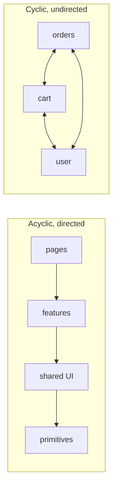
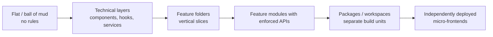
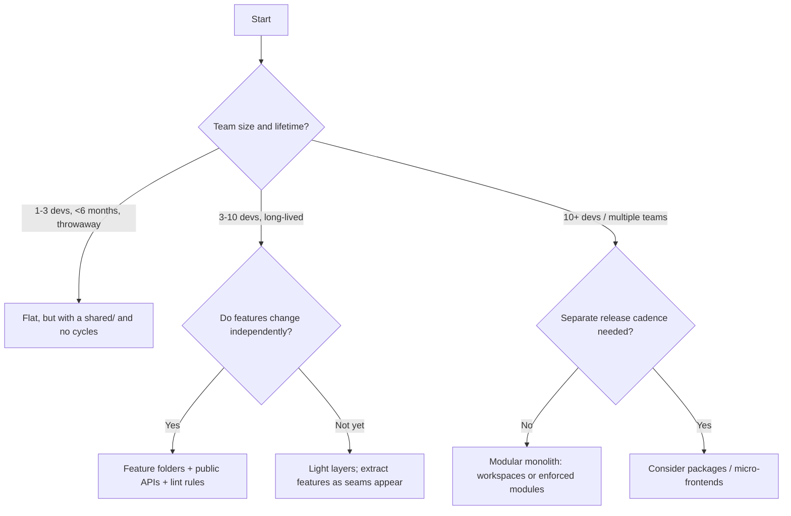

# 04 / 01 — Architecture Fundamentals: What "Frontend Architecture" Actually Means

## 1. Lesson metadata

| | |
|---|---|
| **Level** | Intermediate |
| **Study time** | 4–5 hours (reading 2 h, experiments 1 h, exercises 1.5 h) |
| **Prerequisites** | [Phase 1 / 06 — Props and one-way data flow](../01-react-fundamentals/06-props-and-one-way-data-flow.md), [Phase 1 / 07 — Composition and children](../01-react-fundamentals/07-composition-and-children.md), [Phase 0 / 10 — ES modules and dependency graphs](../00-web-and-javascript-foundations/10-modules-and-dependency-graphs.md), [Phase 1 / 12 — Component purity](../01-react-fundamentals/12-component-purity.md) |
| **Next** | [02 — Separation of concerns](./02-separation-of-concerns.md) |
| **Related later** | [05 — Composition and dependency direction](./05-composition-and-dependency-direction.md), [06 — Feature vs layer structure](./06-feature-vs-layer-structure.md), [07 — Modular architecture](./07-modular-architecture.md), [25 — Architectural fitness and enforcement](./25-architectural-fitness-and-enforcement.md) |

**Learning objectives.** After this lesson you can:
1. Define "architecture" operationally: the set of decisions that are expensive to change, expressed as boundaries and dependency rules.
2. Name the forces a frontend architecture balances (change rate, team topology, runtime cost, testability, cognitive load) and trade them off explicitly.
3. Read a real codebase as a *dependency graph* and identify its actual (not intended) architecture.
4. Apply the three core vocabulary tools: **module**, **boundary**, **dependency direction**.
5. Pick a starting architecture for a project of a given size and name the signals that should trigger a migration.
6. Recognise the failure modes of the four baseline approaches: flat "ball of mud", technical-layer folders, feature folders, and package-level modules.

**Concepts covered:** architecture vs design vs structure, architectural decision, reversibility, coupling and cohesion, dependency graph, boundary, public API of a module, change amplification, cognitive load, Conway's law, architectural drift, fitness function (introduction), the "last responsible moment", baseline approach dossiers.

---

## 2. Deep conceptual explanation

### 2.1 What problem is this lesson solving?

Every React tutorial ends at the same point: the component works. The tutorials do not cover what happens at 400 components, 12 engineers and three years later, when:

- A change to a date format touches 41 files.
- Nobody can delete `utils/helpers.ts` because nobody knows who imports it.
- A new hire needs two weeks before shipping a one-line fix.
- Tests are slow, flaky, or absent because "everything depends on everything".
- Two teams block each other because they edit the same `store.ts`.

None of these are *React* problems. React gives you a component model and a render model ([Phase 1 / 04](../01-react-fundamentals/04-elements-components-instances.md)); it is deliberately silent on how to organise a *system* of components, state, data access, and business rules. That silence is the gap this phase fills. "React architecture" is the discipline of deciding **what may depend on what**, **where each kind of decision lives**, and **what is allowed to change independently**.

### 2.2 Definition: architecture is the expensive-to-change part

There is no single canonical definition. A usable, operational one for working engineers:

> **Architecture is the set of structural decisions that are costly to reverse, plus the rules that keep the rest of the code consistent with them.**

Three consequences:

1. *Architecture is not folder names.* Folders are one visible expression of boundaries. A project can have beautiful folders and a tangled import graph; the graph is the truth.
2. *Architecture is not a diagram on a wiki.* If the code does not enforce or at least reveal it, the diagram describes intent, not reality. Intent and reality diverge over time: **architectural drift**.
3. *Cost of reversal is the measuring stick.* Choosing between `useState` and `useReducer` in one component is cheap to reverse: a design decision. Choosing that every feature may import every other feature's internals is *very* expensive to reverse after 300 components depend on it.

A useful split, borrowed from common software-engineering usage (the terms are conventional, not standardised):

| Level | Scope | Reversal cost | Examples |
|---|---|---|---|
| **Code** | A function or component body | Minutes | Naming, `map` vs loop |
| **Design** | A component/module and its collaborators | Hours–days | Hook shape, prop API, local state structure |
| **Architecture** | Module boundaries, dependency rules, data and state ownership, deployment units | Weeks–quarters | Feature isolation, server-state strategy, monorepo packages, micro-frontend split |

### 2.3 The three vocabulary tools: module, boundary, dependency direction

**Module.** A unit with a *public surface* and *private internals*. In JavaScript, an ES module's exports are its surface ([Phase 0 / 10](../00-web-and-javascript-foundations/10-modules-and-dependency-graphs.md)). In architecture we also use "module" for a *group* of files that act as one unit: a folder with an `index.ts` that re-exports a deliberate subset.

**Boundary.** A line across which dependencies are controlled. A boundary is only real if crossing it is *different* from not crossing it: you go through a declared surface, not around it.

**Dependency direction.** If module A imports B, A depends on B; B can change without A knowing, but A cannot change B's surface without breaking. Arrows in the import graph are the whole story:



The first graph has a *layering*: you can understand and test the bottom without the top. The second has none: to change any node you must reason about all three. Almost every architecture technique in Phase 4 is a way of keeping the graph looking like the left one.

### 2.4 Coupling and cohesion (the two quantities)

- **Cohesion**: how strongly the things *inside* a module belong together (change together, are understood together).
- **Coupling**: how strongly a module depends on the *outside* (other modules' internals, shared mutable state, assumptions about call order).

Goal: high cohesion, low (and *explicit*) coupling. The practical test for both is **change locality**: when a typical requirement changes, how many modules must be edited? "Add a field to the checkout address form" should touch the address form, its validation, its API mapper, and its tests, all in one neighbourhood. If it also touches the global store, three unrelated utils, and a shared type used by 30 screens, coupling is high and cohesion is low.

### 2.5 The forces

Architecture is not a quality you maximise; it is a *balance of forces*. For frontends the recurring ones are:

| Force | Question it asks | What happens when ignored |
|---|---|---|
| **Rate of change** | Which parts change weekly vs yearly? | Volatile code buried in stable code; every change is risky |
| **Team topology** | Who owns what? How many people edit concurrently? (Conway's law: systems mirror the communication structure of the organisations building them.) | Merge conflicts, ownerless code, blocked releases |
| **Runtime cost** | Bundle size, render cost, request waterfalls | Great structure that ships 3 MB to the first paint |
| **Testability** | Can I test this rule without a browser, network, and 12 providers? | Slow tests or no tests |
| **Cognitive load** | How much must a developer hold in head to make a change? | Slow onboarding, defect-prone changes |
| **Domain volatility** | Are requirements well understood? | Premature abstractions that encode wrong guesses |
| **Deployment** | One artifact or many? | Coordination cost between teams vs duplication cost |

⚠ *Opinion warning.* Every approach in this phase optimises some of these at the expense of others. Statements like "feature folders are better than layers" are context-dependent; this lesson and the next six give you the criteria, not a verdict.

### 2.6 What React specifically contributes (and does not)

React gives you:
- **A component tree with one-way data flow** (props down, events up; [Phase 1 / 06](../01-react-fundamentals/06-props-and-one-way-data-flow.md)). This already imposes a dependency direction at *runtime*: data flows parent → child.
- **Composition** ([Phase 1 / 07](../01-react-fundamentals/07-composition-and-children.md)): the primary mechanism for decoupling.
- **Purity of render** ([Phase 1 / 12](../01-react-fundamentals/12-component-purity.md)): a rule that makes components cheap to test and reason about *if* you keep side effects out of render.
- **Hooks** as a unit of reuse for stateful logic.

React does **not** provide: a place for business rules, a data-access convention, a folder convention, a module boundary system, a dependency-injection container, or any check on what imports what. Everything in this phase is therefore a *convention you add*, and conventions are only as strong as their enforcement ([lesson 25](./25-architectural-fitness-and-enforcement.md)).

### 2.7 Common misconceptions

| Misconception | Reality |
|---|---|
| "Architecture = folder structure." | Folders are a hint. Boundaries are enforced by import rules and public APIs; a folder is just a namespace until something prevents deep imports. |
| "Architecture is up-front design done by architects." | In frontends it is mostly *emergent and continuous*: decisions are made in every PR. Up-front work should be limited to the few truly expensive decisions. |
| "More layers = better architecture." | Each layer adds indirection. A layer that only forwards calls is pure cost. |
| "A good architecture is framework-independent." | Complete independence is rarely worth its cost in UI code (see [lesson 10 — Clean and hexagonal](./10-clean-and-hexagonal-architecture.md) for when it is). Pick the *degree* of independence that your change forecast justifies. |
| "We'll refactor later." | True for design, often false for architecture: cross-cutting coupling grows with every file. Cheap early decisions (an import rule, a public API) cost little and save a lot. |
| "DRY across features is always good." | Sharing code couples its consumers. Duplication across *bounded* contexts is sometimes cheaper than coupling ([Phase 5 / 02](../05-design-patterns/02-dry-kiss-yagni.md)). |

---

## 3. Internal mechanics

This lesson's "internals" are those of the **module graph**, because that is where architecture materialises in a JavaScript application.

### 3.1 How the bundler sees your architecture

*Public guarantee (ECMAScript modules).* `import` declarations are static: the dependency graph of a module system can be determined before execution. Bundlers (Vite/Rollup, webpack, esbuild) exploit this to build one graph, tree-shake unused exports, and split chunks at dynamic `import()` boundaries ([Phase 0 / 10](../00-web-and-javascript-foundations/10-modules-and-dependency-graphs.md), [Phase 0 / 20](../00-web-and-javascript-foundations/20-tooling-transpilation-and-bundling.md)).

*Consequences for architecture:*
- **Circular imports** are legal in ESM but cause initialisation-order bugs (`undefined` at import time) and, more importantly architecturally, indicate absent layering. Tools can detect them.
- **Barrel files** (`index.ts` re-exporting many modules) create a public API *and* can hurt tree-shaking/dev-server startup. ⚠ *Implementation-dependent:* how well a bundler eliminates unused re-exports varies by tool and by `sideEffects` metadata; measure before asserting either way (Phase 7 / 16 bundle analysis).
- **Dynamic import boundaries** are where the *runtime* architecture (chunks) can differ from the *source* architecture. A module boundary that also becomes a lazy-load boundary has real performance semantics ([Phase 7 / 15](../07-performance/15-code-splitting-and-lazy-loading.md)).

### 3.2 Three graphs that matter

1. **Import graph** (static): who imports whom. Architecture rules are expressed here.
2. **Component tree** (runtime): who renders whom. Props, context, and composition live here.
3. **State/data dependency graph** (runtime): which state changes cause which renders and fetches. Often different from both of the above.

A frequent architectural error is to fix one graph while ignoring another: e.g. a clean import graph (every feature isolated) but a global context in the component tree that couples every feature's *runtime* behaviour and re-renders. Treat all three as first-class.

### 3.3 Architectural drift and the entropy model

*Teaching model.* Treat each PR as a small random walk on the dependency graph. Without a restoring force (review, lint rules, tests that fail on violations), the graph drifts toward the fully connected state, because the cheapest way to get data from A to B is nearly always to import it directly. The cost of a violation is deferred and shared; the benefit is immediate and personal. That asymmetry is why architecture needs *mechanisms*, not just agreement.

### 3.4 Reversibility and the last responsible moment

Not all decisions deserve equal up-front effort. Rank by **cost of reversal × probability you will need to reverse**:

| Decision | Reversal cost | Guidance |
|---|---|---|
| Folder naming within a feature | Low (IDE rename) | Decide quickly |
| Component library choice | High | Isolate behind your own wrappers |
| Server-state strategy (cache library vs hand-rolled) | High | Decide deliberately ([Phase 6 / 07](../06-data-fetching-and-state-ecosystems/07-server-state-management.md)) |
| Module boundary rules | Medium now, very high after growth | Cheap to adopt *early*, expensive to retrofit |
| Monorepo vs single package | Medium–High | Follow actual team/deploy needs ([lesson 22](./22-monorepos-and-shared-packages.md)) |
| Micro-frontends | Very high | Only with real organisational drivers |

The *last responsible moment* means deferring a decision until the cost of not deciding exceeds the cost of deciding with the information you have. It is not "never decide".

---

## 4. Step-by-step execution walkthrough: how one change propagates through three architectures

Scenario: product asks to **show prices with the user's currency** (previously always USD). Walk the same change through the baseline approaches. Assume a mid-size store app with product list, product detail, cart, checkout, order history.

**A. Ball of mud (flat `components/`, utilities everywhere).**
1. Developer greps for `toFixed(2)` and `$`: 63 hits in 31 files.
2. Some hits are prices, some are percentages; decision per hit.
3. Currency is in the user profile, fetched in `App.tsx`; there is no shared accessor, so developer passes `currency` through props in 14 components (prop drilling) or adds a global store.
4. Tests: 9 snapshots break for unrelated reasons.
5. Regression: the order-history screen formats historical orders in the *current* currency (the data model had no per-order currency). Found in production.
*Cost:* ~31 files, long review, defect.

**B. Technical layers (`components/ hooks/ services/ utils/`).**
1. Developer finds `utils/formatPrice.ts` and updates it to take a currency argument.
2. TypeScript flags every call site (good), 40 files across `components/` and `hooks/`.
3. Currency must reach each call: a `useCurrency()` hook in `hooks/`, used in 20 components.
4. Feature knowledge (cart total vs list price rules) is scattered across layers, so reviewers need to understand five folders.
*Cost:* ~40 files but mechanical; one layer (utils) is the choke point.

**C. Feature folders with a shared `money` module.**
1. `shared/money` exports `formatMoney(amount: Money, locale)`, a `Money` type `{ amountMinor: number; currency: string }`, and a `useFormatMoney()` hook. This is the only place currency formatting lives.
2. Feature code that renders prices already imports `formatMoney` (enforced by lint rule: no raw `toFixed` on money).
3. The change is concentrated: update `shared/money` plus the API mapper in each feature that parsed prices as plain numbers.
4. Order history already stores `Money` from the server, so the historical-currency bug cannot occur by construction.
*Cost:* ~1 shared module + a few mappers; the type system and the boundary remove the error class.


The lesson: architecture is not *which* approach is fashionable, but **whether a likely change has a single, owned place to happen**. Approach C's advantage here came from the `money` module, *not* from the feature folders.

---

## 5. Code examples

### 5.1 Minimal example — a module with a deliberate public surface

```ts
// features/cart/index.ts  (public API of the cart feature)
export { CartButton } from "./ui/CartButton";
export { useCartCount } from "./model/useCartCount";
export type { CartItem } from "./model/types";
// NOT exported: cartReducer, CartStorage, internal selectors
```

```ts
// app/Header.tsx
import { CartButton } from "@/features/cart";          // OK: public surface
// import { cartReducer } from "@/features/cart/model/cartReducer"; // violation: reaching into internals
```

Line notes:
- The `index.ts` is the contract. Anything not exported is free to change.
- The commented import is the architecture violation. It type-checks and runs; **nothing in JavaScript or React stops it**. A lint rule or boundary tool does (lesson 25).

**Predict:** if `cartReducer` is renamed, how many files must change in each scenario (reaching in vs via the public API)? *Answer:* via the API, zero outside the feature; reaching in, every deep importer.

### 5.2 Practical example — reading the *actual* architecture of a codebase

Before proposing changes, measure. A throwaway script using `madge` (a widely used dependency-graph tool; verify current CLI options in its README) answers questions that opinions cannot:

```bash
# Circular dependencies
npx madge --circular --extensions ts,tsx src

# Orphan files (nothing imports them) — candidates for deletion
npx madge --orphans --extensions ts,tsx src

# Render the graph (needs graphviz installed)
npx madge --image graph.svg --extensions ts,tsx src
```

And a hand-rolled fan-in count when you want a specific metric:

```ts
// scripts/fan-in.ts — run with: npx tsx scripts/fan-in.ts
import { readdirSync, readFileSync, statSync } from "node:fs";
import { join, resolve, dirname } from "node:path";

const root = resolve("src");
const fanIn = new Map<string, number>();

function walk(dir: string): string[] {
  return readdirSync(dir).flatMap((name) => {
    const p = join(dir, name);
    return statSync(p).isDirectory() ? walk(p) : /\.(tsx?|jsx?)$/.test(p) ? [p] : [];
  });
}

const importRe = /from\s+["'](\.{1,2}\/[^"']+)["']/g; // relative imports only (teaching simplification)

for (const file of walk(root)) {
  const src = readFileSync(file, "utf8");
  for (const m of src.matchAll(importRe)) {
    const target = resolve(dirname(file), m[1]);
    fanIn.set(target, (fanIn.get(target) ?? 0) + 1);
  }
}

[...fanIn.entries()]
  .sort((a, b) => b[1] - a[1])
  .slice(0, 15)
  .forEach(([p, n]) => console.log(String(n).padStart(4), p.replace(root, "src")));
```

Line notes:
- `fanIn` counts importers per target. Targets with extreme fan-in are your **de facto core**: changing them is high-risk. If `utils/helpers.ts` tops the list, your real architecture has a "junk drawer" at its centre.
- The regex ignores alias imports (`@/…`) and extension-less resolution; it is a teaching tool, not a verified analyser. Use a real tool for decisions.

**Trade-off:** metrics inform, they do not decide. High fan-in is *good* for a stable primitive (`Button`, `Money`) and *bad* for a volatile grab-bag.

### 5.3 Incorrect example — "architecture by folder name" with cross-imports

```text
src/
  components/
    ProductList.tsx        // imports ../hooks/useCart, ../services/orderApi
    CartDrawer.tsx         // imports ../components/ProductList (for the thumbnail), ../hooks/useCart
    OrderHistory.tsx       // imports ../components/CartDrawer (to reuse the line item)
  hooks/
    useCart.ts             // imports ../components/CartDrawer (to open it after add)
  services/
    orderApi.ts
  utils/
    helpers.ts             // 60 unrelated functions
```

**Why it fails.** There are folders, but the import graph is cyclic: `useCart` (a hook) imports a component, which imports the hook. The "hooks" layer depends *upward* on "components", so it cannot be tested or reused without UI. `helpers.ts` is a magnet for everything undeclared. The folder names promise a layering the imports do not honour.

### 5.4 Corrected implementation — explicit direction and a narrow surface

```text
src/
  app/                 // composition root: providers, routes (depends on everything below)
  features/
    catalog/           // product list, product search
    cart/              // cart state, drawer, add-to-cart
    orders/            // order history
  shared/
    ui/                // Button, Dialog (no knowledge of cart/orders)
    money/             // Money type + formatting
    api/               // http client
```

Dependency rules (enforced, see below): `app → features → shared`; features **may not import each other's internals**; `shared` imports nothing from `features` or `app`.

How "open the drawer after add" works without `useCart` importing a component — invert the dependency using a callback or a tiny event surface exposed by the cart feature, and let the composition root wire it:

```tsx
// features/cart/model/useCart.ts — no UI imports
import { useCallback } from "react";
import { useCartStore } from "./store";

export function useCart(options?: { onItemAdded?: (sku: string) => void }) {
  const add = useCartStore((s) => s.add);
  const addAndNotify = useCallback(
    (sku: string) => {
      add(sku);
      options?.onItemAdded?.(sku);
    },
    [add, options],
  );
  return { addAndNotify };
}
```

```tsx
// app/ProductPage.tsx — composition root wires cart behaviour to drawer UI
import { useCart, CartDrawer } from "@/features/cart";
import { useState } from "react";

export function ProductPage({ sku }: { sku: string }) {
  const [open, setOpen] = useState(false);
  const { addAndNotify } = useCart({ onItemAdded: () => setOpen(true) });
  return (
    <>
      <button onClick={() => addAndNotify(sku)}>Add to cart</button>
      <CartDrawer open={open} onClose={() => setOpen(false)} />
    </>
  );
}
```

Line notes: `options` is a new object on each render, so `addAndNotify` is recreated every render. That is fine unless a memoised child receives it; if so stabilise with a latest-ref or memoise it (note: `useEffectEvent`, stable since React 19.2, is *not* a fix here: Effect Events must not be passed to children or other hooks and deliberately have unstable identity; see react.dev/reference/react/useEffectEvent; see [Phase 7 / 04](../07-performance/04-memoization-trade-offs.md)). The key point is **direction**: `cart/model` no longer knows about any UI.

### 5.5 Advanced example — encode the rules so they fail the build

Using ESLint's built-in `no-restricted-imports` (documented ESLint rule) to express a direction rule with *no extra dependency*:

```js
// eslint.config.js (flat config; ESLint 9+)
export default [
  {
    files: ["src/shared/**/*.{ts,tsx}"],
    rules: {
      "no-restricted-imports": ["error", {
        patterns: [
          { group: ["@/features/*", "@/app/*"], message: "shared/ must not depend on features or app." },
        ],
      }],
    },
  },
  {
    files: ["src/features/**/*.{ts,tsx}"],
    rules: {
      "no-restricted-imports": ["error", {
        patterns: [
          { group: ["@/app/*"], message: "features/ must not depend on app." },
          // Deep imports into other features' internals (heuristic: more than one segment after feature name)
          { group: ["@/features/*/*"], message: "Import from a feature's public index only." },
        ],
      }],
    },
  },
];
```

⚠ *Limitations to verify.* This rule cannot tell "importing *another* feature" from "importing *your own* feature via the alias", so the second pattern would also flag a feature importing its own deep path through the alias; teams normally use relative paths inside a feature. Dedicated tools (e.g. `eslint-plugin-boundaries`, `dependency-cruiser`, Nx module-boundary rules) express these rules more precisely. Their option names change between versions; consult their docs (lesson 25 compares them).

---

## 6. Visual explanations

### The spectrum of structure



Moving right increases *enforced isolation* and *coordination/tooling cost*. Moving right is a response to **pressure** (team size, change coupling, build time), never an end in itself.

### Change amplification

```text
Requirement: "Add 'gift note' to checkout"

Layers:    components/ [Checkout, Summary]   hooks/ [useCheckout]   services/ [orderApi]   utils/ [validate]  types/ [Order]
           -> 5 folders, 6 files, reviewer must know all 5 areas

Features:  features/checkout/ [ui, model, api, types]  (+ maybe shared/forms)
           -> 1 folder, 6 files, reviewer needs to know 1 area
```

Same file count; different **cognitive locality**. That is the main argument for feature-oriented structure (explored fully in [lesson 06](./06-feature-vs-layer-structure.md)).

### Decision flow for choosing a baseline



---

## 7. Alternative approaches and trade-offs

For each baseline approach we give a **dossier** with the required fields. These recur through lessons 02–07 and are refined there.

### 7.1 Dossier A — Flat structure ("everything in `components/`")

- **Original problem it solves.** Zero-ceremony start. For a prototype or a small tool, any structure is overhead; the fastest way to learn what the product is.
- **Representative structure.**
  ```text
  src/
    components/   (all components, a few hooks beside them)
    App.tsx
    main.tsx
  ```
- **Dependency rules.** None, by definition. Mitigation (the minimal viable rule): *no import cycles*.
- **Example.** A single-purpose internal admin screen with 15 components.
- **Advantages.** Zero decisions, easy to find files while the app is small, trivial onboarding.
- **Disadvantages.** No locality, ownership is invisible, cyclic imports appear, every file can see every file.
- **Appropriate sizes.** One developer or a pair; < ~30 components; lifetime of months; throwaway/prototype/spike.
- **Failure modes.** `components/` grows past what a directory listing can scan (~50+ files); a `utils.ts` grab-bag appears; side effects creep into any component; no testing seams.
- **Migration.** First step is cheap: group by *feature name prefix* (`Cart*`, `Checkout*`) into folders, then fix cycles, then add an `index.ts` per folder. The earlier, the cheaper; with TypeScript path aliases and IDE move-refactors this is hours, not weeks, up to ~100 components.

### 7.2 Dossier B — Technical layers (`components/ hooks/ services/ utils/ types/`)

- **Original problem.** Separate *kinds* of code so that each kind follows a convention (all API calls in one place, all UI in another). Natural for teams coming from MVC backends and from role-based specialisation (a "UI dev" and a "data dev").
- **Representative structure.**
  ```text
  src/
    components/   pages/   hooks/   services/   store/   utils/   types/
  ```
- **Dependency rules.** Directional layering: `pages → components → hooks → services → utils`. Lower layers never import higher. (Often *stated* but not enforced.)
- **Example.** `services/orderApi.ts` exports `fetchOrders()`; `hooks/useOrders.ts` wraps it with caching; `components/OrderTable.tsx` calls `useOrders`.
- **Advantages.** Obvious conventions for newcomers; easy to find "all API calls"; works well when the number of features is small and the layers are thin; reuse across features is natural because everything is already shared.
- **Disadvantages.** Features are *smeared* across layers (low change locality); layers become dumping grounds (`utils`, `types`); *everything is shared* so nothing is owned; deleting a feature means hunting across 6 folders; merge conflicts on shared barrels.
- **Appropriate sizes.** 2–6 developers, < ~15 distinct features, one team.
- **Failure modes.** Cross-layer back-imports (hook imports component); mega-store; "service" layer that only forwards; `types/` becoming a global coupling hub; inability to extract a feature later.
- **Migration.** Pick one feature, "vertically slice" it into `features/<name>/` by moving its files from each layer, leave genuinely shared items behind in `shared/`. Repeat per feature, most volatile first. Keep the old layers temporarily as re-export shims so imports can be rewritten gradually (see [lesson 06](./06-feature-vs-layer-structure.md) §7 and [lesson 24](./24-refactoring-legacy-react.md)).

### 7.3 Dossier C — Feature folders (vertical slices)

- **Original problem.** Change locality: requirements arrive in terms of *features*, so code should be organised that way. Also enables team ownership of a folder.
- **Representative structure.**
  ```text
  src/
    app/        features/<name>/{ui,model,api,index.ts}     shared/
  ```
- **Dependency rules.** `app → features → shared`; **features do not import each other's internals** (and ideally do not import each other at all, or only via public API in an acyclic direction).
- **Example.** `features/checkout` imports `features/cart`'s public `useCartItems`, never `cart/model/store`.
- **Advantages.** High locality, deletable features, clear ownership, scalable team parallelism, easier code-splitting seams.
- **Disadvantages.** Requires judgement on what is "shared" vs feature-owned; duplication temptation; cross-feature flows (checkout needs cart + user + shipping) require explicit composition decisions; naming debates; a poorly chosen cut produces *chatty* features that import each other constantly.
- **Appropriate sizes.** 4–40 developers, multiple teams, long lifetime.
- **Failure modes.** *Shared dumping ground* (everything ends up in `shared/` to avoid deciding); *feature cycles* (`cart ↔ checkout`); *god feature* (`dashboard` containing half the app); *folder-only features* with deep imports allowed.
- **Migration to.** See B's migration. **Migration from** (to packages): when a feature needs independent builds/ownership, promote it into a workspace package; the public `index.ts` becomes the package entry ([lesson 07](./07-modular-architecture.md)).

### 7.4 Dossier D — Package-level modules (monorepo workspaces)

- **Original problem.** *Enforced* boundaries and independent build/test/ownership for large codebases or shared libraries; keeping a design system, API clients, or domain libraries separate.
- **Representative structure.**
  ```text
  apps/web/
  packages/{ui, money, feature-cart, feature-checkout, api-client}/
  ```
- **Dependency rules.** `package.json` dependencies **are** the rule: a package can only import what it declares; package `exports` define the public API; cycles are detected by the package manager/build graph.
- **Example.** `@acme/ui` has zero knowledge of domain packages.
- **Advantages.** Real enforcement (bundler cannot resolve undeclared packages in strict setups), independent test/lint/build caching, clear ownership with CODEOWNERS, shareable across apps.
- **Disadvantages.** Tooling cost (workspaces, build orchestration, versioning, TS project references), slower setup, risk of over-fragmentation, dev-loop friction if packages need building before consumption.
- **Appropriate sizes.** Roughly 15+ developers, multiple apps or teams; or any size where a shared library has multiple consumers.
- **Failure modes.** *Nano-packages* (dozens of 1-file packages), version skew if packages are published separately, circular package deps, config duplication.
- **Migration.** Make folder boundaries real first (public APIs, no cycles); only then lift folders to packages. A boundary you cannot maintain inside one package will not become easier across packages ([lesson 22](./22-monorepos-and-shared-packages.md)).

### 7.5 Comparison table

| Criterion | Flat | Layers | Features | Packages |
|---|---|---|---|---|
| Time to start | Minutes | Minutes | Hours | Days |
| Change locality | Poor | Poor–Medium | Good | Good |
| Enforcement strength | None | Convention | Lint/tool | Build-level |
| Onboarding (small app) | Easiest | Easy | Medium | Hard |
| Onboarding (large app) | Impossible | Hard | Medium | Medium |
| Team parallelism | Poor | Poor | Good | Best |
| Delete a feature | Hard | Hard | Easy | Easiest |
| Tooling cost | None | None | Low | High |

**A scenario where the commonly recommended approach (feature folders) is *not* best.** A 3-person team builds a 12-screen internal CRUD admin with identical list/detail/edit patterns. Features share 90% of their structure; a *layer-oriented* approach with a generic `DataTable`, a generic `useResource` hook, and a `resources/` configuration is *less* code and equally navigable. Feature folders would multiply near-identical files and invite divergence. Choose structure by the *axis of variation*: if screens vary by *kind of code* (UI/data), layers fit; if they vary by *business capability*, features fit.

---

## 8. Best practices and anti-patterns

**Do**
- Start with the **dependency rules**, then derive folders. Write the rules in one sentence each: "`shared` imports nothing from `features`."
- Make the *import graph* part of review: a PR that adds an upward import should be questioned.
- Keep a **single composition root** (`app/`) that wires features together; features should not wire each other.
- Prefer **narrow public APIs** (a few named exports) to re-exporting everything.
- Record significant decisions in lightweight **Architecture Decision Records** (ADR): context, decision, consequences, date. Revisit when the context changes.
- Use measurement (cycles, fan-in, change coupling from git history) to find the real hotspots.

**Beginner mistakes**
- Creating `utils/` for anything that "doesn't fit".
- Equating more folders with more architecture.
- Putting everything in context/global store "to avoid prop drilling" and thereby coupling every feature at runtime.

**Experienced-developer mistakes**
- Importing a backend or DDD pattern wholesale (repositories, use-case classes, DI containers) into a 15-screen app.
- Designing for hypothetical swaps (we might change the router/state library) at a price paid daily.
- Splitting into packages/micro-frontends before the boundaries are stable.
- Mandating one structure for the whole organisation regardless of project shape.

**Smells**
- A file with fan-in > ~30 that is not a primitive.
- Folder named `common`, `misc`, `helpers`, `utils` containing domain logic.
- Import cycles (any).
- Feature A needs a change whenever feature B changes.
- Tests that need a dozen providers to render one component.
- `../../../../` relative imports (a boundary-less structure).

**Justified exceptions.** A cycle inside a *single* cohesive module (two files that are really one) is tolerable; a deep import into a *stable, generated* module (e.g. API client types) can be pragmatic; copying a small utility between two features to avoid coupling them is a deliberate choice, not a smell.

---

## 9. Real-world application

*Multi-team e-commerce (storefront + account + checkout, 25 engineers, 3 squads).* Constraints: checkout is regulated (PCI scope reduction pushes payment fields into provider-hosted fields); catalog changes daily with marketing; account changes rarely. Architecturally: feature modules per squad; `checkout` has strict public API and its own test and release gates; `catalog` is allowed faster iteration; the design system is a separate package. Conway's law is used deliberately: three squads, three top-level modules with CODEOWNERS.

*Finance dashboard (single team of 6, real-time data).* The dominant force is **runtime cost** and correctness of derived numbers, not team topology. Architecture centres on a pure `domain/` module for calculations (currency rounding, P&L) that is tested without React, a data layer that normalises socket updates, and UI features that subscribe through narrow selectors. Folder style matters less than keeping calculation code React-free and keeping updates from fanning out through a global context ([Phase 7 / 06](../07-performance/06-context-propagation-cost.md)).

*Auth and permissions.* Authorization is cross-cutting: checks in many features. Architectural choice: centralise *decisions* (`can(user, 'refund', order)`) in one module with unit tests, and let features *ask*; do not duplicate role checks across components. Enforced server-side as well; UI checks are convenience, never security.

*Forms-heavy back-office.* Rule volume is high, UI variation is low. Prefer a schema-driven form layer (shared) with feature-specific schemas, reducing per-feature code; layering by *kind* wins here (see §7.5 scenario).

*Realtime collaboration.* The state model is an event stream; architecture is about where event handling and reconciliation live. Isolate transport (WebSocket) behind an adapter so UI code is testable with a fake ([lesson 13](./13-application-services-and-adapters.md)).

---

## 10. Debugging and troubleshooting

Architectural problems show up as *process* symptoms. Treat them with the same evidence-first method as performance bugs.

**Symptom 1: "Every change breaks something unrelated."**
1. Collect the last 20 PRs that caused unrelated breakage; list files touched.
2. Compute **change coupling** from git: files that frequently change together. (`git log --name-only --pretty=format:` plus a small script, or tools such as `code-maat`; verify tool usage in its docs.)
3. Cross-check with the import graph. Files that co-change without an import edge usually share a hidden contract (a string key, a copy-pasted type, a global).
4. Root cause is typically a missing boundary or a duplicated rule. Fix by giving the rule one owner and one API.
5. Validate: next 20 PRs show lower files-per-change for the same kind of requirement.

**Symptom 2: Slow dev server / slow rebuilds after a barrel file was added.** Open the bundler's debug output or dev-server profile; check whether importing one symbol pulls a large barrel's entire graph. Fix by importing from the specific module inside the feature, or by trimming the barrel to the public API only. ⚠ Behaviour depends on the tool and its version; confirm with a before/after measurement.

**Symptom 3: `undefined is not a function` only on app start (or only in tests).** Likely a circular import with initialisation order issues. Run `madge --circular`; break the cycle by moving the shared piece down a layer or inverting the dependency.

**Symptom 4: Component test needs 8 providers.** Inspect the component's imports for hooks that read global context/stores; determine whether the component *needs* those dependencies or just their data. Introduce props for the data and keep the provider-reading hook in the container ([lesson 04](./04-presentational-vs-container.md)).

**DevTools use.** React DevTools Profiler ([Phase 1 / 18](../01-react-fundamentals/18-react-devtools.md)) shows the *runtime* component graph and why things rendered; it will reveal when a "feature-isolated" tree is still coupled by a global context (all features re-render on one update). Use it alongside, not instead of, the import graph.

---

## 11. Exercises

### Level A — Knowledge
A1. Give an operational definition of architecture, and state why folder structure alone does not constitute it.
A2. Define coupling and cohesion and give one frontend example of each being poor.
A3. Name the three graphs from §3.2 and one architectural error that comes from only fixing one of them.
A4. What does "dependency direction" mean in terms of `import` statements? Why are cycles a problem *architecturally* and not just at runtime?
A5. List four forces from §2.5 and say which one dominates for a solo founder's MVP.

### Level B — Code comprehension
B1. Examine:
```ts
// shared/ui/Avatar.tsx
import { useCurrentUser } from "@/features/auth";
export function Avatar() { const u = useCurrentUser(); return ; }
```
What rule from §5.4 does this violate, and what is the practical consequence for a Storybook story of `Avatar`?
B2. A feature has `index.ts` exporting `*` from every file. Is it a real public API? Why or why not?
B3. Given `A imports B`, `B imports C`, `C imports A`, what runtime error class can occur in ESM, and why might it appear only in some entry points?

### Level C — Implementation
C1. Write an ESLint flat-config fragment that forbids `shared/` from importing `features/`. Explain what it cannot detect.
C2. Write a TypeScript script that reads a directory of `.ts` files and prints files with zero importers (orphans), handling `index.ts` imports resolved via a folder path.
C3. Convert the §5.3 structure's `useCart` cycle into the §5.4 callback form for a case where "after add" should *also* trigger an analytics event, without `useCart` knowing about analytics.

### Level D — Debugging
D1. `npm run dev` works but `vitest` fails with `Cannot access 'X' before initialization` in a file imported by three modules that import each other. Describe a procedure to find and break the cycle without changing behaviour.
D2. After introducing `features/*/index.ts` barrels, cold dev-server start time doubled. Propose the investigation and two candidate fixes with their trade-offs.
D3. A "shared" `useDebouncedValue` hook is changed by Team A and breaks Team B's search. Which architectural weakness does this reveal, and what process/structure changes address it?

### Level E — Architecture decisions
E1. A 4-person startup has a 20-screen SaaS app after 8 months, growing to 10 engineers in 6 months. Choose a structure now. Defend with forces, name the signals that would trigger migration, and outline the migration steps.
E2. A bank has 5 teams working in one repository; releases are monthly because of coordination. Argue for or against micro-frontends versus a modular monolith. State the evidence you would collect first.
E3. Your lead proposes "hexagonal architecture everywhere" for a 12-screen marketing-dashboard. Respond with a reasoned assessment.

### Level F — Expert challenge
F1. Given a repository of ~600 components with no documented structure, design a two-week **architecture discovery** plan: the metrics you compute, how you identify the true module boundaries from the data, how you decide which boundaries to enforce first, and how you demonstrate value to the team without stopping feature work.

---

## 12. Detailed answers and explanations

> Attempt the exercises first.

**A1.** Architecture is the set of structural decisions that are expensive to reverse plus the rules that keep code consistent with them (boundaries, dependency directions, ownership of state and data). Folders are one *expression* of boundaries; without enforcement (lint, build rules) and without respecting dependency direction, folders are just labels. Wrong answer: "architecture is the folder layout"; a project can have perfect folders with a cyclic import graph.

**A2.** *Cohesion* = how well elements within a module belong together; *coupling* = dependency strength on things outside. Poor cohesion: `utils/helpers.ts` with date, currency, and DOM utilities that change for different reasons. Poor coupling: a component importing another feature's reducer and reading its internal state shape. Evaluation: examples must be *structural*, not stylistic.

**A3.** Import graph, component tree, state/data dependency graph. Example error: perfect feature isolation in imports, but one global context holds all features' state, so every update re-renders every feature; runtime coupling remains. (Other valid: clean component tree but data-fetching in each leaf causing a waterfall: a data-dependency problem.)

**A4.** If A imports B, A depends on B and must be recompiled/retested when B's surface changes. Cycles mean no module in the cycle can be understood, tested, versioned, or extracted without all the others: they are effectively one module pretending to be several. At runtime, cycles can also produce initialisation-order bugs, but architecturally the cost is the lost ability to isolate.

**A5.** Any four of: rate of change, team topology, runtime cost, testability, cognitive load, domain volatility, deployment. For a solo MVP: *speed of learning/domain volatility* dominates; avoid heavy structure, keep it cycle-free and small, accept rewrite risk.

**B1.** Violates "`shared` imports nothing from `features`". Consequence: `Avatar` cannot be rendered in isolation (Storybook or tests) without the auth feature's provider/store; it cannot be reused in another app; cyclic risk if `auth` later imports `shared/ui`. Fix: `Avatar({ src, alt })` props-only in shared; a feature-level `CurrentUserAvatar` composes it. Plausible-but-wrong: "it's fine, it's only one hook"; the dependency edge is the issue, not its size.

**B2.** `export *` from every file exposes every internal as public; the API is the whole folder. Any rename is breaking, and consumers couple to internals. It is a barrel, not an interface. A real public API is a deliberately small set of named exports (plus types). Edge case: re-exporting types only is cheaper but still a decision.

**B3.** A cycle can lead to reading a binding in its temporal dead zone or `undefined` for an imported function/class that has not been evaluated yet (e.g. `Cannot access 'X' before initialization`, `class extends undefined`). Which entry point is loaded first determines the evaluation order, so it manifests only in some entry points (tests importing `A` directly vs the app importing `C`). Reference: [Phase 0 / 10](../00-web-and-javascript-foundations/10-modules-and-dependency-graphs.md).

**C1.**
```js
export default [{
  files: ["src/shared/**/*.{ts,tsx}"],
  rules: { "no-restricted-imports": ["error", { patterns: [{ group: ["@/features/*", "@/app/*", "../features/*", "../../features/*"], message: "shared must not depend on features/app" }] }] },
}];
```
Cannot detect: relative imports with arbitrary depth unless every pattern is listed, re-exports via an alias that maps elsewhere, dynamic `import()` with computed strings, or type-only violations unless configured. A dedicated boundary plugin or `dependency-cruiser` handles these better.

**C2.** Reference approach: build a set of resolved absolute targets (for each relative import, try `target.ts`, `target.tsx`, `target/index.ts`, `target/index.tsx`) and print files never targeted, excluding entry points (`main.tsx`) and test files. Edge cases: alias imports, `export … from`, dynamic imports, files referenced by config (not by imports). Caveat: orphan ≠ dead; route-config strings and tooling may reference files.

**C3.**
```ts
// features/cart/model/useCart.ts
export function useCart(opts?: { onItemAdded?: (sku: string) => void }) { /* as before */ }

// app/useCartWithEffects.ts — composition root adds cross-cutting reactions
import { useCart } from "@/features/cart";
import { track } from "@/shared/analytics";
export function useCartWithEffects(openDrawer: () => void) {
  return useCart({ onItemAdded: (sku) => { track("cart_add", { sku }); openDrawer(); } });
}
```
Reasoning: reactions are composed *outside* the feature; the feature exposes an extension point rather than importing analytics/UI. Alternative: a small typed event emitter exposed by cart (more flexible, harder to trace).

**D1.** Procedure: (1) run a cycle detector (`madge --circular`) to list the cycle; (2) identify the *reason* each edge exists (shared constant? type? helper?); (3) extract the shared piece into a new leaf module imported by all three (cycles usually hide a missing third module); (4) type-only imports can use `import type` (erased at compile time, so no runtime edge) — but they still indicate coupling; (5) re-run tests/dev with each entry point. Pitfall: "fixing" by reordering imports hides the cycle without removing it.

**D2.** Investigation: measure with the dev server's debug/timing output and the browser's network/module list; count modules loaded for a trivial page; check whether importing from the barrel loads the whole feature. Fixes: (a) import from concrete module paths inside the *same* feature and keep barrels only at the feature boundary — cheap, small discipline cost; (b) remove or slim barrels (export only the public API); (c) bundler/package settings such as optimised dependency pre-bundling for external libraries (tool-specific; verify). Trade-off: concrete paths weaken the "single import point" convenience, but intra-feature imports are not a boundary anyway.

**D3.** Weakness: unowned shared code with high fan-in and no contract tests or versioning. Remedies: ownership (CODEOWNERS), tests that pin behaviour (contract tests; [Phase 8 / 11](../08-testing-and-quality/11-component-contract-testing.md)), change process for high fan-in modules (review by consumers), or copy-per-feature for volatile logic. Note: the shared module may be the *wrong abstraction* if the two teams' needs diverge.

**E1.** Evaluation criteria: addresses growth, doesn't over-engineer, names triggers, gives a migration path. Example answer: feature folders with `app/features/shared`, public `index.ts` per feature, lint rules for direction (`shared` ← `features` ← `app`) added now because they are cheap to adopt at 20 screens and expensive at 200; no packages yet. Signals to escalate: >3 teams editing the same features, CI time dominated by unrelated tests, a shared library with multiple apps. Migration: promote features into workspace packages after boundaries have been stable for a quarter.

**E2.** Evaluation: evidence-first. Collect: what blocks monthly releases (merge conflicts? shared QA? coupled deployments?), PR cross-team touches, build/test duration, incident attribution. If coordination cost comes from *shared repo release process*, trunk-based development, feature flags, per-module test gating in a modular monolith may remove it at a fraction of micro-frontend cost (runtime integration, duplicated dependencies, UX consistency, shared state problems). Micro-frontends justified when teams genuinely need independent deploys *and* have platform capacity. A strong answer concedes this and states what evidence would flip the decision.

**E3.** Strong answer: Hexagonal adds ports/adapters and a domain core, valuable when business rules are complex and I/O varies (multiple data sources, testing without the framework). For a 12-screen dashboard with mostly read-only rendering, the cost (indirection, ceremony, onboarding) exceeds the benefit. Propose: keep derived calculations in pure functions, put API access behind a thin client module, and revisit when domain rules grow. See [lesson 10](./10-clean-and-hexagonal-architecture.md).

**F1. Example plan.** Day 1–2: automated inventory: component count, import graph (madge/dependency-cruiser), cycles, fan-in/fan-out, orphan files, bundle composition. Day 3–4: git-history analysis: change coupling clusters, hotspots (churn × complexity), bug-fix commit locations. Day 5–6: cluster the import graph (community detection or manual) and compare against change-coupling clusters; their intersection reveals true modules. Day 7–8: interview 5–8 engineers on pain points; map pain to metrics. Day 9: propose 3–4 boundaries ranked by (pain × enforceability); define rules in "warn-only" lint. Day 10: pick one boundary, enforce it in CI for *new* code via baseline (existing violations allow-listed), demo a PR where the rule catches a violation. Success measure: fewer files per change for a defined requirement class; zero *new* cycles. Avoids stopping feature work by using ratcheting (allow-list shrinks).

---

## 13. Senior engineer interview questions

**Q1. "How would you decide how to structure a new React application?"**
*Strong answer:* Ask about forces first: team size and topology, expected lifetime, volatility of requirements, performance constraints, whether code is shared across apps. For a typical product team I'd start with `app/features/shared` and a few enforced import directions (`shared` imports no feature; features import each other only via public index), because those rules are cheap early and costly later. Not packages until a concrete driver appears. I'd document the decision as an ADR with the triggers that would change it.

**Q2. "What's wrong with a `utils` folder?"**
*Strong answer:* Not the folder but what it attracts: it has no cohesion criterion, so everything undeclared lands there, creating a high-fan-in module that changes for many reasons. Remedy by naming modules after capabilities (`shared/money`, `shared/dates`) and keeping domain-specific helpers inside the owning feature. A small `utils` of truly generic, stable functions is acceptable.

**Q3. "Feature folders vs layers: which and why?"**
*Strong answer:* Depends on the axis of change. Requirements arrive per business capability, so features give change locality and ownership; layers give uniform conventions. For uniform CRUD-ish apps with a small team, layers or a hybrid can be less code. I'd choose features for multi-team, long-lived products, and enforce boundaries, since feature folders without boundary rules degrade into layers with extra nesting.

**Q4. "How do you keep an architecture from eroding?"**
*Strong answer:* Make rules executable: lint/dependency-cruiser in CI, ratcheting for legacy violations, CODEOWNERS for boundaries, tests for contracts, and periodic metrics (cycles, fan-in). Cultural agreement alone decays because violations are locally cheap and globally expensive.

**Q5. "When would you introduce micro-frontends?"**
*Strong answer:* When organisational constraints, not technical aesthetics, demand independently deployable units: many teams with different release cadences or technology stacks (acquisitions), and capacity to own a platform layer (shell, routing, shared design system, observability). Costs: duplicated dependencies, runtime integration, UX consistency, cross-app state. A modular monolith with enforced boundaries solves many problems at lower cost; I'd try that first and measure.

**Q6. "How does React influence architecture decisions?"**
*Strong answer:* One-way data flow and composition provide natural dependency direction at runtime; purity makes components testable in isolation. But React offers no import boundaries or layers, so you must add them. Also React's rendering model means *state placement* is an architectural decision with performance consequences (global state fans out re-renders), which is why state ownership gets its own lesson ([15](./15-state-ownership.md)).

---

## 14. Further learning resources

| Resource | URL | Covers / why | Level | Study |
|---|---|---|---|---|
| React docs — Thinking in React | <https://react.dev/learn/thinking-in-react> | Decomposing UI into components and state ownership | Beginner | Whole page |
| React docs — Sharing state between components | <https://react.dev/learn/sharing-state-between-components> | Lifting state: the first architectural decision in React | Beginner | Whole page |
| React docs — Choosing the state structure | <https://react.dev/learn/choosing-the-state-structure> | Principles that carry into architecture-level state decisions | Intermediate | Principles list |
| MDN — JavaScript modules | <https://developer.mozilla.org/en-US/docs/Web/JavaScript/Guide/Modules> | The import/export semantics all boundaries rest on | Beginner–Int. | Whole guide |
| TypeScript — Project references | <https://www.typescriptlang.org/docs/handbook/project-references.html> | Build-level boundaries in TS monorepos | Advanced | Overview |
| ESLint — `no-restricted-imports` | <https://eslint.org/docs/latest/rules/no-restricted-imports> | Built-in rule for simple direction rules | Intermediate | Options/patterns |
| dependency-cruiser | <https://github.com/sverweij/dependency-cruiser> | Rule-based dependency validation and graphs | Intermediate | README *(verify options)* |
| madge | <https://github.com/pahen/madge> | Dependency graph, cycles, orphans | Beginner–Int. | README *(verify options)* |
| Conway's law (Melvin Conway, "How Do Committees Invent?", 1968) | *(no URL given; search by title)* | Origin of the org-structure/system-structure link | All | Whole paper |
| Architecture Decision Records (Michael Nygard, "Documenting Architecture Decisions") | *(unverified; search by title)* | Lightweight decision documentation | Intermediate | Whole post |

---

## 15. Knowledge checkpoint

**You should now understand**
- Architecture as expensive-to-change decisions plus enforced dependency rules, not as folders.
- Module, boundary, dependency direction, coupling/cohesion, change locality.
- The three graphs (import, component tree, state/data) and why all three matter.
- Four baseline approaches with their problem, structure, rules, advantages, disadvantages, sizes, failure modes, and migration.

**You should be able to explain without notes**
- Why a `utils` folder and a global context are architectural, not stylistic, decisions.
- Why feature folders without boundary enforcement degrade.
- When layers beat features.

**You should be able to implement**
- A feature `index.ts` public API; a direction rule in ESLint; a cycle/orphan/fan-in analysis.

**You should be able to debug**
- Cycle-related initialisation bugs; "unrelated change breaks things" using change-coupling analysis; barrel-file slowdowns.

**Before moving on:** read [02 — Separation of concerns](./02-separation-of-concerns.md), which applies these ideas *inside* a feature: what kinds of code (rendering, state, data access, rules) should be separated, and how far to go.
